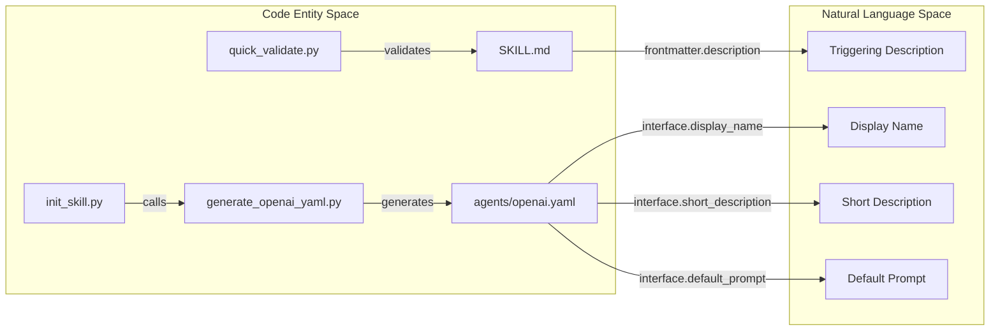
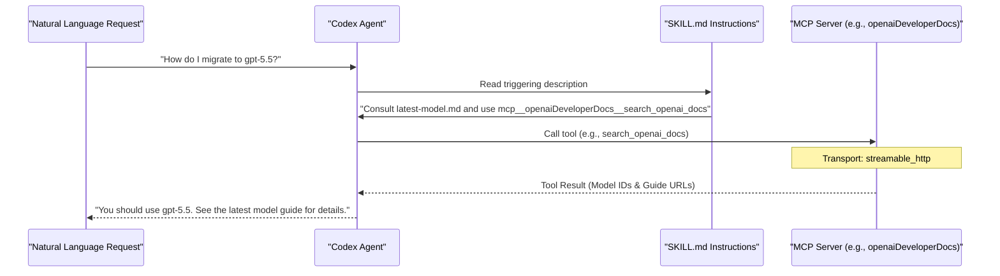

<!-- source: DeepWiki mcp.deepwiki.com · repo openai/skills · page 7 Technical Reference · fetched 2026-10-30 -->

# Technical Reference

<details>
<summary>Relevant source files</summary>

The following files were used as context for generating this wiki page:

- [skills/.curated/openai-docs/references/latest-model.md](skills/.curated/openai-docs/references/latest-model.md)
- [skills/.system/openai-docs/agents/openai.yaml](skills/.system/openai-docs/agents/openai.yaml)
- [skills/.system/openai-docs/references/latest-model.md](skills/.system/openai-docs/references/latest-model.md)
- [skills/.system/skill-creator/SKILL.md](skills/.system/skill-creator/SKILL.md)
- [skills/.system/skill-creator/references/openai_yaml.md](skills/.system/skill-creator/references/openai_yaml.md)
- [skills/.system/skill-creator/scripts/generate_openai_yaml.py](skills/.system/skill-creator/scripts/generate_openai_yaml.py)
- [skills/.system/skill-creator/scripts/init_skill.py](skills/.system/skill-creator/scripts/init_skill.py)
- [skills/.system/skill-creator/scripts/quick_validate.py](skills/.system/skill-creator/scripts/quick_validate.py)

</details>


This document provides detailed technical specifications for skill file formats and configuration systems. It defines the exact structure, validation rules, and generation logic used by the Agent Skills system.

This page covers four core technical specifications:
- **Section 7.1**: `SKILL.md` format and validation rules
- **Section 7.2**: `openai.yaml` interface schema and generation
- **Section 7.3**: MCP server configuration and transport
- **Section 7.4**: OpenAI model landscape and upgrade workflows

For architectural concepts, see page 2. For skill development workflows, see page 4.

## Section 7.1: SKILL.md Format Specification

Every skill requires a `SKILL.md` file containing YAML frontmatter and a markdown body. This section defines the complete format, validation rules, and structural requirements.

### File Structure

```markdown
---
name: skill-name
description: Complete explanation of what the skill does and when to use it
---

# Skill Title

[Markdown body with instructions and guidance]
```

### Frontmatter Pattern

The file must start with YAML frontmatter delimited by `---` markers. The validation logic at [skills/.system/skill-creator/scripts/quick_validate.py:24-29]() extracts frontmatter using this regex:

```python
r"^---\n(.*?)\n---"  # DOTALL mode
```

### Allowed Frontmatter Properties

The `allowed_properties` set at [skills/.system/skill-creator/scripts/quick_validate.py:40]() defines exactly five permitted fields:

```python
allowed_properties = {"name", "description", "license", "allowed-tools", "metadata"}
```

Any properties outside this set cause validation failure.

### Required Fields

| Field | Required | Type | Purpose |
|-------|----------|------|---------|
| `name` | Yes | `str` | Skill identifier in hyphen-case |
| `description` | Yes | `str` | Triggering conditions and functionality |
| `license` | No | `str` | License identifier |
| `allowed-tools` | No | list | Tool allowlist |
| `metadata` | No | dict | Additional metadata |

**Sources:** [skills/.system/skill-creator/scripts/quick_validate.py:40-54]()

### Name Field Validation Rules

| Constraint | Value | Validation Code |
|------------|-------|-----------------|
| **Required** | Yes | [skills/.system/skill-creator/scripts/quick_validate.py:51-52]() |
| **Type** | `str` | [skills/.system/skill-creator/scripts/quick_validate.py:57-58]() |
| **Pattern** | `^[a-z0-9-]+$` | [skills/.system/skill-creator/scripts/quick_validate.py:61]() |
| **Max Length** | 64 characters | Constant `MAX_SKILL_NAME_LENGTH` at [skills/.system/skill-creator/scripts/quick_validate.py:12]() |
| **Hyphen rules** | No leading/trailing/consecutive hyphens | [skills/.system/skill-creator/scripts/quick_validate.py:66]() |

**Sources:** [skills/.system/skill-creator/scripts/quick_validate.py:56-76]()

### Description Field Validation Rules

| Constraint | Value | Validation Code |
|------------|-------|-----------------|
| **Required** | Yes | [skills/.system/skill-creator/scripts/quick_validate.py:53-54]() |
| **Type** | `str` | [skills/.system/skill-creator/scripts/quick_validate.py:79-80]() |
| **Max Length** | 1024 characters | [skills/.system/skill-creator/scripts/quick_validate.py:85]() |
| **Prohibited characters** | `<`, `>` | [skills/.system/skill-creator/scripts/quick_validate.py:83-84]() |

**Sources:** [skills/.system/skill-creator/scripts/quick_validate.py:78-89]()

For complete details on the markdown body and validation logic, see [SKILL.md Format Specification](#7.1).

## Section 7.2: openai.yaml Interface Schema

The `agents/openai.yaml` file provides UI-facing metadata for skill lists and chips. This file is intended for the machine harness rather than the agent itself.

### Interface Schema Fields

| Field | Required | Constraint | Description |
|-------|----------|------------|-------------|
| `display_name` | Yes | String | Human-facing title shown in UI |
| `short_description`| Yes | 25–64 chars | Short UI blurb for quick scanning |
| `default_prompt` | Yes | String | Snippet inserted when invoking skill |
| `icon_small` | No | Path | Relative path to small icon asset |
| `icon_large` | No | Path | Relative path to larger logo asset |
| `brand_color` | No | Hex String | Used for UI accents (e.g., `#3B82F6`) |

**Sources:** [skills/.system/skill-creator/references/openai_yaml.md:25-44](), [skills/.system/skill-creator/scripts/generate_openai_yaml.py:42-49]()

### Generation Logic

The `generate_openai_yaml.py` script automates the creation of this file. It uses specific logic to format names and descriptions:

- **format_display_name**: Converts hyphen-case names to title case, respecting acronyms (GH, MCP, API, CI, CLI, PDF, PR, UI, URL, SQL) and brands (OpenAI, GitHub, PagerDuty, DataDog, SQLite, FastAPI). [skills/.system/skill-creator/scripts/generate_openai_yaml.py:57-73]()
- **generate_short_description**: Deterministically generates a string between 25 and 64 characters, often using "Help with [Name] tasks" patterns. [skills/.system/skill-creator/scripts/generate_openai_yaml.py:76-103]()

For details on schema constraints and tool dependencies, see [openai.yaml Interface Schema](#7.2).

## Section 7.3: MCP Server Configuration

Skills often rely on the Model Context Protocol (MCP) to connect to external services. Configuration for these servers is specified in the `dependencies` section of `openai.yaml`.

### Schema for Dependencies

| Field | Description |
|-------|-------------|
| `type` | Only `mcp` is currently supported. |
| `value` | Identifier of the tool (e.g., `github`, `openaiDeveloperDocs`). |
| `description` | Human-readable explanation of the dependency. |
| `transport` | Connection type (e.g., `streamable_http`). |
| `url` | MCP server endpoint. |

**Sources:** [skills/.system/skill-creator/references/openai_yaml.md:39-44](), [skills/.system/openai-docs/agents/openai.yaml:8-15]()

### Remote Client Feature Flag

Remote MCP servers typically require the `rmcp_client` feature to be enabled in the environment or configuration. For servers using `streamable_http`, the URL must be explicitly provided in the `dependencies` block. [skills/.system/openai-docs/agents/openai.yaml:13-14]()

For details on bearer tokens and HTTP headers, see [MCP Server Configuration](#7.3).

## Section 7.4: OpenAI Model Reference

Skills are designed to leverage the latest OpenAI model capabilities. The `openai-docs` skill provides the primary reference for model selection and upgrade logic.

### Model Landscape

| Category | Primary Model ID |
|----------|------------------|
| **Text/Reasoning** | `gpt-5.5` |
| **Coding** | `gpt-5.3-codex` |
| **Image** | `gpt-image-2` |
| **Audio TTS** | `gpt-4o-mini-tts` |
| **Audio Transcribe** | `gpt-4o-mini-transcribe` |

**Sources:** [skills/.system/openai-docs/references/latest-model.md:7-31](), [skills/.curated/openai-docs/references/latest-model.md:7-32]()

### Upgrade Workflow

The upgrade process is governed by the `openai-docs` skill, which tracks the transition from older models (like `gpt-5.4`) to the current `gpt-5.5` family. It maps specialized tasks to specific endpoints:
- **Text/Reasoning**: `gpt-5.5` or `gpt-5.5-pro` for maximum quality. [skills/.system/openai-docs/references/latest-model.md:9-10]()
- **Agentic Coding**: `gpt-5.3-codex`. [skills/.system/openai-docs/references/latest-model.md:17]()
- **Visuals**: `gpt-image-2`. [skills/.curated/openai-docs/references/latest-model.md:19]()

For the complete model landscape and migration guide, see [OpenAI Model Reference](#7.4).

## Technical Architecture Diagrams

### Skill Metadata Resolution

**Diagram: Bridging Skill Files to UI Entities**



**Sources:** [skills/.system/skill-creator/SKILL.md:71-82](), [skills/.system/skill-creator/scripts/init_skill.py:21](), [skills/.system/skill-creator/scripts/generate_openai_yaml.py:155-186](), [skills/.system/skill-creator/scripts/quick_validate.py:15-21]()

### MCP Integration Flow

**Diagram: Connecting Natural Language Requests to MCP Tools**



**Sources:** [skills/.system/openai-docs/agents/openai.yaml:1-15](), [skills/.system/openai-docs/references/latest-model.md:1-31]()

---

