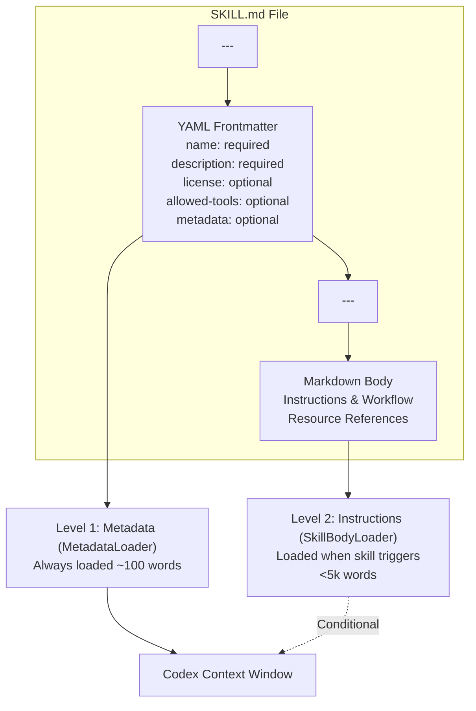
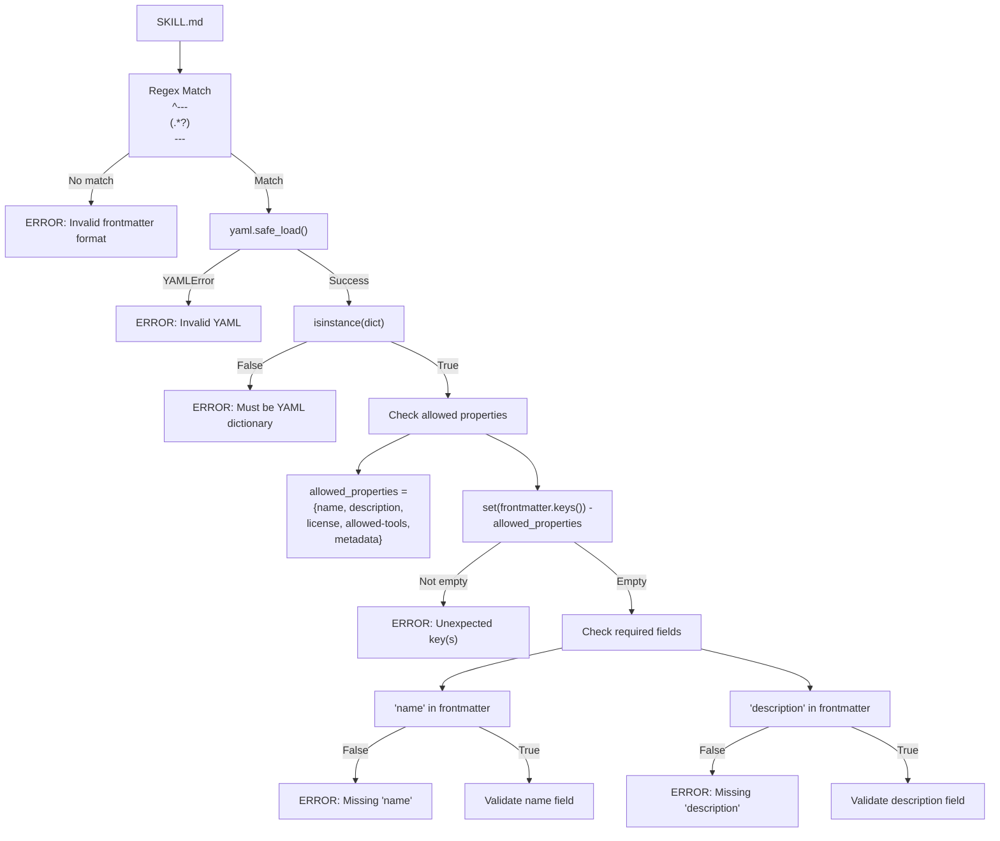
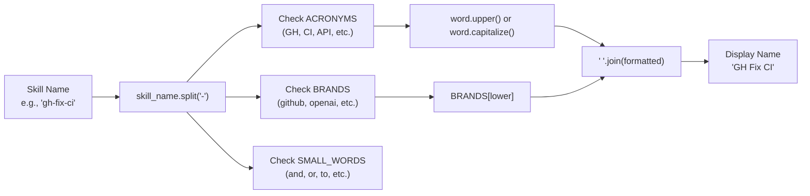
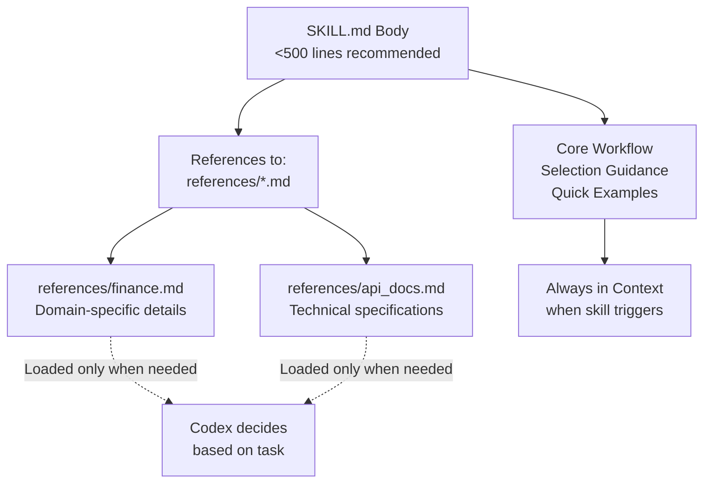

<!-- source: DeepWiki mcp.deepwiki.com · repo openai/skills · page 7.1 SKILL.md Format Specification · fetched 2026-10-30 -->

# SKILL.md Format Specification

<details>
<summary>Relevant source files</summary>

The following files were used as context for generating this wiki page:

- [skills/.system/skill-creator/SKILL.md](skills/.system/skill-creator/SKILL.md)
- [skills/.system/skill-creator/references/openai_yaml.md](skills/.system/skill-creator/references/openai_yaml.md)
- [skills/.system/skill-creator/scripts/generate_openai_yaml.py](skills/.system/skill-creator/scripts/generate_openai_yaml.py)
- [skills/.system/skill-creator/scripts/init_skill.py](skills/.system/skill-creator/scripts/init_skill.py)
- [skills/.system/skill-creator/scripts/quick_validate.py](skills/.system/skill-creator/scripts/quick_validate.py)

</details>


This document defines the complete format specification for `SKILL.md` files, which are the required entry point for every skill in the repository. It covers the YAML frontmatter structure, validation rules, naming conventions, and markdown body guidelines.

For information about the broader skill structure (including `agents/openai.yaml`, `scripts/`, `references/`, and `assets/`), see [Skill Anatomy](#4.3). For details on the `openai.yaml` interface schema, see [openai.yaml Interface Schema](#7.2). For the skill creation process, see [skill-creator](#6.1).

## SKILL.md File Structure

Every `SKILL.md` file consists of two parts: YAML frontmatter enclosed in triple-dash delimiters, followed by markdown content that provides instructions for using the skill.



**SKILL.md Structure Diagram** - Shows the two-part structure and progressive loading strategy.

Sources: [skills/.system/skill-creator/SKILL.md:67-73](), [skills/.system/skill-creator/scripts/quick_validate.py:24-29](), [skills/.system/skill-creator/SKILL.md:129-133]()

## Frontmatter Specification

The frontmatter is a YAML dictionary that must begin and end with `---` on separate lines. It must be valid YAML and conform to specific field requirements.

### Required Fields

| Field | Type | Purpose | Validation |
|-------|------|---------|------------|
| `name` | string | Skill identifier | Hyphen-case, 1-64 chars, lowercase letters/digits/hyphens only |
| `description` | string | Triggering mechanism and usage context | 1-1024 chars, no angle brackets |

### Optional Fields

| Field | Type | Purpose |
|-------|------|---------|
| `license` | string | Licensing information for the skill |
| `allowed-tools` | any | Tool restrictions or permissions |
| `metadata` | object | Additional structured metadata (e.g., `short-description`) |

**Frontmatter Field Reference**

Sources: [skills/.system/skill-creator/scripts/quick_validate.py:40-54](), [skills/.system/skill-creator/SKILL.md:1-6]()

### Frontmatter Validation

The `validate_skill` function in `quick_validate.py` performs a series of checks to ensure compliance with the specification.



**Frontmatter Validation Flow** - Maps to `validate_skill()` function logic in `quick_validate.py`.

Sources: [skills/.system/skill-creator/scripts/quick_validate.py:15-91]()

## Name Field Specification

The `name` field serves as the unique identifier for the skill and determines the skill folder name. It must follow strict formatting rules to ensure consistency and compatibility across the system.

### Format Requirements

The name must match the pattern: `^[a-z0-9-]+$`

**Allowed characters:**
- Lowercase letters: `a-z`
- Digits: `0-9`
- Hyphens: `-`

**Restrictions:**
- Cannot start with a hyphen
- Cannot end with a hyphen
- Cannot contain consecutive hyphens (`--`)
- Maximum length: 64 characters (defined by `MAX_SKILL_NAME_LENGTH` in `quick_validate.py` and `init_skill.py`)

### Name Normalization and Formatting

While `quick_validate.py` enforces constraints, `generate_openai_yaml.py` provides logic for transforming these technical names into human-readable display names via the `format_display_name` function.



**Display Name Formatting Logic** - Logic implemented in `format_display_name` within `generate_openai_yaml.py`.

Sources: [skills/.system/skill-creator/scripts/generate_openai_yaml.py:16-73](), [skills/.system/skill-creator/scripts/quick_validate.py:56-76](), [skills/.system/skill-creator/scripts/init_skill.py:23]()

### Naming Conventions

From the skill creation guidelines:

- Use lowercase letters, digits, and hyphens only.
- Prefer short, verb-led phrases that describe the action.
- Namespace by tool when it improves clarity (e.g., `gh-address-comments`).
- Name the skill folder exactly after the skill name.

Sources: [skills/.system/skill-creator/SKILL.md:53-57](), [skills/.system/skill-creator/scripts/quick_validate.py:61-70]()

## Description Field Specification

The `description` field is the primary triggering mechanism that determines when Codex loads and uses a skill. This field is always loaded into the context window as part of Level 1 metadata.

### Purpose and Content

The description must include:

1. **What the skill does** - Core functionality and capabilities.
2. **When to use it** - Specific triggers, contexts, file types, or scenarios.

**Critical:** All "when to use" information must be in the `description` field, not in the markdown body. The body is only loaded after the skill triggers, so conditional guidance in the body cannot influence triggering decisions.

### Validation Rules

| Rule | Constraint | Error Message |
|------|-----------|---------------|
| Type | Must be a string | "Description must be a string, got {type}" |
| Length | 1-1024 characters | "Description is too long ({len} characters). Maximum is 1024 characters." |
| Characters | No angle brackets | "Description cannot contain angle brackets (< or >)" |

Sources: [skills/.system/skill-creator/scripts/quick_validate.py:78-89](), [skills/.system/skill-creator/SKILL.md:71-72]()

## Markdown Body Specification

The markdown body contains instructions, workflows, and references to bundled resources. This content is only loaded when the skill triggers (Level 2).

### Body Structure Guidelines

The body should use standard markdown and follow imperative form for all instructions.

**Common structural patterns defined in `init_skill.py`:**

| Pattern | Best For | Structure |
|---------|----------|-----------|
| **Workflow-Based** | Sequential processes | Overview → Workflow Decision Tree → Step 1 → Step 2... |
| **Task-Based** | Tool collections | Overview → Quick Start → Task Category 1 → Task Category 2... |
| **Reference/Guidelines** | Standards or specifications | Overview → Guidelines → Specifications → Usage... |
| **Capabilities-Based** | Integrated systems | Overview → Core Capabilities → 1. Feature → 2. Feature... |

Sources: [skills/.system/skill-creator/scripts/init_skill.py:39-60]()

### Progressive Disclosure in Body

The body should keep essential workflow information in `SKILL.md` while moving detailed content to separate files in the `references/` directory.



**Progressive Disclosure Pattern** - Keeps `SKILL.md` lean while making information discoverable.

Sources: [skills/.system/skill-creator/SKILL.md:127-133](), [skills/.system/skill-creator/SKILL.md:95-104]()

### Body Content Rules

**What to include:**
- Essential procedural instructions.
- Core workflow guidance.
- Quick start examples.
- References to `scripts/`, `assets/`, and `references/`.

**What to avoid:**
- Duplication of content in reference files.
- Auxiliary documentation like `README.md`, `INSTALLATION_GUIDE.md`, or `CHANGELOG.md`.
- Verbose explanations where concise examples suffice.

Sources: [skills/.system/skill-creator/SKILL.md:28-35](), [skills/.system/skill-creator/SKILL.md:115-125]()

## Validation and Template Generation

### Running Validation

The `quick_validate.py` script performs automated validation of `SKILL.md` format.

```bash
# Example invocation
python3 scripts/quick_validate.py path/to/skill-folder
```

Sources: [skills/.system/skill-creator/scripts/quick_validate.py:94-101]()

### Template Generation

When creating a new skill with `init_skill.py`, the script generates a `SKILL.md` template with proper frontmatter structure.

```python
# Template defined in init_skill.py
SKILL_TEMPLATE = """---
name: {skill_name}
description: [TODO: Complete and informative explanation of what the skill does and when to use it. Include WHEN to use this skill - specific scenarios, file types, or tasks that trigger it.]
---

# {skill_title}

## Overview
...
"""
```

Sources: [skills/.system/skill-creator/scripts/init_skill.py:26-35]()

## Summary Table

| Component | Required | Format | Max Length | Validation |
|-----------|----------|--------|------------|------------|
| Frontmatter delimiters | Yes | `---` | N/A | Regex match |
| `name` field | Yes | Hyphen-case string | 64 chars | `^[a-z0-9-]+$` |
| `description` field | Yes | Plain string | 1024 chars | No `<` or `>` |
| `license` field | No | String | N/A | YAML valid |
| `metadata` field | No | YAML Object | N/A | YAML valid |
| Markdown body | Yes | Standard markdown | N/A | None |

Sources: [skills/.system/skill-creator/scripts/quick_validate.py:40-89]()

---

