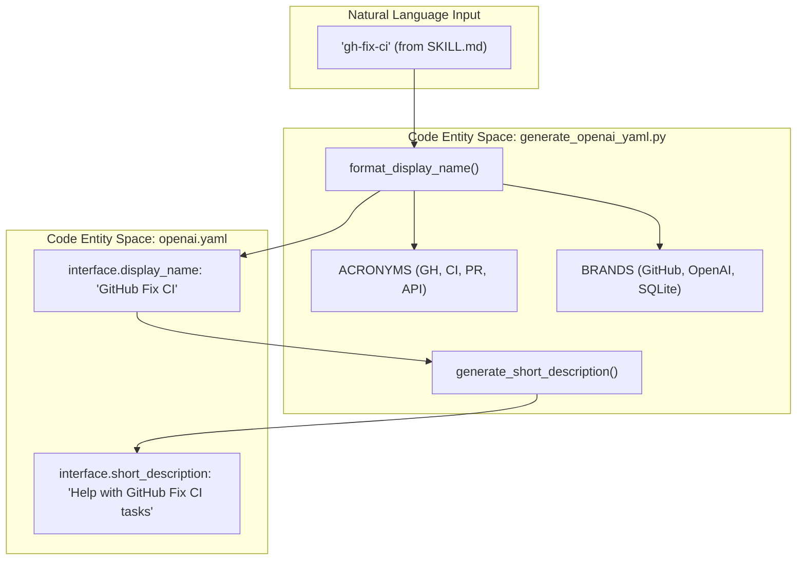
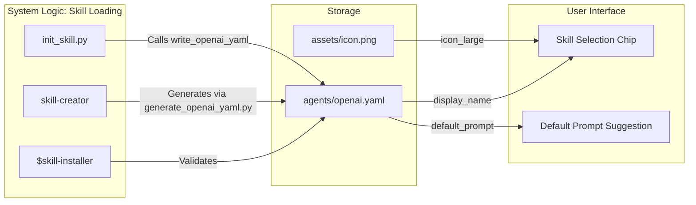

<!-- source: DeepWiki mcp.deepwiki.com · repo openai/skills · page 7.2 openai.yaml Interface Schema · fetched 2026-10-30 -->

# openai.yaml Interface Schema

<details>
<summary>Relevant source files</summary>

The following files were used as context for generating this wiki page:

- [skills/.curated/gh-address-comments/agents/openai.yaml](skills/.curated/gh-address-comments/agents/openai.yaml)
- [skills/.curated/gh-address-comments/assets/github-small.svg](skills/.curated/gh-address-comments/assets/github-small.svg)
- [skills/.curated/gh-address-comments/assets/github.png](skills/.curated/gh-address-comments/assets/github.png)
- [skills/.curated/gh-fix-ci/agents/openai.yaml](skills/.curated/gh-fix-ci/agents/openai.yaml)
- [skills/.curated/yeet/agents/openai.yaml](skills/.curated/yeet/agents/openai.yaml)
- [skills/.curated/yeet/assets/yeet-small.svg](skills/.curated/yeet/assets/yeet-small.svg)
- [skills/.curated/yeet/assets/yeet.png](skills/.curated/yeet/assets/yeet.png)
- [skills/.system/skill-creator/SKILL.md](skills/.system/skill-creator/SKILL.md)
- [skills/.system/skill-creator/agents/openai.yaml](skills/.system/skill-creator/agents/openai.yaml)
- [skills/.system/skill-creator/references/openai_yaml.md](skills/.system/skill-creator/references/openai_yaml.md)
- [skills/.system/skill-creator/scripts/generate_openai_yaml.py](skills/.system/skill-creator/scripts/generate_openai_yaml.py)
- [skills/.system/skill-creator/scripts/init_skill.py](skills/.system/skill-creator/scripts/init_skill.py)
- [skills/.system/skill-creator/scripts/quick_validate.py](skills/.system/skill-creator/scripts/quick_validate.py)
- [skills/.system/skill-installer/agents/openai.yaml](skills/.system/skill-installer/agents/openai.yaml)

</details>


## Purpose and Scope

The `openai.yaml` file defines the user-facing interface metadata for a skill. While `SKILL.md` contains the core instructions for the AI agent, `openai.yaml` (located in the `agents/` directory) provides structured data for the human-facing UI, such as display names, icons, and suggested prompts. It acts as the bridge between the technical skill implementation and the visual representation in the Codex interface. [skills/.system/skill-creator/SKILL.md:74-82]().

For details on the core skill instructions, see [SKILL.md Format Specification](). For automated generation of this file, see [skill-creator]().

## File Location

The `openai.yaml` file is recommended for all skills and must be placed in the `agents/` subdirectory of the skill root. [skills/.system/skill-creator/SKILL.md:59-60]().

```text
<skill-name>/
├── SKILL.md (Required)
├── agents/
│   └── openai.yaml (Recommended interface metadata)
├── scripts/
├── references/
└── assets/ (Contains icons referenced in openai.yaml)
```

Sources: [skills/.system/skill-creator/SKILL.md:59-60](), [skills/.system/skill-creator/references/openai_yaml.md:3]()

## Schema Specification

The schema consists of an `interface` section for UI properties and a `dependencies` section for external tool requirements, such as Model Context Protocol (MCP) servers. [skills/.system/skill-creator/references/openai_yaml.md:8-23]().

### Field Definitions and Constraints

| Field | Description | Constraints |
| :--- | :--- | :--- |
| `display_name` | Human-facing title shown in UI lists and chips. | String. Title Case recommended. [skills/.system/skill-creator/references/openai_yaml.md:33]() |
| `short_description` | Brief UI blurb for quick scanning. | 25–64 characters. [skills/.system/skill-creator/references/openai_yaml.md:34]() |
| `default_prompt` | Suggested initial instruction for the user. | Must mention the skill as `$skill-name`. [skills/.system/skill-creator/references/openai_yaml.md:31]() |
| `icon_small` | Path to a small icon asset (e.g., `.svg`). | Relative to skill dir (usually `./assets/`). [skills/.system/skill-creator/references/openai_yaml.md:35]() |
| `icon_large` | Path to a larger logo asset (e.g., `.png`). | Relative to skill dir (usually `./assets/`). [skills/.system/skill-creator/references/openai_yaml.md:36]() |
| `brand_color` | Hex color used for UI accents (e.g., badges). | Hex string (e.g., `"#3B82F6"`). [skills/.system/skill-creator/references/openai_yaml.md:37]() |
| `dependencies.tools` | List of external tools required. | Currently supports `type: "mcp"`. [skills/.system/skill-creator/references/openai_yaml.md:39]() |

Sources: [skills/.system/skill-creator/references/openai_yaml.md:25-43](), [skills/.system/skill-creator/scripts/generate_openai_yaml.py:42-49]()

### Example Implementation

The following example demonstrates a standard `openai.yaml` for a skill that integrates an MCP server.

```yaml
interface:
  display_name: "OpenAI Docs"
  short_description: "Reference docs, choose models, and migrate OpenAI API integrations"
  icon_small: "./assets/openai-small.svg"
  icon_large: "./assets/openai.png"
  default_prompt: "Use $openai-docs for official docs lookup, model selection, model migration, and prompt-upgrade work."

dependencies:
  tools:
    - type: "mcp"
      value: "openaiDeveloperDocs"
      description: "OpenAI Developer Docs MCP server"
      transport: "streamable_http"
      url: "https://developers.openai.com/mcp"
```

Sources: [skills/.system/skill-creator/references/openai_yaml.md:7-23](), [skills/.system/skill-creator/references/openai_yaml.md:31]()

## Generation Logic

The `generate_openai_yaml.py` script (and `init_skill.py`) automates the creation of this file to ensure consistency across the catalog. [skills/.system/skill-creator/scripts/generate_openai_yaml.py:1-7](), [skills/.system/skill-creator/scripts/init_skill.py:21]().

### Natural Language to Code Entity Mapping

The following diagram illustrates how the `generate_openai_yaml.py` script maps human-readable skill names to the specific interface fields in the YAML schema.



**Diagram: Metadata Generation Flow**
Sources: [skills/.system/skill-creator/scripts/generate_openai_yaml.py:16-38](), [skills/.system/skill-creator/scripts/generate_openai_yaml.py:57-103]()

### Key Functions

1.  **`format_display_name(skill_name)`**: Splits hyphen-case names, capitalizes words, and handles special cases like `ACRONYMS` (e.g., "CI", "MCP") and `BRANDS` (e.g., "GitHub", "OpenAI"). [skills/.system/skill-creator/scripts/generate_openai_yaml.py:57-73]()
2.  **`generate_short_description(display_name)`**: Procedurally generates a summary between 25 and 64 characters. It appends "tasks and workflows" or trims based on length constraints. [skills/.system/skill-creator/scripts/generate_openai_yaml.py:76-103]()
3.  **`write_openai_yaml(skill_dir, skill_name, raw_overrides)`**: The primary entry point that assembles the `interface:` block, validates the `short_description` length, and writes it to the `agents/` directory. [skills/.system/skill-creator/scripts/generate_openai_yaml.py:155-186]()

## UI Rendering and Data Flow

The `openai.yaml` metadata is consumed by the Codex system to render "Skill Chips" and prompt suggestions before the skill instructions in `SKILL.md` are even loaded into the context window. [skills/.system/skill-creator/SKILL.md:129-132]().



**Diagram: Interface Metadata Consumption**
Sources: [skills/.system/skill-creator/SKILL.md:76-82](), [skills/.system/skill-creator/references/openai_yaml.md:33-38](), [skills/.system/skill-creator/scripts/init_skill.py:21]()

## Validation Requirements

The `quick_validate.py` script and the packaging workflow enforce strict rules on the `openai.yaml` content:
- **Quoting**: All string values must be quoted. [skills/.system/skill-creator/references/openai_yaml.md:29]()
- **Length**: `short_description` must be between 25 and 64 characters. [skills/.system/skill-creator/scripts/generate_openai_yaml.py:163-168]()
- **Allowed Keys**: Only specific keys (e.g., `display_name`, `short_description`, `icon_small`, `icon_large`, `brand_color`, `default_prompt`) are permitted in the `interface` block. [skills/.system/skill-creator/scripts/generate_openai_yaml.py:42-49]()
- **No HTML**: Descriptions cannot contain angle brackets (`<` or `>`). [skills/.system/skill-creator/scripts/quick_validate.py:83-84]()

Sources: [skills/.system/skill-creator/scripts/generate_openai_yaml.py:163-168](), [skills/.system/skill-creator/scripts/quick_validate.py:15-91]()

---

