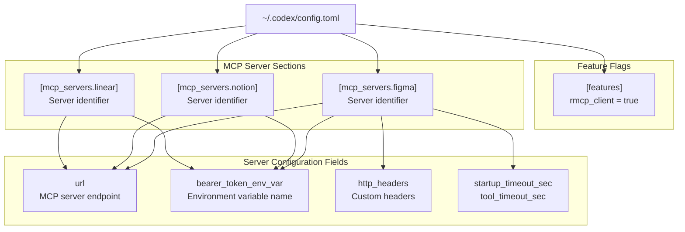
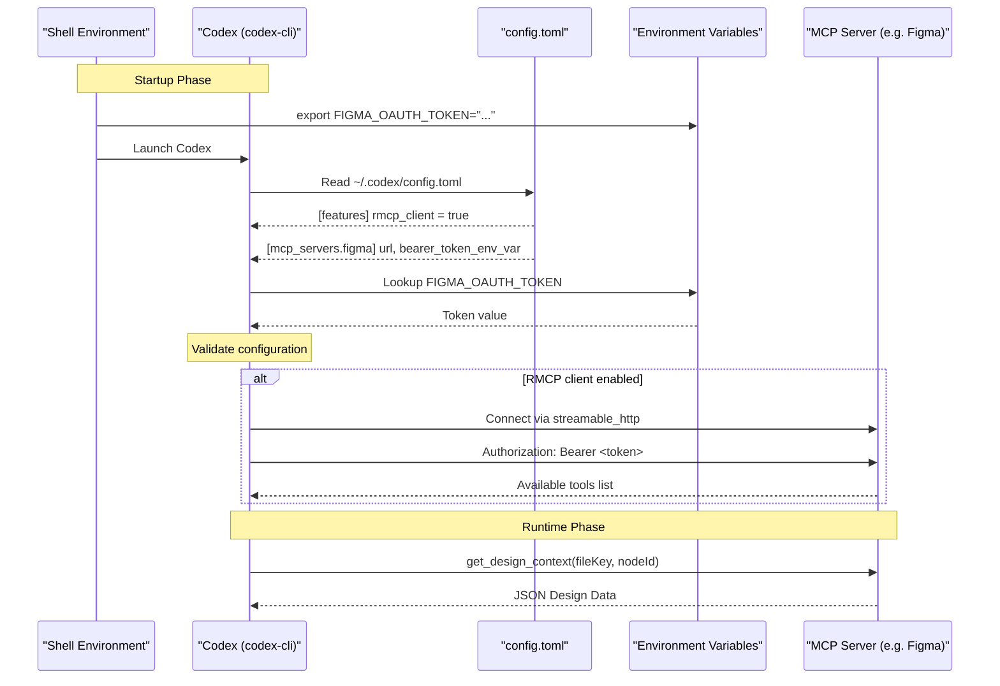

<!-- source: DeepWiki mcp.deepwiki.com · repo openai/skills · page 7.3 MCP Server Configuration · fetched 2026-10-30 -->

# MCP Server Configuration

<details>
<summary>Relevant source files</summary>

The following files were used as context for generating this wiki page:

- [skills/.curated/figma-code-connect-components/SKILL.md](skills/.curated/figma-code-connect-components/SKILL.md)
- [skills/.curated/figma-create-design-system-rules/SKILL.md](skills/.curated/figma-create-design-system-rules/SKILL.md)
- [skills/.curated/figma-implement-design/SKILL.md](skills/.curated/figma-implement-design/SKILL.md)
- [skills/.curated/figma/SKILL.md](skills/.curated/figma/SKILL.md)
- [skills/.curated/figma/agents/openai.yaml](skills/.curated/figma/agents/openai.yaml)
- [skills/.curated/figma/assets/figma-small.svg](skills/.curated/figma/assets/figma-small.svg)
- [skills/.curated/figma/assets/figma.png](skills/.curated/figma/assets/figma.png)
- [skills/.curated/figma/assets/icon.svg](skills/.curated/figma/assets/icon.svg)
- [skills/.curated/figma/references/figma-mcp-config.md](skills/.curated/figma/references/figma-mcp-config.md)
- [skills/.curated/figma/references/figma-tools-and-prompts.md](skills/.curated/figma/references/figma-tools-and-prompts.md)
- [skills/.curated/notion-knowledge-capture/SKILL.md](skills/.curated/notion-knowledge-capture/SKILL.md)
- [skills/.curated/notion-meeting-intelligence/SKILL.md](skills/.curated/notion-meeting-intelligence/SKILL.md)
- [skills/.curated/notion-research-documentation/SKILL.md](skills/.curated/notion-research-documentation/SKILL.md)
- [skills/.curated/notion-spec-to-implementation/SKILL.md](skills/.curated/notion-spec-to-implementation/SKILL.md)

</details>


This document specifies the configuration format for registering MCP (Model Context Protocol) servers in Codex's configuration file. MCP servers provide external tool integrations for skills that connect to services like Figma, Notion, and Linear.

For information about the MCP integration pattern and how skills declare MCP dependencies, see [MCP Integration Pattern](). For specific MCP server implementations and usage workflows, see [Figma MCP Server](), [Notion Integration Skills](), and [Linear Integration]().

## Configuration File Location

MCP servers are registered in the Codex configuration file located at:

```
~/.codex/config.toml
```

This file is read when Codex starts. Changes to MCP server configuration require a Codex restart to take effect [skills/.curated/figma/references/figma-mcp-config.md:25-25]().

**Sources:** [skills/.curated/figma/references/figma-mcp-config.md:3-3](), [skills/.curated/figma/references/figma-mcp-config.md:25-25]()

## MCP Server Section Syntax

Each MCP server is configured using a `[mcp_servers.X]` section, where `X` is the server identifier. This identifier must match the `value` field in skill dependency declarations [skills/.curated/figma/agents/openai.yaml:11-11]().

```toml
[mcp_servers.figma]
url = "https://mcp.figma.com/mcp"
bearer_token_env_var = "FIGMA_OAUTH_TOKEN"
http_headers = { "X-Figma-Region" = "us-east-1" }
```

The server identifier (e.g., `figma`) serves as the lookup key when skills declare MCP tool dependencies with `type: "mcp"` and `value: "figma"` in their `agents/openai.yaml` files [skills/.curated/figma/agents/openai.yaml:10-11]().

**Sources:** [skills/.curated/figma/references/figma-mcp-config.md:5-10](), [skills/.curated/figma/agents/openai.yaml:8-14]()

### MCP Server Configuration Structure

The following diagram illustrates how configuration values in `config.toml` map to the internal system and external MCP endpoints.



**Sources:** [skills/.curated/figma/references/figma-mcp-config.md:5-16](), [skills/.curated/figma/agents/openai.yaml:8-14]()

## Required Fields

### url

The `url` field specifies the HTTPS endpoint for the MCP server [skills/.curated/figma/references/figma-mcp-config.md:7-7]().

```toml
url = "https://mcp.figma.com/mcp"
```

This is the strictly required field for an MCP server configuration. The URL must use the `https://` scheme for remote MCP servers accessed via `streamable_http` transport [skills/.curated/figma/agents/openai.yaml:13-14]().

**Sources:** [skills/.curated/figma/references/figma-mcp-config.md:7-7](), [skills/.curated/figma/agents/openai.yaml:13-14]()

## Authentication Configuration

### bearer_token_env_var

The `bearer_token_env_var` field specifies the name of an environment variable that contains the OAuth bearer token for server authentication [skills/.curated/figma/references/figma-mcp-config.md:8-8]().

```toml
bearer_token_env_var = "FIGMA_OAUTH_TOKEN"
```

The environment variable must be set in the shell environment that launches Codex. The token value is included in the `Authorization: Bearer <token>` header for all requests to the MCP server.

**Sources:** [skills/.curated/figma/references/figma-mcp-config.md:8-8](), [skills/.curated/figma/references/figma-mcp-config.md:13-13]()

### OAuth Login Requirements

For services like Figma and Notion, users can perform an OAuth login via the Codex CLI. This process populates the required environment variables or configuration state.

*   **Figma:** `codex mcp login figma`
*   **Notion:** `codex mcp login notion` [skills/.curated/notion-knowledge-capture/SKILL.md:26-26]()

After a successful login, a restart of the Codex environment is required to recognize the new authentication state [skills/.curated/notion-knowledge-capture/SKILL.md:29-29]().

**Sources:** [skills/.curated/notion-knowledge-capture/SKILL.md:26-29](), [skills/.curated/figma/references/figma-mcp-config.md:25-25]()

### Environment Variable Setup

To configure the bearer token environment variable manually [skills/.curated/figma/references/figma-mcp-config.md:18-21]():

1.  **One-time setup for current shell:** `export FIGMA_OAUTH_TOKEN="<token_value>"`
2.  **Persistent setup:** Add the export statement to your shell profile (e.g., `~/.zshrc` or `~/.bashrc`).
3.  **Verification:** `echo $FIGMA_OAUTH_TOKEN` should print a non-empty token value.

**Sources:** [skills/.curated/figma/references/figma-mcp-config.md:18-21]()

## Optional Configuration Fields

### http_headers

The `http_headers` field specifies custom HTTP headers to include with every request to the MCP server [skills/.curated/figma/references/figma-mcp-config.md:9-9]().

```toml
http_headers = { "X-Figma-Region" = "us-east-1" }
```

This is an inline table mapping header names to values. For example, the `X-Figma-Region` header should align with the user's Figma organization region [skills/.curated/figma/references/figma-mcp-config.md:14-14]().

**Sources:** [skills/.curated/figma/references/figma-mcp-config.md:9-9](), [skills/.curated/figma/references/figma-mcp-config.md:14-14]()

### Timeout Configuration

Two optional timeout fields control server connection behavior [skills/.curated/figma/references/figma-mcp-config.md:16-16]():

| Field | Default | Description |
|-------|---------|-------------|
| `startup_timeout_sec` | 10 | Maximum time to wait for server startup |
| `tool_timeout_sec` | 60 | Maximum time to wait for tool execution |

**Sources:** [skills/.curated/figma/references/figma-mcp-config.md:16-16]()

## Feature Flag Requirements

### rmcp_client

MCP servers using OAuth over `streamable_http` transport require the RMCP (Remote MCP) client feature to be enabled [skills/.curated/figma/references/figma-mcp-config.md:15-15]().

```toml
[features]
rmcp_client = true
```

Alternatively, this can be enabled via the CLI: `codex --enable rmcp_client` [skills/.curated/notion-knowledge-capture/SKILL.md:25-25](). On older builds, the flag may be named `experimental_use_rmcp_client = true` [skills/.curated/figma/references/figma-mcp-config.md:15-15]().

**Sources:** [skills/.curated/figma/references/figma-mcp-config.md:15-15](), [skills/.curated/notion-knowledge-capture/SKILL.md:24-25]()

### Configuration Loading Flow

The following diagram maps the flow from the user's environment to the code-level tool execution.



**Sources:** [skills/.curated/figma/references/figma-mcp-config.md:24-26](), [skills/.curated/figma/agents/openai.yaml:8-14](), [skills/.curated/figma-implement-design/SKILL.md:65-65]()

## Troubleshooting

### Token Not Recognized

**Symptom:** OAuth errors or authentication failures.
**Diagnosis:** Verify `echo $FIGMA_OAUTH_TOKEN` is non-empty in the shell that launches Codex [skills/.curated/figma/references/figma-mcp-config.md:29-29]().
**Solution:** Export the token in the launching shell or add it to the shell profile and restart the shell/IDE [skills/.curated/figma/references/figma-mcp-config.md:29-29]().

### RMCP Client Not Enabled

**Symptom:** MCP servers fail to load or tools are missing.
**Diagnosis:** Check `config.toml` for `[features].rmcp_client = true` [skills/.curated/figma/references/figma-mcp-config.md:30-30]().
**Solution:** Enable the flag and restart Codex [skills/.curated/figma/references/figma-mcp-config.md:30-30]().

**Sources:** [skills/.curated/figma/references/figma-mcp-config.md:29-32]()

---

