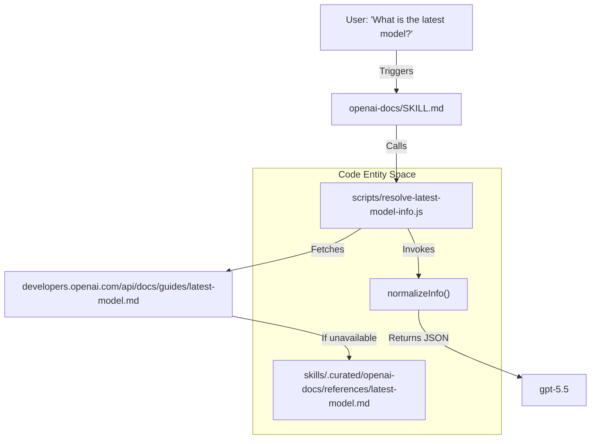
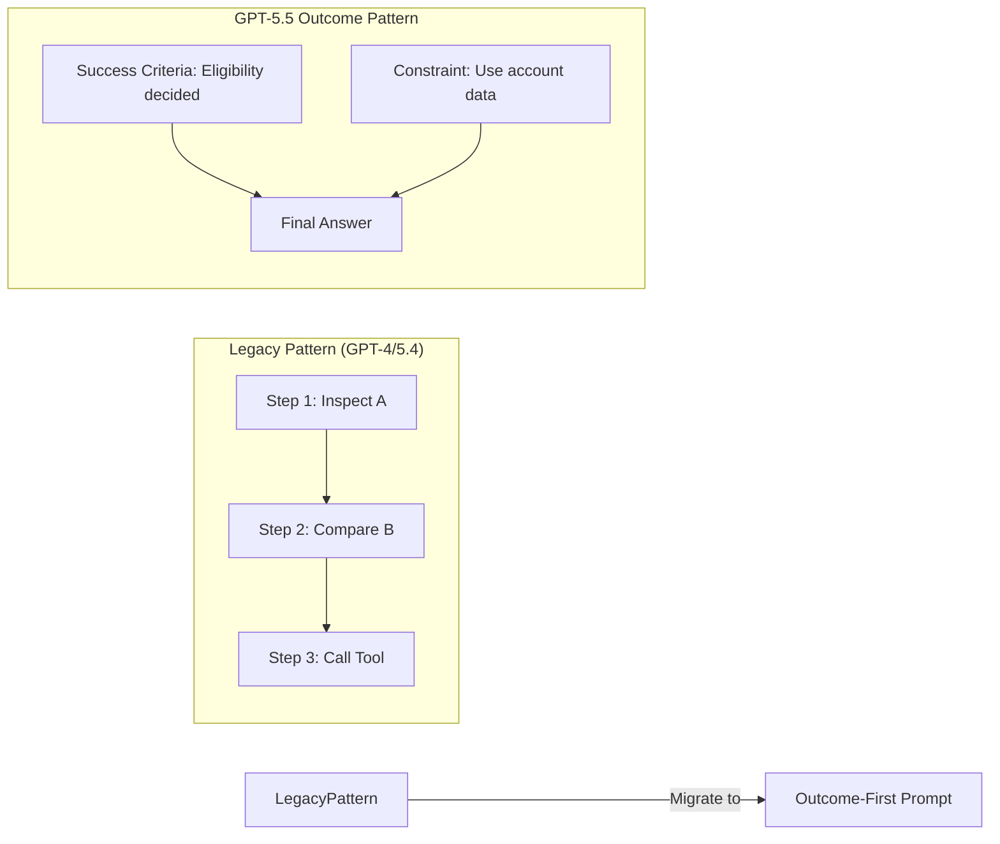

<!-- source: DeepWiki mcp.deepwiki.com · repo openai/skills · page 7.4 OpenAI Model Reference · fetched 2026-10-30 -->

# OpenAI Model Reference

<details>
<summary>Relevant source files</summary>

The following files were used as context for generating this wiki page:

- [skills/.curated/openai-docs/SKILL.md](skills/.curated/openai-docs/SKILL.md)
- [skills/.curated/openai-docs/agents/openai.yaml](skills/.curated/openai-docs/agents/openai.yaml)
- [skills/.curated/openai-docs/references/latest-model.md](skills/.curated/openai-docs/references/latest-model.md)
- [skills/.curated/openai-docs/references/prompting-guide.md](skills/.curated/openai-docs/references/prompting-guide.md)
- [skills/.curated/openai-docs/references/upgrade-guide.md](skills/.curated/openai-docs/references/upgrade-guide.md)
- [skills/.curated/openai-docs/scripts/resolve-latest-model-info.js](skills/.curated/openai-docs/scripts/resolve-latest-model-info.js)
- [skills/.system/openai-docs/SKILL.md](skills/.system/openai-docs/SKILL.md)
- [skills/.system/openai-docs/agents/openai.yaml](skills/.system/openai-docs/agents/openai.yaml)
- [skills/.system/openai-docs/references/latest-model.md](skills/.system/openai-docs/references/latest-model.md)
- [skills/.system/openai-docs/references/prompting-guide.md](skills/.system/openai-docs/references/prompting-guide.md)
- [skills/.system/openai-docs/references/upgrade-guide.md](skills/.system/openai-docs/references/upgrade-guide.md)
- [skills/.system/openai-docs/scripts/resolve-latest-model-info.js](skills/.system/openai-docs/scripts/resolve-latest-model-info.js)

</details>


This page documents the current OpenAI model landscape as utilized by Codex Agent Skills. It serves as a technical reference for selecting the appropriate model IDs for specific modalities (text, coding, audio, image) and outlines the standard upgrade workflow for migrating existing integrations to newer model families like GPT-5.5.

## Current Model Landscape

The `openai-docs` skill maintains a curated model map to guide selection based on task requirements, cost, and latency [skills/.curated/openai-docs/references/latest-model.md:5-32]().

### Text and Reasoning Models
The GPT-5.5 family is the current standard for text and reasoning, offering varying levels of capability and performance.

| Model ID | Use Case | Implementation Note |
| :--- | :--- | :--- |
| `gpt-5.5` | Latest default for text/reasoning | Supports `reasoning.effort: none` for no-reasoning paths [skills/.curated/openai-docs/references/latest-model.md:9-14]() |
| `gpt-5.5-pro` | Maximum reasoning quality | High latency/cost [skills/.curated/openai-docs/references/latest-model.md:10-10]() |
| `gpt-5.4` | Previous default | For existing GPT-5.4 integrations [skills/.curated/openai-docs/references/latest-model.md:11-11]() |
| `gpt-5.4-mini` | Low-cost production | Balanced performance [skills/.curated/openai-docs/references/latest-model.md:12-12]() |
| `gpt-5.4-nano` | High-throughput classification | Simple, fast tasks [skills/.curated/openai-docs/references/latest-model.md:13-13]() |
| `gpt-4.1-mini` | Cost-optimized text | No-reasoning path [skills/.curated/openai-docs/references/latest-model.md:15-15]() |

### Specialized Modality Models
Skills leverage specialized models for coding, visual generation, and audio processing.

| Category | Model ID | Capabilities |
| :--- | :--- | :--- |
| **Coding** | `gpt-5.3-codex` | Agentic coding, editing, tool-heavy workflows [skills/.curated/openai-docs/references/latest-model.md:17-17]() |
| **Coding** | `gpt-5.1-codex-mini` | Cheaper coding workflows [skills/.curated/openai-docs/references/latest-model.md:18-18]() |
| **Image** | `gpt-image-2` | Best generation and edit quality [skills/.curated/openai-docs/references/latest-model.md:19-19]() |
| **Image** | `gpt-image-1.5` | Standard generation/edit quality [skills/.curated/openai-docs/references/latest-model.md:20-20]() |
| **Audio** | `gpt-4o-mini-tts` | Text-to-speech narration [skills/.curated/openai-docs/references/latest-model.md:22-22]() |
| **Audio** | `gpt-4o-mini-transcribe` | Speech-to-text (transcription) [skills/.curated/openai-docs/references/latest-model.md:23-23]() |
| **Realtime** | `gpt-realtime-1.5` | Low-latency multimodal sessions [skills/.curated/openai-docs/references/latest-model.md:24-24]() |

**Sources:** [skills/.curated/openai-docs/references/latest-model.md:7-32](), [skills/.system/openai-docs/references/latest-model.md:7-31]()

---

## Model Selection and Discovery

The `openai-docs` skill provides the mechanism for discovering these models dynamically via the `openaiDeveloperDocs` MCP server.

### Model Discovery Data Flow
The following diagram illustrates how the `openai-docs` skill resolves model information, transitioning from Natural Language requests to the execution of resolution scripts.

**Title: Model Resolution Flow**

**Sources:** [skills/.curated/openai-docs/SKILL.md:16-19](), [skills/.curated/openai-docs/scripts/resolve-latest-model-info.js:6-14](), [skills/.curated/openai-docs/scripts/resolve-latest-model-info.js:111-128]()

---

## Upgrade Workflow

Migrating an integration to a newer model (e.g., GPT-5.5) follows a strict protocol to ensure stability and minimize context drift.

### 1. Freshness Check
Before upgrading, the system must verify if the bundled guides are current.
*   **Action:** Run `node scripts/resolve-latest-model-info.js` [skills/.curated/openai-docs/scripts/resolve-latest-model-info.js:130-142]().
*   **Logic:** If the `modelSlug` returned matches the bundled version (e.g., `gpt-5p5`), proceed with local references. Otherwise, fetch remote `migrationGuideUrl` and `promptingGuideUrl` [skills/.curated/openai-docs/references/upgrade-guide.md:7-12]().

### 2. Upgrade Posture
The workflow prioritizes the "narrowest safe change set" [skills/.curated/openai-docs/references/upgrade-guide.md:16-23]():
*   **Model String First:** Replace the ID (e.g., `gpt-5.4` -> `gpt-5.5`) [skills/.curated/openai-docs/references/upgrade-guide.md:18-18]().
*   **Prompt-Only Upgrades:** Avoid code changes if prompt rewrites suffice [skills/.curated/openai-docs/references/upgrade-guide.md:21-21]().
*   **Scope Protection:** Do not upgrade historical docs, tests, or eval baselines unless explicitly requested [skills/.curated/openai-docs/references/upgrade-guide.md:20-20]().

### 3. Execution Phases
The upgrade is categorized into three classes based on complexity:

| Class | Criteria | Action |
| :--- | :--- | :--- |
| **Model string only** | Source is GPT-5.4; existing prompts are task-bounded. | Replace ID; preserve `reasoning.effort` [skills/.curated/openai-docs/references/upgrade-guide.md:69-84](). |
| **Model string + Light rewrite** | Task needs stronger citation or the model is too verbose. | Replace ID; apply GPT-5.5 prompting patterns [skills/.curated/openai-docs/references/upgrade-guide.md:85-108](). |
| **Blocked** | Requires API-surface changes or tool schema rewiring. | Report blocker; do not edit code [skills/.curated/openai-docs/references/upgrade-guide.md:111-116](). |

**Sources:** [skills/.curated/openai-docs/references/upgrade-guide.md:24-59](), [skills/.curated/openai-docs/references/upgrade-guide.md:69-115]()

---

## GPT-5.5 Prompting Patterns

When upgrading to GPT-5.5, prompts should shift from "process-oriented" to "outcome-oriented" [skills/.curated/openai-docs/references/prompting-guide.md:1-5]().

### Outcome-First Strategy
GPT-5.5 performs best when defined by the destination rather than explicit steps.

**Title: Prompt Logic Transition**


### Key Prompting Adjustments
*   **Preambles:** For tool-heavy tasks, instruct the model to send a short user-visible update before tool execution to improve perceived latency [skills/.curated/openai-docs/references/prompting-guide.md:48-56]().
*   **Stopping Conditions:** Explicitly define when the model should stop (e.g., "Resolve in fewest useful tool loops") [skills/.curated/openai-docs/references/prompting-guide.md:92-98]().
*   **Verbosity Control:** Use `text.verbosity` parameters (low, medium, high) instead of "be concise" instructions [skills/.curated/openai-docs/references/prompting-guide.md:110-112]().

**Sources:** [skills/.curated/openai-docs/references/prompting-guide.md:1-112]()

---

## Implementation Reference

The `openai-docs` skill configuration defines how these models and guides are accessed via the `openai.yaml` interface.

### Interface Definition
```yaml
interface:
  display_name: "OpenAI Docs"
  short_description: "Reference docs, choose models, and migrate OpenAI API integrations"
  default_prompt: "Use OpenAI Docs for official docs lookup, model selection, model migration, and prompt-upgrade work."
dependencies:
  tools:
    - type: "mcp"
      value: "openaiDeveloperDocs"
      transport: "streamable_http"
      url: "https://developers.openai.com/mcp"
```
**Sources:** [skills/.curated/openai-docs/agents/openai.yaml:1-15]()

### Critical Functions
*   **`resolve-latest-model-info.js`**: Parses `latestModelInfo` blocks from markdown (either indented or HTML comments) to provide structured JSON containing `modelSlug`, `migrationGuideUrl`, and `promptingGuideUrl` [skills/.curated/openai-docs/scripts/resolve-latest-model-info.js:83-128]().
*   **`mcp__openaiDeveloperDocs__fetch_openai_doc`**: The primary tool used to retrieve exact sections of official documentation for grounded responses [skills/.curated/openai-docs/SKILL.md:20]().
*   **`modelToSkillSlug`**: Helper in the resolution script that converts model versions (e.g., `5.5`) to filesystem-safe slugs (e.g., `5p5`) [skills/.curated/openai-docs/scripts/resolve-latest-model-info.js:103-105]().

**Sources:** [skills/.curated/openai-docs/SKILL.md:13-17](), [skills/.curated/openai-docs/scripts/resolve-latest-model-info.js:1-148]()

---

