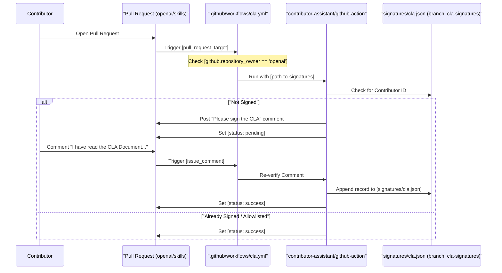
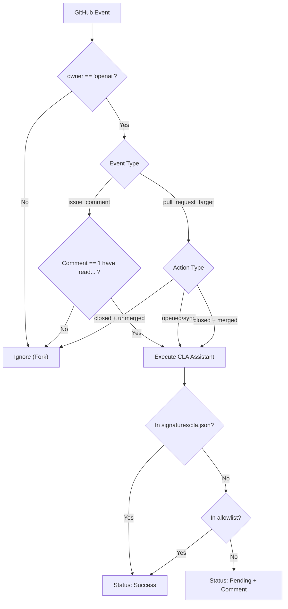

<!-- source: DeepWiki mcp.deepwiki.com · repo openai/skills · page 8.1 Contributor License Agreement · fetched 2026-10-30 -->

# Contributor License Agreement

<details>
<summary>Relevant source files</summary>

The following files were used as context for generating this wiki page:

- [contributing.md](contributing.md)

</details>


This document explains the Contributor License Agreement (CLA) requirement for the `openai/skills` repository, how the automated CLA signing process works, and the technical implementation of the CLA Assistant bot. All contributors must accept the CLA before their pull requests can be merged.

---

## Purpose and Scope

All contributors to the `openai/skills` repository must sign the Individual Contributor License Agreement before their contributions can be accepted. The CLA grants OpenAI, Inc. a perpetual license to use, modify, and distribute contributed code while ensuring contributors have the legal right to make their contributions.

The CLA process is fully automated through a GitHub Actions bot that handles signature collection, verification, and PR status checks without requiring manual intervention by maintainers.

**Sources:** [contributing.md:1-12]()

---

## CLA Requirements

### Legal Terms

The Individual Contributor License Agreement includes standard industry terms to protect both the project and the contributor:

| Section | Scope |
|---------|-------|
| **Copyright License** | Perpetual, worldwide, non-exclusive, royalty-free, irrevocable license to reproduce, prepare derivative works, publicly display, publicly perform, sublicense, and distribute contributions. |
| **Patent License** | Perpetual, worldwide, non-exclusive, royalty-free, irrevocable patent license to make, use, sell, and import contributions (terminates if contributor initiates patent litigation). |
| **Representations** | Contributor is legally entitled to grant licenses; contributions are original work or properly authorized; contributions provided "AS IS" without warranties. |

### Definitions

- **Contribution**: Any original work of authorship submitted to the Project, including code, documentation, and metadata files like `SKILL.md` or `openai.yaml`.
- **Contributor**: The individual or legal entity posting the acceptance comment on a Pull Request.

**Sources:** [contributing.md:1-12]()

---

## Signing Process

### User Workflow

The CLA signing process requires contributors to post a specific comment on their pull request. This lightweight process requires no external forms or email attachments.

#### Initial Signature
Contributors must post the following exact string as a standalone comment:
```text
I have read the CLA Document and I hereby sign the CLA
```

#### Recheck Command
If a contributor has already signed or if the status check needs to be refreshed, they can use:
```text
recheck
```

**Sources:** [contributing.md:1-12]()

### CLA Assistant Workflow

The following diagram illustrates the interaction between the contributor, the GitHub Actions environment, and the signature storage.

**Natural Language to Code Entity: CLA Verification Flow**

**Sources:** [contributing.md:1-12]()

---

## Technical Implementation

### GitHub Actions Configuration

The CLA enforcement is implemented as a GitHub Actions workflow. It is designed to be secure by using `pull_request_target`, which executes in the context of the base repository rather than the fork.

#### Workflow Triggers
The workflow responds to PR lifecycle events and specific comments:
- `pull_request_target`: Triggered when PRs are `opened`, `synchronize`, or `closed`.
- `issue_comment`: Triggered when a comment is `created`.

#### Permissions Model
To function correctly, the workflow requires elevated permissions within the GitHub environment:
- `actions: write`: To manage the workflow execution.
- `contents: write`: To commit the signature JSON to the storage branch.
- `pull-requests: write`: To post the instructional comments for contributors.
- `statuses: write`: To update the "Mergeability" status check on the PR.

**Sources:** [contributing.md:1-12]()

### Logic for PR Locking

The system includes logic to manage the PR state after merging. If a PR is closed and successfully merged, the system ensures the record of the contribution (and the associated CLA acceptance) is preserved.

**Code Entity Space: CLA Logic Gates**

**Sources:** [contributing.md:1-12]()

---

## Community Values and Conduct

In addition to the legal requirements of the CLA, contributors are expected to adhere to the project's community values:
- **Be kind and inclusive**: Respectful treatment of all participants is mandatory, following the [Contributor Covenant](https://www.contributor-covenant.org/) [contributing.md:5-5]().
- **Assume good intent**: Given the challenges of written communication, contributors should err on the side of generosity [contributing.md:6-6]().
- **Teach & learn**: Contributors are encouraged to improve documentation and open issues when something is confusing [contributing.md:7-7]().

### Security Reporting
If a contributor discovers a vulnerability or has concerns regarding model output during development, they should not report it via a public PR or issue. Instead, e-mail **security@openai.com** for a prompt response [contributing.md:11-11]().

**Sources:** [contributing.md:1-12]()

---

## Allowlisted Accounts

Certain automated accounts are exempt from the CLA requirement to prevent blocking critical infrastructure updates:

| Account | Reason |
|---------|--------|
| `codex` | Internal automation for skill management |
| `dependabot[bot]` | Automated dependency security updates |
| `github-actions[bot]` | Internal workflow executions |

**Sources:** [contributing.md:1-12]()

---

## Troubleshooting

### Status Check "Pending"
If the CLA check remains pending after you have commented:
1. Ensure the comment text matches the required string exactly (case-sensitive).
2. Ensure the comment is a new top-level comment, not a reply to another thread.
3. Post `recheck` to force the bot to scan the PR again.

### Workflow Not Triggering
The workflow is configured to only run on the `openai` repository. If you are viewing a PR on your own fork, the CLA check will not appear until the PR is targeted at the `openai/skills` `main` branch.

**Sources:** [contributing.md:1-12]()

---

