# Page: Overview

# Overview

<details>
<summary>Relevant source files</summary>

The following files were used as context for generating this wiki page:

- [.gitignore](.gitignore)
- [README.md](README.md)
- [skills/.system/skill-creator/SKILL.md](skills/.system/skill-creator/SKILL.md)
- [skills/.system/skill-creator/references/openai_yaml.md](skills/.system/skill-creator/references/openai_yaml.md)
- [skills/.system/skill-creator/scripts/generate_openai_yaml.py](skills/.system/skill-creator/scripts/generate_openai_yaml.py)
- [skills/.system/skill-creator/scripts/init_skill.py](skills/.system/skill-creator/scripts/init_skill.py)
- [skills/.system/skill-creator/scripts/quick_validate.py](skills/.system/skill-creator/scripts/quick_validate.py)

</details>


This document provides an introduction to the Agent Skills repository, explaining its purpose as a system for packaging and distributing AI agent capabilities. It covers the high-level architecture, repository organization, and the three-tier skill organization system (`.system`, `.curated`, `.experimental`).

## What are Agent Skills?

Agent Skills are folders of instructions, scripts, and resources that AI agents can discover and use to perform specific tasks [README.md:3-3](). Each skill packages a reusable capability following a "write once, use everywhere" philosophy [README.md:3-3]().

The Codex platform uses skills to package capabilities that teams and individuals can use to complete specific tasks in a repeatable way [README.md:5-5](). Skills provide:

- **Specialized Workflows**: Multi-step procedures for specific domains [skills/.system/skill-creator/SKILL.md:21-21]().
- **Tool Integrations**: Instructions for working with specific APIs or file formats [skills/.system/skill-creator/SKILL.md:22-22]().
- **Bundled Resources**: Executable scripts, reference documentation, and assets (templates/icons) [skills/.system/skill-creator/SKILL.md:61-64]().
- **Standardized Metadata**: YAML frontmatter in `SKILL.md` and UI-facing metadata in `agents/openai.yaml` [skills/.system/skill-creator/SKILL.md:54-60]().

**Sources:** [README.md:1-10](), [skills/.system/skill-creator/SKILL.md:12-25]()

## Repository Structure

The repository is organized around a three-tier skill categorization system and provides meta-tooling for skill management.

### Skill Hierarchy and Code Entities

The following diagram maps the logical organization of the repository to the specific code entities and scripts responsible for managing them.

**Repository Mapping: Natural Language to Code Entity Space**
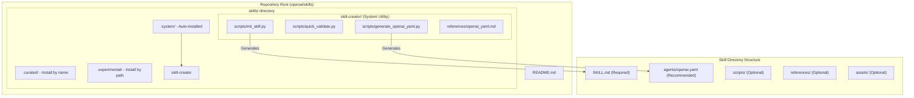

**Sources:** [README.md:12-36](), [skills/.system/skill-creator/SKILL.md:48-65](), [skills/.system/skill-creator/scripts/init_skill.py:1-22]()

## The Three-Tier Skill System

Skills are organized into three categories based on maturity, distribution method, and installation requirements:

| Tier | Directory | Installation Method | Characteristics |
|------|-----------|-------------------|-----------------|
| **System** | `skills/.system/` | Automatic (bundled with Codex) | Core utilities; no user action required to install [README.md:14-14](). |
| **Curated** | `skills/.curated/` | By name: `$skill-installer <name>` | Production-ready skills; vetted and indexed [README.md:18-22](). |
| **Experimental** | `skills/.experimental/` | By path/URL: `$skill-installer <path/url>` | Developmental skills; require explicit path/URL [README.md:24-34](). |

### System Skills (`.system/`)
System skills provide foundational tooling. These are automatically installed in the latest version of Codex [README.md:14-14](). A primary example is `skill-creator`, which contains the logic for initializing new skills [skills/.system/skill-creator/scripts/init_skill.py:1-6]() and validating existing ones [skills/.system/skill-creator/scripts/quick_validate.py:15-15]().

### Curated Skills (`.curated/`)
Curated skills are stable capabilities available in the `skills/.curated` directory. They can be installed simply by providing the skill name to the `$skill-installer` [README.md:18-22]().

### Experimental Skills (`.experimental/`)
Experimental skills allow for rapid iteration. Users can install them by pointing the `$skill-installer` to the `.experimental` folder path or a direct GitHub directory URL [README.md:24-34]().

**Sources:** [README.md:12-36](), [skills/.system/skill-creator/SKILL.md:1-6]()

## Progressive Disclosure Design Principle

Skills are designed to be context-efficient using a three-level loading system [skills/.system/skill-creator/SKILL.md:127-133]():

1.  **Level 1: Metadata**: Only the `name` and `description` from the `SKILL.md` frontmatter are initially loaded into the context window to allow Codex to decide if the skill is relevant [skills/.system/skill-creator/SKILL.md:71-72]().
2.  **Level 2: Skill Body**: The markdown instructions in the body of `SKILL.md` are loaded only after the skill is triggered [skills/.system/skill-creator/SKILL.md:72-72]().
3.  **Level 3: Resources**: Detailed documentation in `references/` or logic in `scripts/` are loaded or executed only as needed, preventing the context window from being overwhelmed [skills/.system/skill-creator/SKILL.md:102-104]().

**Data Flow: Skill Discovery and Loading**
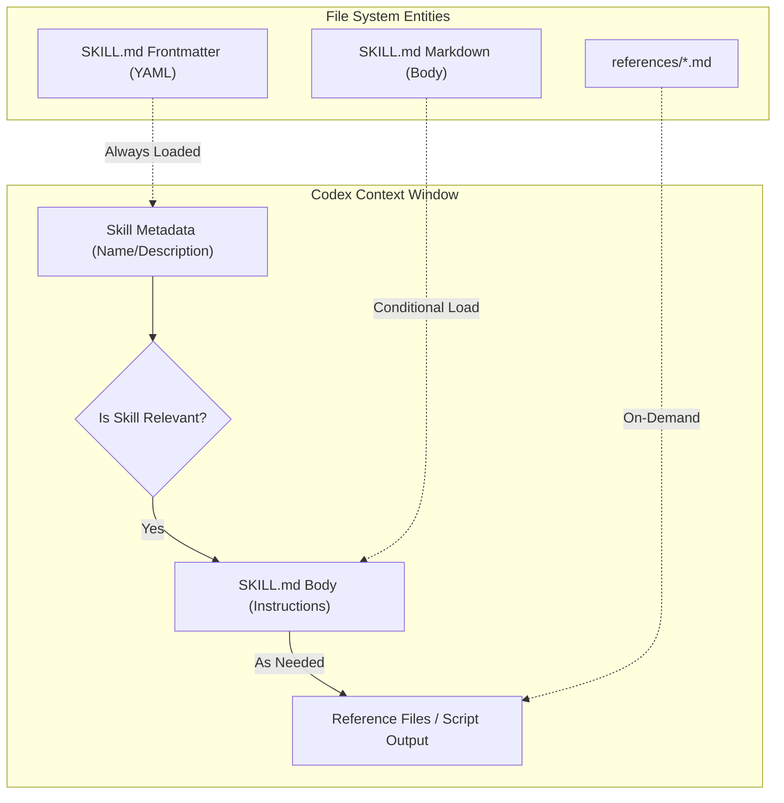

**Sources:** [skills/.system/skill-creator/SKILL.md:28-35](), [skills/.system/skill-creator/SKILL.md:71-73](), [skills/.system/skill-creator/SKILL.md:127-133]()

## Key Implementation Scripts

The repository includes several Python scripts within the `skill-creator` system skill to automate lifecycle tasks:

| Script | Purpose | Key Function |
|--------|---------|--------------|
| `init_skill.py` | Scaffolds a new skill directory with templates [skills/.system/skill-creator/scripts/init_skill.py:3-6](). | `write_openai_yaml` [skills/.system/skill-creator/scripts/init_skill.py:21-21]() |
| `quick_validate.py` | Validates `SKILL.md` format, name length, and YAML keys [skills/.system/skill-creator/scripts/quick_validate.py:15-15](). | `validate_skill` [skills/.system/skill-creator/scripts/quick_validate.py:15-15]() |
| `generate_openai_yaml.py` | Generates UI metadata in `agents/openai.yaml` [skills/.system/skill-creator/scripts/generate_openai_yaml.py:3-4](). | `format_display_name` [skills/.system/skill-creator/scripts/generate_openai_yaml.py:57-57]() |

**Sources:** [skills/.system/skill-creator/scripts/init_skill.py:1-21](), [skills/.system/skill-creator/scripts/quick_validate.py:1-15](), [skills/.system/skill-creator/scripts/generate_openai_yaml.py:1-57]()

## Licensing

The license for individual skills is located within each skill's directory in a `LICENSE.txt` file [README.md:40-40](). This allows individual skills to maintain specific licensing terms while the repository serves as a general catalog.

**Sources:** [README.md:38-41]()

---

# Page: Architecture

# Architecture

<details>
<summary>Relevant source files</summary>

The following files were used as context for generating this wiki page:

- [.gitignore](.gitignore)
- [README.md](README.md)
- [skills/.system/skill-creator/SKILL.md](skills/.system/skill-creator/SKILL.md)
- [skills/.system/skill-creator/references/openai_yaml.md](skills/.system/skill-creator/references/openai_yaml.md)
- [skills/.system/skill-creator/scripts/generate_openai_yaml.py](skills/.system/skill-creator/scripts/generate_openai_yaml.py)
- [skills/.system/skill-creator/scripts/init_skill.py](skills/.system/skill-creator/scripts/init_skill.py)
- [skills/.system/skill-creator/scripts/quick_validate.py](skills/.system/skill-creator/scripts/quick_validate.py)

</details>


## Purpose and Scope

This document explains the architectural design of the Agent Skills system, including the three-tier skill organization (`.system/`, `.curated/`, `.experimental/`), the progressive disclosure loading model, and the complete skill lifecycle from development to runtime execution. The architecture optimizes for context window efficiency while enabling modular capability distribution.

For detailed information on specific subsystems, see:
- Three-tier categorization and installation methods: [Three-Tier Skill System](#2.1)
- Context window optimization strategy: [Progressive Disclosure Model](#2.2)
- Complete skill journey from creation to execution: [Skill Lifecycle](#2.3)
- MCP-based external service connections: [MCP Integration Pattern](#2.4)

## High-Level System Architecture

The Agent Skills repository implements a modular capability distribution system organized into four functional layers: development tooling, distribution repositories, installation utilities, and runtime execution.

**System Architecture: Development to Runtime**

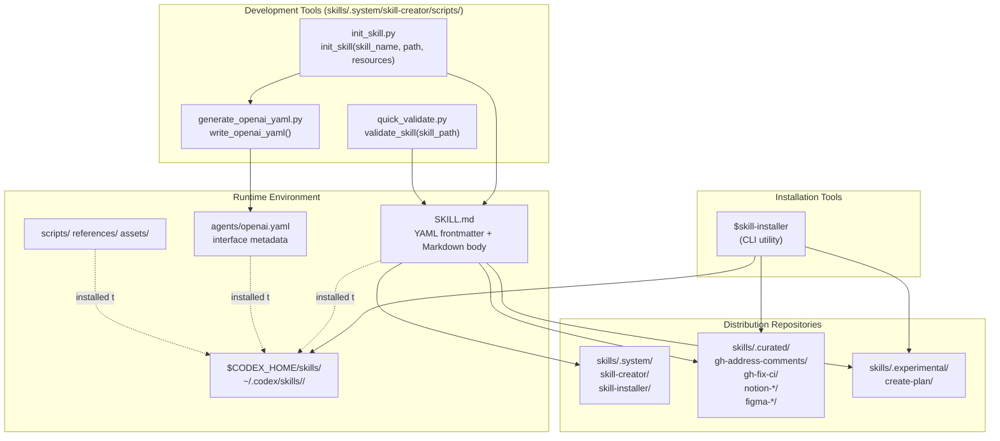

**Directory Structure and Installation Methods**

| Directory Path | Purpose | Installation Command | Auto-Installed |
|---------------|---------|---------------------|----------------|
| `skills/.system/` | Core system skills and development tools | N/A | Yes [README.md:14-14]() |
| `skills/.curated/` | Production-ready, reviewed skills | `$skill-installer <skill-name>` | No [README.md:18-22]() |
| `skills/.experimental/` | Development/testing skills | `$skill-installer install ... --path ...` | No [README.md:24-34]() |

**Sources**: [README.md:12-36](), [skills/.system/skill-creator/SKILL.md:48-64](), [skills/.system/skill-creator/scripts/init_skill.py:1-14]()

## Skill Structure and Format

Every skill is a directory containing a mandatory `SKILL.md` file and optional bundled resources. The structure is validated by the `validate_skill()` function in `quick_validate.py`.

**Skill Directory Structure (skill-name/)**

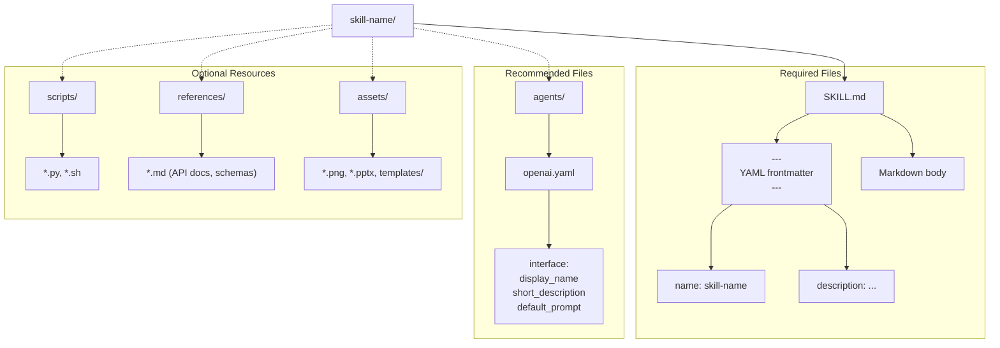

**Frontmatter Validation Rules (validate_skill())**

The `validate_skill()` function at [skills/.system/skill-creator/scripts/quick_validate.py:15-91]() enforces these constraints:

| Field | Validation Rule | Code Reference |
|-------|----------------|----------------|
| `name` | Required, `^[a-z0-9-]+$`, no leading/trailing/consecutive hyphens, ≤64 chars | [skills/.system/skill-creator/scripts/quick_validate.py:51-76]() |
| `description` | Required, no `<>` characters, ≤1024 chars | [skills/.system/skill-creator/scripts/quick_validate.py:53-89]() |
| Allowed properties | `name`, `description`, `license`, `allowed-tools`, `metadata` | [skills/.system/skill-creator/scripts/quick_validate.py:40-49]() |

**Resource Directory Creation (init_skill())**

The `init_skill.py` script creates resource directories based on the `--resources` argument:

| Directory | Creation Flag | Token Impact | Purpose |
|-----------|-----------|-------------|---------|
| `scripts/` | `--resources scripts` | 0 (executed, not loaded to context) | Executable code (Python, Bash, etc.) [skills/.system/skill-creator/SKILL.md:86-93]() |
| `references/` | `--resources references` | Variable (loaded as needed) | Documentation for context injection [skills/.system/skill-creator/SKILL.md:95-104]() |
| `assets/` | `--resources assets` | 0 (used in output, never loaded) | Templates, images, fonts, boilerplate [skills/.system/skill-creator/SKILL.md:106-113]() |

**Sources**: [skills/.system/skill-creator/SKILL.md:48-65](), [skills/.system/skill-creator/scripts/init_skill.py:23-24](), [skills/.system/skill-creator/scripts/quick_validate.py:15-91]()

## Progressive Disclosure Loading Model

The system implements a three-level progressive disclosure model to optimize context window usage. Each level loads progressively more content as needed, minimizing token overhead across dozens of installed skills.

**Three-Level Loading Strategy**

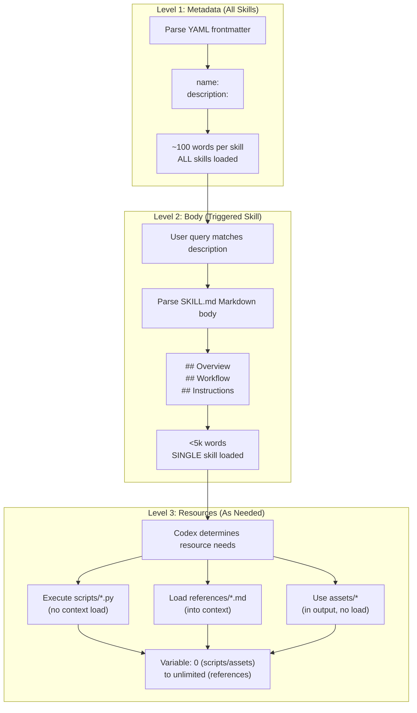

**Level-by-Level Loading Characteristics**

| Level | Content Loaded | Scope | Token Cost | Loading Condition |
|-------|---------------|-------|------------|------------------|
| 1 | `name`, `description` (YAML frontmatter) | All installed skills | ~100 words × N | Codex startup [skills/.system/skill-creator/SKILL.md:131-131]() |
| 2 | Markdown body (below frontmatter) | Single triggered skill | <5k words | Description matches query [skills/.system/skill-creator/SKILL.md:132-132]() |
| 3 | `scripts/`, `references/`, `assets/` | As determined by Codex | 0 (scripts/assets), variable (references) | Workflow execution [skills/.system/skill-creator/SKILL.md:133-133]() |

For details, see [Progressive Disclosure Model](#2.2).

**Sources**: [skills/.system/skill-creator/SKILL.md:127-133](), [skills/.system/skill-creator/scripts/init_skill.py:73-110]()

## Skill Lifecycle

The complete skill lifecycle from creation to runtime execution follows a standardized process involving initialization, validation, and distribution.

**Development and Distribution Pipeline**

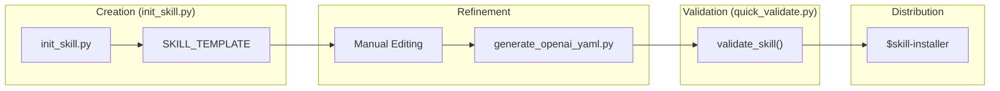

| Phase | Key Tool | Primary Action | Code Reference |
|-------|----------|----------------|----------------|
| **Creation** | `init_skill.py` | Scaffold directory structure and `SKILL.md` | [skills/.system/skill-creator/scripts/init_skill.py:25-111]() |
| **Refinement** | `generate_openai_yaml.py` | Create `agents/openai.yaml` interface metadata | [skills/.system/skill-creator/scripts/generate_openai_yaml.py:155-186]() |
| **Validation** | `quick_validate.py` | Verify frontmatter and naming constraints | [skills/.system/skill-creator/scripts/quick_validate.py:15-91]() |
| **Distribution** | `$skill-installer` | Download and extract to local skills directory | [README.md:12-36]() |

For details, see [Skill Lifecycle](#2.3).

**Sources**: [skills/.system/skill-creator/scripts/init_skill.py:1-111](), [skills/.system/skill-creator/scripts/quick_validate.py:1-102](), [README.md:12-36]()

## MCP Integration Pattern

Skills connect to external services (like Figma, Notion, or Linear) using the Model Context Protocol (MCP). This pattern uses `streamable_http` transport to allow Codex to invoke tools hosted on remote servers.

**MCP Tool Architecture**

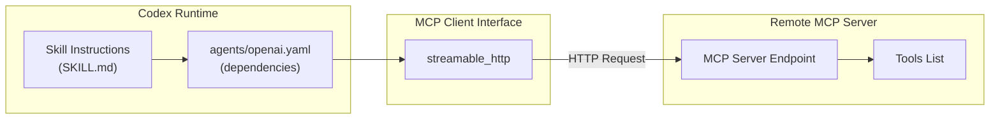

**Key Integration Entities**

| Entity | Role | Code Reference |
|--------|------|----------------|
| `dependencies.tools` | Defines the MCP server type, value, and URL in `openai.yaml` | [skills/.system/skill-creator/references/openai_yaml.md:16-23]() |
| `streamable_http` | The transport protocol used for remote MCP connections | [skills/.system/skill-creator/references/openai_yaml.md:21-21]() |
| `interface.default_prompt` | Snippet mentioning `$skill-name` to trigger usage | [skills/.system/skill-creator/references/openai_yaml.md:31-31]() |

For details, see [MCP Integration Pattern](#2.4).

**Sources**: [skills/.system/skill-creator/references/openai_yaml.md:1-44]()

---

# Page: Three-Tier Skill System

# Three-Tier Skill System

<details>
<summary>Relevant source files</summary>

The following files were used as context for generating this wiki page:

- [.gitignore](.gitignore)
- [README.md](README.md)
- [skills/.system/skill-installer/LICENSE.txt](skills/.system/skill-installer/LICENSE.txt)
- [skills/.system/skill-installer/SKILL.md](skills/.system/skill-installer/SKILL.md)
- [skills/.system/skill-installer/scripts/github_utils.py](skills/.system/skill-installer/scripts/github_utils.py)
- [skills/.system/skill-installer/scripts/install-skill-from-github.py](skills/.system/skill-installer/scripts/install-skill-from-github.py)
- [skills/.system/skill-installer/scripts/list-skills.py](skills/.system/skill-installer/scripts/list-skills.py)

</details>


## Purpose and Scope

This document explains the three-tier organizational structure used to categorize skills based on their maturity, stability, and distribution method. The three tiers—`.system`, `.curated`, and `.experimental`—determine how skills are discovered, installed, and loaded by Codex agents. 

The system is managed primarily by the `skill-installer` utility, which facilitates discovery and installation from the [openai/skills](https://github.com/openai/skills) repository.

**Sources:** [README.md:1-41](), [skills/.system/skill-installer/SKILL.md:1-15]()

## Overview

Skills are organized into three directories within the repository, each representing a different tier of maturity and distribution strategy:

Title: Repository Organization
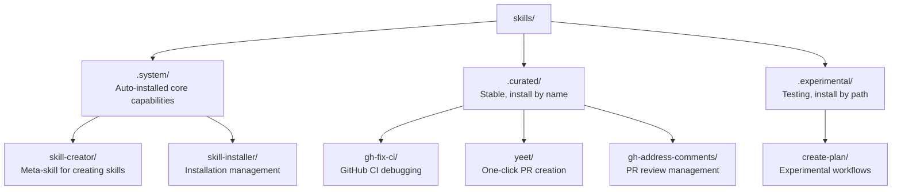

**Sources:** [README.md:14-34](), [skills/.system/skill-installer/SKILL.md:8-15]()

## Tier Characteristics

The following table summarizes the key differences between the three tiers as implemented in the `skill-installer` logic:

| Characteristic | `.system` | `.curated` | `.experimental` |
|---|---|---|---|
| **Installation** | Automatic (Pre-installed) | By name (default) | By path/URL |
| **Discovery** | Hidden from install list | `list-skills.py` (default) | `list-skills.py --path ...` |
| **Stability** | Core Infrastructure | Stable & Reviewed | Active Development |
| **Source Path** | `skills/.system` | `skills/.curated` | `skills/.experimental` |
| **Typical Use** | Essential tools | Production workflows | Testing new patterns |

**Sources:** [README.md:14-36](), [skills/.system/skill-installer/SKILL.md:36-58](), [skills/.system/skill-installer/scripts/list-skills.py:14-16]()

## Tier 1: `.system` (Auto-installed)

### Characteristics

The `.system` tier contains foundational skills that are automatically installed with every Codex instance. These skills provide core capabilities that the platform depends on for proper operation. The `skill-installer` explicitly notes that these are preinstalled and generally do not need manual installation [skills/.system/skill-installer/SKILL.md:56-57]().

**Directory:** `skills/.system/`

**Key Implementation Details:**
- **Pre-installation:** Handled by the Codex environment setup.
- **Home Directory:** Skills are located in `$CODEX_HOME/skills` (defaults to `~/.codex/skills`) [skills/.system/skill-installer/scripts/list-skills.py:34-36]().
- **Overwriting:** If a user insists on installing a system skill, the installer can download and overwrite the existing version [skills/.system/skill-installer/SKILL.md:57-57]().

### Current System Skills

The `.system` directory includes critical utilities for the skill ecosystem itself.

| Skill | Purpose |
|---|---|
| `skill-creator` | Meta-skill for creating and managing other skills. |
| `skill-installer` | Utility for discovering and adding new skills from curated or experimental sources [skills/.system/skill-installer/SKILL.md:2-3](). |
| `imagegen` | System-tier skill for generating and editing images. |
| `openai-docs` | Referencing official OpenAI developer documentation via MCP. |
| `plugin-creator` | Scaffolding Codex plugin directories and marketplace metadata. |

**Sources:** [skills/.system/skill-installer/SKILL.md:1-6](), [README.md:14-15](), [skills/.system/skill-installer/SKILL.md:56-57]()

## Tier 2: `.curated` (Install by Name)

### Characteristics

The `.curated` tier contains stable, reviewed skills. The `skill-installer` defaults to this directory when a user asks to list or install skills without specifying a full path [skills/.system/skill-installer/scripts/list-skills.py:15-15]().

**Directory:** `skills/.curated/`

**Installation method:**
The `list-skills.py` script defaults to `skills/.curated` for its listing [skills/.system/skill-installer/scripts/list-skills.py:15-15]().

```bash
# To install a curated skill by name
$skill-installer gh-address-comments
```

### Installation Logic (Natural Language to Code)

When a user requests a curated skill, the `skill-installer` maps the name to the repository structure:

Title: Installation Data Flow
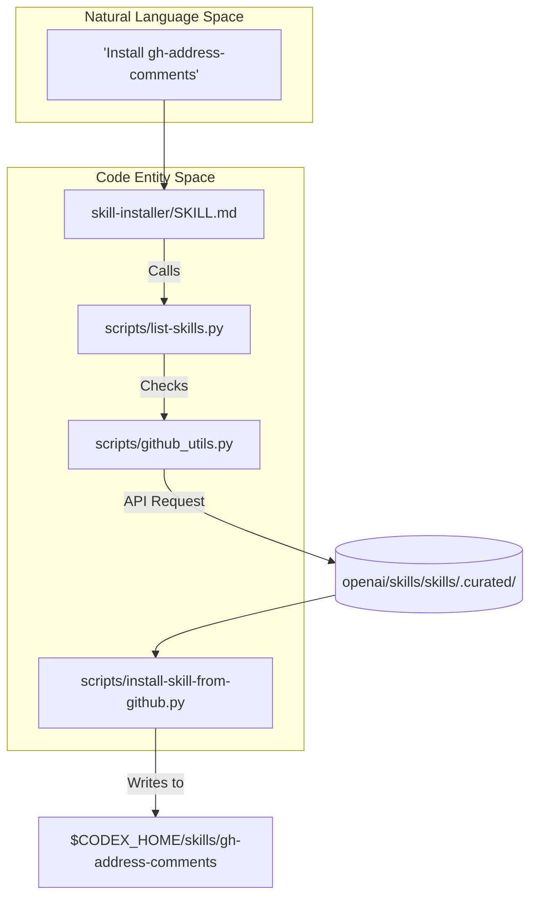

**Sources:** [skills/.system/skill-installer/SKILL.md:36-41](), [skills/.system/skill-installer/scripts/list-skills.py:14-16](), [skills/.system/skill-installer/scripts/install-skill-from-github.py:45-47]()

## Tier 3: `.experimental` (Install by Path)

### Characteristics

The `.experimental` tier contains skills under active development. These require explicit path or URL references, preventing accidental use of unstable features.

**Directory:** `skills/.experimental/`

**Discovery:**
To see experimental skills, the `--path` flag must be used with the listing script:
`scripts/list-skills.py --path skills/.experimental` [skills/.system/skill-installer/SKILL.md:38-38]().

**Installation methods:**
1. **By relative path:** `$skill-installer install ... from the .experimental folder` [README.md:27-28]().
2. **By GitHub URL:** `$skill-installer install https://github.com/openai/skills/tree/main/skills/.experimental/create-plan` [README.md:33-34]().

### Path Resolution and Validation

The `install-skill-from-github.py` script performs strict validation on experimental paths to ensure they contain a valid `SKILL.md` before registration.

Title: Validation and Extraction Logic
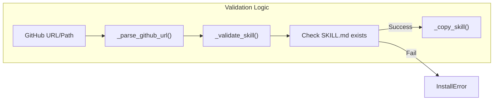

**Sources:** [skills/.system/skill-installer/scripts/install-skill-from-github.py:59-77](), [skills/.system/skill-installer/scripts/install-skill-from-github.py:164-170]()

## Installation Lifecycle

Regardless of the tier, the installation process follows a standard flow:

1.  **Discovery:** Using `scripts/list-skills.py` to identify available skills and check if they are `(already installed)` by scanning `$CODEX_HOME/skills` [skills/.system/skill-installer/scripts/list-skills.py:38-47]().
2.  **Download:** Fetching the skill folder via ZIP download or `git sparse-checkout`. The `_prepare_repo` function handles the logic for choosing the download method, falling back from direct download to git if auth errors occur [skills/.system/skill-installer/scripts/install-skill-from-github.py:187-206](), [skills/.system/skill-installer/SKILL.md:45-46]().
3.  **Persistence:** Copying the contents to the local skill directory using `_copy_skill`. It aborts if the destination already exists [skills/.system/skill-installer/scripts/install-skill-from-github.py:172-176](), [skills/.system/skill-installer/SKILL.md:47-47]().
4.  **Activation:** The user is instructed to **Restart Codex** to pick up the new skills [README.md:36](), [skills/.system/skill-installer/SKILL.md:30-30]().

**Sources:** [README.md:36](), [skills/.system/skill-installer/SKILL.md:10-32](), [skills/.system/skill-installer/scripts/list-skills.py:89-100](), [skills/.system/skill-installer/scripts/install-skill-from-github.py:187-206]()

---

# Page: Progressive Disclosure Model

# Progressive Disclosure Model

<details>
<summary>Relevant source files</summary>

The following files were used as context for generating this wiki page:

- [skills/.system/skill-creator/SKILL.md](skills/.system/skill-creator/SKILL.md)
- [skills/.system/skill-creator/references/openai_yaml.md](skills/.system/skill-creator/references/openai_yaml.md)
- [skills/.system/skill-creator/scripts/generate_openai_yaml.py](skills/.system/skill-creator/scripts/generate_openai_yaml.py)
- [skills/.system/skill-creator/scripts/init_skill.py](skills/.system/skill-creator/scripts/init_skill.py)
- [skills/.system/skill-creator/scripts/quick_validate.py](skills/.system/skill-creator/scripts/quick_validate.py)

</details>


## Overview

The Progressive Disclosure Model is a three-level loading strategy that optimizes context window usage across all installed skills. Instead of loading all skill content into the Codex context window at startup, skills are loaded incrementally based on need: metadata is always present to enable skill selection, instructions are loaded when a skill triggers, and resources are loaded only when the agent determines they're required.

This page details the technical implementation of the three-level loading strategy. For information about how this fits into the complete skill lifecycle, see [Skill Lifecycle](2.3). For detailed file format specifications, see [Skill Anatomy](4.3) and [SKILL.md Format Specification](7.1).

**Sources:** [skills/.system/skill-creator/SKILL.md:127-134]()

## The Three-Level Loading Strategy

Progressive disclosure divides skill content into three levels with different loading behaviors and size constraints:

| Level | Content | Loading Behavior | Size Constraint | Purpose |
|-------|---------|------------------|-----------------|---------|
| **Level 1** | Metadata (`name` + `description`) | Always loaded for all installed skills | ~100 words per skill | Enable skill selection and triggering |
| **Level 2** | `SKILL.md` body (instructions) | Loaded only when skill triggers | <5,000 words | Provide workflow instructions |
| **Level 3** | Bundled resources (`scripts/`, `references/`, `assets/`) | Loaded as needed by agent decision | Unlimited (scripts can execute without reading) | Support execution with code, documentation, and templates |

This design treats the context window as a shared public resource. By keeping Level 1 small and deferring Level 2 and Level 3 loading, the system can support dozens of skills simultaneously without overwhelming the context window.

**Sources:** [skills/.system/skill-creator/SKILL.md:127-134](), [skills/.system/skill-creator/SKILL.md:28-33]()

## Context Window Budget Allocation

The following diagram shows how the progressive disclosure model manages the shared context window across all skills and execution phases.

### Context Window Management Across Loading Levels

```mermaid
graph TD
    subgraph "ContextWindow" ["Codex Context Window (Shared Token Budget)"]
        "SystemPrompt" ["System Prompt"]
        "ConversationHistory" ["Conversation History"]
        "UserRequest" ["Current User Request"]
        "SkillMetadata" ["All Skill Metadata (Level 1)"]
        "TriggeredSkillBody" ["Triggered Skill Body (Level 2)"]
        "LoadedReferences" ["Loaded References (Level 3)"]
    end
    
    subgraph "AllInstalledSkills" ["All Installed Skills (n skills)"]
        "Skill1" ["skill-1/SKILL.md name + description"]
        "Skill2" ["skill-2/SKILL.md name + description"]
        "SkillN" ["skill-n/SKILL.md name + description"]
    end
    
    subgraph "TriggeredSkill" ["Single Triggered Skill"]
        "TriggeredMD" ["triggered-skill/SKILL.md Full markdown body"]
    end
    
    subgraph "BundledResources" ["Bundled Resources (On-Demand)"]
        "ScriptsDir" ["scripts/ Execute without loading"]
        "RefsDir" ["references/ Load when agent decides"]
        "AssetsDir" ["assets/ Use in output, never load"]
    end
    
    "Skill1" -->|"~100 words"| "SkillMetadata"
    "Skill2" -->|"~100 words"| "SkillMetadata"
    "SkillN" -->|"~100 words"| "SkillMetadata"
    
    "TriggeredMD" -->|"<5k words"| "TriggeredSkillBody"
    
    "RefsDir" -.->|"Optional ~1-10k words"| "LoadedReferences"
    "ScriptsDir" -.->|"May read for patching"| "LoadedReferences"
    "AssetsDir" -.->|"Never loaded"| "ContextWindow"
```

**Sources:** [skills/.system/skill-creator/SKILL.md:127-134]()

## Level 1: Metadata (Always Loaded)

Level 1 consists of the YAML frontmatter fields `name` and `description` from every installed skill's `SKILL.md` file. This metadata is always loaded into the context window at the start of any Codex session.

### Content and Structure

The frontmatter is parsed from `SKILL.md`:

```yaml
---
name: skill-name
description: Comprehensive explanation of what the skill does and when to use it
---
```

- **`name`**: Hyphen-case identifier (e.g., `gh-fix-ci`, `notion-meeting-intelligence`).
- **`description`**: The primary triggering mechanism that tells Codex when to activate the skill.

**Sources:** [skills/.system/skill-creator/SKILL.md:68-73](), [skills/.system/skill-creator/scripts/quick_validate.py:51-54]()

### Size Constraints

Each skill's metadata should consume approximately 100 words. This is enforced through validation in `quick_validate.py`:

- **`name`**: Maximum 64 characters [skills/.system/skill-creator/scripts/quick_validate.py:71-76]().
- **`description`**: Maximum 1024 characters [skills/.system/skill-creator/scripts/quick_validate.py:85-89]().

With typical installations of 10-20 skills, Level 1 metadata consumes roughly 1,000-2,000 words (~5-10KB) of the context window.

**Sources:** [skills/.system/skill-creator/scripts/quick_validate.py:12](), [skills/.system/skill-creator/scripts/quick_validate.py:71-89]()

### Purpose: Skill Selection and Triggering

The `description` field is critical because it's the only information Codex reads to determine whether a skill should trigger. The description must include what the skill does and specific scenarios, file types, or tasks that should trigger it.

**Sources:** [skills/.system/skill-creator/SKILL.md:71-72](), [skills/.system/skill-creator/scripts/init_skill.py:26-29]()

## Level 2: SKILL.md Body (Conditional Loading)

Level 2 is the markdown body of `SKILL.md` that follows the YAML frontmatter. This content is loaded into the context window only after a skill has been selected based on its Level 1 metadata.

### Loading Trigger

The `SKILL.md` body is loaded when:

1. Codex evaluates all Level 1 metadata for installed skills.
2. Determines that a specific skill's triggering conditions match the user request.
3. Loads that single skill's body into the context window.

Only one skill's body is typically loaded per request, though multiple skills may trigger if the task requires multiple capabilities.

**Sources:** [skills/.system/skill-creator/SKILL.md:72-73]()

### Content and Size Constraints

The body contains procedural instructions, workflow guidance, and references to bundled resources:

- **Maximum recommended size**: <5,000 words.
- **Content**: Workflow instructions, decision trees, code examples, references to Level 3 resources.
- **Token cost**: Approximately 2-3KB when loaded.

When approaching the 500-line limit, content should be split into separate reference files (Level 3) to keep the `SKILL.md` body lean.

**Sources:** [skills/.system/skill-creator/SKILL.md:130-133](), [skills/.system/skill-creator/SKILL.md:104]()

### Writing Principle: Concise is Key

The documentation emphasizes minimalism for Level 2 content:

> "The context window is a public good. Skills share the context window with everything else Codex needs: system prompt, conversation history, other Skills' metadata, and the actual user request."
>
> "**Default assumption: Codex is already very smart.** Only add context Codex doesn't already have."

**Sources:** [skills/.system/skill-creator/SKILL.md:28-32]()

## Level 3: Bundled Resources (On-Demand Loading)

Level 3 consists of optional resource directories that are loaded or executed only when the agent determines they're needed. These resources have no size limit because scripts can be executed without being read into context.

### Resource Types and Loading Behavior

```mermaid
graph LR
    subgraph "ResourceTypes" ["Level 3 Resource Types"]
        "Scripts" ["scripts/ Python/Bash executables"]
        "References" ["references/ Documentation files"]
        "Assets" ["assets/ Templates and files"]
    end
    
    subgraph "LoadingBehavior" ["Loading Behavior"]
        "ExecuteWithoutLoad" ["Execute without loading Token cost: 0"]
        "LoadIntoContext" ["Load into context Token cost: 1-10KB"]
        "UseInOutput" ["Copy/modify in output Token cost: 0"]
    end
    
    "Scripts" -->|"Primary"| "ExecuteWithoutLoad"
    "Scripts" -.->|"For patching"| "LoadIntoContext"
    "References" --> "LoadIntoContext"
    "Assets" --> "UseInOutput"
```

**Sources:** [skills/.system/skill-creator/SKILL.md:86-114]()

#### `scripts/` Directory

Executable code for deterministic operations:

- **Loading behavior**: Executed without reading into context in most cases.
- **May be read**: When Codex needs to patch or adjust scripts for environment-specific configurations.
- **Examples**: Python scripts, shell scripts, or any executable code for automation.
- **Token efficiency**: High (execution doesn't consume context).

**Sources:** [skills/.system/skill-creator/SKILL.md:86-94](), [skills/.system/skill-creator/scripts/init_skill.py:77-86]()

#### `references/` Directory

Documentation intended to be loaded into context when needed:

- **Loading behavior**: Agent decides when to load based on task requirements.
- **Examples**: Database schemas, API documentation, company policies, detailed workflow guides.
- **Best practice**: For files >10k words, include grep search patterns in `SKILL.md`.
- **Token cost**: Variable (1-10KB when loaded).

**Sources:** [skills/.system/skill-creator/SKILL.md:96-104](), [skills/.system/skill-creator/scripts/init_skill.py:88-97]()

#### `assets/` Directory

Files used in output, not loaded into context:

- **Loading behavior**: Never loaded to context, only used in final output.
- **Examples**: Templates, images, icons, boilerplate code, fonts.
- **Token cost**: Zero (never enters context window).

**Sources:** [skills/.system/skill-creator/SKILL.md:107-113](), [skills/.system/skill-creator/scripts/init_skill.py:98-106]()

## Loading Sequence in Practice

The following diagram shows how the three levels interact during a typical skill invocation.

### Progressive Disclosure Loading Flow

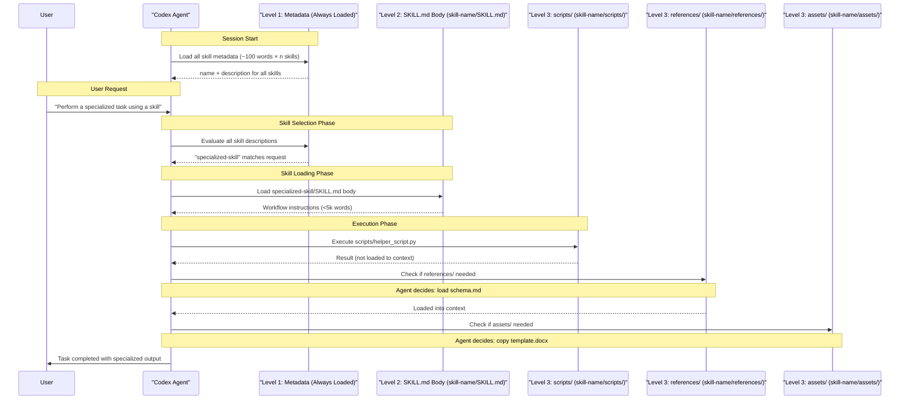

**Sources:** [skills/.system/skill-creator/SKILL.md:127-134]()

## Implementation Details

### Frontmatter Parsing and Validation

The frontmatter is extracted and validated using the logic found in `quick_validate.py`. The system ensures that only specific properties are present in the YAML header.

- **Regex Extraction**: `match = re.match(r"^---\n(.*?)\n---", content, re.DOTALL)` [skills/.system/skill-creator/scripts/quick_validate.py:27-29]()
- **Allowed Properties**: `name`, `description`, `license`, `allowed-tools`, `metadata` [skills/.system/skill-creator/scripts/quick_validate.py:40-49]()
- **Constraints**:
    - **`name`**: Must be hyphen-case and <= 64 characters [skills/.system/skill-creator/scripts/quick_validate.py:61-76]().
    - **`description`**: Must be string and <= 1024 characters [skills/.system/skill-creator/scripts/quick_validate.py:78-89]().

### UI Metadata Generation

While `SKILL.md` drives the agent's logic, `agents/openai.yaml` provides the UI-facing representation. The `generate_openai_yaml.py` script automates this by:
1. Reading the skill name from `SKILL.md` [skills/.system/skill-creator/scripts/generate_openai_yaml.py:106-129]().
2. Formatting a `display_name` (handling acronyms like GH, API, CI via `ACRONYMS`) [skills/.system/skill-creator/scripts/generate_openai_yaml.py:16-28](), [skills/.system/skill-creator/scripts/generate_openai_yaml.py:57-73]().
3. Generating a `short_description` constrained between 25-64 characters [skills/.system/skill-creator/scripts/generate_openai_yaml.py:76-103]().

### Skill Initialization

The `init_skill.py` utility scaffolds the directory structure required for progressive disclosure:
- Creates the `SKILL.md` with required frontmatter [skills/.system/skill-creator/scripts/init_skill.py:26-29]().
- Creates the `agents/openai.yaml` interface via `write_openai_yaml` [skills/.system/skill-creator/scripts/init_skill.py:21](), [skills/.system/skill-creator/scripts/generate_openai_yaml.py:155-186]().
- Optionally creates `scripts/`, `references/`, and `assets/` folders based on the `ALLOWED_RESOURCES` set [skills/.system/skill-creator/scripts/init_skill.py:24](), [skills/.system/skill-creator/scripts/init_skill.py:284-301]().

**Sources:** [skills/.system/skill-creator/scripts/init_skill.py:1-111](), [skills/.system/skill-creator/scripts/quick_validate.py:1-101](), [skills/.system/skill-creator/scripts/generate_openai_yaml.py:1-226]()

---

# Page: Skill Lifecycle

# Skill Lifecycle

<details>
<summary>Relevant source files</summary>

The following files were used as context for generating this wiki page:

- [skills/.system/skill-creator/SKILL.md](skills/.system/skill-creator/SKILL.md)
- [skills/.system/skill-creator/references/openai_yaml.md](skills/.system/skill-creator/references/openai_yaml.md)
- [skills/.system/skill-creator/scripts/generate_openai_yaml.py](skills/.system/skill-creator/scripts/generate_openai_yaml.py)
- [skills/.system/skill-creator/scripts/init_skill.py](skills/.system/skill-creator/scripts/init_skill.py)
- [skills/.system/skill-creator/scripts/quick_validate.py](skills/.system/skill-creator/scripts/quick_validate.py)
- [skills/.system/skill-installer/LICENSE.txt](skills/.system/skill-installer/LICENSE.txt)
- [skills/.system/skill-installer/SKILL.md](skills/.system/skill-installer/SKILL.md)
- [skills/.system/skill-installer/scripts/github_utils.py](skills/.system/skill-installer/scripts/github_utils.py)
- [skills/.system/skill-installer/scripts/install-skill-from-github.py](skills/.system/skill-installer/scripts/install-skill-from-github.py)
- [skills/.system/skill-installer/scripts/list-skills.py](skills/.system/skill-installer/scripts/list-skills.py)

</details>


This page traces the complete lifecycle of a skill from initial creation through distribution, installation, loading, and execution. It provides a technical overview of how skills move through each stage and the key code entities involved at each step.

For detailed information about creating skills, see [Creating Skills](). For installation procedures, see [Installing Skills](). For the progressive disclosure loading strategy, see [Progressive Disclosure Model]().

## Overview

A skill progresses through six distinct lifecycle stages:

| Stage | Key Actions | Primary Tools/Files |
|-------|-------------|---------------------|
| **Development** | Initialize, edit, add resources | `init_skill.py`, `SKILL.md`, resource directories |
| **Validation** | Check format and naming | `quick_validate.py` |
| **Distribution** | Choose tier, publish | `.system/`, `.curated/`, `.experimental/` |
| **Installation** | Install to Codex config | `$skill-installer` utility |
| **Loading** | Load metadata and body | Progressive disclosure (3 levels) |
| **Execution** | Trigger, execute, load resources | Codex agent runtime |

Sources: [skills/.system/skill-creator/SKILL.md:48-65](), [skills/.system/skill-installer/SKILL.md:1-6]()

## Lifecycle Flow Diagram

The following diagram illustrates the transition between Natural Language intent and Code Entity execution.

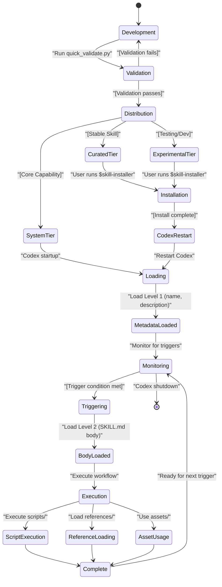

Sources: [skills/.system/skill-creator/SKILL.md:127-145](), [skills/.system/skill-installer/SKILL.md:30-31]()

## Development Phase

The development phase begins when a developer initializes a new skill and ends when the skill is ready for validation. This phase involves creating the skill structure, writing instructions, and adding bundled resources.

### Skill Initialization

Skills are initialized using the `init_skill.py` script, which creates the required directory structure and template files.

**Script Invocation Pattern:**

```bash
init_skill.py <skill-name> --path <path> [--resources scripts,references,assets] [--examples] [--interface key=value]
```

**Key Code Entities:**

| Entity | File Location | Purpose |
|----------|---------------|---------|
| `init_skill.py` | [skills/.system/skill-creator/scripts/init_skill.py:1-14]() | CLI entry point for skill scaffolding |
| `SKILL_TEMPLATE` | [skills/.system/skill-creator/scripts/init_skill.py:26-111]() | Base content for new SKILL.md files |
| `write_openai_yaml` | [skills/.system/skill-creator/scripts/generate_openai_yaml.py:155-186]() | Logic for generating `agents/openai.yaml` |
| `ALLOWED_RESOURCES` | [skills/.system/skill-creator/scripts/init_skill.py:24-24]() | Defines valid subdirectories (`scripts`, `references`, `assets`) |

**Initialization Sequence:**

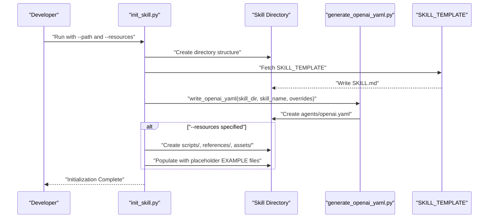

Sources: [skills/.system/skill-creator/scripts/init_skill.py:1-14](), [skills/.system/skill-creator/scripts/init_skill.py:25-111](), [skills/.system/skill-creator/scripts/generate_openai_yaml.py:155-186]()

### SKILL.md Structure Creation

The initialization creates a `SKILL.md` file with required frontmatter and a template body.

**Required Frontmatter Fields:**

| Field | Type | Constraints | Purpose |
|-------|------|-------------|---------|
| `name` | string | Hyphen-case, max 64 chars | Unique identifier for triggering |
| `description` | string | Max 1024 chars | Primary trigger evaluation text |

Sources: [skills/.system/skill-creator/scripts/quick_validate.py:51-91](), [skills/.system/skill-creator/SKILL.md:67-72]()

### UI Metadata Generation

The `generate_openai_yaml.py` script creates the `agents/openai.yaml` file with user-facing metadata used for UI chips and lists.

**Generation Logic:**

*   **`format_display_name`**: Converts hyphen-case names to Title Case, preserving acronyms like "API", "MCP", and "CI" [skills/.system/skill-creator/scripts/generate_openai_yaml.py:57-73]().
*   **`generate_short_description`**: Produces a string between 25-64 characters suitable for UI blurbs [skills/.system/skill-creator/scripts/generate_openai_yaml.py:76-103]().
*   **`write_openai_yaml`**: Orchestrates the writing of the `interface:` block in the YAML file [skills/.system/skill-creator/scripts/generate_openai_yaml.py:155-186]().

Sources: [skills/.system/skill-creator/scripts/generate_openai_yaml.py:57-186](), [skills/.system/skill-creator/references/openai_yaml.md:1-44]()

## Validation Phase

Before distribution, skills are validated using the `quick_validate.py` script to catch structural and formatting issues.

### Validation Checks

The `validate_skill(skill_path)` function performs the following technical checks:

1.  **Existence**: Verifies `SKILL.md` exists [skills/.system/skill-creator/scripts/quick_validate.py:19-21]().
2.  **Frontmatter**: Ensures valid YAML frontmatter between `---` delimiters [skills/.system/skill-creator/scripts/quick_validate.py:24-38]().
3.  **Allowed Keys**: Restricts frontmatter to `name`, `description`, `license`, `allowed-tools`, and `metadata` [skills/.system/skill-creator/scripts/quick_validate.py:40-49]().
4.  **Name Constraints**: Enforces hyphen-case regex `^[a-z0-9-]+$` and a `MAX_SKILL_NAME_LENGTH` of 64 [skills/.system/skill-creator/scripts/quick_validate.py:56-76]().
5.  **Description Constraints**: Enforces a 1024 character limit and forbids angle brackets (`<`, `>`) to prevent injection/formatting issues [skills/.system/skill-creator/scripts/quick_validate.py:78-89]().

Sources: [skills/.system/skill-creator/scripts/quick_validate.py:15-101]()

## Distribution and Installation Phase

Skills are distributed via the repository's tier system and installed into the user's local environment.

### Tiered Distribution

*   **.system**: Preinstalled core skills. No user installation required [skills/.system/skill-installer/SKILL.md:57-57]().
*   **.curated**: Stable skills available for installation by name [skills/.system/skill-installer/SKILL.md:10-10]().
*   **.experimental**: Testing skills available for installation by path or URL [skills/.system/skill-installer/SKILL.md:13-13]().

### Installation Mechanics

The `$skill-installer` utility (implemented via `install-skill-from-github.py`) manages the transfer of skill directories to `$CODEX_HOME/skills` (defaulting to `~/.codex/skills`) [skills/.system/skill-installer/SKILL.md:48-48]().

**Installation Logic Flow:**

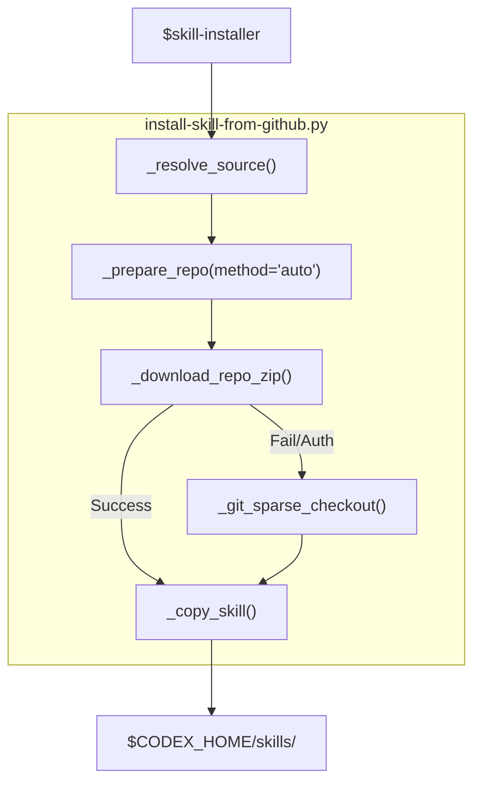

**Key Scripts:**
*   `list-skills.py`: Queries the GitHub API via `github_api_contents_url` to list available skills and checks against `_installed_skills()` locally [skills/.system/skill-installer/scripts/list-skills.py:38-65]().
*   `install-skill-from-github.py`: Handles ZIP downloads (`_download_repo_zip`) or Git sparse checkouts (`_git_sparse_checkout`) for public and private repositories [skills/.system/skill-installer/scripts/install-skill-from-github.py:80-162]().

Sources: [skills/.system/skill-installer/SKILL.md:32-52](), [skills/.system/skill-installer/scripts/list-skills.py:38-65](), [skills/.system/skill-installer/scripts/install-skill-from-github.py:45-178](), [skills/.system/skill-installer/scripts/github_utils.py:20-21]()

## Loading and Execution Phase

Once installed, skills are loaded into the Codex runtime following the **Progressive Disclosure** model.

### Loading Levels

1.  **Level 1 (Metadata)**: The `name` and `description` from `SKILL.md` frontmatter are always in context. This is used by Codex to determine if a skill should trigger [skills/.system/skill-creator/SKILL.md:71-72]().
2.  **Level 2 (Body)**: The Markdown body of `SKILL.md` is loaded only after the skill triggers [skills/.system/skill-creator/SKILL.md:72-72]().
3.  **Level 3 (Resources)**: Supplemental materials are loaded or executed as needed.

### Execution of Resources

During execution, the agent interacts with the `scripts/`, `references/`, and `assets/` directories:

*   **Scripts (`scripts/`)**: Executable code for deterministic reliability. These may be executed without loading their source into the context window [skills/.system/skill-creator/SKILL.md:86-93]().
*   **References (`references/`)**: Documentation loaded into context to inform the process. If files are large, the skill should provide grep search patterns in `SKILL.md` [skills/.system/skill-creator/SKILL.md:96-104]().
*   **Assets (`assets/`)**: Files like templates or icons that are used in the output but never loaded into the context window [skills/.system/skill-creator/SKILL.md:107-113]().

**Post-Installation Requirement**: Users must restart Codex to pick up new skills after installation [skills/.system/skill-installer/SKILL.md:30-30]().

Sources: [skills/.system/skill-creator/SKILL.md:86-113](), [skills/.system/skill-creator/SKILL.md:129-134](), [skills/.system/skill-installer/SKILL.md:30-30]()

---

# Page: MCP Integration Pattern

# MCP Integration Pattern

<details>
<summary>Relevant source files</summary>

The following files were used as context for generating this wiki page:

- [skills/.curated/figma-code-connect-components/SKILL.md](skills/.curated/figma-code-connect-components/SKILL.md)
- [skills/.curated/figma-create-design-system-rules/SKILL.md](skills/.curated/figma-create-design-system-rules/SKILL.md)
- [skills/.curated/figma-implement-design/SKILL.md](skills/.curated/figma-implement-design/SKILL.md)
- [skills/.curated/figma/SKILL.md](skills/.curated/figma/SKILL.md)
- [skills/.curated/figma/agents/openai.yaml](skills/.curated/figma/agents/openai.yaml)
- [skills/.curated/figma/assets/figma-small.svg](skills/.curated/figma/assets/figma-small.svg)
- [skills/.curated/figma/assets/figma.png](skills/.curated/figma/assets/figma.png)
- [skills/.curated/figma/assets/icon.svg](skills/.curated/figma/assets/icon.svg)
- [skills/.curated/figma/references/figma-mcp-config.md](skills/.curated/figma/references/figma-mcp-config.md)
- [skills/.curated/figma/references/figma-tools-and-prompts.md](skills/.curated/figma/references/figma-tools-and-prompts.md)
- [skills/.curated/notion-knowledge-capture/SKILL.md](skills/.curated/notion-knowledge-capture/SKILL.md)
- [skills/.curated/notion-meeting-intelligence/SKILL.md](skills/.curated/notion-meeting-intelligence/SKILL.md)
- [skills/.curated/notion-research-documentation/SKILL.md](skills/.curated/notion-research-documentation/SKILL.md)
- [skills/.curated/notion-spec-to-implementation/SKILL.md](skills/.curated/notion-spec-to-implementation/SKILL.md)

</details>


This document explains the Model Context Protocol (MCP) integration pattern used by skills to connect to external services such as Figma, Notion, and Linear. It covers how skills declare MCP dependencies, configuration requirements in `config.toml`, authentication mechanisms, and runtime behavior.

For details on specific MCP-enabled skills, see [Figma Integration](#5.2), [Notion Integration Skills](#5.3), and [Linear Integration](#5.4). For the overall architecture of skills, see [Architecture](#2).

## What is MCP Integration

MCP (Model Context Protocol) is a standardized protocol that allows Codex to interact with external platforms through remote servers. Skills declare MCP dependencies in their `agents/openai.yaml` file, and users configure the corresponding MCP servers in `config.toml` with authentication credentials. At runtime, Codex establishes authenticated HTTPS connections to these servers using the `streamable_http` transport, enabling skills to invoke platform-specific tools. [skills/.curated/figma/agents/openai.yaml:10-14](), [skills/.curated/figma/references/figma-mcp-config.md:15-16]()

The MCP pattern provides:
- **Standardized tool invocation**: Skills call tools by name (e.g., `get_design_context`, `notion-search`) without managing HTTP details. [skills/.curated/figma/references/figma-tools-and-prompts.md:6-16](), [skills/.curated/notion-spec-to-implementation/SKILL.md:13-17]()
- **OAuth-based authentication**: Servers authenticate via bearer tokens stored in environment variables and mapped in configuration. [skills/.curated/figma/references/figma-mcp-config.md:13-15]()
- **Remote execution**: MCP servers run on external infrastructure provided by the service (e.g., `https://mcp.figma.com/mcp`). [skills/.curated/figma/agents/openai.yaml:14-14]()
- **Declarative dependencies**: Skills explicitly state which MCP servers they require to function. [skills/.curated/figma/agents/openai.yaml:10-14]()

**Sources:**
- [skills/.curated/figma/references/figma-mcp-config.md:1-17]()
- [skills/.curated/figma/agents/openai.yaml:8-15]()
- [skills/.curated/notion-spec-to-implementation/SKILL.md:12-17]()

## Dependency Declaration

Skills declare MCP dependencies in the `dependencies.tools` section of their `agents/openai.yaml` file. Each dependency specifies the MCP server name, transport type, and URL. [skills/.curated/figma/agents/openai.yaml:8-15]()

### openai.yaml Dependency Schema

```yaml
dependencies:
  tools:
    - type: "mcp"
      value: "<server-name>"
      description: "<human-readable description>"
      transport: "streamable_http"
      url: "<mcp-server-url>"
```

**Field Definitions:**

| Field | Required | Description |
|-------|----------|-------------|
| `type` | Yes | Must be `"mcp"`. |
| `value` | Yes | Server identifier matching `[mcp_servers.<value>]` in `config.toml`. |
| `description` | Yes | Human-readable description of the server's purpose. |
| `transport` | Yes | Must be `"streamable_http"` for remote MCP servers. |
| `url` | Yes | HTTPS endpoint of the MCP server. |

### Figma MCP Dependency Example
[skills/.curated/figma/agents/openai.yaml:8-15]()
```yaml
dependencies:
  tools:
    - type: "mcp"
      value: "figma"
      description: "Figma MCP server"
      transport: "streamable_http"
      url: "https://mcp.figma.com/mcp"
```

**Sources:**
- [skills/.curated/figma/agents/openai.yaml:8-15]()

## Configuration Requirements

Users must configure MCP servers in `~/.codex/config.toml` before skills can use them. Each server requires a `[mcp_servers.<name>]` section with the server URL, authentication credentials, and optional headers. [skills/.curated/figma/references/figma-mcp-config.md:1-11]()

### config.toml MCP Server Schema
[skills/.curated/figma/references/figma-mcp-config.md:5-10]()
```toml
[mcp_servers.<server-name>]
url = "<mcp-server-url>"
bearer_token_env_var = "<ENV_VAR_NAME>"
http_headers = { "<header-name>" = "<header-value>" }
```

**Configuration Fields:**

| Field | Required | Description |
|-------|----------|-------------|
| `url` | Yes | HTTPS endpoint matching the skill's dependency declaration. |
| `bearer_token_env_var` | Yes | Environment variable name containing the OAuth bearer token. |
| `http_headers` | No | Additional HTTP headers sent with each request (e.g., `X-Figma-Region`). |

### RMCP Client Feature Flag
MCP integration requires the RMCP (Remote Model Context Protocol) client feature to be enabled in `config.toml`:
[skills/.curated/figma/references/figma-mcp-config.md:15-15]()
```toml
[features]
rmcp_client = true
```

**Sources:**
- [skills/.curated/figma/references/figma-mcp-config.md:1-17]()
- [skills/.curated/notion-spec-to-implementation/SKILL.md:24-25]()

## Authentication Flow

MCP servers authenticate requests using OAuth bearer tokens provided through environment variables. The authentication flow ensures that Codex can securely connect to external platforms. [skills/.curated/figma/references/figma-mcp-config.md:13-15]()

### Authentication Sequence

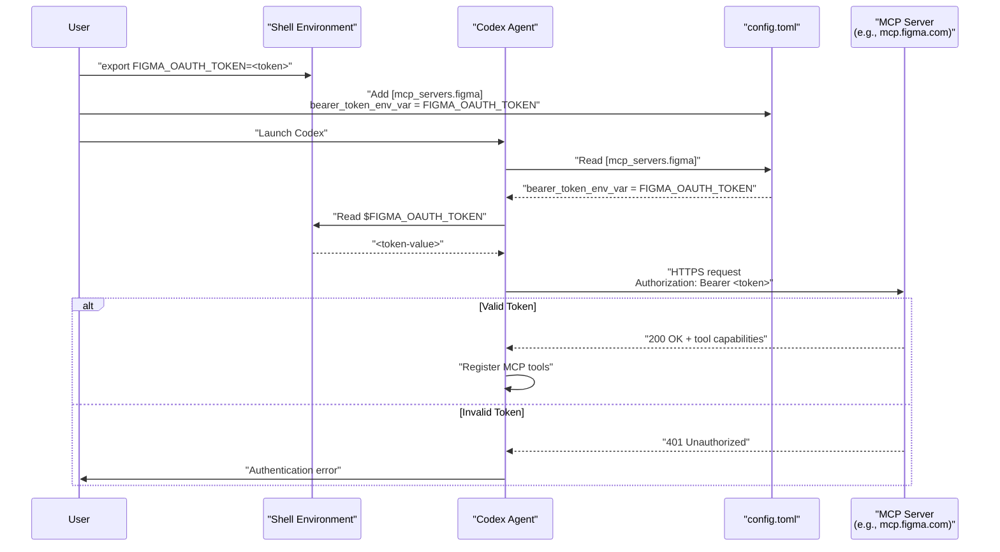

**Sources:**
- [skills/.curated/figma/references/figma-mcp-config.md:13-22]()
- [skills/.curated/figma/references/figma-mcp-config.md:28-32]()

## Runtime Behavior

At runtime, Codex establishes connections to MCP servers and exposes their tools to skills. The connection lifecycle includes server initialization, tool registration, and invocation. [skills/.curated/figma/references/figma-mcp-config.md:23-27]()

### Connection Lifecycle

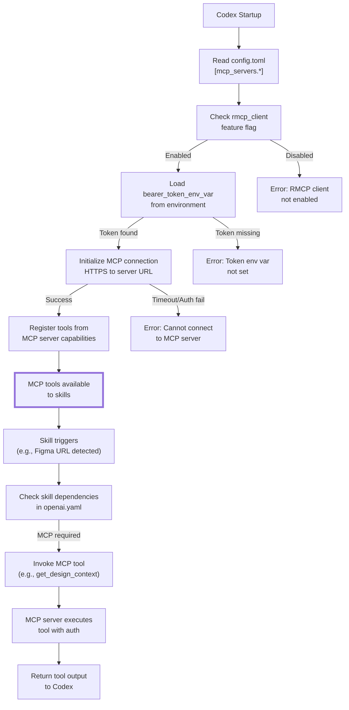

### Best-Practice Execution Flow
For design-to-code tasks, skills follow a specific tool-calling sequence to ensure context accuracy:
1.  `get_design_context`: Fetch structured representation of the node. [skills/.curated/figma-implement-design/SKILL.md:62-68]()
2.  `get_metadata`: Used if the initial context is too large or truncated to map child nodes. [skills/.curated/figma-implement-design/SKILL.md:78-81]()
3.  `get_screenshot`: Capture visual reference for parity validation. [skills/.curated/figma-implement-design/SKILL.md:84-88]()

**Sources:**
- [skills/.curated/figma-implement-design/SKILL.md:29-91]()
- [skills/.curated/figma/references/figma-mcp-config.md:23-27]()

## MCP-Enabled Skills Overview

The following table summarizes curated skills that utilize the MCP integration pattern:

| Skill | MCP Server Name | Default URL | Auth Env Var |
|-------|----------------|-------------|--------------|
| `figma` | `figma` | `https://mcp.figma.com/mcp` | `FIGMA_OAUTH_TOKEN` |
| `notion-knowledge-capture` | `notion` | `https://mcp.notion.com/mcp` | `NOTION_OAUTH_TOKEN` |
| `notion-meeting-intelligence` | `notion` | `https://mcp.notion.com/mcp` | `NOTION_OAUTH_TOKEN` |
| `notion-research-documentation` | `notion` | `https://mcp.notion.com/mcp` | `NOTION_OAUTH_TOKEN` |
| `notion-spec-to-implementation` | `notion` | `https://mcp.notion.com/mcp` | `NOTION_OAUTH_TOKEN` |

**Sources:**
- [skills/.curated/figma/agents/openai.yaml:10-14]()
- [skills/.curated/notion-spec-to-implementation/SKILL.md:22-26]()
- [skills/.curated/notion-meeting-intelligence/SKILL.md:21-26]()

## Troubleshooting MCP Connections

Common issues when configuring or using MCP integration:

### Token and Environment Issues
- **Token not picked up:** Export `FIGMA_OAUTH_TOKEN` (or equivalent) in the same shell that launches Codex, or add it to your shell profile and restart. [skills/.curated/figma/references/figma-mcp-config.md:29-30]()
- **OAuth errors:** Verify `rmcp_client = true` is set in `config.toml` and the bearer token is valid without surrounding quotes. [skills/.curated/figma/references/figma-mcp-config.md:30-31]()

### Connection Failures
- **Restart Requirement:** Codex must be restarted after updating `config.toml` or environment variables for changes to take effect. [skills/.curated/notion-spec-to-implementation/SKILL.md:28-29]()
- **Timeout:** Optional per-server timeouts (`startup_timeout_sec`, `tool_timeout_sec`) can be adjusted inside the `[mcp_servers.X]` block. [skills/.curated/figma/references/figma-mcp-config.md:16-16]()

**Sources:**
- [skills/.curated/figma/references/figma-mcp-config.md:28-32]()
- [skills/.curated/notion-spec-to-implementation/SKILL.md:28-29]()

---

# Page: Getting Started with Skills

# Getting Started with Skills

<details>
<summary>Relevant source files</summary>

The following files were used as context for generating this wiki page:

- [.gitignore](.gitignore)
- [README.md](README.md)
- [skills/.system/skill-installer/LICENSE.txt](skills/.system/skill-installer/LICENSE.txt)
- [skills/.system/skill-installer/SKILL.md](skills/.system/skill-installer/SKILL.md)
- [skills/.system/skill-installer/scripts/github_utils.py](skills/.system/skill-installer/scripts/github_utils.py)
- [skills/.system/skill-installer/scripts/install-skill-from-github.py](skills/.system/skill-installer/scripts/install-skill-from-github.py)
- [skills/.system/skill-installer/scripts/list-skills.py](skills/.system/skill-installer/scripts/list-skills.py)

</details>


This page provides a practical guide for users who want to install and use skills in their Codex environment. It covers the prerequisites, basic workflow, and installation methods needed to get productive with the Agent Skills ecosystem.

For detailed installation instructions and command options, see [Installing Skills](#3.1). For information on how Codex discovers and triggers skills during runtime, see [Using Installed Skills](#3.2). For creating new skills, see [Creating Skills](#4).

---

## Prerequisites

Before installing and using skills, ensure the following requirements are met:

| Requirement | Description | Verification |
|-------------|-------------|--------------|
| **Codex Platform** | Latest version of Codex with skills support | Skills are automatically discoverable in compatible Codex versions |
| **$CODEX_HOME** | Environment variable pointing to Codex home directory | Defaults to `~/.codex/` if not set [skills/.system/skill-installer/scripts/list-skills.py:35]() |
| **$skill-installer** | System skill for installing additional skills | Auto-installed in `.system/` tier with Codex [README.md:14-16]() |
| **Network Access** | Internet connectivity for downloading skills from GitHub | Required for installation scripts [skills/.system/skill-installer/SKILL.md:34]() |

The `.system/` tier skills, including `skill-installer` and `skill-creator`, are automatically installed with Codex and require no manual setup [README.md:14-16](). Skills are installed to the `$CODEX_HOME/skills/` directory [skills/.system/skill-installer/scripts/install-skill-from-github.py:45-46]().

**Sources:** [README.md:14-16](), [skills/.system/skill-installer/scripts/install-skill-from-github.py:45-46](), [skills/.system/skill-installer/SKILL.md:34](), [skills/.system/skill-installer/scripts/list-skills.py:35]()

---

## Understanding Skills Structure

A skill is a directory containing a `SKILL.md` file and optional bundled resources. After installation, skills reside in `$CODEX_HOME/skills/` organized by their directory names.

### Code Entity to Natural Language Mapping
The following diagram bridges the physical file structure (Code Entity Space) to how they are perceived by the user (Natural Language Space).

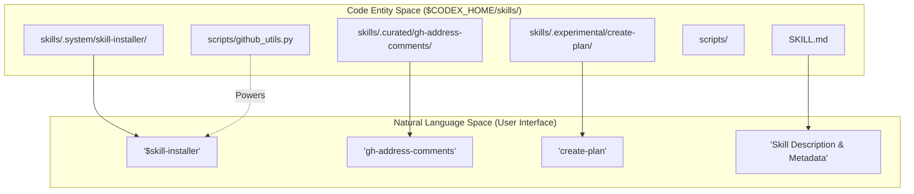

**Skill Directory Layout:**
```
$CODEX_HOME/skills/
├── .system/
│   ├── skill-installer/
│   │   ├── SKILL.md
│   │   └── scripts/
│   │       ├── list-skills.py
│   │       └── install-skill-from-github.py
│   └── skill-creator/
│       ├── SKILL.md
│       └── scripts/
│           ├── init_skill.py
│           └── package_skill.py
├── gh-address-comments/
│   ├── SKILL.md
│   └── scripts/
│       └── fetch_comments.py
└── create-plan/
    └── SKILL.md
```

**Sources:** [README.md:13-35](), [skills/.system/skill-installer/SKILL.md:48](), [skills/.system/skill-installer/scripts/list-skills.py:38-47]()

---

## Quick Start Workflow

The typical workflow for getting started with skills involves three steps:

### Skill Lifecycle Diagram
This diagram shows how system scripts interact with the filesystem to move a skill from a remote repository to a local executable state.

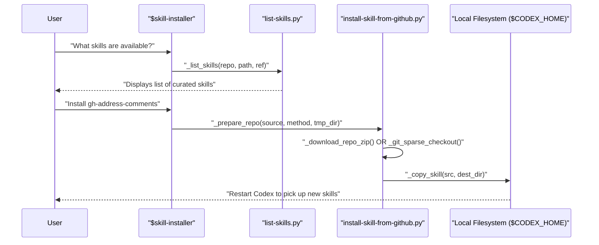

**Sources:** [README.md:11-35](), [skills/.system/skill-installer/SKILL.md:1-57](), [skills/.system/skill-installer/scripts/list-skills.py:50-65](), [skills/.system/skill-installer/scripts/install-skill-from-github.py:187-206]()

---

## Installation Methods Overview

The `$skill-installer` skill supports three installation methods based on the skill's tier and accessibility:

### Installation Method Comparison

| Method | Use Case | Example | Skill Tier |
|--------|----------|---------|------------|
| **By Name** | Installing curated skills | `$skill-installer gh-address-comments` | `.curated/` |
| **By Path** | Installing experimental skills from same repo | `$skill-installer install create-plan from .experimental folder` | `.experimental/` |
| **By URL** | Installing from specific GitHub location | `$skill-installer install https://github.com/openai/skills/tree/main/skills/.experimental/create-plan` | Any tier, any repo |

**Key Implementation Details:**

- **List skills:** `scripts/list-skills.py` queries GitHub via `github_api_contents_url` [skills/.system/skill-installer/scripts/list-skills.py:51]() and marks those already in `$CODEX_HOME/skills` [skills/.system/skill-installer/scripts/list-skills.py:90-99]().
- **Install skill:** `scripts/install-skill-from-github.py` handles the logic, including URL parsing [skills/.system/skill-installer/scripts/install-skill-from-github.py:59-77]().
- **Default behavior:** Public repos use direct ZIP download [skills/.system/skill-installer/scripts/install-skill-from-github.py:190](); if that fails with auth errors (401, 403, 404), it falls back to git sparse checkout [skills/.system/skill-installer/SKILL.md:43-46](), [skills/.system/skill-installer/scripts/install-skill-from-github.py:195-206]().
- **Installation target:** Always `$CODEX_HOME/skills/[skill-name]`, aborting if the destination directory already exists [skills/.system/skill-installer/scripts/install-skill-from-github.py:172-176]().

**Sources:** [README.md:15-33](), [skills/.system/skill-installer/SKILL.md:36-49](), [skills/.system/skill-installer/scripts/list-skills.py:38-47](), [skills/.system/skill-installer/scripts/install-skill-from-github.py:172-176](), [skills/.system/skill-installer/scripts/install-skill-from-github.py:190-206]()

---

## Installation Examples

### Example 1: Installing a Curated Skill
To install the `gh-address-comments` skill by name [README.md:21]():
```
$skill-installer gh-address-comments
```

### Example 2: Installing an Experimental Skill
To install the `create-plan` skill from the `.experimental/` folder [README.md:27-33]():
```
$skill-installer install the create-plan skill from the .experimental folder
```

### Example 3: Listing Available Skills
To see all available curated skills and their installation status [skills/.system/skill-installer/SKILL.md:13]():
```
$skill-installer
```

**Sources:** [README.md:21-33](), [skills/.system/skill-installer/SKILL.md:13]()

---

## After Installation

### Activating Installed Skills
Skills are not immediately available after installation. Codex must be restarted to discover and load new skills [README.md:36]().

1. **Exit Codex** completely.
2. **Restart Codex** to trigger skill discovery.
3. **Verify activation** by checking that queries matching the skill's description trigger the skill.

**Sources:** [README.md:36](), [skills/.system/skill-installer/SKILL.md:30]()

---

## Command Reference

### skill-installer Scripts

The `$skill-installer` skill provides access to two primary scripts [skills/.system/skill-installer/SKILL.md:32-42]():

| Script | Purpose | Key Parameters |
|--------|---------|----------------|
| `list-skills.py` | List installable skills with status | `--path`, `--format json` |
| `install-skill-from-github.py` | Install skills from GitHub | `--repo`, `--path`, `--url`, `--ref`, `--method` |

**Sources:** [skills/.system/skill-installer/SKILL.md:32-42]()

---

## Next Steps

- **To install specific skills:** See detailed installation instructions in [Installing Skills](#3.1)
- **To use installed skills:** Learn about skill triggering and execution in [Using Installed Skills](#3.2)
- **To create your own skills:** Follow the comprehensive guide in [Creating Skills](#4)
- **To explore available skills:** Browse the curated skills catalog in [Curated Skills Reference](#5)

**Sources:** [README.md:1-40]()

---

# Page: Installing Skills

# Installing Skills

<details>
<summary>Relevant source files</summary>

The following files were used as context for generating this wiki page:

- [.gitignore](.gitignore)
- [README.md](README.md)
- [skills/.system/skill-installer/LICENSE.txt](skills/.system/skill-installer/LICENSE.txt)
- [skills/.system/skill-installer/SKILL.md](skills/.system/skill-installer/SKILL.md)
- [skills/.system/skill-installer/scripts/github_utils.py](skills/.system/skill-installer/scripts/github_utils.py)
- [skills/.system/skill-installer/scripts/install-skill-from-github.py](skills/.system/skill-installer/scripts/install-skill-from-github.py)
- [skills/.system/skill-installer/scripts/list-skills.py](skills/.system/skill-installer/scripts/list-skills.py)

</details>


This page provides detailed instructions for installing skills into your Codex environment using the `skill-installer` system skill. It covers the primary installation methods: by skill name (for curated skills), by path (for experimental skills), and by URL (for any GitHub-hosted skill).

**Sources**: [skills/.system/skill-installer/SKILL.md:1-15]()

---

## Prerequisites

Before installing skills, ensure you have:

| Requirement | Description | How to Verify |
|------------|-------------|---------------|
| **Codex Installation** | Skills are loaded by the Codex platform | Check that `$CODEX_HOME` environment variable is set |
| **System Skills** | `skill-installer` is auto-installed in `.system/` | The `skill-installer` command should be available in Codex |
| **Network Access** | Installation scripts fetch skills from GitHub | Scripts require network permissions (sandbox escalation is needed) |
| **Git (Optional)** | Required for private repositories or fallback method | Run `git --version` to verify installation |

### Authentication for Private Repositories

If you need to install skills from private repositories, configure authentication:

- **GitHub Token**: Set `GITHUB_TOKEN` or `GH_TOKEN` environment variables. [skills/.system/skill-installer/scripts/github_utils.py:12-14]()
- **Git Credentials**: Configure git credentials for sparse checkout fallback (HTTPS or SSH). [skills/.system/skill-installer/SKILL.md:55-56]()

**Sources**: [skills/.system/skill-installer/SKILL.md:34-34](), [skills/.system/skill-installer/SKILL.md:52-56](), [skills/.system/skill-installer/scripts/github_utils.py:10-17]()

---

## Installation Location

All skills are installed to the skills directory in your Codex home:

```
$CODEX_HOME/skills/
└── <skill-name>/
    ├── SKILL.md
    ├── scripts/
    ├── references/
    └── assets/
```

Default location: `~/.codex/skills/`. [skills/.system/skill-installer/SKILL.md:48]()

**Important**: Installation aborts if a skill directory already exists at the destination. To reinstall, remove the existing directory first. [skills/.system/skill-installer/SKILL.md:47]()

**Sources**: [skills/.system/skill-installer/SKILL.md:46-48](), [skills/.system/skill-installer/scripts/list-skills.py:34-47]()

---

## Installation Methods

### Method 1: Installing Curated Skills by Name

**Installation Method Flow - Curated Skills**

```mermaid
graph TB
    User["User in Codex"]
    Command["$skill-installer gh-address-comments"]
    SkillInstaller["skill-installer/SKILL.md"]
    ListScript["scripts/list-skills.py"]
    InstallScript["scripts/install-skill-from-github.py"]
    GitHubAPI["GitHub API<br/>api.github.com/repos/openai/skills"]
    CuratedDir["skills/.curated/ directory"]
    DestDir["$CODEX_HOME/skills/gh-address-comments/"]
    
    User -->|"invokes"| Command
    Command -->|"triggers"| SkillInstaller
    SkillInstaller -->|"executes"| ListScript
    SkillInstaller -->|"executes"| InstallScript
    
    ListScript -->|"fetches catalog"| GitHubAPI
    GitHubAPI -->|"returns list"| CuratedDir
    
    InstallScript -->|"resolves name to path:<br/>--repo openai/skills<br/>--path skills/.curated/gh-address-comments"| GitHubAPI
    GitHubAPI -->|"downloads skill files"| DestDir
```

**Usage**:

Curated skills from `skills/.curated/` can be installed by name alone. The `skill-installer` uses `scripts/list-skills.py` to identify available curated skills. [skills/.system/skill-installer/SKILL.md:13-14]()

```
$skill-installer gh-address-comments
```

This command:
1. Resolves the skill name to the path `skills/.curated/gh-address-comments`.
2. Invokes `scripts/install-skill-from-github.py` with parameters:
   - `--repo openai/skills`
   - `--path skills/.curated/gh-address-comments`
   - `--ref main` (default). [skills/.system/skill-installer/SKILL.md:39-41]()

**Sources**: [skills/.system/skill-installer/SKILL.md:10-15](), [skills/.system/skill-installer/SKILL.md:36-41](), [skills/.system/skill-installer/scripts/list-skills.py:14-15]()

---

### Method 2: Installing Experimental Skills by Path

**Installation Method Flow - Experimental Skills**

```mermaid
graph TB
    User["User in Codex"]
    Command["$skill-installer install the create-plan skill<br/>from the .experimental folder"]
    SkillInstaller["skill-installer/SKILL.md"]
    InstallScript["scripts/install-skill-from-github.py"]
    
    User -->|"natural language request"| Command
    Command -->|"triggers"| SkillInstaller
    SkillInstaller -->|"parses to:<br/>--repo openai/skills<br/>--path skills/.experimental/create-plan"| InstallScript
    
    InstallScript -->|"GitHub API call"| GitHubAPI["GitHub API"]
    GitHubAPI -->|"fetch skill files"| ExperimentalDir["skills/.experimental/create-plan"]
    ExperimentalDir -->|"install to"| DestDir["$CODEX_HOME/skills/create-plan/"]
```

**Usage**:

Experimental skills require specifying the folder path or providing the skill name when the context is set to experimental. [skills/.system/skill-installer/SKILL.md:13](), [skills/.system/skill-installer/SKILL.md:38]()

```
$skill-installer install the create-plan skill from the .experimental folder
```

The `skill-installer` translates this to:
```bash
scripts/install-skill-from-github.py \
  --repo openai/skills \
  --path skills/.experimental/create-plan
```

**Sources**: [skills/.system/skill-installer/SKILL.md:13](), [skills/.system/skill-installer/SKILL.md:38](), [skills/.system/skill-installer/SKILL.md:41]()

---

### Method 3: Installing Skills by URL

**Installation Method Flow - URL-Based**

```mermaid
graph LR
    User["User"]
    URLCommand["$skill-installer install<br/>https://github.com/openai/skills/tree/main/skills/.experimental/create-plan"]
    InstallScript["scripts/install-skill-from-github.py"]
    
    URLParser["_parse_github_url<br/>(Extracts owner, repo, ref, path)"]
    
    User -->|"provides GitHub tree URL"| URLCommand
    URLCommand -->|"--url parameter"| InstallScript
    InstallScript -->|"parse URL"| URLParser
    
    URLParser -->|"owner=openai<br/>repo=skills<br/>ref=main<br/>path=skills/.experimental/create-plan"| Download["Download Process"]
    
    Download -->|"installed to"| Dest["$CODEX_HOME/skills/create-plan/"]
```

**Usage**:

Any skill can be installed by providing its GitHub tree URL. [skills/.system/skill-installer/SKILL.md:40]()

```
$skill-installer install https://github.com/openai/skills/tree/main/skills/.experimental/create-plan
```

The `install-skill-from-github.py` script includes a `_parse_github_url` function that extracts the repository owner, name, reference (branch/tag), and the internal path to the skill. [skills/.system/skill-installer/scripts/install-skill-from-github.py:59-77]()

**Sources**: [skills/.system/skill-installer/SKILL.md:40](), [skills/.system/skill-installer/scripts/install-skill-from-github.py:59-77]()

---

## Installation Process Details

### Fallback Strategy

The installation system implements a fallback strategy to handle different repository types and permission levels. [skills/.system/skill-installer/SKILL.md:45](), [skills/.system/skill-installer/SKILL.md:53]()

**Installation Method Selection**

```mermaid
graph TB
    Start["scripts/install-skill-from-github.py"]
    CheckMethod["Check Args.method flag"]
    
    AutoMethod["method=auto (default)"]
    DownloadMethod["method=download"]
    GitMethod["method=git"]
    
    TryDownload["_download_repo_zip<br/>via codeload.github.com"]
    DownloadSuccess{"Success?"}
    
    TryGit["_git_sparse_checkout"]
    GitHTTPS["Try HTTPS clone"]
    HTTPSSuccess{"Success?"}
    GitSSH["Try SSH clone"]
    SSHSuccess{"Success?"}
    
    Extract["_copy_skill to dest"]
    Failed["Installation failed"]
    Complete["Installation complete"]
    
    Start --> CheckMethod
    CheckMethod --> AutoMethod
    CheckMethod --> DownloadMethod
    CheckMethod --> GitMethod
    
    AutoMethod --> TryDownload
    DownloadMethod --> TryDownload
    GitMethod --> TryGit
    
    TryDownload --> DownloadSuccess
    DownloadSuccess -->|"Yes"| Extract
    DownloadSuccess -->|"No (Auth/Permission)"| TryGit
    
    TryGit --> GitHTTPS
    GitHTTPS --> HTTPSSuccess
    HTTPSSuccess -->|"Yes"| Extract
    HTTPSSuccess -->|"No"| GitSSH
    
    GitSSH --> SSHSuccess
    SSHSuccess -->|"Yes"| Extract
    SSHSuccess -->|"No"| Failed
    
    Extract --> Complete
```

| Method | Implementation | Use Case |
|--------|----------------|----------|
| **Download** | `_download_repo_zip` | Public repos; uses `urllib` to fetch ZIP from `codeload.github.com`. [skills/.system/skill-installer/scripts/install-skill-from-github.py:80-96]() |
| **Git Sparse** | `_git_sparse_checkout` | Private repos or fallback; uses `git clone --sparse`. [skills/.system/skill-installer/scripts/install-skill-from-github.py:128-161]() |

**Sources**: [skills/.system/skill-installer/SKILL.md:43-45](), [skills/.system/skill-installer/SKILL.md:52-54](), [skills/.system/skill-installer/scripts/install-skill-from-github.py:80-96](), [skills/.system/skill-installer/scripts/install-skill-from-github.py:128-161](), [skills/.system/skill-installer/scripts/install-skill-from-github.py:187-206]()

---

### Advanced Options

The `install-skill-from-github.py` script supports the following CLI arguments defined in the `Args` dataclass: [skills/.system/skill-installer/scripts/install-skill-from-github.py:21-29]()

| Option | Description | Default |
|--------|-------------|---------|
| `--ref <ref>` | Branch, tag, or commit to install from | `main` |
| `--dest <path>` | Custom installation directory | `$CODEX_HOME/skills` |
| `--method <auto\|download\|git>` | Force specific installation method | `auto` |
| `--name <name>` | Override skill directory name | Basename of path |

**Sources**: [skills/.system/skill-installer/SKILL.md:49-50](), [skills/.system/skill-installer/scripts/install-skill-from-github.py:21-29]()

---

## Post-Installation Steps

### Required: Restart Codex

After installing any skill, you must restart Codex to load the new skill. [skills/.system/skill-installer/SKILL.md:30]()

> "Restart Codex to pick up new skills."

Codex scans the `$CODEX_HOME/skills` directory at startup to register available capabilities.

**Sources**: [skills/.system/skill-installer/SKILL.md:30](), [skills/.system/skill-installer/SKILL.md:48]()

---

### Verifying Installation

**List Installed Skills**

Use `scripts/list-skills.py` to see which skills are currently installed. [skills/.system/skill-installer/SKILL.md:36]()

**Output format**:
```text
Skills from openai/skills (.curated):
1. gh-address-comments (already installed)
2. gh-fix-ci
3. notion-knowledge-capture (already installed)
```

The `_installed_skills()` function in the list script scans the local filesystem (defined by `_codex_home()`) to determine the `(already installed)` status. [skills/.system/skill-installer/scripts/list-skills.py:34-47](), [skills/.system/skill-installer/scripts/list-skills.py:98]()

**Sources**: [skills/.system/skill-installer/SKILL.md:21-28](), [skills/.system/skill-installer/SKILL.md:36-37](), [skills/.system/skill-installer/SKILL.md:58](), [skills/.system/skill-installer/scripts/list-skills.py:34-47](), [skills/.system/skill-installer/scripts/list-skills.py:89-100]()

---

## System Skills Note

Skills in the `.system/` tier (e.g., `skill-installer`) are preinstalled and should not be manually installed by users. If a user requests to install a system skill, the installer should explain this. [skills/.system/skill-installer/SKILL.md:57]()

**Sources**: [skills/.system/skill-installer/SKILL.md:57]()

---

# Page: Using Installed Skills

# Using Installed Skills

<details>
<summary>Relevant source files</summary>

The following files were used as context for generating this wiki page:

- [skills/.curated/gh-address-comments/agents/openai.yaml](skills/.curated/gh-address-comments/agents/openai.yaml)
- [skills/.curated/gh-address-comments/assets/github-small.svg](skills/.curated/gh-address-comments/assets/github-small.svg)
- [skills/.curated/gh-address-comments/assets/github.png](skills/.curated/gh-address-comments/assets/github.png)
- [skills/.curated/gh-fix-ci/agents/openai.yaml](skills/.curated/gh-fix-ci/agents/openai.yaml)
- [skills/.curated/yeet/agents/openai.yaml](skills/.curated/yeet/agents/openai.yaml)
- [skills/.curated/yeet/assets/yeet-small.svg](skills/.curated/yeet/assets/yeet-small.svg)
- [skills/.curated/yeet/assets/yeet.png](skills/.curated/yeet/assets/yeet.png)
- [skills/.system/skill-creator/SKILL.md](skills/.system/skill-creator/SKILL.md)
- [skills/.system/skill-creator/agents/openai.yaml](skills/.system/skill-creator/agents/openai.yaml)
- [skills/.system/skill-creator/references/openai_yaml.md](skills/.system/skill-creator/references/openai_yaml.md)
- [skills/.system/skill-creator/scripts/generate_openai_yaml.py](skills/.system/skill-creator/scripts/generate_openai_yaml.py)
- [skills/.system/skill-creator/scripts/init_skill.py](skills/.system/skill-creator/scripts/init_skill.py)
- [skills/.system/skill-creator/scripts/quick_validate.py](skills/.system/skill-creator/scripts/quick_validate.py)
- [skills/.system/skill-installer/agents/openai.yaml](skills/.system/skill-installer/agents/openai.yaml)

</details>


This document explains how to invoke and interact with skills after they have been installed in Codex. It covers skill discovery through the interface layer, explicit and implicit invocation patterns, and the execution flow triggered by user prompts. For information about installing skills before use, see [3.1 Installing Skills]().

## Skill Discovery

Once installed and after restarting Codex, skills become discoverable through their interface metadata defined in `agents/openai.yaml` [skills/.system/skill-creator/SKILL.md:59-60](). Codex always loads Level 1 metadata (the `name` and `description` fields from `SKILL.md` frontmatter) for all installed skills to manage the context window efficiently [skills/.system/skill-creator/SKILL.md:129-131]().

The interface layer extends this metadata with user-facing presentation information defined in the `interface` block of `openai.yaml` [skills/.system/skill-creator/references/openai_yaml.md:8-14]():

| Interface Field | Purpose | Example |
|----------------|---------|---------|
| `display_name` | User-facing skill name shown in UI | "GitHub Fix CI" |
| `short_description` | 25-64 character summary for quick scanning | "Debug failing GitHub Actions CI" |
| `default_prompt` | Suggested prompt text when skill is selected | "Inspect failing GitHub Actions checks..." |
| `icon_small` | Path to SVG icon asset (relative to skill dir) | `./assets/github-small.svg` |
| `icon_large` | Path to PNG icon asset (relative to skill dir) | `./assets/github.png` |

### Skill Selection Grid

Codex renders installed skills in a selection interface using these presentation fields. The metadata is processed by scripts like `generate_openai_yaml.py` to ensure consistency, specifically enforcing the 25-64 character limit for short descriptions [skills/.system/skill-creator/scripts/generate_openai_yaml.py:163-168]().

**Skill Interface Rendering and Discovery**
```mermaid
graph TB
    subgraph "Codex UI Layer"
        SkillGrid["Skill Selection Grid"]
        SearchBar["Skill Search / Filter"]
    end
    
    subgraph "Interface Metadata (agents/openai.yaml)"
        DisplayName["display_name<br/>User-facing skill name"]
        ShortDesc["short_description<br/>25-64 char summary"]
        IconSmall["icon_small<br/>SVG icon asset"]
        IconLarge["icon_large<br/>PNG icon asset"]
        DefaultPrompt["default_prompt<br/>Suggested invocation text"]
    end
    
    subgraph "Core Metadata (SKILL.md frontmatter)"
        Name["name: hyphen-case-id"]
        Description["description:<br/>Triggering conditions"]
    end
    
    Name -->|"Loaded as Level 1"| SkillGrid
    Description -->|"Loaded as Level 1"| SkillGrid
    
    DisplayName -->|"Renders in"| SkillGrid
    ShortDesc -->|"Renders in"| SkillGrid
    IconSmall -->|"Renders in"| SkillGrid
    IconLarge -->|"Renders in"| SkillGrid
    
    SkillGrid -->|"User selects skill"| DefaultPrompt
    DefaultPrompt -->|"Pre-fills prompt box"| Invocation["Skill Invocation"]
    
    SearchBar -->|"Filters by"| DisplayName
    SearchBar -->|"Filters by"| ShortDesc
```
Sources: [skills/.system/skill-creator/SKILL.md:74-82](), [skills/.system/skill-creator/scripts/generate_openai_yaml.py:42-49](), [skills/.system/skill-creator/references/openai_yaml.md:33-38]()

## Skill Invocation Methods

Skills can be invoked through two primary methods: explicit invocation by name or prompt, and implicit triggering based on context.

### Explicit Invocation

Users can explicitly invoke a skill by:
1. **Selecting from the UI**: Click a skill in the selection grid to pre-fill the `default_prompt` [skills/.system/skill-creator/references/openai_yaml.md:38]().
2. **Mentioning by display name**: Reference the skill's `display_name` (e.g., "Skill Creator") in a prompt [skills/.system/skill-creator/agents/openai.yaml:2]().
3. **Using the skill name**: Reference the `name` field from `SKILL.md` frontmatter (e.g., `$skill-creator`) [skills/.system/skill-creator/SKILL.md:71](), [skills/.system/skill-creator/references/openai_yaml.md:31]().

**Example explicit invocations:**
- "Use the GitHub Fix CI skill to debug the failing tests"
- "Run gh-fix-ci on this repository"
- "Skill Creator, read my repository and create a skill for API testing"

### Implicit Triggering

Codex decides to trigger a skill implicitly when the conversation context matches conditions described in the skill's `description` field. The `description` is part of Level 1 metadata, always loaded for all skills, allowing Codex to evaluate triggering conditions without loading the full skill content [skills/.system/skill-creator/SKILL.md:71-72]().

**Example triggering patterns:**

| Skill | Trigger Condition (from description) | Example Prompt |
|-------|--------------------------------------|----------------|
| `skill-creator` | User wants to create/update a skill [skills/.system/skill-creator/SKILL.md:3]() | "Help me build a new skill for AWS" |
| `gh-fix-ci` | GitHub CI failures mentioned [skills/.curated/gh-fix-ci/agents/openai.yaml:3]() | "The tests are failing in CI" |
| `yeet` | User wants to stage/commit/PR [skills/.curated/yeet/agents/openai.yaml:3]() | "Open a PR for these changes" |

Sources: [skills/.system/skill-creator/SKILL.md:1-6](), [skills/.curated/gh-fix-ci/agents/openai.yaml:1-6](), [skills/.curated/yeet/agents/openai.yaml:1-6]()

## Interface Structure Mapping

The `openai.yaml` file defines the complete interface contract between a skill and the Codex UI. The `generate_openai_yaml.py` script enforces these fields and formats them deterministically using functions like `format_display_name` and `generate_short_description` [skills/.system/skill-creator/scripts/generate_openai_yaml.py:155-168]().

**openai.yaml Interface to Runtime Behavior Mapping**
```mermaid
graph LR
    subgraph "File: agents/openai.yaml"
        InterfaceBlock["interface:"]
        
        InterfaceBlock --> DisplayNameField["display_name:<br/>'GitHub Fix CI'"]
        InterfaceBlock --> ShortDescField["short_description:<br/>'Debug failing GitHub Actions CI'"]
        InterfaceBlock --> DefaultPromptField["default_prompt:<br/>'Inspect failing checks...'"]
        InterfaceBlock --> IconSmallField["icon_small:<br/>'./assets/github-small.svg'"]
        InterfaceBlock --> IconLargeField["icon_large:<br/>'./assets/github.png'"]
    end
    
    subgraph "Codex Runtime Behavior"
        UIRendering["UI Rendering:<br/>Shows icon + display_name + short_description"]
        PromptSuggestion["Prompt Pre-fill:<br/>Inserts default_prompt when selected"]
        SearchIndexing["Search Index:<br/>Matches display_name + short_description"]
    end
    
    DisplayNameField --> UIRendering
    ShortDescField --> UIRendering
    IconSmallField --> UIRendering
    IconLargeField --> UIRendering
    
    DefaultPromptField --> PromptSuggestion
    
    DisplayNameField --> SearchIndexing
    ShortDescField --> SearchIndexing
```
Sources: [skills/.system/skill-creator/references/openai_yaml.md:1-14](), [skills/.system/skill-creator/scripts/generate_openai_yaml.py:160-161](), [skills/.curated/gh-fix-ci/agents/openai.yaml:1-6]()

## Skill Execution Flow

When a skill is invoked, Codex follows a progressive disclosure pattern to manage the context window [skills/.system/skill-creator/SKILL.md:127-133]().

**Progressive Skill Loading and Execution**
```mermaid
sequenceDiagram
    participant User
    participant Codex["Codex Agent"]
    participant Level1["Level 1 Metadata<br/>(Always Loaded)"]
    participant Level2["Level 2: SKILL.md Body<br/>(Triggered)"]
    participant Level3["Level 3: Resources<br/>(On-demand)"]
    participant External["External Systems<br/>(MCP servers)"]
    
    Note over Codex,Level1: At Startup
    Codex->>Level1: Load name + description (~100 words)
    
    Note over User,Level2: During Conversation
    User->>Codex: "Inspect failing GitHub Actions checks"
    
    Codex->>Level1: Evaluate trigger conditions
    Level1-->>Codex: gh-fix-ci matches
    
    Codex->>Level2: Load SKILL.md body instructions
    Level2-->>Codex: Detailed workflow steps
    
    Note over Codex,External: Execute Workflow
    Codex->>External: Call MCP Tool (e.g. GitHub)
    External-->>Codex: Tool results
    
    alt References needed
        Codex->>Level3: Load references/api_docs.md
        Level3-->>Codex: Detailed documentation
    end
    
    alt Scripts needed
        Codex->>Level3: Execute scripts/helper.py
        Level3-->>Codex: Deterministic output
    end
    
    Codex->>User: Final response
```

### Loading Stages

1.  **Stage 1: Metadata (Level 1)**: Always in context. Includes `name` and `description` from `SKILL.md` frontmatter [skills/.system/skill-creator/SKILL.md:131]().
2.  **Stage 2: Instructions (Level 2)**: Loaded only when the skill triggers. Includes the full Markdown body of `SKILL.md` [skills/.system/skill-creator/SKILL.md:132]().
3.  **Stage 3: Resources (Level 3)**: Loaded as needed. Includes `scripts/` for deterministic tasks [skills/.system/skill-creator/SKILL.md:86-93]() and `references/` for detailed documentation [skills/.system/skill-creator/SKILL.md:95-104]().

Sources: [skills/.system/skill-creator/SKILL.md:127-133](), [skills/.system/skill-creator/SKILL.md:48-65]()

## Invocation Patterns by Skill Type

### System Skills (skill-creator, skill-installer)
**Trigger conditions**: User intent to manage the skill library itself.
- `skill-creator`: Triggered when users want to create or update a skill [skills/.system/skill-creator/SKILL.md:1-6]().
- `skill-installer`: Triggered when users want to install new capabilities.

### Curated Integration Skills (GitHub, Yeet)
**Trigger conditions**: Repository context, CI failures, or PR management.
- `gh-fix-ci`: "Inspect failing GitHub Actions checks in this repo, summarize root cause, and propose a focused fix plan." [skills/.curated/gh-fix-ci/agents/openai.yaml:6]().
- `yeet`: "Prepare this branch for review: stage intended changes, write a focused commit, and open a PR." [skills/.curated/yeet/agents/openai.yaml:6]().

Sources: [skills/.system/skill-creator/agents/openai.yaml:1-4](), [skills/.curated/gh-fix-ci/agents/openai.yaml:1-6](), [skills/.curated/yeet/agents/openai.yaml:1-6]()

## Post-Installation Restart Requirement

Skills are loaded during Codex startup. After using `$skill-installer` to add new skills, you must restart Codex for the skills to appear in the selection grid and for their Level 1 metadata to become available for trigger evaluation. This ensures that the skill metadata is properly indexed and available in Codex's context window allocation strategy [skills/.system/skill-creator/SKILL.md:127-133]().

---

# Page: Creating Skills

# Creating Skills

<details>
<summary>Relevant source files</summary>

The following files were used as context for generating this wiki page:

- [skills/.system/skill-creator/SKILL.md](skills/.system/skill-creator/SKILL.md)
- [skills/.system/skill-creator/references/openai_yaml.md](skills/.system/skill-creator/references/openai_yaml.md)
- [skills/.system/skill-creator/scripts/generate_openai_yaml.py](skills/.system/skill-creator/scripts/generate_openai_yaml.py)
- [skills/.system/skill-creator/scripts/init_skill.py](skills/.system/skill-creator/scripts/init_skill.py)
- [skills/.system/skill-creator/scripts/quick_validate.py](skills/.system/skill-creator/scripts/quick_validate.py)

</details>


This document provides a comprehensive guide to developing custom skills for Codex agents. It covers the complete development lifecycle from conceptualization through validation and packaging, including the tools, file structures, and workflows used by the skill-creator system.

For information about using existing skills, see [Getting Started with Skills](#3). For detailed anatomy of skill components, see [Skill Anatomy](#4.3). For catalog of available skills, see [Curated Skills Reference](#5).

## Purpose and Scope

Skills are modular, self-contained directories that extend Codex's capabilities by providing specialized knowledge, workflows, and tool integrations. This page documents the end-to-end process of creating new skills, including:

- The six-step skill creation workflow
- Development tools (`init_skill.py`, `quick_validate.py`, `generate_openai_yaml.py`)
- Required file structures and formats (`SKILL.md`, `agents/openai.yaml`)
- Progressive disclosure design patterns
- Best practices for resource organization

The skill-creator system itself is a meta-skill (`.system/skill-creator`) that provides scaffolding, validation, and guidance for building effective skills.

Sources: [skills/.system/skill-creator/SKILL.md:8-17]()

## Six-Step Development Workflow

The skill creation process follows a structured workflow designed to ensure skills are well-designed and implementable:

```mermaid
graph TB
    Step1["Step 1: Understand the Skill<br/>Gather concrete usage examples"]
    Step2["Step 2: Plan Contents<br/>Identify scripts, references, assets"]
    Step3["Step 3: Initialize Skill<br/>Run init_skill.py"]
    Step4["Step 4: Edit Skill<br/>Implement SKILL.md and resources"]
    Step5["Step 5: Validate<br/>Run quick_validate.py"]
    Step6["Step 6: Iterate<br/>Test and refine based on usage"]
    
    Step1 --> Step2
    Step2 --> Step3
    Step3 --> Step4
    Step4 --> Step5
    Step5 --> |"Validation passes"| Step6
    Step5 --> |"Validation fails"| Step4
    Step6 --> |"Issues found"| Step4
    Step6 --> |"Ready"| Complete["Skill Complete"]
    
    Step1 -.-> |"Skip if patterns<br/>already clear"| Step2
    Step3 -.-> |"Skip if skill<br/>already exists"| Step4
```

**Workflow details:**

| Step | Key Activities | Primary Output | Can Skip? |
|------|---------------|----------------|-----------|
| 1. Understand | Ask questions, gather examples | Concrete usage patterns | Only if patterns already clear |
| 2. Plan | Analyze examples, identify reusable components | List of scripts/references/assets | No |
| 3. Initialize | Run `init_skill.py` with appropriate flags | Skill directory structure | Only if skill exists |
| 4. Edit | Write `SKILL.md`, implement resources, generate interface | Complete skill implementation | No |
| 5. Validate | Run `quick_validate.py` | Validation report | No |
| 6. Iterate | Test on real tasks, collect feedback | Refined skill | No |

For details, see [Skill Development Principles](#4.1).

Sources: [skills/.system/skill-creator/SKILL.md:215-227](), [skills/.system/skill-creator/SKILL.md:236-378]()

## Development Tool Chain

The skill-creator provides Python scripts that handle initialization, validation, and interface generation:

```mermaid
graph LR
    subgraph "Initialization Phase"
        init["init_skill.py<br/>--path, --resources,<br/>--examples, --interface"]
        init_out["Creates:<br/>SKILL.md<br/>agents/openai.yaml<br/>Optional directories"]
    end
    
    subgraph "Interface Generation"
        gen["generate_openai_yaml.py<br/>--name, --interface"]
        gen_helpers["Helper functions:<br/>format_display_name()<br/>generate_short_description()"]
    end
    
    subgraph "Validation Phase"
        validate["quick_validate.py<br/>&lt;skill_path&gt;"]
        validate_checks["Checks:<br/>Frontmatter format<br/>Required fields<br/>Naming rules"]
    end
    
    init --> init_out
    gen --> gen_helpers
    gen_helpers --> |"Writes to"| init_out
    init --> |"Calls internally"| gen
    validate --> validate_checks
    init_out -.-> |"Validates"| validate
```

### Script Details

| Script | Purpose | Key Functions/Constants | Usage Pattern |
|--------|---------|------------------------|---------------|
| `init_skill.py` | Create skill scaffolding | `SKILL_TEMPLATE`, `MAX_SKILL_NAME_LENGTH=64` | `init_skill.py <name> --path <dir> [--resources scripts,references,assets] [--examples]` |
| `generate_openai_yaml.py` | Generate UI metadata | `format_display_name()`, `generate_short_description()`, `write_openai_yaml()`, `ACRONYMS`, `BRANDS` | `generate_openai_yaml.py <skill_dir> [--name <name>] [--interface key=value]` |
| `quick_validate.py` | Validate skill format | `validate_skill()`, `MAX_SKILL_NAME_LENGTH=64` | `quick_validate.py <skill_path>` |

For details, see [Initializing a New Skill](#4.2) and [Validating and Packaging Skills](#4.4).

Sources: [skills/.system/skill-creator/scripts/init_skill.py:1-111](), [skills/.system/skill-creator/scripts/generate_openai_yaml.py:1-226](), [skills/.system/skill-creator/scripts/quick_validate.py:1-102]()

## Skill Directory Structure

Every skill follows a standardized directory layout with required and optional components:

```mermaid
graph TB
    Root["skill-name/<br/>(Directory name = skill name)"]
    
    Required["SKILL.md<br/>(Required)"]
    Frontmatter["YAML Frontmatter:<br/>name: (required)<br/>description: (required)"]
    Body["Markdown Body:<br/>Instructions and guidance"]
    
    Agents["agents/<br/>(Recommended)"]
    OpenAIYAML["openai.yaml<br/>UI metadata"]
    
    Scripts["scripts/<br/>(Optional)"]
    ScriptFiles["Executable code:<br/>*.py, *.sh, etc."]
    
    References["references/<br/>(Optional)"]
    RefFiles["Documentation:<br/>*.md files for context"]
    
    Assets["assets/<br/>(Optional)"]
    AssetFiles["Output resources:<br/>Templates, images, fonts"]
    
    Root --> Required
    Root --> Agents
    Root --> Scripts
    Root --> References
    Root --> Assets
    
    Required --> Frontmatter
    Required --> Body
    
    Agents --> OpenAIYAML
    Scripts --> ScriptFiles
    References --> RefFiles
    Assets --> AssetFiles
```

### File Structure Table

| Path | Required? | Purpose | Size Guidelines |
|------|-----------|---------|-----------------|
| `SKILL.md` | Yes | Core skill definition and instructions | Keep body <5k words target; metadata always loaded (~100 words) |
| `agents/openai.yaml` | Recommended | UI metadata (display_name, icons, prompts) | Generated by `generate_openai_yaml.py` |
| `scripts/` | Optional | Executable code for deterministic tasks | Token-efficient; may execute without loading to context |
| `references/` | Optional | Documentation loaded as needed | Keep individual files <10k words; move detailed info here from `SKILL.md` |
| `assets/` | Optional | Files used in output (not loaded to context) | Templates, images, fonts; used in final output |

For details, see [Skill Anatomy](#4.3).

Sources: [skills/.system/skill-creator/SKILL.md:48-114](), [skills/.system/skill-creator/scripts/init_skill.py:1-14]()

## Progressive Disclosure Architecture

Skills use a three-level loading strategy to optimize context window usage:

```mermaid
graph TB
    subgraph "Context Window (Shared Resource)"
        CW["Codex Context Window<br/>Token budget shared across all skills"]
    end
    
    subgraph "Level 1: Always Loaded"
        L1["Metadata from SKILL.md frontmatter<br/>~100 words per skill"]
        L1Name["name: skill identifier"]
        L1Desc["description: triggering conditions"]
        L1 --> L1Name
        L1 --> L1Desc
    end
    
    subgraph "Level 2: Loaded When Triggered"
        L2["SKILL.md body<br/>&lt;5k words target"]
        L2Body["Markdown instructions<br/>Workflow guidance<br/>Quick examples"]
        L2 --> L2Body
    end
    
    subgraph "Level 3: Loaded As Needed"
        L3Scripts["scripts/<br/>Execute without loading<br/>or read for patching"]
        L3Refs["references/<br/>Load when Codex decides<br/>Domain knowledge, schemas"]
        L3Assets["assets/<br/>Never loaded to context<br/>Used in output"]
    end
    
    L1 --> |"Always in context"| CW
    L2 -.-> |"Only if skill triggers"| CW
    L3Refs -.-> |"Optional on-demand"| CW
    L3Scripts -.-> |"Optional on-demand"| CW
    L3Assets -.-> |"Never loaded"| CW
```

### Loading Behavior by Component

| Component | When Loaded | Size Budget | Description |
|-----------|-------------|-------------|-------------|
| Frontmatter (`name`, `description`) | Always (all skills) | ~100 words | Used by Codex to determine when to trigger the skill |
| `SKILL.md` body | After skill triggers | <5k words | Instructions and guidance for using the skill |
| `scripts/*.py` | On demand or execution | Token-efficient | Executable code for tasks requiring deterministic reliability |
| `references/*.md` | When Codex needs them | <10k words each | Documentation loaded into context to inform thinking |
| `assets/*` | Never | Unlimited | Used within output Codex produces (templates, images) |

**Design principle:** Keep `SKILL.md` focused on essential procedural knowledge. Move detailed information to `references/` files that are loaded only when needed.

Sources: [skills/.system/skill-creator/SKILL.md:127-133](), [skills/.system/skill-creator/SKILL.md:67-114]()

## SKILL.md Format Requirements

The `SKILL.md` file consists of YAML frontmatter followed by Markdown instructions:

```mermaid
graph LR
    SKILLMD["SKILL.md"]
    
    Frontmatter["YAML Frontmatter<br/>(---delimited)"]
    FMName["name: skill-name<br/>(hyphen-case, &lt;64 chars)"]
    FMDesc["description: Complete explanation<br/>of what skill does and when to use"]
    
    Body["Markdown Body<br/>(Instructions)"]
    BodySections["# Title<br/>## Overview<br/>## Resources"]
    
    SKILLMD --> Frontmatter
    SKILLMD --> Body
    
    Frontmatter --> FMName
    Frontmatter --> FMDesc
    
    Body --> BodySections
```

### Frontmatter Validation Rules

The `quick_validate.py` script enforces these constraints:

| Field | Required | Type | Constraints | Validation Logic |
|-------|----------|------|-------------|------------------|
| `name` | Yes | string | Hyphen-case only (`^[a-z0-9-]+$`), no leading/trailing hyphens, ≤64 chars | [skills/.system/skill-creator/scripts/quick_validate.py:56-77]() |
| `description` | Yes | string | No angle brackets (`<` or `>`), ≤1024 chars | [skills/.system/skill-creator/scripts/quick_validate.py:78-89]() |
| `allowed-tools` | No | list | Optional tool restrictions | [skills/.system/skill-creator/scripts/quick_validate.py:40]() |
| `metadata` | No | dict | Optional extended metadata | [skills/.system/skill-creator/scripts/quick_validate.py:40]() |

Sources: [skills/.system/skill-creator/scripts/quick_validate.py:15-92](), [skills/.system/skill-creator/SKILL.md:71-73]()

## Interface Metadata Generation

The `agents/openai.yaml` file provides UI-facing metadata generated from skill content:

```mermaid
graph TB
    SkillName["Skill name:<br/>'gh-fix-ci'"]
    
    FormatDisplay["format_display_name()<br/>Applies title case rules"]
    DisplayName["display_name:<br/>'GH Fix CI'"]
    
    GenShortDesc["generate_short_description()<br/>Creates 25-64 char summary"]
    ShortDesc["short_description:<br/>'Help with GH Fix CI tasks'"]
    
    WriteYAML["write_openai_yaml()<br/>Writes agents/openai.yaml"]
    
    SkillName --> FormatDisplay
    FormatDisplay --> DisplayName
    
    DisplayName --> GenShortDesc
    GenShortDesc --> ShortDesc
    
    DisplayName --> WriteYAML
    ShortDesc --> WriteYAML
```

### Interface Field Generation

| Function | Input | Logic | Output Example |
|----------|-------|-------|----------------|
| `format_display_name()` | `"gh-fix-ci"` | Title case with ACRONYMS (`GH`, `CI`, `API`, etc.) and BRANDS (`GitHub`, `OpenAI`) | `"GH Fix CI"` |
| `generate_short_description()` | `"GH Fix CI"` | Template: `"Help with {name} tasks"`, adjusted to 25-64 chars | `"Help with GH Fix CI tasks and workflows"` |

**Constraints enforced:**

- `short_description` must be 25-64 characters (checked at [skills/.system/skill-creator/scripts/generate_openai_yaml.py:163-168]())
- `interface.default_prompt` must explicitly mention the skill as `$skill-name` (specified in [skills/.system/skill-creator/references/openai_yaml.md:31]())

Sources: [skills/.system/skill-creator/scripts/generate_openai_yaml.py:16-104](), [skills/.system/skill-creator/references/openai_yaml.md:1-44]()

## Resource Organization Patterns

Skills bundle three types of optional resources:

- **scripts/**: Executable code (Python/Bash) for deterministic tasks or complex operations.
- **references/**: Documentation (Markdown) loaded into context as needed for domain knowledge or schemas.
- **assets/**: Files used in final output (templates, images, fonts) that are never loaded into context.

Sources: [skills/.system/skill-creator/SKILL.md:84-114](), [skills/.system/skill-creator/scripts/init_skill.py:73-111]()

## Development Principles

Three core principles guide effective skill design:

### 1. Conciseness
**Context window is a shared resource.** Only add context Codex doesn't already have. Prefer concise examples over verbose explanations.

### 2. Appropriate Degrees of Freedom
Match specificity to task fragility:
- **High freedom**: Text-based instructions for context-dependent decisions.
- **Medium freedom**: Pseudocode or scripts with parameters for preferred patterns.
- **Low freedom**: Specific scripts for fragile or consistency-critical operations.

### 3. Progressive Disclosure
Keep `SKILL.md` lean. Use `references/` for detailed info, and `scripts/` or `assets/` to offload logic and resources from the main instruction file.

For details, see [Skill Development Principles](#4.1).

Sources: [skills/.system/skill-creator/SKILL.md:26-47](), [skills/.system/skill-creator/SKILL.md:127-133]()

## Next Steps

For detailed information about each development phase:
- [Skill Development Principles](#4.1) — Detailed workflow and design philosophy.
- [Initializing a New Skill](#4.2) — Using `init_skill.py` for scaffolding.
- [Skill Anatomy](#4.3) — Complete structure of `SKILL.md` and resource directories.
- [Validating and Packaging Skills](#4.4) — Using `quick_validate.py` and `package_skill.py`.

---

# Page: Skill Development Principles

# Skill Development Principles

<details>
<summary>Relevant source files</summary>

The following files were used as context for generating this wiki page:

- [skills/.system/skill-creator/SKILL.md](skills/.system/skill-creator/SKILL.md)
- [skills/.system/skill-creator/references/openai_yaml.md](skills/.system/skill-creator/references/openai_yaml.md)
- [skills/.system/skill-creator/scripts/generate_openai_yaml.py](skills/.system/skill-creator/scripts/generate_openai_yaml.py)
- [skills/.system/skill-creator/scripts/init_skill.py](skills/.system/skill-creator/scripts/init_skill.py)
- [skills/.system/skill-creator/scripts/quick_validate.py](skills/.system/skill-creator/scripts/quick_validate.py)

</details>


This page outlines the foundational principles that guide effective skill development in the Agent Skills repository. These principles ensure skills are context-efficient, appropriately structured, and follow consistent patterns that maximize their utility for Codex agents.

For detailed information about skill file structure and components, see **4.3 Skill Anatomy**. For hands-on guidance on creating a new skill, see **4.2 Initializing a New Skill**.

## Purpose of Skills

Skills are modular, self-contained folders that extend Codex's capabilities by providing specialized knowledge, workflows, and tools. They function as "onboarding guides" for specific domains or tasks, transforming Codex from a general-purpose agent into a specialized agent equipped with procedural knowledge that no model can fully possess. [skills/.system/skill-creator/SKILL.md:12-17]()

### What Skills Provide

| Capability | Description | Examples |
|------------|-------------|----------|
| **Specialized workflows** | Multi-step procedures for specific domains | Design-to-code implementation, CI debugging processes |
| **Tool integrations** | Instructions for working with specific formats or APIs | PDF manipulation, GitHub API usage, MCP server connections |
| **Domain expertise** | Company-specific knowledge, schemas, business logic | Database schemas, brand guidelines, compliance policies |
| **Bundled resources** | Scripts, references, and assets for complex tasks | Reusable Python scripts, API documentation, template files |

**Sources:** [skills/.system/skill-creator/SKILL.md:19-24]()

## Core Development Principles

### Context Efficiency (Concise is Key)

The context window is a shared resource. Skills compete for context space with system prompts, conversation history, other skills' metadata, and user requests. [skills/.system/skill-creator/SKILL.md:28-30]()

**Default assumption: Codex is already very smart.** Only add context Codex doesn't already have. Challenge each piece of information:
- "Does Codex really need this explanation?" [skills/.system/skill-creator/SKILL.md:32-32]()
- "Does this paragraph justify its token cost?" [skills/.system/skill-creator/SKILL.md:32-32]()

**Prefer concise examples over verbose explanations.** [skills/.system/skill-creator/SKILL.md:34-34]()

Title: Context Window as a Public Good
```mermaid
graph TB
    subgraph ContextWindow["Context Window (Shared Resource)"]
        SystemPrompt["System Prompt"]
        ConvHistory["Conversation History"]
        AllSkillsMeta["All Skills Metadata<br/>~100 words each"]
        TriggeredSkillBody["Triggered Skill Body<br/><5k words"]
        UserRequest["User Request"]
    end
    
    subgraph Guidelines["Efficiency Guidelines"]
        Question1["Does Codex need<br/>this explanation?"]
        Question2["Does this justify<br/>its token cost?"]
        Prefer["Prefer examples<br/>over verbose prose"]
    end
    
    ContextWindow -.-> Guidelines
```
**Sources:** [skills/.system/skill-creator/SKILL.md:28-34]()

### Setting Appropriate Degrees of Freedom

Match the level of specificity to the task's fragility and variability. Think of Codex as exploring a path: a narrow bridge with cliffs needs specific guardrails (low freedom), while an open field allows many routes (high freedom). [skills/.system/skill-creator/SKILL.md:36-46]()

| Freedom Level | When to Use | Implementation Approach | Example Use Cases |
|--------------|-------------|------------------------|-------------------|
| **High freedom** | Multiple approaches are valid; decisions depend on context; heuristics guide approach | Text-based instructions | Content generation, design critique, exploratory analysis |
| **Medium freedom** | A preferred pattern exists; some variation acceptable; configuration affects behavior | Pseudocode or scripts with parameters | Deployment with environment options, query construction |
| **Low freedom** | Operations are fragile and error-prone; consistency is critical; specific sequence required | Specific scripts with few parameters | PDF form filling, CI log parsing, OAuth flows |

**Sources:** [skills/.system/skill-creator/SKILL.md:36-46]()

Title: Degrees of Freedom Decision Tree
```mermaid
graph TD
    TaskAnalysis["Analyze Task"]
    
    TaskAnalysis --> Fragility{"Is operation<br/>fragile/error-prone?"}
    TaskAnalysis --> Variability{"Are multiple<br/>approaches valid?"}
    TaskAnalysis --> Consistency{"Is consistency<br/>critical?"}
    
    Fragility -->|Yes| LowFreedom["Low Freedom<br/>Specific scripts"]
    Consistency -->|Yes| LowFreedom
    
    Variability -->|Yes| HighFreedom["High Freedom<br/>Text instructions"]
    Fragility -->|No| CheckVariability{Check variability}
    CheckVariability --> HighFreedom
    
    Consistency -->|No| MediumFreedom["Medium Freedom<br/>Parameterized scripts"]
    Variability -->|Some| MediumFreedom
    
    LowFreedom --> Example1["Example:<br/>scripts/rotate_pdf.py"]
    MediumFreedom --> Example2["Example:<br/>deploy.sh --env prod"]
    HighFreedom --> Example3["Example:<br/>Design critique workflow"]
```
**Sources:** [skills/.system/skill-creator/SKILL.md:36-46]()

### Progressive Disclosure Design Principle

Skills use a three-level loading system to manage context efficiently. This ensures that Codex always has access to skill metadata for triggering decisions, but only loads detailed content when necessary. [skills/.system/skill-creator/SKILL.md:127-134]()

Title: Progressive Disclosure Levels
```mermaid
graph LR
    subgraph Level1["Level 1: Metadata<br/>Always Loaded"]
        NameDesc["name + description<br/>~100 words per skill"]
        Trigger["Enables triggering<br/>decisions"]
    end
    
    subgraph Level2["Level 2: SKILL.md Body<br/>Conditionally Loaded"]
        Instructions["Workflow instructions<br/><5k words"]
        OnTrigger["Loaded when<br/>skill triggers"]
    end
    
    subgraph Level3["Level 3: Bundled Resources<br/>Loaded As Needed"]
        Scripts["scripts/<br/>May execute without loading"]
        References["references/<br/>Loaded on Codex decision"]
        Assets["assets/<br/>Never loaded to context"]
    end
    
    Level1 -->|Skill triggers| Level2
    Level2 -->|Codex decides| Level3
```
**Sources:** [skills/.system/skill-creator/SKILL.md:127-134]()

#### Progressive Disclosure Patterns

Keep `SKILL.md` body under 500 lines to minimize context bloat. When approaching this limit, split content into separate files in `references/` with clear descriptions in `SKILL.md` explaining when to read them. [skills/.system/skill-creator/SKILL.md:104-104]()

**Pattern 1: High-level guide with references**
Codex loads reference files only when it determines they are needed for the specific task. [skills/.system/skill-creator/SKILL.md:102-102]()

**Pattern 2: Domain-specific organization**
For skills with multiple domains, organize content by domain (e.g., `references/finance.md`, `references/sales.md`) so Codex only reads relevant files. [skills/.system/skill-creator/SKILL.md:100-101]()

**Important guidelines:**
- **Avoid duplication**: Information should live in either `SKILL.md` or reference files, not both. [skills/.system/skill-creator/SKILL.md:104-104]()
- **Structure longer reference files**: If files are large (>10k words), include grep search patterns in `SKILL.md`. [skills/.system/skill-creator/SKILL.md:103-103]()

**Sources:** [skills/.system/skill-creator/SKILL.md:95-105]()

## Six-Step Creation Workflow

Skill creation follows a structured process defined in the system's meta-skills. [skills/.system/skill-creator/SKILL.md:215-225]()

Title: Six-Step Skill Creation Process
```mermaid
graph TD
    Step1["1. Understand the Skill<br/>Gather concrete examples"]
    Step2["2. Plan Resources<br/>Identify scripts, references, assets"]
    Step3["3. Initialize Skill<br/>Run init_skill.py"]
    Step4["4. Edit the Skill<br/>Implement resources and SKILL.md"]
    Step5["5. Validate<br/>Run quick_validate.py"]
    Step6["6. Iterate<br/>Test and improve"]
    
    Step1 --> Step2
    Step2 --> Step3
    Step3 --> Step4
    Step4 --> Step5
    Step5 --> ValidCheck{Validation<br/>passed?}
    ValidCheck -->|No| FixIssues["Fix reported issues"]
    FixIssues --> Step5
    ValidCheck -->|Yes| Step6
```
**Sources:** [skills/.system/skill-creator/SKILL.md:215-225]()

### Step 1: Understanding the Skill with Concrete Examples
Gather concrete examples of how the skill will be used to understand the functionality it should support. [skills/.system/skill-creator/SKILL.md:236-251]()

### Step 2: Planning Reusable Skill Contents
Identify what scripts, references, and assets would be helpful for executing the skill repeatedly. [skills/.system/skill-creator/SKILL.md:253-275]()

### Step 3: Initializing the Skill
Use `init_skill.py` to generate the template directory. This script handles the creation of the `SKILL.md` template and the `agents/openai.yaml` interface metadata. [skills/.system/skill-creator/scripts/init_skill.py:1-14]()

```bash
# Example initialization
init_skill.py my-new-skill --path skills/public --resources scripts,references
```

### Step 4: Editing the Skill
- **Bundled Resources**: Implement logic in `scripts/`, documentation in `references/`, and templates in `assets/`. [skills/.system/skill-creator/SKILL.md:84-114]()
- **SKILL.md**: Define the `name` and `description` in frontmatter. The description is the primary triggering mechanism. [skills/.system/skill-creator/SKILL.md:71-72]()
- **openai.yaml**: Generate UI metadata using `generate_openai_yaml.py`. This script ensures that `display_name` and `short_description` adhere to character limits and formatting rules. [skills/.system/skill-creator/scripts/generate_openai_yaml.py:155-186]()

### Step 5: Validating the Skill
Run `quick_validate.py` to ensure the skill meets format and naming requirements. This script checks for valid YAML frontmatter, character limits, and naming conventions. [skills/.system/skill-creator/scripts/quick_validate.py:15-91]()

### Step 6: Iteration
Test the skill on real tasks and refine instructions or resources based on performance. [skills/.system/skill-creator/SKILL.md:368-378]()

## Skill Naming Conventions

Skills follow strict naming conventions enforced by the system validation logic. [skills/.system/skill-creator/scripts/quick_validate.py:61-76]()

| Rule | Description | Valid Examples |
|------|-------------|----------------|
| **Character set** | Lowercase letters, digits, hyphens only | `pdf-editor`, `gh-fix-ci` |
| **Length** | Maximum 64 characters | `notion-meeting-intelligence` |
| **Format** | No leading/trailing hyphens, no consecutive hyphens | `linear-address-issue` |

**Sources:** [skills/.system/skill-creator/scripts/init_skill.py:23](), [skills/.system/skill-creator/scripts/quick_validate.py:12, 61-76]()

## What NOT to Include in a Skill

Skills should only contain essential files for the AI agent. Do NOT include: [skills/.system/skill-creator/SKILL.md:115-125]()
- `README.md`
- `INSTALLATION_GUIDE.md`
- `QUICK_REFERENCE.md`
- `CHANGELOG.md`

These files add context clutter and are not used by the agent. [skills/.system/skill-creator/SKILL.md:125-126]()

## Code Entity Reference

Title: Skill Creation Code Utilities
```mermaid
classDiagram
    class "init_skill.py" {
        +MAX_SKILL_NAME_LENGTH: 64
        +ALLOWED_RESOURCES: set
        +write_openai_yaml()
    }
    class "quick_validate.py" {
        +validate_skill(skill_path)
        +MAX_SKILL_NAME_LENGTH: 64
    }
    class "generate_openai_yaml.py" {
        +format_display_name(skill_name)
        +generate_short_description(display_name)
        +write_openai_yaml(skill_dir, skill_name, raw_overrides)
    }
```
**Sources:** [skills/.system/skill-creator/scripts/init_skill.py](), [skills/.system/skill-creator/scripts/quick_validate.py](), [skills/.system/skill-creator/scripts/generate_openai_yaml.py]()

---

# Page: Initializing a New Skill

# Initializing a New Skill

<details>
<summary>Relevant source files</summary>

The following files were used as context for generating this wiki page:

- [skills/.system/skill-creator/SKILL.md](skills/.system/skill-creator/SKILL.md)
- [skills/.system/skill-creator/references/openai_yaml.md](skills/.system/skill-creator/references/openai_yaml.md)
- [skills/.system/skill-creator/scripts/generate_openai_yaml.py](skills/.system/skill-creator/scripts/generate_openai_yaml.py)
- [skills/.system/skill-creator/scripts/init_skill.py](skills/.system/skill-creator/scripts/init_skill.py)
- [skills/.system/skill-creator/scripts/quick_validate.py](skills/.system/skill-creator/scripts/quick_validate.py)

</details>


This page documents the skill initialization process using `init_skill.py`, which scaffolds a new skill directory with template files, metadata, and optional resource directories. This is the first hands-on step in creating a new skill after planning its contents.

For the overall skill development principles and workflow, see [Skill Development Principles](4.1). For detailed information about the generated components, see [Skill Anatomy](4.3). For validation after initialization, see [Validating and Packaging Skills](4.4).

## Purpose and Scope

The `init_skill.py` script automates the creation of a properly structured skill directory, eliminating manual file creation and ensuring consistency across all skills. It generates:

- A `SKILL.md` file with proper YAML frontmatter and structured guidance [skills/.system/skill-creator/scripts/init_skill.py:26-111]().
- An `agents/openai.yaml` file containing UI-facing metadata [skills/.system/skill-creator/scripts/init_skill.py:307-307]().
- Optional resource directories (`scripts/`, `references/`, `assets/`) [skills/.system/skill-creator/scripts/init_skill.py:309-317]().
- Optional example files within resource directories [skills/.system/skill-creator/scripts/init_skill.py:113-191]().
- Proper naming and directory structure [skills/.system/skill-creator/scripts/init_skill.py:270-271]().

This script should be run once per new skill, before manual editing begins.

**Sources:** [skills/.system/skill-creator/scripts/init_skill.py:1-14](), [skills/.system/skill-creator/SKILL.md:48-65]()

## Script Location and Invocation

The initialization script is located at `skills/.system/skill-creator/scripts/init_skill.py` and is part of the `skill-creator` system skill.

Basic invocation pattern:

```bash
init_skill.py <skill-name> --path <output-directory> [--resources <comma-separated-list>] [--examples] [--interface key=value]
```

**Sources:** [skills/.system/skill-creator/scripts/init_skill.py:1-14]()

## Initialization Process Flow

The following diagram illustrates how the `init_skill.py` script processes input arguments and generates the skill scaffolding.

**Skill Scaffolding Logic**
```mermaid
flowchart TD
    Start["User invokes init_skill.py"] --> ParseArgs["parse_args()"]
    ParseArgs --> NormalizeName["normalize_skill_name()"]
    NormalizeName --> ValidateLen["Check MAX_SKILL_NAME_LENGTH"]
    ValidateLen --> ParseRes["parse_resources()"]
    ParseRes --> ValidateRes["Validate against ALLOWED_RESOURCES"]
    ValidateRes --> InitSkill["init_skill()"]
    
    InitSkill --> CreateDir["skill_dir.mkdir()"]
    CreateDir --> GenTemplate["Generate SKILL_TEMPLATE"]
    GenTemplate --> WriteSkillMd["Write SKILL.md"]
    
    WriteSkillMd --> GenYaml["write_openai_yaml()"]
    GenYaml --> WriteYaml["Write agents/openai.yaml"]
    
    WriteYaml --> CheckResources{"resources specified?"}
    
    CheckResources -->|Yes| CreateResourceDirs["create_resource_dirs()"]
    CheckResources -->|No| PrintSteps["Print next steps"]
    
    CreateResourceDirs --> CheckExamples{"--examples flag?"}
    CheckExamples -->|Yes| CreateExamples["Create example files:<br/>EXAMPLE_SCRIPT<br/>EXAMPLE_REFERENCE<br/>EXAMPLE_ASSET"]
    CheckExamples -->|No| EmptyDirs["Create empty directories"]
    
    CreateExamples --> PrintSteps
    EmptyDirs --> PrintSteps
    PrintSteps --> End["Return skill_dir path"]
    
    ValidateLen -->|Too long| Error1["Exit with error"]
    ValidateRes -->|Invalid| Error2["Exit with error"]
    CreateDir -->|Exists| Error3["Exit with error"]
```

**Sources:** [skills/.system/skill-creator/scripts/init_skill.py:255-317](), [skills/.system/skill-creator/scripts/init_skill.py:320-378]()

## Command-Line Arguments

| Argument | Required | Type | Description |
|----------|----------|------|-------------|
| `skill_name` | Yes | Positional | The name of the skill (normalized to hyphen-case) |
| `--path` | Yes | Flag | Output directory where the skill directory will be created |
| `--resources` | No | Flag | Comma-separated list of resource directories to create: `scripts`, `references`, `assets` |
| `--examples` | No | Flag | When set, creates example files inside the selected resource directories |
| `--interface` | No | Flag | Key=value pairs for `agents/openai.yaml` (e.g., `short_description="My label"`) |

**Sources:** [skills/.system/skill-creator/scripts/init_skill.py:320-336](), [skills/.system/skill-creator/scripts/init_skill.py:13-14]()

### Example Invocations

```bash
# Minimal skill with no resources
init_skill.py my-new-skill --path skills/public

# Skill with scripts and references directories
init_skill.py my-new-skill --path skills/public --resources scripts,references

# Skill with all resources, example files, and custom UI description
init_skill.py my-api-helper --path skills/private --resources scripts,references,assets --examples --interface short_description="Helper for API tasks"
```

**Sources:** [skills/.system/skill-creator/scripts/init_skill.py:8-14](), [skills/.system/skill-creator/SKILL.md:79-81]()

## Name Normalization and Title Generation

The script normalizes skill names for consistency and generates human-readable titles for documentation.

**From CLI Input to Code Entities**
```mermaid
flowchart LR
    Input["Input: 'My New Skill!'"] --> Strip["Strip whitespace"]
    Strip --> Lower["Convert to lowercase"]
    Lower --> Replace["Replace non-alphanumeric with '-'"]
    Replace --> Trim["Strip leading/trailing '-'"]
    Trim --> Dedupe["Collapse multiple '-' to single"]
    
    subgraph "Code Entity Space"
    Dedupe --> NormalizedName["skill_name: 'my-new-skill'"]
    NormalizedName --> TitleFunc["title_case_skill_name()"]
    TitleFunc --> SkillTitle["skill_title: 'My New Skill'"]
    NormalizedName --> FormatFunc["format_display_name()"]
    FormatFunc --> DisplayName["display_name: 'My New Skill'"]
    end
```

**Normalization Rules:**
1. Convert to lowercase [skills/.system/skill-creator/scripts/init_skill.py:196-196]().
2. Replace non-alphanumeric sequences with a single hyphen [skills/.system/skill-creator/scripts/init_skill.py:198-198]().
3. Strip leading/trailing hyphens [skills/.system/skill-creator/scripts/init_skill.py:200-200]().
4. Verify length ≤ 64 characters (`MAX_SKILL_NAME_LENGTH`) [skills/.system/skill-creator/scripts/init_skill.py:202-205]().

**Sources:** [skills/.system/skill-creator/scripts/init_skill.py:194-205](), [skills/.system/skill-creator/scripts/generate_openai_yaml.py:57-73]()

## Metadata Generation (`agents/openai.yaml`)

`init_skill.py` calls `write_openai_yaml` from `generate_openai_yaml.py` to create UI-facing metadata [skills/.system/skill-creator/scripts/init_skill.py:307-307]().

- **Display Name**: Generated by `format_display_name()`, which handles acronyms like `API`, `GH`, `MCP` [skills/.system/skill-creator/scripts/generate_openai_yaml.py:16-28]() and brands like `GitHub` or `OpenAI` [skills/.system/skill-creator/scripts/generate_openai_yaml.py:30-38]() specially.
- **Short Description**: Generated by `generate_short_description()`. It must be between 25 and 64 characters [skills/.system/skill-creator/scripts/generate_openai_yaml.py:163-168]().
- **Interface Overrides**: Users can provide custom values via `--interface`. Supported keys include `display_name`, `short_description`, `icon_small`, `icon_large`, `brand_color`, and `default_prompt` [skills/.system/skill-creator/scripts/generate_openai_yaml.py:42-49]().

**Sources:** [skills/.system/skill-creator/scripts/generate_openai_yaml.py:16-49](), [skills/.system/skill-creator/scripts/generate_openai_yaml.py:155-186]()

## Generated Directory Structure

The initialization process creates the following structure:

```
<path>/<skill-name>/
├── SKILL.md                    # Core instructions (SKILL_TEMPLATE)
├── agents/
│   └── openai.yaml             # UI metadata (via write_openai_yaml)
└── [resource directories]      # Optional, based on --resources flag
    ├── scripts/               # Executable code
    │   └── example.py         # If --examples flag set
    ├── references/            # Context documentation
    │   └── api_reference.md   # If --examples flag set
    └── assets/                # Output files/templates
        └── example_asset.txt  # If --examples flag set
```

**Sources:** [skills/.system/skill-creator/scripts/init_skill.py:255-317](), [skills/.system/skill-creator/SKILL.md:52-65]()

## SKILL.md Template Structure

The `SKILL_TEMPLATE` defines the markdown structure for the AI agent [skills/.system/skill-creator/scripts/init_skill.py:26-111]().

| Section | Content |
|---------|---------|
| **Frontmatter** | YAML containing `name` and `description` [skills/.system/skill-creator/scripts/init_skill.py:26-29](). |
| **Overview** | 1-2 sentence explanation of the skill [skills/.system/skill-creator/scripts/init_skill.py:33-35](). |
| **Structuring Guidance** | Advice on patterns: Workflow-Based, Task-Based, Reference-Based, or Capabilities-Based [skills/.system/skill-creator/scripts/init_skill.py:37-63](). |
| **Resources** | Guidance on when to use `scripts/`, `references/`, and `assets/` [skills/.system/skill-creator/scripts/init_skill.py:73-111](). |

**Sources:** [skills/.system/skill-creator/scripts/init_skill.py:26-111]()

## Example File Templates

When `--examples` is specified, the script populates resource directories with functional templates:

- **`scripts/example.py`**: A Python 3 template with `main()` and executable permissions (`0o755`) [skills/.system/skill-creator/scripts/init_skill.py:113-132]().
- **`references/api_reference.md`**: A guide on structuring API documentation and complex workflows [skills/.system/skill-creator/scripts/init_skill.py:134-168]().
- **`assets/example_asset.txt`**: A placeholder file explaining that assets are for output, not for context [skills/.system/skill-creator/scripts/init_skill.py:170-191]().

**Sources:** [skills/.system/skill-creator/scripts/init_skill.py:113-191](), [skills/.system/skill-creator/scripts/init_skill.py:227-252]()

## Error Handling

The script performs strict validation:
- **Name Validation**: Rejects names starting/ending with hyphens or containing consecutive hyphens [skills/.system/skill-creator/scripts/quick_validate.py:66-70]().
- **Resource Validation**: Only `scripts`, `references`, and `assets` are allowed [skills/.system/skill-creator/scripts/init_skill.py:24]().
- **Length Constraints**: Skill names are capped at 64 characters [skills/.system/skill-creator/scripts/quick_validate.py:71-76](); descriptions in `openai.yaml` must be 25-64 characters [skills/.system/skill-creator/scripts/generate_openai_yaml.py:163-168]().

**Sources:** [skills/.system/skill-creator/scripts/init_skill.py:20-21](), [skills/.system/skill-creator/scripts/quick_validate.py:61-76](), [skills/.system/skill-creator/scripts/generate_openai_yaml.py:163-168]()

---

# Page: Skill Anatomy

# Skill Anatomy

<details>
<summary>Relevant source files</summary>

The following files were used as context for generating this wiki page:

- [skills/.curated/gh-address-comments/agents/openai.yaml](skills/.curated/gh-address-comments/agents/openai.yaml)
- [skills/.curated/gh-address-comments/assets/github-small.svg](skills/.curated/gh-address-comments/assets/github-small.svg)
- [skills/.curated/gh-address-comments/assets/github.png](skills/.curated/gh-address-comments/assets/github.png)
- [skills/.curated/gh-fix-ci/agents/openai.yaml](skills/.curated/gh-fix-ci/agents/openai.yaml)
- [skills/.curated/yeet/agents/openai.yaml](skills/.curated/yeet/agents/openai.yaml)
- [skills/.curated/yeet/assets/yeet-small.svg](skills/.curated/yeet/assets/yeet-small.svg)
- [skills/.curated/yeet/assets/yeet.png](skills/.curated/yeet/assets/yeet.png)
- [skills/.system/skill-creator/SKILL.md](skills/.system/skill-creator/SKILL.md)
- [skills/.system/skill-creator/agents/openai.yaml](skills/.system/skill-creator/agents/openai.yaml)
- [skills/.system/skill-creator/references/openai_yaml.md](skills/.system/skill-creator/references/openai_yaml.md)
- [skills/.system/skill-creator/scripts/generate_openai_yaml.py](skills/.system/skill-creator/scripts/generate_openai_yaml.py)
- [skills/.system/skill-creator/scripts/init_skill.py](skills/.system/skill-creator/scripts/init_skill.py)
- [skills/.system/skill-creator/scripts/quick_validate.py](skills/.system/skill-creator/scripts/quick_validate.py)
- [skills/.system/skill-installer/agents/openai.yaml](skills/.system/skill-installer/agents/openai.yaml)

</details>


## Purpose and Scope

This document details the complete structure and organization of skill packages, including the required `SKILL.md` file with its mandatory frontmatter, the recommended `agents/openai.yaml` for UI integration, and the optional bundled resource directories (`scripts/`, `references/`, `assets/`).

A skill is a modular, self-contained directory that transforms a general-purpose agent into a specialized one by providing procedural knowledge, specialized workflows, and tool integrations [skills/.system/skill-creator/SKILL.md:14-24](). Every skill follows a consistent structure designed for **Progressive Disclosure**, ensuring the agent's context window is used efficiently by loading only what is necessary at each stage of interaction [skills/.system/skill-creator/SKILL.md:127-133]().

## Directory Structure Overview

The canonical skill directory structure consists of two key files and three optional resource directories:

```text
skill-name/
├── SKILL.md              (required)
├── agents/               (recommended)
│   └── openai.yaml       (UI metadata)
├── scripts/              (optional)
├── references/           (optional)
└── assets/               (optional)
```

**Skill Component Relationship**

```mermaid
graph TB
    ROOT["skill-name/"]
    
    SKILL_MD["SKILL.md<br/>(REQUIRED)"]
    AGENTS["agents/<br/>(RECOMMENDED)"]
    SCRIPTS["scripts/<br/>(OPTIONAL)"]
    REFS["references/<br/>(OPTIONAL)"]
    ASSETS["assets/<br/>(OPTIONAL)"]
    
    ROOT --> SKILL_MD
    ROOT --> AGENTS
    ROOT --> SCRIPTS
    ROOT --> REFS
    ROOT --> ASSETS
    
    subgraph "Logic & Instructions"
    SKILL_MD --> FRONT["YAML Frontmatter<br/>(Trigger Logic)"]
    SKILL_MD --> BODY["Markdown Body<br/>(Execution Guide)"]
    end
    
    subgraph "UI & Integration"
    AGENTS --> O_YAML["openai.yaml<br/>(Display & Tools)"]
    end
    
    subgraph "Resources"
    SCRIPTS --> PY_SH["*.py, *.sh<br/>(Deterministic Code)"]
    REFS --> DOCS["*.md, *.json<br/>(Deep Context)"]
    ASSETS --> TEMPLATES["*.pptx, *.png<br/>(Output Files)"]
    end
```

Sources: [skills/.system/skill-creator/SKILL.md:48-65](), [skills/.system/skill-creator/scripts/init_skill.py:23-111]()

## SKILL.md: The Core Interface

The `SKILL.md` file is the primary interface between the repository and the AI agent. It is split into YAML frontmatter (read during the "Trigger" phase) and a Markdown body (read during the "Execution" phase) [skills/.system/skill-creator/SKILL.md:67-73]().

### YAML Frontmatter

The frontmatter contains the metadata used by the system to determine when a skill should be activated.

| Field | Type | Validation Rule | Purpose |
|-------|------|-----------------|---------|
| `name` | string | hyphen-case, max 64 chars | Unique identifier for the skill [skills/.system/skill-creator/scripts/quick_validate.py:56-76]() |
| `description` | string | Max 1024 chars | Detailed explanation of **when** to trigger the skill [skills/.system/skill-creator/scripts/quick_validate.py:78-89]() |
| `metadata` | dict | Optional | Additional structured data like `short-description` [skills/.system/skill-creator/SKILL.md:4-5]() |

**Example:**
```yaml
---
name: skill-creator
description: Guide for creating effective skills. Use when users want to create a new skill or update an existing one.
---
```

### Markdown Body

The body provides the actual instructions. To maintain context efficiency, it should be concise and prefer examples over verbose explanations [skills/.system/skill-creator/SKILL.md:28-35]().

**Structural Patterns:**
*   **Workflow-Based:** Sequential steps (e.g., "Step 1: Read", "Step 2: Edit") [skills/.system/skill-creator/scripts/init_skill.py:41-44]().
*   **Task-Based:** Collection of operations (e.g., "Merge PDFs", "Split PDFs") [skills/.system/skill-creator/scripts/init_skill.py:46-49]().
*   **Reference/Guidelines:** Standards and specifications [skills/.system/skill-creator/scripts/init_skill.py:51-54]().

Sources: [skills/.system/skill-creator/SKILL.md:67-73](), [skills/.system/skill-creator/scripts/quick_validate.py:15-91](), [skills/.system/skill-creator/scripts/init_skill.py:37-61]()

## agents/openai.yaml: UI and Tooling

While `SKILL.md` is for the agent, `agents/openai.yaml` is for the UI harness. It defines how the skill appears to humans in lists and what external tools (like MCP servers) it requires [skills/.system/skill-creator/references/openai_yaml.md:1-4]().

### Interface Fields
*   `display_name`: Human-facing title (e.g., "GitHub Fix CI") [skills/.system/skill-creator/references/openai_yaml.md:33]().
*   `short_description`: Human-facing short UI blurb (25–64 chars) for quick scanning [skills/.system/skill-creator/references/openai_yaml.md:34]().
*   `default_prompt`: A starter prompt that explicitly mentions the skill as `$skill-name` [skills/.system/skill-creator/references/openai_yaml.md:31]().

### Tool Dependencies
Skills often depend on **Model Context Protocol (MCP)** servers to interact with external APIs (GitHub, Figma, etc.) [skills/.system/skill-creator/references/openai_yaml.md:16-23]().

**Natural Language to Code Entity Mapping**

```mermaid
graph LR
    subgraph "Natural Language Space (User/UI)"
        UI_NAME["Display Name: 'Skill Creator'"]
        UI_DESC["Short Description: 'Create a skill'"]
        UI_CHIP["UI Skill Chip"]
    end

    subgraph "Code Entity Space (File/System)"
        O_YAML["agents/openai.yaml"]
        GEN_SCRIPT["scripts/generate_openai_yaml.py"]
        VAL_FUNC["format_display_name()"]
    end

    UI_NAME <-->|defined in| O_YAML
    UI_DESC <-->|defined in| O_YAML
    O_YAML ---|generated by| GEN_SCRIPT
    GEN_SCRIPT ---|uses| VAL_FUNC
```

Sources: [skills/.system/skill-creator/references/openai_yaml.md:1-44](), [skills/.system/skill-creator/scripts/generate_openai_yaml.py:57-73]()

## Bundled Resource Directories

### scripts/ (Deterministic Logic)
Contains executable code (Python, Bash) for tasks that require high reliability or are too token-heavy to describe in text [skills/.system/skill-creator/SKILL.md:86-94]().
*   **Benefit:** Scripts can be executed without being fully loaded into the context window, saving tokens [skills/.system/skill-creator/SKILL.md:92]().
*   **Implementation:** Usually invoked by the agent via a shell or python interpreter tool.

### references/ (On-Demand Knowledge)
Documentation and reference material intended to be loaded into context as needed to inform Codex's process [skills/.system/skill-creator/SKILL.md:95-98]().
*   **Use Cases:** API documentation, database schemas, company policies, and detailed workflow guides [skills/.system/skill-creator/SKILL.md:101]().
*   **Best Practice:** If files are >10k words, include grep search patterns in `SKILL.md` to help the agent find specific sections [skills/.system/skill-creator/SKILL.md:103]().

### assets/ (Output Templates)
Files not intended for the agent to read, but for the agent to use as part of its output (e.g., `.pptx` templates, `.png` logos, or boilerplate code) [skills/.system/skill-creator/SKILL.md:106-114]().

Sources: [skills/.system/skill-creator/SKILL.md:84-114](), [skills/.system/skill-creator/scripts/init_skill.py:73-108]()

## Progressive Disclosure Implementation

The system uses a three-level loading strategy to manage the context window [skills/.system/skill-creator/SKILL.md:127-133]():

| Level | Content Loaded | Timing | Purpose |
| :--- | :--- | :--- | :--- |
| **1** | Metadata (`name`, `description`) | Always | Discovery & Triggering |
| **2** | `SKILL.md` Body | On Trigger | Core Instructions |
| **3** | Resources (`references/`, `scripts/`) | On Demand | Specialized Execution |

**Data Flow: Trigger to Execution**

```mermaid
sequenceDiagram
    participant U as User Request
    participant C as Codex (Harness)
    participant S as SKILL.md
    participant R as references/
    participant T as scripts/

    U->>C: "Help me create a new skill"
    C->>C: Scans Metadata (Level 1)
    Note over C: Matches 'skill-creator' description
    C->>S: Loads Body (Level 2)
    S-->>C: Workflow instructions
    C->>R: Requests deep-dive (Level 3)
    R-->>C: Specific schemas/examples
    C->>T: Executes init_skill.py
    T-->>C: Returns success/output
    C->>U: "I've initialized your skill at..."
```

Sources: [skills/.system/skill-creator/SKILL.md:127-133](), [skills/.system/skill-creator/scripts/init_skill.py:1-14]()

## Technical Reference: Key Utilities

The `skill-creator` system skill provides the following tools for managing skill anatomy:

*   `init_skill.py`: Scaffolds the directory structure and generates templates [skills/.system/skill-creator/scripts/init_skill.py:1-14]().
*   `quick_validate.py`: Checks `SKILL.md` for frontmatter validity, name length (max 64), and description length (max 1024) [skills/.system/skill-creator/scripts/quick_validate.py:15-91]().
*   `generate_openai_yaml.py`: Deterministically generates UI metadata using `format_display_name()` to handle acronyms (API, CLI, PDF, etc.) and brands (GitHub, OpenAI, PagerDuty) [skills/.system/skill-creator/scripts/generate_openai_yaml.py:16-73]().

Sources: [skills/.system/skill-creator/scripts/init_skill.py:1-25](), [skills/.system/skill-creator/scripts/quick_validate.py:1-13](), [skills/.system/skill-creator/scripts/generate_openai_yaml.py:1-50]()

---

# Page: Validating and Packaging Skills

# Validating and Packaging Skills

<details>
<summary>Relevant source files</summary>

The following files were used as context for generating this wiki page:

- [skills/.system/skill-creator/SKILL.md](skills/.system/skill-creator/SKILL.md)
- [skills/.system/skill-creator/references/openai_yaml.md](skills/.system/skill-creator/references/openai_yaml.md)
- [skills/.system/skill-creator/scripts/generate_openai_yaml.py](skills/.system/skill-creator/scripts/generate_openai_yaml.py)
- [skills/.system/skill-creator/scripts/init_skill.py](skills/.system/skill-creator/scripts/init_skill.py)
- [skills/.system/skill-creator/scripts/quick_validate.py](skills/.system/skill-creator/scripts/quick_validate.py)

</details>


This document details the validation and packaging stages of skill development. It explains how to use `quick_validate.py` to enforce `SKILL.md` formatting and naming conventions, and how `generate_openai_yaml.py` (often called via `init_skill.py`) prepares a skill for distribution by creating the necessary UI metadata.

## Validation Overview

Validation ensures that skills conform to the required format and naming conventions before they are distributed or installed. The `quick_validate.py` script performs automated checks on `SKILL.md` frontmatter, name length, and description constraints.

**When to validate:**
- After initial skill creation with `init_skill.py` [[skills/.system/skill-creator/scripts/init_skill.py:1-13]]().
- After editing the `SKILL.md` body or frontmatter [[skills/.system/skill-creator/SKILL.md:71-73]]().
- Before generating or updating `agents/openai.yaml` [[skills/.system/skill-creator/SKILL.md:74-82]]().
- Prior to packaging a skill for distribution in the curated or experimental tiers.

**What validation checks:**
- **File Existence**: Presence of the required `SKILL.md` file [[skills/.system/skill-creator/scripts/quick_validate.py:19-21]]().
- **Frontmatter Structure**: Valid YAML delimited by `---` markers [[skills/.system/skill-creator/scripts/quick_validate.py:24-30]]().
- **Required Fields**: Presence of `name` and `description` [[skills/.system/skill-creator/scripts/quick_validate.py:51-54]]().
- **Allowed Keys**: Ensuring only supported keys (`name`, `description`, `license`, `allowed-tools`, `metadata`) exist in frontmatter [[skills/.system/skill-creator/scripts/quick_validate.py:40-49]]().
- **Naming Conventions**: Hyphen-case format, no consecutive hyphens, and length limits [[skills/.system/skill-creator/scripts/quick_validate.py:61-76]]().
- **Description Constraints**: Length limits and forbidden characters [[skills/.system/skill-creator/scripts/quick_validate.py:78-89]]().

Sources: [skills/.system/skill-creator/SKILL.md:67-73](), [skills/.system/skill-creator/scripts/quick_validate.py:1-102]()

## Validation Workflow

The following diagram illustrates the logical flow of the `validate_skill` function within `quick_validate.py`.

### Skill Validation Logic
```mermaid
graph TD
    subgraph "quick_validate.py"
        Start["validate_skill(skill_path)"] --> Exist{"SKILL.md exists?"}
        Exist -- "No" --> Err1["Return False, 'SKILL.md not found'"]
        Exist -- "Yes" --> FM{"Check '---' markers"}
        FM -- "Invalid" --> Err2["Return False, 'Invalid frontmatter'"]
        FM -- "Valid" --> Parse{"yaml.safe_load()"}
        Parse -- "Error" --> Err3["Return False, 'Invalid YAML'"]
        Parse -- "Success" --> Keys{"Check allowed_properties"}
        Keys -- "Unexpected" --> Err4["Return False, 'Unexpected key'"]
        Keys -- "Valid" --> NameVal{"Validate name string"}
        NameVal -- "Not hyphen-case" --> Err5["Return False"]
        NameVal -- "> 64 chars" --> Err6["Return False"]
        NameVal -- "Valid" --> DescVal{"Validate description string"}
        DescVal -- "Contains < or >" --> Err7["Return False"]
        DescVal -- "> 1024 chars" --> Err8["Return False"]
        DescVal -- "Valid" --> Success["Return True, 'Skill is valid!'"]
    end
```
Sources: [skills/.system/skill-creator/scripts/quick_validate.py:15-91]()

## SKILL.md Frontmatter Requirements

### Required Fields and Constraints

| Field | Type | Constraint | Purpose |
| :--- | :--- | :--- | :--- |
| `name` | String | Max 64 chars, `^[a-z0-9-]+$` | Unique identifier for the skill [[skills/.system/skill-creator/scripts/quick_validate.py:12, 61]](). |
| `description` | String | Max 1024 chars, no `<` or `>` | Used by Codex to determine when to trigger the skill [[skills/.system/skill-creator/scripts/quick_validate.py:84-89]](). |

Sources: [skills/.system/skill-creator/scripts/quick_validate.py:12-89]()

### Naming Convention Rules
1. **Hyphen-case only**: Must contain only lowercase letters, digits, and hyphens [[skills/.system/skill-creator/scripts/quick_validate.py:61-65]]().
2. **No leading/trailing hyphens**: Cannot start or end with `-` [[skills/.system/skill-creator/scripts/quick_validate.py:66-70]]().
3. **No consecutive hyphens**: Cannot contain `--` [[skills/.system/skill-creator/scripts/quick_validate.py:66-70]]().
4. **Length**: Maximum of 64 characters [[skills/.system/skill-creator/scripts/quick_validate.py:71-76]]().

## Packaging and Metadata Generation

Packaging involves preparing the skill for the UI by generating the `agents/openai.yaml` file. This file contains metadata that Codex uses for display names, short descriptions, and default prompts [[skills/.system/skill-creator/references/openai_yaml.md:1-23]]().

### Interface Metadata Generation
The `generate_openai_yaml.py` script (or `write_openai_yaml` function) automates the creation of `agents/openai.yaml`. It reads the `name` from `SKILL.md` and applies formatting rules to create human-readable strings [[skills/.system/skill-creator/scripts/generate_openai_yaml.py:155-187]]().

**Key Functions in `generate_openai_yaml.py`:**
- `format_display_name(skill_name)`: Converts hyphen-case names to Title Case, handling acronyms like "API" or "CI" and brands like "GitHub" [[skills/.system/skill-creator/scripts/generate_openai_yaml.py:57-73]]().
- `generate_short_description(display_name)`: Creates a UI-friendly blurb between 25 and 64 characters [[skills/.system/skill-creator/scripts/generate_openai_yaml.py:76-103]]().
- `write_openai_yaml(skill_dir, skill_name, raw_overrides)`: Writes the final `interface:` block to `agents/openai.yaml` [[skills/.system/skill-creator/scripts/generate_openai_yaml.py:155-187]]().

### Packaging Data Flow
The following diagram bridges the transition from the developer-written `SKILL.md` (Natural Language Space) to the structured `openai.yaml` used by the system (Code Entity Space).

```mermaid
graph TD
    subgraph "Natural_Language_Space_(Developer_Input)"
        SKILL_MD["SKILL.md"]
        Frontmatter["YAML_Frontmatter<br/>(name,_description)"]
    end

    subgraph "Code_Entity_Space_(System_Metadata)"
        GenYAML["generate_openai_yaml.py"]
        OpenAI_YAML["agents/openai.yaml"]
        Interface["interface:<br/>display_name<br/>short_description<br/>default_prompt"]
    end

    SKILL_MD -->|"read_frontmatter_name()"| GenYAML
    GenYAML -->|"format_display_name()"| Interface
    GenYAML -->|"generate_short_description()"| Interface
    Interface -->|"write_openai_yaml()"| OpenAI_YAML
```
Sources: [skills/.system/skill-creator/scripts/generate_openai_yaml.py:106-187](), [skills/.system/skill-creator/SKILL.md:74-82]()

## Summary of Field Constraints

| Field | Location | Constraint | Source |
| :--- | :--- | :--- | :--- |
| `name` | `SKILL.md` | Hyphen-case, max 64 chars | `quick_validate.py` [[skills/.system/skill-creator/scripts/quick_validate.py:12, 61]]() |
| `description` | `SKILL.md` | Max 1024 chars, no `<>` | `quick_validate.py` [[skills/.system/skill-creator/scripts/quick_validate.py:84, 88]]() |
| `short_description` | `openai.yaml` | 25–64 characters | `generate_openai_yaml.py` [[skills/.system/skill-creator/scripts/generate_openai_yaml.py:163]]() |
| `display_name` | `openai.yaml` | Title Case (auto-gen) | `generate_openai_yaml.py` [[skills/.system/skill-creator/scripts/generate_openai_yaml.py:57]]() |
| `default_prompt` | `openai.yaml` | Must include `$skill-name` | `openai_yaml.md` [[skills/.system/skill-creator/references/openai_yaml.md:31]]() |

Sources: [skills/.system/skill-creator/scripts/quick_validate.py:12-89](), [skills/.system/skill-creator/scripts/generate_openai_yaml.py:163-168](), [skills/.system/skill-creator/references/openai_yaml.md:25-44]()

---

# Page: Curated Skills Reference

# Curated Skills Reference

<details>
<summary>Relevant source files</summary>

The following files were used as context for generating this wiki page:

- [.gitignore](.gitignore)
- [README.md](README.md)
- [skills/.system/skill-installer/LICENSE.txt](skills/.system/skill-installer/LICENSE.txt)
- [skills/.system/skill-installer/SKILL.md](skills/.system/skill-installer/SKILL.md)
- [skills/.system/skill-installer/scripts/github_utils.py](skills/.system/skill-installer/scripts/github_utils.py)
- [skills/.system/skill-installer/scripts/install-skill-from-github.py](skills/.system/skill-installer/scripts/install-skill-from-github.py)
- [skills/.system/skill-installer/scripts/list-skills.py](skills/.system/skill-installer/scripts/list-skills.py)

</details>


This document provides a high-level catalog of production-ready curated skills available in the `skills/.curated/` directory. Curated skills are stable, reviewed, and can be installed by name. They often bridge "Natural Language Space" (user intent) to "Code Entity Space" (specific scripts, CLIs, and API calls).

For detailed installation procedures, see [Installing Skills](#3.1). For information about creating new skills, see [Creating Skills](#4).

## Curated Skills Overview

Curated skills reside in [skills/.curated/]() and represent modular capabilities with the following characteristics:

-   **Name-based installation**: Install using `$skill-installer <skill-name>` (defaults to `skills/.curated`) [README.md:16-18]().
-   **Vetted quality**: Stable interfaces and validated `SKILL.md` structures.
-   **Progressive Disclosure**: Only metadata is loaded at startup; full instructions and resources are loaded only when the skill is triggered.

The `$skill-installer` utility, a system skill, facilitates the discovery and deployment of these curated capabilities [skills/.system/skill-installer/SKILL.md:1-6]().

**Sources:** [README.md:12-36](), [skills/.system/skill-installer/SKILL.md:1-6]()

## GitHub Integration Skills

GitHub skills automate PR management and CI debugging by wrapping the `gh` CLI.

-   **gh-fix-ci**: Debugs and fixes failing GitHub Actions. It uses `inspect_pr_checks.py` to parse logs and extract failure snippets.
-   **gh-address-comments**: Manages PR reviews. It utilizes `fetch_comments.py` to perform GraphQL queries for threads and comments.
-   **yeet**: Automates the `stage -> commit -> push -> PR` flow using the `gh` CLI.

For details, see [GitHub Integration Skills](#5.1).

**Sources:** [README.md:1-10](), [skills/.system/skill-installer/SKILL.md:12-15]()

## Figma Integration

The Figma skill enables design-to-code workflows via an MCP server connection.

-   **Figma MCP Server**: Provides tools like `get_design_context`, `get_metadata`, and `get_screenshot`.
-   **Workflows**: Includes `figma-implement-design`, which follows a multi-step process to achieve 1:1 visual parity.
-   **Figma Plugin API**: Skills like `figma-use` provide the foundation for direct design manipulation.

For details, see [Figma Integration](#5.2).

**Sources:** [README.md:1-10]()

## Notion Integration Skills

Notion skills facilitate document management and project planning via the Notion MCP server.

-   **notion-knowledge-capture**: Converts conversations into structured wiki pages.
-   **notion-meeting-intelligence**: Prepares meeting agendas and context.
-   **notion-research-documentation**: Generates sourced research briefs.
-   **notion-spec-to-implementation**: Transforms specs into actionable tasks.

For details, see [Notion Integration Skills](#5.3).

**Sources:** [README.md:1-10]()

## Linear Integration

The Linear skill provides issue tracking and project management capabilities via the Linear MCP server. It enables agents to `list_issues`, `create_issue`, and `update_issue` to manage backlogs and sprints directly from the conversation.

For details, see [Linear Integration](#5.4).

**Sources:** [README.md:1-10]()

## Deployment Tools

These skills provide CLI-based deployment workflows for popular cloud platforms.

-   **Vercel Deploy**: Uses `vercel deploy` for zero-configuration deployments.
-   **Netlify, Cloudflare, Render**: Platform-specific deployment logic using `netlify`, `wrangler`, and `render.yaml`.

For details, see [Deployment Tools](#5.5).

**Sources:** [README.md:1-10]()

## Content Generation Skills

Skills for generating media and documents using specialized APIs and libraries.

-   **Speech Generation**: Uses `text_to_speech.py` for narration via the OpenAI Audio API.
-   **PDF, Screenshot, and Transcribe**: Tools for programmatic PDF creation, OS-level screen capture, and audio transcription.

For details, see [Content Generation Skills](#5.6).

**Sources:** [README.md:1-10]()

## Development Tools

Specialized tools for engineering, browser automation, and CLI construction.

-   **Jupyter Notebook**: Creation of reproducible notebooks via `new_notebook.py`.
-   **Playwright**: CLI-based and interactive browser automation.
-   **CLI Creator**: Scaffolding for composable, durable CLIs from API docs or SDKs.

For details, see [Development Tools](#5.7).

**Sources:** [README.md:1-10]()

## Reference and Observability

Support skills for technical reference and system monitoring.

-   **OpenAI Docs**: Reference official developer documentation via MCP.
-   **Sentry**: Read-only observability and error tracking.

For details, see [Reference and Observability](#5.8).

**Sources:** [README.md:1-10]()

## Security Skills

Advanced security auditing and threat modeling tools.

-   **security-best-practices**: Language/framework security reviews.
-   **security-ownership-map**: Git-based ownership topology and bus factor analysis.
-   **security-threat-model**: Repository-grounded AppSec threat modeling.

For details, see [Security Skills](#5.9).

**Sources:** [README.md:1-10]()

## Platform-Specific App Skills

Skills designed for building applications on specific frameworks or platforms.

-   **ChatGPT Apps**: Scaffolding for applications combining MCP servers and widget UIs.
-   **ASP.NET Core**: Tools for building and refactoring .NET web applications.
-   **WinUI App**: Development of Windows desktop applications using C# and WinUI 3.

For details, see [Platform-Specific App Skills](#5.10).

**Sources:** [README.md:1-10]()

## Migration and Utility Skills

Utility skills for workflow migration and asset creation.

-   **migrate-to-codex**: Automated migration from Claude Code to Codex.
-   **hatch-pet**: Creating animated Codex pet spritesheets.
-   **define-goal**: Shaping user intentions into concrete, measurable goals.

For details, see [Migration and Utility Skills](#5.11).

**Sources:** [README.md:1-10]()

## Mapping Intent to Code Entities

The following diagrams illustrate how natural language requests bridge to specific code entities within curated and system skills.

### Diagram: Skill Discovery and Installation Flow
```mermaid
graph LR
    subgraph "NaturalLanguageSpace"
        UserReq1["'What curated skills are available?'"]
        UserReq2["'Install the gh-fix-ci skill'"]
    end

    subgraph "CodeEntitySpace"
        subgraph "skill-installer"
            ListScript["list-skills.py"]
            InstallScript["install-skill-from-github.py"]
            Utils["github_utils.py"]
        end
        subgraph "Environment"
            CodexHome["$CODEX_HOME/skills"]
        end
    end

    UserReq1 --> ListScript
    UserReq2 --> InstallScript
    ListScript --> Utils
    InstallScript --> Utils
    InstallScript --> CodexHome
```
**Sources:** [skills/.system/skill-installer/scripts/list-skills.py:86-103](), [skills/.system/skill-installer/scripts/install-skill-from-github.py:209-220](), [skills/.system/skill-installer/scripts/github_utils.py:10-22]()

### Diagram: Remote Skill Resolution
```mermaid
graph LR
    subgraph "NaturalLanguageSpace"
        Intent3["'Install skill from github.com/user/repo'"]
    end

    subgraph "CodeEntitySpace"
        subgraph "install-skill-from-github.py"
            Parse["_parse_github_url"]
            Prepare["_prepare_repo"]
            Download["_download_repo_zip"]
            GitSparse["_git_sparse_checkout"]
        end
    end

    Intent3 --> Parse
    Parse --> Prepare
    Prepare --> Download
    Prepare --> GitSparse
```
**Sources:** [skills/.system/skill-installer/scripts/install-skill-from-github.py:59-77](), [skills/.system/skill-installer/scripts/install-skill-from-github.py:128-161](), [skills/.system/skill-installer/scripts/install-skill-from-github.py:187-207]()

## Curated Skills Reference Table

| Skill Name | Category | Primary Code Entity | Auth Requirement |
| :--- | :--- | :--- | :--- |
| `skill-installer` | System | `list-skills.py` | `GITHUB_TOKEN` (optional) |
| `gh-fix-ci` | GitHub | `inspect_pr_checks.py` | `gh auth login` |
| `gh-address-comments` | GitHub | `fetch_comments.py` | `gh auth login` |
| `yeet` | GitHub | `gh` CLI | `gh auth login` |

**Sources:** [skills/.system/skill-installer/SKILL.md:32-42](), [skills/.system/skill-installer/scripts/github_utils.py:12-14]()

---

# Page: GitHub Integration Skills

# GitHub Integration Skills

<details>
<summary>Relevant source files</summary>

The following files were used as context for generating this wiki page:

- [skills/.curated/gh-address-comments/LICENSE.txt](skills/.curated/gh-address-comments/LICENSE.txt)
- [skills/.curated/gh-address-comments/SKILL.md](skills/.curated/gh-address-comments/SKILL.md)
- [skills/.curated/gh-address-comments/scripts/fetch_comments.py](skills/.curated/gh-address-comments/scripts/fetch_comments.py)
- [skills/.curated/gh-fix-ci/LICENSE.txt](skills/.curated/gh-fix-ci/LICENSE.txt)
- [skills/.curated/gh-fix-ci/SKILL.md](skills/.curated/gh-fix-ci/SKILL.md)
- [skills/.curated/gh-fix-ci/assets/github.png](skills/.curated/gh-fix-ci/assets/github.png)
- [skills/.curated/gh-fix-ci/scripts/inspect_pr_checks.py](skills/.curated/gh-fix-ci/scripts/inspect_pr_checks.py)
- [skills/.curated/pdf/SKILL.md](skills/.curated/pdf/SKILL.md)
- [skills/.curated/screenshot/SKILL.md](skills/.curated/screenshot/SKILL.md)
- [skills/.curated/speech/SKILL.md](skills/.curated/speech/SKILL.md)
- [skills/.curated/yeet/SKILL.md](skills/.curated/yeet/SKILL.md)

</details>


## Purpose and Scope

This document provides an overview of curated skills that integrate with GitHub for pull request and CI/CD workflow management. These skills use the `gh` CLI tool as a unified integration layer to interact with GitHub's REST and GraphQL APIs. The skills in this category enable automated PR creation, review response, and CI failure debugging workflows.

For detailed documentation of individual skills, see:
- [gh-fix-ci](#5.1.1) — Detail the gh-fix-ci skill for debugging and fixing GitHub Actions CI failures, including `inspect_pr_checks.py` script, log fetching strategies, and failure snippet extraction
- [gh-address-comments](#5.1.2) — Detail the gh-address-comments skill for managing PR review comments, including `fetch_comments.py` script, GraphQL queries for comments/reviews/threads, and the approval workflow
- [yeet](#5.1.3) — Detail the yeet skill for staging, committing, pushing, and opening a GitHub pull request in one automated flow using the gh CLI, including branch naming conventions and PR description format

---

## Shared Architecture

### gh CLI Integration Layer

GitHub integration skills use the `gh` CLI tool as their primary interface to GitHub. This architecture provides several benefits:

- **Unified Authentication**: Single authentication mechanism via `gh auth login` works for both REST and GraphQL operations. [skills/.curated/gh-fix-ci/SKILL.md:14-14]()
- **Built-in Token Management**: `gh` handles OAuth tokens and keychain storage automatically. [skills/.curated/gh-address-comments/SKILL.md:12-12]()
- **API Abstraction**: Skills avoid direct HTTP client implementation and API version management by using commands like `gh api graphql`. [skills/.curated/gh-address-comments/scripts/fetch_comments.py:147-167]()
- **Consistent Error Handling**: Standard `gh` error messages and exit codes across all operations, encapsulated in helper classes like `GhResult`. [skills/.curated/gh-fix-ci/scripts/inspect_pr_checks.py:51-55]()

Sources: [skills/.curated/gh-address-comments/SKILL.md:1-6](), [skills/.curated/gh-fix-ci/SKILL.md:1-4](), [skills/.curated/yeet/SKILL.md:1-4](), [skills/.curated/gh-fix-ci/scripts/inspect_pr_checks.py:51-65]()

### Authentication Requirements

All GitHub integration skills follow a mandatory authentication workflow:

1. **Initial Authentication**: User must run `gh auth login` once to establish credentials. [skills/.curated/yeet/SKILL.md:9-9]()
2. **Verification**: Skills run `gh auth status` to verify authentication state. [skills/.curated/gh-fix-ci/SKILL.md:30-30]()
3. **Scope Requirements**: Skills typically require `workflow` and `repo` scopes for accessing PR data and CI logs. [skills/.curated/gh-address-comments/SKILL.md:12-12]()
4. **Sandbox Permissions**: Commands may require `sandbox_permissions=require_escalated` to access network and keychain in restricted environments. [skills/.curated/gh-address-comments/SKILL.md:12-12]()

Sources: [skills/.curated/gh-address-comments/SKILL.md:12-12](), [skills/.curated/gh-fix-ci/SKILL.md:14-14](), [skills/.curated/yeet/SKILL.md:8-9]()

---

## Available Skills Overview

| Skill Name | Description | Primary Use Case | Bundled Scripts |
|------------|-------------|------------------|-----------------|
| `gh-fix-ci` | Debug and fix GitHub Actions CI failures | Diagnosing and resolving CI/CD issues | `scripts/inspect_pr_checks.py` |
| `gh-address-comments` | Address PR review comments and issue comments | Responding to code review feedback | `scripts/fetch_comments.py` |
| `yeet` | Automated stage, commit, push, and PR flow | Fast-tracking changes from local to PR | N/A (CLI-based) |

Sources: [skills/.curated/gh-fix-ci/SKILL.md:2-3](), [skills/.curated/gh-address-comments/SKILL.md:2-3](), [skills/.curated/yeet/SKILL.md:2-3]()

---

## Common Patterns

### Script-Based Workflows

Several skills include Python scripts that encapsulate complex GitHub API operations, particularly those involving GraphQL or log parsing.

**gh-address-comments Architecture:**
```mermaid
graph TB
    User["User invokes skill"]
    SKILL["SKILL.md workflow"]
    FETCH["scripts/fetch_comments.py"]
    GH_CLI["gh CLI"]
    GH_API["GitHub GraphQL API"]
    
    User --> SKILL
    SKILL -->|"Step 1: Inspect"| FETCH
    SKILL -->|"Step 2-3: Apply fixes"| GH_CLI
    FETCH -->|"gh api graphql"| GH_CLI
    GH_CLI --> GH_API
    
    FETCH -.->|"Returns comment threads"| SKILL
    SKILL -.->|"Presents numbered list"| User
    User -.->|"Selects comments"| SKILL
```
**Workflow: gh-address-comments**
Sources: [skills/.curated/gh-address-comments/SKILL.md:14-23](), [skills/.curated/gh-address-comments/scripts/fetch_comments.py:23-91]()

**gh-fix-ci Architecture:**
```mermaid
graph TB
    User["User invokes skill"]
    SKILL["SKILL.md workflow"]
    INSPECT["scripts/inspect_pr_checks.py"]
    GH_PR["gh pr checks/view"]
    GH_RUN["gh run view"]
    GH_API_JOBS["gh api /repos/.../actions/jobs/.../logs"]
    PLAN["create-plan skill"]
    
    User --> SKILL
    SKILL -->|"Step 1: Verify auth"| GH_PR
    SKILL -->|"Step 3: Inspect"| INSPECT
    INSPECT -->|"Fetch check status"| GH_PR
    INSPECT -->|"Fetch run logs"| GH_RUN
    INSPECT -->|"Fetch job logs (fallback)"| GH_API_JOBS
    INSPECT -.->|"Returns failure summary"| SKILL
    SKILL -->|"Step 6: Create plan"| PLAN
    PLAN -.->|"Returns approved plan"| SKILL
```
**Workflow: gh-fix-ci**
Sources: [skills/.curated/gh-fix-ci/SKILL.md:29-61](), [skills/.curated/gh-fix-ci/scripts/inspect_pr_checks.py:110-135]()

### Code Entity Mapping

The following diagram maps natural language concepts to specific code entities and commands used by the skills:

```mermaid
graph LR
    subgraph "Natural Language Space"
        NL_COMMENTS["'Address PR comments'"]
        NL_FIX_CI["'Fix CI failures'"]
        NL_YEET["'Yeet these changes'"]
        NL_LOGS["'Fetch failure logs'"]
    end
    
    subgraph "Code Entity Space"
        CMD_FETCH["scripts/fetch_comments.py"]
        CMD_INSPECT["scripts/inspect_pr_checks.py"]
        CMD_YEET_PR["gh pr create --draft --fill"]
        CMD_CHECKS["gh pr checks"]
        CMD_RUN_LOG["gh run view --log"]
        SKILL_AC["gh-address-comments/SKILL.md"]
        SKILL_FIX["gh-fix-ci/SKILL.md"]
        SKILL_YEET["yeet/SKILL.md"]
    end
    
    NL_COMMENTS --> SKILL_AC
    SKILL_AC --> CMD_FETCH
    
    NL_FIX_CI --> SKILL_FIX
    SKILL_FIX --> CMD_INSPECT
    
    NL_YEET --> SKILL_YEET
    SKILL_YEET --> CMD_YEET_PR
    
    NL_LOGS --> CMD_CHECKS
    NL_LOGS --> CMD_RUN_LOG
    
    CMD_INSPECT --> CMD_CHECKS
    CMD_INSPECT --> CMD_RUN_LOG
```
**Natural Language to Code Entity Mapping**
Sources: [skills/.curated/gh-address-comments/SKILL.md:15-15](), [skills/.curated/gh-fix-ci/SKILL.md:37-44](), [skills/.curated/yeet/SKILL.md:51-52]()

---

## Technical Implementation Details

### gh-address-comments Workflow
The `gh-address-comments` skill uses a Python script to fetch all PR conversation comments, reviews, and inline review threads via GraphQL. [skills/.curated/gh-address-comments/scripts/fetch_comments.py:23-91]() It parses the response into a structured format containing `conversation_comments`, `reviews`, and `review_threads`. [skills/.curated/gh-address-comments/scripts/fetch_comments.py:221-226]() It then presents a numbered list to the user to decide which feedback to address. [skills/.curated/gh-address-comments/SKILL.md:14-22]()

### gh-fix-ci Workflow
The `gh-fix-ci` skill automates the debugging of GitHub Actions. It resolves the PR for the current branch, identifies failing checks, and fetches logs. [skills/.curated/gh-fix-ci/SKILL.md:32-46]() It is designed to handle "field drift" in the `gh` CLI by attempting fallbacks if specific JSON fields are missing during `gh pr checks`. [skills/.curated/gh-fix-ci/scripts/inspect_pr_checks.py:182-215]() It specifically looks for failure conclusions such as `failure`, `cancelled`, or `timed_out`. [skills/.curated/gh-fix-ci/scripts/inspect_pr_checks.py:13-18]()

### yeet Workflow
The `yeet` skill provides a high-velocity workflow for pushing changes. It handles branch creation (using `{description}` naming), staging all changes (`git add -A`), committing, pushing, and opening a draft PR with an automated description. [skills/.curated/yeet/SKILL.md:11-55]() The skill supports repository-specific PR template discovery to ensure compliance with project standards. [skills/.curated/yeet/SKILL.md:17-37]() The PR creation command uses `GH_PROMPT_DISABLED=1` and `GIT_TERMINAL_PROMPT=0` to ensure non-interactive execution. [skills/.curated/yeet/SKILL.md:51-52]()

---

## Relationship to Other Skills

```mermaid
graph TB
    subgraph "System Skills"
        INSTALLER["skill-installer"]
    end
    
    subgraph "GitHub Integration Skills"
        GH_ADDR["gh-address-comments"]
        GH_FIX["gh-fix-ci"]
        YEET["yeet"]
    end
    
    subgraph "Support Skills"
        PLAN["create-plan skill"]
    end
    
    INSTALLER -->|"Installs"| GH_ADDR
    INSTALLER -->|"Installs"| GH_FIX
    INSTALLER -->|"Installs"| YEET
    
    GH_FIX -->|"Uses for fix strategy"| PLAN
```
**Skill Dependencies**
Sources: [skills/.curated/gh-fix-ci/SKILL.md:54-54]()

---

# Page: gh-fix-ci

# gh-fix-ci

<details>
<summary>Relevant source files</summary>

The following files were used as context for generating this wiki page:

- [skills/.curated/gh-address-comments/LICENSE.txt](skills/.curated/gh-address-comments/LICENSE.txt)
- [skills/.curated/gh-address-comments/SKILL.md](skills/.curated/gh-address-comments/SKILL.md)
- [skills/.curated/gh-address-comments/scripts/fetch_comments.py](skills/.curated/gh-address-comments/scripts/fetch_comments.py)
- [skills/.curated/gh-fix-ci/LICENSE.txt](skills/.curated/gh-fix-ci/LICENSE.txt)
- [skills/.curated/gh-fix-ci/SKILL.md](skills/.curated/gh-fix-ci/SKILL.md)
- [skills/.curated/gh-fix-ci/assets/github.png](skills/.curated/gh-fix-ci/assets/github.png)
- [skills/.curated/gh-fix-ci/scripts/inspect_pr_checks.py](skills/.curated/gh-fix-ci/scripts/inspect_pr_checks.py)

</details>


## Purpose and Scope

The `gh-fix-ci` skill automates the diagnosis and repair of failing GitHub Actions CI checks on pull requests. It inspects PR check status, fetches log output from failed workflows, extracts relevant failure snippets, and generates a fix plan for user approval before implementing changes.

This skill focuses exclusively on **GitHub Actions** checks. For external CI systems (e.g., Buildkite, CircleCI), it identifies them as out of scope and reports only their details URL. For addressing PR review comments, see [gh-address-comments]().

**Sources:** [skills/.curated/gh-fix-ci/SKILL.md:1-13]()

---

## Overview

The skill operates in a structured 8-step workflow:

1. Verify `gh` CLI authentication with elevated scopes.
2. Resolve the target PR (from current branch or explicit input).
3. Inspect failing checks using GitHub Actions APIs via `inspect_pr_checks.py`.
4. Filter out external (non-GitHub Actions) checks.
5. Summarize failures with log snippets.
6. Create a fix plan using the `create-plan` skill.
7. Implement approved changes.
8. Suggest revalidation with `gh pr checks`.

The skill depends on the `create-plan` skill for drafting and approving fix plans, ensuring users maintain control over proposed changes.

**Sources:** [skills/.curated/gh-fix-ci/SKILL.md:8-60]()

---

## Prerequisites

### Authentication Requirements

The skill requires authenticated `gh` CLI with escalated permissions:

| Requirement | Command | Notes |
|-------------|---------|-------|
| Initial login | `gh auth login` | One-time setup |
| Verify authentication | `gh auth status` | Must include `workflow` and `repo` scopes |

The `workflow` scope is necessary for fetching GitHub Actions logs via `gh run view --log` and `gh api /repos/{owner}/{repo}/actions/jobs/{job_id}/logs`.

**Sources:** [skills/.curated/gh-fix-ci/SKILL.md:14-15](), [skills/.curated/gh-fix-ci/SKILL.md:29-31]()

---

## Architecture

The skill consists of a declarative workflow definition and a bundled Python script that handles the complexity of GitHub API field drift and log fetching fallbacks.

### System Components to Code Entities

```mermaid
graph TB
    subgraph "gh-fix-ci Skill"
        SKILL["SKILL.md<br/>(Workflow Definition)"]
        SCRIPT["scripts/inspect_pr_checks.py<br/>(Check Inspection)"]
    end
    
    subgraph "Dependencies"
        GH_CLI["gh CLI<br/>(GitHub API Wrapper)"]
        PLAN["create-plan skill<br/>(Fix Plan Creation)"]
    end
    
    subgraph "GitHub Platform"
        GH_PR["Pull Request API"]
        GH_CHECKS["Checks API<br/>(gh pr checks)"]
        GH_RUNS["Actions Runs API<br/>(gh run view)"]
        GH_JOBS["Actions Jobs API<br/>(gh api /repos/.../actions/jobs)"]
    end
    
    User([Codex User]) -->|"fix CI failures"| SKILL
    SKILL -->|"1. verify auth"| GH_CLI
    SKILL -->|"2. resolve PR"| GH_CLI
    SKILL -->|"3. fetch checks"| SCRIPT
    SCRIPT -->|"gh pr checks"| GH_CLI
    SCRIPT -->|"gh run view"| GH_CLI
    SCRIPT -->|"gh api (fallback)"| GH_CLI
    
    GH_CLI --> GH_PR
    GH_CLI --> GH_CHECKS
    GH_CLI --> GH_RUNS
    GH_CLI --> GH_JOBS
    
    SKILL -->|"6. create plan"| PLAN
    PLAN -->|"approval required"| User
    User -->|"approve"| SKILL
    SKILL -->|"7. implement"| User
```

**Sources:** [skills/.curated/gh-fix-ci/SKILL.md:1-70](), [skills/.curated/gh-fix-ci/scripts/inspect_pr_checks.py:1-11]()

---

## Workflow Steps

### Step 1: Verify gh Authentication
The skill first runs `gh auth status` to confirm authentication. If unauthenticated, it instructs the user to run `gh auth login` ensuring `repo` and `workflow` scopes are present.
**Sources:** [skills/.curated/gh-fix-ci/SKILL.md:29-31](), [skills/.curated/gh-fix-ci/scripts/inspect_pr_checks.py:150-159]()

### Step 2: Resolve Target PR
The skill prefers to use the current branch's associated PR via `gh pr view --json number,url`. If the user provides an explicit PR number or URL, that value is used directly.
**Sources:** [skills/.curated/gh-fix-ci/SKILL.md:32-34](), [skills/.curated/gh-fix-ci/scripts/inspect_pr_checks.py:162-179]()

### Step 3: Inspect Failing Checks
The skill invokes the bundled script with configurable parameters:
```bash
python "<path-to-skill>/scripts/inspect_pr_checks.py" --repo "." --pr "<number-or-url>" --json
```
Parameters defined in `parse_args()`:
| Parameter | Default | Purpose |
|-----------|---------|---------|
| `--repo` | `.` | Path to repository root |
| `--pr` | `None` | Explicit PR number or URL |
| `--max-lines` | 160 | Maximum lines in log snippet |
| `--context` | 30 | Context lines around failure marker |
| `--json` | `False` | Emit JSON output for parsing |

**Sources:** [skills/.curated/gh-fix-ci/SKILL.md:36-38](), [skills/.curated/gh-fix-ci/scripts/inspect_pr_checks.py:78-93]()

---

## inspect_pr_checks.py Script

The bundled script at `scripts/inspect_pr_checks.py` handles the complexity of fetching and analyzing GitHub Actions checks. It is designed to be robust against GitHub API field changes.

### Key Functions and Data Flow

```mermaid
flowchart TD
    Start["main()"] --> FindRoot["find_git_root(Path)"]
    FindRoot --> EnsureAuth["ensure_gh_available(repo_root)"]
    EnsureAuth --> ResolvePR["resolve_pr(pr_value, repo_root)"]
    ResolvePR --> FetchChecks["fetch_checks(pr_value, repo_root)"]
    
    FetchChecks -->|"Primary fields"| RunGhChecks["gh pr checks --json name,state,conclusion,..."]
    RunGhChecks -->|"Field drift"| ParseFields["parse_available_fields(message)"]
    ParseFields --> FallbackFields["Retry with available fields"]
    FallbackFields --> Checks["checks: list[dict]"]
    RunGhChecks -->|"Success"| Checks
    
    Checks --> FilterFailing["is_failing(check)"]
    FilterFailing -->|"For each failing"| Analyze["analyze_check(check, repo_root, max_lines, context)"]
    
    Analyze --> ExtractRunID["extract_run_id(detailsUrl)"]
    ExtractRunID -->|"No run_id"| External["Label as external"]
    ExtractRunID -->|"Has run_id"| FetchLog["fetch_check_log(run_id, job_id, repo_root)"]
    
    FetchLog --> TryRunLog["fetch_run_log(run_id)"]
    TryRunLog -->|"Pending marker"| TryJobLog["fetch_job_log(job_id)"]
    TryJobLog -->|"Success"| ExtractSnippet["extract_failure_snippet(log_text, max_lines, context)"]
    TryRunLog -->|"Success"| ExtractSnippet
    
    ExtractSnippet --> FindMarker["find_failure_index(lines)"]
    FindMarker --> Snippet["Return context window"]
    
    External --> Result["result: dict"]
    Snippet --> Result
    Result --> Output["Render results"]
```

**Sources:** [skills/.curated/gh-fix-ci/scripts/inspect_pr_checks.py:96-135](), [skills/.curated/gh-fix-ci/scripts/inspect_pr_checks.py:182-224]()

### Failure Detection Logic
The `is_failing(check)` function identifies failures using multiple signals:

| Field | Failure Values | Code Reference |
|-------|----------------|-----------|
| `conclusion` | `failure`, `cancelled`, `timed_out`, `action_required` | [skills/.curated/gh-fix-ci/scripts/inspect_pr_checks.py:13-18]() |
| `state` | `failure`, `error`, `cancelled`, `timed_out`, `action_required` | [skills/.curated/gh-fix-ci/scripts/inspect_pr_checks.py:20-26]() |
| `bucket` | `fail` | [skills/.curated/gh-fix-ci/scripts/inspect_pr_checks.py:28-28]() |

**Sources:** [skills/.curated/gh-fix-ci/scripts/inspect_pr_checks.py:227-231]()

### Log Fetching Strategy
The script uses a cascading fallback approach to maximize log availability:
1. **`fetch_run_log(run_id)`**: Attempts `gh run view <run_id> --log`.
2. **Pending Detection**: If the log contains `PENDING_LOG_MARKERS` (e.g., "still in progress"), it attempts to fetch specific job logs.
3. **`fetch_job_log(job_id)`**: Uses `gh api "/repos/<owner>/<repo>/actions/jobs/<job_id>/logs"` to get logs for an in-progress or specific job.

**Sources:** [skills/.curated/gh-fix-ci/scripts/inspect_pr_checks.py:45-48](), [skills/.curated/gh-fix-ci/SKILL.md:42-46]()

### Failure Snippet Extraction
The `extract_failure_snippet()` function centers log output around the most relevant failure using `FAILURE_MARKERS` (e.g., "error", "traceback", "exception", "panic"). It extracts a window of `context` lines around the marker, up to `max_lines`.

**Sources:** [skills/.curated/gh-fix-ci/scripts/inspect_pr_checks.py:30-41](), [skills/.curated/gh-fix-ci/scripts/inspect_pr_checks.py:43-44]()

---

## Usage Examples

### Basic Usage (Current Branch PR)
```bash
python "skills/.curated/gh-fix-ci/scripts/inspect_pr_checks.py" --repo "."
```

### JSON Output with Custom Snippet Size
```bash
python "skills/.curated/gh-fix-ci/scripts/inspect_pr_checks.py" --repo "." --pr "123" --json --max-lines 200 --context 40
```

**Sources:** [skills/.curated/gh-fix-ci/SKILL.md:67-69]()

---

## Comparison: gh-fix-ci vs gh-address-comments

While `gh-fix-ci` focuses on automated CI logs, the `gh-address-comments` skill handles human feedback on the PR.

| Feature | `gh-fix-ci` | `gh-address-comments` |
|---------|-------------|-----------------------|
| **Primary Data Source** | GitHub Actions Logs | PR Reviews & Threads |
| **Primary Script** | `inspect_pr_checks.py` | `fetch_comments.py` |
| **Data Fetching** | `gh pr checks` / `gh run view` | `gh api graphql` |
| **Authentication** | `gh auth status` | `gh auth status` |

**Sources:** [skills/.curated/gh-fix-ci/SKILL.md:1-4](), [skills/.curated/gh-address-comments/SKILL.md:1-6](), [skills/.curated/gh-address-comments/scripts/fetch_comments.py:23-92]()

---

# Page: gh-address-comments

# gh-address-comments

<details>
<summary>Relevant source files</summary>

The following files were used as context for generating this wiki page:

- [skills/.curated/gh-address-comments/LICENSE.txt](skills/.curated/gh-address-comments/LICENSE.txt)
- [skills/.curated/gh-address-comments/SKILL.md](skills/.curated/gh-address-comments/SKILL.md)
- [skills/.curated/gh-address-comments/scripts/fetch_comments.py](skills/.curated/gh-address-comments/scripts/fetch_comments.py)
- [skills/.curated/gh-fix-ci/LICENSE.txt](skills/.curated/gh-fix-ci/LICENSE.txt)
- [skills/.curated/gh-fix-ci/SKILL.md](skills/.curated/gh-fix-ci/SKILL.md)
- [skills/.curated/gh-fix-ci/assets/github.png](skills/.curated/gh-fix-ci/assets/github.png)
- [skills/.curated/gh-fix-ci/scripts/inspect_pr_checks.py](skills/.curated/gh-fix-ci/scripts/inspect_pr_checks.py)

</details>


This page documents the `gh-address-comments` skill, a curated skill that helps users address review and issue comments on GitHub pull requests. The skill provides an automated workflow for fetching PR comments, presenting them to the user for triage, and applying fixes for selected comments. 

For information about CI failure diagnosis, see [gh-fix-ci](5.1.1). For general GitHub integration patterns, see [GitHub Integration Skills](5.1).

**Sources:** [skills/.curated/gh-address-comments/SKILL.md:1-6]()

---

## Purpose and Capabilities

The `gh-address-comments` skill automates the process of addressing PR review comments by:

1. Fetching all conversation comments, review submissions, and inline review threads from the current branch's PR [skills/.curated/gh-address-comments/scripts/fetch_comments.py:3-14]().
2. Presenting comments to the user in a numbered, summarized format [skills/.curated/gh-address-comments/SKILL.md:18-19]().
3. Applying fixes for user-selected comments [skills/.curated/gh-address-comments/SKILL.md:21-22]().

The skill operates on the open PR associated with the current Git branch and requires the GitHub CLI (`gh`) for authentication and API access [skills/.curated/gh-address-comments/SKILL.md:10-12]().

**Sources:** [skills/.curated/gh-address-comments/SKILL.md:1-6](), [skills/.curated/gh-address-comments/scripts/fetch_comments.py:3-14]()

---

## System Architecture

```mermaid
graph TB
    subgraph "Codex_Runtime"
        SKILL["gh-address-comments_skill"]
        SKILL_MD["SKILL.md"]
        SKILL --> SKILL_MD
    end
    
    subgraph "Bundled_Script"
        FETCH["fetch_comments.py"]
        SKILL --> FETCH
    end
    
    subgraph "GitHub_CLI_gh"
        GH_AUTH["gh_auth_status"]
        GH_PR["gh_pr_view"]
        GH_API["gh_api_graphql"]
        
        FETCH --> GH_AUTH
        FETCH --> GH_PR
        FETCH --> GH_API
    end
    
    subgraph "GitHub_API"
        GQL["GraphQL_API"]
        REST["REST_API"]
        
        GH_API --> GQL
        GH_PR --> REST
    end
    
    subgraph "GitHub_Data"
        PR["Pull_Request"]
        COMMENTS["Conversation_Comments"]
        REVIEWS["Review_Submissions"]
        THREADS["Review_Threads_inline"]
        
        GQL --> PR
        GQL --> COMMENTS
        GQL --> REVIEWS
        GQL --> THREADS
    end
    
    subgraph "Output"
        JSON["JSON_Output"]
        FETCH --> JSON
    end
    
    SKILL_MD -. "workflow_step_1" .-> FETCH
```

**Diagram: System Interaction Model**

This diagram shows how `gh-address-comments` interacts with external systems. The skill loads workflow instructions from `SKILL.md` [skills/.curated/gh-address-comments/SKILL.md:8-26]() and executes `fetch_comments.py` [skills/.curated/gh-address-comments/scripts/fetch_comments.py:1-238]() to retrieve PR data. The script shells out to `gh` CLI commands, which authenticate and interact with GitHub's GraphQL and REST APIs. The script outputs structured JSON containing PR metadata and all comment data.

**Sources:** [skills/.curated/gh-address-comments/SKILL.md:8-26](), [skills/.curated/gh-address-comments/scripts/fetch_comments.py:1-238]()

---

## Prerequisites and Authentication

### GitHub CLI Setup

The skill requires `gh` CLI to be installed and authenticated. The workflow verifies authentication status before executing commands [skills/.curated/gh-address-comments/SKILL.md:12]().

| Requirement | Command | Permissions |
|-------------|---------|-------------|
| Initial authentication | `gh auth login` | One-time setup [skills/.curated/gh-address-comments/SKILL.md:12]() |
| Authentication verification | `gh auth status` | Requires escalated permissions [skills/.curated/gh-address-comments/SKILL.md:12]() |
| Required scopes | N/A | `workflow` and `repo` scopes [skills/.curated/gh-address-comments/SKILL.md:12]() |

The skill explicitly requires elevated network access for all `gh` commands due to sandboxing restrictions. If `gh auth status` fails due to sandboxing, the skill instructs Codex to retry with `sandbox_permissions=require_escalated` [skills/.curated/gh-address-comments/SKILL.md:12]().

**Sources:** [skills/.curated/gh-address-comments/SKILL.md:10-12](), [skills/.curated/gh-address-comments/scripts/fetch_comments.py:110-116]()

### Authentication Verification Flow

```mermaid
stateDiagram-v2
    [*] --> CheckAuth
    CheckAuth: "_ensure_gh_authenticated()"
    CheckAuth --> Authenticated: "gh_auth_status_returns_0"
    CheckAuth --> NotAuthenticated: "gh_auth_status_fails"
    
    NotAuthenticated --> PrintError: "Print_stderr_to_user"
    PrintError --> RaiseError: "RuntimeError"
    RaiseError --> [*]
    
    Authenticated --> FetchPR: "Continue_execution"
    FetchPR --> [*]
```

**Diagram: Authentication Verification State Machine**

The `_ensure_gh_authenticated()` function at [skills/.curated/gh-address-comments/scripts/fetch_comments.py:110-116]() checks authentication status before proceeding. If authentication fails, the script prints the error message and raises a `RuntimeError`, prompting the user to run `gh auth login`.

**Sources:** [skills/.curated/gh-address-comments/scripts/fetch_comments.py:110-116]()

---

## Three-Step Workflow

The skill follows a structured three-step process defined in the SKILL.md body [skills/.curated/gh-address-comments/SKILL.md:14-22]():

```mermaid
stateDiagram-v2
    [*] --> Step1
    
    state Step1 {
        [*] --> RunScript
        RunScript: "Execute_scripts/fetch_comments.py"
        RunScript --> ParseOutput: "Parse_JSON_output"
        ParseOutput --> [*]
    }
    
    Step1 --> Step2: "Comments_fetched"
    
    state Step2 {
        [*] --> NumberThreads
        NumberThreads: "Number_all_review_threads"
        NumberThreads --> Summarize
        Summarize: "Summarize_fix_requirements"
        Summarize --> PromptUser
        PromptUser: "Ask_which_comments_to_address"
        PromptUser --> [*]
    }
    
    Step2 --> UserDecision
    
    UserDecision --> Step3: "User_selects_comments"
    UserDecision --> [*]: "User_declines"
    
    state Step3 {
        [*] --> ApplyFixes
        ApplyFixes: "Apply_fixes_for_selected_comments"
        ApplyFixes --> [*]
    }
    
    Step3 --> [*]
```

**Diagram: Skill Workflow State Machine**

The workflow implements a three-phase process with explicit user interaction at Step 2.

### Step 1: Inspect Comments

The skill executes `scripts/fetch_comments.py`, which outputs a JSON structure containing:
- `pull_request`: PR metadata (number, URL, title, state, owner, repo) [skills/.curated/gh-address-comments/scripts/fetch_comments.py:196-203]()
- `conversation_comments`: Top-level issue comments [skills/.curated/gh-address-comments/scripts/fetch_comments.py:39-49]()
- `reviews`: Review submissions (approve/request changes/comment) [skills/.curated/gh-address-comments/scripts/fetch_comments.py:52-61]()
- `review_threads`: Inline code review threads with resolution status [skills/.curated/gh-address-comments/scripts/fetch_comments.py:64-88]()

**Sources:** [skills/.curated/gh-address-comments/SKILL.md:14-15](), [skills/.curated/gh-address-comments/scripts/fetch_comments.py:221-226]()

### Step 2: User Triage

The skill presents all comments with:
1. Sequential numbering for each review thread and comment [skills/.curated/gh-address-comments/SKILL.md:18]()
2. Short summaries of required fixes [skills/.curated/gh-address-comments/SKILL.md:18]()
3. Prompt asking which numbered comments should be addressed [skills/.curated/gh-address-comments/SKILL.md:19]()

This step requires user input and is not automated, allowing the user to selectively choose which comments require immediate attention.

**Sources:** [skills/.curated/gh-address-comments/SKILL.md:17-19]()

### Step 3: Apply Fixes

If the user selects comments, the skill applies fixes for those specific comments [skills/.curated/gh-address-comments/SKILL.md:21-22](). The implementation of this step is left to the agent's capabilities, using the comment context and code understanding to make appropriate changes.

**Sources:** [skills/.curated/gh-address-comments/SKILL.md:21-22]()

---

## fetch_comments.py Script Architecture

### Core Functions

The script provides a layered architecture for fetching PR data:

```mermaid
graph TB
    MAIN["main()"]
    
    ENSURE["_ensure_gh_authenticated()"]
    GET_REF["get_current_pr_ref()"]
    FETCH_ALL["fetch_all()"]
    
    GH_PR_VIEW["gh_pr_view_json()"]
    GH_API_GQL["gh_api_graphql()"]
    
    RUN["_run()"]
    RUN_JSON["_run_json()"]
    
    MAIN --> ENSURE
    MAIN --> GET_REF
    MAIN --> FETCH_ALL
    
    ENSURE --> RUN
    GET_REF --> GH_PR_VIEW
    FETCH_ALL --> GH_API_GQL
    
    GH_PR_VIEW --> RUN_JSON
    GH_API_GQL --> RUN_JSON
    
    RUN_JSON --> RUN
```

**Diagram: Function Call Hierarchy**

The script uses a three-tier function architecture:
1. **Entry point**: `main()` orchestrates the workflow [skills/.curated/gh-address-comments/scripts/fetch_comments.py:229-233]()
2. **Business logic**: `get_current_pr_ref()` [skills/.curated/gh-address-comments/scripts/fetch_comments.py:123-133]() and `fetch_all()` [skills/.curated/gh-address-comments/scripts/fetch_comments.py:170-227]() handle PR resolution and data fetching
3. **Utilities**: `_run()` [skills/.curated/gh-address-comments/scripts/fetch_comments.py:95-99]() and `_run_json()` [skills/.curated/gh-address-comments/scripts/fetch_comments.py:102-108]() abstract subprocess execution

**Sources:** [skills/.curated/gh-address-comments/scripts/fetch_comments.py:95-237]()

### Key Function Specifications

| Function | Lines | Input | Output | Purpose |
|----------|-------|-------|--------|---------|
| `_run()` | [95-99]() | `cmd: list[str]`, `stdin: str \| None` | `str` | Execute subprocess, capture stdout |
| `_run_json()` | [102-108]() | `cmd: list[str]`, `stdin: str \| None` | `dict[str, Any]` | Execute and parse JSON output |
| `_ensure_gh_authenticated()` | [110-116]() | None | None | Verify `gh auth status`, raise if fails |
| `gh_pr_view_json()` | [118-121]() | `fields: str` | `dict[str, Any]` | Execute `gh pr view --json` |
| `get_current_pr_ref()` | [123-133]() | None | `tuple[str, str, int]` | Resolve (owner, repo, number) for current branch |
| `gh_api_graphql()` | [135-168]() | `owner`, `repo`, `number`, cursors | `dict[str, Any]` | Execute GraphQL query via `gh api graphql` |
| `fetch_all()` | [170-227]() | `owner: str`, `repo: str`, `number: int` | `dict[str, Any]` | Paginate and aggregate all PR data |

**Sources:** [skills/.curated/gh-address-comments/scripts/fetch_comments.py:95-227]()

### PR Reference Resolution

The script resolves the current branch's PR using cross-repository-aware logic [skills/.curated/gh-address-comments/scripts/fetch_comments.py:123-133]():

```python
# At fetch_comments.py:123-133
def get_current_pr_ref() -> tuple[str, str, int]:
    pr = gh_pr_view_json("number,headRepositoryOwner,headRepository")
    owner = pr["headRepositoryOwner"]["login"]
    repo = pr["headRepository"]["name"]
    number = int(pr["number"])
    return owner, repo, number
```

This function queries `gh pr view` for the current branch and extracts the head repository owner (handling forks), the repository name, and the PR number [skills/.curated/gh-address-comments/scripts/fetch_comments.py:128-132]().

**Sources:** [skills/.curated/gh-address-comments/scripts/fetch_comments.py:123-133]()

---

## GraphQL Query Structure

### Query Definition

The script uses a comprehensive GraphQL query [skills/.curated/gh-address-comments/scripts/fetch_comments.py:23-92]() to fetch all PR data in paginated batches:

```mermaid
graph TB
    QUERY["GraphQL_Query"]
    
    subgraph "Variables"
        VAR_OWNER["$owner"]
        VAR_REPO["$repo"]
        VAR_NUMBER["$number"]
        VAR_COMMENTS["$commentsCursor"]
        VAR_REVIEWS["$reviewsCursor"]
        VAR_THREADS["$threadsCursor"]
    end
    
    subgraph "Query_Structure"
        REPO["repository"]
        PR["pullRequest"]
        
        META["PR_Metadata"]
        COMMENTS_NODE["comments"]
        REVIEWS_NODE["reviews"]
        THREADS_NODE["reviewThreads"]
    end
    
    QUERY --> REPO
    REPO --> PR
    PR --> META
    PR --> COMMENTS_NODE
    PR --> REVIEWS_NODE
    PR --> THREADS_NODE
    
    subgraph "Pagination"
        PAGE_INFO["pageInfo"]
        COMMENTS_NODE --> PAGE_INFO
        REVIEWS_NODE --> PAGE_INFO
        THREADS_NODE --> PAGE_INFO
    end
```

**Diagram: GraphQL Query Structure**

The query at [scripts/fetch_comments.py:23-92]() defines a single request that fetches:
1. PR metadata (number, URL, title, state)
2. Conversation comments with pagination [skills/.curated/gh-address-comments/scripts/fetch_comments.py:40-49]()
3. Review submissions with pagination [skills/.curated/gh-address-comments/scripts/fetch_comments.py:52-61]()
4. Review threads (inline comments) with pagination [skills/.curated/gh-address-comments/scripts/fetch_comments.py:64-88]()

**Sources:** [skills/.curated/gh-address-comments/scripts/fetch_comments.py:23-92]()

### Pagination Strategy

The `fetch_all()` function implements cursor-based pagination [skills/.curated/gh-address-comments/scripts/fetch_comments.py:181-218]():

```mermaid
stateDiagram-v2
    [*] --> Initialize
    Initialize: "Set_all_cursors_to_None"
    Initialize --> CallAPI
    
    CallAPI: "gh_api_graphql()"
    CallAPI --> CheckErrors: "Parse_response"
    
    CheckErrors --> ExtractData: "No_errors"
    CheckErrors --> RaiseError: "GraphQL_errors_present"
    
    ExtractData: "Append_to_lists"
    ExtractData --> CheckCursors
    
    CheckCursors --> CallAPI: "Any_cursor_hasNextPage"
    CheckCursors --> Return: "All_cursors_finished"
    
    Return: "Assemble_final_dict"
    Return --> [*]
    
    RaiseError --> [*]
```

**Diagram: Pagination Loop State Machine**

The pagination loop at [scripts/fetch_comments.py:181-218]() continues until all three data types (comments, reviews, threads) have exhausted their pagination cursors.

**Sources:** [skills/.curated/gh-address-comments/scripts/fetch_comments.py:170-227]()

---

## Data Model

### Output JSON Schema

The script outputs a JSON object with the following structure [skills/.curated/gh-address-comments/scripts/fetch_comments.py:221-226]():

```mermaid
graph TB
    ROOT["Output_JSON"]
    
    subgraph "pull_request"
        PR_NUMBER["number"]
        PR_URL["url"]
        PR_TITLE["title"]
        PR_STATE["state"]
        PR_OWNER["owner"]
        PR_REPO["repo"]
    end
    
    subgraph "conversation_comments"
        CC_ID["id"]
        CC_BODY["body"]
        CC_AUTHOR["author"]
    end
    
    subgraph "reviews"
        R_ID["id"]
        R_STATE["state"]
        R_BODY["body"]
        R_AUTHOR["author"]
    end
    
    subgraph "review_threads"
        RT_ID["id"]
        RT_RESOLVED["isResolved"]
        RT_PATH["path"]
        RT_LINE["line"]
        RT_COMMENTS["comments"]
    end
    
    ROOT --> pull_request
    ROOT --> conversation_comments
    ROOT --> reviews
    ROOT --> review_threads
```

**Diagram: Output JSON Schema**

The output structure at [scripts/fetch_comments.py:221-226]() contains four top-level keys.

### Review Threads Schema Details

Review threads represent inline code comments and include position information [skills/.curated/gh-address-comments/scripts/fetch_comments.py:64-88]():

| Field | Type | Description |
|-------|------|-------------|
| `id` | string | GraphQL node ID |
| `isResolved` | boolean | Whether thread is marked resolved |
| `isOutdated` | boolean | Whether thread is on outdated diff |
| `path` | string | File path |
| `line` | int | Line number in new version |
| `diffSide` | enum | `LEFT` (deleted) or `RIGHT` (added) |
| `startLine` | int | Start line for multi-line comments |
| `startDiffSide` | enum | Side for start line |
| `originalLine` | int | Line number in base version |
| `originalStartLine` | int | Start line in base version |
| `resolvedBy` | object | User who resolved (null if unresolved) |
| `comments.nodes[]` | array | Comment objects in thread |

**Sources:** [skills/.curated/gh-address-comments/scripts/fetch_comments.py:64-88]()

---

## Error Handling

### Authentication Failures

The script provides explicit error messages for authentication failures [skills/.curated/gh-address-comments/scripts/fetch_comments.py:110-116]():

```python
# At fetch_comments.py:110-116
def _ensure_gh_authenticated() -> None:
    try:
        _run(["gh", "auth", "status"])
    except RuntimeError:
        print("run `gh auth login` to authenticate the GitHub CLI", file=sys.stderr)
        raise RuntimeError("gh auth status failed; run `gh auth login` to authenticate the GitHub CLI") from None
```

This prints guidance to stderr and raises an exception that propagates to the user.

**Sources:** [skills/.curated/gh-address-comments/scripts/fetch_comments.py:110-116]()

### GraphQL Errors

The pagination loop checks for GraphQL errors in each response [skills/.curated/gh-address-comments/scripts/fetch_comments.py:191-192]():

```python
# At fetch_comments.py:191-192
if "errors" in payload and payload["errors"]:
    raise RuntimeError(f"GitHub GraphQL errors:\n{json.dumps(payload['errors'], indent=2)}")
```

This handles query errors (e.g., invalid PR number, permission denied) by formatting the error array and raising a `RuntimeError`.

**Sources:** [skills/.curated/gh-address-comments/scripts/fetch_comments.py:191-192]()

### Subprocess Failures

The `_run()` utility function handles subprocess failures [skills/.curated/gh-address-comments/scripts/fetch_comments.py:95-99]():

```python
# At fetch_comments.py:95-99
def _run(cmd: list[str], stdin: str | None = None) -> str:
    p = subprocess.run(cmd, input=stdin, capture_output=True, text=True)
    if p.returncode != 0:
        raise RuntimeError(f"Command failed: {' '.join(cmd)}\n{p.stderr}")
    return p.stdout
```

This raises exceptions with the full command and stderr output for debugging.

**Sources:** [skills/.curated/gh-address-comments/scripts/fetch_comments.py:95-99]()

### JSON Parsing Errors

The `_run_json()` function handles malformed JSON responses [skills/.curated/gh-address-comments/scripts/fetch_comments.py:102-108]():

```python
# At fetch_comments.py:102-108
def _run_json(cmd: list[str], stdin: str | None = None) -> dict[str, Any]:
    out = _run(cmd, stdin=stdin)
    try:
        return json.loads(out)
    except json.JSONDecodeError as e:
        raise RuntimeError(f"Failed to parse JSON from command output: {e}\nRaw:\n{out}") from e
```

This provides both the parse error and the raw output for debugging.

**Sources:** [skills/.curated/gh-address-comments/scripts/fetch_comments.py:102-108]()

---

## Usage Example

### Command Execution

When the skill is triggered, the user sees output similar to:

```bash
$ python scripts/fetch_comments.py
{
  "pull_request": {
    "number": 123,
    "url": "https://github.com/openai/skills/pull/123",
    "title": "Add new feature",
    "state": "OPEN",
    "owner": "openai",
    "repo": "skills"
  },
  "conversation_comments": [
    {
      "id": "IC_...",
      "body": "Please update the documentation",
      "createdAt": "2024-01-15T10:00:00Z",
      "updatedAt": "2024-01-15T10:00:00Z",
      "author": {"login": "reviewer1"}
    }
  ],
  "reviews": [...],
  "review_threads": [...]
}
```

The skill then numbers and summarizes these comments, presents them to the user, and waits for selection before applying fixes [skills/.curated/gh-address-comments/SKILL.md:14-22]().

**Sources:** [skills/.curated/gh-address-comments/SKILL.md:14-22](), [skills/.curated/gh-address-comments/scripts/fetch_comments.py:229-237]()

---

## Integration with Codex Runtime

The skill leverages Codex's progressive disclosure model:

1. **Metadata Loading**: The SKILL.md frontmatter (name and description) is loaded at Codex startup [skills/.curated/gh-address-comments/SKILL.md:1-6]()
2. **Body Loading**: The workflow instructions are loaded when the skill triggers [skills/.curated/gh-address-comments/SKILL.md:8-26]()
3. **Script Execution**: The `scripts/fetch_comments.py` script executes without being loaded into context (0 tokens) [skills/.curated/gh-address-comments/SKILL.md:15]()

The description field acts as the trigger condition: "Help address review/issue comments on the open GitHub PR for the current branch" [skills/.curated/gh-address-comments/SKILL.md:3](). When a user query matches this pattern, Codex loads the full workflow and begins execution.

**Sources:** [skills/.curated/gh-address-comments/SKILL.md:1-6]()

---

## Related Skills

For related GitHub workflow automation, see:
- [gh-fix-ci](5.1.1) - Diagnose and fix GitHub Actions CI failures
- [GitHub Integration Skills](5.1) - Overview of all GitHub-focused skills

For information about skill structure and bundled resources, see:
- [Skill Anatomy](4.3) - SKILL.md format and bundled resources
- [Progressive Disclosure](2.2) - How Codex loads skills efficiently

**Sources:** [skills/.curated/gh-address-comments/SKILL.md:1-26]()

---

# Page: yeet

# yeet

<details>
<summary>Relevant source files</summary>

The following files were used as context for generating this wiki page:

- [skills/.curated/gh-address-comments/agents/openai.yaml](skills/.curated/gh-address-comments/agents/openai.yaml)
- [skills/.curated/gh-address-comments/assets/github-small.svg](skills/.curated/gh-address-comments/assets/github-small.svg)
- [skills/.curated/gh-address-comments/assets/github.png](skills/.curated/gh-address-comments/assets/github.png)
- [skills/.curated/gh-fix-ci/agents/openai.yaml](skills/.curated/gh-fix-ci/agents/openai.yaml)
- [skills/.curated/pdf/SKILL.md](skills/.curated/pdf/SKILL.md)
- [skills/.curated/screenshot/SKILL.md](skills/.curated/screenshot/SKILL.md)
- [skills/.curated/speech/SKILL.md](skills/.curated/speech/SKILL.md)
- [skills/.curated/yeet/SKILL.md](skills/.curated/yeet/SKILL.md)
- [skills/.curated/yeet/agents/openai.yaml](skills/.curated/yeet/agents/openai.yaml)
- [skills/.curated/yeet/assets/yeet-small.svg](skills/.curated/yeet/assets/yeet-small.svg)
- [skills/.curated/yeet/assets/yeet.png](skills/.curated/yeet/assets/yeet.png)
- [skills/.system/skill-creator/agents/openai.yaml](skills/.system/skill-creator/agents/openai.yaml)
- [skills/.system/skill-installer/agents/openai.yaml](skills/.system/skill-installer/agents/openai.yaml)

</details>


The `yeet` skill is a curated automation workflow designed to streamline the process of staging changes, committing, pushing, and opening a GitHub Pull Request (PR) in a single unified flow. It leverages the GitHub CLI (`gh`) to handle authentication, PR creation, and updates, enforcing specific naming conventions and description formats to maintain repository consistency [skills/.curated/yeet/SKILL.md:1-4]().

### Workflow Overview

The skill follows a strict sequence of operations to ensure that code changes are safely transitioned from a local environment to a remote GitHub repository. It includes built-in logic for branch management, template discovery, and automated PR body generation [skills/.curated/yeet/SKILL.md:38-55]().

#### Data Flow and Execution Logic

The following diagram illustrates the transition from a natural language request to the execution of specific git and GitHub CLI commands.

**Natural Language to Code Entity Space: Yeet Workflow**
```mermaid
graph TD
    subgraph "NaturalLanguageSpace"
        "UserRequest"["'Yeet these changes with description fix-login'"]
    end

    subgraph "CodeEntitySpace"
        direction TB
        "BranchLogic"["git checkout -b 'fix-login'"]
        "StageAction"["git add -A"]
        "CommitAction"["git commit -m 'fix-login'"]
        "PushAction"["git push -u origin $(git branch --show-current)"]
        "PRDiscovery"["gh pr view --json number"]
        "PRAction"["gh pr create --draft --fill"]
    end

    "UserRequest" --> "BranchLogic"
    "BranchLogic" --> "StageAction"
    "StageAction" --> "CommitAction"
    "CommitAction" --> "PushAction"
    "PushAction" --> "PRDiscovery"
    "PRDiscovery" --> "PRAction"
```
Sources: [skills/.curated/yeet/SKILL.md:11-16](), [skills/.curated/yeet/SKILL.md:38-55]()

### Implementation Details

#### 1. Prerequisites and Authentication
Before execution, the skill performs a pre-flight check for the GitHub CLI. It requires an authenticated session, verified via `gh auth status`. If authentication is missing, the workflow halts to prompt the user for `gh auth login` [skills/.curated/yeet/SKILL.md:6-9]().

#### 2. Naming Conventions
To maintain a clean history, the skill enforces the following patterns:

| Entity | Convention | Example |
| :--- | :--- | :--- |
| **Branch** | `{description}` | `feat-add-wobble` |
| **Commit** | `{description}` (terse) | `feat: add hat wobble` |
| **PR Title** | `<type>(<scope>): <subject>` | `feat(ui): add hat wobble` |

Sources: [skills/.curated/yeet/SKILL.md:11-16](), [skills/.curated/yeet/SKILL.md:67-93]()

#### 3. PR Template Discovery
The skill attempts to find existing PR templates to ensure consistency with repository standards. It checks the following locations in order:
1. `.github/pull_request_template.md`
2. `.github/PULL_REQUEST_TEMPLATE.md`
3. A single `*.md` file under `.github/pull_request_template/` or `.github/PULL_REQUEST_TEMPLATE/` [skills/.curated/yeet/SKILL.md:17-31]().

If exactly one template is found, it is passed to `gh pr create` via the `--template` flag [skills/.curated/yeet/SKILL.md:34]().

#### 4. Execution Steps
The automated flow handles several edge cases, such as existing PRs and CI failures:

*   **Branch Management**: If on `main`, `master`, or the default branch, it creates a new branch. Otherwise, it stays on the current branch [skills/.curated/yeet/SKILL.md:40-41]().
*   **Staging & Committing**: Runs `git status -sb` for confirmation before performing a global `git add -A` and committing with the provided description [skills/.curated/yeet/SKILL.md:42-43]().
*   **CI & Dependencies**: If local checks fail due to missing tools, the skill attempts to install dependencies and reruns the checks once [skills/.curated/yeet/SKILL.md:44]().
*   **Push & PR Logic**: Pushes with tracking. It then checks if a PR already exists for the branch using `gh pr view` [skills/.curated/yeet/SKILL.md:45-48](). 
    *   **Existing PR**: Updates the PR in place and preserves its review state (never converts a ready PR back to draft) [skills/.curated/yeet/SKILL.md:49](), [skills/.curated/yeet/SKILL.md:65]().
    *   **New PR**: Opens a new draft PR using `gh pr create --draft --fill` [skills/.curated/yeet/SKILL.md:50-52]().

**Component Interaction Diagram**
```mermaid
sequenceDiagram
    participant C as "Codex Agent"
    participant G as "Git CLI"
    participant GH as "GitHub CLI (gh)"
    
    C->>G: "git checkout -b {description}"
    C->>G: "git add -A"
    C->>G: "git commit -m {description}"
    C->>G: "git push -u origin $(git branch --show-current)"
    C->>GH: "gh pr view --json number"
    alt PR Exists
        C->>GH: "gh pr edit --body-file temp_body.md"
    else No PR
        C->>GH: "gh pr create --draft --fill --template {path}"
    end
```
Sources: [skills/.curated/yeet/SKILL.md:38-55](), [skills/.curated/yeet/SKILL.md:57-66]()

### PR Body Format
The skill avoids shell-escaped newline issues by writing the PR description to a temporary file before passing it via `--body-file` [skills/.curated/yeet/SKILL.md:54](). The body should prioritize explaining **why** a change was made before **what** changed [skills/.curated/yeet/SKILL.md:101-103]().

**Fallback Structure (when no template is found):**
*   **## Why**: Describes the user-facing or maintainer-facing problem.
*   **## What Changed**: Describes the net implementation change in concise prose [skills/.curated/yeet/SKILL.md:120-132]().

### Interface and Assets
The skill is defined with a specific interface for the agent, including icons and a default prompt [skills/.curated/yeet/agents/openai.yaml:1-7]().

**Natural Language to Code Entity Space: Interface Definition**
```mermaid
classDiagram
    class "YeetSkill" {
        +String display_name "Yeet"
        +String short_description "Stage, commit, and open PR"
        +String default_prompt "Prepare this branch for review..."
        +Path icon_small "./assets/yeet-small.svg"
        +Path icon_large "./assets/yeet.png"
    }
```
Sources: [skills/.curated/yeet/agents/openai.yaml:1-7]()

*   **Display Name**: "Yeet" [skills/.curated/yeet/agents/openai.yaml:2]()
*   **Default Prompt**: "Prepare this branch for review: stage intended changes, write a focused commit, and open a PR." [skills/.curated/yeet/agents/openai.yaml:6]()
*   **Icon (Small)**: `yeet-small.svg` [skills/.curated/yeet/assets/yeet-small.svg:1-3]()
*   **Icon (Large)**: `yeet.png` [skills/.curated/yeet/assets/yeet.png:1-6]()

Sources: [skills/.curated/yeet/agents/openai.yaml](), [skills/.curated/yeet/assets/yeet-small.svg](), [skills/.curated/yeet/assets/yeet.png]()

---

# Page: Figma Integration

# Figma Integration

<details>
<summary>Relevant source files</summary>

The following files were used as context for generating this wiki page:

- [skills/.curated/figma-code-connect-components/LICENSE.TXT](skills/.curated/figma-code-connect-components/LICENSE.TXT)
- [skills/.curated/figma-code-connect-components/SKILL.md](skills/.curated/figma-code-connect-components/SKILL.md)
- [skills/.curated/figma-create-design-system-rules/LICENSE.TXT](skills/.curated/figma-create-design-system-rules/LICENSE.TXT)
- [skills/.curated/figma-create-design-system-rules/SKILL.md](skills/.curated/figma-create-design-system-rules/SKILL.md)
- [skills/.curated/figma-create-new-file/LICENSE.TXT](skills/.curated/figma-create-new-file/LICENSE.TXT)
- [skills/.curated/figma-generate-design/LICENSE.TXT](skills/.curated/figma-generate-design/LICENSE.TXT)
- [skills/.curated/figma-generate-library/LICENSE.TXT](skills/.curated/figma-generate-library/LICENSE.TXT)
- [skills/.curated/figma-implement-design/LICENSE.txt](skills/.curated/figma-implement-design/LICENSE.txt)
- [skills/.curated/figma-implement-design/SKILL.md](skills/.curated/figma-implement-design/SKILL.md)
- [skills/.curated/figma-use/LICENSE.TXT](skills/.curated/figma-use/LICENSE.TXT)
- [skills/.curated/figma/LICENSE.txt](skills/.curated/figma/LICENSE.txt)
- [skills/.curated/notion-knowledge-capture/SKILL.md](skills/.curated/notion-knowledge-capture/SKILL.md)
- [skills/.curated/notion-meeting-intelligence/SKILL.md](skills/.curated/notion-meeting-intelligence/SKILL.md)
- [skills/.curated/notion-research-documentation/SKILL.md](skills/.curated/notion-research-documentation/SKILL.md)
- [skills/.curated/notion-spec-to-implementation/SKILL.md](skills/.curated/notion-spec-to-implementation/SKILL.md)

</details>


## Purpose and Scope

This document provides a high-level overview of the full suite of Figma integration capabilities within the Skills repository. These skills enable a bidirectional bridge between design and code, covering automated design-to-code implementation, design system rule generation, Code Connect orchestration, and programmatic Figma canvas manipulation via the Plugin API.

For detailed documentation on specific areas, see the child pages:
- [Figma MCP Server](#5.2.1) — Configuration and core tool reference.
- [Figma Design Implementation Workflows](#5.2.2) — Structured design-to-code processes including implementation and Code Connect.
- [Figma Plugin API Skills](#5.2.3) — Direct Figma canvas writes and screen generation.
- [Figma Design System Builder](#5.2.4) — Orchestrating large-scale design system creation from codebase foundations.

## Integration Architecture

The Figma integration leverages the Model Context Protocol (MCP) to provide agents with real-time access to Figma's design data and visual state. It bridges the "Natural Language Space" of user requests to the "Code Entity Space" of specific skill implementations.

Title: Figma Integration Entity Map
```mermaid
graph TB
    subgraph "Natural Language Space"
        UserRequest["'Implement this design'"]
        DesignSystemRequest["'Create a design system library'"]
        ConnectRequest["'Link component to code'"]
    end
    
    subgraph "Code Entity Space (Skills)"
        FigmaBase["figma skill<br/>[skills/.curated/figma/]()"]
        FigmaImpl["figma-implement-design<br/>[skills/.curated/figma-implement-design/]()"]
        FigmaUse["figma-use<br/>[skills/.curated/figma-use/]()"]
        FigmaLib["figma-generate-library<br/>[skills/.curated/figma-generate-library/]()"]
        FigmaRules["figma-create-design-system-rules<br/>[skills/.curated/figma-create-design-system-rules/]()"]
        FigmaConnect["figma-code-connect-components<br/>[skills/.curated/figma-code-connect-components/]()"]
    end
    
    subgraph "Tool Space (MCP & Plugin API)"
        GetContext["get_design_context"]
        GetScreen["get_screenshot"]
        UseFigma["use_figma<br/>(Plugin API Bridge)"]
        ConnectSuggestions["get_code_connect_suggestions"]
        SendMappings["send_code_connect_mappings"]
    end
    
    UserRequest --> FigmaImpl
    DesignSystemRequest --> FigmaLib
    ConnectRequest --> FigmaConnect
    
    FigmaImpl --> GetContext
    FigmaImpl --> GetScreen
    FigmaUse --> UseFigma
    FigmaLib --> FigmaUse
    FigmaConnect --> ConnectSuggestions
    FigmaConnect --> SendMappings
    
    FigmaBase -.-> ConnectSuggestions
```

**Sources:** [skills/.curated/figma-implement-design/SKILL.md:1-20](), [skills/.curated/figma-code-connect-components/SKILL.md:1-18](), [skills/.curated/figma-create-design-system-rules/SKILL.md:1-10]()

## Core Skill Groups

### 1. Figma MCP Server (The `figma` Skill)
The foundational `figma` skill provides the base MCP integration. It allows agents to inspect designs, fetch metadata, and capture screenshots for visual grounding. It is a prerequisite for any workflow requiring design data extraction. It supports both remote MCP and `figma-desktop` for local selection-based prompting [skills/.curated/figma-implement-design/SKILL.md:54-59]().

For details, see [Figma MCP Server](#5.2.1).

### 2. Design Implementation Workflows
This group focuses on translating designs into production-ready code.
- **`figma-implement-design`**: A prescriptive 7-step workflow to achieve 1:1 visual fidelity using structured data from `get_design_context` and visual references from `get_screenshot` [skills/.curated/figma-implement-design/SKILL.md:31-140]().
- **`figma-create-design-system-rules`**: Generates project-specific `CLAUDE.md`, `AGENTS.md`, or `.cursor/rules/` to ensure AI agents follow local component and styling conventions [skills/.curated/figma-create-design-system-rules/SKILL.md:12-31]().
- **`figma-code-connect-components`**: Automates the mapping of Figma components to code implementations using `get_code_connect_suggestions` and `send_code_connect_mappings` [skills/.curated/figma-code-connect-components/SKILL.md:33-144]().

For details, see [Figma Design Implementation Workflows](#5.2.2).

### 3. Figma Plugin API Skills
While the MCP server is primarily read-only for design data, these skills enable **writing** to the Figma canvas via the Plugin API.
- **`figma-use`**: The mandatory interface for all `use_figma` tool calls. It provides the sandbox rules and constraints for executing Plugin API scripts [skills/.curated/figma-implement-design/SKILL.md:15-15]().
- **`figma-generate-design`**: Translates code or descriptions into Figma screens, utilizing existing design system components via the Plugin API.
- **`figma-create-new-file`**: Utility for creating blank Figma or FigJam files programmatically.

For details, see [Figma Plugin API Skills](#5.2.3).

### 4. Figma Design System Builder
The `figma-generate-library` skill is a high-orchestration capability designed to build professional-grade design systems from scratch. It follows a multi-phase workflow (Discovery, Foundations, File Structure, Components, Documentation) and involves a high volume of `use_figma` calls (often 20-100+) to construct complex libraries [skills/.curated/figma-generate-library/LICENSE.TXT:1-2]().

For details, see [Figma Design System Builder](#5.2.4).

## Technical Foundation: MCP Integration

All Figma skills rely on the Model Context Protocol to communicate with Figma. The implementation logic requires specific handling of `fileKey` and `nodeId` (converting URL hyphens to API colons) [skills/.curated/figma-code-connect-components/SKILL.md:52-62]().

Title: Figma MCP Authentication & Transport
```mermaid
sequenceDiagram
    participant Agent as "Codex Agent"
    participant MCP as "Figma MCP Server<br/>(mcp.figma.com)"
    participant API as "Figma REST API"
    
    Note over Agent: Requires FIGMA_OAUTH_TOKEN
    Agent->>MCP: POST /mcp (streamable_http)
    Note right of Agent: Tool: get_design_context(fileKey, nodeId)
    MCP->>API: GET /v1/files/:key/nodes?ids=:nodeId
    API-->>MCP: JSON Scenegraph
    MCP-->>Agent: Structured Context + Localhost Assets
```

**Sources:** [skills/.curated/figma-implement-design/SKILL.md:60-101](), [skills/.curated/figma-code-connect-components/SKILL.md:21-27]()

## Skill Selection Logic

Agents select the appropriate skill based on the user's intent and the required output (Code vs. Figma Canvas):

| User Intent | Recommended Skill | Output Target |
| :--- | :--- | :--- |
| "Implement this button in React" | `figma-implement-design` | Local Codebase |
| "Create a login screen in my Figma file" | `figma-generate-design` | Figma Canvas |
| "Link my local Card.tsx to the Figma Card" | `figma-code-connect-components` | Figma Code Connect |
| "Build a full design system library from my code" | `figma-generate-library` | Figma Canvas |
| "Setup my project rules for Figma" | `figma-create-design-system-rules` | `CLAUDE.md` / `AGENTS.md` |

**Sources:** [skills/.curated/figma-implement-design/SKILL.md:12-18](), [skills/.curated/figma-code-connect-components/SKILL.md:12-17](), [skills/.curated/figma-create-design-system-rules/SKILL.md:39-49]()

---

# Page: Figma MCP Server

# Figma MCP Server

<details>
<summary>Relevant source files</summary>

The following files were used as context for generating this wiki page:

- [skills/.curated/figma/SKILL.md](skills/.curated/figma/SKILL.md)
- [skills/.curated/figma/agents/openai.yaml](skills/.curated/figma/agents/openai.yaml)
- [skills/.curated/figma/assets/figma-small.svg](skills/.curated/figma/assets/figma-small.svg)
- [skills/.curated/figma/assets/figma.png](skills/.curated/figma/assets/figma.png)
- [skills/.curated/figma/assets/icon.svg](skills/.curated/figma/assets/icon.svg)
- [skills/.curated/figma/references/figma-mcp-config.md](skills/.curated/figma/references/figma-mcp-config.md)
- [skills/.curated/figma/references/figma-tools-and-prompts.md](skills/.curated/figma/references/figma-tools-and-prompts.md)

</details>


This page documents the Figma MCP (Model Context Protocol) server integration (the `figma` skill), which enables Codex to interact with Figma designs programmatically. The Figma MCP server is a remote HTTP-based integration that provides tools for fetching design context, screenshots, variables, and assets from Figma files.

## Overview

The Figma MCP server is a curated skill that connects to `https://mcp.figma.com/mcp` [skills/.curated/figma/agents/openai.yaml:14-14](). It uses the `streamable_http` transport protocol [skills/.curated/figma/agents/openai.yaml:13-13](). This integration allows Codex to inspect Figma designs and translate them into implementable UI decisions using a set of specialized tools [skills/.curated/figma/agents/openai.yaml:6-6]().

The server provides capabilities for:
- Retrieving structured design data and default React + Tailwind code [skills/.curated/figma/references/figma-tools-and-prompts.md:6-6]().
- Listing variables and styles (colors, spacing, typography) [skills/.curated/figma/references/figma-tools-and-prompts.md:7-7]().
- Capturing screenshots for visual fidelity checks [skills/.curated/figma/references/figma-tools-and-prompts.md:9-9]().
- Mapping Figma nodes to existing code components via Code Connect [skills/.curated/figma/references/figma-tools-and-prompts.md:12-13]().

**Sources:** [skills/.curated/figma/agents/openai.yaml:1-15](), [skills/.curated/figma/references/figma-tools-and-prompts.md:1-16]()

## Connection Architecture

The following diagram illustrates the relationship between the local configuration, the MCP client, and the remote Figma services.

### Figma MCP System Topology
```mermaid
graph TB
    subgraph "Local_Environment" ["Local Environment"]
        Config["config.toml<br/>[mcp_servers.figma]"]
        EnvVar["FIGMA_OAUTH_TOKEN<br/>Env Var"]
        CodexAgent["Codex Agent"]
        RMCPClient["RMCP Client<br/>(streamable_http)"]
    end
    
    subgraph "Remote_Figma_Services" ["Remote Figma Services"]
        MCPServer["Figma MCP Server<br/>mcp.figma.com/mcp"]
        FigmaAPI["Figma REST API"]
    end
    
    Config -->|"Registers URL"| CodexAgent
    EnvVar -->|"Provides Auth"| CodexAgent
    CodexAgent -->|"Invokes Tools"| RMCPClient
    RMCPClient -->|"Bearer Auth + X-Figma-Region"| MCPServer
    MCPServer -->|"Authenticated Calls"| FigmaAPI
    
    MCPServer -.->|"Returns JSON/PNG/XML"| RMCPClient
    RMCPClient -.->|"Data Payload"| CodexAgent
```

**Sources:** [skills/.curated/figma/references/figma-mcp-config.md:3-10](), [skills/.curated/figma/agents/openai.yaml:8-14](), [skills/.curated/figma/references/figma-mcp-config.md:15-16]()

## Configuration

### config.toml Setup
The Figma MCP server is registered in `~/.codex/config.toml` under the `[mcp_servers.figma]` section [skills/.curated/figma/references/figma-mcp-config.md:3-6]().

```toml
[mcp_servers.figma]
url = "https://mcp.figma.com/mcp"
bearer_token_env_var = "FIGMA_OAUTH_TOKEN"
http_headers = { "X-Figma-Region" = "us-east-1" }
```

| Field | Purpose | Notes |
|-------|---------|-------|
| `url` | MCP server endpoint | `https://mcp.figma.com/mcp` [skills/.curated/figma/references/figma-mcp-config.md:7-7]() |
| `bearer_token_env_var` | Auth source | Environment variable for the OAuth token [skills/.curated/figma/references/figma-mcp-config.md:8-8]() |
| `http_headers` | Metadata | Includes `X-Figma-Region` (e.g., `us-east-1`) [skills/.curated/figma/references/figma-mcp-config.md:9-9]() |

### Authentication
The server requires an OAuth bearer token.
1. **Environment Variable**: Export `FIGMA_OAUTH_TOKEN` in the shell that launches Codex [skills/.curated/figma/references/figma-mcp-config.md:13-13]().
2. **Feature Flag**: OAuth on streamable HTTP requires the RMCP client. Set `[features].rmcp_client = true` in `config.toml` [skills/.curated/figma/references/figma-mcp-config.md:15-15]().

**Sources:** [skills/.curated/figma/references/figma-mcp-config.md:1-26]()

## Available Tools

The `figma` skill provides a comprehensive toolset for design inspection.

| Tool Name | Scope | Description |
|-----------|-------|-------------|
| `get_design_context` | Design/Make | Primary tool. Returns structured data and default React + Tailwind code [skills/.curated/figma/references/figma-tools-and-prompts.md:6-6](). |
| `get_variable_defs` | Design | Lists variables/styles (colors, spacing, typography) for the selection [skills/.curated/figma/references/figma-tools-and-prompts.md:7-7](). |
| `get_metadata` | Design | Sparse XML outline of layer IDs/names. Used to avoid truncation on large nodes [skills/.curated/figma/references/figma-tools-and-prompts.md:8-8](). |
| `get_screenshot` | Design/Jam | Captures a PNG screenshot of the selection for visual fidelity [skills/.curated/figma/references/figma-tools-and-prompts.md:9-9](). |
| `get_figjam` | FigJam | Returns XML and screenshots for FigJam diagrams [skills/.curated/figma/references/figma-tools-and-prompts.md:10-10](). |
| `get_code_connect_map`| Design | Returns mapping of Figma node IDs to code components [skills/.curated/figma/references/figma-tools-and-prompts.md:12-12](). |
| `add_code_connect_map`| Design | Adds/updates a mapping between a Figma node and a code component [skills/.curated/figma/references/figma-tools-and-prompts.md:13-13](). |
| `whoami` | Remote | Returns authenticated Figma user identity (email, plans) [skills/.curated/figma/references/figma-tools-and-prompts.md:16-16](). |

**Sources:** [skills/.curated/figma/references/figma-tools-and-prompts.md:5-16]()

## Implementation Workflow

Codex follows a strict multi-step flow when translating Figma designs to code to ensure accuracy and visual parity.

### Design Extraction Sequence
```mermaid
sequenceDiagram
    participant Agent as Codex Agent
    participant Tool as MCP Toolset
    
    Agent->>Tool: get_design_context(node_url)
    Note over Tool: Fetches structured JSON
    Tool-->>Agent: Design Data + Initial Code
    
    alt Data Truncated
        Agent->>Tool: get_metadata(node_url)
        Tool-->>Agent: XML Node Map
        Agent->>Tool: get_design_context(specific_child_id)
    end
    
    Agent->>Tool: get_screenshot(node_url)
    Tool-->>Agent: Visual PNG reference
    
    Agent->>Agent: Implement UI using Context + Screenshot
```

### Integration Rules
1. **Required Flow**: Always run `get_design_context` first, followed by `get_screenshot` [skills/.curated/figma/SKILL.md:14-17]().
2. **Metadata Fallback**: If a response is too large, use `get_metadata` to identify specific nodes for re-fetching [skills/.curated/figma/SKILL.md:15-15]().
3. **Asset Handling**: If the server returns a `localhost` source for an image or SVG, use it directly. Do not create placeholders or import new icon packages [skills/.curated/figma/SKILL.md:31-34]().
4. **Link-Based Prompting**: The server extracts the node ID from the provided Figma frame/layer link; it does not browse the URL [skills/.curated/figma/SKILL.md:37-38]().

**Sources:** [skills/.curated/figma/SKILL.md:10-39](), [skills/.curated/figma/references/figma-tools-and-prompts.md:33-35]()

## Prompt Patterns

The skill supports natural language steering to customize the output of the MCP tools.

- **Framework Steering**: "generate my Figma selection in Vue" or "for iOS" [skills/.curated/figma/references/figma-tools-and-prompts.md:19-19]().
- **Component Reuse**: "generate my Figma selection using components from `src/components/ui`" [skills/.curated/figma/references/figma-tools-and-prompts.md:20-20]().
- **Variable Inspection**: "list the variable names and their values used in my Figma selection" [skills/.curated/figma/references/figma-tools-and-prompts.md:27-27]().
- **Code Connect**: "map this node to `src/components/ui/Button.tsx` with name `Button`" [skills/.curated/figma/references/figma-tools-and-prompts.md:31-31]().

**Sources:** [skills/.curated/figma/references/figma-tools-and-prompts.md:18-32]()

---

# Page: Figma Design Implementation Workflows

# Figma Design Implementation Workflows

<details>
<summary>Relevant source files</summary>

The following files were used as context for generating this wiki page:

- [skills/.curated/figma-code-connect-components/SKILL.md](skills/.curated/figma-code-connect-components/SKILL.md)
- [skills/.curated/figma-code-connect-components/agents/openai.yaml](skills/.curated/figma-code-connect-components/agents/openai.yaml)
- [skills/.curated/figma-code-connect-components/assets/figma-small.svg](skills/.curated/figma-code-connect-components/assets/figma-small.svg)
- [skills/.curated/figma-code-connect-components/assets/figma.png](skills/.curated/figma-code-connect-components/assets/figma.png)
- [skills/.curated/figma-code-connect-components/assets/icon.svg](skills/.curated/figma-code-connect-components/assets/icon.svg)
- [skills/.curated/figma-code-connect-components/references/mapping-checklist.md](skills/.curated/figma-code-connect-components/references/mapping-checklist.md)
- [skills/.curated/figma-code-connect-components/scripts/normalize_node_id.py](skills/.curated/figma-code-connect-components/scripts/normalize_node_id.py)
- [skills/.curated/figma-create-design-system-rules/SKILL.md](skills/.curated/figma-create-design-system-rules/SKILL.md)
- [skills/.curated/figma-create-design-system-rules/agents/openai.yaml](skills/.curated/figma-create-design-system-rules/agents/openai.yaml)
- [skills/.curated/figma-create-design-system-rules/assets/figma-small.svg](skills/.curated/figma-create-design-system-rules/assets/figma-small.svg)
- [skills/.curated/figma-create-design-system-rules/assets/figma.png](skills/.curated/figma-create-design-system-rules/assets/figma.png)
- [skills/.curated/figma-implement-design/SKILL.md](skills/.curated/figma-implement-design/SKILL.md)
- [skills/.curated/notion-knowledge-capture/SKILL.md](skills/.curated/notion-knowledge-capture/SKILL.md)
- [skills/.curated/notion-meeting-intelligence/SKILL.md](skills/.curated/notion-meeting-intelligence/SKILL.md)
- [skills/.curated/notion-research-documentation/SKILL.md](skills/.curated/notion-research-documentation/SKILL.md)
- [skills/.curated/notion-spec-to-implementation/SKILL.md](skills/.curated/notion-spec-to-implementation/SKILL.md)

</details>


This document details the design-to-code workflows available through Figma integration skills. These workflows enable translating Figma designs into production-ready code with pixel-perfect accuracy using structured MCP tool calls and validation steps.

For information about the underlying Figma MCP server configuration and available tools, see **5.2.1 Figma MCP Server**.

## Available Workflows

The Figma integration provides three curated workflows defined in the `skills/.curated/` directory:

| Workflow | Skill Name | Purpose |
|----------|------------|---------|
| Design Implementation | `figma-implement-design` | Translate Figma nodes into production code with 1:1 visual fidelity |
| Design System Rules | `figma-create-design-system-rules` | Extract design system patterns and constraints from Figma files |
| Code Connect | `figma-code-connect-components` | Link Figma components to existing code component implementations |

**Sources:** [skills/.curated/figma-implement-design/SKILL.md:1-11](), [skills/.curated/figma-create-design-system-rules/SKILL.md:1-3](), [skills/.curated/figma-code-connect-components/SKILL.md:1-3]()

## figma-implement-design Workflow

The `figma-implement-design` skill provides a structured process for converting Figma designs to code. It ensures consistency across implementations by enforcing a specific sequence of MCP tool calls and validation checkpoints.

### Workflow Overview

The following diagram illustrates the interaction between the Codex agent, the Figma MCP server (configured via `streamable_http` [skills/.curated/figma-code-connect-components/agents/openai.yaml:13-13]()), and the project codebase.

**Figma Implementation Data Flow**
```mermaid
sequenceDiagram
    participant User
    participant Codex as "Codex Agent"
    participant FigmaMCP as "Figma MCP Server"
    participant Project as "Project Codebase"
    
    User->>Codex: "Provide Figma URL or node-id"
    Note over Codex: "Step 1: Parse URL"
    Codex->>Codex: "Extract fileKey and nodeId"
    
    Note over Codex,FigmaMCP: "Step 2: Fetch Design Context"
    Codex->>FigmaMCP: "get_design_context(fileKey, nodeId)"
    FigmaMCP-->>Codex: "Layout, typography, colors, tokens"
    
    alt "Response truncated"
        Codex->>FigmaMCP: "get_metadata(fileKey, nodeId)"
        FigmaMCP-->>Codex: "Node structure map"
        Codex->>FigmaMCP: "get_design_context(fileKey, childNodeId)"
        FigmaMCP-->>Codex: "Child node details"
    end
    
    Note over Codex,FigmaMCP: "Step 3: Visual Reference"
    Codex->>FigmaMCP: "get_screenshot(fileKey, nodeId)"
    FigmaMCP-->>Codex: "Screenshot PNG"
    
    Note over Codex,FigmaMCP: "Step 4: Download Assets"
    Codex->>FigmaMCP: "Fetch assets from localhost endpoint"
    FigmaMCP-->>Codex: "Images, icons, SVGs"
    
    Note over Codex,Project: "Step 5: Translate Conventions"
    Codex->>Project: "Map to design system tokens"
    Codex->>Project: "Reuse existing components"
    
    Note over Codex,Project: "Step 6: Achieve Parity"
    Codex->>Project: "Implement with 1:1 fidelity"
    
    Note over Codex: "Step 7: Validate"
    Codex->>Codex: "Compare implementation to screenshot"
    Codex-->>User: "Component code + validation report"
```

**Sources:** [skills/.curated/figma-implement-design/SKILL.md:22-147](), [skills/.curated/figma-code-connect-components/agents/openai.yaml:8-15]()

### URL Parsing and Node Identification

The workflow supports two input methods: URL-based and selection-based (desktop app only).

#### URL Format
The standard URL format used for extraction is:
`https://figma.com/design/:fileKey/:fileName?node-id=1-2` [skills/.curated/figma-implement-design/SKILL.md:39-39]()

**Extraction logic:**

| Component | Location | Example |
|-----------|----------|---------|
| `fileKey` | Path segment after `/design/` | `kL9xQn2VwM8pYrTb4ZcHjF` |
| `nodeId` | Query parameter `node-id` | `42-15` |

**Natural Language to Tool Arguments**
```mermaid
graph LR
    URL["https://figma.com/design/kL9xQn2VwM8pYrTb4ZcHjF/DesignSystem?node-id=42-15"]
    
    URL --> Parse["URL Parser"]
    Parse --> FileKey["fileKey = 'kL9xQn2VwM8pYrTb4ZcHjF'"]
    Parse --> NodeId["nodeId = '42-15'"]
    
    FileKey --> GetDesignContext["get_design_context(fileKey, nodeId)"]
    NodeId --> GetDesignContext
    
    FileKey --> GetScreenshot["get_screenshot(fileKey, nodeId)"]
    NodeId --> GetScreenshot
    
    FileKey --> GetMetadata["get_metadata(fileKey, nodeId)"]
    NodeId --> GetMetadata
```

**Sources:** [skills/.curated/figma-implement-design/SKILL.md:39-58]()

#### Desktop Selection (figma-desktop MCP only)
When using the `figma-desktop` MCP server variant, the `fileKey` is not required as the server automatically uses the currently open file [skills/.curated/figma-implement-design/SKILL.md:46-46](). Selection-based prompting requires the user to have a node selected in the Figma desktop app [skills/.curated/figma-implement-design/SKILL.md:58-58]().

**Sources:** [skills/.curated/figma-implement-design/SKILL.md:54-59]()

### Implementation Translation Process

Step 5 involves translating Figma MCP output (typically React + Tailwind) into project-specific conventions [skills/.curated/figma-implement-design/SKILL.md:105-105]().

#### Translation Principles
1.  **Reuse existing components**: Use project buttons, inputs, and typography instead of duplicating functionality [skills/.curated/figma-implement-design/SKILL.md:111-111]().
2.  **Token Mapping**: Replace Tailwind utility classes with the project's design system tokens [skills/.curated/figma-implement-design/SKILL.md:110-110]().
3.  **Consistency**: Use the project's color system, typography scale, and spacing tokens [skills/.curated/figma-implement-design/SKILL.md:112-112]().

**Sources:** [skills/.curated/figma-implement-design/SKILL.md:103-114]()

---

## figma-create-design-system-rules Workflow

The `figma-create-design-system-rules` skill helps establish project-level instructions (e.g., `CLAUDE.md`, `AGENTS.md`, or `.cursor/rules`) to ensure AI coding agents follow team-specific conventions [skills/.curated/figma-create-design-system-rules/SKILL.md:12-19]().

### Workflow Steps
1.  **Initialize**: Call `create_design_system_rules` with `clientLanguages` and `clientFrameworks` to fetch the foundation template [skills/.curated/figma-create-design-system-rules/SKILL.md:53-61]().
2.  **Analyze Codebase**: Inspect the project for component organization (e.g., `src/components/`), styling approach (e.g., Tailwind), and naming conventions [skills/.curated/figma-create-design-system-rules/SKILL.md:66-93]().
3.  **Generate Rules**: Create project-specific rules covering styling, asset handling, and Figma MCP integration [skills/.curated/figma-create-design-system-rules/SKILL.md:94-166]().
4.  **Save**: Persist the rules to the appropriate file for the active agent [skills/.curated/figma-create-design-system-rules/SKILL.md:168-175]().

**Sources:** [skills/.curated/figma-create-design-system-rules/SKILL.md:49-175]()

---

## figma-code-connect-components Workflow

The `figma-code-connect-components` skill automates the linking of Figma design components to their code implementations using Figma's Code Connect feature [skills/.curated/figma-code-connect-components/SKILL.md:8-10]().

### Technical Workflow
1.  **Get Suggestions**: Call `get_code_connect_suggestions` [skills/.curated/figma-code-connect-components/SKILL.md:33-33](). Note that URL node IDs using hyphens (`1-2`) must be converted to colon format (`1:2`) for tool compatibility [skills/.curated/figma-code-connect-components/SKILL.md:52-56]().
2.  **Scan Codebase**: Search for components with matching names or props (variants, text, styles) in directories like `src/components/` [skills/.curated/figma-code-connect-components/SKILL.md:77-106]().
3.  **Batch Mapping**: Call `send_code_connect_mappings` with an array of confirmed mappings including `nodeId`, `componentName`, `source` path, and `label` [skills/.curated/figma-code-connect-components/SKILL.md:129-144]().

**Code Connect Logic Flow**
```mermaid
graph TD
    User["User Selection/URL"] --> Suggestions["get_code_connect_suggestions(fileKey, nodeId)"]
    Suggestions --> Scan["Scan Codebase (Prop/Name matching)"]
    Scan --> Match["Present Matches to User"]
    Match --> Confirm{"User Confirms?"}
    Confirm -->|"Yes"| Send["send_code_connect_mappings(mappings=[...])"]
    Confirm -->|"No"| End["Stop"]
```

**Sources:** [skills/.curated/figma-code-connect-components/SKILL.md:29-145](), [skills/.curated/figma-code-connect-components/scripts/normalize_node_id.py:9-21]()

---

# Page: Figma Plugin API Skills

# Figma Plugin API Skills

<details>
<summary>Relevant source files</summary>

The following files were used as context for generating this wiki page:

- [skills/.curated/figma-create-new-file/SKILL.md](skills/.curated/figma-create-new-file/SKILL.md)
- [skills/.curated/figma-generate-design/SKILL.md](skills/.curated/figma-generate-design/SKILL.md)
- [skills/.curated/figma-use/SKILL.md](skills/.curated/figma-use/SKILL.md)

</details>


The Figma Plugin API skills provide a robust framework for programmatically interacting with Figma files. These skills enable agents to execute JavaScript directly within the Figma environment via the Model Context Protocol (MCP), bridging the gap between high-level design descriptions and the low-level Figma Plugin API.

The system is centered around three primary skills:
1.  **`figma-use`**: The foundational skill that defines the execution environment, safety constraints, and API rules. It is a mandatory prerequisite for any `use_figma` tool call.
2.  **`figma-generate-design`**: A high-level workflow skill for translating application code or descriptions into full Figma screens using existing design system components.
3.  **`figma-create-new-file`**: A utility skill for creating blank Figma or FigJam files, often used as the first step in a design workflow.

## Architecture and Data Flow

The Figma integration utilizes a "Bridge" pattern where the agent generates JavaScript code that conforms to the Figma Plugin API. This code is sent via the `use_figma` MCP tool to a runner that executes it within the context of a specific Figma file.

### Design-to-Code Data Flow
The following diagram illustrates how natural language requests are transformed into Figma entities through the interaction of these skills.

**Diagram: Natural Language to Figma Entity Mapping**
```mermaid
graph TD
    subgraph "Natural_Language_Space"
        NL["'Build a pricing page'"]
        DESC["'Update primary button to red'"]
        NEW["'Create a new FigJam for brainstorming'"]
    end

    subgraph "Skill_Logic_(Code_Entity_Space)"
        FGD["figma-generate-design"]
        FU["figma-use"]
        FCNF["figma-create-new-file"]
        
        subgraph "Workflow_Functions"
            SD["search_design_system"]
            UF["use_figma (MCP Tool)"]
            CNF["create_new_file (MCP Tool)"]
            WA["whoami (MCP Tool)"]
        end
    end

    subgraph "Figma_Plugin_API_Space"
        API["Figma Plugin API"]
        Nodes["SceneNode (Frame, Instance, Text)"]
        Vars["Variable / Style"]
        Files["Figma / FigJam File"]
    end

    NL --> FGD
    DESC --> FU
    NEW --> FCNF
    FGD -- "Requires" --> FU
    FU -- "Generates JS for" --> UF
    FCNF -- "Calls" --> CNF
    CNF -- "May require" --> WA
    UF -- "Executes via" --> API
    API -- "Creates/Mutates" --> Nodes
    API -- "Binds" --> Vars
    CNF -- "Generates" --> Files
```
Sources: [skills/.curated/figma-generate-design/SKILL.md:1-12](), [skills/.curated/figma-use/SKILL.md:1-12](), [skills/.curated/figma-create-new-file/SKILL.md:1-10]()

---

## 1. figma-use (Foundational Skill)

The `figma-use` skill is the **mandatory prerequisite** for all `use_figma` calls [skills/.curated/figma-use/SKILL.md:2-3](). It contains the critical operational rules that prevent script failures and ensure data consistency.

### Critical Constraints
*   **Atomic Execution**: Scripts are atomic. If an error occurs, no changes are applied to the Figma file [skills/.curated/figma-use/SKILL.md:34-34]().
*   **Output via `return`**: The `return` statement is the only way to send data back to the agent. `console.log()` is not captured [skills/.curated/figma-use/SKILL.md:20-20](), [skills/.curated/figma-use/SKILL.md:75-75]().
*   **Color Space**: Figma uses a **0.0 to 1.0** range for RGB values, not 0-255 [skills/.curated/figma-use/SKILL.md:26-26]().
*   **Async Operations**: All Figma API promises (e.g., `figma.loadFontAsync`, `figma.setCurrentPageAsync`) **must** be awaited to prevent race conditions [skills/.curated/figma-use/SKILL.md:37-37]().
*   **Layout Sizing**: Setting `layoutSizingHorizontal/Vertical = 'FILL'` must occur **after** the node is appended to its parent [skills/.curated/figma-use/SKILL.md:32-32]().
*   **Node Tracking**: Every script that creates or mutates canvas nodes **MUST** return all affected node IDs [skills/.curated/figma-use/SKILL.md:72-72]().

### Reference Documentation
The skill relies on a set of local reference files to guide code generation:
*   `plugin-api-standalone.d.ts`: The definitive TypeScript definitions for the API [skills/.curated/figma-use/SKILL.md:14-14]().
*   `gotchas.md`: Documentation of common pitfalls and their corrections [skills/.curated/figma-use/SKILL.md:39-39]().
*   `variable-patterns.md`: Guidelines for binding variables and setting scopes [skills/.curated/figma-use/SKILL.md:36-36]().

Sources: [skills/.curated/figma-use/SKILL.md:10-75]()

---

## 2. figma-generate-design (Workflow Skill)

This skill orchestrates complex design tasks, specifically translating code or descriptions into full Figma screens [skills/.curated/figma-generate-design/SKILL.md:3-3](). It prioritizes the use of **Design System Tokens** (components, variables, and styles) over drawing primitives with hardcoded values [skills/.curated/figma-generate-design/SKILL.md:8-9]().

### Component Discovery Strategy
The skill follows a strict hierarchy for finding components:
1.  **Inspect Existing Screens**: The agent first scans the current file for existing `INSTANCE` nodes to build an authoritative component map [skills/.curated/figma-generate-design/SKILL.md:62-77]().
2.  **Search Design System**: If no local examples exist, it uses the `search_design_system` tool to find published components and variables across linked libraries [skills/.curated/figma-generate-design/SKILL.md:79-80]().
3.  **Variable Discovery**: The agent must distinguish between `getLocalVariableCollectionsAsync()` (local only) and `search_design_system` (includes remote libraries) to avoid missing design system tokens [skills/.curated/figma-generate-design/SKILL.md:99-104]().

### The Parallel Workflow (Web Apps)
For web-based applications, the skill utilizes a dual-track approach to achieve pixel perfection:
1.  **Track A**: Assemble the screen using `use_figma` and design system components [skills/.curated/figma-generate-design/SKILL.md:35-35]().
2.  **Track B**: Run `generate_figma_design` to capture a screenshot of the live web app [skills/.curated/figma-generate-design/SKILL.md:36-36]().
3.  **Merge**: Use the screenshot as a visual reference to adjust the layout, then delete the reference capture [skills/.curated/figma-generate-design/SKILL.md:37-38]().

**Diagram: figma-generate-design Execution Flow**
```mermaid
sequenceDiagram
    participant A as Agent
    participant S as search_design_system
    participant U as use_figma (MCP)
    participant F as Figma API

    A->>A: Understand Screen Structure (Step 1)
    A->>S: Discover Components & Variables (Step 2)
    S-->>A: Return Component Keys & Variable IDs
    A->>U: Script: Load Fonts & Switch Page (Step 3)
    U->>F: figma.loadFontAsync()
    A->>U: Script: Import & Place Instances (Step 4)
    U->>F: figma.importComponentByKeyAsync()
    F-->>U: InstanceNode
    U->>F: parent.appendChild(instance)
    A->>U: Script: Apply Overrides & Bindings (Step 5)
    U->>F: instance.setProperties()
    F-->>A: Return Created Node IDs
```
Sources: [skills/.curated/figma-generate-design/SKILL.md:31-106]()

---

## 3. figma-create-new-file (Utility Skill)

The `figma-create-new-file` skill handles the creation of new assets in the user's drafts folder [skills/.curated/figma-create-new-file/SKILL.md:66-66](). It is typically used as a setup step before design generation [skills/.curated/figma-create-new-file/SKILL.md:8-8]().

### Plan Resolution Workflow
Creating a file requires a `planKey`. The skill implements a specific logic to resolve this:
1.  **Direct Provision**: If the user provides a key, use it [skills/.curated/figma-create-new-file/SKILL.md:30-30]().
2.  **Discovery**: Call the `whoami` tool to fetch available plans [skills/.curated/figma-create-new-file/SKILL.md:32-32]().
    *   **Single Plan**: Use the `key` automatically [skills/.curated/figma-create-new-file/SKILL.md:34-34]().
    *   **Multiple Plans**: Prompt the user to select the target team or organization [skills/.curated/figma-create-new-file/SKILL.md:35-35]().

### Supported Types
The skill supports two `editorType` values: `design` (default) and `figjam` [skills/.curated/figma-create-new-file/SKILL.md:14-14]().

Sources: [skills/.curated/figma-create-new-file/SKILL.md:26-62]()

---

## 4. Collaborative Skill Usage

The skills are designed to be loaded together depending on the complexity of the task.

| Task Type | Required Skills | Primary Tools |
| :--- | :--- | :--- |
| **Simple API Call** | `figma-use` | `use_figma` |
| **Build Full Screen** | `figma-use`, `figma-generate-design` | `search_design_system`, `use_figma` |
| **New File Setup** | `figma-create-new-file`, `figma-use` | `create_new_file`, `whoami`, `use_figma` |

### Multi-Call Orchestration
Complex designs are never built in a single `use_figma` call. The workflow follows an incremental pattern:
1.  **Discovery Call**: Read the file structure or existing components [skills/.curated/figma-use/SKILL.md:66-66]().
2.  **Foundation Call**: Create the main frame and background [skills/.curated/figma-use/SKILL.md:25-25]().
3.  **Section Calls**: Build individual sections (Header, Hero, etc.) one by one [skills/.curated/figma-generate-design/SKILL.md:52-53]().
4.  **Refinement Call**: Apply final constraints, auto-layout, and variable bindings [skills/.curated/figma-use/SKILL.md:32-32]().

Sources: [skills/.curated/figma-create-new-file/SKILL.md:68-68](), [skills/.curated/figma-generate-design/SKILL.md:10-12](), [skills/.curated/figma-use/SKILL.md:10-12]()

---

# Page: Figma Design System Builder

# Figma Design System Builder

<details>
<summary>Relevant source files</summary>

The following files were used as context for generating this wiki page:

- [skills/.curated/figma-generate-library/SKILL.md](skills/.curated/figma-generate-library/SKILL.md)
- [skills/.curated/figma-generate-library/references/component-creation.md](skills/.curated/figma-generate-library/references/component-creation.md)
- [skills/.curated/figma-generate-library/references/discovery-phase.md](skills/.curated/figma-generate-library/references/discovery-phase.md)

</details>


The `figma-generate-library` skill is a professional-grade toolset for building or updating Figma design systems directly from a codebase. It automates the creation of variables (tokens), component libraries, theming (light/dark modes), and foundational documentation while ensuring perfect parity between code and design.

## Purpose and Scope

This skill focuses on **what** to build and the **order** in which to build it. It orchestrates complex, multi-phase workflows that typically involve 20–100+ `use_figma` tool calls [[skills/.curated/figma-generate-library/SKILL.md:3-8]]().

**Critical Dependency**: This skill MUST be used in conjunction with `figma-use`. While `figma-generate-library` provides the domain knowledge and workflow logic, `figma-use` provides the technical rules for the Figma Plugin API (e.g., font loading, color ranges, and return patterns) [[skills/.curated/figma-generate-library/SKILL.md:10-12]]().

## Mandatory Multi-Phase Workflow

Building a design system is never a one-shot task. Attempting to create everything in a single call results in broken structures. The skill enforces a strict phase-based progression with mandatory user checkpoints [[skills/.curated/figma-generate-library/SKILL.md:16-19]]().

### Phase 0: Discovery
Before any writes occur, the agent must analyze the codebase and the existing Figma environment.
*   **Codebase Analysis**: Extract tokens from CSS variables, Tailwind configs, or design token JSON files [[skills/.curated/figma-generate-library/references/discovery-phase.md:9-13]]().
*   **Figma Inspection**: Check for existing pages, variables, and styles to match conventions [[skills/.curated/figma-generate-library/references/discovery-phase.md:180-182]]().
*   **Scope Locking**: Agree on the exact token set and component list with the user [[skills/.curated/figma-generate-library/SKILL.md:31-33]]().

### Phase 1: Foundations
Tokens must exist before components.
*   **Variables**: Create primitive collections (raw values) and semantic collections (mode-aware aliases) [[skills/.curated/figma-generate-library/SKILL.md:35-38]]().
*   **Scoping**: Set explicit scopes (e.g., `FRAME_FILL`, `TEXT_FILL`, `GAP`, `CORNER_RADIUS`) on all variables to prevent misuse [[skills/.curated/figma-generate-library/SKILL.md:39-40]](), [[skills/.curated/figma-generate-library/SKILL.md:90-90]]().
*   **Styles**: Create Effect Styles (shadows) and Text Styles (typography) [[skills/.curated/figma-generate-library/SKILL.md:41-42]]().

### Phase 2: File Structure
*   **Page Skeleton**: Generate standard pages: Cover, Getting Started, Foundations, Components, and Utilities [[skills/.curated/figma-generate-library/SKILL.md:46-47]]().
*   **Documentation**: Create visual specimens for color swatches, type specimens, and spacing bars [[skills/.curated/figma-generate-library/SKILL.md:47-48]]().

### Phase 3: Components
Components are built one at a time in dependency order (Atoms → Molecules → Organisms) [[skills/.curated/figma-generate-library/SKILL.md:51-52]]().
*   **Dependency Graph**: Build atoms (Icon, Avatar) before molecules (Button, Input) to allow for instance embedding [[skills/.curated/figma-generate-library/references/component-creation.md:11-21]]().
*   **Base Construction**: Build with Auto-Layout and bind all properties to variables [[skills/.curated/figma-generate-library/SKILL.md:54-54]]().
*   **Variants**: Use `combineAsVariants`, arrange in a grid, and add component properties (TEXT, BOOLEAN, INSTANCE_SWAP) [[skills/.curated/figma-generate-library/SKILL.md:55-56]]().
*   **Validation**: Run `get_metadata` for structure and `get_screenshot` for visual verification after each component [[skills/.curated/figma-generate-library/SKILL.md:59-59]]().

### Phase 4: Integration & QA
*   **Code Connect**: Finalize mappings between Figma components and code snippets [[skills/.curated/figma-generate-library/SKILL.md:65-66]]().
*   **Audits**: Perform accessibility audits (contrast, touch targets) and naming audits to ensure no unnamed nodes or duplicates [[skills/.curated/figma-generate-library/SKILL.md:66-68]]().

### Workflow Orchestration Logic
The following diagram illustrates the transition from Natural Language requirements to the technical execution phases.

**Design System Construction Flow**
```mermaid
graph TD
    subgraph "Natural Language Space"
        UserReq["'Build a design system from my React components'"]
    end

    subgraph "Code Entity Space (figma-generate-library)"
        Phase0["Phase 0: Discovery<br/>(discovery-phase.md)"]
        Phase1["Phase 1: Foundations<br/>(SKILL.md Phase 1)"]
        Phase2["Phase 2: File Structure"]
        Phase3["Phase 3: Components<br/>(component-creation.md)"]
        
        UserReq --> Phase0
        Phase0 -- "Approval" --> Phase1
        Phase1 -- "Approval" --> Phase2
        Phase2 -- "Approval" --> Phase3
        
        subgraph "Execution Layer (figma-use)"
            UF["use_figma tool calls"]
            S1["figma.variables.createVariableCollection"]
            S2["figma.createComponent"]
            S3["figma.loadFontAsync"]
        end
        
        Phase1 --> S1
        Phase3 --> S2
        Phase3 --> S3
        S1 & S2 & S3 --> UF
    end
```
Sources: [[skills/.curated/figma-generate-library/SKILL.md:22-71]](), [[skills/.curated/figma-generate-library/SKILL.md:75-102]](), [[skills/.curated/figma-generate-library/references/component-creation.md:3-5]]()

## Implementation Details

### State Management and Idempotency
Because the workflow spans dozens of tool calls, the skill requires a robust state management pattern.
*   **State Ledger**: The agent must maintain a ledger of created IDs (e.g., `variableIds`, `componentIds`) to avoid hallucinating IDs or creating duplicates [[skills/.curated/figma-generate-library/SKILL.md:105-108]]().
*   **Deterministic Naming**: Use unique, consistent names for nodes to allow for idempotent cleanup and resumability [[skills/.curated/figma-generate-library/SKILL.md:95-95]().
*   **PluginData**: Use `setPluginData` to tag frames with run IDs and keys (e.g., `dsb_run_id`) to ensure the agent can re-identify nodes it created in previous turns [[skills/.curated/figma-generate-library/references/component-creation.md:102-104]]().

### Data Flow: Code Token to Figma Variable
This diagram shows how a CSS variable is transformed into a Figma entity during the Foundations phase.

**Token Transformation Pipeline**
```mermaid
graph LR
    subgraph "Source Code"
        CSS["--color-bg-primary: #fff"]
    end

    subgraph "Agent Logic (Discovery Phase)"
        Parse["Regex: --[\\w-]+"]
        Map["Map to: color/bg/primary"]
    end

    subgraph "Figma Plugin API (Foundations Phase)"
        CVC["figma.variables.createVariableCollection('Semantic')"]
        CV["figma.variables.createVariable('primary', ... )"]
        SCS["setVariableCodeSyntax('WEB', 'var(--color-bg-primary)')"]
    end

    CSS --> Parse --> Map --> CVC
    Map --> CV
    CSS --> SCS
```
Sources: [[skills/.curated/figma-generate-library/references/discovery-phase.md:37-48]](), [[skills/.curated/figma-generate-library/SKILL.md:35-41]]()

## Critical Rules for Implementation

1.  **Variables Before Components**: Components must bind to variables. No hardcoded colors or spacing are permitted in the final library [[skills/.curated/figma-generate-library/SKILL.md:86-86]]().
2.  **Sequential Execution**: NEVER parallelize `use_figma` calls. Figma state mutations must be strictly sequential to prevent race conditions or corrupted file state [[skills/.curated/figma-generate-library/SKILL.md:98-98]]().
3.  **Variable Scoping**: Scopes must be set on every variable (e.g., `TEXT_FILL` for text colors, `GAP` for spacing) rather than leaving them as `ALL_SCOPES` [[skills/.curated/figma-generate-library/SKILL.md:90-90]]().
4.  **Code Syntax**: Web syntax for variables MUST use the `var()` wrapper (e.g., `var(--color-bg-primary)`) to match actual CSS usage [[skills/.curated/figma-generate-library/SKILL.md:91-91]]().
5.  **Font Loading**: `await figma.loadFontAsync({family, style})` must be called before any text write operations [[skills/.curated/figma-generate-library/SKILL.md:83-83]]().
6.  **No Destructive Cleanup**: Cleanup logic must identify nodes by name convention or returned IDs, never by guessing [[skills/.curated/figma-generate-library/SKILL.md:96-96]]().
7.  **Private Components**: Use the `__` prefix for internal helper components and `_` for documentation-only components [[skills/.curated/figma-generate-library/references/component-creation.md:44-51]]().

Sources:
- [[skills/.curated/figma-generate-library/SKILL.md]]()
- [[skills/.curated/figma-generate-library/references/discovery-phase.md]]()
- [[skills/.curated/figma-generate-library/references/component-creation.md]]()

---

# Page: Notion Integration Skills

# Notion Integration Skills

<details>
<summary>Relevant source files</summary>

The following files were used as context for generating this wiki page:

- [skills/.curated/figma-code-connect-components/SKILL.md](skills/.curated/figma-code-connect-components/SKILL.md)
- [skills/.curated/figma-create-design-system-rules/SKILL.md](skills/.curated/figma-create-design-system-rules/SKILL.md)
- [skills/.curated/figma-implement-design/SKILL.md](skills/.curated/figma-implement-design/SKILL.md)
- [skills/.curated/notion-knowledge-capture/SKILL.md](skills/.curated/notion-knowledge-capture/SKILL.md)
- [skills/.curated/notion-knowledge-capture/agents/openai.yaml](skills/.curated/notion-knowledge-capture/agents/openai.yaml)
- [skills/.curated/notion-meeting-intelligence/SKILL.md](skills/.curated/notion-meeting-intelligence/SKILL.md)
- [skills/.curated/notion-meeting-intelligence/agents/openai.yaml](skills/.curated/notion-meeting-intelligence/agents/openai.yaml)
- [skills/.curated/notion-research-documentation/SKILL.md](skills/.curated/notion-research-documentation/SKILL.md)
- [skills/.curated/notion-research-documentation/agents/openai.yaml](skills/.curated/notion-research-documentation/agents/openai.yaml)
- [skills/.curated/notion-spec-to-implementation/SKILL.md](skills/.curated/notion-spec-to-implementation/SKILL.md)
- [skills/.curated/notion-spec-to-implementation/agents/openai.yaml](skills/.curated/notion-spec-to-implementation/agents/openai.yaml)
- [skills/.curated/sentry/agents/openai.yaml](skills/.curated/sentry/agents/openai.yaml)

</details>


## Purpose and Scope

This document details the four Notion integration skills available in the `.curated` tier that enable Codex to read, create, and update Notion pages via the Notion MCP (Model Context Protocol) server. These skills provide workflows for knowledge management, meeting preparation, research synthesis, and spec-to-implementation tracking.

For information about the general MCP integration pattern, see [MCP Integration Pattern](#2.4). For other platform integrations, see [Figma Integration](#5.2) and [Linear Integration](#5.4).

---

## MCP Setup and Configuration

All four Notion skills require the Notion MCP server to be configured before use. The setup is identical across all skills.

### Configuration Requirements

| Component | Value | Purpose |
|-----------|-------|---------|
| MCP Server URL | `https://mcp.notion.com/mcp` | Remote Notion MCP endpoint |
| Transport | `streamable_http` | OAuth-based HTTP transport |
| Feature Flag | `rmcp_client = true` | Enables remote MCP client in Codex |
| Authentication | OAuth via `codex mcp login notion` | Grants access to user's Notion workspace |

### Setup Workflow

The following diagram illustrates the initialization process for the Notion MCP connection, which is a prerequisite for all Notion-based skills.

Title: Notion MCP Setup Lifecycle
```mermaid
sequenceDiagram
    participant U as User
    participant C as Codex CLI
    participant Config as config.toml
    participant MCP as "Notion MCP Server"
    participant OAuth as "OAuth Provider"

    U->>C: "codex mcp add notion --url https://mcp.notion.com/mcp"
    C->>Config: "Add [mcp_servers.notion]"
    
    U->>C: "codex --enable rmcp_client"
    C->>Config: "Set [features].rmcp_client = true"
    
    U->>C: "codex mcp login notion"
    C->>OAuth: "Initiate OAuth flow"
    OAuth-->>U: "Browser authentication"
    U-->>OAuth: "Grant permissions"
    OAuth-->>C: "Return access token"
    C->>Config: "Store credentials"
    
    Note over U,C: "Restart required after setup"
    U->>C: "codex (restart)"
    
    C->>MCP: "Test connection with credentials"
    MCP-->>C: "Ready"
```

**Sources:** [skills/.curated/notion-knowledge-capture/SKILL.md:20-28](), [skills/.curated/notion-meeting-intelligence/SKILL.md:20-28](), [skills/.curated/notion-research-documentation/SKILL.md:20-28](), [skills/.curated/notion-spec-to-implementation/SKILL.md:21-29]()

All four skills implement this setup as "Step 0" in their workflows. If any MCP call fails due to missing configuration, the skill pauses and instructs the user to complete setup before continuing.

**Sources:** [skills/.curated/notion-knowledge-capture/agents/openai.yaml:8-14](), [skills/.curated/notion-meeting-intelligence/agents/openai.yaml:8-14](), [skills/.curated/notion-research-documentation/agents/openai.yaml:8-14](), [skills/.curated/notion-spec-to-implementation/agents/openai.yaml:8-14]()

---

## Common Notion MCP Tools

All Notion skills use the same set of MCP tools to interact with the Notion workspace.

### Core Tool Set

| Tool Name | Purpose | Key Parameters |
|-----------|---------|----------------|
| `Notion:notion-search` | Search for pages in workspace | Query string, filters |
| `Notion:notion-fetch` | Retrieve full page content | Page ID or URL |
| `Notion:notion-create-pages` | Create new pages | `data_source_id` (database ID), properties, content blocks |
| `Notion:notion-update-page` | Update existing page | Page ID, property updates, content updates |

### Tool Usage Pattern

This diagram maps natural language intent to the specific MCP tool entities defined in the skill interfaces.

Title: Natural Language to Notion MCP Tool Mapping
```mermaid
graph TB
    Search["Notion:notion-search<br/>(Find pages)"]
    Fetch["Notion:notion-fetch<br/>(Read content)"]
    Create["Notion:notion-create-pages<br/>(Write new)"]
    Update["Notion:notion-update-page<br/>(Modify existing)"]
    
    Search -->|"Returns page IDs"| Fetch
    Fetch -->|"Confirms schema"| Create
    Fetch -->|"Gets current state"| Update
    
    Create -->|"Returns new page ID"| Update
```

**Sources:** [skills/.curated/notion-knowledge-capture/SKILL.md:13-17](), [skills/.curated/notion-spec-to-implementation/SKILL.md:13-17]()

The typical workflow pattern is: **Search → Fetch → Create/Update**. Skills search for relevant pages first, fetch them to confirm structure and gather context, then create or update pages with structured content.

**Sources:** [skills/.curated/notion-meeting-intelligence/SKILL.md:32-33](), [skills/.curated/notion-research-documentation/SKILL.md:31-34]()

---

## The Four Notion Skills

### Overview

The following diagram bridges the user's high-level intent with the specific curated skill entities and their associated Notion database targets.

Title: Intent to Skill Entity Mapping
```mermaid
graph LR
    subgraph "Natural Language Space (Input)"
        Convo["Conversations/<br/>Chat History"]
        Meeting["Meeting<br/>Requests"]
        Research["Research<br/>Topics"]
        Spec["Notion Specs/<br/>PRDs"]
    end
    
    subgraph "Code Entity Space (Curated Skills)"
        KC["notion-knowledge-capture"]
        MI["notion-meeting-intelligence"]
        RD["notion-research-documentation"]
        SI["notion-spec-to-implementation"]
    end
    
    subgraph "Notion Workspace (Targets)"
        Wiki["Wiki DB"]
        Meetings["Meeting DB"]
        Docs["Documentation DB"]
        Plans["Plans DB"]
        Tasks["Tasks DB"]
    end
    
    Convo --> KC
    Meeting --> MI
    Research --> RD
    Spec --> SI
    
    KC -->|"notion-create-pages"| Wiki
    MI -->|"notion-create-pages"| Meetings
    RD -->|"notion-create-pages"| Docs
    SI -->|"notion-create-pages"| Plans
    SI -->|"notion-create-pages"| Tasks
```

**Sources:** [skills/.curated/notion-knowledge-capture/SKILL.md:1-6](), [skills/.curated/notion-meeting-intelligence/SKILL.md:1-6](), [skills/.curated/notion-research-documentation/SKILL.md:1-6](), [skills/.curated/notion-spec-to-implementation/SKILL.md:1-6]()

---

### 5.3.1 notion-knowledge-capture

Converts conversations and decisions into structured, linkable Notion pages.

**Triggering Condition:** User requests to capture conversations/notes into wiki entries, how-tos, decisions, or FAQs.

**Interface Configuration:**
- **Display Name:** `Notion Knowledge Capture` [skills/.curated/notion-knowledge-capture/agents/openai.yaml:2-2]()
- **Short Description:** `Capture conversations into structured Notion pages` [skills/.curated/notion-knowledge-capture/agents/openai.yaml:3-3]()
- **Default Prompt:** `Capture this conversation into structured Notion pages with decisions, action items, and owners when known.` [skills/.curated/notion-knowledge-capture/agents/openai.yaml:6-6]()

For details, see [notion-knowledge-capture](#5.3.1).

---

### 5.3.2 notion-meeting-intelligence

Prepares meeting materials by pulling Notion context and tailoring agendas/pre-reads to attendees.

**Triggering Condition:** User requests help preparing meetings, gathering context, or drafting agendas.

**Interface Configuration:**
- **Display Name:** `Notion Meeting Intelligence` [skills/.curated/notion-meeting-intelligence/agents/openai.yaml:2-2]()
- **Short Description:** `Prep meetings with Notion context and tailored agendas` [skills/.curated/notion-meeting-intelligence/agents/openai.yaml:3-3]()
- **Default Prompt:** `Prepare this meeting from Notion context with a brief, agenda, decisions needed, and open questions.` [skills/.curated/notion-meeting-intelligence/agents/openai.yaml:6-6]()

For details, see [notion-meeting-intelligence](#5.3.2).

---

### 5.3.3 notion-research-documentation

Researches across Notion and synthesizes findings into structured documentation with citations.

**Triggering Condition:** User requests to gather information from multiple Notion sources to produce briefs, comparisons, or reports.

**Interface Configuration:**
- **Display Name:** `Notion Research & Documentation` [skills/.curated/notion-research-documentation/agents/openai.yaml:2-2]()
- **Short Description:** `Research Notion content and produce briefs/reports` [skills/.curated/notion-research-documentation/agents/openai.yaml:3-3]()
- **Default Prompt:** `Research this topic in Notion and produce a sourced brief with clear recommendations.` [skills/.curated/notion-research-documentation/agents/openai.yaml:6-6]()

For details, see [notion-research-documentation](#5.3.3).

---

### 5.3.4 notion-spec-to-implementation

Converts Notion specs into implementation plans, tasks, and progress tracking.

**Triggering Condition:** User requests to implement PRDs/feature specs and create Notion plans + tasks from them.

**Interface Configuration:**
- **Display Name:** `Notion Spec to Implementation` [skills/.curated/notion-spec-to-implementation/agents/openai.yaml:2-2]()
- **Short Description:** `Turn Notion specs into implementation plans, tasks, and progress tracking` [skills/.curated/notion-spec-to-implementation/agents/openai.yaml:3-3]()
- **Default Prompt:** `Turn this Notion spec into an implementation plan with milestones, tasks, and dependencies.` [skills/.curated/notion-spec-to-implementation/agents/openai.yaml:6-6]()

For details, see [notion-spec-to-implementation](#5.3.4).

---

## Common Patterns Across Skills

### Standardized Setup (Step 0)

All four skills implement identical MCP setup as "Step 0" in their workflows to ensure the environment is ready for tool calls.

**Sources:** [skills/.curated/notion-knowledge-capture/SKILL.md:20-28](), [skills/.curated/notion-meeting-intelligence/SKILL.md:20-28](), [skills/.curated/notion-research-documentation/SKILL.md:20-28](), [skills/.curated/notion-spec-to-implementation/SKILL.md:21-29]()

### Search-Fetch-Create/Update Pattern

All skills follow this MCP tool sequence to maintain data integrity and avoid duplication.

**Sources:** [skills/.curated/notion-knowledge-capture/SKILL.md:13-17](), [skills/.curated/notion-spec-to-implementation/SKILL.md:13-17]()

### Template-Driven Content

All skills use templates from their `reference/` directories to maintain consistency across the workspace.

| Skill | Template Purpose | Examples |
|-------|-----------------|----------|
| `notion-knowledge-capture` | Database schemas and content structure | `team-wiki-database.md`, `how-to-guide-database.md` |
| `notion-meeting-intelligence` | Meeting-type specific agendas | `status-update-template.md`, `decision-meeting-template.md` |
| `notion-research-documentation` | Output format templates | `research-summary-template.md`, `comparison-template.md` |
| `notion-spec-to-implementation` | Plan and task structures | `standard-implementation-plan.md`, `task-creation-template.md` |

**Sources:** [skills/.curated/notion-knowledge-capture/SKILL.md:54-56](), [skills/.curated/notion-meeting-intelligence/SKILL.md:58-60](), [skills/.curated/notion-research-documentation/SKILL.md:57-59](), [skills/.curated/notion-spec-to-implementation/SKILL.md:56-58]()

### Page Linking and Relations

All skills emphasize linking created pages back to source materials to create a dense knowledge graph in Notion.

**Sources:** [skills/.curated/notion-knowledge-capture/SKILL.md:49-52](), [skills/.curated/notion-meeting-intelligence/SKILL.md:44-48](), [skills/.curated/notion-research-documentation/SKILL.md:50](), [skills/.curated/notion-spec-to-implementation/SKILL.md:47-49]()

---

## Database Schema Discovery

All skills rely on discovering and respecting existing Notion database schemas rather than hardcoding properties. The `data_source_id` parameter in `notion-create-pages` specifies which database to create pages in. Skills fetch the database first to confirm available properties before creating pages.

**Sources:** [skills/.curated/notion-knowledge-capture/SKILL.md:35-37](), [skills/.curated/notion-spec-to-implementation/SKILL.md:42-45]()

---

# Page: notion-knowledge-capture

# notion-knowledge-capture

<details>
<summary>Relevant source files</summary>

The following files were used as context for generating this wiki page:

- [skills/.curated/figma-code-connect-components/SKILL.md](skills/.curated/figma-code-connect-components/SKILL.md)
- [skills/.curated/figma-create-design-system-rules/SKILL.md](skills/.curated/figma-create-design-system-rules/SKILL.md)
- [skills/.curated/figma-implement-design/SKILL.md](skills/.curated/figma-implement-design/SKILL.md)
- [skills/.curated/notion-knowledge-capture/LICENSE.txt](skills/.curated/notion-knowledge-capture/LICENSE.txt)
- [skills/.curated/notion-knowledge-capture/SKILL.md](skills/.curated/notion-knowledge-capture/SKILL.md)
- [skills/.curated/notion-knowledge-capture/evaluations/README.md](skills/.curated/notion-knowledge-capture/evaluations/README.md)
- [skills/.curated/notion-knowledge-capture/evaluations/conversation-to-wiki.json](skills/.curated/notion-knowledge-capture/evaluations/conversation-to-wiki.json)
- [skills/.curated/notion-knowledge-capture/evaluations/decision-record.json](skills/.curated/notion-knowledge-capture/evaluations/decision-record.json)
- [skills/.curated/notion-knowledge-capture/examples/conversation-to-faq.md](skills/.curated/notion-knowledge-capture/examples/conversation-to-faq.md)
- [skills/.curated/notion-knowledge-capture/examples/decision-capture.md](skills/.curated/notion-knowledge-capture/examples/decision-capture.md)
- [skills/.curated/notion-knowledge-capture/examples/how-to-guide.md](skills/.curated/notion-knowledge-capture/examples/how-to-guide.md)
- [skills/.curated/notion-knowledge-capture/reference/database-best-practices.md](skills/.curated/notion-knowledge-capture/reference/database-best-practices.md)
- [skills/.curated/notion-knowledge-capture/reference/decision-log-database.md](skills/.curated/notion-knowledge-capture/reference/decision-log-database.md)
- [skills/.curated/notion-knowledge-capture/reference/documentation-database.md](skills/.curated/notion-knowledge-capture/reference/documentation-database.md)
- [skills/.curated/notion-meeting-intelligence/SKILL.md](skills/.curated/notion-meeting-intelligence/SKILL.md)
- [skills/.curated/notion-research-documentation/SKILL.md](skills/.curated/notion-research-documentation/SKILL.md)
- [skills/.curated/notion-spec-to-implementation/SKILL.md](skills/.curated/notion-spec-to-implementation/SKILL.md)

</details>


## Purpose and Scope

The `notion-knowledge-capture` skill converts conversations, decisions, and unstructured notes into structured, linkable Notion pages. This skill enables agents to create wiki entries, how-to guides, architectural decision records (ADRs), FAQs, and documentation by extracting content from conversations and organizing it into appropriate Notion databases with proper tagging, ownership, and relationships. [skills/.curated/notion-knowledge-capture/SKILL.md:1-10]()

This page documents the workflow, Notion MCP integration, database templates, and evaluation criteria for the `notion-knowledge-capture` skill. For other Notion-focused skills, see [notion-meeting-intelligence](notion-meeting-intelligence), [notion-research-documentation](notion-research-documentation), and [notion-spec-to-implementation](notion-spec-to-implementation).

**Sources:** [skills/.curated/notion-knowledge-capture/SKILL.md:1-10]()

---

## System Architecture

### MCP Tool Integration

The skill orchestrates several tools from the Notion MCP server to perform discovery, retrieval, and writing operations.

Title: Notion Knowledge Capture Tool Flow
```mermaid
graph TB
    subgraph "SKILL.md"
        WORKFLOW["Workflow Steps<br/>Lines 19-53"]
        QUICKSTART["Quick Start<br/>Lines 12-17"]
    end
    
    subgraph "MCP Configuration Lines 20-28"
        SETUP["codex mcp add notion<br/>--url https://mcp.notion.com/mcp"]
        ENABLE["rmcp_client = true<br/>in config.toml"]
        LOGIN["codex mcp login notion<br/>OAuth flow"]
    end
    
    subgraph "MCP Tool Invocations"
        SEARCH_TOOL["Notion:notion-search<br/>Line 15"]
        FETCH_TOOL["Notion:notion-fetch<br/>Line 15"]
        CREATE_TOOL["Notion:notion-create-pages<br/>Line 16"]
        UPDATE_TOOL["Notion:notion-update-page<br/>Lines 17, 52"]
    end
    
    subgraph "Parameters"
        SEARCH_PARAMS["query, limit"]
        FETCH_PARAMS["page_id"]
        CREATE_PARAMS["data_source_id<br/>title, properties<br/>content"]
        UPDATE_PARAMS["page_id, properties<br/>content"]
    end
    
    WORKFLOW --> SEARCH_TOOL
    WORKFLOW --> FETCH_TOOL
    WORKFLOW --> CREATE_TOOL
    WORKFLOW --> UPDATE_TOOL
    
    QUICKSTART --> SEARCH_TOOL
    QUICKSTART --> FETCH_TOOL
    QUICKSTART --> CREATE_TOOL
    QUICKSTART --> UPDATE_TOOL
    
    SEARCH_TOOL --> SEARCH_PARAMS
    FETCH_TOOL --> FETCH_PARAMS
    CREATE_TOOL --> CREATE_PARAMS
    UPDATE_TOOL --> UPDATE_PARAMS
    
    SETUP --> SEARCH_TOOL
    ENABLE --> SEARCH_TOOL
    LOGIN --> SEARCH_TOOL
```

**Sources:** [skills/.curated/notion-knowledge-capture/SKILL.md:13-17](), [skills/.curated/notion-knowledge-capture/SKILL.md:20-28](), [skills/.curated/notion-knowledge-capture/SKILL.md:44-52]()

### Notion MCP Integration Architecture

The interaction between the Codex runtime and the Notion API is mediated by a remote MCP server.

Title: Natural Language Space to Notion Entity Space Mapping
```mermaid
graph LR
    subgraph "Natural Language Space (Codex)"
        SKILL["notion-knowledge-capture<br/>SKILL.md"]
        USER_REQ["User Request<br/>'Save this conversation'"]
    end
    
    subgraph "Code Entity Space (Notion MCP)"
        MCP["https://mcp.notion.com/mcp<br/>(Remote MCP)"]
        
        subgraph "MCP Tools"
            SEARCH_TOOL["Notion:notion-search"]
            FETCH_TOOL["Notion:notion-fetch"]
            CREATE_TOOL["Notion:notion-create-pages"]
            UPDATE_TOOL["Notion:notion-update-page"]
        end
        
        MCP --> SEARCH_TOOL
        MCP --> FETCH_TOOL
        MCP --> CREATE_TOOL
        MCP --> UPDATE_TOOL
    end
    
    subgraph "Authentication"
        OAUTH["OAuth Token<br/>(codex mcp login notion)"]
        RMCP["rmcp_client Feature<br/>(config.toml)"]
    end
    
    subgraph "Notion API Resources"
        API["Notion REST API"]
        
        subgraph "Entities"
            DATABASES["Databases<br/>(data_source_id)"]
            PAGES["Pages<br/>(page_id)"]
            PROPERTIES["Properties<br/>(title, tags, owner, status)"]
        end
        
        API --> DATABASES
        API --> PAGES
        API --> PROPERTIES
    end
    
    SKILL --> SEARCH_TOOL
    SKILL --> FETCH_TOOL
    SKILL --> CREATE_TOOL
    SKILL --> UPDATE_TOOL
    
    USER_REQ --> SKILL
    
    OAUTH -.authenticates.-> MCP
    RMCP -.enables.-> MCP
    
    SEARCH_TOOL --> API
    FETCH_TOOL --> API
    CREATE_TOOL --> API
    UPDATE_TOOL --> API
```

**Sources:** [skills/.curated/notion-knowledge-capture/SKILL.md:20-28](), [skills/.curated/notion-knowledge-capture/evaluations/README.md:51-66]()

---

## Workflow Implementation

The skill implements a structured five-step workflow for converting conversations into Notion pages.

### 1. Define the Capture
The agent clarifies the purpose (decision, how-to, FAQ, concept, wiki entry, learning, documentation), identifies the target audience, and determines if this is a new page or an update to existing documentation. [skills/.curated/notion-knowledge-capture/SKILL.md:30-32]()

### 2. Locate Destination
The agent picks the correct database using `reference/*-database.md` guides and confirms required properties (title, tags, owner, status, date, relations). If multiple candidate databases exist, the agent asks the user for clarification; otherwise, it defaults to the primary wiki or documentation database. [skills/.curated/notion-knowledge-capture/SKILL.md:34-37]()

### 3. Extract and Structure
Facts, decisions, and actions are extracted from the conversation context. The content is structured based on the type: [skills/.curated/notion-knowledge-capture/SKILL.md:38-43]()
*   **Decisions**: Records alternatives, rationale, outcomes, and consequences. [skills/.curated/notion-knowledge-capture/reference/decision-log-database.md:33-42]()
*   **How-tos**: Captures steps, prerequisites, links to assets/code, and edge cases. [skills/.curated/notion-knowledge-capture/examples/how-to-guide.md:14-20]()
*   **FAQs**: Formatted as Q&A with concise answers and links to deeper docs. [skills/.curated/notion-knowledge-capture/SKILL.md:42]()

### 4. Create/Update in Notion
The agent uses `Notion:notion-create-pages` with the correct `data_source_id` to instantiate the page, applying templates from the `reference/` directory for headers and checklists. If an update is required, it fetches the page first via `Notion:notion-fetch` and then uses `Notion:notion-update-page`. [skills/.curated/notion-knowledge-capture/SKILL.md:44-48]()

### 5. Link and Surface
Relations and backlinks are added to hub pages, related specs, or teams. Follow-up tasks are created in relevant databases and linked to the new documentation. [skills/.curated/notion-knowledge-capture/SKILL.md:49-52]()

---

## Data Structures and Templates

### Decision Log Schema
The skill follows a specific schema for Architecture Decision Records (ADRs).

| Property | Type | Purpose |
|----------|------|---------|
| **Decision** | title | What was decided |
| **Status** | select | Proposed, Accepted, Superseded, Deprecated |
| **Domain** | select | Architecture, Product, Business, Design, Operations |
| **Impact** | select | High, Medium, Low |
| **Deciders** | people | Who made the decision |

**Sources:** [skills/.curated/notion-knowledge-capture/reference/decision-log-database.md:7-17]()

### Documentation Database Schema
For general team wikis and knowledge bases, the following schema is used:

| Property | Type | Options | Purpose |
|----------|------|---------|---------|
| **Title** | title | - | Document name |
| **Type** | select | How-To, Concept, Reference, FAQ, Decision | Categorize content type |
| **Status** | select | Draft, In Review, Final, Deprecated | Track document lifecycle |
| **Owner** | people | - | Document maintainer |
| **Last Reviewed**| date | - | Manual review tracking |

**Sources:** [skills/.curated/notion-knowledge-capture/reference/documentation-database.md:7-17]()

---

## Authentication and Setup

If MCP calls fail, the skill pauses to guide the user through setup: [skills/.curated/notion-knowledge-capture/SKILL.md:20-28]()

1.  **Add MCP**: `codex mcp add notion --url https://mcp.notion.com/mcp` [skills/.curated/notion-knowledge-capture/SKILL.md:22]()
2.  **Enable Remote Client**: Set `[features].rmcp_client = true` in `config.toml` or run `codex --enable rmcp_client`. [skills/.curated/notion-knowledge-capture/SKILL.md:24]()
3.  **Login**: `codex mcp login notion` (OAuth flow). [skills/.curated/notion-knowledge-capture/SKILL.md:26]()
4.  **Restart**: The user must restart Codex after successful login to proceed. [skills/.curated/notion-knowledge-capture/SKILL.md:28]()

**Sources:** [skills/.curated/notion-knowledge-capture/SKILL.md:20-28]()

---

## Evaluations and Success Criteria

The skill is evaluated against specific scenarios to ensure technical accuracy and proper structuring.

### Key Evaluation Behaviors
*   **Content Extraction**: Accurately captures key points and preserves specific technical details (commands, configs) from the chat. [skills/.curated/notion-knowledge-capture/evaluations/README.md:51-55]()
*   **Type Selection**: Correctly identifies if content is a how-to, FAQ, or decision record. [skills/.curated/notion-knowledge-capture/evaluations/README.md:56-60]()
*   **Notion Integration**: Uses correct tool names (`Notion:notion-search`, `Notion:notion-fetch`, `Notion:notion-create-pages`) and places pages in appropriate parent locations with discoverable titles. [skills/.curated/notion-knowledge-capture/evaluations/README.md:61-66]()

### Success Criteria
*   **Formatting**: Content uses proper Notion markdown (headings, code blocks, bullets). [skills/.curated/notion-knowledge-capture/evaluations/README.md:59]()
*   **Decision Quality**: Decisions include both positive and negative consequences (trade-offs) and alternatives considered. [skills/.curated/notion-knowledge-capture/evaluations/README.md:32-35]()
*   **Actionability**: How-to guides include numbered steps and verification checklists. [skills/.curated/notion-knowledge-capture/examples/how-to-guide.md:76-82]()

**Sources:** [skills/.curated/notion-knowledge-capture/evaluations/README.md:47-72](), [skills/.curated/notion-knowledge-capture/examples/how-to-guide.md:113-119]()

---

# Page: notion-meeting-intelligence

# notion-meeting-intelligence

<details>
<summary>Relevant source files</summary>

The following files were used as context for generating this wiki page:

- [skills/.curated/figma-code-connect-components/SKILL.md](skills/.curated/figma-code-connect-components/SKILL.md)
- [skills/.curated/figma-create-design-system-rules/SKILL.md](skills/.curated/figma-create-design-system-rules/SKILL.md)
- [skills/.curated/figma-implement-design/SKILL.md](skills/.curated/figma-implement-design/SKILL.md)
- [skills/.curated/notion-knowledge-capture/SKILL.md](skills/.curated/notion-knowledge-capture/SKILL.md)
- [skills/.curated/notion-meeting-intelligence/SKILL.md](skills/.curated/notion-meeting-intelligence/SKILL.md)
- [skills/.curated/notion-research-documentation/SKILL.md](skills/.curated/notion-research-documentation/SKILL.md)
- [skills/.curated/notion-spec-to-implementation/SKILL.md](skills/.curated/notion-spec-to-implementation/SKILL.md)

</details>


This page documents the `notion-meeting-intelligence` skill, a curated production skill that prepares meeting materials by gathering Notion context, drafting tailored agendas and pre-reads, and enriching content with research. This skill helps users create comprehensive meeting preparation documents that pull relevant background information from Notion and structure it according to meeting type.

For information about capturing conversations into Notion pages, see [notion-knowledge-capture](5.3.1). For converting specifications into implementation plans, see [notion-spec-to-implementation](5.3.4). For general research synthesis in Notion, see [notion-research-documentation](5.3.3).

---

## Purpose and Scope

The `notion-meeting-intelligence` skill automates meeting preparation workflows by:

- Searching Notion for relevant context (prior notes, specs, OKRs, decisions).
- Selecting appropriate meeting templates based on meeting type.
- Drafting structured agendas with owners, timeboxes, and expected outputs.
- Enriching materials with Codex research (benchmarks, risks, best practices).
- Creating and updating Notion pages with meeting materials.

This skill is triggered when users need to prepare for meetings, gather context from multiple sources, draft agendas or pre-reads, and tailor materials to specific attendees or meeting objectives.

**Sources:** [skills/.curated/notion-meeting-intelligence/SKILL.md:1-11]()

---

## Skill Metadata

| Property | Value |
|----------|-------|
| **Name** | `notion-meeting-intelligence` |
| **Description** | Prepare meeting materials with Notion context and Codex research; use when gathering context, drafting agendas/pre-reads, and tailoring materials to attendees. |
| **Short Description** | Prep meetings with Notion context and tailored agendas |
| **Category** | `.curated` (production-ready, name-installable) |
| **External Integration** | Notion MCP (`https://mcp.notion.com/mcp`) |

The skill's description serves as the trigger condition for Codex skill matching. When user queries mention meeting preparation, context gathering, agenda drafting, or pre-read creation, this skill is loaded into context.

**Sources:** [skills/.curated/notion-meeting-intelligence/SKILL.md:1-6]()

---

## Prerequisites and Notion MCP Setup

This skill requires the Notion MCP to be configured and authenticated before use. If any MCP call fails, the skill workflow pauses and guides users through setup.

### Notion MCP Configuration Steps

```mermaid
graph TB
    ["Check_Notion_MCP_Connection"] -->|"MCP not connected"| ["codex_mcp_add_notion"]
    ["codex_mcp_add_notion"] --> ["Enable_rmcp_client"]
    ["Enable_rmcp_client"] --> ["codex_mcp_login_notion"]
    ["codex_mcp_login_notion"] --> ["Restart_Codex"]
    ["Restart_Codex"] --> ["Notion_MCP_Ready"]
    ["Check_Notion_MCP_Connection"] -->|"MCP connected"| ["Notion_MCP_Ready"]

    subgraph "Natural Language Space"
        ["Check_Notion_MCP_Connection"]
    end

    subgraph "Code Entity Space"
        ["codex_mcp_add_notion"] -- "CLI command" --> ["mcp.notion.com/mcp"]
        ["Enable_rmcp_client"] -- "config.toml" --> ["rmcp_client = true"]
        ["codex_mcp_login_notion"] -- "OAuth flow" --> ["Notion:notion-search"]
    end
```

**Configuration Requirements:**

1. **Add Notion MCP:** Run `codex mcp add notion --url https://mcp.notion.com/mcp` [skills/.curated/notion-meeting-intelligence/SKILL.md:22-22]()
2. **Enable Remote MCP:** Set `[features].rmcp_client = true` in `config.toml` OR run `codex --enable rmcp_client` [skills/.curated/notion-meeting-intelligence/SKILL.md:23-24]()
3. **Authenticate:** Run `codex mcp login notion` to complete OAuth flow [skills/.curated/notion-meeting-intelligence/SKILL.md:25-26]()
4. **Restart Codex:** Required after successful login to load MCP connection [skills/.curated/notion-meeting-intelligence/SKILL.md:28-28]()

The skill workflow explicitly checks for MCP connectivity and provides these setup instructions if any operation fails.

**Sources:** [skills/.curated/notion-meeting-intelligence/SKILL.md:20-29]()

---

## Core Workflow

The skill implements a five-step workflow for meeting preparation, from input gathering through finalization.

```mermaid
stateDiagram-v2
    [*] --> GatherInputs
    
    state GatherInputs {
        [*] --> AskDetails
        AskDetails: "Ask for objective, outcomes, attendees, duration, date/time"
        AskDetails --> SearchNotion
        SearchNotion: "Notion:notion-search (Find relevant docs, notes, specs)"
        SearchNotion --> FetchPages
        FetchPages: "Notion:notion-fetch (Retrieve key pages)"
        FetchPages --> CaptureBlockers
        CaptureBlockers: "Document blockers, risks, open questions"
    }
    
    GatherInputs --> ChooseFormat
    
    state ChooseFormat {
        [*] --> ReadGuide
        ReadGuide: "reference/template-selection-guide.md"
        ReadGuide --> SelectTemplate
        SelectTemplate: "Match meeting type: status, decision, planning, retro, 1:1, brainstorming"
    }
    
    ChooseFormat --> BuildAgenda
    
    state BuildAgenda {
        [*] --> LoadTemplate
        LoadTemplate: "Load template from reference/"
        LoadTemplate --> AdaptSections
        AdaptSections: "Customize: context, goals, agenda, owners, timeboxes"
        AdaptSections --> LinkSources
        LinkSources: "Include Notion page links and pre-reading"
        LinkSources --> AssignOwners
        AssignOwners: "Assign owners and timeboxes per agenda item"
    }
    
    BuildAgenda --> EnrichResearch
    
    state EnrichResearch {
        [*] --> ConductResearch
        ConductResearch: "Add Codex research: benchmarks, risks, best practices"
        ConductResearch --> CiteSources
        CiteSources: "Include source links, separate fact from opinion"
    }
    
    EnrichResearch --> FinalizeShare
    
    state FinalizeShare {
        [*] --> CreatePage
        CreatePage: "Notion:notion-create-pages (Create meeting page)"
        CreatePage --> AddNextSteps
        AddNextSteps: "Document next steps, assign follow-up owners"
        AddNextSteps --> UpdatePage
        UpdatePage: "Notion:notion-update-page (Update as details change)"
    }
    
    FinalizeShare --> [*]
```

### Step 1: Gather Inputs

The skill collects meeting parameters and relevant context:

- **Meeting Details:** Objective, desired outcomes/decisions, attendees, duration, date/time, prior materials. [skills/.curated/notion-meeting-intelligence/SKILL.md:31-31]()
- **Notion Context:** Uses `Notion:notion-search` to find relevant documents, past notes, specifications, and action items. [skills/.curated/notion-meeting-intelligence/SKILL.md:32-32]()
- **Content Retrieval:** Uses `Notion:notion-fetch` to retrieve full content of key pages. [skills/.curated/notion-meeting-intelligence/SKILL.md:32-32]()
- **Risk Capture:** Documents blockers, risks, and open questions upfront. [skills/.curated/notion-meeting-intelligence/SKILL.md:33-33]()

**Sources:** [skills/.curated/notion-meeting-intelligence/SKILL.md:30-34]()

### Step 2: Choose Format

Template selection matches meeting type to appropriate structure:

| Meeting Type | Template Used |
|--------------|---------------|
| Status/update meeting | `status-update-template.md` |
| Decision/approval meeting | `decision-meeting-template.md` |
| Planning (sprint/project) | `sprint-planning-template.md` |
| Retrospective/feedback | `retrospective-template.md` |
| One-on-one meeting | `one-on-one-template.md` |
| Ideation/brainstorming | `brainstorming-template.md` |

The `reference/template-selection-guide.md` file provides decision logic for template selection. [skills/.curated/notion-meeting-intelligence/SKILL.md:42-42]()

**Sources:** [skills/.curated/notion-meeting-intelligence/SKILL.md:35-43]()

### Step 3: Build the Agenda/Pre-read

Starting from the selected template, the skill adapts sections to meeting needs:

- **Core Sections:** Context, goals, agenda items, owner/time per item, decisions needed, risks, prep asks. [skills/.curated/notion-meeting-intelligence/SKILL.md:45-45]()
- **Source Links:** Include links to pulled Notion pages and required pre-reading materials. [skills/.curated/notion-meeting-intelligence/SKILL.md:46-46]()
- **Ownership Assignment:** Assign owners for each agenda item with timeboxes and expected outputs. [skills/.curated/notion-meeting-intelligence/SKILL.md:47-47]()

**Sources:** [skills/.curated/notion-meeting-intelligence/SKILL.md:44-48]()

### Step 4: Enrich with Research

The skill supplements materials with Codex-generated research:

- **Research Areas:** Market/industry facts, benchmarks, risks, best practices. [skills/.curated/notion-meeting-intelligence/SKILL.md:50-50]()
- **Source Attribution:** Claims cited with source links. [skills/.curated/notion-meeting-intelligence/SKILL.md:51-51]()
- **Opinion Separation:** Distinguishes factual research from subjective recommendations. [skills/.curated/notion-meeting-intelligence/SKILL.md:51-51]()

**Sources:** [skills/.curated/notion-meeting-intelligence/SKILL.md:49-52]()

### Step 5: Finalize and Share

Final steps create and maintain the meeting page:

- **Page Creation:** Uses `Notion:notion-create-pages` to create the meeting preparation page. [skills/.curated/notion-meeting-intelligence/SKILL.md:16-16]()
- **Next Steps:** Documents follow-up actions and assigns owners. [skills/.curated/notion-meeting-intelligence/SKILL.md:54-54]()
- **Task Linking:** Creates or links to tasks in relevant Notion databases. [skills/.curated/notion-meeting-intelligence/SKILL.md:55-55]()
- **Updates:** Uses `Notion:notion-update-page` when details change, maintaining a changelog for multiple edits. [skills/.curated/notion-meeting-intelligence/SKILL.md:56-56]()

**Sources:** [skills/.curated/notion-meeting-intelligence/SKILL.md:53-57]()

---

## Notion MCP Operations

The skill uses four primary Notion MCP tools throughout its workflow.

```mermaid
graph LR
    subgraph "Gather Context"
        ["Notion:notion-search"] -->|"Find relevant pages"| ["Notion:notion-fetch"]
    end
    
    subgraph "Create & Update"
        ["Notion:notion-create-pages"] -->|"Initial page"| ["Notion:notion-update-page"]
    end
    
    subgraph "Code Entity Space"
        ["Notion:notion-search"]
        ["Notion:notion-fetch"]
        ["Notion:notion-create-pages"]
        ["Notion:notion-update-page"]
    end
    
    ["Notion:notion-search"] --> ["Find prior meeting notes, specs, OKRs, decisions"]
    ["Notion:notion-fetch"] --> ["Retrieve full page content for context"]
    ["Notion:notion-create-pages"] --> ["Create meeting prep page with agenda"]
    ["Notion:notion-update-page"] --> ["Update page as plans change, add changelog"]
```

### Operation Details

| MCP Operation | Purpose | Usage in Workflow |
|---------------|---------|-------------------|
| `Notion:notion-search` | Search Notion workspace for pages matching query | Step 1: Find relevant documents, past notes, specs, action items related to meeting topic [skills/.curated/notion-meeting-intelligence/SKILL.md:32-32]() |
| `Notion:notion-fetch` | Retrieve full content of specific Notion page(s) | Step 1: Get detailed content from key pages identified in search [skills/.curated/notion-meeting-intelligence/SKILL.md:32-32]() |
| `Notion:notion-create-pages` | Create new page(s) in Notion workspace | Step 5: Create meeting preparation page with agenda, context, and research [skills/.curated/notion-meeting-intelligence/SKILL.md:16-16]() |
| `Notion:notion-update-page` | Update existing Notion page content | Step 5: Modify page when meeting details change, add notes, maintain changelog [skills/.curated/notion-meeting-intelligence/SKILL.md:56-56]() |

**Sources:** [skills/.curated/notion-meeting-intelligence/SKILL.md:14-17](), [skills/.curated/notion-meeting-intelligence/SKILL.md:32-33](), [skills/.curated/notion-meeting-intelligence/SKILL.md:54-56]()

---

## Template System

The skill bundles a template selection guide and six meeting-type-specific templates in the `reference/` directory.

### Available Templates

The skill includes six templates, each optimized for different meeting contexts:

| Template File | Meeting Type | Key Sections |
|---------------|--------------|--------------|
| `status-update-template.md` | Status/progress updates | Accomplishments, metrics, blockers, next steps |
| `decision-meeting-template.md` | Decision/approval meetings | Context, options, trade-offs, recommendation, decision needed |
| `sprint-planning-template.md` | Sprint/project planning | Goals, capacity, backlog items, acceptance criteria, risks |
| `retrospective-template.md` | Retrospectives/feedback | What went well, what didn't, action items, experiments |
| `one-on-one-template.md` | One-on-one meetings | Check-in, updates, coaching, career development, feedback |
| `brainstorming-template.md` | Ideation/brainstorming | Problem statement, constraints, ideas, evaluation, next steps |

**Sources:** [skills/.curated/notion-meeting-intelligence/SKILL.md:35-42](), [skills/.curated/notion-meeting-intelligence/SKILL.md:59]()

---

## Example Scenarios

The skill bundles four end-to-end examples in the `examples/` directory demonstrating complete meeting preparation workflows:

| Example File | Scenario | Demonstrates |
|--------------|----------|--------------|
| `executive-review.md` | Executive status update meeting | High-level summary, key metrics, asks |
| `project-decision.md` | Project decision/approval meeting | Options analysis, trade-offs, recommendation with research |
| `sprint-planning.md` | Sprint planning session | Capacity calculation, backlog prioritization, acceptance criteria |
| `customer-meeting.md` | Customer meeting preparation | Account context, use case review, feedback capture strategy |

**Sources:** [skills/.curated/notion-meeting-intelligence/SKILL.md:60]()

---

## Skill File Structure

The `notion-meeting-intelligence` skill follows the standard skill structure with bundled reference and example resources.

| Path | Type | Purpose |
|------|------|---------|
| `SKILL.md` | Required | Skill metadata, workflow, and instructions [skills/.curated/notion-meeting-intelligence/SKILL.md:1-61]() |
| `reference/` | Optional | Template selection guide and six meeting templates [skills/.curated/notion-meeting-intelligence/SKILL.md:59-59]() |
| `examples/` | Optional | Four end-to-end meeting preparation examples [skills/.curated/notion-meeting-intelligence/SKILL.md:60-60]() |

**Sources:** [skills/.curated/notion-meeting-intelligence/SKILL.md:58-60]()

---

## Installation

Install the `notion-meeting-intelligence` skill using the curated skill name-based installation method:

```bash
$skill-installer notion-meeting-intelligence
```

After installation, restart Codex to load the skill. The skill will be triggered when user queries match meeting preparation, context gathering, agenda drafting, or pre-read creation patterns.

**Sources:** [skills/.curated/notion-meeting-intelligence/SKILL.md:1-3]()

---

# Page: notion-research-documentation

# notion-research-documentation

<details>
<summary>Relevant source files</summary>

The following files were used as context for generating this wiki page:

- [skills/.curated/figma-code-connect-components/SKILL.md](skills/.curated/figma-code-connect-components/SKILL.md)
- [skills/.curated/figma-create-design-system-rules/SKILL.md](skills/.curated/figma-create-design-system-rules/SKILL.md)
- [skills/.curated/figma-implement-design/SKILL.md](skills/.curated/figma-implement-design/SKILL.md)
- [skills/.curated/notion-knowledge-capture/SKILL.md](skills/.curated/notion-knowledge-capture/SKILL.md)
- [skills/.curated/notion-meeting-intelligence/SKILL.md](skills/.curated/notion-meeting-intelligence/SKILL.md)
- [skills/.curated/notion-research-documentation/SKILL.md](skills/.curated/notion-research-documentation/SKILL.md)
- [skills/.curated/notion-spec-to-implementation/SKILL.md](skills/.curated/notion-spec-to-implementation/SKILL.md)

</details>


## Purpose and Scope

The `notion-research-documentation` skill performs multi-source research across Notion workspaces and synthesizes findings into structured documentation with source citations. The skill implements a five-phase workflow that progresses from source discovery through document creation. [skills/.curated/notion-research-documentation/SKILL.md:1-10]()

**Primary function:** Aggregate information from multiple Notion pages and produce briefs, comparisons, or reports with proper citations. [skills/.curated/notion-research-documentation/SKILL.md:1-6]()

**Related skills:**
- [notion-knowledge-capture](5.3.1) — Converts conversations to Notion pages [skills/.curated/notion-knowledge-capture/SKILL.md:2-3]()
- [notion-meeting-intelligence](5.3.2) — Prepares meeting materials [skills/.curated/notion-meeting-intelligence/SKILL.md:2-3]()
- [notion-spec-to-implementation](5.3.4) — Converts specifications to implementation tasks [skills/.curated/notion-spec-to-implementation/SKILL.md:2-3]()

**Sources:** [skills/.curated/notion-research-documentation/SKILL.md:1-10](), [skills/.curated/notion-knowledge-capture/SKILL.md:2-3](), [skills/.curated/notion-meeting-intelligence/SKILL.md:2-3](), [skills/.curated/notion-spec-to-implementation/SKILL.md:2-3]()

---

## Skill Metadata

| Property | Value |
|----------|-------|
| Skill name | `notion-research-documentation` |
| Description | Research across Notion and synthesize into structured documentation; use when gathering info from multiple Notion sources to produce briefs, comparisons, or reports with citations. |
| Short description | Research Notion content and produce briefs/reports |
| Location | `.curated/notion-research-documentation/` |
| Installation | Via `$skill-installer` by name |

**Sources:** [skills/.curated/notion-research-documentation/SKILL.md:1-6]()

---

## Prerequisites

### Notion MCP Server Requirements

This skill requires the remote MCP client feature and authenticated connection to the Notion MCP server at `https://mcp.notion.com/mcp`. The skill detects missing MCP configuration and outputs setup commands. [skills/.curated/notion-research-documentation/SKILL.md:20-28]()

**Setup sequence (Phase 0 in workflow):**

```bash
# Add Notion MCP server
codex mcp add notion --url https://mcp.notion.com/mcp

# Enable rmcp_client feature
codex --enable rmcp_client
# OR manually edit config.toml: [features].rmcp_client = true

# Authenticate via OAuth
codex mcp login notion
```

Codex restart required after authentication to load MCP connection. [skills/.curated/notion-research-documentation/SKILL.md:28-28]()

**Sources:** [skills/.curated/notion-research-documentation/SKILL.md:20-28]()

---

## Five-Phase Workflow Architecture

The skill executes a structured research pipeline defined in `SKILL.md`. Each phase maps to specific MCP operations and reference materials. [skills/.curated/notion-research-documentation/SKILL.md:19-56]()

### Workflow Phase Mapping

```mermaid
graph TB
    UserRequest["User request:<br/>research task"]
    
    Phase0["Phase 0: MCP Setup Check<br/>SKILL.md:20-28"]
    Phase1["Phase 1: Gather Sources<br/>SKILL.md:30-34"]
    Phase2["Phase 2: Select Format<br/>SKILL.md:35-40"]
    Phase3["Phase 3: Synthesize<br/>SKILL.md:42-46"]
    Phase4["Phase 4: Create Document<br/>SKILL.md:47-51"]
    Phase5["Phase 5: Finalize<br/>SKILL.md:52-56"]
    
    MCPTools["MCP Operations:<br/>Notion:notion-search<br/>Notion:notion-fetch<br/>Notion:notion-create-pages<br/>Notion:notion-update-page"]
    
    RefMaterials["reference/ directory:<br/>format-selection-guide.md<br/>citations.md<br/>*-template.md files"]
    
    UserRequest --> Phase0
    Phase0 -->|MCP connected| Phase1
    Phase1 --> Phase2
    Phase2 --> Phase3
    Phase3 --> Phase4
    Phase4 --> Phase5
    
    Phase1 -.uses.-> MCPTools
    Phase4 -.uses.-> MCPTools
    Phase5 -.uses.-> MCPTools
    
    Phase2 -.consults.-> RefMaterials
    Phase3 -.consults.-> RefMaterials
    Phase4 -.consults.-> RefMaterials
```

**Sources:** [skills/.curated/notion-research-documentation/SKILL.md:12-17](), [skills/.curated/notion-research-documentation/SKILL.md:19-56]()

---

## Phase 1: Source Gathering

Phase 1 implements two-step source discovery using MCP operations `notion-search` and `notion-fetch`. [skills/.curated/notion-research-documentation/SKILL.md:30-34]()

### MCP Operation Sequence

```mermaid
sequenceDiagram
    participant Skill as "notion-research-documentation"
    participant NotionSearch as "Notion:notion-search"
    participant User
    participant NotionFetch as "Notion:notion-fetch"
    participant Citations as "reference/citations.md"
    
    Skill->>NotionSearch: "Execute query with search terms"
    NotionSearch-->>Skill: "List of page IDs"
    
    alt Multiple results
        Skill->>User: "Confirm relevant pages"
        User-->>Skill: "Selected page IDs"
    end
    
    loop For each page ID
        Skill->>NotionFetch: "Retrieve page content"
        NotionFetch-->>Skill: "Page content + metadata"
        Skill->>Skill: "Extract facts, metrics, claims"
        Skill->>Citations: "Track source URL/ID"
    end
```

### Content Extraction Targets

| Data Type | Extraction Method | Citation Requirement |
|-----------|------------------|---------------------|
| Facts | Direct quote preferred | Source URL/ID tracked [SKILL.md:33-34]() |
| Metrics | Numeric values captured | Source URL/ID tracked [SKILL.md:32-34]() |
| Claims | Quote or paraphrase | Source URL/ID tracked [SKILL.md:33-34]() |
| Constraints | Note limitations | Source URL/ID tracked [SKILL.md:32-34]() |
| Dates | Timestamp extraction | Source URL/ID tracked [SKILL.md:32-34]() |

Search refinement iterates with `Notion:notion-search` until scope is confirmed by the user. [skills/.curated/notion-research-documentation/SKILL.md:31-31]()

**Sources:** [skills/.curated/notion-research-documentation/SKILL.md:13-14](), [skills/.curated/notion-research-documentation/SKILL.md:30-34]()

---

## Phase 2: Format Selection

Phase 2 selects one of four document formats based on research scope and user requirements. [skills/.curated/notion-research-documentation/SKILL.md:35-40]()

### Format-Template Mapping

| Format | User Signal | Template File | Structure |
|--------|------------|---------------|-----------|
| Quick Brief | "quick readout" | `reference/quick-brief-template.md` | Title, summary, key findings, sources |
| Research Summary | "single-topic dive" | `reference/research-summary-template.md` | Title, summary, background, findings, recommendations |
| Comparison | "option tradeoffs" | `reference/comparison-template.md` | Title, options, side-by-side matrix, recommendations |
| Comprehensive Report | "deep dive / exec-ready" | `reference/comprehensive-template.md` | Title, executive summary, methodology, findings, evidence, recommendations, next steps |

**Sources:** [skills/.curated/notion-research-documentation/SKILL.md:35-40](), [skills/.curated/notion-research-documentation/SKILL.md:48-49](), [skills/.curated/notion-research-documentation/SKILL.md:58-58]()

---

## Phase 3: Synthesis

Phase 3 organizes fetched content into a structured outline before document creation. [skills/.curated/notion-research-documentation/SKILL.md:42-46]()

### Synthesis Operations

| Operation | Input | Output |
|-----------|-------|--------|
| Outline creation | Fetched sources | Themes/questions grouping [SKILL.md:43-43]() |
| Evidence mapping | Source content + IDs | Evidence-to-source associations [SKILL.md:44-44]() |
| Gap identification | Thematic groups | Missing information flags [SKILL.md:44-44]() |
| Goal alignment | User objective | Prioritized findings [SKILL.md:45-45]() |

User objective types include: decision support, summary, plan, or recommendation. [skills/.curated/notion-research-documentation/SKILL.md:45-45]()

**Sources:** [skills/.curated/notion-research-documentation/SKILL.md:42-46]()

---

## Phase 4: Document Creation

Phase 4 generates the Notion document using the `Notion:notion-create-pages` MCP operation with template-based content structure. [skills/.curated/notion-research-documentation/SKILL.md:47-51]()

### MCP Operation Sequence

```mermaid
sequenceDiagram
    participant Outline as "Phase 3 outline"
    participant Skill as "notion-research-documentation"
    participant TemplateFile as "reference/*.md"
    participant Citations as "reference/citations.md"
    participant CreatePages as "Notion:notion-create-pages"
    
    Outline->>Skill: "Structured findings"
    Skill->>TemplateFile: "Load selected template"
    TemplateFile-->>Skill: "Template structure"
    
    Skill->>Skill: "Populate with findings"
    Skill->>Citations: "Apply citation format"
    Skill->>Skill: "Add inline citations"
    Skill->>Skill: "Build references section"
    
    Skill->>CreatePages: "Create page request"
    CreatePages-->>Skill: "Page created (ID + URL)"
    
    Skill->>Skill: "Link source pages"
```

All document formats include title, summary, key findings, supporting evidence with citations, and recommendations when relevant. [skills/.curated/notion-research-documentation/SKILL.md:49-50]()

**Sources:** [skills/.curated/notion-research-documentation/SKILL.md:47-51]()

---

## Phase 5: Finalization

Phase 5 adds metadata and enables iterative updates using the `Notion:notion-update-page` MCP operation. [skills/.curated/notion-research-documentation/SKILL.md:52-56]()

### Finalization Components

| Component | Purpose | Implementation |
|-----------|---------|----------------|
| Highlights | Key findings emphasis | Callouts or summary block [SKILL.md:53-53]() |
| Risks | Issue flagging | Dedicated risks section [SKILL.md:53-53]() |
| Open questions | Gap documentation | Unanswered items list [SKILL.md:53-53]() |
| Follow-up tasks | Action items | Checklists or task links [SKILL.md:54-54]() |
| Task linking | Database integration | Link to task database entries [SKILL.md:54-54]() |

`Notion:notion-update-page` is used for adding new findings or appending changelog notes. [skills/.curated/notion-research-documentation/SKILL.md:55-55]()

**Sources:** [skills/.curated/notion-research-documentation/SKILL.md:52-56]()

---

## MCP Operation Reference

Four Notion MCP operations are invoked across the five-phase workflow. [skills/.curated/notion-research-documentation/SKILL.md:30-56]()

| MCP Operation | Invocation Phase | Input | Output |
|---------------|-----------------|-------|--------|
| `Notion:notion-search` | Phase 1 | Query string | List of page IDs [SKILL.md:31-31]() |
| `Notion:notion-fetch` | Phase 1 | Page ID | Content + metadata [SKILL.md:32-32]() |
| `Notion:notion-create-pages` | Phase 4 | Content + properties | New Page ID + URL [SKILL.md:49-49]() |
| `Notion:notion-update-page` | Phase 5 | Page ID + updates | Updated page [SKILL.md:55-55]() |

All operations require authenticated MCP connection to `https://mcp.notion.com/mcp` via OAuth and the `streamable_http` transport. [skills/.curated/notion-research-documentation/SKILL.md:20-28]()

**Sources:** [skills/.curated/notion-research-documentation/SKILL.md:20-28](), [skills/.curated/notion-research-documentation/SKILL.md:30-56]()

---

## Bundled Resources

The skill packages reference materials and examples in two directories. [skills/.curated/notion-research-documentation/SKILL.md:57-60]()

### Reference Directory

Location: `reference/` within skill package. [skills/.curated/notion-research-documentation/SKILL.md:58-58]()

| File | Purpose |
|------|---------|
| `advanced-search.md` | Search tactics for `Notion:notion-search` |
| `format-selection-guide.md` | Format selection decision criteria |
| `research-summary-template.md` | Template structure for summaries |
| `comparison-template.md` | Template structure for comparisons |
| `citations.md` | Citation format and source tracking rules |

### Examples Directory

Location: `examples/` within skill package. [skills/.curated/notion-research-documentation/SKILL.md:59-59]()

| File | Scenario Type |
|------|--------------|
| `competitor-analysis.md` | Multi-competitor research |
| `technical-investigation.md` | Technical deep dive |
| `market-research.md` | Market landscape |
| `trip-planning.md` | Information aggregation |

**Sources:** [skills/.curated/notion-research-documentation/SKILL.md:57-60]()

---

## Citation System

The skill implements source tracking across phases to maintain citation integrity. Citation format standards are defined in `reference/citations.md`. [skills/.curated/notion-research-documentation/SKILL.md:14-14]()

### Citation Storage Pattern

| Phase | Operation | Citation Data |
|-------|-----------|---------------|
| Phase 1 | `Notion:notion-fetch` | Store page URL + ID per fetch [SKILL.md:33-33]() |
| Phase 3 | Synthesis | Associate evidence with source ID [SKILL.md:44-44]() |
| Phase 4 | Document assembly | Insert inline citations + references section [SKILL.md:50-50]() |

**Sources:** [skills/.curated/notion-research-documentation/SKILL.md:14](), [skills/.curated/notion-research-documentation/SKILL.md:33-34](), [skills/.curated/notion-research-documentation/SKILL.md:44-44](), [skills/.curated/notion-research-documentation/SKILL.md:50-50]()

---

# Page: notion-spec-to-implementation

# notion-spec-to-implementation

<details>
<summary>Relevant source files</summary>

The following files were used as context for generating this wiki page:

- [skills/.curated/figma-code-connect-components/SKILL.md](skills/.curated/figma-code-connect-components/SKILL.md)
- [skills/.curated/figma-create-design-system-rules/SKILL.md](skills/.curated/figma-create-design-system-rules/SKILL.md)
- [skills/.curated/figma-implement-design/SKILL.md](skills/.curated/figma-implement-design/SKILL.md)
- [skills/.curated/notion-knowledge-capture/SKILL.md](skills/.curated/notion-knowledge-capture/SKILL.md)
- [skills/.curated/notion-knowledge-capture/agents/openai.yaml](skills/.curated/notion-knowledge-capture/agents/openai.yaml)
- [skills/.curated/notion-meeting-intelligence/SKILL.md](skills/.curated/notion-meeting-intelligence/SKILL.md)
- [skills/.curated/notion-meeting-intelligence/agents/openai.yaml](skills/.curated/notion-meeting-intelligence/agents/openai.yaml)
- [skills/.curated/notion-research-documentation/SKILL.md](skills/.curated/notion-research-documentation/SKILL.md)
- [skills/.curated/notion-research-documentation/agents/openai.yaml](skills/.curated/notion-research-documentation/agents/openai.yaml)
- [skills/.curated/notion-spec-to-implementation/SKILL.md](skills/.curated/notion-spec-to-implementation/SKILL.md)
- [skills/.curated/notion-spec-to-implementation/agents/openai.yaml](skills/.curated/notion-spec-to-implementation/agents/openai.yaml)
- [skills/.curated/sentry/agents/openai.yaml](skills/.curated/sentry/agents/openai.yaml)

</details>


## Purpose and Scope

The `notion-spec-to-implementation` skill converts Notion specification documents (PRDs, feature specs) into structured implementation artifacts: linked plans, tasks, and progress tracking pages. This skill orchestrates the complete workflow from spec analysis through task creation and ongoing status updates. [skills/.curated/notion-spec-to-implementation/SKILL.md:1-11]()

This skill focuses on the **implementation planning phase** after a specification has been written. It automates the extraction of requirements and the generation of a task-oriented implementation graph within Notion using the Model Context Protocol (MCP). [skills/.curated/notion-spec-to-implementation/SKILL.md:31-55]()

Sources: [skills/.curated/notion-spec-to-implementation/SKILL.md:1-59]()

## Architecture Overview

The skill operates as a coordinator that orchestrates multiple Notion MCP operations to transform a single spec document into a network of linked implementation artifacts. It relies entirely on the Notion MCP server for all Notion API interactions. [skills/.curated/notion-spec-to-implementation/SKILL.md:13-17]()

### Natural Language to Code Entity Mapping

The following diagram bridges the user's natural language intent with the specific MCP tool calls and reference files defined in the skill's codebase.

```mermaid
graph TB
    User["User: 'Turn this PRD into a plan'"]
    
    subgraph "Skill Logic (SKILL.md)"
        Workflow["notion-spec-to-implementation Workflow"]
    end

    subgraph "MCP Tool Space (Notion MCP)"
        Search["Notion:notion-search"]
        Fetch["Notion:notion-fetch"]
        Create["Notion:notion-create-pages"]
        Update["Notion:notion-update-page"]
    end
    
    subgraph "Reference Space (Code Assets)"
        Parsing["reference/spec-parsing.md"]
        QuickPlan["reference/quick-implementation-plan.md"]
        StdPlan["reference/standard-implementation-plan.md"]
        TaskTemplate["reference/task-creation-template.md"]
    end
    
    User --> Workflow
    Workflow -->|"Step 1: Locate"| Search
    Workflow -->|"Step 1: Read"| Fetch
    Workflow -->|"Step 2: Format"| QuickPlan
    Workflow -->|"Step 2: Format"| StdPlan
    Workflow -->|"Step 3: Structure"| TaskTemplate
    Workflow -->|"Step 3: Write"| Create
    Workflow -->|"Step 4: Sync"| Update
    
    Parsing -.->|"Informs"| Fetch
    QuickPlan -.->|"Template for"| Create
    StdPlan -.->|"Template for"| Create
```

Sources: [skills/.curated/notion-spec-to-implementation/SKILL.md:13-58](), [skills/.curated/notion-spec-to-implementation/agents/openai.yaml:8-15]()

## Workflow State Machine

The skill follows a five-phase workflow (plus an optional setup phase) that transforms a spec into tracked implementation work. [skills/.curated/notion-spec-to-implementation/SKILL.md:19-55]()

```mermaid
stateDiagram-v2
    [*] --> Setup: MCP not connected
    Setup --> LocateSpec: "codex mcp login notion"
    
    [*] --> LocateSpec: MCP already connected
    
    LocateSpec --> ReadSpec: "Notion:notion-search"
    ReadSpec --> ChoosePlan: "Notion:notion-fetch"
    
    ChoosePlan --> CreatePlan: Apply spec-parsing.md
    
    state ChoosePlan {
        [*] --> SimpleChange
        [*] --> MultiPhase
        SimpleChange --> QuickTemplate: "reference/quick-implementation-plan.md"
        MultiPhase --> StandardTemplate: "reference/standard-implementation-plan.md"
    }
    
    CreatePlan --> CreateTasks: "Notion:notion-create-pages (plan)"
    CreateTasks --> LinkArtifacts: "Notion:notion-create-pages (tasks)"
    LinkArtifacts --> TrackProgress: "Notion:notion-update-page"
    TrackProgress --> [*]
    
    TrackProgress --> TrackProgress: Ongoing updates
```

Sources: [skills/.curated/notion-spec-to-implementation/SKILL.md:19-55]()

## MCP Operations Mapping

The skill uses core Notion MCP operations configured via the `openai.yaml` interface. [skills/.curated/notion-spec-to-implementation/agents/openai.yaml:8-15]()

| Workflow Step | MCP Operation | Purpose | Key Parameters |
|--------------|---------------|---------|----------------|
| **Step 1: Locate spec** | `Notion:notion-search` | Find spec page by title/keyword | Query string, filter by page type |
| **Step 1: Read spec** | `Notion:notion-fetch` | Retrieve full spec content | Page ID from search results |
| **Step 2: Create plan** | `Notion:notion-create-pages` | Generate implementation plan page | Template choice, link to spec |
| **Step 3: Verify task DB** | `Notion:notion-fetch` | Confirm task database schema | Database ID, check properties |
| **Step 3: Create tasks** | `Notion:notion-create-pages` | Populate task database | `data_source_id`, properties |
| **Step 4: Link artifacts** | `Notion:notion-update-page` | Add implementation section to spec | Spec page ID, new content block |
| **Step 5: Track progress** | `Notion:notion-update-page` | Update plan/task status | Page IDs, status fields |

Sources: [skills/.curated/notion-spec-to-implementation/SKILL.md:13-54](), [skills/.curated/notion-spec-to-implementation/agents/openai.yaml:8-15]()

## Workflow Step Details

### Step 0: MCP Setup (Conditional)

This step executes only if a Notion MCP call fails due to missing authentication. The skill detects the failure and provides setup instructions. [skills/.curated/notion-spec-to-implementation/SKILL.md:21-29]()

1.  **Add the Notion MCP:** `codex mcp add notion --url https://mcp.notion.com/mcp` [skills/.curated/notion-spec-to-implementation/SKILL.md:23]()
2.  **Enable remote client:** Set `[features].rmcp_client = true` in `config.toml` or run `codex --enable rmcp_client`. [skills/.curated/notion-spec-to-implementation/SKILL.md:24-25]()
3.  **Login:** `codex mcp login notion`. [skills/.curated/notion-spec-to-implementation/SKILL.md:26]()
4.  **Restart:** The user must restart Codex after login to refresh the MCP connection. [skills/.curated/notion-spec-to-implementation/SKILL.md:29]()

### Step 1: Locate and Read Spec

The skill searches for the specification document, disambiguates if multiple results exist, and fetches the full content. [skills/.curated/notion-spec-to-implementation/SKILL.md:31-34]()

**Key Operations:**
- `Notion:notion-search` with user-provided keywords. [skills/.curated/notion-spec-to-implementation/SKILL.md:32]()
- `Notion:notion-fetch` to retrieve full page content. [skills/.curated/notion-spec-to-implementation/SKILL.md:33]()
- Parse using patterns from `reference/spec-parsing.md` for requirements, acceptance criteria, constraints, and priorities. [skills/.curated/notion-spec-to-implementation/SKILL.md:33]()

### Step 2: Choose Plan Depth

The skill selects an appropriate implementation plan template based on complexity: [skills/.curated/notion-spec-to-implementation/SKILL.md:36-39]()

| Change Type | Template | Content Includes |
|-------------|----------|------------------|
| Simple change | `reference/quick-implementation-plan.md` | Overview, requirements summary, single phase. [skills/.curated/notion-spec-to-implementation/SKILL.md:37]() |
| Multi-phase feature | `reference/standard-implementation-plan.md` | Phases, dependencies, risks, success criteria. [skills/.curated/notion-spec-to-implementation/SKILL.md:38-39]() |

### Step 3: Create Tasks

The skill locates the task database, validates its schema, and creates individual task pages sized to 1–2 days. [skills/.curated/notion-spec-to-implementation/SKILL.md:42-45]()

```mermaid
graph TB
    FindDB["Notion:notion-search (task database)"]
    FetchDB["Notion:notion-fetch (confirm schema)"]
    SizeTasks["Size tasks to 1-2 days"]
    StructureContent["Apply reference/task-creation-template.md"]
    CreatePages["Notion:notion-create-pages (data_source_id)"]
    
    FindDB --> FetchDB
    FetchDB --> SizeTasks
    SizeTasks --> StructureContent
    StructureContent --> CreatePages
```

### Step 4: Link Artifacts

The skill creates bidirectional relationships. The plan links to the spec, and tasks link to both the plan and the spec. [skills/.curated/notion-spec-to-implementation/SKILL.md:47-49]() Optionally, the spec is updated with an "Implementation" section pointing to the new artifacts using `Notion:notion-update-page`. [skills/.curated/notion-spec-to-implementation/SKILL.md:49]()

### Step 5: Track Progress

The skill maintains ongoing status synchronization using `reference/progress-tracking.md`. Updates are posted using `reference/progress-update-template.md` and milestones are closed with `reference/milestone-summary-template.md`. [skills/.curated/notion-spec-to-implementation/SKILL.md:51-54]()

Sources: [skills/.curated/notion-spec-to-implementation/SKILL.md:21-54](), [skills/.curated/notion-spec-to-implementation/agents/openai.yaml:1-15]()

---

# Page: Linear Integration

# Linear Integration

<details>
<summary>Relevant source files</summary>

The following files were used as context for generating this wiki page:

- [skills/.curated/cloudflare-deploy/agents/openai.yaml](skills/.curated/cloudflare-deploy/agents/openai.yaml)
- [skills/.curated/linear/LICENSE.txt](skills/.curated/linear/LICENSE.txt)
- [skills/.curated/linear/SKILL.md](skills/.curated/linear/SKILL.md)
- [skills/.curated/linear/agents/openai.yaml](skills/.curated/linear/agents/openai.yaml)
- [skills/.curated/linear/assets/linear-small.svg](skills/.curated/linear/assets/linear-small.svg)
- [skills/.curated/linear/assets/linear.png](skills/.curated/linear/assets/linear.png)
- [skills/.curated/netlify-deploy/agents/openai.yaml](skills/.curated/netlify-deploy/agents/openai.yaml)

</details>


This page documents the `linear` skill, which provides structured workflows for managing issues, projects, and team collaboration in Linear via the Model Context Protocol (MCP). The skill enables natural-language project management operations including issue triage, sprint planning, documentation management, and team workload balancing.

## Overview

The Linear skill connects Codex to Linear's issue tracking platform through a remote MCP server hosted at `https://mcp.linear.app/mcp` [skills/.curated/linear/agents/openai.yaml:14-14](). It provides access to issue management, project planning, team collaboration, and documentation tools through OAuth-authenticated API calls [skills/.curated/linear/SKILL.md:15-16]().

**Key capabilities:**
- Issue lifecycle management (create, read, update, list) [skills/.curated/linear/SKILL.md:57-57]()
- Project and sprint planning [skills/.curated/linear/SKILL.md:65-65]()
- Team and user management [skills/.curated/linear/SKILL.md:59-60]()
- Documentation search and collaboration [skills/.curated/linear/SKILL.md:61-61]()
- Label and status management [skills/.curated/linear/SKILL.md:72-72]()

Sources: [skills/.curated/linear/SKILL.md:1-88](), [skills/.curated/linear/agents/openai.yaml:1-15]()

## MCP Server Configuration

### Connection Architecture

The following diagram bridges the Natural Language Space (User requests) to the Code Entity Space (MCP configuration and tools).

**Linear Integration Data Flow**

```mermaid
graph TB
    subgraph "Natural_Language_Space"
        UserPrompt["'Triage high priority bugs'"]
        SkillTrigger["SKILL.md: description"]
    end
    
    subgraph "Code_Entity_Space (Codex)"
        OpenAIYAML["agents/openai.yaml"]
        Config["config.toml: [features] rmcp_client"]
        Auth["codex mcp login linear"]
    end

    subgraph "Linear_MCP_Server (Remote)"
        Endpoint["https://mcp.linear.app/mcp"]
        Transport["streamable_http"]
        Tools["list_issues, update_issue, etc."]
    end
    
    UserPrompt --> SkillTrigger
    SkillTrigger --> OpenAIYAML
    OpenAIYAML --> Transport
    Transport --> Endpoint
    Config --> Transport
    Auth --> Endpoint
    Endpoint --> Tools
```

Sources: [skills/.curated/linear/SKILL.md:2-3](), [skills/.curated/linear/SKILL.md:22-31](), [skills/.curated/linear/agents/openai.yaml:10-14]()

### Setup Process

The Linear MCP server requires a specific configuration sequence [skills/.curated/linear/SKILL.md:22-33]():

1.  **Add the MCP server:**
    `codex mcp add linear --url https://mcp.linear.app/mcp` [skills/.curated/linear/SKILL.md:27-27]()
2.  **Enable remote MCP client:**
    Set `[features] rmcp_client = true` in `config.toml` or run `codex --enable rmcp_client` [skills/.curated/linear/SKILL.md:29-29]()
3.  **Log in with OAuth:**
    `codex mcp login linear` [skills/.curated/linear/SKILL.md:31-31]()

**Windows/WSL Note:** If connection errors occur on Windows, the Linear MCP can be configured to run via WSL using `npx -y mcp-remote` [skills/.curated/linear/SKILL.md:35-38]().

Sources: [skills/.curated/linear/SKILL.md:22-38]()

## Available Tools

The Linear MCP server exposes tools categorized by functional area [skills/.curated/linear/SKILL.md:55-62]():

| Category | Tools |
| :--- | :--- |
| **Issue Management** | `list_issues`, `get_issue`, `create_issue`, `update_issue`, `list_my_issues`, `list_issue_statuses`, `list_issue_labels`, `create_issue_label` |
| **Project & Team** | `list_projects`, `get_project`, `create_project`, `update_project`, `list_teams`, `get_team`, `list_users` |
| **Docs & Collab** | `list_documents`, `get_document`, `search_documentation`, `list_comments`, `create_comment`, `list_cycles` |

Sources: [skills/.curated/linear/SKILL.md:57-61]()

## Workflow Implementation

### Required Execution Steps

The skill enforces a 5-step workflow (Steps 0-4) to ensure consistency [skills/.curated/linear/SKILL.md:18-53]():

1.  **Step 0: Connection Check.** If MCP calls fail, provide setup commands and require a restart [skills/.curated/linear/SKILL.md:22-33]().
2.  **Step 1: Goal Clarification.** Confirm team, project, priority, and labels with the user [skills/.curated/linear/SKILL.md:40-41]().
3.  **Step 2: Workflow Selection.** Identify the appropriate practical workflow and required tool identifiers (Issue ID, Team Key) [skills/.curated/linear/SKILL.md:43-44]().
4.  **Step 3: Batch Execution.** Perform "Read" operations first (list/get) to build context, then "Create/Update" in logical batches [skills/.curated/linear/SKILL.md:46-50]().
5.  **Step 4: Summary.** Report results and propose next actions or blockers [skills/.curated/linear/SKILL.md:52-53]().

**Workflow Logic Diagram**

```mermaid
flowchart TD
    Start["User Request"] --> Step0["Step 0: Check MCP Connection"]
    Step0 -->|Failed| Setup["codex mcp login linear"]
    Step0 -->|Success| Step1["Step 1: Clarify Scope (Team/Project)"]
    Step1 --> Step2["Step 2: Identify Tools (list_issues, etc.)"]
    Step2 --> Step3["Step 3: Execute Batch Calls (Read -> Write)"]
    Step3 --> Step4["Step 4: Summarize Results"]
```

Sources: [skills/.curated/linear/SKILL.md:18-53]()

### Practical Workflows

The skill includes pre-defined patterns for common project management tasks [skills/.curated/linear/SKILL.md:63-73]():

*   **Sprint Planning:** Review open issues, pick by priority, and create/assign to a new cycle [skills/.curated/linear/SKILL.md:65-65]().
*   **Bug Triage:** List high-priority bugs and move top items to "In Progress" [skills/.curated/linear/SKILL.md:66-66]().
*   **Documentation Audit:** Search for gaps (e.g., "API auth") and open labeled issues for fixes [skills/.curated/linear/SKILL.md:67-67]().
*   **Team Workload Balance:** Group issues by assignee and suggest redistributions [skills/.curated/linear/SKILL.md:68-68]().
*   **Smart Labeling:** Analyze unlabeled issues and apply suggested categories [skills/.curated/linear/SKILL.md:72-72]().

Sources: [skills/.curated/linear/SKILL.md:63-73]()

## Technical Reference

### Interface Definition

The `openai.yaml` file defines the skill's identity and tool dependencies [skills/.curated/linear/agents/openai.yaml:1-15]():

*   **Display Name:** "Linear" [skills/.curated/linear/agents/openai.yaml:2-2]()
*   **Short Description:** "Manage Linear issues in Codex" [skills/.curated/linear/agents/openai.yaml:3-3]()
*   **Default Prompt:** "Use Linear context to triage or update relevant issues for this task, with clear next actions." [skills/.curated/linear/agents/openai.yaml:6-6]()
*   **Icons:** Located in `./assets/linear-small.svg` and `./assets/linear.png` [skills/.curated/linear/agents/openai.yaml:4-5]()
*   **Transport:** Uses `streamable_http` for the MCP connection [skills/.curated/linear/agents/openai.yaml:13-13]()

### Best Practices & Troubleshooting

*   **Batching:** Break large updates into smaller batches to avoid rate limits [skills/.curated/linear/SKILL.md:80-80]().
*   **Natural Language:** Use queries like "Show me what John is working on" [skills/.curated/linear/SKILL.md:78-78]().
*   **Authentication Errors:** Clear browser cookies or re-run OAuth if calls fail [skills/.curated/linear/SKILL.md:84-84]().
*   **Rate Limits:** Cache frequent queries and use specific filters to optimize performance [skills/.curated/linear/SKILL.md:87-87]().

Sources: [skills/.curated/linear/SKILL.md:75-88](), [skills/.curated/linear/agents/openai.yaml:1-15]()

---

# Page: Deployment Tools

# Deployment Tools

<details>
<summary>Relevant source files</summary>

The following files were used as context for generating this wiki page:

- [skills/.curated/cloudflare-deploy/SKILL.md](skills/.curated/cloudflare-deploy/SKILL.md)
- [skills/.curated/netlify-deploy/SKILL.md](skills/.curated/netlify-deploy/SKILL.md)
- [skills/.curated/render-deploy/SKILL.md](skills/.curated/render-deploy/SKILL.md)
- [skills/.curated/vercel-deploy/SKILL.md](skills/.curated/vercel-deploy/SKILL.md)
- [skills/.curated/vercel-deploy/scripts/deploy.sh](skills/.curated/vercel-deploy/scripts/deploy.sh)

</details>


This page documents the curated deployment skills for cloud platforms: Netlify, Vercel, Cloudflare, and Render. Each skill automates the deployment workflow for its respective platform using CLI tools, platform-specific APIs, and specialized scripts.

For GitHub-specific deployment workflows (CI/CD debugging), see [GitHub Integration Skills](#5.1). For containerized deployments outside these platforms, see [Development Tools](#5.7).

## Purpose and Scope

The deployment tools skills provide:
- Automated authentication verification and setup.
- Platform-specific deployment workflows (Preview vs. Production).
- Configuration file generation and validation (e.g., `render.yaml`, `netlify.toml`).
- Framework detection for zero-config environments.
- Error handling and troubleshooting guidance for sandboxed execution.

All four skills are available in the `.curated` tier and can be installed by name using the `$skill-installer` utility (see [Installing Skills](#3.1)).

## Common Patterns

All deployment skills share these architectural patterns:

### Sandboxing and Network Access

All deployment skills require escalated network permissions when sandboxing blocks deployment API calls. When deployment fails due to network issues (timeouts, DNS errors, connection resets), the skills instruct the agent to rerun with `sandbox_permissions=require_escalated`.

**Sources:** [skills/.curated/netlify-deploy/SKILL.md:213-221](), [skills/.curated/cloudflare-deploy/SKILL.md:216-226](), [skills/.curated/render-deploy/SKILL.md:22-23](), [skills/.curated/vercel-deploy/SKILL.md:69-78]()

### Authentication Strategy

Each platform uses one of two authentication approaches:

```mermaid
graph TB
    subgraph "CLI-Based Authentication"
        NetlifyCLI["netlify CLI<br/>(npx netlify)"]
        CloudflareCLI["wrangler CLI<br/>(npx wrangler)"]
        RenderCLI["render CLI"]
        VercelCLI["vercel CLI"]
        
        NetlifyCLI -->|"npx netlify status"| CheckNetlify["Check auth status"]
        CloudflareCLI -->|"npx wrangler whoami"| CheckCF["Check auth status"]
        RenderCLI -->|"render --version"| CheckRender["Check installation"]
        VercelCLI -->|"command -v vercel"| CheckVercel["Check installation"]
        
        CheckNetlify -->|"Not authenticated"| NetlifyLogin["npx netlify login<br/>(Browser OAuth)"]
        CheckCF -->|"Not authenticated"| CFLogin["wrangler login<br/>(Browser OAuth)"]
        CheckVercel -->|"No credentials"| VercelFallback["deploy.sh script<br/>(Claimable URL)"]
    end
    
    subgraph "MCP-Based Authentication"
        RenderMCP["Render MCP Server<br/>(mcp.render.com/mcp)"]
        RenderMCP -->|"Bearer token"| RenderAPIKey["RENDER_API_KEY env var"]
        RenderMCP -->|"MCP tools"| DirectCreate["Direct service creation<br/>list_services(), create_web_service()"]
    end
```

**Sources:** [skills/.curated/netlify-deploy/SKILL.md:26-68](), [skills/.curated/cloudflare-deploy/SKILL.md:15-25](), [skills/.curated/render-deploy/SKILL.md:96-189](), [skills/.curated/vercel-deploy/SKILL.md:33-52]()

### Deployment Workflow Pattern

```mermaid
sequenceDiagram
    participant Agent as Codex Agent
    participant Auth as Authentication Check
    participant Config as Configuration
    participant CLI as Platform CLI
    participant Platform as Cloud Platform
    
    Agent->>Auth: Verify authentication status
    Auth-->>Agent: Authenticated or require login
    
    alt Not authenticated
        Agent->>Auth: Guide user through login
        Auth->>Platform: Browser OAuth or API key
        Platform-->>Auth: Authentication complete
    end
    
    Agent->>Config: Detect/generate configuration
    Config-->>Agent: netlify.toml, wrangler.toml, or render.yaml
    
    Agent->>CLI: Validate configuration (if supported)
    CLI-->>Agent: Validation result
    
    alt Git-backed deployment
        Agent->>Agent: git add, commit, push
    end
    
    Agent->>CLI: Execute deployment command
    CLI->>Platform: Deploy application
    Platform-->>CLI: Deployment URL and status
    CLI-->>Agent: Report success with URLs
```

**Sources:** [skills/.curated/netlify-deploy/SKILL.md:38-150](), [skills/.curated/render-deploy/SKILL.md:228-372](), [skills/.curated/vercel-deploy/SKILL.md:16-31]()

## Platform Selection Guide

Choose deployment platforms based on application type and infrastructure needs:

| Platform | Best For | Configuration | Authentication |
|----------|----------|---------------|----------------|
| **Netlify** | Static sites, JAMstack apps, preview deployments | `netlify.toml` | `npx netlify login` or `NETLIFY_AUTH_TOKEN` |
| **Vercel** | Next.js apps, zero-config deployments, fast iteration | Auto-detected | CLI login or fallback `deploy.sh` |
| **Cloudflare** | Edge computing, Workers, global scale, complex infrastructure | `wrangler.toml` per product | `npx wrangler login` or `CLOUDFLARE_API_TOKEN` |
| **Render** | Full-stack apps, databases, multi-service deployments, IaC | `render.yaml` (Blueprint) or MCP tools | `render login`, API key, or MCP |

**Sources:** [skills/.curated/netlify-deploy/SKILL.md:1-10](), [skills/.curated/vercel-deploy/SKILL.md:1-10](), [skills/.curated/cloudflare-deploy/SKILL.md:1-8](), [skills/.curated/render-deploy/SKILL.md:1-18]()

### Decision Tree

```mermaid
graph TD
    Start["Deployment needed"]
    
    Start --> Type{"Application type?"}
    
    Type -->|"Static site or JAMstack"| Netlify["Netlify Deploy<br/>Preview + production flows"]
    Type -->|"Next.js or zero-config"| Vercel["Vercel Deploy<br/>Minimal setup required"]
    Type -->|"Edge computing or Workers"| Edge{"Edge requirements?"}
    Type -->|"Full-stack with databases"| Render["Render Deploy<br/>Blueprint or MCP"]
    
    Edge -->|"Serverless functions"| CFWorkers["Cloudflare Workers<br/>references/workers/"]
    Edge -->|"Static with Git"| CFPages["Cloudflare Pages<br/>references/pages/"]
    Edge -->|"Stateful coordination"| CFDO["Cloudflare Durable Objects<br/>references/durable-objects/"]
    Edge -->|"Multiple products"| CFIndex["See cloudflare-deploy<br/>Product Index"]
    
    Netlify --> Auth1["npx netlify login"]
    Vercel --> VercelMethod{"CLI Available?"}
    VercelMethod -->|"Yes"| VercelCLI["vercel deploy -y"]
    VercelMethod -->|"No/Auth Fail"| VercelScript["deploy.sh fallback"]
    
    CFWorkers --> Auth2["npx wrangler login"]
    
    Render --> Method{"Deployment method?"}
    Method -->|"Single service, quick"| RenderMCP["MCP Direct Creation<br/>list_services()"]
    Method -->|"Multi-service, IaC"| RenderBlueprint["Blueprint Method<br/>render.yaml + Dashboard"]
```

**Sources:** [skills/.curated/netlify-deploy/SKILL.md:6-17](), [skills/.curated/cloudflare-deploy/SKILL.md:27-110](), [skills/.curated/render-deploy/SKILL.md:54-80](), [skills/.curated/vercel-deploy/SKILL.md:16-52]()

## Platform-Specific Details

Each deployment platform has unique characteristics and workflows documented in the following subsections:

- [Netlify Deploy](#5.5.1) — Detail Netlify deployment workflow using netlify CLI, including authentication via `npx netlify status` [skills/.curated/netlify-deploy/SKILL.md:40-50](), site linking/creation, preview vs production deploys, and `netlify.toml` configuration.
- [Vercel Deploy](#5.5.2) — Detail Vercel deployment with zero-configuration approach, CLI-based workflow, framework detection via `detect_framework` in `deploy.sh` [skills/.curated/vercel-deploy/scripts/deploy.sh:12-162](), and the fallback script-based deployment path for sandboxed environments [skills/.curated/vercel-deploy/SKILL.md:33-52]().
- [Cloudflare Deploy](#5.5.3) — Detail the comprehensive Cloudflare deployment skill using `wrangler` CLI for Workers, Pages, D1, KV, R2, Durable Objects, and the full suite of Cloudflare platform services [skills/.curated/cloudflare-deploy/SKILL.md:112-213]().
- [Render Deploy](#5.5.4) — Detail Render deployment with two methods: Blueprint (`render.yaml`) and Direct Creation (MCP tools like `list_services()`), including validation and dashboard workflows [skills/.curated/render-deploy/SKILL.md:53-112]().

**Sources:** [skills/.curated/netlify-deploy/SKILL.md:1-20](), [skills/.curated/vercel-deploy/scripts/deploy.sh:12-162](), [skills/.curated/cloudflare-deploy/SKILL.md:112-213](), [skills/.curated/render-deploy/SKILL.md:1-112]()

---

# Page: Netlify Deploy

# Netlify Deploy

<details>
<summary>Relevant source files</summary>

The following files were used as context for generating this wiki page:

- [skills/.curated/cloudflare-deploy/SKILL.md](skills/.curated/cloudflare-deploy/SKILL.md)
- [skills/.curated/cloudflare-deploy/agents/openai.yaml](skills/.curated/cloudflare-deploy/agents/openai.yaml)
- [skills/.curated/linear/agents/openai.yaml](skills/.curated/linear/agents/openai.yaml)
- [skills/.curated/linear/assets/linear-small.svg](skills/.curated/linear/assets/linear-small.svg)
- [skills/.curated/linear/assets/linear.png](skills/.curated/linear/assets/linear.png)
- [skills/.curated/netlify-deploy/SKILL.md](skills/.curated/netlify-deploy/SKILL.md)
- [skills/.curated/netlify-deploy/agents/openai.yaml](skills/.curated/netlify-deploy/agents/openai.yaml)
- [skills/.curated/render-deploy/SKILL.md](skills/.curated/render-deploy/SKILL.md)

</details>


The Netlify Deploy skill automates web project deployments to Netlify using the Netlify CLI (`npx netlify`). This skill handles authentication verification, site linking/creation, project detection, dependency installation, and both preview and production deployments.

For deployment to other cloud platforms, see [Vercel Deploy](5.5.2), [Cloudflare Deploy](5.5.3), or [Render Deploy](5.5.4).

**Sources:** [skills/.curated/netlify-deploy/SKILL.md:1-8](), [skills/.curated/netlify-deploy/SKILL.md:2-3]()

## Scope and Prerequisites

This skill operates on web projects in the current directory and requires:
- **Netlify CLI**: Available via `npx netlify` (no global install required). [skills/.curated/netlify-deploy/SKILL.md:20-20]()
- **Authentication**: Active Netlify account with an authenticated session. [skills/.curated/netlify-deploy/SKILL.md:21-21]()
- **Project**: A valid web project in the current directory. [skills/.curated/netlify-deploy/SKILL.md:22-22]()
- **Permissions**: Escalated sandbox permissions (`sandbox_permissions=require_escalated`) when network restrictions block deployment. [skills/.curated/netlify-deploy/SKILL.md:23-23]()
- **Timeouts**: Appropriate timeout values for multi-minute deployment operations. [skills/.curated/netlify-deploy/SKILL.md:24-24]()

The skill does NOT create Netlify accounts or handle billing configurations. Users must have an existing Netlify account before deployment.

**Sources:** [skills/.curated/netlify-deploy/SKILL.md:18-24]()

## Authentication Pattern

The skill uses a pre-authenticated CLI approach rather than programmatic OAuth. It verifies authentication via `npx netlify status` which outputs the logged-in user email if authenticated, or an error message if not. [skills/.curated/netlify-deploy/SKILL.md:28-32]()

### Authentication Logic Flow

```mermaid
graph TB
    Start["Deployment requested"]
    CheckAuth["Execute:<br/>npx netlify status"]
    
    AuthSuccess["Output contains:<br/>logged-in user email"]
    AuthFail["Output:<br/>'Not logged into any site'<br/>or auth error"]
    
    PromptLogin["Guide user to run:<br/>npx netlify login"]
    BrowserOAuth["Browser opens for OAuth"]
    SetToken["Alternative:<br/>export NETLIFY_AUTH_TOKEN=..."]
    
    VerifyAgain["Re-run:<br/>npx netlify status"]
    ProceedDeploy["Proceed to site linking"]
    
    Start --> CheckAuth
    CheckAuth --> AuthSuccess
    CheckAuth --> AuthFail
    
    AuthSuccess --> ProceedDeploy
    
    AuthFail --> PromptLogin
    AuthFail --> SetToken
    
    PromptLogin --> BrowserOAuth
    BrowserOAuth --> VerifyAgain
    SetToken --> VerifyAgain
    
    VerifyAgain --> CheckAuth
```

Authentication methods supported:
1. **Browser OAuth** (primary): `npx netlify login` opens a browser window for authentication. [skills/.curated/netlify-deploy/SKILL.md:35-35]()
2. **API Token** (alternative): Set `NETLIFY_AUTH_TOKEN` environment variable with a personal access token generated in the Netlify dashboard. [skills/.curated/netlify-deploy/SKILL.md:36-68]()

**Sources:** [skills/.curated/netlify-deploy/SKILL.md:26-68]()

## Site Linking Workflow

The linking workflow determines whether the current project is connected to an existing Netlify site.

### Linking Logic Flow

```mermaid
graph TB
    CheckStatus["npx netlify status output"]
    
    Linked["Shows site name/URL<br/>Site already linked"]
    NotLinked["No site information<br/>Site not linked"]
    
    CheckGit["Check Git remote:<br/>git remote show origin"]
    
    HasRemote["Extract URL from output:<br/>https://github.com/user/repo<br/>git@github.com:user/repo.git"]
    NoRemote["No remote configured"]
    
    LinkByGit["Execute:<br/>npx netlify link<br/>--git-remote-url &lt;URL&gt;"]
    
    LinkSuccess["Site linked successfully"]
    LinkFail["Site not found on Netlify"]
    
    CreateSite["Execute:<br/>npx netlify init"]
    
    Interactive["User prompted for:<br/>1. Team/account selection<br/>2. Site name<br/>3. Build settings<br/>4. netlify.toml creation"]
    
    SkipToDepend["Skip to dependency check"]
    
    CheckStatus --> Linked
    CheckStatus --> NotLinked
    
    Linked --> SkipToDepend
    
    NotLinked --> CheckGit
    CheckGit --> HasRemote
    CheckGit --> NoRemote
    
    HasRemote --> LinkByGit
    LinkByGit --> LinkSuccess
    LinkByGit --> LinkFail
    
    LinkSuccess --> SkipToDepend
    
    LinkFail --> CreateSite
    NoRemote --> CreateSite
    
    CreateSite --> Interactive
    Interactive --> SkipToDepend
```

1. **Check link status**: Parse `npx netlify status` output for site name/URL. [skills/.curated/netlify-deploy/SKILL.md:72-75]()
2. **If not linked**: Attempt Git-based linking via `npx netlify link --git-remote-url <REMOTE_URL>`. [skills/.curated/netlify-deploy/SKILL.md:80-91]()
3. **If link fails**: Fall back to `npx netlify init` for interactive site creation, which guides users through team selection and build configuration. [skills/.curated/netlify-deploy/SKILL.md:93-105]()

**Sources:** [skills/.curated/netlify-deploy/SKILL.md:70-105]()

## Deployment Types and Commands

The skill chooses the deployment type based on the context of the user request. [skills/.curated/netlify-deploy/SKILL.md:120-120]()

### Deployment Process Mapping

```mermaid
graph LR
    subgraph "CLI Commands"
        PreviewCmd["npx netlify deploy<br/>(no flags)"]
        ProdCmd["npx netlify deploy --prod"]
    end
    
    subgraph "Build Process"
        DetectConfig["Detect build settings from:<br/>netlify.toml or prompt user"]
        RunBuild["Execute build command locally"]
        UploadAssets["Upload built assets to Netlify"]
    end
    
    subgraph "Deployment URLs"
        PreviewURL["Deploy Preview URL:<br/>https://&lt;hash&gt;--&lt;site&gt;.netlify.app"]
        ProdURL["Production URL:<br/>https://&lt;site&gt;.netlify.app"]
    end
    
    PreviewCmd --> DetectConfig
    ProdCmd --> DetectConfig
    
    DetectConfig --> RunBuild
    RunBuild --> UploadAssets
    
    PreviewCmd --> UploadAssets
    ProdCmd --> UploadAssets
    
    UploadAssets --> PreviewURL
    UploadAssets --> ProdURL
```

### Preview vs Production
- **Preview/Draft Deploy**: `npx netlify deploy` (default for existing sites). Creates a unique URL for testing. [skills/.curated/netlify-deploy/SKILL.md:122-128]()
- **Production Deploy**: `npx netlify deploy --prod` (for new sites or explicit production requests). Deploys to the live production URL. [skills/.curated/netlify-deploy/SKILL.md:130-136]()

Both commands involve local building and asset uploading. [skills/.curated/netlify-deploy/SKILL.md:138-142]()

**Sources:** [skills/.curated/netlify-deploy/SKILL.md:118-142]()

## netlify.toml Configuration Detection

If `netlify.toml` exists, the CLI uses it automatically. If not, the CLI prompts for build settings. [skills/.curated/netlify-deploy/SKILL.md:152-156]()

### Framework Detection Logic

| Framework | Build Command | Publish Directory |
|-----------|--------------|-------------------|
| **Next.js** | `npm run build` | `.next` |
| **React (Vite)** | `npm run build` | `dist` |
| **Static HTML** | (none) | `.` |

The skill detects these frameworks from `package.json` and suggests appropriate settings. [skills/.curated/netlify-deploy/SKILL.md:158-163]()

**Sources:** [skills/.curated/netlify-deploy/SKILL.md:152-163]()

## Complete Deployment Sequence

```mermaid
sequenceDiagram
    participant User
    participant Skill
    participant CLI as npx netlify
    participant Netlify as Netlify API
    
    User->>Skill: Request deploy to Netlify
    
    Skill->>CLI: npx netlify status
    CLI-->>Skill: Check auth status
    
    alt Not authenticated
        Skill->>User: Guide to run npx netlify login
        User->>CLI: npx netlify login
        CLI->>User: Open browser for OAuth
        User->>Netlify: Complete OAuth
        Netlify-->>CLI: Auth token
        CLI-->>Skill: Authenticated
    end
    
    alt Site not linked
        Skill->>CLI: git remote show origin
        CLI-->>Skill: Remote URL
        
        Skill->>CLI: npx netlify link --git-remote-url
        
        alt Link fails
            Skill->>CLI: npx netlify init
            CLI->>User: Prompt for team/site/config
            User->>CLI: Provide configuration
            CLI->>Netlify: Create site
            Netlify-->>CLI: Site created
        end
    end
    
    Skill->>CLI: npm install
    CLI-->>Skill: Dependencies installed
    
    alt Preview deploy
        Skill->>CLI: npx netlify deploy
        CLI->>CLI: Build project
        CLI->>Netlify: Upload assets
        Netlify-->>CLI: Preview URL
        CLI-->>Skill: https://hash--site.netlify.app
    else Production deploy
        Skill->>CLI: npx netlify deploy --prod
        CLI->>CLI: Build project
        CLI->>Netlify: Upload assets
        Netlify-->>CLI: Production URL
        CLI-->>Skill: https://site.netlify.app
    end
    
    Skill->>User: Report deployment URL
```

**Sources:** [skills/.curated/netlify-deploy/SKILL.md:165-190]()

## Error Handling and Troubleshooting

Common error patterns and their associated fixes:

| Error Pattern | Resolution |
|---------------|------------|
| **"Not logged in"** | Run `npx netlify login`. [skills/.curated/netlify-deploy/SKILL.md:196-197]() |
| **"No site linked"** | Run `npx netlify link` or `npx netlify init`. [skills/.curated/netlify-deploy/SKILL.md:199-200]() |
| **"Build failed"** | Verify `netlify.toml`, dependencies, and build logs. [skills/.curated/netlify-deploy/SKILL.md:202-205]() |
| **"Publish directory not found"** | Verify build success and directory path. [skills/.curated/netlify-deploy/SKILL.md:207-209]() |
| **Network Failures** | Rerun with `sandbox_permissions=require_escalated`. [skills/.curated/netlify-deploy/SKILL.md:212-215]() |

### Escalated Network Access
If deployment fails due to timeouts, DNS errors, or connection resets, the skill prompts the user to rerun with escalated permissions to bypass sandbox networking blocks. [skills/.curated/netlify-deploy/SKILL.md:212-221]()

**Sources:** [skills/.curated/netlify-deploy/SKILL.md:192-221]()

## Environment Variables and Tips

- **Secrets Management**: Never commit secrets to Git. Set them in the Netlify dashboard (Site Settings → Environment Variables) and access them via `process.env`. [skills/.curated/netlify-deploy/SKILL.md:223-229]()
- **Dashboard Access**: Use `netlify open` to view the site in the Netlify dashboard. [skills/.curated/netlify-deploy/SKILL.md:234-234]()
- **Functions**: Use `netlify logs` for function logs and `netlify dev` for local development with Netlify Functions. [skills/.curated/netlify-deploy/SKILL.md:235-236]()

**Sources:** [skills/.curated/netlify-deploy/SKILL.md:223-236]()

---

# Page: Vercel Deploy

# Vercel Deploy

<details>
<summary>Relevant source files</summary>

The following files were used as context for generating this wiki page:

- [skills/.curated/vercel-deploy/SKILL.md](skills/.curated/vercel-deploy/SKILL.md)
- [skills/.curated/vercel-deploy/agents/openai.yaml](skills/.curated/vercel-deploy/agents/openai.yaml)
- [skills/.curated/vercel-deploy/assets/vercel.png](skills/.curated/vercel-deploy/assets/vercel.png)
- [skills/.curated/vercel-deploy/scripts/deploy.sh](skills/.curated/vercel-deploy/scripts/deploy.sh)

</details>


## Purpose and Scope

This document details the `vercel-deploy` skill, which enables zero-configuration deployment of applications and websites to the Vercel platform. The skill provides two primary paths: a native Vercel CLI-based workflow for environments with existing credentials, and a specialized fallback script-based deployment path for sandboxed or unauthenticated environments.

For other cloud deployment options, see [Netlify Deploy [5.5.1]](), [Cloudflare Deploy [5.5.3]](), and [Render Deploy [5.5.4]]().

---

## Deployment Strategies

The skill implements a hierarchical execution strategy to ensure deployment success regardless of the local environment's authentication state.

### 1. CLI-Based Deployment (Preferred)
If the Vercel CLI is present, the skill attempts a direct deployment. This method is preferred as it utilizes the user's local configuration and existing project links.

- **Check**: `command -v vercel` [skills/.curated/vercel-deploy/SKILL.md:18-22]()
- **Command**: `vercel deploy [path] -y` [skills/.curated/vercel-deploy/SKILL.md:24-27]()
- **Timeout**: A 10-minute (600,000ms) timeout is enforced to accommodate remote builds [skills/.curated/vercel-deploy/SKILL.md:29-29]().

### 2. Fallback Script-Based Deployment
If the CLI is missing or returns an authentication error ("No existing credentials found"), the skill executes a specialized deployment script [skills/.curated/vercel-deploy/SKILL.md:31-35]().

- **Script Path**: `scripts/deploy.sh` [skills/.curated/vercel-deploy/scripts/deploy.sh:1-5]()
- **Mechanism**: Packages the project into a tarball and uploads it to a claimable deployment endpoint `https://codex-deploy-skills.vercel.sh/api/deploy` [skills/.curated/vercel-deploy/scripts/deploy.sh:9-9]().
- **Output**: Returns JSON containing a `previewUrl` and a `claimUrl` [skills/.curated/vercel-deploy/SKILL.md:50-52]().

---

## Implementation Details: `deploy.sh`

The fallback script handles complex logic for framework detection and project staging to ensure Vercel can build the project correctly without manual intervention.

### Framework Detection
The `detect_framework` function parses `package.json` to identify the specific technology stack. This allows the deployment API to apply the correct build settings.

| Framework Category | Detection Logic (Dependencies) | Internal Identifier |
|--------------------|--------------------------------|---------------------|
| Meta-frameworks    | `next`, `blitz`, `gatsby`, `astro` | `nextjs`, `blitzjs`, etc. |
| Modern SSR         | `@remix-run/`, `@tanstack/start` | `remix`, `tanstack-start` |
| SPAs               | `react-scripts`, `vue`, `svelte` | `create-react-app`, etc. |
| Static/SSG         | `vitepress`, `docusaurus`, `hexo` | `vitepress`, `docusaurus-2` |
| Backend/API        | `express`, `nestjs`, `hono` | `express`, `nestjs`, etc. |

**Sources**: [skills/.curated/vercel-deploy/scripts/deploy.sh:12-162]()

### Data Flow and Staging
The script creates a clean deployment package by staging files in a temporary directory, ensuring sensitive data and heavy artifacts are excluded.

```mermaid
graph TD
    subgraph "Local Filesystem"
        [ProjectDir]
        [PkgJson]
    end

    subgraph "deploy.sh Execution"
        ["detect_framework()"]
        ["mktemp -d"]
        ["tar -cf - . --exclude='node_modules'"]
        ["Static HTML Index Fix"]
        ["tar -czf project.tgz"]
    end

    subgraph "Remote API"
        ["DEPLOY_ENDPOINT"]
    end

    [ProjectDir] --> ["detect_framework()"]
    [ProjectDir] --> ["tar -cf - . --exclude='node_modules'"]
    ["tar -cf - . --exclude='node_modules'"] --> ["mktemp -d"]
    ["mktemp -d"] --> ["Static HTML Index Fix"]
    ["Static HTML Index Fix"] --> ["tar -czf project.tgz"]
    ["tar -czf project.tgz"] --> ["DEPLOY_ENDPOINT"]
```
**Diagram: Vercel Deploy Script Data Flow**

**Sources**: [skills/.curated/vercel-deploy/scripts/deploy.sh:9-9](), [skills/.curated/vercel-deploy/scripts/deploy.sh:165-231]()

---

## Skill Interface Configuration

The `vercel-deploy` skill defines its user-facing interface through the `openai.yaml` configuration file.

### Interface Metadata
| Field | Value | Purpose |
|-------|-------|---------|
| `display_name` | "Vercel Deploy" | User-facing name [skills/.curated/vercel-deploy/agents/openai.yaml:2]() |
| `short_description` | "Deploy apps and agents with zero configuration..." | Brief summary [skills/.curated/vercel-deploy/agents/openai.yaml:3]() |
| `default_prompt` | "Create a Vercel deployment for this project and share the URL." | Default action prompt [skills/.curated/vercel-deploy/agents/openai.yaml:6]() |

### Security and Permissions
The skill documentation specifies how to handle sandboxed environments:
- **Default**: No escalated permissions for CLI checks [skills/.curated/vercel-deploy/SKILL.md:12-13]().
- **Escalation**: If network calls are blocked (timeouts/DNS errors), the deploy command should be rerun with `sandbox_permissions=require_escalated` [skills/.curated/vercel-deploy/SKILL.md:69-72]().

---

## Code Entity Mapping

The following diagrams map the logical deployment concepts and data processing to specific code entities within the skill directory.

### Intent to Entity Mapping
```mermaid
graph LR
    subgraph "Natural Language Intent"
        ["'Deploy my app'"]
        ["'Push to production'"]
    end

    subgraph "Code Entity Space"
        ["SKILL.md"]
        ["scripts/deploy.sh"]
        ["agents/openai.yaml"]
        
        subgraph "Functions in deploy.sh"
            ["detect_framework()"]
            ["cleanup()"]
            ["has_dep_exact()"]
        end
    end

    ["'Deploy my app'"] --> ["SKILL.md"]
    ["'Push to production'"] -->|"--prod"| ["SKILL.md"]
    ["SKILL.md"] -->|Fallback| ["scripts/deploy.sh"]
    ["scripts/deploy.sh"] --> ["detect_framework()"]
    ["detect_framework()"] --> ["has_dep_exact()"]
    ["agents/openai.yaml"] -->|Interface| ["'Deploy my app'"]
```
**Diagram: Vercel Deploy Intent to Code Mapping**

### Deployment Logic Flow
```mermaid
graph TD
    subgraph "Skill Logic"
        ["SKILL.md"]
    end

    subgraph "CLI Flow"
        ["command -v vercel"]
        ["vercel deploy -y"]
    end

    subgraph "Script Flow (deploy.sh)"
        ["detect_framework()"]
        ["has_dep_exact()"]
        ["has_dep_prefix()"]
        ["cleanup()"]
    end

    ["SKILL.md"] --> ["command -v vercel"]
    ["command -v vercel"] -- "Found" --> ["vercel deploy -y"]
    ["command -v vercel"] -- "Missing/Auth Error" --> ["detect_framework()"]
    ["detect_framework()"] --> ["has_dep_exact()"]
    ["detect_framework()"] --> ["has_dep_prefix()"]
    ["detect_framework()"] --> ["cleanup()"]
```
**Diagram: Deployment Execution Paths**

**Sources**: [skills/.curated/vercel-deploy/SKILL.md:1-8](), [skills/.curated/vercel-deploy/scripts/deploy.sh:12-12](), [skills/.curated/vercel-deploy/scripts/deploy.sh:25-27](), [skills/.curated/vercel-deploy/scripts/deploy.sh:29-31](), [skills/.curated/vercel-deploy/scripts/deploy.sh:173-178](), [skills/.curated/vercel-deploy/agents/openai.yaml:1-7]()

---

# Page: Cloudflare Deploy

# Cloudflare Deploy

<details>
<summary>Relevant source files</summary>

The following files were used as context for generating this wiki page:

- [skills/.curated/cloudflare-deploy/SKILL.md](skills/.curated/cloudflare-deploy/SKILL.md)
- [skills/.curated/netlify-deploy/SKILL.md](skills/.curated/netlify-deploy/SKILL.md)
- [skills/.curated/render-deploy/SKILL.md](skills/.curated/render-deploy/SKILL.md)

</details>


This page documents the `cloudflare-deploy` skill, which provides deployment capabilities for Cloudflare's platform services including Workers, Pages, and related infrastructure. The skill uses the `wrangler` CLI to interact with Cloudflare's API and provides decision trees to help users select the appropriate Cloudflare product for their use case.

For other deployment platforms, see [Netlify Deploy](5.5.1), [Vercel Deploy](5.5.2), and [Render Deploy](5.5.4).

## Skill Purpose and Scope

The `cloudflare-deploy` skill activates when users want to deploy, host, publish, or set up projects on the Cloudflare platform. It serves as a unified entry point to Cloudflare's extensive product catalog, guiding users through product selection, authentication, and deployment workflows [skills/.curated/cloudflare-deploy/SKILL.md:1-8]().

The skill operates as a hub-and-spoke architecture: the main `SKILL.md` provides decision trees and product routing, while detailed implementation instructions are stored in product-specific reference files under `references/` [skills/.curated/cloudflare-deploy/SKILL.md:112-213]().

Sources: [skills/.curated/cloudflare-deploy/SKILL.md:1-10]()

## Architecture Overview

### Skill Structure

```mermaid
graph TB
    SkillEntry["cloudflare-deploy/SKILL.md<br/>Entry point + routing"]
    
    subgraph "Decision_Trees"
        ComputeTree["Compute Decision Tree<br/>Workers, Pages, DO, etc."]
        StorageTree["Storage Decision Tree<br/>KV, D1, R2, etc."]
        AITree["AI Decision Tree<br/>Workers AI, Vectorize"]
        NetworkTree["Networking Decision Tree<br/>Tunnel, Spectrum"]
        SecurityTree["Security Decision Tree<br/>WAF, Bot Management"]
        MediaTree["Media Decision Tree<br/>Images, Stream"]
    end
    
    subgraph "Authentication_Layer"
        WranglerAuth["npx wrangler whoami<br/>Auth verification"]
        LoginFlow["wrangler login<br/>OAuth flow"]
        APIToken["CLOUDFLARE_API_TOKEN<br/>CI/CD auth"]
    end
    
    subgraph "Product_References"
        WorkersRef["references/workers/<br/>Serverless functions"]
        PagesRef["references/pages/<br/>Static sites + SSR"]
        KVRef["references/kv/<br/>Key-value storage"]
        D1Ref["references/d1/<br/>SQLite database"]
        AIRef["references/workers-ai/<br/>AI inference"]
        TunnelRef["references/tunnel/<br/>Local exposure"]
    end
    
    subgraph "Deployment_Commands"
        WranglerDeploy["wrangler deploy<br/>Worker deployment"]
        PagesDeploy["wrangler pages deploy<br/>Pages deployment"]
        NPMDeploy["npm run deploy<br/>Framework-specific"]
    end
    
    SkillEntry --> ComputeTree
    SkillEntry --> StorageTree
    SkillEntry --> AITree
    SkillEntry --> NetworkTree
    SkillEntry --> SecurityTree
    SkillEntry --> MediaTree
    
    ComputeTree --> WorkersRef
    ComputeTree --> PagesRef
    StorageTree --> KVRef
    StorageTree --> D1Ref
    AITree --> AIRef
    NetworkTree --> TunnelRef
    
    SkillEntry --> WranglerAuth
    WranglerAuth --> LoginFlow
    WranglerAuth --> APIToken
    
    WorkersRef --> WranglerDeploy
    PagesRef --> PagesDeploy
    WorkersRef --> NPMDeploy
```

Sources: [skills/.curated/cloudflare-deploy/SKILL.md:1-213]()

## Prerequisites and Sandboxing

The skill requires escalated sandbox permissions for network operations. Deployments may fail with timeout, DNS, or connection errors under default sandbox settings. Users should be prompted to rerun with `sandbox_permissions=require_escalated` if deployment network calls are blocked [skills/.curated/cloudflare-deploy/SKILL.md:12-13]().

Deployments typically take several minutes to complete. The skill should use appropriate timeout values and inform users of expected duration [skills/.curated/cloudflare-deploy/SKILL.md:13]().

Sources: [skills/.curated/cloudflare-deploy/SKILL.md:10-13]()

## Authentication Workflow

### Authentication Verification

Before any deployment operation (`wrangler deploy`, `wrangler pages deploy`, or `npm run deploy`), the skill verifies authentication status using:

```bash
npx wrangler whoami
```

This command returns the authenticated account details if successful, or an error if not authenticated [skills/.curated/cloudflare-deploy/SKILL.md:19-21]().

Sources: [skills/.curated/cloudflare-deploy/SKILL.md:15-21]()

### Authentication Methods

```mermaid
sequenceDiagram
    participant Skill as "cloudflare-deploy"
    participant Wrangler as "wrangler CLI"
    participant CF as "Cloudflare API"
    participant Browser as "Browser"
    participant CI as "CI/CD Environment"
    
    Skill->>Wrangler: "npx wrangler whoami"
    
    alt "Already Authenticated"
        Wrangler->>CF: "Verify token"
        CF-->>Wrangler: "Account details"
        Wrangler-->>Skill: "Show account info"
        Skill->>Skill: "Proceed to deployment"
    else "Not Authenticated (Local)"
        Wrangler-->>Skill: "Not authenticated error"
        Skill->>Wrangler: "npx wrangler login"
        Wrangler->>Browser: "Open OAuth flow"
        Browser->>CF: "User authenticates"
        CF-->>Browser: "Auth success"
        Browser-->>Wrangler: "Token stored"
        Wrangler-->>Skill: "Authentication complete"
    else "Not Authenticated (CI/CD)"
        Wrangler-->>Skill: "Not authenticated error"
        Skill->>CI: "Check CLOUDFLARE_API_TOKEN env var"
        CI-->>Skill: "Token value"
        Skill->>Wrangler: "Use token from env"
        Wrangler->>CF: "Authenticate with token"
        CF-->>Wrangler: "Auth success"
    end
```

The skill supports two authentication methods [skills/.curated/cloudflare-deploy/SKILL.md:23-25]():

1. **Interactive/Local**: `wrangler login` triggers a one-time OAuth flow via browser.
2. **CI/CD**: `CLOUDFLARE_API_TOKEN` environment variable for automated pipelines.

Detailed authentication instructions are stored in the `references/wrangler/auth.md` reference file [skills/.curated/cloudflare-deploy/SKILL.md:23]().

Sources: [skills/.curated/cloudflare-deploy/SKILL.md:15-25]()

## Product Selection Decision Trees

The skill uses decision trees to route users to appropriate Cloudflare products based on their requirements. The trees are structured by functional category: compute, storage, AI, networking, security, and media.

### Compute Decision Tree

```mermaid
graph TD
    ComputeEntry["Need to run code?"]
    
    ComputeEntry --> ServerlessEdge["Serverless functions at edge"]
    ComputeEntry --> FullStack["Full-stack web app with Git deploys"]
    ComputeEntry --> Stateful["Stateful coordination/real-time"]
    ComputeEntry --> LongRunning["Long-running multi-step jobs"]
    ComputeEntry --> Containers["Run containers"]
    ComputeEntry --> MultiTenant["Multi-tenant customers deploy code"]
    ComputeEntry --> Cron["Scheduled tasks cron"]
    ComputeEntry --> EdgeLogic["Lightweight edge logic HTTP modification"]
    ComputeEntry --> Observability["Process Worker execution events"]
    ComputeEntry --> Latency["Optimize latency to backend"]
    
    ServerlessEdge --> WorkersRef["references/workers/"]
    FullStack --> PagesRef["references/pages/"]
    Stateful --> DORef["references/durable-objects/"]
    LongRunning --> WorkflowsRef["references/workflows/"]
    Containers --> ContainersRef["references/containers/"]
    MultiTenant --> PlatformsRef["references/workers-for-platforms/"]
    Cron --> CronRef["references/cron-triggers/"]
    EdgeLogic --> SnippetsRef["references/snippets/"]
    Observability --> TailRef["references/tail-workers/"]
    Latency --> SmartPlaceRef["references/smart-placement/"]
```

Sources: [skills/.curated/cloudflare-deploy/SKILL.md:27-43]()

### Storage Decision Tree

```mermaid
graph TD
    StorageEntry["Need storage?"]
    
    StorageEntry --> KVStore["Key-value config, sessions, cache"]
    StorageEntry --> RelationalSQL["Relational SQL"]
    StorageEntry --> ObjectStorage["Object/file storage S3-compatible"]
    StorageEntry --> MessageQueue["Message queue async processing"]
    StorageEntry --> VectorDB["Vector embeddings AI/search"]
    StorageEntry --> EntityState["Strongly-consistent per-entity state"]
    StorageEntry --> SecretsManage["Secrets management"]
    StorageEntry --> StreamETL["Streaming ETL to R2"]
    StorageEntry --> PersistCache["Persistent cache long-term retention"]
    
    KVStore --> KVRef["references/kv/"]
    RelationalSQL --> SQLiteChoice["SQLite or Postgres/MySQL?"]
    SQLiteChoice --> D1Ref["references/d1/<br/>SQLite"]
    SQLiteChoice --> HyperdriveRef["references/hyperdrive/<br/>Existing Postgres/MySQL"]
    ObjectStorage --> R2Ref["references/r2/"]
    MessageQueue --> QueuesRef["references/queues/"]
    VectorDB --> VectorizeRef["references/vectorize/"]
    EntityState --> DOStorageRef["references/durable-objects/<br/>DO storage"]
    SecretsManage --> SecretsRef["references/secrets-store/"]
    StreamETL --> PipelinesRef["references/pipelines/"]
    PersistCache --> CacheReserveRef["references/cache-reserve/"]
```

Sources: [skills/.curated/cloudflare-deploy/SKILL.md:45-58]()

### AI/ML Decision Tree

```mermaid
graph TD
    AIEntry["Need AI?"]
    
    AIEntry --> Inference["Run inference LLMs, embeddings, images"]
    AIEntry --> VectorRAG["Vector database for RAG/search"]
    AIEntry --> Agents["Build stateful AI agents"]
    AIEntry --> Gateway["Gateway for any AI provider caching, routing"]
    AIEntry --> SearchWidget["AI-powered search widget"]
    
    Inference --> WorkersAIRef["references/workers-ai/"]
    VectorRAG --> VectorizeRef2["references/vectorize/"]
    Agents --> AgentsSDKRef["references/agents-sdk/"]
    Gateway --> AIGatewayRef["references/ai-gateway/"]
    SearchWidget --> AISearchRef["references/ai-search/"]
```

Sources: [skills/.curated/cloudflare-deploy/SKILL.md:60-69]()

## Product Catalog

The skill maintains a comprehensive index of Cloudflare products organized by category. Each entry maps to a reference directory containing detailed deployment instructions.

### Compute & Runtime Products

| Product | Reference Path | Primary Use Case |
|---------|----------------|------------------|
| Workers | `references/workers/` | Serverless edge functions [skills/.curated/cloudflare-deploy/SKILL.md:117]() |
| Pages | `references/pages/` | Static sites with Git integration [skills/.curated/cloudflare-deploy/SKILL.md:118]() |
| Durable Objects | `references/durable-objects/` | Stateful coordination primitives [skills/.curated/cloudflare-deploy/SKILL.md:120]() |
| Workflows | `references/workflows/` | Long-running multi-step jobs [skills/.curated/cloudflare-deploy/SKILL.md:121]() |

Sources: [skills/.curated/cloudflare-deploy/SKILL.md:115-127]()

### Storage & Data Products

| Product | Reference Path | Storage Type |
|---------|----------------|--------------|
| KV | `references/kv/` | Key-value store [skills/.curated/cloudflare-deploy/SKILL.md:132]() |
| D1 | `references/d1/` | SQLite database [skills/.curated/cloudflare-deploy/SKILL.md:133]() |
| R2 | `references/r2/` | S3-compatible object storage [skills/.curated/cloudflare-deploy/SKILL.md:134]() |
| Queues | `references/queues/` | Message queuing [skills/.curated/cloudflare-deploy/SKILL.md:135]() |

Sources: [skills/.curated/cloudflare-deploy/SKILL.md:130-141]()

## Deployment Workflow

### General Deployment Pattern

```mermaid
sequenceDiagram
    participant User as "User"
    participant Skill as "cloudflare-deploy"
    participant DecisionTree as "Decision Trees"
    participant Ref as "Product Reference"
    participant Wrangler as "wrangler CLI"
    participant CF as "Cloudflare API"
    
    User->>Skill: "Request deployment"
    Skill->>Wrangler: "npx wrangler whoami"
    
    alt "Not Authenticated"
        Wrangler-->>Skill: "Auth error"
        Skill->>Skill: "Load references/wrangler/auth.md"
        Skill->>User: "Guide through wrangler login"
        User->>Wrangler: "npx wrangler login"
        Wrangler->>CF: "OAuth flow"
        CF-->>Wrangler: "Token stored"
    end
    
    Skill->>DecisionTree: "Route by requirements"
    DecisionTree->>Ref: "Load product reference"
    Ref-->>Skill: "Deployment instructions"
    
    Skill->>Wrangler: "Execute deployment command"
    Note over Wrangler: "wrangler deploy or<br/>wrangler pages deploy or<br/>npm run deploy"
    
    Wrangler->>CF: "Upload assets/code"
    CF->>CF: "Build and deploy"
    CF-->>Wrangler: "Deployment URL"
    Wrangler-->>Skill: "Success + URL"
    Skill-->>User: "Report deployment URL"
```

Sources: [skills/.curated/cloudflare-deploy/SKILL.md:15-213]()

## Troubleshooting

### Escalated Network Access

When deployment commands fail due to network issues (timeouts, DNS errors, connection resets), the skill should prompt users to rerun with escalated sandbox permissions [skills/.curated/cloudflare-deploy/SKILL.md:216-218](). This typically occurs when sandbox networking blocks outbound requests to Cloudflare's API.

The recommended user-facing guidance:
```
The deploy needs escalated network access to deploy to Cloudflare. I can rerun the command with escalated permissions—want me to proceed?
```
Sources: [skills/.curated/cloudflare-deploy/SKILL.md:216-222]()

### Integration with Other Deployment Skills

The `cloudflare-deploy` skill is part of a broader deployment tools suite:

- **[Netlify Deploy](5.5.1)**: Alternative for JAMstack sites with Netlify-specific features using `npx netlify` [skills/.curated/netlify-deploy/SKILL.md:2-3]().
- **[Render Deploy](5.5.4)**: Full-stack applications with databases and background workers using `render.yaml` Blueprints or Direct Creation [skills/.curated/render-deploy/SKILL.md:2-12]().

Sources: [skills/.curated/cloudflare-deploy/SKILL.md:1-10](), [skills/.curated/netlify-deploy/SKILL.md:1-10](), [skills/.curated/render-deploy/SKILL.md:1-15]()

---

# Page: Render Deploy

# Render Deploy

<details>
<summary>Relevant source files</summary>

The following files were used as context for generating this wiki page:

- [skills/.curated/cloudflare-deploy/SKILL.md](skills/.curated/cloudflare-deploy/SKILL.md)
- [skills/.curated/netlify-deploy/SKILL.md](skills/.curated/netlify-deploy/SKILL.md)
- [skills/.curated/render-deploy/SKILL.md](skills/.curated/render-deploy/SKILL.md)

</details>


This page documents the `render-deploy` skill, which provides automated deployment workflows for Render's cloud platform. The skill supports two deployment methods: **Blueprint-based Infrastructure-as-Code** (IaC) deployments using `render.yaml` configuration files, and **Direct Creation** via MCP (Model Context Protocol) tools for quick single-service deployments.

For other cloud deployment skills, see [Netlify Deploy](5.5.1), [Vercel Deploy](5.5.2), and [Cloudflare Deploy](5.5.3).

Sources: [skills/.curated/render-deploy/SKILL.md:1-25]()

## Purpose and Scope

The skill activates when users want to deploy, host, publish, or set up applications on Render. It analyzes codebases to determine runtime requirements, generates deployment configurations, handles authentication, and verifies deployment health. The skill supports both Git-backed services (code deployed from GitHub/GitLab/Bitbucket) and prebuilt Docker images (via Blueprint with `runtime: image`). [skills/.curated/render-deploy/SKILL.md:1-18]().

The skill does **not** support creating image-backed services via MCP—users must use the Render Dashboard or API for that workflow. [skills/.curated/render-deploy/SKILL.md:16-19]().

Sources: [skills/.curated/render-deploy/SKILL.md:7-18, 26-33]()

## Deployment Architecture

The following diagram maps user intent to the specific code-level deployment strategies and MCP tool interactions.

Title: Render Deployment Logic Flow
```mermaid
graph TB
    UserIntent["User: 'Deploy my app to Render'"]
    
    SourceCheck{"Source<br/>Type?"}
    GitBacked["Git-Backed<br/>Service"]
    DockerImage["Prebuilt<br/>Docker Image"]
    
    MethodSelection{"Deployment<br/>Method?"}
    Blueprint["Blueprint Method<br/>(render.yaml IaC)"]
    DirectCreation["Direct Creation<br/>(MCP tools)"]
    DashboardFlow["Render Dashboard<br/>(not MCP-supported)"]
    
    BlueprintSteps["1. Analyze codebase<br/>2. Generate render.yaml<br/>3. Validate configuration<br/>4. Commit and push<br/>5. Generate deeplink<br/>6. Guide user"]
    DirectSteps["1. Analyze codebase<br/>2. Create via MCP<br/>3. Configure env vars<br/>4. Verify deployment"]
    
    BlueprintArtifacts["render.yaml file<br/>Dashboard deeplink<br/>Git repository"]
    DirectArtifacts["MCP tool calls:<br/>create_web_service()<br/>create_static_site()<br/>create_postgres_database()"]
    
    UserIntent --> SourceCheck
    SourceCheck -->|"Git repo"| GitBacked
    SourceCheck -->|"Docker image"| DockerImage
    
    GitBacked --> MethodSelection
    DockerImage --> DashboardFlow
    
    MethodSelection -->|"Multiple services<br/>Databases/workers<br/>IaC workflow"| Blueprint
    MethodSelection -->|"Single service<br/>Quick deploy<br/>No render.yaml"| DirectCreation
    
    Blueprint --> BlueprintSteps
    DirectCreation --> DirectSteps
    
    BlueprintSteps --> BlueprintArtifacts
    DirectArtifacts --> DirectSteps
    
    Verification["Post-deploy verification:<br/>list_deploys()<br/>list_logs()<br/>get_metrics()"]
    
    BlueprintArtifacts --> Verification
    DirectArtifacts --> Verification
```

**Deployment Method Selection Heuristic**

The skill uses a decision rule to select the method:
- **Direct Creation (MCP)**: Used for single services (one web app/static site) with simple environment variables and no attached databases or cron jobs. [skills/.curated/render-deploy/SKILL.md:66-71]().
- **Blueprint**: Used for multiple services, databases (Postgres/Redis), cron jobs, or when Infrastructure-as-Code is desired. [skills/.curated/render-deploy/SKILL.md:73-80]().

Sources: [skills/.curated/render-deploy/SKILL.md:40-80]()

## Authentication Methods

The skill supports three authentication patterns, checked in order during prerequisites verification:

### MCP Authentication (Preferred)

MCP tools provide the best experience for service creation and management. The skill depends on the `render` MCP server using `streamable_http` transport. [skills/.curated/render-deploy/SKILL.md:98-103]().

**Codex:**
```bash
export RENDER_API_KEY="<YOUR_API_KEY>"
codex mcp add render --url https://mcp.render.com/mcp --bearer-token-env-var RENDER_API_KEY
```
[skills/.curated/render-deploy/SKILL.md:158-178]().

**Cursor:** Add to `~/.cursor/mcp.json`:
```json
{
  "mcpServers": {
    "render": {
      "url": "https://mcp.render.com/mcp",
      "headers": {
        "Authorization": "Bearer <YOUR_API_KEY>"
      }
    }
  }
}
```
[skills/.curated/render-deploy/SKILL.md:117-141]().

**Claude Code:**
```bash
claude mcp add --transport http render https://mcp.render.com/mcp --header "Authorization: Bearer <YOUR_API_KEY>"
```
[skills/.curated/render-deploy/SKILL.md:142-157]().

After configuration, verify with:
```
list_services()
```
[skills/.curated/render-deploy/SKILL.md:98-103]().

Sources: [skills/.curated/render-deploy/SKILL.md:113-182]()

### CLI Authentication (Fallback)

If MCP is not available, the skill uses the Render CLI:

```bash
render whoami -o json
```
[skills/.curated/render-deploy/SKILL.md:191-195]().

If not authenticated, users choose between:
- **API Key:** `export RENDER_API_KEY="rnd_xxxxx"` (from `https://dashboard.render.com/u/*/settings#api-keys`)
- **OAuth Login:** `render login` (opens browser)

Sources: [skills/.curated/render-deploy/SKILL.md:192-204]()

### Workspace Selection

After authentication, verify the active workspace:

```bash
# Via MCP
get_selected_workspace()

# Via CLI
render workspace current -o json
```
[skills/.curated/render-deploy/SKILL.md:183-189]().

List available workspaces:
```
list_workspaces()
```

Sources: [skills/.curated/render-deploy/SKILL.md:183-189, 206-224]()

## Prerequisites Verification Flow

Title: Render Deployment Prerequisites
```mermaid
graph TD
    Start["Start Deployment"]
    
    CheckSource["Check Git remote:<br/>git remote -v"]
    SourceOK{"Remote<br/>exists?"}
    StopNoRemote["Stop: Ask user to<br/>create/push remote OR<br/>switch to Docker image"]
    
    CheckMCP["Attempt MCP:<br/>list_services()"]
    MCPAvail{"MCP<br/>available?"}
    
    GuideMCPSetup["Guide MCP setup<br/>(tool-specific config)"]
    MCPSetupComplete{"User<br/>configured<br/>MCP?"}
    
    CheckCLI["Check CLI:<br/>render --version"]
    CLIInstalled{"CLI<br/>installed?"}
    OfferCLIInstall["Offer CLI install:<br/>brew install render OR<br/>curl install script"]
    
    CheckAuth["Check auth:<br/>render whoami -o json"]
    Authenticated{"Authenticated?"}
    GuideAuth["Guide authentication:<br/>RENDER_API_KEY OR<br/>render login"]
    
    CheckWorkspace["Check workspace:<br/>get_selected_workspace()"]
    WorkspaceOK{"Workspace<br/>set?"}
    SetWorkspace["User sets workspace:<br/>Dashboard or CLI"]
    
    ProceedDeploy["Proceed to deployment"]
    
    Start --> CheckSource
    CheckSource --> SourceOK
    SourceOK -->|"No"| StopNoRemote
    SourceOK -->|"Yes"| CheckMCP
    
    CheckMCP --> MCPAvail
    MCPAvail -->|"Yes"| CheckWorkspace
    MCPAvail -->|"No"| GuideMCPSetup
    
    GuideMCPSetup --> MCPSetupComplete
    MCPSetupComplete -->|"Yes"| CheckWorkspace
    MCPSetupComplete -->|"No"| CheckCLI
    
    CheckCLI --> CLIInstalled
    CLIInstalled -->|"No"| OfferCLIInstall
    CLIInstalled -->|"Yes"| CheckAuth
    OfferCLIInstall --> CheckAuth
    
    CheckAuth --> Authenticated
    Authenticated -->|"No"| GuideAuth
    Authenticated -->|"Yes"| CheckWorkspace
    GuideAuth --> CheckWorkspace
    
    CheckWorkspace --> WorkspaceOK
    WorkspaceOK -->|"No"| SetWorkspace
    WorkspaceOK -->|"Yes"| ProceedDeploy
    SetWorkspace --> ProceedDeploy
```

**Network Prerequisites**

Both deployment methods may require escalated sandbox permissions if network calls are blocked. The skill prompts users to retry with `sandbox_permissions=require_escalated` for timeouts, DNS errors, or connection resets. [skills/.curated/render-deploy/SKILL.md:22-23]().

Sources: [skills/.curated/render-deploy/SKILL.md:82-224, 468-476]()

## Method 1: Blueprint Deployment

Blueprint deployment uses `render.yaml` Infrastructure-as-Code configuration files for version-controlled, reproducible deployments. [skills/.curated/render-deploy/SKILL.md:11-12]().

### Blueprint Workflow

Title: Blueprint Deployment Sequence
```mermaid
sequenceDiagram
    participant Skill as render-deploy skill
    participant Codebase as User's Codebase
    participant Git as Git Repository
    participant CLI as Render CLI
    participant Dashboard as Render Dashboard
    participant MCP as MCP Tools
    
    Note over Skill: Step 1: Analyze Codebase
    Skill->>Codebase: Detect framework/runtime
    Skill->>Codebase: Identify build/start commands
    Skill->>Codebase: Determine env vars/datastores
    Codebase-->>Skill: Analysis results
    
    Note over Skill: Step 2: Generate render.yaml
    Skill->>Codebase: Create render.yaml file
    Note over Codebase: services:<br/>- type: web<br/>  name: my-app<br/>  runtime: node<br/>databases:<br/>- name: postgres
    
    Note over Skill: Step 3: Validate Configuration
    Skill->>CLI: render whoami -o json
    CLI-->>Skill: Authentication status
    Skill->>CLI: render blueprints validate
    CLI-->>Skill: Validation results
    
    Note over Skill: Step 4: Commit and Push
    Skill->>Git: git add render.yaml
    Skill->>Git: git commit -m "Add config"
    Skill->>Git: git push origin main
    
    Note over Skill: Step 5: Generate Deeplink
    Skill->>Git: git remote get-url origin
    Git-->>Skill: Repository URL
    Skill->>Skill: Format deeplink URL
    
    Note over Skill: Step 6: Guide User
    Skill->>Dashboard: Provide deeplink
    Note over Dashboard: User completes OAuth,<br/>fills secrets,<br/>clicks Apply
    
    Note over Skill: Step 7: Verify Deployment
    Skill->>MCP: list_deploys(serviceId, limit: 1)
    MCP-->>Skill: Deploy status
```

Sources: [skills/.curated/render-deploy/SKILL.md:228-397]()

### render.yaml Structure

The Blueprint specification defines the complete infrastructure. The skill defaults to `plan: free` unless specified otherwise. [skills/.curated/render-deploy/SKILL.md:236-282]().

**Basic Structure:**
```yaml
services:
  - type: web
    name: my-app
    runtime: node
    plan: free
    buildCommand: npm ci
    startCommand: npm start
    envVars:
      - key: DATABASE_URL
        fromDatabase:
          name: postgres
          property: connectionString
      - key: JWT_SECRET
        sync: false  # User fills in Dashboard

databases:
  - name: postgres
    databaseName: myapp_db
    plan: free
```

Sources: [skills/.curated/render-deploy/SKILL.md:236-282]()

### Validation and Deeplink Generation

The CLI validates Blueprint syntax before deployment using `render blueprints validate`. [skills/.curated/render-deploy/SKILL.md:295-309]().

**Git Remote URL Conversion:**

The skill converts SSH format to HTTPS for Dashboard deeplinks. [skills/.curated/render-deploy/SKILL.md:329-350]().

**Deeplink Format:**
```
https://dashboard.render.com/blueprint/new?repo=<REPOSITORY_URL>
```
[skills/.curated/render-deploy/SKILL.md:352-357]().

### Critical Blueprint Workflow Note

**Before providing the deeplink**, the skill verifies that `render.yaml` is committed and pushed to the repository. The Dashboard deeplink reads the configuration from the repository—if the file isn't merged and pushed, deployment will fail. [skills/.curated/render-deploy/SKILL.md:312-327, 359-372]().

Sources: [skills/.curated/render-deploy/SKILL.md:295-372]()

## Method 2: Direct Service Creation

Direct Creation uses MCP tools to create services instantly without a `render.yaml` file. [skills/.curated/render-deploy/SKILL.md:12-13]().

### Direct Creation MCP Tools

Title: MCP Tool-to-Entity Mapping
```mermaid
graph LR
    subgraph "MCP Tool Ecosystem"
        Discovery["Discovery:<br/>list_services()<br/>list_databases()<br/>list_redis()"]
        
        Creation["Creation:<br/>create_web_service()<br/>create_static_site()<br/>create_postgres_database()"]
        
        Configuration["Configuration:<br/>update_environment_variables()<br/>redeploy_service()"]
        
        Monitoring["Monitoring:<br/>list_deploys()<br/>list_logs()<br/>get_metrics()"]
    end
    
    subgraph "User's Codebase"
        GitRepo["Git Repository<br/>(GitHub/GitLab/Bitbucket)"]
        BuildConfig["Build/Start Commands<br/>Environment Variables"]
    end
    
    subgraph "Render Platform"
        Service["Web Service /<br/>Static Site"]
        Deployment["Active Deployment<br/>status: live"]
    end
    
    Discovery --> Service
    GitRepo --> Creation
    BuildConfig --> Creation
    Creation --> Service
    Configuration --> Service
    Service --> Deployment
    Monitoring --> Deployment
```

Sources: [skills/.curated/render-deploy/SKILL.md:400-445]()

### Direct Creation Workflow Steps

**Step 1: Analyze Codebase**

The skill determines runtime, framework, build commands, and start commands from the codebase. [skills/.curated/render-deploy/SKILL.md:427-434]().

**Step 2: Create Resources via MCP**

Example web service creation using `create_web_service`. [skills/.curated/render-deploy/SKILL.md:436-440]().

**Step 3: Configure Environment Variables**

Add required environment variables using `update_environment_variables`. [skills/.curated/render-deploy/SKILL.md:442-445]().

**Step 4: Verify Deployment**

Check deployment status using `list_deploys`. [skills/.curated/render-deploy/SKILL.md:452-460]().

Sources: [skills/.curated/render-deploy/SKILL.md:427-460]()

## Post-Deploy Verification

The skill performs a standardized verification checklist after both deployment methods:

Title: Render Health Verification Flow
```mermaid
graph TD
    Start["Deployment Complete"]
    
    CheckStatus["Check deploy status:<br/>list_deploys(serviceId, limit: 1)"]
    StatusLive{"Status == 'live'?"}
    
    CheckLogs["Scan error logs:<br/>list_logs(resource, level: 'error')"]
    LogsClean{"Clear failure<br/>signatures?"}
    
    CheckMetrics["Check health metrics:<br/>get_metrics(resourceId)"]
    MetricsHealthy{"Metrics<br/>healthy?"}
    
    Success["Deployment successful"]
    Troubleshoot["Triage failure"]
    
    Start --> CheckStatus
    CheckStatus --> StatusLive
    StatusLive -->|"No"| Troubleshoot
    StatusLive -->|"Yes"| CheckLogs
    
    CheckLogs --> LogsClean
    LogsClean -->|"Errors found"| Troubleshoot
    LogsClean -->|"No errors"| CheckMetrics
    
    CheckMetrics --> MetricsHealthy
    MetricsHealthy -->|"No"| Troubleshoot
    MetricsHealthy -->|"Yes"| Success
```

**MCP Tool Usage:**

| Verification Task | MCP Tool |
| :--- | :--- |
| **Check deployment status** | `list_deploys(serviceId: "<service-id>", limit: 1)` |
| **Check for runtime errors** | `list_logs(resource: ["<service-id>"], level: ["error"], limit: 20)` |
| **Check health metrics** | `get_metrics(resourceId: "<service-id>", metricTypes: ["http_request_count", "cpu_usage", "memory_usage"])` |

Sources: [skills/.curated/render-deploy/SKILL.md:375-397, 452-465]()

## Troubleshooting

### Escalated Network Access

If deployment fails due to network issues (timeouts, DNS errors, connection resets), the skill prompts users to retry with escalated permissions:

```
The deploy needs escalated network access to deploy to Render. 
I can rerun the command with escalated permissions—want me to proceed?
```
[skills/.curated/render-deploy/SKILL.md:468-479]().

Use `sandbox_permissions=require_escalated` when rerunning the deployment. [skills/.curated/render-deploy/SKILL.md:22]().

Sources: [skills/.curated/render-deploy/SKILL.md:22, 468-479]()

---

# Page: Content Generation Skills

# Content Generation Skills

<details>
<summary>Relevant source files</summary>

The following files were used as context for generating this wiki page:

- [skills/.curated/pdf/SKILL.md](skills/.curated/pdf/SKILL.md)
- [skills/.curated/pdf/agents/openai.yaml](skills/.curated/pdf/agents/openai.yaml)
- [skills/.curated/screenshot/SKILL.md](skills/.curated/screenshot/SKILL.md)
- [skills/.curated/screenshot/agents/openai.yaml](skills/.curated/screenshot/agents/openai.yaml)
- [skills/.curated/speech/SKILL.md](skills/.curated/speech/SKILL.md)
- [skills/.curated/speech/agents/openai.yaml](skills/.curated/speech/agents/openai.yaml)
- [skills/.curated/yeet/SKILL.md](skills/.curated/yeet/SKILL.md)

</details>


## Purpose and Scope

This page documents the content generation skills in the `.curated` tier, which enable Codex to create, edit, and manipulate various content formats including documents, media, and data files. These skills provide interfaces to OpenAI's content generation APIs (DALL-E, TTS, Transcribe) and document manipulation capabilities.

For development tools like Jupyter notebooks and Playwright browser automation, see [Development Tools](#5.7). For deployment-related skills, see [Deployment Tools](#5.5).

## Available Skills Overview

The following table lists the content generation skills available for installation by name using `$skill-installer`:

| Skill Name | Display Name | Primary Purpose | Output Format |
|------------|--------------|-----------------|---------------|
| `pdf` | PDF Skill | Create, edit, and review PDFs | `.pdf`, `.png` |
| `speech` | Speech Generation Skill | Generate narrated audio from text | Audio files |
| `imagegen` | Image Gen | Generate and edit images using DALL-E | Image files |
| `screenshot` | Screenshot Capture | Capture desktop or app screenshots | Image files |
| `transcribe` | Transcribe Skill | Audio-to-text with diarization | Text/JSON |
| `yeet` | yeet | Stage, commit, push, and open GitHub PRs | Git/PR |

**Sources:** [skills/.curated/pdf/agents/openai.yaml:1-6](), [skills/.curated/speech/agents/openai.yaml:1-6](), [skills/.curated/screenshot/agents/openai.yaml:1-6](), [skills/.curated/yeet/SKILL.md:1-4]()

## Interface Architecture

All content generation skills follow the standard `openai.yaml` interface pattern for skill metadata and UI presentation. This bridges the natural language intent to the specific code entities and scripts required for execution.

### Mapping Natural Language to Code Entities

The following diagram illustrates how the `openai.yaml` interface maps user-facing elements to the underlying skill assets and execution scripts for media generation.

```mermaid
graph LR
    subgraph "NaturalLanguageSpace" ["Natural Language Space (User UI)"]
        UI_Name["display_name: 'Speech Generation Skill'"]
        UI_Desc["short_description: 'Generate narrated audio...'"]
        UI_Prompt["default_prompt: 'Generate spoken audio...'"]
    end
    
    subgraph "CodeEntitySpace" ["Code Entity Space (Skill Assets)"]
        YAML["skills/.curated/speech/agents/openai.yaml"]
        MD["skills/.curated/speech/SKILL.md"]
        CLI["skills/.curated/speech/scripts/text_to_speech.py"]
        REF["skills/.curated/speech/references/audio-api.md"]
    end

    UI_Name -.-> YAML
    UI_Desc -.-> YAML
    UI_Prompt -.-> MD
    MD -- "Invokes" --> CLI
    MD -- "Context from" --> REF
```

**Sources:** [skills/.curated/speech/agents/openai.yaml:1-6](), [skills/.curated/speech/SKILL.md:1-9](), [skills/.curated/speech/SKILL.md:135-136]()

## Speech Generation

The `speech` skill provides a high-level interface for text-to-speech narration using the OpenAI Audio API. It defaults to the `gpt-4o-mini-tts-2025-12-15` model [skills/.curated/speech/SKILL.md:9]().

- **CLI-Driven**: Uses `scripts/text_to_speech.py` for deterministic audio generation [skills/.curated/speech/SKILL.md:67]().
- **Batch Processing**: Supports batch generation via JSONL files for high-volume tasks like IVR prompts [skills/.curated/speech/SKILL.md:22]().
- **Instruction Augmentation**: Supports a structured "Instruction Spec" (Affect, Tone, Pacing) to control voice characteristics [skills/.curated/speech/SKILL.md:77-87]().

For details, see [Speech Generation](#5.6.1).

**Sources:** [skills/.curated/speech/SKILL.md:1-115]()

## PDF, Screenshot, and Transcribe

These skills handle document generation, OS-level visual capture, and audio-to-text processing.

### Document and Visual Skills Mapping

```mermaid
graph TD
    subgraph "NaturalLanguageSpace" ["Natural Language Space"]
        Intent_PDF["'Create a report PDF'"]
        Intent_SS["'Take a screenshot'"]
    end

    subgraph "CodeEntitySpace" ["Code Entity Space"]
        PDF_Skill["skills/.curated/pdf/SKILL.md"]
        SS_Skill["skills/.curated/screenshot/SKILL.md"]
        
        PDF_Lib["reportlab / pdfplumber"]
        SS_Script["scripts/take_screenshot.py"]
        SS_PS1["scripts/take_screenshot.ps1"]
    end

    Intent_PDF --> PDF_Skill
    Intent_SS --> SS_Skill
    PDF_Skill -- "Uses" --> PDF_Lib
    SS_Skill -- "Executes" --> SS_Script
    SS_Skill -- "Executes" --> SS_PS1
```

### PDF Skill
Uses `reportlab` for generation and `pdfplumber` (or `pypdf`) for text extraction [skills/.curated/pdf/SKILL.md:18-19](). It prioritizes visual review by rendering PDF pages to PNGs using Poppler's `pdftoppm` [skills/.curated/pdf/SKILL.md:15-17]().

### Screenshot Skill
Captures desktop or window content across macOS, Linux, and Windows [skills/.curated/screenshot/SKILL.md:3](). It includes `scripts/take_screenshot.py` for macOS/Linux and `scripts/take_screenshot.ps1` for Windows to handle platform-specific capture APIs [skills/.curated/screenshot/SKILL.md:51-153]().

### Transcribe Skill
Converts audio to text using `gpt-4o-transcribe` models, supporting optional speaker diarization for multi-participant recordings.

For details, see [PDF, Screenshot, and Transcribe](#5.6.2).

**Sources:** [skills/.curated/pdf/SKILL.md:1-68](), [skills/.curated/screenshot/SKILL.md:1-115]()

## Automated Content Promotion (yeet)

The `yeet` skill is used for the final stage of content generation: promoting changes to a repository. It automates the `git` and `gh` CLI workflow to stage, commit, push, and create a Pull Request in one flow [skills/.curated/yeet/SKILL.md:2-3]().

- **Naming Conventions**: Automatically generates branch names, commit messages, and PR titles from the user's description [skills/.curated/yeet/SKILL.md:11-15]().
- **PR Generation**: Discovers repository PR templates (e.g., `.github/pull_request_template.md`) and uses `gh pr create --fill` with a detailed markdown body [skills/.curated/yeet/SKILL.md:25-34]().
- **Update Logic**: If a PR already exists for the current branch, `yeet` updates the existing PR rather than creating a duplicate [skills/.curated/yeet/SKILL.md:48-49]().

**Sources:** [skills/.curated/yeet/SKILL.md:1-120]()

## Installation

All content generation skills can be installed using the `$skill-installer` utility:

```bash
$skill-installer pdf
$skill-installer speech
$skill-installer screenshot
$skill-installer transcribe
$skill-installer yeet
```

After installation, restart Codex to load the skills. See [Installing Skills](#3.1) for detailed instructions.

**Sources:** [skills/.curated/yeet/SKILL.md:8-9](), [skills/.curated/speech/SKILL.md:34-44]()

---

# Page: Speech Generation

# Speech Generation

<details>
<summary>Relevant source files</summary>

The following files were used as context for generating this wiki page:

- [skills/.curated/pdf/SKILL.md](skills/.curated/pdf/SKILL.md)
- [skills/.curated/pdf/agents/openai.yaml](skills/.curated/pdf/agents/openai.yaml)
- [skills/.curated/screenshot/SKILL.md](skills/.curated/screenshot/SKILL.md)
- [skills/.curated/screenshot/agents/openai.yaml](skills/.curated/screenshot/agents/openai.yaml)
- [skills/.curated/speech/SKILL.md](skills/.curated/speech/SKILL.md)
- [skills/.curated/speech/agents/openai.yaml](skills/.curated/speech/agents/openai.yaml)
- [skills/.curated/yeet/SKILL.md](skills/.curated/yeet/SKILL.md)

</details>


The speech skill provides a comprehensive interface for text-to-speech narration, voiceovers, and accessibility reads within the Agent Skills framework. It leverages the OpenAI Audio API to generate high-quality spoken audio using the `gpt-4o-mini-tts` model [skills/.curated/speech/SKILL.md:1-9](). The skill is centered around a bundled Python CLI (`text_to_speech.py`) that supports single-clip generation and high-throughput batch processing via JSONL files [skills/.curated/speech/SKILL.md:20-27]().

## System Architecture

The speech skill bridges natural language requests to the OpenAI Audio API through a structured command-line interface. It manages the conversion of text into audio assets while applying stylistic augmentations.

### Natural Language to Code Entity Map

The following diagram illustrates how user intent is mapped to specific execution paths and parameters within the `text_to_speech.py` CLI.

**Intent Mapping Architecture**
```mermaid
graph TD
    subgraph "NaturalLanguageSpace"
        SingleIntent["'Narrate this sentence'"]
        BatchIntent["'Generate audio for these 50 prompts'"]
        StyleIntent["'Make it sound warm and slow'"]
    end

    subgraph "CodeEntitySpace"
        CLI["scripts/text_to_speech.py"]
        
        subgraph "ExecutionLogic"
            SinglePath["Single Request Mode"]
            BatchPath["Batch JSONL Processing"]
            Augmentation["Instruction Augmentation"]
        end

        SDK["OpenAI Python SDK"]
    end

    SingleIntent --> CLI
    BatchIntent --> CLI
    StyleIntent --> CLI

    CLI --> SinglePath
    CLI --> BatchPath
    CLI --> Augmentation

    SinglePath --> SDK
    BatchPath --> SDK
    Augmentation --> SDK
```
Sources: [skills/.curated/speech/SKILL.md:15-24](), [skills/.curated/speech/SKILL.md:66-67](), [skills/.curated/speech/SKILL.md:135]()

### Data Flow and Lifecycle

The speech generation process follows a deterministic flow from input collection to local file storage.

**Speech Generation Lifecycle**
```mermaid
sequenceDiagram
    participant U as "User/Codex"
    participant CLI as "scripts/text_to_speech.py"
    participant API as "OpenAI Audio API"
    participant Disk as "Local Storage"

    U->>CLI: Invoke with text/JSONL & voice
    CLI->>CLI: Validate OPENAI_API_KEY
    CLI->>CLI: Apply Instruction Augmentation
    
    alt "Single Clip"
        CLI->>API: "openai.audio.speech.create()"
        API-->>CLI: Audio Stream
    else "Batch Mode"
        CLI->>CLI: Read "tmp/speech/*.jsonl"
        loop "For each line"
            CLI->>API: Async Request (RPM capped at 50)
        end
    end

    CLI->>Disk: Save to "output/speech/" (mp3/wav)
    CLI-->>U: Return local file paths
```
Sources: [skills/.curated/speech/SKILL.md:20-32](), [skills/.curated/speech/SKILL.md:46-48](), [skills/.curated/speech/SKILL.md:63](), [skills/.curated/speech/SKILL.md:66]()

## Core Capabilities

### 1. Model and Voice Selection
*   **Model:** Defaults to `gpt-4o-mini-tts-2025-12-15` [skills/.curated/speech/SKILL.md:58]().
*   **Voices:** Uses built-in voices such as `cedar` (default) and `marin` (brighter tone) [skills/.curated/speech/SKILL.md:59-60](). Custom voice creation is explicitly out of scope [skills/.curated/speech/SKILL.md:3-4]().
*   **Constraints:** Input length is limited to 4096 characters per request [skills/.curated/speech/SKILL.md:62]().

### 2. Batch Processing
For requests involving multiple lines or prompts, the skill utilizes a batch workflow:
*   **JSONL Format:** Jobs are written to a temporary JSONL file in `tmp/speech/` [skills/.curated/speech/SKILL.md:22, 30]().
*   **Throughput:** The CLI enforces a rate limit of 50 requests per minute (RPM) [skills/.curated/speech/SKILL.md:63]().
*   **Cleanup:** Temporary batch files are deleted upon completion [skills/.curated/speech/SKILL.md:22]().

### 3. Instruction Augmentation
The skill transforms user stylistic preferences into a structured "labeled spec" to guide the TTS model without altering the source text [skills/.curated/speech/SKILL.md:23, 71]().

| Category | Description |
| :--- | :--- |
| `Voice Affect` | Overall character and texture of the voice |
| `Tone` | Attitude, formality, or warmth |
| `Pacing` | Speed (slow, steady, brisk) |
| `Pronunciation` | Hints for acronyms or specific emphasis |

Sources: [skills/.curated/speech/SKILL.md:77-87](), [skills/.curated/speech/SKILL.md:112-117]()

## Technical Reference

### CLI Usage (`text_to_speech.py`)
The primary interface for generation. It requires the `openai` Python package and a valid `OPENAI_API_KEY` [skills/.curated/speech/SKILL.md:37-47]().

*   **Output Paths:** Uses `--out` for single files or `--out-dir` for batches [skills/.curated/speech/SKILL.md:32]().
*   **Conventions:** Final artifacts are stored under `output/speech/` [skills/.curated/speech/SKILL.md:31]().

### Use Case Modules
The skill provides targeted defaults and templates for specific scenarios:
*   **Narration/Explainer:** Steady pacing and friendly tones [skills/.curated/speech/SKILL.md:123, 140]().
*   **IVR/Phone Prompts:** Clear, neutral delivery with slow pacing [skills/.curated/speech/SKILL.md:109, 125]().
*   **Accessibility:** Optimized for reading clarity [skills/.curated/speech/SKILL.md:126, 143]().

### Guardrails
*   **Disclosure:** Users must be informed that the audio is AI-generated [skills/.curated/speech/SKILL.md:65]().
*   **API Usage:** Raw HTTP calls are prohibited; the OpenAI Python SDK must be used [skills/.curated/speech/SKILL.md:66]().
*   **Security:** Never paste API keys into chat; they must be set as environment variables [skills/.curated/speech/SKILL.md:53]().

Sources: [skills/.curated/speech/SKILL.md:46-53](), [skills/.curated/speech/SKILL.md:57-68](), [skills/.curated/speech/SKILL.md:135-145]()

---

# Page: PDF, Screenshot, and Transcribe

# PDF, Screenshot, and Transcribe

<details>
<summary>Relevant source files</summary>

The following files were used as context for generating this wiki page:

- [skills/.curated/jupyter-notebook/agents/openai.yaml](skills/.curated/jupyter-notebook/agents/openai.yaml)
- [skills/.curated/jupyter-notebook/assets/jupyter-small.svg](skills/.curated/jupyter-notebook/assets/jupyter-small.svg)
- [skills/.curated/jupyter-notebook/assets/jupyter.png](skills/.curated/jupyter-notebook/assets/jupyter.png)
- [skills/.curated/pdf/agents/openai.yaml](skills/.curated/pdf/agents/openai.yaml)
- [skills/.curated/screenshot/agents/openai.yaml](skills/.curated/screenshot/agents/openai.yaml)
- [skills/.curated/speech/agents/openai.yaml](skills/.curated/speech/agents/openai.yaml)
- [skills/.curated/transcribe/agents/openai.yaml](skills/.curated/transcribe/agents/openai.yaml)
- [skills/.curated/transcribe/assets/transcribe-small.svg](skills/.curated/transcribe/assets/transcribe-small.svg)
- [skills/.curated/transcribe/assets/transcribe.png](skills/.curated/transcribe/assets/transcribe.png)

</details>


This page documents the **PDF**, **Screenshot**, and **Transcribe** skills. These curated capabilities allow agents to generate and extract data from documents, capture OS-level visual state, and convert audio/video into structured text with speaker identification.

## PDF Skill

The PDF skill provides programmatic generation and extraction of PDF documents. It relies on `reportlab` for creation and `pdfplumber` for high-fidelity text and table extraction [skills/.curated/pdf/agents/openai.yaml:2-3]().

### Implementation Details
The skill is designed to handle both "Write" and "Read" operations:
*   **Generation:** Uses Python scripts (typically leveraging `reportlab`) to create structured reports, invoices, or documentation from raw data.
*   **Extraction:** Uses `pdfplumber` to parse existing PDFs, allowing the agent to "review" content or convert PDF tables into structured formats like JSON or Markdown [skills/.curated/pdf/agents/openai.yaml:5]().

**Sources:** [skills/.curated/pdf/agents/openai.yaml:1-6]()

---

## Screenshot Skill

The Screenshot skill enables agents to capture the current state of the desktop environment. This is critical for UI automation, debugging visual regressions, or providing "eyes" to the agent on macOS and Linux systems.

### OS-Level Capture
The skill abstracts the underlying OS capture utilities:
*   **macOS:** Typically invokes the `screencapture` CLI.
*   **Linux:** Utilizes tools like `gnome-screenshot` or `maim` depending on the desktop environment.

The agent can specify a target window, a specific screen area, or a full-screen capture [skills/.curated/screenshot/agents/openai.yaml:6]().

**Diagram: Screenshot Execution Flow**
```mermaid
graph LR
    subgraph "Natural Language Space"
        UserReq["'Take a screenshot of the browser'"]
    end

    subgraph "Code Entity Space"
        Interface["openai.yaml [Screenshot Capture]"]
        CaptureScript["screenshot_capture.sh / .py"]
        OS_CLI["OS CLI (screencapture/gnome-screenshot)"]
    end

    UserReq --> Interface
    Interface --> CaptureScript
    CaptureScript --> OS_CLI
    OS_CLI --> Result["PNG/JPG Output"]
```
**Sources:** [skills/.curated/screenshot/agents/openai.yaml:1-7]()

---

## Transcribe Skill

The Transcribe skill converts audio and video files into text. It is optimized for accuracy using OpenAI's transcription models (e.g., `gpt-4o-transcribe` variants) and supports advanced features like speaker diarization [skills/.curated/transcribe/agents/openai.yaml:2-3]().

### Key Features
*   **Speaker Diarization:** When requested, the skill attempts to label different speakers (e.g., "Speaker 1", "Speaker 2") to provide a coherent transcript of meetings or interviews [skills/.curated/transcribe/agents/openai.yaml:6]().
*   **Deterministic Execution:** Prefers a bundled CLI for repeatable runs, ensuring that long-form audio is processed consistently [skills/.curated/transcribe/agents/openai.yaml:3]().
*   **Summarization:** Often paired with a post-processing step to provide a "clean summary" alongside the raw transcript [skills/.curated/transcribe/agents/openai.yaml:6]().

**Diagram: Transcribe Data Flow**
```mermaid
sequenceDiagram
    participant Agent
    participant CLI["transcribe CLI"]
    participant API["OpenAI Audio API (gpt-4o-transcribe)"]

    Note over Agent, API: Natural Language Space to Code Entity Space
    Agent->>CLI: Invoke with audio.mp3 --diarize
    CLI->>API: Send audio stream
    API-->>CLI: Return JSON with timestamps/segments
    CLI->>CLI: Format into Markdown/Text
    CLI-->>Agent: Return Transcript + Speaker Labels
```
**Sources:** [skills/.curated/transcribe/agents/openai.yaml:1-7](), [skills/.curated/transcribe/assets/transcribe-small.svg:1-4]()

---

## Interface Reference

The following table summarizes the interfaces for these content generation and extraction skills.

| Skill | Display Name | Short Description | Default Prompt |
| :--- | :--- | :--- | :--- |
| **PDF** | PDF Skill | Create, edit, and review PDFs | "Create, edit, or review this PDF and summarize the key output or changes." [skills/.curated/pdf/agents/openai.yaml:2-5]() |
| **Screenshot** | Screenshot Capture | Capture screenshots | "Capture the right screenshot for this task (target, area, and output path)." [skills/.curated/screenshot/agents/openai.yaml:2-6]() |
| **Transcribe** | Audio Transcribe | Transcribe audio using OpenAI, with optional speaker diarization when requested. | "Transcribe this audio or video, include speaker labels when possible, and provide a clean summary." [skills/.curated/transcribe/agents/openai.yaml:2-6]() |

**Sources:** [skills/.curated/pdf/agents/openai.yaml:1-6](), [skills/.curated/screenshot/agents/openai.yaml:1-7](), [skills/.curated/transcribe/agents/openai.yaml:1-7]()

---

# Page: Development Tools

# Development Tools

<details>
<summary>Relevant source files</summary>

The following files were used as context for generating this wiki page:

- [skills/.curated/cli-creator/LICENSE.txt](skills/.curated/cli-creator/LICENSE.txt)
- [skills/.curated/cli-creator/SKILL.md](skills/.curated/cli-creator/SKILL.md)
- [skills/.curated/cli-creator/agents/openai.yaml](skills/.curated/cli-creator/agents/openai.yaml)
- [skills/.curated/cli-creator/references/agent-cli-patterns.md](skills/.curated/cli-creator/references/agent-cli-patterns.md)
- [skills/.curated/playwright-interactive/LICENSE.txt](skills/.curated/playwright-interactive/LICENSE.txt)
- [skills/.curated/playwright-interactive/NOTICE.txt](skills/.curated/playwright-interactive/NOTICE.txt)
- [skills/.curated/playwright-interactive/SKILL.md](skills/.curated/playwright-interactive/SKILL.md)
- [skills/.curated/playwright-interactive/agents/openai.yaml](skills/.curated/playwright-interactive/agents/openai.yaml)
- [skills/.curated/playwright-interactive/assets/playwright-small.svg](skills/.curated/playwright-interactive/assets/playwright-small.svg)
- [skills/.curated/playwright-interactive/assets/playwright.png](skills/.curated/playwright-interactive/assets/playwright.png)
- [skills/.curated/playwright/SKILL.md](skills/.curated/playwright/SKILL.md)
- [skills/.curated/playwright/scripts/playwright_cli.sh](skills/.curated/playwright/scripts/playwright_cli.sh)

</details>


## Purpose and Scope

This document covers development-focused skills in the `.curated` tier that support technical workflows including interactive experimentation (Jupyter Notebooks), browser automation (Playwright and Playwright Interactive), and custom tool building (CLI Creator). These tools are designed to bridge the gap between high-level natural language intent and low-level code execution environments.

For detailed technical implementation of specific tools, see the following child pages:
- [Jupyter Notebook](#5.7.1) — Detail the `jupyter-notebook` skill for creating reproducible experiment and tutorial notebooks.
- [Playwright and Browser Automation](#5.7.2) — Document both the `playwright` skill (CLI-based) and `playwright-interactive` skill (persistent `js_repl` sessions).
- [CLI Creator](#5.7.3) — Detail the `cli-creator` skill for building composable, durable CLIs for Codex.

## Overview

Development Tools skills provide specialized capabilities for technical users performing iterative development, testing, and documentation tasks. These skills emphasize:

- **Interactive Execution**: Jupyter Notebooks for experimental code with inline results.
- **Browser Automation**: Playwright for repeatable CLI-based browser workflows [skills/.curated/playwright/SKILL.md:7-10]() and Playwright Interactive for persistent debugging via `js_repl` [skills/.curated/playwright-interactive/SKILL.md:6-9]().
- **Tool Creation**: CLI Creator for building composable, durable command-line interfaces from API docs, OpenAPI specs, or SDKs [skills/.curated/cli-creator/SKILL.md:1-10]().

Sources: [skills/.curated/playwright/SKILL.md](), [skills/.curated/playwright-interactive/SKILL.md](), [skills/.curated/cli-creator/SKILL.md]()

## Development Tools Architecture

The following diagram illustrates how natural language requests map to specific code entities and execution environments within the development tools category.

### Natural Language to Code Entity Mapping

```mermaid
graph TB
    subgraph "Natural Language Space"
        NL_Jupyter["'Create a notebook for data analysis'"]
        NL_Browser["'Debug this login flow interactively'"]
        NL_CLI["'Build a CLI for this API'"]
    end

    subgraph "Code Entity Space (Skills & Scripts)"
        JupyterSkill["jupyter-notebook<br/>(SKILL.md)"]
        PlaywrightSkill["playwright-interactive<br/>(SKILL.md)"]
        CLICreator["cli-creator<br/>(SKILL.md)"]
        
        PW_CLI["playwright_cli.sh"]
        JS_REPL["js_repl (Kernel)"]
        AgentPatterns["agent-cli-patterns.md"]
    end

    subgraph "Execution & Artifacts"
        NB_File["analysis.ipynb"]
        Browser_Instance["Headed Chromium Instance"]
        CLI_Binary["~/.local/bin/tool-name"]
    end

    NL_Jupyter --> JupyterSkill
    NL_Browser --> PlaywrightSkill
    NL_CLI --> CLICreator

    JupyterSkill --> NB_File
    PlaywrightSkill --> JS_REPL
    JS_REPL --> PW_CLI
    PW_CLI --> Browser_Instance
    CLICreator --> AgentPatterns
    AgentPatterns --> CLI_Binary
```

Sources: [skills/.curated/playwright/scripts/playwright_cli.sh:1-25](), [skills/.curated/playwright-interactive/SKILL.md:12-25](), [skills/.curated/cli-creator/SKILL.md:50-54](), [skills/.curated/cli-creator/references/agent-cli-patterns.md:1-155]()

## Jupyter Notebooks

The `jupyter-notebook` skill creates interactive `.ipynb` files for experiments and tutorials. It is designed for creating reproducible experiment and tutorial notebooks using the `new_notebook.py` helper script, templates, and reference patterns.

- **Structure**: Generates notebooks with clear sections, runnable cells, and concise takeaways.
- **Workflow**: Ideal for exploratory data analysis or step-by-step API tutorials.

For details, see [Jupyter Notebook](#5.7.1).

## Playwright and Browser Automation

This category includes two distinct skills for browser interaction, enabling both automated and interactive UI debugging.

- **Playwright (CLI)**: Focuses on terminal-based automation using the `playwright_cli.sh` wrapper script [skills/.curated/playwright/scripts/playwright_cli.sh:1-25](). It follows a "Snapshot-Interact-Snapshot" workflow to ensure stable element references [skills/.curated/playwright/SKILL.md:63-79]().
- **Playwright Interactive**: Uses a persistent `js_repl` session to keep browser handles (like `browser`, `context`, and `page`) alive across multiple cells [skills/.curated/playwright-interactive/SKILL.md:61-73](). This allows for fast iterative UI debugging and visual QA without restarting the toolchain [skills/.curated/playwright-interactive/SKILL.md:6-9]().

### Browser Automation Interaction Model

```mermaid
graph LR
    subgraph "Execution Mode"
        CLI["playwright (CLI)"]
        Interactive["playwright-interactive (JS REPL)"]
    end

    subgraph "Core Entities"
        PW_SH["playwright_cli.sh"]
        JS_BIND["var browser, context, page"]
    end

    subgraph "Targets"
        Web["Web Apps (Chromium)"]
        Electron["Electron Apps"]
    end

    CLI --> PW_SH
    Interactive --> JS_BIND
    PW_SH --> Web
    JS_BIND --> Web
    JS_BIND --> Electron
```

For details, see [Playwright and Browser Automation](#5.7.2).

Sources: [skills/.curated/playwright/SKILL.md:1-148](), [skills/.curated/playwright/scripts/playwright_cli.sh:1-25](), [skills/.curated/playwright-interactive/SKILL.md:1-89](), [skills/.curated/playwright-interactive/SKILL.md:61-73]()

## CLI Creator

The `cli-creator` skill is used to build real, durable CLIs that Codex can run from any directory [skills/.curated/cli-creator/SKILL.md:8-10](). It focuses on turning services, APIs, or scripts into composable primitives [skills/.curated/cli-creator/references/agent-cli-patterns.md:7-10]().

- **Runtimes**: Supports **Rust** (default for speed/binaries), **TypeScript** (for SDK/browser heavy tools), and **Python** (for data/admin tools) [skills/.curated/cli-creator/SKILL.md:32-43]().
- **Design Patterns**: Enforces a "Product Noun then Verb" command shape (e.g., `tool-name accounts list`) and requires a `--json` output flag for machine readability [skills/.curated/cli-creator/references/agent-cli-patterns.md:26-38](), [skills/.curated/cli-creator/references/agent-cli-patterns.md:84-86]().
- **Companion Skills**: Every CLI created should be paired with a companion skill that teaches Codex how to use the new tool [skills/.curated/cli-creator/SKILL.md:131-155]().

For details, see [CLI Creator](#5.7.3).

Sources: [skills/.curated/cli-creator/SKILL.md:1-105](), [skills/.curated/cli-creator/references/agent-cli-patterns.md:1-155](), [skills/.curated/cli-creator/agents/openai.yaml:1-5]()

## Summary of Tooling Entities

The following table maps the development tools to their primary execution mechanisms and core files.

| Skill Name | Primary Entity / Script | Interface File |
| :--- | :--- | :--- |
| **Playwright CLI** | `playwright_cli.sh` | [skills/.curated/playwright/SKILL.md]() |
| **Playwright Interactive** | `js_repl` / `chromium.launch` | [skills/.curated/playwright-interactive/agents/openai.yaml]() |
| **CLI Creator** | `agent-cli-patterns.md` | [skills/.curated/cli-creator/agents/openai.yaml]() |
| **Jupyter** | `new_notebook.py` | (See Jupyter Child Page) |

Sources: [skills/.curated/playwright/scripts/playwright_cli.sh:19](), [skills/.curated/playwright-interactive/SKILL.md:106](), [skills/.curated/cli-creator/SKILL.md:52](), [skills/.curated/cli-creator/agents/openai.yaml:1-5]()

---

# Page: Jupyter Notebook

# Jupyter Notebook

<details>
<summary>Relevant source files</summary>

The following files were used as context for generating this wiki page:

- [skills/.curated/jupyter-notebook/agents/openai.yaml](skills/.curated/jupyter-notebook/agents/openai.yaml)
- [skills/.curated/jupyter-notebook/assets/jupyter-small.svg](skills/.curated/jupyter-notebook/assets/jupyter-small.svg)
- [skills/.curated/jupyter-notebook/assets/jupyter.png](skills/.curated/jupyter-notebook/assets/jupyter.png)
- [skills/.curated/transcribe/agents/openai.yaml](skills/.curated/transcribe/agents/openai.yaml)
- [skills/.curated/transcribe/assets/transcribe-small.svg](skills/.curated/transcribe/assets/transcribe-small.svg)
- [skills/.curated/transcribe/assets/transcribe.png](skills/.curated/transcribe/assets/transcribe.png)

</details>


The `jupyter-notebook` skill is a curated capability designed for creating reproducible, well-structured, and runnable Jupyter notebooks. It provides a standardized workflow for experiments, tutorials, and technical demonstrations by utilizing pre-defined templates and helper scripts to ensure consistency and quality in notebook generation.

### Interface Definition

The skill is defined by its interface configuration in `openai.yaml`, which specifies how the agent should present and initialize the capability within the Codex environment.

| Field | Value |
| :--- | :--- |
| **Display Name** | Jupyter Notebooks |
| **Short Description** | Create Jupyter notebooks for experiments and tutorials |
| **Default Prompt** | Create a Jupyter notebook for this task with clear sections, runnable cells, and concise takeaways. |
| **Small Icon** | `./assets/jupyter-small.svg` |
| **Large Icon** | `./assets/jupyter.png` |

Sources: [`skills/.curated/jupyter-notebook/agents/openai.yaml:1-6`]()

---

### Core Components and Data Flow

The `jupyter-notebook` skill operates through a specialized helper script, `new_notebook.py`, which serves as the primary engine for notebook instantiation. This script manages the transition from a natural language request to a structured `.ipynb` file.

#### System Architecture

The following diagram illustrates the relationship between the user's intent and the code entities responsible for generating the notebook.

**Jupyter Notebook Generation Flow**
```mermaid
graph TD
    UserIntent["User Request (Natural Language)"] --> Agent["Codex Agent"]
    Agent --> Trigger["openai.yaml (default_prompt)"]
    Trigger --> Script["new_notebook.py"]
    
    subgraph "Skill Assets"
        Script --> Template["Notebook Template (.ipynb)"]
        Script --> Patterns["Reference Patterns"]
    end
    
    Script --> Output["Final Notebook (.ipynb)"]
    Output --> Execution["Jupyter Runtime / Lab"]
```
Sources: [`skills/.curated/jupyter-notebook/agents/openai.yaml:1-6`]()

---

### Implementation Details

The skill focuses on reproducibility and clarity. Unlike ad-hoc code generation, the `jupyter-notebook` skill enforces a structure that includes:

1.  **Clear Sectioning**: Automatically generates markdown headers for Introduction, Implementation, and Conclusion.
2.  **Runnable Cells**: Ensures that code cells are self-contained or correctly ordered to maintain state.
3.  **Concise Takeaways**: Prompts the inclusion of a summary section at the end of the notebook to highlight findings or tutorial goals.

#### Code Entity Mapping

This diagram maps the functional requirements of the skill to the specific files and configurations within the repository.

**Code Entity Mapping**
```mermaid
graph LR
    subgraph "Skill Configuration"
        Config["openai.yaml"]
        Metadata["SKILL.md"]
    end

    subgraph "Execution Logic"
        Helper["new_notebook.py"]
    end

    subgraph "Visual Assets"
        SmallIcon["jupyter-small.svg"]
        LargeIcon["jupyter.png"]
    end

    Config -->|Defines| DisplayName["display_name: Jupyter Notebooks"]
    Config -->|Icon Reference| SmallIcon["jupyter-small.svg"]
    Config -->|Icon Reference| LargeIcon["jupyter.png"]
    Helper -->|Implements| NotebookCreation["Notebook Scaffolding"]
```
Sources: [`skills/.curated/jupyter-notebook/agents/openai.yaml:1-6`](), [`skills/.curated/jupyter-notebook/assets/jupyter-small.svg:1-4`]()

---

### Visual Assets

The skill includes branding assets used in the agent's UI to distinguish Jupyter-related tasks. These are referenced in the `interface` section of the skill configuration.

*   **Small Icon**: A 20x21 pixel SVG optimized for sidebar or inline display.
    *   Path: `skills/.curated/jupyter-notebook/assets/jupyter-small.svg`
    *   Implementation: Uses `fill="currentColor"` to support theme-aware rendering.
*   **Large Icon**: A high-resolution PNG for detailed skill views.
    *   Path: `skills/.curated/jupyter-notebook/assets/jupyter.png`

Sources: [`skills/.curated/jupyter-notebook/agents/openai.yaml:4-5`](), [`skills/.curated/jupyter-notebook/assets/jupyter-small.svg:1-4`](), [`skills/.curated/jupyter-notebook/assets/jupyter.png:1-10`]()

---

### Usage Pattern

When an agent invokes this skill, it typically follows these steps:
1.  **Initialization**: Calls `new_notebook.py` to create the file structure.
2.  **Content Injection**: Populates cells based on the specific experiment or tutorial requested by the user.
3.  **Validation**: Ensures the resulting `.ipynb` JSON structure is valid and can be opened by standard Jupyter interfaces.

The `default_prompt` ensures that the agent doesn't just write code, but wraps it in a narrative suitable for a notebook format: *"Create a Jupyter notebook for this task with clear sections, runnable cells, and concise takeaways."*

Sources: [`skills/.curated/jupyter-notebook/agents/openai.yaml:6-6`]()

---

# Page: Playwright and Browser Automation

# Playwright and Browser Automation

<details>
<summary>Relevant source files</summary>

The following files were used as context for generating this wiki page:

- [skills/.curated/playwright-interactive/LICENSE.txt](skills/.curated/playwright-interactive/LICENSE.txt)
- [skills/.curated/playwright-interactive/NOTICE.txt](skills/.curated/playwright-interactive/NOTICE.txt)
- [skills/.curated/playwright-interactive/SKILL.md](skills/.curated/playwright-interactive/SKILL.md)
- [skills/.curated/playwright-interactive/agents/openai.yaml](skills/.curated/playwright-interactive/agents/openai.yaml)
- [skills/.curated/playwright-interactive/assets/playwright-small.svg](skills/.curated/playwright-interactive/assets/playwright-small.svg)
- [skills/.curated/playwright-interactive/assets/playwright.png](skills/.curated/playwright-interactive/assets/playwright.png)
- [skills/.curated/playwright/SKILL.md](skills/.curated/playwright/SKILL.md)
- [skills/.curated/playwright/scripts/playwright_cli.sh](skills/.curated/playwright/scripts/playwright_cli.sh)

</details>


The Agent Skills repository provides two distinct approaches to browser automation: the **Playwright CLI Skill** for terminal-based, scriptable automation and the **Playwright Interactive Skill** for persistent, stateful debugging and QA sessions. These skills allow agents to navigate the web, interact with UI elements, capture screenshots, and debug both web and Electron applications.

## 1. Playwright CLI Skill (`playwright`)

The `playwright` skill is designed for CLI-first automation tasks such as form filling, data extraction, and UI-flow debugging using a bundled wrapper script `playwright_cli.sh` [[skills/.curated/playwright/SKILL.md:1-10]]().

### 1.1 Implementation and Data Flow

The skill relies on `@playwright/cli` and a bash wrapper to ensure execution even without global installations. It uses a "Snapshot and Interact" pattern to maintain reliable element references [[skills/.curated/playwright/SKILL.md:63-70]]().

| Component | Description | File Path |
| :--- | :--- | :--- |
| **Wrapper Script** | `playwright_cli.sh` - Manages `npx` execution and session flags. | [[skills/.curated/playwright/scripts/playwright_cli.sh:1-26]]() |
| **Interface** | `openai.yaml` - Defines the skill's display name and default prompt. | [[skills/.curated/playwright-interactive/agents/openai.yaml:1-7]]() |
| **Workflow** | `SKILL.md` - Documents the snapshot-based interaction loop. | [[skills/.curated/playwright/SKILL.md:1-148]]() |

### 1.2 CLI Invocation Pattern

The agent interacts with the browser by calling the wrapper script with specific sub-commands. The `PLAYWRIGHT_CLI_SESSION` environment variable can be used to persist state across multiple calls [[skills/.curated/playwright/scripts/playwright_cli.sh:20-22]]().

**Common Commands:**
*   `"$PWCLI" open <url>`: Initializes the browser session [[skills/.curated/playwright/SKILL.md:48]]().
*   `"$PWCLI" snapshot`: Generates stable element IDs (e.g., `e1`, `e2`) for the current DOM [[skills/.curated/playwright/SKILL.md:49]]().
*   `"$PWCLI" click <id>`: Interacts with an element identified in the last snapshot [[skills/.curated/playwright/SKILL.md:50]]().
*   `"$PWCLI" screenshot`: Captures the current viewport to `output/playwright/` [[skills/.curated/playwright/SKILL.md:53]]().

### 1.3 Entity Mapping: Natural Language to Code

The following diagram maps high-level automation concepts to the specific code entities and scripts used in the `playwright` skill.

**Playwright CLI Entity Map**
```mermaid
graph TD
    subgraph "Natural Language Space"
        A["'Automate a login flow'"]
        B["'Capture a screenshot'"]
        C["'Debug a navigation error'"]
    end

    subgraph "Code Entity Space"
        direction TB
        S1["playwright_cli.sh"]
        S2["playwright/SKILL.md"]
        S3["@playwright/cli (via npx)"]
        
        subgraph "Internal Commands"
            C1["snapshot"]
            C2["tracing-start"]
            C3["screenshot"]
        end
    end

    A --> S1
    B --> C3
    C --> C2
    S1 --> S3
    S2 -- "Defines Patterns" --> S1
    S1 -- "Invokes" --> C1
```
Sources: [[skills/.curated/playwright/SKILL.md:37-54]](), [[skills/.curated/playwright/scripts/playwright_cli.sh:19-25]]()

---

## 2. Playwright Interactive Skill (`playwright-interactive`)

The `playwright-interactive` skill provides a persistent `js_repl` session. Unlike the CLI skill, it keeps browser handles, contexts, and page objects alive in memory across multiple iterations, making it ideal for iterative UI debugging and complex QA [[skills/.curated/playwright-interactive/SKILL.md:1-9]]().

### 2.1 Technical Requirements

*   **Feature Flag**: `js_repl` must be enabled in `~/.codex/config.toml` [[skills/.curated/playwright-interactive/SKILL.md:12-18]]().
*   **Sandbox Mode**: Currently requires `danger-full-access` to allow the Node.js process to manage browser instances [[skills/.curated/playwright-interactive/SKILL.md:22]]().
*   **Dependencies**: Requires `playwright` and optionally `electron` installed in the project directory [[skills/.curated/playwright-interactive/SKILL.md:28-36]]().

### 2.2 Execution Logic and Global State

The skill uses `var` declarations in the `js_repl` to ensure that handles like `browser`, `context`, and `page` persist between cell executions [[skills/.curated/playwright-interactive/SKILL.md:84-89]]().

**Key Lifecycle Functions:**
*   `ensureWebBrowser()`: Launches a headed Chromium instance if one isn't already connected [[skills/.curated/playwright-interactive/SKILL.md:100-108]]().
*   `reloadWebContexts()`: Refreshes all open pages in the current session [[skills/.curated/playwright-interactive/SKILL.md:110-119]]().
*   `resetWebHandles()`: Clears stale references without killing the browser process [[skills/.curated/playwright-interactive/SKILL.md:93-98]]().

### 2.3 Interactive Session Architecture

This diagram illustrates how the `js_repl` maintains state between the Agent's requests and the live browser/Electron instance.

**Playwright Interactive State Flow**
```mermaid
sequenceDiagram
    participant Agent as "Codex Agent"
    participant REPL as "js_repl (Node.js Kernel)"
    participant PW as "Playwright Runtime"
    participant App as "Web/Electron App"

    Note over REPL: Global 'var page' exists
    Agent->>REPL: "await page.goto(URL)"
    REPL->>PW: Command to navigate
    PW->>App: Load URL
    App-->>PW: DOM Content Loaded
    PW-->>REPL: Resolve Promise
    REPL-->>Agent: "Loaded: Page Title"
    
    Note over Agent: Agent thinks, decides to click
    Agent->>REPL: "await page.click('.btn')"
    REPL->>PW: Execute Click
    PW->>App: UI Interaction
    Note over REPL: 'page' handle remains valid for next prompt
```
Sources: [[skills/.curated/playwright-interactive/SKILL.md:63-82]](), [[skills/.curated/playwright-interactive/SKILL.md:140-153]]()

---

## 3. Use Case Comparison

| Feature | Playwright CLI (`playwright`) | Playwright Interactive (`playwright-interactive`) |
| :--- | :--- | :--- |
| **Primary Tool** | `playwright_cli.sh` wrapper | `js_repl` (JavaScript REPL) |
| **Persistence** | Session-based via env vars/files | In-memory object persistence |
| **Best For** | One-off automation, scraping, CI-like tasks | Iterative UI fix/debug, Electron QA |
| **Sandbox** | Works in standard sandbox | Requires `danger-full-access` |
| **Headed Mode** | Optional (`--headed`) | Default (Headed Chromium) |

Sources: [[skills/.curated/playwright/SKILL.md:7-10]](), [[skills/.curated/playwright-interactive/SKILL.md:1-9]](), [[skills/.curated/playwright-interactive/SKILL.md:106]]()

---

# Page: CLI Creator

# CLI Creator

<details>
<summary>Relevant source files</summary>

The following files were used as context for generating this wiki page:

- [skills/.curated/cli-creator/LICENSE.txt](skills/.curated/cli-creator/LICENSE.txt)
- [skills/.curated/cli-creator/SKILL.md](skills/.curated/cli-creator/SKILL.md)
- [skills/.curated/cli-creator/agents/openai.yaml](skills/.curated/cli-creator/agents/openai.yaml)
- [skills/.curated/cli-creator/references/agent-cli-patterns.md](skills/.curated/cli-creator/references/agent-cli-patterns.md)

</details>


The `cli-creator` skill enables Codex to build durable, composable, and machine-readable Command Line Interfaces (CLIs) from various source materials, including API documentation, OpenAPI specifications, SDKs, or existing scripts. Unlike one-off scripts, this skill focuses on creating tools that are installed on the system `PATH`, return structured JSON, and are designed for repeated use by AI agents across different repositories.

Sources: [skills/.curated/cli-creator/SKILL.md:1-10](), [skills/.curated/cli-creator/agents/openai.yaml:1-5]()

## Architectural Patterns

The `cli-creator` follows a "Command Layer" mental model, where the CLI serves as the primary interface between the AI agent and external services or data sources. It prioritizes composable primitives over monolithic "do-it-all" commands.

### Agent-CLI Design Principles
CLIs generated by this skill are expected to follow specific patterns to ensure they are "agent-friendly":

*   **Discovery**: Commands to list top-level containers (accounts, projects, workspaces, channels). [skills/.curated/cli-creator/references/agent-cli-patterns.md:75](), [skills/.curated/cli-creator/SKILL.md:59]()
*   **Resolution**: Commands to turn human-readable names, URLs, or slugs into stable IDs to prevent repeated broad searches. [skills/.curated/cli-creator/references/agent-cli-patterns.md:76](), [skills/.curated/cli-creator/SKILL.md:60]()
*   **Reading**: Structured fetching of objects (issues, events, threads) with pagination support via `--limit`, cursors, or offsets. [skills/.curated/cli-creator/references/agent-cli-patterns.md:77](), [skills/.curated/cli-creator/SKILL.md:61]()
*   **Writing**: Narrow, named actions (create, update, delete) that support `--dry-run`, `draft`, or `preview` modes. [skills/.curated/cli-creator/SKILL.md:62]()
*   **Escape Hatch**: A raw request command (e.g., `tool-name request get /path`) for cases where high-level abstractions are missing. [skills/.curated/cli-creator/SKILL.md:64](), [skills/.curated/cli-creator/references/agent-cli-patterns.md:116-128]()

### Natural Language to Code Entity Mapping

The following diagram illustrates how natural language requirements are translated into specific CLI code structures and behaviors.

**Diagram: Requirement to Implementation Mapping**
```mermaid
graph TD
    subgraph "Natural Language Space"
        req_auth["'I need to authenticate with GitHub'"]
        req_read["'List all open issues'"]
        req_id["'Find the ID for project X'"]
        req_debug["'Is my setup correct?'"]
    end

    subgraph "Code Entity Space (CLI Implementation)"
        env_var["Environment Variables (e.g., GITHUB_TOKEN)"]
        cmd_list["Command: issues list --json"]
        cmd_resolve["Command: projects resolve --name X"]
        cmd_doctor["Command: doctor --json"]
        
        subgraph "Internal Logic"
            json_out["JSON Stdout / Text Stderr"]
            exit_codes["Exit Codes (0=Success, 1=Error)"]
        end
    end

    req_auth --> env_var
    req_read --> cmd_list
    req_id --> cmd_resolve
    req_debug --> cmd_doctor
    
    cmd_list --> json_out
    cmd_resolve --> json_out
    cmd_doctor --> exit_codes
```
Sources: [skills/.curated/cli-creator/references/agent-cli-patterns.md:5-102](), [skills/.curated/cli-creator/SKILL.md:59-68]()

## Implementation Workflow

The creation of a CLI follows a structured build workflow to ensure reliability and discoverability. Before scaffolding, the skill checks if the command name is already taken using `command -v <tool-name>`. [skills/.curated/cli-creator/SKILL.md:22-28]()

### Build Phases
| Phase | Action | Purpose |
| :--- | :--- | :--- |
| **1. Inventory** | Read docs/specs | Identify resources, auth, pagination, and IDs. [skills/.curated/cli-creator/SKILL.md:88]() |
| **2. Sketch** | Define surface | Agree on command names and flags in chat. [skills/.curated/cli-creator/SKILL.md:89]() |
| **3. Scaffold** | Initialize repo | Create project structure and README. [skills/.curated/cli-creator/SKILL.md:90]() |
| **4. Implement** | Code commands | Build `doctor`, discovery, and read paths. [skills/.curated/cli-creator/SKILL.md:91]() |
| **5. Install** | Link to PATH | Ensure `tool-name` works globally. [skills/.curated/cli-creator/SKILL.md:92]() |
| **6. Validate** | Smoke test | Verify execution from outside the source folder. [skills/.curated/cli-creator/SKILL.md:93]() |

Sources: [skills/.curated/cli-creator/SKILL.md:87-95]()

### Runtime Selection Logic
The skill selects a runtime based on the user's environment and the specific requirements of the tool.

**Diagram: Runtime Decision Flow**
```mermaid
graph TD
    Start["Check machine: 'command -v cargo node python3'"] --> Decision{Target Goal?}
    
    Decision -- "Durable, fast, portable" --> Rust["Rust (Default)"]
    Decision -- "SDK/Browser automation" --> TS["TypeScript/Node"]
    Decision -- "Data science/Local transforms" --> Python["Python"]

    Rust --> Action1["Install to ~/.local/bin"]
    TS --> Action2["pnpm/npm link"]
    Python --> Action3["uv/pip install -e"]
```
Sources: [skills/.curated/cli-creator/SKILL.md:32-46]()

## Auth and Configuration

The `cli-creator` enforces a strict precedence for authentication to prevent credential leakage and ensure ease of use.

1.  **Environment Variables**: The primary method (e.g., `GITHUB_TOKEN`). [skills/.curated/cli-creator/SKILL.md:74]()
2.  **Config Files**: Persistent storage (e.g., `~/.<tool-name>/config.toml`). [skills/.curated/cli-creator/SKILL.md:75]()
3.  **Flags**: Used only for one-off overrides (e.g., `--api-key`). Flags are discouraged for normal use as they leak into shell history. [skills/.curated/cli-creator/SKILL.md:76-77]()

The `doctor --json` command is a mandatory implementation detail. It must report:
*   Whether a token is available and its source category. [skills/.curated/cli-creator/SKILL.md:78]()
*   Endpoint reachability and version. [skills/.curated/cli-creator/SKILL.md:57]()
*   Machine-readable error shapes that redact credentials. [skills/.curated/cli-creator/SKILL.md:68](), [skills/.curated/cli-creator/references/agent-cli-patterns.md:91]()

Sources: [skills/.curated/cli-creator/SKILL.md:70-79](), [skills/.curated/cli-creator/references/agent-cli-patterns.md:102]()

## Companion Skill Pairing

Every CLI created via `cli-creator` should be paired with a "Companion Skill". This is a lightweight `SKILL.md` file that teaches Codex how to use the newly created tool.

### Companion Skill Contract
The companion skill must:
*   **Prefer System PATH**: Instruct Codex to use the installed binary. [skills/.curated/cli-creator/references/agent-cli-patterns.md:147]()
*   **Structured Analysis**: Mandate the use of `--json` for output parsing. [skills/.curated/cli-creator/references/agent-cli-patterns.md:148]()
*   **Safety Constraints**: Define "safe" workflows (e.g., "Do not publish/delete unless the user asked"). [skills/.curated/cli-creator/references/agent-cli-patterns.md:149-150]()
*   **Pathfinding**: Provide example command sequences for common jobs. [skills/.curated/cli-creator/references/agent-cli-patterns.md:132-144]()

Sources: [skills/.curated/cli-creator/references/agent-cli-patterns.md:130-155]()

---

# Page: Reference and Observability

# Reference and Observability

<details>
<summary>Relevant source files</summary>

The following files were used as context for generating this wiki page:

- [skills/.curated/openai-docs/SKILL.md](skills/.curated/openai-docs/SKILL.md)
- [skills/.curated/openai-docs/agents/openai.yaml](skills/.curated/openai-docs/agents/openai.yaml)
- [skills/.curated/openai-docs/references/prompting-guide.md](skills/.curated/openai-docs/references/prompting-guide.md)
- [skills/.curated/openai-docs/references/upgrade-guide.md](skills/.curated/openai-docs/references/upgrade-guide.md)
- [skills/.curated/openai-docs/scripts/resolve-latest-model-info.js](skills/.curated/openai-docs/scripts/resolve-latest-model-info.js)
- [skills/.curated/sentry/SKILL.md](skills/.curated/sentry/SKILL.md)

</details>


This page documents support skills that provide reference documentation access and observability capabilities. These skills enable Codex to look up official documentation, perform model upgrades, and investigate production issues.

The skills covered here are:
- **openai-docs**: Reference official OpenAI Developer documentation via MCP and manage model migrations.
- **sentry**: Read-only access to Sentry observability data for issue investigation via the Sentry CLI.

---

## OpenAI Docs

The `openai-docs` skill provides direct access to official OpenAI Developer documentation through an MCP server connection. Beyond simple lookups, it acts as the authoritative owner for model selection, API model migration, and prompt-upgrade guidance [skills/.curated/openai-docs/SKILL.md:9]().

### Interface Configuration

The skill interface is defined in [skills/.curated/openai-docs/agents/openai.yaml:1-6]():

| Field | Value |
|-------|-------|
| `display_name` | "OpenAI Docs" |
| `short_description` | "Reference docs, choose models, and migrate OpenAI API integrations" |
| `default_prompt` | "Use OpenAI Docs for official docs lookup, model selection, model migration, and prompt-upgrade work." |

### MCP Server Dependency

The skill utilizes the `openaiDeveloperDocs` MCP server over `streamable_http` [skills/.curated/openai-docs/agents/openai.yaml:10-14](). If the MCP server is missing, Codex is instructed to attempt auto-installation via `codex mcp add openaiDeveloperDocs --url https://developers.openai.com/mcp` [skills/.curated/openai-docs/SKILL.md:35]().

### Model Upgrade and Migration Logic

A core capability of this skill is managing the transition to newer models (e.g., GPT-5.5). It uses a "Freshness Check" workflow to ensure guidance is current [skills/.curated/openai-docs/references/upgrade-guide.md:5-11]():

1.  **Freshness Check**: Runs `node scripts/resolve-latest-model-info.js` to determine the current `modelSlug` and migration URLs [skills/.curated/openai-docs/references/upgrade-guide.md:7]().
2.  **Resolution**: If the script returns a new model (e.g., `gpt-5p5`), it fetches remote `migrationGuideUrl` and `promptingGuideUrl` [skills/.curated/openai-docs/scripts/resolve-latest-model-info.js:125-126]().
3.  **Fallback**: If remote fetching fails, it falls back to bundled references: `references/upgrade-guide.md` and `references/prompting-guide.md` [skills/.curated/openai-docs/SKILL.md:64-65]().

### Upgrade Posture

The skill enforces a "narrowest safe change set" policy [skills/.curated/openai-docs/references/upgrade-guide.md:16]():
- Update the model string first [skills/.curated/openai-docs/references/upgrade-guide.md:18]().
- Update only prompts directly tied to that model [skills/.curated/openai-docs/references/upgrade-guide.md:19]().
- Mark as `blocked` if the upgrade requires API-surface changes or tool rewiring [skills/.curated/openai-docs/references/upgrade-guide.md:22]().

**Sources:** [skills/.curated/openai-docs/SKILL.md:1-83](), [skills/.curated/openai-docs/agents/openai.yaml:1-15](), [skills/.curated/openai-docs/references/upgrade-guide.md:1-60](), [skills/.curated/openai-docs/scripts/resolve-latest-model-info.js:122-128]()

---

## Sentry

The `sentry` skill provides read-only access to Sentry observability data using the `sentry` CLI [skills/.curated/sentry/SKILL.md:3](). It enables root cause analysis, impact assessment, and next-step recommendations based on error tracking data.

### Interface Configuration

The skill interface is defined in [skills/.curated/sentry/agents/openai.yaml:1-6]():

| Field | Value |
|-------|-------|
| `display_name` | "Sentry (Read-only Observability)" |
| `short_description` | "Read-only Sentry observability" |
| `icon_small` | "./assets/sentry-small.svg" |
| `icon_large` | "./assets/sentry.png" |
| `default_prompt` | "Investigate this issue in read-only Sentry data and report likely root cause, impact, and next steps." |

### Implementation and CLI Usage

The skill utilizes the `sentry` command-line tool for all queries [skills/.curated/sentry/SKILL.md:25](). It emphasizes machine-readable output by enforcing the `--json` flag [skills/.curated/sentry/SKILL.md:14, 25]().

Key operations include:
- **Listing Issues**: Uses `sentry issue list` with queries for unresolved production errors [skills/.curated/sentry/SKILL.md:30-35]().
- **Viewing Details**: Uses `sentry issue view {short_id}` using the short ID format (e.g., `ABC-123`) [skills/.curated/sentry/SKILL.md:49, 52]().
- **Root Cause Analysis**: Leverages `sentry issue explain {short_id}` for AI-powered analysis [skills/.curated/sentry/SKILL.md:75]().
- **Fix Planning**: Uses `sentry issue plan {short_id}` to generate a fix strategy [skills/.curated/sentry/SKILL.md:81]().
- **Schema Discovery**: Uses `sentry schema <resource>` to explore API endpoints [skills/.curated/sentry/SKILL.md:15, 91-93]().

### Authentication and Setup

The skill requires the Sentry CLI to be installed and authenticated. Users are instructed to run `sentry auth login` or set the `SENTRY_AUTH_TOKEN` environment variable [skills/.curated/sentry/SKILL.md:11, 19](). The CLI automatically detects organization and project slugs from local environment files (`.env`) or source code [skills/.curated/sentry/SKILL.md:12, 98]().

**Sources:** [skills/.curated/sentry/SKILL.md:1-121](), [skills/.curated/sentry/agents/openai.yaml:1-7]()

---

## Architecture: Reference and Observability Skills

### Skill Entity Mapping

This diagram bridges Natural Language intents to the specific Code Entities (files and configuration keys) that implement them.

```mermaid
graph TB
    subgraph "Natural Language Space"
        IntentA["'Upgrade this app to GPT-5.5'"]
        IntentB["'List the top 10 open issues for prod'"]
        IntentC["'Explain why this crash ABC-123 happened'"]
    end

    subgraph "Code Entity Space"
        subgraph "openai-docs skill"
            YAML_OA["skills/.curated/openai-docs/agents/openai.yaml"]
            SCR_UP["skills/.curated/openai-docs/scripts/resolve-latest-model-info.js"]
            REF_UP["skills/.curated/openai-docs/references/upgrade-guide.md"]
            MCP_DOCS["mcp__openaiDeveloperDocs__search_openai_docs"]
        end

        subgraph "sentry skill"
            YAML_SENTRY["skills/.curated/sentry/agents/openai.yaml"]
            SENTRY_MD["skills/.curated/sentry/SKILL.md"]
            SENTRY_CLI["sentry issue list --json --fields"]
            SENTRY_EXPLAIN["sentry issue explain {short_id}"]
        end
    end

    IntentA --> YAML_OA
    YAML_OA --> SCR_UP
    SCR_UP --> REF_UP
    IntentA --> MCP_DOCS
    IntentB --> SENTRY_CLI
    IntentC --> SENTRY_EXPLAIN
    SENTRY_CLI --> SENTRY_MD
    SENTRY_EXPLAIN --> SENTRY_MD
```

**Sources:** [skills/.curated/openai-docs/SKILL.md:43-51](), [skills/.curated/sentry/SKILL.md:25-35](), [skills/.curated/sentry/SKILL.md:75](), [skills/.curated/openai-docs/references/upgrade-guide.md:7-11]()

### Sentry Read-Only Investigation Flow

This diagram details the data flow when Codex uses the Sentry CLI to investigate production errors.

```mermaid
flowchart TD
    Start["User Request (e.g., 'Summarize errors')"] --> Detect["CLI Auto-detects Org/Project from .env"]
    Detect --> CmdList["sentry issue list --query 'is:unresolved' --json"]
    CmdList --> Parse["Parse JSON for shortId, title, priority"]
    Parse --> Choice{Detail Needed?}
    Choice -- "Yes" --> CmdView["sentry issue view {short_id} --json"]
    Choice -- "No" --> Report["Generate Summary Report"]
    CmdView --> CmdExplain["sentry issue explain {short_id}"]
    CmdExplain --> Report
    
    subgraph "Output Formatting"
        Report --> Rules["Redact PII (IPs/Emails)"]
        Rules --> Final["Final Response to User"]
    end
```

**Sources:** [skills/.curated/sentry/SKILL.md:12-14](), [skills/.curated/sentry/SKILL.md:27-35](), [skills/.curated/sentry/SKILL.md:75](), [skills/.curated/sentry/SKILL.md:110]()

---

## Comparison of Reference and Observability Skills

| Aspect | openai-docs | sentry |
|--------|-------------|--------|
| **Primary Purpose** | Documentation & Model Migration | Error investigation |
| **Interface** | MCP Server & Node.js Scripts | Shell CLI |
| **Transport** | `streamable_http` | Local Process Execution |
| **Access Mode** | Read-only | Read-only [skills/.curated/sentry/SKILL.md:7]() |
| **Data Source** | OpenAI Developer Portal | Sentry API via CLI |
| **Key Operations** | `resolve-latest-model-info.js`, `search_openai_docs` | `sentry issue list`, `sentry issue explain` |

**Sources:** [skills/.curated/sentry/SKILL.md:3-4](), [skills/.curated/openai-docs/SKILL.md:9, 17](), [skills/.curated/openai-docs/agents/openai.yaml:1-15]()

---

# Page: Security Skills

# Security Skills

<details>
<summary>Relevant source files</summary>

The following files were used as context for generating this wiki page:

- [skills/.curated/security-best-practices/LICENSE.txt](skills/.curated/security-best-practices/LICENSE.txt)
- [skills/.curated/security-best-practices/SKILL.md](skills/.curated/security-best-practices/SKILL.md)
- [skills/.curated/security-best-practices/agents/openai.yaml](skills/.curated/security-best-practices/agents/openai.yaml)
- [skills/.curated/security-best-practices/references/golang-general-backend-security.md](skills/.curated/security-best-practices/references/golang-general-backend-security.md)
- [skills/.curated/security-best-practices/references/javascript-express-web-server-security.md](skills/.curated/security-best-practices/references/javascript-express-web-server-security.md)
- [skills/.curated/security-best-practices/references/javascript-general-web-frontend-security.md](skills/.curated/security-best-practices/references/javascript-general-web-frontend-security.md)
- [skills/.curated/security-best-practices/references/javascript-jquery-web-frontend-security.md](skills/.curated/security-best-practices/references/javascript-jquery-web-frontend-security.md)
- [skills/.curated/security-best-practices/references/javascript-typescript-nextjs-web-server-security.md](skills/.curated/security-best-practices/references/javascript-typescript-nextjs-web-server-security.md)
- [skills/.curated/security-best-practices/references/javascript-typescript-react-web-frontend-security.md](skills/.curated/security-best-practices/references/javascript-typescript-react-web-frontend-security.md)
- [skills/.curated/security-best-practices/references/javascript-typescript-vue-web-frontend-security.md](skills/.curated/security-best-practices/references/javascript-typescript-vue-web-frontend-security.md)
- [skills/.curated/security-best-practices/references/python-django-web-server-security.md](skills/.curated/security-best-practices/references/python-django-web-server-security.md)

</details>


The **Security Skills** category provides a suite of modular capabilities designed to harden applications, analyze organizational risk, and perform professional-grade threat modeling. These skills leverage repository-grounded context to move beyond generic advice, providing actionable security engineering outputs.

### High-Level Capabilities

The security suite is organized into three distinct functional areas:

| Skill | Primary Purpose | Key Output |
| :--- | :--- | :--- |
| **Security Best Practices** | Language/Framework specific reviews. | `security_best_practices_report.md` |
| **Security Ownership Map** | Git-based topology and bus factor analysis. | Bipartite people-to-file graphs / Neo4j exports. |
| **Security Threat Model** | AppSec-grade architectural threat modeling. | 8-step structured threat model. |

**Sources:**
- [skills/.curated/security-best-practices/SKILL.md:1-13]()
- [skills/.curated/security-best-practices/agents/openai.yaml:1-5]()

---

## 5.9.1 Security Best Practices

The `security-best-practices` skill performs deep-dive security reviews based on the specific language and framework stack detected in the repository [skills/.curated/security-best-practices/SKILL.md:14-25](). It operates in three modes: **Generation** (writing secure code), **Passive Review** (flagging issues during development), and **Active Audit** (producing a comprehensive vulnerability report) [skills/.curated/security-best-practices/SKILL.md:26-33]().

### Supported Frameworks and References
The skill relies on a structured `references/` directory using the naming convention `<language>-<framework>-<stack>-security.md` [skills/.curated/security-best-practices/SKILL.md:18-21]().

*   **Python:** Includes deep specs for Django [skills/.curated/security-best-practices/references/python-django-web-server-security.md:1-10]().
*   **JavaScript/TypeScript:** Covers React [skills/.curated/security-best-practices/references/javascript-typescript-react-web-frontend-security.md:1-10](), Vue [skills/.curated/security-best-practices/references/javascript-typescript-vue-web-frontend-security.md:1-10](), Next.js [skills/.curated/security-best-practices/references/javascript-typescript-nextjs-web-server-security.md:1-10](), Express [skills/.curated/security-best-practices/references/javascript-express-web-server-security.md:1-10](), jQuery [skills/.curated/security-best-practices/references/javascript-jquery-web-frontend-security.md:1-10](), and general frontend JS [skills/.curated/security-best-practices/references/javascript-general-web-frontend-security.md:1-10]().
*   **Go:** Focuses on the standard library and `net/http` security [skills/.curated/security-best-practices/references/golang-general-backend-security.md:1-10]().

For details, see [Security Best Practices](#5.9.1).

**Sources:**
- [skills/.curated/security-best-practices/SKILL.md:14-33]()
- [skills/.curated/security-best-practices/references/python-django-web-server-security.md:1-10]()
- [skills/.curated/security-best-practices/references/golang-general-backend-security.md:1-10]()
- [skills/.curated/security-best-practices/references/javascript-jquery-web-frontend-security.md:1-10]()

---

## 5.9.2 Security Ownership Map

The `security-ownership-map` skill focuses on the "human" element of security. By analyzing git history, it builds a bipartite graph connecting contributors to specific code entities. This analysis is critical for identifying **orphaned code** (sensitive files with no active maintainers) and calculating the **bus factor** for critical security modules.

The skill can export these topologies to professional visualization tools like Neo4j or Gephi to help security leadership visualize ownership gaps across large organizations.

For details, see [Security Ownership Map](#5.9.2).

---

## 5.9.3 Security Threat Model

The `security-threat-model` skill automates AppSec-grade threat modeling. It follows a rigorous 8-step workflow that starts with scope extraction and ends with prioritized mitigation recommendations. Unlike generic LLM prompting, this skill is grounded in the repository's actual architecture, identifying specific entry points, trust boundaries, and data flows.

The output is governed by a strict `prompt-template.md` contract to ensure that every threat model includes:
1.  **System Description & Scope**
2.  **Trust Boundaries & Data Flows**
3.  **Threat Analysis (STRIDE/PASTA methodologies)**
4.  **Mitigation Roadmap**

For details, see [Security Threat Model](#5.9.3).

---

## Security Skill Architecture

The following diagram illustrates how the Security Skills bridge the gap between high-level security requirements and the actual code entities within a repository.

### Security Mapping: Requirements to Code Entities
```mermaid
graph TD
    subgraph "Natural Language Space"
        ["Requirement"] --> ["security-best-practices"]
        ["Requirement"] --> ["security-threat-model"]
        ["Requirement"] --> ["security-ownership-map"]
    end

    subgraph "Code Entity Space"
        ["security-best-practices"] -- "loads" --> ["references_dir"]
        ["references_dir"] -- "audits" --> ["req_params"]
        ["references_dir"] -- "validates" --> ["middleware_stack"]
        
        ["security-threat-model"] -- "identifies" --> ["route_handlers"]
        ["security-threat-model"] -- "traces" --> ["trust_boundaries"]
        
        ["security-ownership-map"] -- "analyzes" --> ["git_log"]
        ["git_log"] -- "maps" --> ["contributors"]
    end

    ["references_dir"]:::file
    ["req_params"]:::code
    ["middleware_stack"]:::code
    ["route_handlers"]:::code
    ["trust_boundaries"]:::logic
    ["git_log"]:::data
    ["contributors"]:::people

    classDef file stroke-dasharray: 5 5
    classDef code font-weight:bold
    classDef logic font-style:italic
```

**Sources:**
- [skills/.curated/security-best-practices/SKILL.md:14-25]()
- [skills/.curated/security-best-practices/references/javascript-express-web-server-security.md:67-81]()
- [skills/.curated/security-best-practices/references/golang-general-backend-security.md:40-54]()

### Workflow Integration
The security skills are designed to work together during the software development lifecycle (SDLC).

```mermaid
sequenceDiagram
    participant U as "User"
    participant TM as "Security Threat Model"
    participant SBP as "Security Best Practices"
    participant OM as "Security Ownership Map"

    U->>TM: "Define New Feature"
    TM->>TM: "Identify Trust Boundaries"
    TM-->>U: "Threat Model & Mitigations"
    
    U->>SBP: "Implement Feature"
    SBP->>SBP: "Load references/*.md"
    SBP-->>U: "Secure-by-default Code"
    
    U->>OM: "Audit Repository"
    OM->>OM: "Analyze Git History"
    OM-->>U: "Ownership Topology & Bus Factor"
```

**Sources:**
- [skills/.curated/security-best-practices/SKILL.md:26-33]()
- [skills/.curated/security-best-practices/agents/openai.yaml:1-5]()

---

# Page: Security Best Practices

# Security Best Practices

<details>
<summary>Relevant source files</summary>

The following files were used as context for generating this wiki page:

- [skills/.curated/security-best-practices/LICENSE.txt](skills/.curated/security-best-practices/LICENSE.txt)
- [skills/.curated/security-best-practices/SKILL.md](skills/.curated/security-best-practices/SKILL.md)
- [skills/.curated/security-best-practices/agents/openai.yaml](skills/.curated/security-best-practices/agents/openai.yaml)
- [skills/.curated/security-best-practices/references/golang-general-backend-security.md](skills/.curated/security-best-practices/references/golang-general-backend-security.md)
- [skills/.curated/security-best-practices/references/javascript-express-web-server-security.md](skills/.curated/security-best-practices/references/javascript-express-web-server-security.md)
- [skills/.curated/security-best-practices/references/javascript-general-web-frontend-security.md](skills/.curated/security-best-practices/references/javascript-general-web-frontend-security.md)
- [skills/.curated/security-best-practices/references/javascript-jquery-web-frontend-security.md](skills/.curated/security-best-practices/references/javascript-jquery-web-frontend-security.md)
- [skills/.curated/security-best-practices/references/javascript-typescript-nextjs-web-server-security.md](skills/.curated/security-best-practices/references/javascript-typescript-nextjs-web-server-security.md)
- [skills/.curated/security-best-practices/references/javascript-typescript-react-web-frontend-security.md](skills/.curated/security-best-practices/references/javascript-typescript-react-web-frontend-security.md)
- [skills/.curated/security-best-practices/references/javascript-typescript-vue-web-frontend-security.md](skills/.curated/security-best-practices/references/javascript-typescript-vue-web-frontend-security.md)
- [skills/.curated/security-best-practices/references/python-django-web-server-security.md](skills/.curated/security-best-practices/references/python-django-web-server-security.md)

</details>


The `security-best-practices` skill is a curated capability designed to perform language and framework-specific security reviews [skills/.curated/security-best-practices/SKILL.md:1-4](). It provides a structured approach for generating secure-by-default code, passively detecting vulnerabilities during development, and performing active security audits [skills/.curated/security-best-practices/SKILL.md:9-13]().

## Overview and Purpose

This skill functions as a specialized knowledge engine that identifies the tech stack of a project and applies normative security requirements based on a library of reference specifications [skills/.curated/security-best-practices/SKILL.md:16-19](). It is specifically scoped to Python, JavaScript/TypeScript, and Go [skills/.curated/security-best-practices/SKILL.md:3]().

### Operating Modes
The skill operates in three distinct modes:
1.  **Generation Mode**: Writing new code following "MUST" and "SHOULD" requirements from the reference specs [skills/.curated/security-best-practices/SKILL.md:27-28]().
2.  **Passive Review Mode**: Continuously monitoring nearby code for violations while the agent is performing other tasks [skills/.curated/security-best-practices/SKILL.md:30-32]().
3.  **Active Audit Mode**: Systematically scanning the codebase upon explicit user request to produce a structured `security_best_practices_report.md` [skills/.curated/security-best-practices/SKILL.md:33-34](), [skills/.curated/security-best-practices/SKILL.md:45-46]().

**Sources:**
- [skills/.curated/security-best-practices/SKILL.md:1-34]()
- [skills/.curated/security-best-practices/SKILL.md:45-46]()

## Technical Implementation

The skill relies on a strict directory structure and naming convention to load the correct security context.

### Reference File Naming Convention
Reference files are stored in the `references/` directory and follow a specific pattern:
`<language>-<framework>-<stack>-security.md` [skills/.curated/security-best-practices/SKILL.md:18-19]().

Common reference files include:
- `javascript-typescript-nextjs-web-server-security.md` [skills/.curated/security-best-practices/references/javascript-typescript-nextjs-web-server-security.md:1]()
- `python-django-web-server-security.md` [skills/.curated/security-best-practices/references/python-django-web-server-security.md:1]()
- `golang-general-backend-security.md` [skills/.curated/security-best-practices/references/golang-general-backend-security.md:1]()
- `javascript-express-web-server-security.md` [skills/.curated/security-best-practices/references/javascript-express-web-server-security.md:1]()
- `javascript-typescript-vue-web-frontend-security.md` [skills/.curated/security-best-practices/references/javascript-typescript-vue-web-frontend-security.md:1]()
- `javascript-typescript-react-web-frontend-security.md` [skills/.curated/security-best-practices/references/javascript-typescript-react-web-frontend-security.md:1]()

### Workflow Logic
The following diagram illustrates the internal decision-making process when the skill is triggered, transitioning from a natural language request to code-level analysis.

**Security Review Data Flow**
```mermaid
graph TD
    subgraph "Natural Language Space"
    A["User Prompt: 'Review security'"] --> B["Skill Trigger"]
    end

    subgraph "Code Entity Space"
    B --> C["Identify Stack (inspect repo)"]
    C --> D{"Match references/"}
    D -- "Match Found" --> E["Load SPEC.md"]
    D -- "No Match" --> F["Fall back to General Knowledge"]
    E --> G["Apply Normative Rules (MUST/SHOULD)"]
    G --> H["Generate security_best_practices_report.md"]
    end
```
**Sources:**
- [skills/.curated/security-best-practices/SKILL.md:16-39]()
- [skills/.curated/security-best-practices/SKILL.md:45-46]()

## Supported Frameworks and Specs

The skill includes comprehensive specifications for modern web stacks. Each spec defines "Sinks" (dangerous functions) and "Sources" (untrusted input).

| Category | Supported Specs / Frameworks | Key Security Focus |
| :--- | :--- | :--- |
| **JavaScript/TS** | Next.js, React, Vue, Express, jQuery, General Frontend | XSS, CSRF, Secure Cookies, CSP, SSRF, Sink protection |
| **Python** | Django | Middleware config, `SECRET_KEY`, ORM safety, `DEBUG` mode |
| **Go** | Standard Library (`net/http`) | Toolchain patching, HTTP timeouts, `govulncheck`, injection |

### Example: JavaScript Sink Analysis
In the JavaScript specs, specific code entities are flagged as dangerous "sinks" that must be audited for DOM XSS or remote execution vulnerabilities.

**JS Security Sink Mapping**
```mermaid
graph LR
    subgraph "Code Entities (Sinks)"
    S1[".innerHTML"]
    S2["$.getScript()"]
    S3["eval()"]
    S4["dangerouslySetInnerHTML"]
    S5["v-html"]
    S6["insertAdjacentHTML"]
    end

    subgraph "Vulnerability Categories"
    V1["DOM XSS"]
    V2["Remote Script Execution"]
    V3["Dynamic Code Injection"]
    end

    S1 --> V1
    S4 --> V1
    S5 --> V1
    S6 --> V1
    S2 --> V2
    S3 --> V3
```
**Sources:**
- [skills/.curated/security-best-practices/references/javascript-general-web-frontend-security.md:79-87]()
- [skills/.curated/security-best-practices/references/javascript-jquery-web-frontend-security.md:80-101]()
- [skills/.curated/security-best-practices/references/javascript-typescript-react-web-frontend-security.md:33]()
- [skills/.curated/security-best-practices/references/javascript-typescript-vue-web-frontend-security.md:31]()

## Audit and Remediation Workflow

When performing an active audit, the skill follows a standardized output contract to ensure findings are actionable and evidence-based.

### Finding Format
Every vulnerability identified MUST include [skills/.curated/security-best-practices/references/javascript-typescript-nextjs-web-server-security.md:100-111]():
- **Rule ID**: Unique identifier for the violation (e.g., `EXPRESS-INPUT-001` [skills/.curated/security-best-practices/references/javascript-express-web-server-security.md:126]()).
- **Severity**: Critical, High, Medium, or Low.
- **Location**: File path, function/class, and exact line numbers.
- **Evidence**: The specific code snippet causing the issue.
- **Impact**: Description of the risk and exploitability.
- **Fix**: A minimal diff to remediate the vulnerability.
- **Mitigation**: Defense-in-depth strategies if a direct fix is complex.

### Remediation Principles
When suggesting fixes, the skill is governed by several constraints:
- **Functionality First**: Avoid breaking changes; insecure code is often relied upon for functionality [skills/.curated/security-best-practices/SKILL.md:70-71]().
- **Minimal Diffs**: Prefer small, surgical changes over large refactors [skills/.curated/security-best-practices/SKILL.md:72]().
- **No Secrets**: The skill MUST NOT output, log, or commit actual secrets (API keys, tokens) found during the review [skills/.curated/security-best-practices/references/golang-general-backend-security.md:13](), [skills/.curated/security-best-practices/references/javascript-express-web-server-security.md:14]().

**Sources:**
- [skills/.curated/security-best-practices/SKILL.md:44-75]()
- [skills/.curated/security-best-practices/references/golang-general-backend-security.md:13-17]()
- [skills/.curated/security-best-practices/references/javascript-express-web-server-security.md:14-18]()
- [skills/.curated/security-best-practices/references/javascript-typescript-nextjs-web-server-security.md:100-111]()

## Anti-Abuse and Safety Constraints

The skill includes hard-coded safety boundaries that it cannot bypass:
- **No Disabling Protections**: It will not suggest "fixing" an issue by disabling security headers, CSRF checks, or TLS [skills/.curated/security-best-practices/references/javascript-typescript-nextjs-web-server-security.md:17]().
- **Uncertainty Honesty**: If a protection might exist at the infrastructure level (e.g., WAF, CDN), it must be reported as "not visible in repo" rather than assumed missing [skills/.curated/security-best-practices/references/javascript-typescript-vue-web-frontend-security.md:17]().
- **Frontend Trust Model**: It must treat the browser as an attacker-controlled environment; frontend-only checks are never considered security boundaries [skills/.curated/security-best-practices/references/javascript-jquery-web-frontend-security.md:15-18]().
- **Secret Handling**: Strict prohibition against requesting or committing secrets like `SECRET_KEY` or database credentials [skills/.curated/security-best-practices/references/python-django-web-server-security.md:14]().

**Sources:**
- [skills/.curated/security-best-practices/references/javascript-typescript-nextjs-web-server-security.md:14-22]()
- [skills/.curated/security-best-practices/references/javascript-typescript-vue-web-frontend-security.md:12-18]()
- [skills/.curated/security-best-practices/references/javascript-jquery-web-frontend-security.md:12-22]()
- [skills/.curated/security-best-practices/references/python-django-web-server-security.md:12-18]()

---

# Page: Security Ownership Map

# Security Ownership Map

<details>
<summary>Relevant source files</summary>

The following files were used as context for generating this wiki page:

- [skills/.curated/security-best-practices/LICENSE.txt](skills/.curated/security-best-practices/LICENSE.txt)
- [skills/.curated/security-best-practices/SKILL.md](skills/.curated/security-best-practices/SKILL.md)
- [skills/.curated/security-best-practices/agents/openai.yaml](skills/.curated/security-best-practices/agents/openai.yaml)
- [skills/.curated/security-best-practices/references/golang-general-backend-security.md](skills/.curated/security-best-practices/references/golang-general-backend-security.md)
- [skills/.curated/security-best-practices/references/javascript-express-web-server-security.md](skills/.curated/security-best-practices/references/javascript-express-web-server-security.md)
- [skills/.curated/security-best-practices/references/javascript-general-web-frontend-security.md](skills/.curated/security-best-practices/references/javascript-general-web-frontend-security.md)
- [skills/.curated/security-best-practices/references/javascript-jquery-web-frontend-security.md](skills/.curated/security-best-practices/references/javascript-jquery-web-frontend-security.md)
- [skills/.curated/security-best-practices/references/javascript-typescript-nextjs-web-server-security.md](skills/.curated/security-best-practices/references/javascript-typescript-nextjs-web-server-security.md)
- [skills/.curated/security-best-practices/references/javascript-typescript-react-web-frontend-security.md](skills/.curated/security-best-practices/references/javascript-typescript-react-web-frontend-security.md)
- [skills/.curated/security-best-practices/references/javascript-typescript-vue-web-frontend-security.md](skills/.curated/security-best-practices/references/javascript-typescript-vue-web-frontend-security.md)
- [skills/.curated/security-best-practices/references/python-django-web-server-security.md](skills/.curated/security-best-practices/references/python-django-web-server-security.md)

</details>


The `security-ownership-map` skill is a curated tool designed to analyze repository security through the lens of human interaction and code provenance. It builds bipartite graphs mapping contributors to files using git history to compute metrics such as the **bus factor**, identify **orphaned sensitive code**, and visualize the security topology of a codebase.

## Overview

The skill enables security engineers and architects to understand the "social" structure of their code. By analyzing commit frequency and authorship, it identifies which parts of the system are bottlenecked by a single developer or which security-critical files no longer have active maintainers.

### Key Capabilities
*   **Bipartite Graph Construction**: Maps "People" nodes to "File" nodes based on git activity [skills/.curated/security-best-practices/SKILL.md:14-18]().
*   **Bus Factor Analysis**: Calculates the minimum number of developers who must "be hit by a bus" before a component becomes unmaintainable.
*   **Orphan Detection**: Identifies sensitive files (e.g., auth logic, crypto) that have not been touched by current team members.
*   **Visualization Export**: Generates data formats compatible with Neo4j (graph database) and Gephi (visualization software).

## Architecture and Data Flow

The skill operates by extracting metadata from the local git environment and processing it through a series of analytical steps. It bridges the gap between raw git logs and high-level security insights by associating file-level risks (sinks) with contributor patterns.

### Code-to-Entity Mapping
The following diagrams illustrate how system concepts map to specific implementation references within the skill's workflow and how "Natural Language" triggers correspond to "Code Entity" components.

**Natural Language to Code Entity Space: Security Review Workflow**
```mermaid
graph TD
    subgraph "Natural Language Space"
        A["'Security Review'"]
        B["'Audit Findings'"]
        C["'Vulnerability Report'"]
    end

    subgraph "Code Entity Space"
        D["security-best-practices"]
        E["references/"]
        F["security_best_practices_report.md"]
        G["Rule ID"]
    end

    A -->|triggers| D
    D -->|loads| E
    B -->|formatted as| G
    C -->|written to| F
```
Sources: [skills/.curated/security-best-practices/SKILL.md:2-4](), [skills/.curated/security-best-practices/SKILL.md:44-50]()

**Code Entity Space: Sink and Vulnerability Mapping**
```mermaid
graph TD
    subgraph "Code Entity Space (Sinks)"
        S1["'dangerouslySetInnerHTML'"]
        S2["'v-html'"]
        S3["'trust proxy'"]
        S4["'http.Server' timeouts"]
    end

    subgraph "Reference Specifications"
        R1["react-web-frontend-security.md"]
        R2["vue-web-frontend-security.md"]
        R3["express-web-server-security.md"]
        R4["golang-general-backend-security.md"]
    end

    S1 --- R1
    S2 --- R2
    S3 --- R3
    S4 --- R4
```
Sources: [skills/.curated/security-best-practices/references/javascript-typescript-react-web-frontend-security.md:53-53](), [skills/.curated/security-best-practices/references/javascript-typescript-vue-web-frontend-security.md:51-51](), [skills/.curated/security-best-practices/references/javascript-express-web-server-security.md:51-51](), [skills/.curated/security-best-practices/references/golang-general-backend-security.md:98-98]()

### Technical Data Flow
The data flow starts with identifying the environment and then applying specialized security specs found in the `references/` directory.

**Security Analysis Pipeline**
```mermaid
graph LR
    subgraph "Discovery Phase"
        DIR["Repo Root"] --> ID["Identify Languages/Frameworks"]
    end

    subgraph "Knowledge Retrieval"
        ID --> REF["Load references/*.md"]
    end

    subgraph "Analysis Phase"
        REF --> PASSIVE["Passive Review (Editing)"]
        REF --> ACTIVE["Active Audit (Scan)"]
    end

    subgraph "Output Phase"
        ACTIVE --> REP["security_best_practices_report.md"]
        PASSIVE --> SUGGEST["Inline Fix Suggestions"]
    end
```
Sources: [skills/.curated/security-best-practices/SKILL.md:14-25](), [skills/.curated/security-best-practices/SKILL.md:34-39]()

## Implementation Details

### Operating Modes
The skill supports three distinct modes of operation to balance developer productivity with security rigor:

1.  **Generation Mode**: Used when writing new code. The skill ensures new snippets follow "MUST" requirements from the reference specs [skills/.curated/security-best-practices/references/golang-general-backend-security.md:23-28]().
2.  **Passive Review Mode**: Always active during editing. It "notices" violations in nearby code and provides brief explanations with safe fixes [skills/.curated/security-best-practices/SKILL.md:30-31]().
3.  **Active Audit Mode**: Triggered by explicit requests (e.g., "scan for vulnerabilities"). It performs a systematic search and generates a structured report [skills/.curated/security-best-practices/SKILL.md:32-33]().

### Reference Specifications
The skill relies on a library of normative requirements. These files use `MUST/SHOULD/MAY` terminology to define security boundaries for various stacks. Filenames follow the pattern `<language>-<framework>-<stack>-security.md` [skills/.curated/security-best-practices/SKILL.md:18-19]().

| Stack | Reference File |
| :--- | :--- |
| **Go** | `golang-general-backend-security.md` [skills/.curated/security-best-practices/references/golang-general-backend-security.md:1-1]() |
| **Next.js** | `javascript-typescript-nextjs-web-server-security.md` [skills/.curated/security-best-practices/references/javascript-typescript-nextjs-web-server-security.md:1-1]() |
| **Django** | `python-django-web-server-security.md` [skills/.curated/security-best-practices/references/python-django-web-server-security.md:1-1]() |
| **React** | `javascript-typescript-react-web-frontend-security.md` [skills/.curated/security-best-practices/references/javascript-typescript-react-web-frontend-security.md:1-1]() |
| **Vue** | `javascript-typescript-vue-web-frontend-security.md` [skills/.curated/security-best-practices/references/javascript-typescript-vue-web-frontend-security.md:1-1]() |
| **Express** | `javascript-express-web-server-security.md` [skills/.curated/security-best-practices/references/javascript-express-web-server-security.md:1-1]() |
| **jQuery** | `javascript-jquery-web-frontend-security.md` [skills/.curated/security-best-practices/references/javascript-jquery-web-frontend-security.md:1-1]() |

Sources: [skills/.curated/security-best-practices/SKILL.md:16-23](), [skills/.curated/security-best-practices/agents/openai.yaml:1-5]()

## Security Audit Workflow

When performing a full ownership and security map, the skill follows a prioritized audit order:

1.  **Entrypoint Analysis**: Inspects `main.go`, `cmd/*`, `Dockerfiles`, and CI workflows to understand the attack surface [skills/.curated/security-best-practices/references/golang-general-backend-security.md:41-41]().
2.  **Bipartite Mapping**: Correlates file sensitivity (based on the presence of sinks like `unsafe`, `reflect`, or raw SQL) with author history [skills/.curated/security-best-practices/references/golang-general-backend-security.md:48-51]().
3.  **Report Generation**: Findings are written to `security_best_practices_report.md` with specific fields:
    *   **Rule ID**: Unique identifier for the violation [skills/.curated/security-best-practices/references/golang-general-backend-security.md:74-74]().
    *   **Severity**: Critical/High/Medium/Low [skills/.curated/security-best-practices/references/golang-general-backend-security.md:75-75]().
    *   **Location**: File path and line numbers [skills/.curated/security-best-practices/SKILL.md:56-57]().
    *   **Evidence**: The exact code snippet [skills/.curated/security-best-practices/references/golang-general-backend-security.md:77-77]().
    *   **Fix**: A minimal diff to remediate the issue [skills/.curated/security-best-practices/SKILL.md:68-70]().

Sources: [skills/.curated/security-best-practices/SKILL.md:44-57](), [skills/.curated/security-best-practices/references/golang-general-backend-security.md:71-82]()

## Safety and Constraints
*   **No Secret Exposure**: The skill is strictly prohibited from requesting, logging, or committing secrets (API keys, JWTs, database URLs) [skills/.curated/security-best-practices/references/golang-general-backend-security.md:13-13]().
*   **Minimal Breaking Changes**: Fixes are designed to be production-safe and minimal to avoid functionality regressions [skills/.curated/security-best-practices/SKILL.md:70-71]().
*   **Evidence-Based**: Every finding must cite specific file paths and line numbers [skills/.curated/security-best-practices/SKILL.md:56-57]().

Sources: [skills/.curated/security-best-practices/SKILL.md:12-14](), [skills/.curated/security-best-practices/references/golang-general-backend-security.md:11-17]()

---

# Page: Security Threat Model

# Security Threat Model

<details>
<summary>Relevant source files</summary>

The following files were used as context for generating this wiki page:

- [skills/.curated/security-best-practices/LICENSE.txt](skills/.curated/security-best-practices/LICENSE.txt)
- [skills/.curated/security-best-practices/SKILL.md](skills/.curated/security-best-practices/SKILL.md)
- [skills/.curated/security-best-practices/agents/openai.yaml](skills/.curated/security-best-practices/agents/openai.yaml)
- [skills/.curated/security-best-practices/references/golang-general-backend-security.md](skills/.curated/security-best-practices/references/golang-general-backend-security.md)
- [skills/.curated/security-best-practices/references/javascript-express-web-server-security.md](skills/.curated/security-best-practices/references/javascript-express-web-server-security.md)
- [skills/.curated/security-best-practices/references/javascript-general-web-frontend-security.md](skills/.curated/security-best-practices/references/javascript-general-web-frontend-security.md)
- [skills/.curated/security-best-practices/references/javascript-jquery-web-frontend-security.md](skills/.curated/security-best-practices/references/javascript-jquery-web-frontend-security.md)
- [skills/.curated/security-best-practices/references/javascript-typescript-nextjs-web-server-security.md](skills/.curated/security-best-practices/references/javascript-typescript-nextjs-web-server-security.md)
- [skills/.curated/security-best-practices/references/javascript-typescript-react-web-frontend-security.md](skills/.curated/security-best-practices/references/javascript-typescript-react-web-frontend-security.md)
- [skills/.curated/security-best-practices/references/javascript-typescript-vue-web-frontend-security.md](skills/.curated/security-best-practices/references/javascript-typescript-vue-web-frontend-security.md)
- [skills/.curated/security-best-practices/references/python-django-web-server-security.md](skills/.curated/security-best-practices/references/python-django-web-server-security.md)

</details>


The `security-threat-model` skill (implemented within the `security-best-practices` curated skill) is a repository-grounded Application Security (AppSec) capability. It enables Codex to systematically identify, categorize, and propose mitigations for security risks by analyzing the actual implementation details of a codebase rather than relying on generic security advice [skills/.curated/security-best-practices/SKILL.md:10-12]().

## Overview

The skill operates by extracting the architectural scope of a repository and applying an 8-step workflow to produce an AppSec-grade threat model. It is specifically tailored for developers and security engineers to integrate security thinking directly into the development lifecycle.

### Key Capabilities
*   **Scope Extraction**: Automatically identifies the primary languages and frameworks (frontend, backend, and stack) by inspecting files like `go.mod`, `package.json`, or `settings.py` [skills/.curated/security-best-practices/SKILL.md:16-18]().
*   **Grounded Analysis**: Uses specific reference documents for languages like Python (Django), JavaScript/TypeScript (React, Vue, Express, Next.js, jQuery), and Go to identify known risky sinks and patterns [skills/.curated/security-best-practices/SKILL.md:18-20]().
*   **Mitigation Mapping**: Proposes specific code changes or architectural adjustments based on industry-standard "MUST/SHOULD" requirements defined in the reference specifications [skills/.curated/security-best-practices/references/golang-general-backend-security.md:87-95]().

## Workflow Implementation

The skill follows a structured decision tree to ensure consistency across different technology stacks [skills/.curated/security-best-practices/SKILL.md:34-39]().

### 8-Step Threat Modeling Workflow

1.  **Scope Identification**: Determine the tech stack by inspecting the repo and listing evidence of frameworks used (e.g., detecting Vite, Django, or Go modules) [skills/.curated/security-best-practices/SKILL.md:36-37]().
2.  **Reference Loading**: Fetch the relevant security specs from the `references/` directory. Filenames follow the `<language>-<framework>-<stack>-security.md` convention [skills/.curated/security-best-practices/SKILL.md:18-20]().
3.  **Entrypoint Audit**: Analyze deployment manifests (`Dockerfiles`, `Kubernetes` manifests), build scripts (`package.json` scripts), and server bootstrap code (`main.go`, `app.js`, `settings.py`) [skills/.curated/security-best-practices/references/golang-general-backend-security.md:41-42](), [skills/.curated/security-best-practices/references/javascript-express-web-server-security.md:49-51](), [skills/.curated/security-best-practices/references/javascript-typescript-vue-web-frontend-security.md:49-50]().
4.  **Data Flow Mapping**: Identify "Untrusted Input" sources such as `*http.Request` fields in Go, `req.body/req.query` in Express, or `request.GET/POST` in Django [skills/.curated/security-best-practices/references/golang-general-backend-security.md:59-67](), [skills/.curated/security-best-practices/references/python-django-web-server-security.md:69-73]().
5.  **Sink Identification**: Locate dangerous sinks like OS command execution, SQL injection, `dangerouslySetInnerHTML` in React, or jQuery's `.html()` [skills/.curated/security-best-practices/references/golang-general-backend-security.md:49-50](), [skills/.curated/security-best-practices/references/javascript-jquery-web-frontend-security.md:86-91]().
6.  **Trust Boundary Analysis**: Evaluate AuthN/AuthZ boundaries, session/cookie settings (e.g., `HttpOnly`, `Secure`, `SameSite` flags), and CSRF protections [skills/.curated/security-best-practices/references/golang-general-backend-security.md:45-46](), [skills/.curated/security-best-practices/references/javascript-typescript-nextjs-web-server-security.md:131-132]().
7.  **Vulnerability Categorization**: Group findings by severity (Critical, High, Medium, Low) and assign numeric IDs for structured reporting [skills/.curated/security-best-practices/SKILL.md:50-51]().
8.  **Mitigation Generation**: Produce a structured report with evidence-based fixes and defense-in-depth recommendations [skills/.curated/security-best-practices/references/golang-general-backend-security.md:79-81]().

### Data Flow: From Code to Threat Model

The following diagram illustrates how the skill bridges the gap between raw source code and structured security findings.

**Code-to-Entity Mapping for Threat Modeling**
```mermaid
graph TD
    subgraph "Code Entity Space"
        A["go.mod / package.json / settings.py"]
        B["main.go / server.js / urls.py"]
        C["req.body / request.GET / r.URL.Path"]
        D["Dockerfile / next.config.js / helmet()"]
    end

    subgraph "Natural Language Space"
        E["Stack Identification"]
        F["Entrypoint Analysis"]
        G["Untrusted Input Mapping"]
        H["Deployment Review"]
    end

    A -->|"Identifies Framework"| E
    B -->|"Defines Entrypoint"| F
    C -->|"Identifies Input Sources"| G
    D -->|"Configures Environment"| H

    E & F & G & H --> I["security_best_practices_report.md"]
```
Sources: [skills/.curated/security-best-practices/SKILL.md:16-25](), [skills/.curated/security-best-practices/references/golang-general-backend-security.md:41-67](), [skills/.curated/security-best-practices/references/javascript-express-web-server-security.md:107-116]()

## Security Reference Architecture

The skill relies on a library of normative requirements stored in `references/`. These files define what constitutes a "Critical" finding versus a "Low" risk.

| Language/Stack | Reference File | Key Focus Areas |
| :--- | :--- | :--- |
| **Go (General)** | `golang-general-backend-security.md` | `http.Server` timeouts, `govulncheck`, `unsafe` usage, concurrency [skills/.curated/security-best-practices/references/golang-general-backend-security.md:41-53]() |
| **React** | `javascript-typescript-react-web-frontend-security.md` | `dangerouslySetInnerHTML`, XSS, Token Storage, CSP [skills/.curated/security-best-practices/references/javascript-typescript-react-web-frontend-security.md:51-60]() |
| **Next.js** | `javascript-typescript-nextjs-web-server-security.md` | Server Actions, Route Handlers, `headers()`, `cookies()` [skills/.curated/security-best-practices/references/javascript-typescript-nextjs-web-server-security.md:73-82]() |
| **Django** | `python-django-web-server-security.md` | `SECRET_KEY`, `ALLOWED_HOSTS`, `CsrfViewMiddleware`, `DEBUG` [skills/.curated/security-best-practices/references/python-django-web-server-security.md:111-115]() |
| **jQuery** | `javascript-jquery-web-frontend-security.md` | `.html()`, `.append()`, `$.getScript()`, SRI for CDNs [skills/.curated/security-best-practices/references/javascript-jquery-web-frontend-security.md:86-96]() |

### Logic Flow for Security Audits

The audit logic is designed to be "passive" (noticing issues while editing), "active" (full repository scan), or "generative" (writing secure code by default) [skills/.curated/security-best-practices/SKILL.md:26-33]().

**Audit Execution Logic**
```mermaid
flowchart TD
    Start["User Request / Edit Event"] --> DetectStack["Detect Language/Framework"]
    DetectStack --> LoadRef["Load references/*.md"]
    
    subgraph "Internal Audit Engine"
        LoadRef --> SearchSinks["Search for Risky Sinks (SQL, OS, XSS)"]
        SearchSinks --> CheckAuth["Verify AuthN/AuthZ & Session State"]
        CheckAuth --> ValidateConfig["Check Toolchain & Dependency Hygiene"]
    end
    
    ValidateConfig --> Severity["Assign Severity (Critical to Low)"]
    Severity --> Output["Generate security_best_practices_report.md"]
```
Sources: [skills/.curated/security-best-practices/SKILL.md:35-39](), [skills/.curated/security-best-practices/references/golang-general-backend-security.md:40-54]()

## Output Contract: The Threat Model Report

When an active audit is requested, the skill must produce a report (typically `security_best_practices_report.md`) following a strict contract [skills/.curated/security-best-practices/SKILL.md:45-47]():

1.  **Executive Summary**: High-level posture of the application [skills/.curated/security-best-practices/SKILL.md:48-49]().
2.  **Finding ID**: Unique numeric identifier for tracking [skills/.curated/security-best-practices/SKILL.md:50-51]().
3.  **Evidence**: Exact code snippets and file paths with line numbers [skills/.curated/security-best-practices/SKILL.md:56-57]().
4.  **Impact Statement**: Description of what an attacker could achieve [skills/.curated/security-best-practices/SKILL.md:52-53]().
5.  **Remediation**: Recommended code fix (minimal diff) and defense-in-depth mitigations [skills/.curated/security-best-practices/references/golang-general-backend-security.md:79-81]().

### Safety Constraints
The skill is governed by strict anti-abuse rules:
*   **No Secrets**: It MUST NOT request, output, log, or commit secrets (API keys, passwords, JWTs, `SECRET_KEY`) [skills/.curated/security-best-practices/references/golang-general-backend-security.md:13-14](), [skills/.curated/security-best-practices/references/python-django-web-server-security.md:14-15]().
*   **No Disabling Protections**: It MUST NOT "fix" security by disabling protections (e.g., `InsecureSkipVerify`, disabling CSRF, or removing `ALLOWED_HOSTS`) [skills/.curated/security-best-practices/references/golang-general-backend-security.md:14-15](), [skills/.curated/security-best-practices/references/python-django-web-server-security.md:15-16]().
*   **Evidence-Based**: Every claim must be backed by specific code snippets and file paths [skills/.curated/security-best-practices/references/golang-general-backend-security.md:15-16]().

Sources: [skills/.curated/security-best-practices/SKILL.md:1-81](), [skills/.curated/security-best-practices/agents/openai.yaml:1-5](), [skills/.curated/security-best-practices/references/golang-general-backend-security.md:1-115](), [skills/.curated/security-best-practices/references/python-django-web-server-security.md:1-120](), [skills/.curated/security-best-practices/references/javascript-jquery-web-frontend-security.md:1-115]()

---

# Page: Platform-Specific App Skills

# Platform-Specific App Skills

<details>
<summary>Relevant source files</summary>

The following files were used as context for generating this wiki page:

- [skills/.curated/aspnet-core/LICENSE.txt](skills/.curated/aspnet-core/LICENSE.txt)
- [skills/.curated/aspnet-core/SKILL.md](skills/.curated/aspnet-core/SKILL.md)
- [skills/.curated/aspnet-core/agents/openai.yaml](skills/.curated/aspnet-core/agents/openai.yaml)
- [skills/.curated/aspnet-core/assets/dotnet-logo.png](skills/.curated/aspnet-core/assets/dotnet-logo.png)
- [skills/.curated/aspnet-core/references/_sections.md](skills/.curated/aspnet-core/references/_sections.md)
- [skills/.curated/aspnet-core/references/apis-minimal-and-controllers.md](skills/.curated/aspnet-core/references/apis-minimal-and-controllers.md)
- [skills/.curated/aspnet-core/references/data-state-and-services.md](skills/.curated/aspnet-core/references/data-state-and-services.md)
- [skills/.curated/aspnet-core/references/program-and-pipeline.md](skills/.curated/aspnet-core/references/program-and-pipeline.md)
- [skills/.curated/aspnet-core/references/realtime-grpc-and-background-work.md](skills/.curated/aspnet-core/references/realtime-grpc-and-background-work.md)
- [skills/.curated/aspnet-core/references/security-and-identity.md](skills/.curated/aspnet-core/references/security-and-identity.md)
- [skills/.curated/aspnet-core/references/source-map.md](skills/.curated/aspnet-core/references/source-map.md)
- [skills/.curated/chatgpt-apps/LICENSE.txt](skills/.curated/chatgpt-apps/LICENSE.txt)
- [skills/.curated/chatgpt-apps/SKILL.md](skills/.curated/chatgpt-apps/SKILL.md)
- [skills/.curated/chatgpt-apps/agents/openai.yaml](skills/.curated/chatgpt-apps/agents/openai.yaml)
- [skills/.curated/chatgpt-apps/references/app-archetypes.md](skills/.curated/chatgpt-apps/references/app-archetypes.md)
- [skills/.curated/chatgpt-apps/references/apps-sdk-docs-workflow.md](skills/.curated/chatgpt-apps/references/apps-sdk-docs-workflow.md)
- [skills/.curated/chatgpt-apps/references/interactive-state-sync-patterns.md](skills/.curated/chatgpt-apps/references/interactive-state-sync-patterns.md)
- [skills/.curated/chatgpt-apps/references/repo-contract-and-validation.md](skills/.curated/chatgpt-apps/references/repo-contract-and-validation.md)
- [skills/.curated/chatgpt-apps/references/search-fetch-standard.md](skills/.curated/chatgpt-apps/references/search-fetch-standard.md)
- [skills/.curated/chatgpt-apps/references/upstream-example-workflow.md](skills/.curated/chatgpt-apps/references/upstream-example-workflow.md)
- [skills/.curated/chatgpt-apps/references/window-openai-patterns.md](skills/.curated/chatgpt-apps/references/window-openai-patterns.md)
- [skills/.curated/chatgpt-apps/scripts/scaffold_node_ext_apps.mjs](skills/.curated/chatgpt-apps/scripts/scaffold_node_ext_apps.mjs)

</details>


This section documents specialized skills designed for building, refactoring, and maintaining applications on specific platforms and frameworks. These skills provide deep domain knowledge, boilerplate scaffolding, and validation logic tailored to the unique requirements of ChatGPT Apps, ASP.NET Core web applications, and Windows desktop applications using WinUI 3.

## Overview of App Skills

Platform-specific skills bridge the gap between general coding capabilities and the rigid requirements of specific SDKs. They often include "docs-first" workflows that fetch the latest API references before generating code to ensure compatibility with rapidly evolving platforms.

### Skill-to-Platform Mapping

| Skill Name | Target Platform | Primary Technologies | Key Capabilities |
| :--- | :--- | :--- | :--- |
| `chatgpt-apps` | ChatGPT Ecosystem | MCP, React/Vanilla JS, Node.js/Python | Scaffolding ChatGPT Apps with widget UIs and MCP servers. |
| `aspnet-core` | Web / Enterprise | C#, .NET 10, Blazor, Minimal APIs | Building and refactoring robust ASP.NET Core web apps. |
| `winui-app` | Windows Desktop | C#, WinUI 3, Windows App SDK | Bootstrapping native Windows desktop applications. |

Sources: [skills/.curated/chatgpt-apps/SKILL.md:1-22](), [skills/.curated/aspnet-core/SKILL.md:1-10]()

## ChatGPT Apps

The `chatgpt-apps` skill is used to build applications for the ChatGPT Apps SDK. These applications typically consist of two parts: a **Model Context Protocol (MCP) Server** (the backend logic/tools) and a **Widget UI** (the frontend displayed within the ChatGPT interface).

The skill follows a strict **Docs-First Workflow**, requiring the agent to fetch the latest documentation from the `openaiDeveloperDocs` MCP server before generating code [skills/.curated/chatgpt-apps/SKILL.md:24-49](). It categorizes every request into one of five archetypes (e.g., `tool-only`, `vanilla-widget`, `react-widget`, `interactive-decoupled`, `submission-ready`) to ensure the generated repository structure matches the user's intent [skills/.curated/chatgpt-apps/references/app-archetypes.md:11-124]().

### ChatGPT App Architecture

The following diagram illustrates how the `chatgpt-apps` skill bridges the Natural Language request to the specific code entities required by the SDK.

```mermaid
graph TD
    subgraph "NaturalLanguageSpace"
        UserRequest["'Build a weather app with a React widget'"]
        Archetype["Archetype: react-widget"]
    end

    subgraph "CodeEntitySpace_ChatGPT_Apps"
        MCPServer["MCP Server (server.ts / server.py)"]
        WidgetUI["Widget UI (web/src/App.tsx)"]
        ToolDef["Tool Definition (_meta.ui.resourceUri)"]
        Bridge["MCP Apps Bridge (window.parent.postMessage)"]
        WindowOpenAI["window.openai (ChatGPT-only extensions)"]
    end

    UserRequest --> Archetype
    Archetype --> MCPServer
    Archetype --> WidgetUI
    MCPServer -- "Exposes /mcp" --> ToolDef
    WidgetUI -- "Communicates via" --> Bridge
    ToolDef -- "Triggers" --> WidgetUI
    WidgetUI -- "Optional Additive" --> WindowOpenAI
```
Sources: [skills/.curated/chatgpt-apps/references/app-archetypes.md:58-78](), [skills/.curated/chatgpt-apps/references/repo-contract-and-validation.md:16-40](), [skills/.curated/chatgpt-apps/scripts/scaffold_node_ext_apps.mjs:222-231](), [skills/.curated/chatgpt-apps/references/window-openai-patterns.md:5-9]()

For details, see [ChatGPT Apps](#5.10.1).

## ASP.NET Core

The `aspnet-core` skill provides a comprehensive reference-based workflow for building modern web applications on .NET 10. It covers the full spectrum of ASP.NET Core capabilities, including Blazor for interactive UIs, Minimal APIs for lightweight services, and Entity Framework (EF) Core for data persistence.

The skill emphasizes standard patterns such as constructor-based **Dependency Injection**, `IHttpClientFactory` for outbound calls, and `WebApplicationBuilder` for modern pipeline configuration [skills/.curated/aspnet-core/references/source-map.md:12-27]().

### ASP.NET Core System Integration

```mermaid
graph LR
    subgraph "NaturalLanguageSpace"
        DevGoal["'Add a database-backed API for products'"]
    end

    subgraph "CodeEntitySpace_ASP_NET_Core"
        ProgramCS["Program.cs (WebApplicationBuilder)"]
        Controller["ProductsController.cs / MapGet"]
        DbContext["AppDbContext : DbContext"]
        Service["IProductService / ProductService"]
    end

    DevGoal --> ProgramCS
    ProgramCS --> Service
    Service --> DbContext
    Controller --> Service
```
Sources: [skills/.curated/aspnet-core/references/source-map.md:12-27](), [skills/.curated/aspnet-core/references/data-state-and-services.md:1-28]()

For details, see [ASP.NET Core](#5.10.2).

## WinUI App

The `winui-app` skill is dedicated to bootstrapping and developing native Windows desktop applications using the Windows App SDK and WinUI 3. It manages the complexities of the Windows development environment by utilizing `winget` for configuration and `dotnet new winui` templates for scaffolding.

The skill includes a comprehensive reference library for WinUI controls, XAML patterns, and Windows-specific lifecycle management, ensuring that generated applications follow the latest Fluent Design and performance guidelines.

For details, see [WinUI App](#5.10.3).

---

# Page: ChatGPT Apps

# ChatGPT Apps

<details>
<summary>Relevant source files</summary>

The following files were used as context for generating this wiki page:

- [skills/.curated/chatgpt-apps/LICENSE.txt](skills/.curated/chatgpt-apps/LICENSE.txt)
- [skills/.curated/chatgpt-apps/SKILL.md](skills/.curated/chatgpt-apps/SKILL.md)
- [skills/.curated/chatgpt-apps/agents/openai.yaml](skills/.curated/chatgpt-apps/agents/openai.yaml)
- [skills/.curated/chatgpt-apps/references/app-archetypes.md](skills/.curated/chatgpt-apps/references/app-archetypes.md)
- [skills/.curated/chatgpt-apps/references/apps-sdk-docs-workflow.md](skills/.curated/chatgpt-apps/references/apps-sdk-docs-workflow.md)
- [skills/.curated/chatgpt-apps/references/interactive-state-sync-patterns.md](skills/.curated/chatgpt-apps/references/interactive-state-sync-patterns.md)
- [skills/.curated/chatgpt-apps/references/repo-contract-and-validation.md](skills/.curated/chatgpt-apps/references/repo-contract-and-validation.md)
- [skills/.curated/chatgpt-apps/references/search-fetch-standard.md](skills/.curated/chatgpt-apps/references/search-fetch-standard.md)
- [skills/.curated/chatgpt-apps/references/upstream-example-workflow.md](skills/.curated/chatgpt-apps/references/upstream-example-workflow.md)
- [skills/.curated/chatgpt-apps/references/window-openai-patterns.md](skills/.curated/chatgpt-apps/references/window-openai-patterns.md)
- [skills/.curated/chatgpt-apps/scripts/scaffold_node_ext_apps.mjs](skills/.curated/chatgpt-apps/scripts/scaffold_node_ext_apps.mjs)

</details>


The `chatgpt-apps` skill is a specialized toolkit for building, scaffolding, and troubleshooting applications using the **ChatGPT Apps SDK**. It combines Model Context Protocol (MCP) servers with widget-based user interfaces to create interactive, tool-augmented experiences within ChatGPT. The skill enforces a docs-first workflow, utilizing the official OpenAI developer documentation to ensure implementations align with the latest SDK patterns and security requirements.

## Core Concepts and Workflow

The skill operates on a "Docs-First" principle, requiring developers to fetch current guidance before generating code. This ensures that tool schemas, UI bridge protocols, and security settings (like CSP) are accurate.

### The Five App Archetypes
To avoid custom structures for every request, the skill classifies apps into five primary archetypes:

| Archetype | Use Case | Key Components |
| :--- | :--- | :--- |
| `tool-only` | Background actions, search, or retrieval without a UI. | MCP Server only. |
| `vanilla-widget` | Simple demos, workshop starters, or single HTML widgets. | Server + `public/` assets. |
| `react-widget` | Polished, component-based UIs with rich design needs. | Split `server/` + `web/` layout. |
| `interactive-decoupled` | Stateful experiences (boards, games, editors) with repeated interaction. | Data tools + Render tools. |
| `submission-ready` | Public launch or directory submission readiness. | Full repo + Deployment/CSP/Auth. |

**Sources:** [skills/.curated/chatgpt-apps/references/app-archetypes.md:1-125](), [skills/.curated/chatgpt-apps/SKILL.md:79-97]()

### Implementation Logic Flow
The following diagram illustrates the transition from a natural language request to the selection of code entities and scaffolds.

**Archetype and Scaffold Selection Logic**
```mermaid
graph TD
    subgraph "NaturalLanguageSpace"
        UserPrompt["User Prompt (e.g., 'Build a React weather app')"]
        ArchetypeClass["Archetype Classification (app-archetypes.md)"]
    end

    subgraph "CodeEntitySpace"
        DocsTool["openai-docs skill / mcp__openaiDeveloperDocs"]
        ExampleChoice{"Selection Heuristic"}
        OfficialEx["Official OpenAI Examples (GitHub)"]
        ExtAppsEx["@modelcontextprotocol/ext-apps Examples"]
        LocalScaffold["scaffold_node_ext_apps.mjs"]
    end

    UserPrompt --> ArchetypeClass
    ArchetypeClass --> DocsTool
    DocsTool --> ExampleChoice
    
    ExampleChoice -- "React / Polished UI" --> OfficialEx
    ExampleChoice -- "Portable / Low-level" --> ExtAppsEx
    ExampleChoice -- "No upstream match / Tiny Node" --> LocalScaffold
```
**Sources:** [skills/.curated/chatgpt-apps/SKILL.md:110-131](), [skills/.curated/chatgpt-apps/references/upstream-example-workflow.md:1-80]()

---

## Technical Architecture

### MCP Server and Tool Design
The server acts as the backend, exposing an `/mcp` route and registering tools that the ChatGPT model can invoke.

*   **Standard Tools:** For connector-like or sync-oriented apps, the skill defaults to implementing standard `search` and `fetch` tools [skills/.curated/chatgpt-apps/references/search-fetch-standard.md:5-43]().
*   **Annotations:** Tools must include impact hints such as `readOnlyHint`, `destructiveHint`, and `openWorldHint` [skills/.curated/chatgpt-apps/references/apps-sdk-docs-workflow.md:51-58]().
*   **UI Integration:** Tools intended to trigger a UI use `_meta.ui.resourceUri` to link the tool result to a specific widget template [skills/.curated/chatgpt-apps/references/repo-contract-and-validation.md:23-31]().

### The Widget Bridge (`window.openai`)
The widget UI communicates with the host (ChatGPT) via the MCP Apps bridge. While the bridge handles portable messaging (`ui/message`, `tools/call`), the `window.openai` object provides ChatGPT-specific runtime conveniences.

**Bridge Communication and window.openai Surface**
```mermaid
sequenceDiagram
    participant W as "Widget (HTML/JS)"
    participant B as "MCP Apps Bridge"
    participant H as "ChatGPT Host (window.openai)"

    W->>B: "tools/call (Request Data)"
    B-->>W: "ui/notifications/tool-result (New State)"
    
    Note over W, H: "window.openai Patterns"
    W->>H: "window.openai.setWidgetState(state)"
    W->>H: "window.openai.sendFollowUpMessage({ prompt })"
    H->>W: "window.openai.theme / window.openai.displayMode"
```
**Sources:** [skills/.curated/chatgpt-apps/references/window-openai-patterns.md:1-43](), [skills/.curated/chatgpt-apps/references/repo-contract-and-validation.md:32-40]()

### Key window.openai APIs
| API | Purpose |
| :--- | :--- |
| `toolInput` | Arguments supplied by the host to the tool [skills/.curated/chatgpt-apps/references/window-openai-patterns.md:15-15](). |
| `toolOutput` | The current `structuredContent` payload [skills/.curated/chatgpt-apps/references/window-openai-patterns.md:16-16](). |
| `setWidgetState(state)` | Persists a local UI snapshot [skills/.curated/chatgpt-apps/references/window-openai-patterns.md:19-19](). |
| `callTool(name, args)` | Calls another MCP tool from the widget [skills/.curated/chatgpt-apps/references/window-openai-patterns.md:23-23](). |
| `requestDisplayMode(mode)` | Requests `inline`, `pip`, or `fullscreen` [skills/.curated/chatgpt-apps/references/window-openai-patterns.md:26-26](). |

**Sources:** [skills/.curated/chatgpt-apps/references/window-openai-patterns.md:11-32]()

---

## Validation and Contract

The skill follows a **Validation Ladder** to ensure generated repos are functional beyond simple file creation.

1.  **Level 0 (Static):** Review repo shape, `/mcp` route presence, and archetype coherence [skills/.curated/chatgpt-apps/references/repo-contract-and-validation.md:51-60]().
2.  **Level 1 (Syntax):** Run `tsc` or Python syntax checks [skills/.curated/chatgpt-apps/references/repo-contract-and-validation.md:61-68]().
3.  **Level 2 (Runtime):** Start the server and confirm the `/mcp` endpoint responds [skills/.curated/chatgpt-apps/references/repo-contract-and-validation.md:69-75]().
4.  **Level 3 (Host Loop):** Test through ChatGPT Developer Mode or MCP Inspector [skills/.curated/chatgpt-apps/references/repo-contract-and-validation.md:76-83]().

**Sources:** [skills/.curated/chatgpt-apps/references/repo-contract-and-validation.md:47-83]()

### Minimum Working Repo Contract
Every app must satisfy these requirements:
*   **Shape:** Matches the chosen archetype (e.g., split `server/` and `web/` for React) [skills/.curated/chatgpt-apps/references/repo-contract-and-validation.md:11-14]().
*   **Server:** Exposes `/mcp` and registers resources with the `text/html;profile=mcp-app` MIME type [skills/.curated/chatgpt-apps/references/apps-sdk-docs-workflow.md:44-45]().
*   **Security:** Accurate Content Security Policy (CSP) in `_meta.ui.csp.connectDomains` and `resourceDomains` [skills/.curated/chatgpt-apps/references/apps-sdk-docs-workflow.md:73-77]().
*   **Metadata:** Includes `openai/widgetDescription` to inform the model of the widget's purpose [skills/.curated/chatgpt-apps/references/apps-sdk-docs-workflow.md:78-78]().

**Sources:** [skills/.curated/chatgpt-apps/references/repo-contract-and-validation.md:7-46](), [skills/.curated/chatgpt-apps/references/apps-sdk-docs-workflow.md:73-79]()

---

## Local Scaffolding Utility

When upstream examples are unavailable, the skill utilizes a local Node.js fallback script: `scripts/scaffold_node_ext_apps.mjs`.

### Key Functions
*   `buildPackageJson(appSlug)`: Generates a `package.json` with `@modelcontextprotocol/ext-apps` and `@modelcontextprotocol/sdk` dependencies [skills/.curated/chatgpt-apps/scripts/scaffold_node_ext_apps.mjs:49-72]().
*   `WIDGET_TEMPLATE`: A baseline HTML/CSS/JS template that implements the RPC bridge for communication with the host [skills/.curated/chatgpt-apps/scripts/scaffold_node_ext_apps.mjs:91-231]().
*   `rpcRequest(method, params)`: Handles JSON-RPC communication over `window.parent.postMessage` [skills/.curated/chatgpt-apps/scripts/scaffold_node_ext_apps.mjs:226-231]().

**Sources:** [skills/.curated/chatgpt-apps/scripts/scaffold_node_ext_apps.mjs:1-231]()

---

# Page: ASP.NET Core

# ASP.NET Core

<details>
<summary>Relevant source files</summary>

The following files were used as context for generating this wiki page:

- [skills/.curated/aspnet-core/LICENSE.txt](skills/.curated/aspnet-core/LICENSE.txt)
- [skills/.curated/aspnet-core/SKILL.md](skills/.curated/aspnet-core/SKILL.md)
- [skills/.curated/aspnet-core/agents/openai.yaml](skills/.curated/aspnet-core/agents/openai.yaml)
- [skills/.curated/aspnet-core/assets/dotnet-logo.png](skills/.curated/aspnet-core/assets/dotnet-logo.png)
- [skills/.curated/aspnet-core/references/_sections.md](skills/.curated/aspnet-core/references/_sections.md)
- [skills/.curated/aspnet-core/references/apis-minimal-and-controllers.md](skills/.curated/aspnet-core/references/apis-minimal-and-controllers.md)
- [skills/.curated/aspnet-core/references/data-state-and-services.md](skills/.curated/aspnet-core/references/data-state-and-services.md)
- [skills/.curated/aspnet-core/references/program-and-pipeline.md](skills/.curated/aspnet-core/references/program-and-pipeline.md)
- [skills/.curated/aspnet-core/references/realtime-grpc-and-background-work.md](skills/.curated/aspnet-core/references/realtime-grpc-and-background-work.md)
- [skills/.curated/aspnet-core/references/security-and-identity.md](skills/.curated/aspnet-core/references/security-and-identity.md)
- [skills/.curated/aspnet-core/references/source-map.md](skills/.curated/aspnet-core/references/source-map.md)

</details>


The `aspnet-core` skill provides a comprehensive framework for building, reviewing, refactoring, and architecting web applications using modern ASP.NET Core guidance [skills/.curated/aspnet-core/SKILL.md:2-3](). It supports a wide array of application models including Blazor, Razor Pages, MVC, and Minimal APIs, with a specific focus on the .NET 10 ecosystem [skills/.curated/aspnet-core/SKILL.md:34-35]().

## Overview and Workflow

This skill is designed to guide developers through the selection of the appropriate application model and the correct composition of the request pipeline [skills/.curated/aspnet-core/SKILL.md:9-10](). It operates on a reference-based model where specific documentation is loaded only as needed for the task at hand [skills/.curated/aspnet-core/SKILL.md:12-13]().

### Development Workflow
The skill follows a structured process for application development and maintenance [skills/.curated/aspnet-core/SKILL.md:14-30]():
1. **Context Initialization**: Confirm target framework, SDK, and current app model [skills/.curated/aspnet-core/SKILL.md:16]().
2. **Architecture Selection**: Open `references/stack-selection.md` first for new apps or major refactors [skills/.curated/aspnet-core/SKILL.md:17]().
3. **Host Configuration**: Open `references/program-and-pipeline.md` next for `Program.cs`, Dependency Injection (DI), configuration, and middleware [skills/.curated/aspnet-core/SKILL.md:18]().
4. **App Model Implementation**: Open exactly one primary app-model reference (Blazor, Razor Pages, MVC, or APIs) [skills/.curated/aspnet-core/SKILL.md:19-23]().
5. **Cross-Cutting Concerns**: Add references for data (EF Core), security, or realtime (SignalR/gRPC) only as needed [skills/.curated/aspnet-core/SKILL.md:24-28]().
6. **Lifecycle Management**: Open `references/versioning-and-upgrades.md` before introducing new APIs or migrating versions [skills/.curated/aspnet-core/SKILL.md:29]().
7. **Documentation Mapping**: Use `references/source-map.md` to find corresponding official Microsoft Learn sections [skills/.curated/aspnet-core/SKILL.md:30]().

**Sources:** [skills/.curated/aspnet-core/SKILL.md:9-30]()

## Architecture and Pipeline

Modern ASP.NET Core utilizes the `WebApplicationBuilder` pattern, which consolidates service registration and middleware configuration into a single flow [skills/.curated/aspnet-core/references/program-and-pipeline.md:11-18]().

### Request Pipeline Order
The middleware order is critical for security and functionality. The skill enforces a standard sequence [skills/.curated/aspnet-core/references/program-and-pipeline.md:50-61]():

| Order | Middleware Component | Purpose |
| :--- | :--- | :--- |
| 1 | `ForwardedHeaders` | Proxy/Load balancer support [skills/.curated/aspnet-core/references/program-and-pipeline.md:52]() |
| 2 | `ExceptionHandling` | Error catching and HSTS [skills/.curated/aspnet-core/references/program-and-pipeline.md:53]() |
| 3 | `HttpsRedirection` | Enforce TLS [skills/.curated/aspnet-core/references/program-and-pipeline.md:54]() |
| 4 | `StaticFiles` | Serve `wwwroot` assets [skills/.curated/aspnet-core/references/program-and-pipeline.md:55]() |
| 5 | `Routing` | Endpoint matching [skills/.curated/aspnet-core/references/program-and-pipeline.md:56]() |
| 6 | `CORS` | Cross-origin resource sharing [skills/.curated/aspnet-core/references/program-and-pipeline.md:57]() |
| 7 | `Authentication` | Identify the user (`UseAuthentication`) [skills/.curated/aspnet-core/references/program-and-pipeline.md:58]() |
| 8 | `Authorization` | Check permissions (`UseAuthorization`) [skills/.curated/aspnet-core/references/program-and-pipeline.md:59]() |
| 9 | `EndpointMapping` | `MapRazorPages`, `MapControllers`, `MapGet`, etc. [skills/.curated/aspnet-core/references/program-and-pipeline.md:61]() |

### System Architecture Diagram
The following diagram illustrates the relationship between the `WebApplicationBuilder` and the resulting application host.

**ASP.NET Core Host Construction**
```mermaid
graph TD
    subgraph "Code Entity Space: Program.cs"
        Builder["WebApplication.CreateBuilder(args)"]
        Services["builder.Services (IServiceCollection)"]
        AppBuild["builder.Build()"]
        Middleware["app.Use... (Middleware Pipeline)"]
        Run["app.Run()"]
    end

    subgraph "Natural Language Space: Configuration"
        DI["Dependency Injection Registration"]
        Config["App Configuration (JSON, Env)"]
        Routes["Endpoint Routing"]
    end

    Builder --> Services
    Config -.-> Builder
    Services --> DI
    Services --> AppBuild
    AppBuild --> Middleware
    Middleware --> Routes
    Routes --> Run
```
**Sources:** [skills/.curated/aspnet-core/references/program-and-pipeline.md:11-18](), [skills/.curated/aspnet-core/references/program-and-pipeline.md:33-40]()

## Application Model Selection

The skill provides a heuristic-based matrix for choosing the correct framework for a task, mapping specific needs to primary references [skills/.curated/aspnet-core/references/_sections.md:16-23]().

### Model Matrix
| Model | Reference File | Use Case |
| :--- | :--- | :--- |
| **Blazor** | `ui-blazor.md` | Build or review Blazor Web Apps and component-based UI [skills/.curated/aspnet-core/references/_sections.md:20]() |
| **Razor Pages** | `ui-razor-pages.md` | Build or review page-focused server-rendered applications [skills/.curated/aspnet-core/references/_sections.md:21]() |
| **MVC** | `ui-mvc.md` | Build or review controller/view applications [skills/.curated/aspnet-core/references/_sections.md:22]() |
| **APIs** | `apis-minimal-and-controllers.md` | Build or review HTTP APIs (Minimal or Controllers) [skills/.curated/aspnet-core/references/_sections.md:23]() |

**Sources:** [skills/.curated/aspnet-core/references/_sections.md:14-23]()

## Data and State Management

Data access is primarily handled through Entity Framework Core (EF Core) and the built-in Dependency Injection system [skills/.curated/aspnet-core/references/data-state-and-services.md:1-7]().

### Implementation Standards
- **Dependency Injection**: Constructor injection is the default [skills/.curated/aspnet-core/references/data-state-and-services.md:12](). Scoped services (like `DbContext`) must not be resolved from Singletons [skills/.curated/aspnet-core/references/data-state-and-services.md:14]().
- **EF Core**: `DbContext` is registered with `AddDbContext` and treated as scoped by default [skills/.curated/aspnet-core/references/data-state-and-services.md:23-24](). `IDbContextFactory<TContext>` is used for Blazor components or background services where the scope is longer-lived [skills/.curated/aspnet-core/references/data-state-and-services.md:29-33]().
- **Outbound HTTP**: Use `IHttpClientFactory` with named or typed clients [skills/.curated/aspnet-core/references/data-state-and-services.md:44-49]().

### Data Flow Diagram
This diagram maps the interaction between the HTTP Request and the underlying data services.

**ASP.NET Core Data Flow**
```mermaid
graph LR
    subgraph "Code Entity Space: Data Layer"
        Context["DbContext (EF Core)"]
        Factory["IHttpClientFactory"]
        Options["IOptions&lt;T&gt;"]
    end

    subgraph "Natural Language Space: Logic"
        Req["HTTP Request"]
        Service["Business Service"]
        ExtAPI["External API"]
    end

    Req --> Service
    Service --> Context
    Service --> Factory
    Factory --> ExtAPI
    Options -.-> Service
```
**Sources:** [skills/.curated/aspnet-core/references/data-state-and-services.md:9-52]()

## API Development Guidance

The skill supports two primary API styles: **Minimal APIs** and **Controller-based APIs** [skills/.curated/aspnet-core/references/apis-minimal-and-controllers.md:8-15]().

### Minimal APIs
- **Preferred for**: Small to medium surfaces and concise definitions [skills/.curated/aspnet-core/references/apis-minimal-and-controllers.md:19]().
- **Features**: Route groups, `TypedResults`, and built-in validation in .NET 10 via `AddValidation()` [skills/.curated/aspnet-core/references/apis-minimal-and-controllers.md:23-37]().

### Controller APIs
- **Preferred for**: Mature organization, attribute routing, and `[ApiController]` behaviors [skills/.curated/aspnet-core/references/apis-minimal-and-controllers.md:41-47]().
- **Automatic Behavior**: Invalid model state automatically results in an HTTP 400 with `ProblemDetails` [skills/.curated/aspnet-core/references/apis-minimal-and-controllers.md:57-62]().

**Sources:** [skills/.curated/aspnet-core/references/apis-minimal-and-controllers.md:17-62]()

## Security and Identity

Security is implemented via the standard ASP.NET Core Identity system and middleware pipeline [skills/.curated/aspnet-core/references/security-and-identity.md:35-37]().

- **Authentication vs. Authorization**: Authentication identifies the user; Authorization determines permissions via policies or roles [skills/.curated/aspnet-core/references/security-and-identity.md:19-32]().
- **Secrets Management**: Secret Manager is used for development; secure external stores are required for production [skills/.curated/aspnet-core/references/security-and-identity.md:12-13]().
- **Browser Security**: Antiforgery protection is mandatory for cookie-based interactive apps and form posts [skills/.curated/aspnet-core/references/security-and-identity.md:55]().

**Sources:** [skills/.curated/aspnet-core/references/security-and-identity.md:8-72]()

## Realtime and Background Work

The skill provides guidance for asynchronous and realtime communication patterns [skills/.curated/aspnet-core/references/realtime-grpc-and-background-work.md:1]().

- **SignalR**: Used for server-to-client push updates (chat, dashboards, live status) [skills/.curated/aspnet-core/references/realtime-grpc-and-background-work.md:8-18]().
- **gRPC**: Preferred for efficient service-to-service communication with strongly typed contracts via `.proto` files [skills/.curated/aspnet-core/references/realtime-grpc-and-background-work.md:29-41]().
- **Background Services**: Implemented using `IHostedService` or `BackgroundService` for tasks tied to the application host [skills/.curated/aspnet-core/references/realtime-grpc-and-background-work.md:46-49](). Developers must respect `CancellationToken` and avoid capturing scoped services directly in singleton hosted services [skills/.curated/aspnet-core/references/realtime-grpc-and-background-work.md:54-55]().

**Sources:** [skills/.curated/aspnet-core/references/realtime-grpc-and-background-work.md:1-59]()

---

# Page: WinUI App

# WinUI App

<details>
<summary>Relevant source files</summary>

The following files were used as context for generating this wiki page:

- [skills/.curated/winui-app/assets/winui.png](skills/.curated/winui-app/assets/winui.png)

</details>


The `winui-app` skill provides a comprehensive toolkit for bootstrapping, developing, and designing modern WinUI 3 desktop applications using C# and the Windows App SDK. It integrates official Microsoft guidance, WinUI Gallery patterns, and CommunityToolkit components into a streamlined workflow that covers everything from machine environment auditing to final app verification.

## Overview and Purpose

This skill is designed to handle the full lifecycle of a WinUI 3 application. It automates the complex setup requirements of the Windows development environment and provides grounded implementation patterns for XAML, navigation, and windowing.

Key capabilities include:
*   **Environment Bootstrapping**: Using WinGet configuration to install Visual Studio components and the Windows App SDK [skills/.curated/winui-app/SKILL.md:22-22]().
*   **Project Scaffolding**: Utilizing `dotnet new winui` with supported flags for MVVM, Central Package Management, and packaging models [skills/.curated/winui-app/SKILL.md:34-34]().
*   **Reference-Grounded Development**: Leveraging a curated library of Microsoft Learn and WinUI Gallery patterns [skills/.curated/winui-app/SKILL.md:43-45]().
*   **Verification Loops**: Automated building and launching of applications to ensure functional UI and responsive windows [skills/.curated/winui-app/SKILL.md:35-41]().

Sources: [skills/.curated/winui-app/SKILL.md:1-45](), [skills/.curated/winui-app/agents/openai.yaml:1-6]()

## Architectural Logic: From Request to Running App

The `winui-app` skill follows a strict "Required Flow" to ensure the development environment is stable before code is written. It transitions from natural language requirements to concrete CLI actions and file system entities.

### Natural Language to Code Entity Mapping

The following diagram illustrates how user intent is mapped to specific WinUI development entities and commands.

**Intent Mapping Diagram**
```mermaid
graph TD
    subgraph "Natural Language Space"
        UserRequest["'Create a new WinUI app named PhotoEditor'"]
        SetupRequest["'Is my machine ready for WinUI?'"]
    end

    subgraph "Skill Logic (SKILL.md)"
        Classifier["Task Classifier (Step 1)"]
        Naming["PascalCase Naming Logic (Step 2)"]
    end

    subgraph "Code Entity Space (CLI & Files)"
        WinGet["winget configure -f config.yaml"]
        DotnetNew["dotnet new winui -o PhotoEditor"]
        Csproj["PhotoEditor.csproj"]
        DotnetBuild["dotnet build"]
    end

    UserRequest --> Classifier
    SetupRequest --> Classifier
    Classifier --> WinGet
    Naming --> DotnetNew
    DotnetNew --> Csproj
    Csproj --> DotnetBuild
```
Sources: [skills/.curated/winui-app/SKILL.md:10-36]()

## Core Implementation Workflows

### 1. Environment Setup and Bootstrapping
The skill uses a bundled `config.yaml` with WinGet to ensure the developer machine has the necessary workloads. This includes Developer Mode, Visual Studio Community, and the Managed Desktop workloads.

*   **Command**: `winget configure -f config.yaml --accept-configuration-agreements --disable-interactivity` [skills/.curated/winui-app/SKILL.md:22-22]().
*   **Validation**: The skill verifies the template availability using `dotnet new list winui` before proceeding [skills/.curated/winui-app/SKILL.md:30-30]().

### 2. Project Scaffolding
When creating a new application, the skill defaults to a PascalCase naming convention and uses the standard `dotnet` template.

| Feature | Template Option |
| :--- | :--- |
| **Framework** | `-f net10.0` (or 9.0/8.0) |
| **Solution Format** | `-slnx` |
| **Dependency Mgmt** | `-cpm` (Central Package Management) |
| **Architecture** | `-mvvm` or `-imt` (MVVM Toolkit) |
| **Packaging** | `--unpackaged` (defaults to false/packaged) |

Sources: [skills/.curated/winui-app/SKILL.md:34-34]()

### 3. Packaging Models
The skill distinguishes between two primary deployment models:
*   **Packaged**: Default for Store-like workflows and Visual Studio F5 flows.
*   **Unpackaged**: Preferred for repeatable CLI build-and-run loops and direct `.exe` launches.

Sources: [skills/.curated/winui-app/SKILL.md:38-38](), [skills/.curated/winui-app/references/foundation-setup-and-project-selection.md:46-48]()

## Technical Reference Library

The skill utilizes specialized reference files to guide implementation details.

### UI and Layout Principles
The `controls-layout-and-adaptive-ui.md` reference enforces "WinUI-first" design.

**UI Implementation Data Flow**
```mermaid
graph TD
    subgraph "Requirement"
        UI_Req["'Add a toolbar and a list of items'"]
    end

    subgraph "Reference: controls-layout-and-adaptive-ui.md"
        Pref["Prefer: CommandBar, ListView, GridView"]
        Avoid["Avoid: Custom Grid-based toolbars"]
    end

    subgraph "XAML Implementation"
        XAML_Code["&lt;CommandBar&gt; ... &lt;/CommandBar&gt;"]
    end

    UI_Req --> Pref
    Pref --> XAML_Code
    Avoid -.->|"Prevents"| XAML_Code
```
Sources: [skills/.curated/winui-app/references/controls-layout-and-adaptive-ui.md:15-34]()

### Key Layout Guidelines
*   **Command Surfaces**: Use `CommandBar` for grouped actions before building custom rows with `Grid` or `StackPanel` [skills/.curated/winui-app/references/controls-layout-and-adaptive-ui.md:18-19]().
*   **Scroll Ownership**: Explicitly define scroll ownership. For vertical pages with horizontal "shelves," use a horizontal `ScrollViewer` containing an `ItemsRepeater` rather than nested `GridView` controls which cause scroll conflicts [skills/.curated/winui-app/references/controls-layout-and-adaptive-ui.md:45-47]().
*   **Adaptive UI**: Design for "effective pixels" and ensure the smallest supported layout (phone-width) is fully usable by stacking content vertically instead of clipping desktop rails [skills/.curated/winui-app/references/controls-layout-and-adaptive-ui.md:58-67]().

## Verification and Recovery

The skill mandates a "Build and Run" loop for every change:
1.  **Edit**: Minimal, complete XAML/C# edits.
2.  **Build**: `dotnet build` against the `.csproj` [skills/.curated/winui-app/SKILL.md:35-35]().
3.  **Launch**: Execute the app based on its packaging model.
4.  **Observe**: Confirm a responsive top-level window exists (process exit code is not enough) [skills/.curated/winui-app/SKILL.md:41-41]().

### Troubleshooting XAML Compiler Failures
For opaque errors like `MSB3073` or `XamlCompiler.exe` failures, the skill refers to `foundation-template-first-recovery.md` to simplify the project back toward the standard `dotnet new winui` scaffold before attempting custom fixes.

Sources: [skills/.curated/winui-app/SKILL.md:39-40]()

---

# Page: Migration and Utility Skills

# Migration and Utility Skills

<details>
<summary>Relevant source files</summary>

The following files were used as context for generating this wiki page:

- [skills/.curated/define-goal/LICENSE.txt](skills/.curated/define-goal/LICENSE.txt)
- [skills/.curated/define-goal/SKILL.md](skills/.curated/define-goal/SKILL.md)
- [skills/.curated/define-goal/agents/openai.yaml](skills/.curated/define-goal/agents/openai.yaml)
- [skills/.curated/hatch-pet/SKILL.md](skills/.curated/hatch-pet/SKILL.md)
- [skills/.curated/hatch-pet/agents/openai.yaml](skills/.curated/hatch-pet/agents/openai.yaml)
- [skills/.curated/hatch-pet/references/animation-rows.md](skills/.curated/hatch-pet/references/animation-rows.md)
- [skills/.curated/hatch-pet/references/qa-rubric.md](skills/.curated/hatch-pet/references/qa-rubric.md)
- [skills/.curated/hatch-pet/scripts/compose_atlas.py](skills/.curated/hatch-pet/scripts/compose_atlas.py)
- [skills/.curated/hatch-pet/scripts/derive_running_left_from_running_right.py](skills/.curated/hatch-pet/scripts/derive_running_left_from_running_right.py)
- [skills/.curated/hatch-pet/scripts/extract_strip_frames.py](skills/.curated/hatch-pet/scripts/extract_strip_frames.py)
- [skills/.curated/hatch-pet/scripts/inspect_frames.py](skills/.curated/hatch-pet/scripts/inspect_frames.py)
- [skills/.curated/hatch-pet/scripts/prepare_pet_run.py](skills/.curated/hatch-pet/scripts/prepare_pet_run.py)
- [skills/.curated/migrate-to-codex/LICENSE.txt](skills/.curated/migrate-to-codex/LICENSE.txt)
- [skills/.curated/migrate-to-codex/SKILL.md](skills/.curated/migrate-to-codex/SKILL.md)
- [skills/.curated/migrate-to-codex/agents/openai.yaml](skills/.curated/migrate-to-codex/agents/openai.yaml)
- [skills/.curated/migrate-to-codex/references/differences.md](skills/.curated/migrate-to-codex/references/differences.md)
- [skills/.curated/migrate-to-codex/scripts/cli.py](skills/.curated/migrate-to-codex/scripts/cli.py)
- [skills/.curated/migrate-to-codex/scripts/migrate-to-codex.py](skills/.curated/migrate-to-codex/scripts/migrate-to-codex.py)
- [skills/.curated/migrate-to-codex/scripts/migrate/__init__.py](skills/.curated/migrate-to-codex/scripts/migrate/__init__.py)
- [skills/.curated/migrate-to-codex/scripts/migrate/agents.py](skills/.curated/migrate-to-codex/scripts/migrate/agents.py)
- [skills/.curated/migrate-to-codex/scripts/migrate/codex_config.py](skills/.curated/migrate-to-codex/scripts/migrate/codex_config.py)
- [skills/.curated/migrate-to-codex/scripts/migrate/common.py](skills/.curated/migrate-to-codex/scripts/migrate/common.py)
- [skills/.curated/migrate-to-codex/scripts/migrate/hooks.py](skills/.curated/migrate-to-codex/scripts/migrate/hooks.py)

</details>


The **Migration and Utility Skills** category provides specialized tools for transitioning from legacy AI agent configurations to the Codex ecosystem, defining measurable work objectives, and creating specialized assets like animated pet spritesheets. These skills automate complex transformation logic, goal shaping, and asset generation pipelines that would otherwise require significant manual effort.

## migrate-to-codex

The `migrate-to-codex` skill is an automated pipeline designed to transition projects from Claude Code configurations to Codex. It scans for existing instruction files (`CLAUDE.md`), skills, subagents, and Model Context Protocol (MCP) settings, converting them into Codex-native formats while preserving logic through a "self-healing" validation loop [[skills/.curated/migrate-to-codex/SKILL.md:2-3]]().

### Migration Pipeline
The skill operates via a CLI script located at `scripts/migrate-to-codex.py` [[skills/.curated/migrate-to-codex/SKILL.md:87]](). The workflow follows a strict sequence to ensure data integrity:
1.  **Scan & Plan**: Inspects source surfaces (global or project) and stages artifacts using `--scan-only` or `--plan` [[skills/.curated/migrate-to-codex/SKILL.md:28-31]]().
2.  **Conversion**: Transforms Claude-specific entities (Slash commands, Hooks, MCP servers) into Codex equivalents [[skills/.curated/migrate-to-codex/SKILL.md:33-40]]().
3.  **Validation**: Runs a `--validate-target` check against generated files to ensure configuration compliance [[skills/.curated/migrate-to-codex/SKILL.md:47]]().
4.  **Reporting**: Generates a status table in the terminal and a detailed report at `.codex/migrate-to-codex-report.txt` [[skills/.curated/migrate-to-codex/SKILL.md:43-51]]().

### Technical Mappings
The migration logic handles several surface types with specific behavioral overrides:
*   **Instructions**: Maps `CLAUDE.md` / `AGENTS.md` to the Codex `AGENTS.md` format [[skills/.curated/migrate-to-codex/SKILL.md:34]]().
*   **Skills**: Converts Claude slash commands and command files into standard Codex skills under `.agents/skills/` [[skills/.curated/migrate-to-codex/SKILL.md:37]]().
*   **MCP Config**: Maps `.mcp.json` server definitions to `[mcp_servers]` blocks in `.codex/config.toml` [[skills/.curated/migrate-to-codex/SKILL.md:38]]().
*   **Hooks**: Rewrites supported Claude hooks into `.codex/hooks.json` [[skills/.curated/migrate-to-codex/SKILL.md:36]]().

**Claude-to-Codex Entity Mapping**
| Claude Entity | Codex Entity | Code Reference |
| :--- | :--- | :--- |
| `.claude/agents/*.md` | `.codex/agents/*.toml` | `[skills/.curated/migrate-to-codex/SKILL.md:39]()` |
| `.claude/commands/*.md` | `.agents/skills/<name>/SKILL.md` | `[skills/.curated/migrate-to-codex/SKILL.md:37]()` |
| `.mcp.json` | `.codex/config.toml` | `[skills/.curated/migrate-to-codex/SKILL.md:38]()` |
| `hooks` in `settings.json` | `.codex/hooks.json` | `[skills/.curated/migrate-to-codex/SKILL.md:36]()` |

For details, see [migrate-to-codex](#5.11.1).

---

## hatch-pet

The `hatch-pet` skill automates the creation of animated Codex pet spritesheets. It orchestrates image generation via `$imagegen`, background removal, and atlas composition to produce a standard 8x9 animation grid compatible with the Codex pet system [[skills/.curated/hatch-pet/SKILL.md:2-3]]().

### Animation Atlas Format
The skill enforces a strict geometry for the final output:
*   **Dimensions**: Exact `1536x1872` pixel atlas [[skills/.curated/hatch-pet/references/qa-rubric.md:7]]().
*   **Grid**: 8 columns by 9 rows [[skills/.curated/hatch-pet/references/qa-rubric.md:8]]().
*   **Cell Size**: Each frame must fit within a `192x208` cell [[skills/.curated/hatch-pet/scripts/extract_strip_frames.py:14-15]]().

### Generation Workflow
1.  **Discovery**: If a brand name is provided, a discovery subagent researches visual cues and personality traits [[skills/.curated/hatch-pet/SKILL.md:40-43]]().
2.  **Base Generation**: Delegates to the `$imagegen` skill to create a consistent character identity [[skills/.curated/hatch-pet/SKILL.md:16-18]]().
3.  **Row Generation**: Generates specific animation rows (Idle, Running, Waving, Jumping, etc.) defined in `scripts/prepare_pet_run.py` [[skills/.curated/hatch-pet/scripts/prepare_pet_run.py:21-31]]().
4.  **Extraction**: Uses `scripts/extract_strip_frames.py` to remove chroma backgrounds and center sprites in cells [[skills/.curated/hatch-pet/scripts/extract_strip_frames.py:66-100]]().
5.  **Composition**: Uses `scripts/compose_atlas.py` to stitch frames into the final grid [[skills/.curated/hatch-pet/scripts/compose_atlas.py:96-107]]().

**Pet Asset Pipeline**
```mermaid
graph TD
    subgraph "Natural Language Space"
        UserPrompt["User Pet Description"]
        BrandDiscovery["brand-discovery.md"]
    end

    subgraph "Code Entity Space"
        PrepScript["prepare_pet_run.py"]
        ExtractScript["extract_strip_frames.py"]
        ComposeScript["compose_atlas.py"]
        Atlas["1536x1872 Spritesheet"]
        Manifest["frames-manifest.json"]
    end

    UserPrompt --> PrepScript
    BrandDiscovery --> PrepScript
    PrepScript --> ExtractScript
    ExtractScript --> ComposeScript
    ComposeScript --> Atlas
    ExtractScript -.-> Manifest
```
Sources: `[skills/.curated/hatch-pet/scripts/prepare_pet_run.py:1-31]()`, `[skills/.curated/hatch-pet/scripts/extract_strip_frames.py:1-26]()`, `[skills/.curated/hatch-pet/scripts/compose_atlas.py:11-28]()`

For details, see [hatch-pet](#5.11.2).

---

## define-goal

The `define-goal` skill shapes fuzzy user intentions into concrete, measurable objectives before an agent begins work. It ensures that success is defined by quantitative outcomes rather than just activity [[skills/.curated/define-goal/SKILL.md:2-3]]().

### Workflow and Quality Bar
The skill follows a strict "Quality Bar" before committing to a goal:
*   **Quantification**: Prefers binary validators (pass/fail tests) or quality thresholds (latency, error rates) [[skills/.curated/define-goal/SKILL.md:29-35]]().
*   **Verification**: The objective must include the evidence that will prove completion [[skills/.curated/define-goal/SKILL.md:49]]().
*   **Tool Interface**: Interacts with the environment via `get_goal` to check active state and `create_goal` to set the objective [[skills/.curated/define-goal/SKILL.md:41-43]]().

**Goal Definition Logic**
```mermaid
graph TD
    subgraph "Natural Language Space"
        Intent["Fuzzy User Intent"]
        Criteria["Success Criteria"]
    end

    subgraph "Code Entity Space"
        GetGoal["get_goal()"]
        CreateGoal["create_goal()"]
        ObjectiveString["Objective String"]
    end

    Intent --> GetGoal
    GetGoal -->|"If No Active Goal"| Criteria
    Criteria --> ObjectiveString
    ObjectiveString --> CreateGoal
```
Sources: `[skills/.curated/define-goal/SKILL.md:41-53]()`

For details, see [define-goal](#5.11.3).

---

## Integration and Utility Scripts

Both skills rely on shared utility patterns within the repository:
*   **CLI Orchestration**: Utility skills house Python logic in `scripts/` to manage deterministic multi-step processes [[skills/.curated/hatch-pet/scripts/compose_atlas.py:1-2]()].
*   **Metadata Management**: Skills utilize `openai.yaml` to define their interfaces (display names and default prompts) for the Codex runtime [[skills/.curated/hatch-pet/agents/openai.yaml:1-4](), [skills/.curated/define-goal/agents/openai.yaml:1-4]()].

Sources:
- `[skills/.curated/migrate-to-codex/SKILL.md]()`
- `[skills/.curated/hatch-pet/SKILL.md]()`
- `[skills/.curated/hatch-pet/scripts/prepare_pet_run.py]()`
- `[skills/.curated/hatch-pet/scripts/extract_strip_frames.py]()`
- `[skills/.curated/hatch-pet/scripts/compose_atlas.py]()`
- `[skills/.curated/hatch-pet/references/qa-rubric.md]()`
- `[skills/.curated/define-goal/SKILL.md]()`
- `[skills/.curated/define-goal/agents/openai.yaml]()`

---

# Page: migrate-to-codex

# migrate-to-codex

<details>
<summary>Relevant source files</summary>

The following files were used as context for generating this wiki page:

- [skills/.curated/migrate-to-codex/LICENSE.txt](skills/.curated/migrate-to-codex/LICENSE.txt)
- [skills/.curated/migrate-to-codex/SKILL.md](skills/.curated/migrate-to-codex/SKILL.md)
- [skills/.curated/migrate-to-codex/agents/openai.yaml](skills/.curated/migrate-to-codex/agents/openai.yaml)
- [skills/.curated/migrate-to-codex/references/differences.md](skills/.curated/migrate-to-codex/references/differences.md)
- [skills/.curated/migrate-to-codex/scripts/cli.py](skills/.curated/migrate-to-codex/scripts/cli.py)
- [skills/.curated/migrate-to-codex/scripts/migrate-to-codex.py](skills/.curated/migrate-to-codex/scripts/migrate-to-codex.py)
- [skills/.curated/migrate-to-codex/scripts/migrate/__init__.py](skills/.curated/migrate-to-codex/scripts/migrate/__init__.py)
- [skills/.curated/migrate-to-codex/scripts/migrate/agents.py](skills/.curated/migrate-to-codex/scripts/migrate/agents.py)
- [skills/.curated/migrate-to-codex/scripts/migrate/codex_config.py](skills/.curated/migrate-to-codex/scripts/migrate/codex_config.py)
- [skills/.curated/migrate-to-codex/scripts/migrate/common.py](skills/.curated/migrate-to-codex/scripts/migrate/common.py)
- [skills/.curated/migrate-to-codex/scripts/migrate/hooks.py](skills/.curated/migrate-to-codex/scripts/migrate/hooks.py)
- [skills/.curated/migrate-to-codex/scripts/migrate/instructions.py](skills/.curated/migrate-to-codex/scripts/migrate/instructions.py)
- [skills/.curated/migrate-to-codex/scripts/migrate/mcps.py](skills/.curated/migrate-to-codex/scripts/migrate/mcps.py)

</details>


The `migrate-to-codex` skill provides an automated pipeline for migrating AI agent configurations from Claude Code to Codex. It handles the translation of instructions, slash commands, custom skills, subagents, and Model Context Protocol (MCP) configurations into Codex-native formats while maintaining a self-healing validation loop to ensure migration integrity.

## Overview

The migration process is orchestrated by a CLI tool that scans source directories (global and project-specific), plans the transformation, and deploys artifacts to the Codex project structure.

### Key Capabilities
*   **Instruction Mapping**: Converts `CLAUDE.md` or `claude.md` to `AGENTS.md` symlinks or copies [skills/.curated/migrate-to-codex/scripts/migrate/instructions.py:17-22]().
*   **Skill Conversion**: Transforms `.claude/commands/*.md` and `.claude/skills/` into standard Codex skill directories under `.agents/skills/` [skills/.curated/migrate-to-codex/scripts/migrate/common.py:29-29]().
*   **Agent Translation**: Maps Claude subagents (`.claude/agents/*.md`) to Codex custom agent TOML files (`.codex/agents/*.toml`) [skills/.curated/migrate-to-codex/scripts/migrate/agents.py:14-20]().
*   **Config & MCP**: Migrates `.mcp.json` or `.claude.json` settings into `.codex/config.toml` [skills/.curated/migrate-to-codex/scripts/migrate/codex_config.py:1-6]().
*   **Hook Rewrite**: Converts supported Claude lifecycle hooks into `.codex/hooks.json` [skills/.curated/migrate-to-codex/scripts/migrate/hooks.py:24-24]().

**Sources**: [skills/.curated/migrate-to-codex/SKILL.md:2-3](), [skills/.curated/migrate-to-codex/scripts/migrate/common.py:27-29]()

---

## Migration Pipeline Architecture

The migration follows a structured pipeline managed by `cli.py` and the core script `migrate-to-codex.py`.

### Technical Workflow Diagram
This diagram shows how the `MigrationContext` and `DeploymentPlan` bridge the source Claude files to the target Codex entities.

```mermaid
graph TD
    subgraph "Natural Language Space (Source)"
        A[".claude/CLAUDE.md"]
        B[".claude/commands/*.md"]
        C[".claude/agents/*.md"]
        D[".mcp.json"]
    end

    subgraph "Code Entity Space (Implementation)"
        E["cli.py:convert_tree()"]
        F["DeploymentPlan"]
        G["PlannedArtifact"]
        H["migrate.agents:convert_agent_file()"]
        I["migrate.skills:convert_skills()"]
    end

    subgraph "Codex Filesystem (Target)"
        J["AGENTS.md"]
        K[".agents/skills/"]
        L[".codex/agents/*.toml"]
        M[".codex/config.toml"]
    end

    A --> E
    B --> E
    C --> E
    D --> E
    
    E --> H
    E --> I
    H --> G
    I --> G
    
    G --> F
    F --> J
    F --> K
    F --> L
    F --> M
```
**Sources**: [skills/.curated/migrate-to-codex/scripts/cli.py:212-229](), [skills/.curated/migrate-to-codex/scripts/migrate/common.py:153-157]()

---

## Surface Converters

The migration is split into specialized modules, each owning a specific "surface" of the configuration.

### 1. Instructions (`instructions.py`)
The converter looks for candidates like `.claude/CLAUDE.md` or `CLAUDE.md` [skills/.curated/migrate-to-codex/scripts/migrate/instructions.py:17-22](). 
*   **Symlink Strategy**: If the content is "provider-neutral" (no mentions of `/hooks` or `.claude/agents/`), it creates a symlink to `AGENTS.md` to avoid duplication [skills/.curated/migrate-to-codex/scripts/migrate/instructions.py:56-57]().
*   **Copy Strategy**: If Claude-specific markers are found, it performs a copy for manual rewrite [skills/.curated/migrate-to-codex/SKILL.md:34-34]().

### 2. Skills and Commands (`skills.py`)
Claude "Slash Commands" are promoted to full Codex skills.
*   **Pathing**: Commands move from `.claude/commands/` to `.agents/skills/source-command-<name>/SKILL.md` [skills/.curated/migrate-to-codex/references/differences.md:21-21]().
*   **Interpolation**: Variables like `$ARGUMENTS` and shell-output interpolation are preserved as prompt guidance within the new `SKILL.md` [skills/.curated/migrate-to-codex/references/differences.md:21-22]().

### 3. Subagents (`agents.py`)
Converts Markdown-based Claude agents to TOML-based Codex agents.
*   **Model Mapping**: Maps Claude model families (Sonnet, Opus) to Codex equivalents (GPT-5.4 family) [skills/.curated/migrate-to-codex/scripts/migrate/common.py:60-76]().
*   **Effort Mapping**: Translates "effort" levels; for example, Claude `max` effort maps to Codex `xhigh` [skills/.curated/migrate-to-codex/scripts/migrate/common.py:64-64]().
*   **Permission Mapping**: Maps `acceptEdits` to `workspace-write` and `readOnly` to `read-only` [skills/.curated/migrate-to-codex/scripts/migrate/common.py:33-36]().

### 4. Config and MCP (`codex_config.py` & `mcps.py`)
*   **Personality**: The migrator injects `personality = "friendly"` into the generated `.codex/config.toml` to maintain the assistant's tone [skills/.curated/migrate-to-codex/scripts/migrate/codex_config.py:38-38]().
*   **MCP Auth**: Automatically rewrites `Authorization: Bearer ${VAR}` headers into the Codex `bearer_token_env_var` field [skills/.curated/migrate-to-codex/references/differences.md:43-43]().

**Sources**: [skills/.curated/migrate-to-codex/scripts/migrate/agents.py:122-128](), [skills/.curated/migrate-to-codex/scripts/migrate/codex_config.py:82-105](), [skills/.curated/migrate-to-codex/references/differences.md:1-60]()

---

## Data Flow: Artifact Generation

The following diagram illustrates the internal class structure used to manage data during the conversion process, specifically how `ParsedDocument` instances are transformed into `PlannedArtifact` objects.

```mermaid
classDiagram
    class ParsedDocument {
        +SimpleYamlFrontmatter frontmatter
        +string body
        +Path path
        +from_file(Path) ParsedDocument
    }
    class PlannedArtifact {
        +Path relative_path
        +ArtifactPayload payload
        +ArtifactKind kind
        +for_skill(Path, string) PlannedArtifact
        +for_agent(Path, string) PlannedArtifact
    }
    class ConversionResult {
        +MigrationSummary summary
        +list artifacts
        +list report_items
        +add(ConversionResult)
    }
    class MigrationSummary {
        +int instructions
        +int skills
        +int subagents
        +int mcp_servers
    }

    ParsedDocument ..> PlannedArtifact : transformed into
    PlannedArtifact --* ConversionResult : collected in
    MigrationSummary --* ConversionResult : tracks
```
**Sources**: [skills/.curated/migrate-to-codex/scripts/migrate/common.py:142-235]()

---

## Self-Healing Validation Loop

The skill implements a "Self-Healing Loop" to ensure that the generated configuration is valid and functional.

1.  **Scan**: Run with `--scan-only` to identify active surfaces [skills/.curated/migrate-to-codex/SKILL.md:29-29]().
2.  **Plan**: Run with `--plan` to preview the filesystem changes [skills/.curated/migrate-to-codex/SKILL.md:30-30]().
3.  **Dry Run**: Execute the conversion logic without writing to disk [skills/.curated/migrate-to-codex/SKILL.md:74-74]().
4.  **Deploy**: Perform the actual write. Use `--replace` to clean up orphaned skills or agents [skills/.curated/migrate-to-codex/SKILL.md:41-41]().
5.  **Validate**: Run `--validate-target` to check generated TOML/JSON and verify that `AGENTS.md` is under the 32KB context threshold [skills/.curated/migrate-to-codex/scripts/migrate/instructions.py:60-70]().
6.  **Fix**: Address `## MANUAL MIGRATION REQUIRED` blocks injected into files where 1:1 mapping was impossible [skills/.curated/migrate-to-codex/SKILL.md:76-76]().

### Validation Logic
*   **TOML Validation**: `validate_config_toml` checks for syntax errors and valid MCP command structures [skills/.curated/migrate-to-codex/scripts/migrate/codex_config.py:108-134]().
*   **Instruction Threshold**: `validate_agents_md_files` warns if any instruction file exceeds 32KB, which can degrade agent performance [skills/.curated/migrate-to-codex/scripts/migrate/instructions.py:65-71]().

**Sources**: [skills/.curated/migrate-to-codex/SKILL.md:69-81](), [skills/.curated/migrate-to-codex/scripts/migrate/codex_config.py:108-134]()

---

# Page: hatch-pet

# hatch-pet

<details>
<summary>Relevant source files</summary>

The following files were used as context for generating this wiki page:

- [skills/.curated/hatch-pet/SKILL.md](skills/.curated/hatch-pet/SKILL.md)
- [skills/.curated/hatch-pet/agents/openai.yaml](skills/.curated/hatch-pet/agents/openai.yaml)
- [skills/.curated/hatch-pet/references/animation-rows.md](skills/.curated/hatch-pet/references/animation-rows.md)
- [skills/.curated/hatch-pet/references/qa-rubric.md](skills/.curated/hatch-pet/references/qa-rubric.md)
- [skills/.curated/hatch-pet/scripts/compose_atlas.py](skills/.curated/hatch-pet/scripts/compose_atlas.py)
- [skills/.curated/hatch-pet/scripts/derive_running_left_from_running_right.py](skills/.curated/hatch-pet/scripts/derive_running_left_from_running_right.py)
- [skills/.curated/hatch-pet/scripts/extract_strip_frames.py](skills/.curated/hatch-pet/scripts/extract_strip_frames.py)
- [skills/.curated/hatch-pet/scripts/inspect_frames.py](skills/.curated/hatch-pet/scripts/inspect_frames.py)
- [skills/.curated/hatch-pet/scripts/prepare_pet_run.py](skills/.curated/hatch-pet/scripts/prepare_pet_run.py)
- [skills/.curated/hatch-pet/scripts/validate_atlas.py](skills/.curated/hatch-pet/scripts/validate_atlas.py)

</details>


The `hatch-pet` skill is a curated capability for creating, repairing, validating, and packaging Codex-compatible animated pet spritesheets from character art, generated images, or brand references [skills/.curated/hatch-pet/SKILL.md:2-3](). It manages the end-to-end workflow of transforming character concepts into a standardized 8x9 animation atlas used by the Codex application [skills/.curated/hatch-pet/SKILL.md:8-10]().

## Overview

This skill provides a structured pipeline for digital pet generation, combining creative AI delegation with deterministic processing scripts. It supports a variety of "pet-safe" visual styles—including pixel, plush, clay, sticker, and flat-vector—to ensure visual consistency and readability at small sizes [skills/.curated/hatch-pet/scripts/prepare_pet_run.py:110-132]().

### Key Capabilities
*   **Brand Discovery**: Optional subagent workflow to extract visual and personality cues from company or product names using web search [skills/.curated/hatch-pet/SKILL.md:40-54]().
*   **Prompt Planning**: Orchestrates state-specific animation prompts (idle, running, jumping, etc.) with strict behavioral requirements [skills/.curated/hatch-pet/scripts/prepare_pet_run.py:33-93]().
*   **Visual Delegation**: Uses the `$imagegen` system skill for all base art and row strip generation to maintain storage efficiency and policy compliance [skills/.curated/hatch-pet/SKILL.md:14-24]().
*   **Deterministic Assembly**: Extracts frames from generated strips, handles chroma-key transparency, and assembles the final 1536x1872 atlas [skills/.curated/hatch-pet/scripts/extract_strip_frames.py:14-26](), [skills/.curated/hatch-pet/scripts/compose_atlas.py:11-17]().
*   **QA & Validation**: Validates geometry, frame counts, and character consistency against a rigorous rubric [skills/.curated/hatch-pet/references/qa-rubric.md:5-12]().

### Data Flow: Concept to Package
The following diagram illustrates the transition from natural language requirements to code-driven execution.

**Pet Generation Pipeline**
```mermaid
graph TD
    subgraph "Natural Language Space"
        UserReq["User Concept/Images/Brand"]
        BrandDisc["brand-discovery.md"]
        PetSpec["Pet Name & Description"]
    end

    subgraph "Code Entity Space"
        Prep["prepare_pet_run.py"]
        ImgGen["$imagegen (Skill)"]
        Extract["extract_strip_frames.py"]
        Mirror["derive_running_left_from_running_right.py"]
        Inspect["inspect_frames.py"]
        Atlas["compose_atlas.py"]
        Validate["validate_atlas.py"]
    end

    UserReq --> BrandDisc
    BrandDisc --> Prep
    PetSpec --> Prep
    Prep -->|"imagegen-jobs.json"| ImgGen
    ImgGen -->|"decoded/*.png"| Extract
    Extract -->|"frames/"| Mirror
    Mirror --> Inspect
    Inspect --> Atlas
    Atlas --> Validate
    Validate -->|"spritesheet.webp"| Output[".codex Pet Package"]
```
Sources: [skills/.curated/hatch-pet/SKILL.md:8-30](), [skills/.curated/hatch-pet/scripts/prepare_pet_run.py:2-12](), [skills/.curated/hatch-pet/scripts/extract_strip_frames.py:1-10]()

## Technical Specifications

### The Codex Pet Contract
To be compatible with the Codex webview, pets must adhere to a strict geometry and file structure [skills/.curated/hatch-pet/references/animation-rows.md:3-4]().

| Attribute | Specification |
| :--- | :--- |
| **Atlas Dimensions** | 1536 x 1872 pixels |
| **Grid Layout** | 8 columns x 9 rows |
| **Cell Size** | 192 x 208 pixels |
| **Format** | PNG or WebP (Lossless) |
| **Transparency** | Required (Unused cells and backgrounds must be transparent) |

Sources: [skills/.curated/hatch-pet/references/animation-rows.md:3-17](), [skills/.curated/hatch-pet/scripts/compose_atlas.py:11-17]()

### Animation Row Map
The atlas defines 9 specific states, each mapped to a row index [skills/.curated/hatch-pet/references/animation-rows.md:5-15]().

| Row | State | Frame Count | Purpose |
| :--- | :--- | :--- | :--- |
| 0 | `idle` | 6 | Calm resting, breathing, and blinking loop |
| 1 | `running-right`| 8 | Rightward drag movement loop |
| 2 | `running-left` | 8 | Leftward drag movement loop (often mirrored) |
| 3 | `waving` | 4 | Greeting or attention gesture |
| 4 | `jumping` | 5 | Hover or playful jump (anticipation to settle) |
| 5 | `failed` | 8 | Blocked, failed, or cancelled reaction |
| 6 | `waiting` | 6 | Waiting for approval, help, or user input |
| 7 | `running` | 6 | Active task work or processing (not foot-running) |
| 8 | `review` | 6 | Ready or completed output review |

Sources: [skills/.curated/hatch-pet/references/animation-rows.md:7-15](), [skills/.curated/hatch-pet/scripts/prepare_pet_run.py:21-31]()

## Implementation Detail

### Visual Generation Delegation
The skill explicitly delegates all visual synthesis to the `$imagegen` system skill [skills/.curated/hatch-pet/SKILL.md:14-18]().
*   **Base Art**: If the user omits references, the base pet is generated from text first and used as the canonical reference for all animation rows [skills/.curated/hatch-pet/SKILL.md:12]().
*   **Row Strips**: Generated as horizontal strips of frames. The `running` row (Row 7) is specifically defined as a "working" state (thinking, typing) rather than literal locomotion [skills/.curated/hatch-pet/scripts/prepare_pet_run.py:73-76]().
*   **Mirroring Logic**: `running-left` can be deterministically mirrored from `running-right` using `derive_running_left_from_running_right.py`. This requires horizontal mirroring while preserving the temporal frame order [skills/.curated/hatch-pet/scripts/derive_running_left_from_running_right.py:53-67]().

### Processing & Extraction
The script `extract_strip_frames.py` handles the conversion of raw generation outputs into atlas-ready frames:
1.  **Chroma Key Removal**: Removes the background color (defaulting to green `#00FF00`) to create transparency [skills/.curated/hatch-pet/scripts/extract_strip_frames.py:66-78]().
2.  **Component Extraction**: Uses connected component analysis to isolate the pet silhouette from background artifacts [skills/.curated/hatch-pet/scripts/extract_strip_frames.py:122-181]().
3.  **Cell Fitting**: Crops the sprite to its bounding box and centers it within the `192x208` cell, applying a 10px margin [skills/.curated/hatch-pet/scripts/extract_strip_frames.py:81-99]().

### Validation Workflow
Validation occurs at multiple levels:
*   **Frame Inspection**: `inspect_frames.py` checks for empty/sparse frames, edge-clipping, and chroma-key residue [skills/.curated/hatch-pet/scripts/inspect_frames.py:143-182]().
*   **Atlas Validation**: `validate_atlas.py` ensures the final composite matches the 1536x1872 dimensions and that unused cells are fully transparent [skills/.curated/hatch-pet/scripts/validate_atlas.py:74-108]().

**System Interaction Diagram**
```mermaid
sequenceDiagram
    participant C as Codex User
    participant H as hatch-pet (Skill)
    participant I as $imagegen (System Skill)
    participant S as Scripts (Local)

    C->>H: "Hatch a mascot for [Company]"
    H->>H: Run Brand Discovery subagent
    H->>S: prepare_pet_run.py --brand-discovery-file ...
    S-->>H: imagegen-jobs.json
    H->>I: Generate base character
    I-->>H: base.png
    loop Each Row (0-8)
        H->>I: Generate row strip (grounded by base)
        I-->>H: strip.png
    end
    H->>S: extract_strip_frames.py
    H->>S: inspect_frames.py
    H->>S: compose_atlas.py
    H->>S: validate_atlas.py
    S-->>H: spritesheet.webp + pet.json
    H->>C: "Mascot pet is ready"
```
Sources: [skills/.curated/hatch-pet/SKILL.md:14-35](), [skills/.curated/hatch-pet/scripts/prepare_pet_run.py:2-12](), [skills/.curated/hatch-pet/agents/openai.yaml:4]()

## QA Rubric and Repair
A detailed rubric in `references/qa-rubric.md` defines the acceptance criteria for a "hatch" [skills/.curated/hatch-pet/references/qa-rubric.md:1-5]().

*   **Geometry**: Exact 1536x1872 dimensions and no non-zero RGB residue in transparent pixels [skills/.curated/hatch-pet/references/qa-rubric.md:7-11]().
*   **Character Consistency**: Identical silhouette, face language, and palette across all rows [skills/.curated/hatch-pet/references/qa-rubric.md:16-20]().
*   **App Fitness**: The first frame of the `idle` row must work as a static reduced-motion pet [skills/.curated/hatch-pet/references/qa-rubric.md:42-43]().
*   **Repair Policy**: Developers must repair the smallest failing scope first (single frame -> single row -> full atlas) [skills/.curated/hatch-pet/references/qa-rubric.md:58-64]().

Sources: [skills/.curated/hatch-pet/references/qa-rubric.md:1-67](), [skills/.curated/hatch-pet/scripts/validate_atlas.py:128-132]()

---

# Page: define-goal

# define-goal

<details>
<summary>Relevant source files</summary>

The following files were used as context for generating this wiki page:

- [skills/.curated/define-goal/LICENSE.txt](skills/.curated/define-goal/LICENSE.txt)
- [skills/.curated/define-goal/SKILL.md](skills/.curated/define-goal/SKILL.md)
- [skills/.curated/define-goal/agents/openai.yaml](skills/.curated/define-goal/agents/openai.yaml)

</details>


The `define-goal` skill is a curated capability designed to shape fuzzy user intentions into concrete, measurable objectives. It acts as a quality filter and initialization step for goal-backed work, ensuring that an agent has a clear success criterion, verification method, and bounded scope before execution begins [skills/.curated/define-goal/SKILL.md:1-12]().

## Overview

The primary purpose of `define-goal` is to transform intent into an objective that an agent can pursue honestly [skills/.curated/define-goal/SKILL.md:9-10](). It focuses exclusively on goal definition and the invocation of the goal-tooling interface; it is explicitly prohibited from managing intermediate planning artifacts like decision logs, durable snapshots, or resume files [skills/.curated/define-goal/SKILL.md:12-13]().

### When to Use
- When a user explicitly invokes `$define-goal` [skills/.curated/define-goal/SKILL.md:17]().
- When a user asks to "set an objective" or "clarify success criteria" [skills/.curated/define-goal/SKILL.md:2-3]().
- When turning a "fuzzy intention" into a quantitative outcome [skills/.curated/define-goal/SKILL.md:3]().
- **Skip** if the user is asking for ordinary implementation work without requesting a goal-backed structure [skills/.curated/define-goal/SKILL.md:18]().

## Workflow and Logic

The skill follows a structured workflow to validate and refine the goal before committing it to the system state.

### Goal Definition Workflow
"Natural Language Space" (User Intent) to "Code Entity Space" (Tool Calls)

```mermaid
graph TD
    subgraph "Natural Language Space"
        A["User Intent / Fuzzy Request"] --> B{"Is Goal Needed?"}
        B -- "Yes" --> C["Restate Goal in Concrete Terms"]
        B -- "No" --> D["Proceed with Direct Work"]
    end

    subgraph "Refinement Logic"
        C --> E["Apply Quantification Heuristics"]
        E --> F{"Passes Quality Bar?"}
        F -- "No" --> G["Ask Clarifying Question"]
        G --> C
    end

    subgraph "Code Entity Space"
        F -- "Yes" --> H["Call get_goal"]
        H --> I{"Goal Exists?"}
        I -- "No" --> J["Call create_goal"]
        I -- "Yes (Matches)" --> K["Continue with Active Goal"]
        I -- "Yes (Conflicts)" --> L["Ask User for Resolution"]
    end
```
Sources: [skills/.curated/define-goal/SKILL.md:15-52]()

### Quantification Heuristics
The skill applies specific heuristics to ensure the goal is measurable [skills/.curated/define-goal/SKILL.md:80-88]():

| Domain | Success Definition |
| :--- | :--- |
| **Bugs** | Reproduction first, fix second, failing-then-passing validator [skills/.curated/define-goal/SKILL.md:82](). |
| **Tests** | Name exact command and required pass condition [skills/.curated/define-goal/SKILL.md:83](). |
| **Performance** | Metric, target threshold, measurement method, and run count [skills/.curated/define-goal/SKILL.md:84](). |
| **Quality** | Observable bar (e.g., lint/typecheck pass, user-approved artifact) [skills/.curated/define-goal/SKILL.md:85](). |
| **Research** | Sources in scope and the decision the research enables [skills/.curated/define-goal/SKILL.md:86](). |

## Goal Quality Bar

Before calling `create_goal`, the objective must meet a specific quality bar. It must answer:
1. What concrete thing will be true? [skills/.curated/define-goal/SKILL.md:58]()
2. What evidence will prove it? [skills/.curated/define-goal/SKILL.md:59]()
3. What is the quantitative/binary threshold for success? [skills/.curated/define-goal/SKILL.md:60]()
4. What are the scope boundaries? [skills/.curated/define-goal/SKILL.md:61]()

### Examples of the Quality Bar

| Quality | Example Objective |
| :--- | :--- |
| **Good** | "Reduce checkout API p95 latency below 250 ms... verify with `npm run test:checkout`... across 3 consecutive runs." [skills/.curated/define-goal/SKILL.md:66-67]() |
| **Weak** | "Make checkout faster." [skills/.curated/define-goal/SKILL.md:74]() |
| **Weak** | "Keep investigating the PR comments." [skills/.curated/define-goal/SKILL.md:78]() |

Sources: [skills/.curated/define-goal/SKILL.md:54-80]()

## Tool Interface

The skill interacts with the underlying system via two primary tool calls.

### System Interaction Diagram

```mermaid
sequenceDiagram
    participant S as define-goal Skill
    participant T as Goal Tooling System

    S->>T: get_goal()
    Note over T: Checks for existing active goal
    T-->>S: return goal_state

    alt No active goal & quality bar met
        S->>T: create_goal(objective, [token_budget])
    else Active goal conflicts
        S->>User: Ask for resolution (complete/separate)
    end
```
Sources: [skills/.curated/define-goal/SKILL.md:41-52]()

### Interface Configuration
The skill's metadata is defined in `openai.yaml`:
- **Display Name**: "Define Goal" [skills/.curated/define-goal/agents/openai.yaml:2]()
- **Short Description**: "Shape clear measurable goals" [skills/.curated/define-goal/agents/openai.yaml:3]()
- **Default Prompt**: Instructs the agent to use `$define-goal` to turn intentions into concrete goals [skills/.curated/define-goal/agents/openai.yaml:4]().

## Implementation Details

- **File Path**: `skills/.curated/define-goal/`
- **License**: Apache License 2.0 [skills/.curated/define-goal/LICENSE.txt:1-20]()
- **Frontmatter Name**: `define-goal` [skills/.curated/define-goal/SKILL.md:2]()

### Constraints
- Do not call `create_goal` for ordinary multi-step tasks unless explicitly requested [skills/.curated/define-goal/SKILL.md:52]().
- Avoid "activity goals" (e.g., "make progress") [skills/.curated/define-goal/SKILL.md:39]().
- Only include a `token_budget` if the user explicitly requested one [skills/.curated/define-goal/SKILL.md:51]().

Sources: [skills/.curated/define-goal/SKILL.md:1-52](), [skills/.curated/define-goal/agents/openai.yaml:1-5]()

---

# Page: System Skills

# System Skills

<details>
<summary>Relevant source files</summary>

The following files were used as context for generating this wiki page:

- [skills/.system/imagegen/LICENSE.txt](skills/.system/imagegen/LICENSE.txt)
- [skills/.system/imagegen/SKILL.md](skills/.system/imagegen/SKILL.md)
- [skills/.system/imagegen/agents/openai.yaml](skills/.system/imagegen/agents/openai.yaml)
- [skills/.system/imagegen/assets/imagegen-small.svg](skills/.system/imagegen/assets/imagegen-small.svg)
- [skills/.system/imagegen/assets/imagegen.png](skills/.system/imagegen/assets/imagegen.png)
- [skills/.system/imagegen/references/cli.md](skills/.system/imagegen/references/cli.md)
- [skills/.system/imagegen/references/codex-network.md](skills/.system/imagegen/references/codex-network.md)
- [skills/.system/imagegen/references/image-api.md](skills/.system/imagegen/references/image-api.md)
- [skills/.system/imagegen/references/prompting.md](skills/.system/imagegen/references/prompting.md)
- [skills/.system/imagegen/references/sample-prompts.md](skills/.system/imagegen/references/sample-prompts.md)
- [skills/.system/imagegen/scripts/image_gen.py](skills/.system/imagegen/scripts/image_gen.py)
- [skills/.system/skill-creator/SKILL.md](skills/.system/skill-creator/SKILL.md)
- [skills/.system/skill-creator/references/openai_yaml.md](skills/.system/skill-creator/references/openai_yaml.md)
- [skills/.system/skill-creator/scripts/generate_openai_yaml.py](skills/.system/skill-creator/scripts/generate_openai_yaml.py)
- [skills/.system/skill-creator/scripts/init_skill.py](skills/.system/skill-creator/scripts/init_skill.py)
- [skills/.system/skill-creator/scripts/quick_validate.py](skills/.system/skill-creator/scripts/quick_validate.py)

</details>


## Purpose and Scope

This page documents the `.system` skills—core capabilities automatically installed with Codex that provide foundational functionality for the Agent Skills ecosystem. System skills enable users and agents to create, scaffold, and reference authoritative documentation and tools without manual installation.

For detailed documentation on individual system skills, see:
- [skill-creator](#6.1) — Detail the meta-skill for creating and managing other skills, including `init_skill.py`, `quick_validate.py`, `generate_openai_yaml.py`, and `package_skill.py` scripts.
- [imagegen (System)](#6.2) — Detail the system-tier imagegen skill for generating and editing images using GPT Image models, including the `image_gen.py` CLI and prompt augmentation.
- [openai-docs (System)](#6.3) — Detail the system-tier `openai-docs` skill for referencing official OpenAI developer documentation via the `openaiDeveloperDocs` MCP server.
- [plugin-creator (System)](#6.4) — Detail the system-tier `plugin-creator` skill for scaffolding Codex plugin directories and `marketplace.json` entries.

## What Are System Skills

System skills reside in the `.system/` directory and are foundational capabilities that extend Codex [skills/.system/skill-creator/SKILL.md:2-3](). Unlike curated or experimental skills, they are considered "onboarding guides" for the agent itself, transforming Codex from a general-purpose model into a specialized agent equipped with procedural knowledge [skills/.system/skill-creator/SKILL.md:14-17]().

| Skill | Purpose | Key Components |
|-------|---------|----------------|
| `skill-creator` | Meta-skill for building the ecosystem | `init_skill.py`, `SKILL.md` templates |
| `imagegen` | AI image generation and editing | `image_gen.py`, `prompting.md` |
| `openai-docs` | Authoritative product reference | `openaiDeveloperDocs` MCP |
| `plugin-creator` | Scaffolding for Codex plugins | `plugin.json` generation |

**Sources:** [skills/.system/skill-creator/SKILL.md:1-6](), [skills/.system/imagegen/SKILL.md:1-4]()

## System Skills Architecture

The following diagram bridges the **Natural Language Space** (User Requests) to the **Code Entity Space** (System Scripts and MCP Tools) within the system tier.

```mermaid
graph TD
    subgraph "Natural Language Space"
        REQ_SKILL["'Create a new skill for Figma'"]
        REQ_IMG["'Generate a photo of a sailor'"]
        REQ_DOCS["'How do I use gpt-5.5?'"]
    end

    subgraph "Code Entity Space (.system)"
        subgraph "skill-creator"
            INIT["init_skill.py"]
            GEN_YAML["generate_openai_yaml.py"]
            VALIDATE["quick_validate.py"]
        end

        subgraph "imagegen"
            IMG_CLI["image_gen.py"]
            IMG_TOOL["image_gen tool (built-in)"]
            P_REF["references/prompting.md"]
        end

        subgraph "openai-docs"
            MCP_DOCS["openaiDeveloperDocs MCP"]
            MODEL_MAP["gpt-5.5 model map"]
        end
    end

    REQ_SKILL --> INIT
    INIT --> GEN_YAML
    GEN_YAML --> VALIDATE

    REQ_IMG --> IMG_TOOL
    REQ_IMG --> IMG_CLI
    IMG_CLI --> P_REF

    REQ_DOCS --> MCP_DOCS
```

**System Skill Invocation Flow**

This diagram illustrates how user intent triggers specific Python scripts and tools within the system directory.

**Sources:** [skills/.system/skill-creator/scripts/init_skill.py:1-14](), [skills/.system/imagegen/SKILL.md:12-16]()

## skill-creator: The Meta-Skill

The `skill-creator` provides the tools necessary to extend Codex's capabilities. It enforces the **Progressive Disclosure** principle, ensuring that only metadata (name + description) is loaded initially, with the full `SKILL.md` body and resources loaded only when the skill triggers [skills/.system/skill-creator/SKILL.md:127-133]().

### Core Toolchain
- `init_skill.py`: Scaffolds a new skill directory with the required `SKILL.md` and optional `scripts/`, `references/`, and `assets/` folders [skills/.system/skill-creator/scripts/init_skill.py:5-14]().
- `quick_validate.py`: Validates that a skill follows naming conventions (hyphen-case), respects character limits (64 for names, 1024 for descriptions), and contains required YAML frontmatter [skills/.system/skill-creator/scripts/quick_validate.py:15-91]().
- `generate_openai_yaml.py`: Deterministically generates UI metadata in `agents/openai.yaml` by passing values as `--interface key=value` [skills/.system/skill-creator/SKILL.md:74-82]().

For details, see [skill-creator](#6.1).

**Sources:** [skills/.system/skill-creator/SKILL.md:48-65](), [skills/.system/skill-creator/scripts/init_skill.py:23-24](), [skills/.system/skill-creator/scripts/quick_validate.py:71-89]()

## imagegen: AI Image Generation

The `imagegen` skill provides a standardized workflow for generating and editing images using GPT Image models. It prefers a built-in `image_gen` tool but includes a fallback CLI for explicit requests [skills/.system/imagegen/SKILL.md:12-16]().

- **Prompt Augmentation**: Automatically enhances generic prompts with composition, lighting, and style cues [skills/.system/imagegen/references/prompting.md:32-39]().
- **Batch Processing**: Supports concurrent generation of multiple prompts via the `generate-batch` subcommand in the CLI [skills/.system/imagegen/references/cli.md:126-141]().
- **Model Support**: Targeted at GPT Image models such as `gpt-image-1.5`, `gpt-image-1`, and `gpt-image-1-mini` [skills/.system/imagegen/references/image-api.md:8-10]().

For details, see [imagegen (System)](#6.2).

**Sources:** [skills/.system/imagegen/references/cli.md:1-10](), [skills/.system/imagegen/references/prompting.md:22-25](), [skills/.system/imagegen/SKILL.md:10-22]()

## plugin-creator: Plugin Scaffolding

The `plugin-creator` skill is used to scaffold Codex plugin directories. It ensures all plugins follow the required structure, including the `.codex-plugin/plugin.json` manifest.

- **Marketplace Integration**: Manages `marketplace.json` entries for plugin ordering and availability metadata.
- **Scaffolding**: Supports optional plugin folders including `skills/`, `hooks/`, `scripts/`, `assets/`, `mcp/`, and `apps/`.

For details, see [plugin-creator (System)](#6.4).

## openai-docs: Authoritative Reference

The `openai-docs` skill provides a direct bridge to official OpenAI developer documentation, prioritizing accuracy via the `openaiDeveloperDocs` MCP server.

For details, see [openai-docs (System)](#6.3).

```mermaid
graph LR
    subgraph "System Skill: openai-docs"
        direction TB
        UI["agents/openai.yaml"]
        BODY["SKILL.md (Instructions)"]
        
        subgraph "Resources"
            MCP["MCP: openaiDeveloperDocs"]
            MODEL_MAP["gpt-5.5 Model Map"]
        end
    end

    UI -->|Metadata| CODEX["Codex Engine"]
    BODY -->|Logic| CODEX
    CODEX -->|Call| MCP
    CODEX -->|Upgrade Framework| MODEL_MAP
```

**OpenAI Docs Resource Integration**

This diagram shows how the `openai-docs` skill combines model mapping with dynamic MCP tool calls to provide documentation.

## Licensing

System skills are distributed under the **Apache License 2.0**, allowing for redistribution and modification while requiring the preservation of copyright notices.

**Sources:** [skills/.system/imagegen/LICENSE.txt:1-10]()

---

# Page: skill-creator

# skill-creator

<details>
<summary>Relevant source files</summary>

The following files were used as context for generating this wiki page:

- [skills/.system/skill-creator/LICENSE.txt](skills/.system/skill-creator/LICENSE.txt)
- [skills/.system/skill-creator/SKILL.md](skills/.system/skill-creator/SKILL.md)
- [skills/.system/skill-creator/references/openai_yaml.md](skills/.system/skill-creator/references/openai_yaml.md)
- [skills/.system/skill-creator/scripts/generate_openai_yaml.py](skills/.system/skill-creator/scripts/generate_openai_yaml.py)
- [skills/.system/skill-creator/scripts/init_skill.py](skills/.system/skill-creator/scripts/init_skill.py)
- [skills/.system/skill-creator/scripts/quick_validate.py](skills/.system/skill-creator/scripts/quick_validate.py)

</details>


## Purpose and Scope

The `skill-creator` system is an auto-installed system skill that provides command-line tools for developing and managing skills. It consists of Python scripts that handle skill initialization, metadata generation, validation, and packaging, along with comprehensive documentation on skill design principles.

This page documents the technical implementation of the skill-creator toolchain. For guidance on using these tools to create skills from a developer perspective, see [Creating Skills]().

**Sources:** [skills/.system/skill-creator/SKILL.md:1-10](), [skills/.system/skill-creator/scripts/init_skill.py:1-14]()

## System Architecture

The skill-creator system consists of four primary command-line tools that operate sequentially in the skill development workflow:

```mermaid
graph TD
    subgraph "Natural Language Space"
        UserIntent["Developer Intent"]
        SkillIdea["New Capability Idea"]
    end

    subgraph "Code Entity Space (skill-creator)"
        Init["init_skill.py"]
        GenYAML["generate_openai_yaml.py"]
        Validate["quick_validate.py"]
        Package["package_skill.py"]
        
        SkillDir["Skill Directory"]
        SkillMD["SKILL.md"]
        OpenAIYAML["agents/openai.yaml"]
        DistFile["skill-name.skill"]
    end

    UserIntent -->|"1. Initialize"| Init
    SkillIdea --> Init
    
    Init -->|"scaffolds"| SkillDir
    SkillDir -->|"contains"| SkillMD
    
    SkillMD -->|"2. Generate UI Metadata"| GenYAML
    GenYAML -->|"outputs"| OpenAIYAML
    
    SkillDir -->|"3. Validate"| Validate
    Validate -->|"checks"| SkillMD
    
    SkillDir -->|"4. Package"| Package
    Package -->|"calls"| Validate
    Package -->|"creates"| DistFile
```

**Diagram: Skill Creation Workflow (Natural Language to Code Entities)**

**Sources:** [skills/.system/skill-creator/SKILL.md:48-83](), [skills/.system/skill-creator/scripts/init_skill.py:1-14](), [skills/.system/skill-creator/scripts/generate_openai_yaml.py:1-7]()

## Tool Locations and Entry Points

| Tool | File Path | Entry Point | Purpose |
|------|-----------|-------------|---------|
| **Initializer** | `skills/.system/skill-creator/scripts/init_skill.py` | `main()` at line 320 | Scaffold new skill directories and initial metadata |
| **UI Metadata Gen** | `skills/.system/skill-creator/scripts/generate_openai_yaml.py` | `write_openai_yaml()` at line 155 | Create/Update `agents/openai.yaml` for UI integration |
| **Validator** | `skills/.system/skill-creator/scripts/quick_validate.py` | `validate_skill()` at line 15 | Check skill structure, naming, and frontmatter |
| **Packager** | `package_skill.py` (referenced) | `package_skill()` | Create distributable .skill files (ZIP archives) |

**Sources:** [skills/.system/skill-creator/scripts/init_skill.py:320-378](), [skills/.system/skill-creator/scripts/generate_openai_yaml.py:155-186](), [skills/.system/skill-creator/scripts/quick_validate.py:15-92]()

## init_skill.py - Skill Scaffolding

### Command-Line Interface

```bash
init_skill.py <skill-name> --path <path> [--resources scripts,references,assets] [--examples] [--interface key=value]
```

**Parameters:**
- `skill_name` (required): Skill name, automatically normalized to hyphen-case. [skills/.system/skill-creator/scripts/init_skill.py:231-253]()
- `--path` (required): Output directory where the skill folder will be created. [skills/.system/skill-creator/scripts/init_skill.py:206-212]()
- `--resources` (optional): Comma-separated list of resource directories (`scripts`, `references`, `assets`). [skills/.system/skill-creator/scripts/init_skill.py:24]()
- `--interface` (optional): Key-value pairs for `agents/openai.yaml` (e.g., `short_description="My skill"`). [skills/.system/skill-creator/scripts/init_skill.py:13]()

**Sources:** [skills/.system/skill-creator/scripts/init_skill.py:1-14](), [skills/.system/skill-creator/scripts/init_skill.py:320-336]()

### Implementation Flow

The script normalizes the name, creates the directory structure, generates `SKILL.md` from a template, and calls `write_openai_yaml` logic to initialize UI metadata.

**Sources:** [skills/.system/skill-creator/scripts/init_skill.py:255-317](), [skills/.system/skill-creator/scripts/init_skill.py:21]()

## generate_openai_yaml.py - UI Metadata Management

This script generates the `agents/openai.yaml` file, which is used by the system to display skills in UI lists and chips.

### Metadata Logic

```mermaid
graph TD
    SkillName["Skill Name (e.g., 'gh-fix-ci')"]
    Frontmatter["SKILL.md Frontmatter"]
    Overrides["--interface Overrides"]

    subgraph "Logic (generate_openai_yaml.py)"
        FmtName["format_display_name()"]
        GenDesc["generate_short_description()"]
        ParseOvr["parse_interface_overrides()"]
        WriteYAML["write_openai_yaml()"]
    end

    SkillName --> FmtName
    FmtName -->|"GitHub Fix CI"| GenDesc
    Frontmatter --> WriteYAML
    Overrides --> ParseOvr
    ParseOvr --> WriteYAML
    GenDesc --> WriteYAML
    
    WriteYAML --> OpenAIYAML["agents/openai.yaml"]
```

**Diagram: UI Metadata Generation Flow**

### Formatting Rules
- **Display Name**: `format_display_name` splits by hyphens and capitalizes. It uses a lookup for `ACRONYMS` (GH, MCP, API, CI, CLI, PDF, PR, UI, SQL) and `BRANDS` (OpenAI, GitHub, PagerDuty, DataDog, SQLite, FastAPI) to ensure correct casing. [skills/.system/skill-creator/scripts/generate_openai_yaml.py:16-38](), [skills/.system/skill-creator/scripts/generate_openai_yaml.py:57-73]()
- **Short Description**: `generate_short_description` ensures the string is between 25 and 64 characters, appending "tasks" or "workflows" as padding if too short, or trimming if too long. [skills/.system/skill-creator/scripts/generate_openai_yaml.py:76-103]()

**Sources:** [skills/.system/skill-creator/scripts/generate_openai_yaml.py:16-49](), [skills/.system/skill-creator/scripts/generate_openai_yaml.py:57-103](), [skills/.system/skill-creator/references/openai_yaml.md:25-44]()

## quick_validate.py - Skill Validation

### Validation Rules

The `validate_skill()` function enforces the following constraints:

| Entity | Constraint | Code Reference |
|--------|------------|----------------|
| **File** | `SKILL.md` must exist and contain YAML frontmatter | [skills/.system/skill-creator/scripts/quick_validate.py:19-31]() |
| **Keys** | Only `name`, `description`, `license`, `allowed-tools`, `metadata` allowed | [skills/.system/skill-creator/scripts/quick_validate.py:40-49]() |
| **Name** | Hyphen-case, max 64 chars, regex `^[a-z0-9-]+$` | [skills/.system/skill-creator/scripts/quick_validate.py:61-76]() |
| **Description** | Max 1024 chars, no angle brackets (`<`, `>`) | [skills/.system/skill-creator/scripts/quick_validate.py:78-89]() |

**Sources:** [skills/.system/skill-creator/scripts/quick_validate.py:15-92]()

## Skill Anatomy and Resources

Every skill created by `skill-creator` follows a standard directory structure:

| Component | Path | Required | Purpose |
|-----------|------|----------|---------|
| **Core Instructions** | `SKILL.md` | Yes | Frontmatter for triggering, Body for instructions. |
| **UI Metadata** | `agents/openai.yaml` | Rec. | Display name, icons, and default prompts. |
| **Scripts** | `scripts/` | No | Deterministic executable code (Python/Bash). |
| **References** | `references/` | No | Deep-dive docs loaded into context only when needed. |
| **Assets** | `assets/` | No | Static files (templates, logos) used in output. |

**Sources:** [skills/.system/skill-creator/SKILL.md:48-65](), [skills/.system/skill-creator/SKILL.md:84-114]()

### Progressive Disclosure
The system utilizes a three-level loading strategy supported by this structure:
1. **Metadata**: `name` + `description` (always in context). [skills/.system/skill-creator/SKILL.md:131]()
2. **SKILL.md body**: Loaded when skill triggers. [skills/.system/skill-creator/SKILL.md:132]()
3. **Resources**: Files in `references/` or `scripts/` (loaded as needed). [skills/.system/skill-creator/SKILL.md:133-135]()

**Sources:** [skills/.system/skill-creator/SKILL.md:127-135]()

---

# Page: imagegen (System)

# imagegen (System)

<details>
<summary>Relevant source files</summary>

The following files were used as context for generating this wiki page:

- [skills/.system/imagegen/LICENSE.txt](skills/.system/imagegen/LICENSE.txt)
- [skills/.system/imagegen/SKILL.md](skills/.system/imagegen/SKILL.md)
- [skills/.system/imagegen/agents/openai.yaml](skills/.system/imagegen/agents/openai.yaml)
- [skills/.system/imagegen/assets/imagegen-small.svg](skills/.system/imagegen/assets/imagegen-small.svg)
- [skills/.system/imagegen/assets/imagegen.png](skills/.system/imagegen/assets/imagegen.png)
- [skills/.system/imagegen/references/cli.md](skills/.system/imagegen/references/cli.md)
- [skills/.system/imagegen/references/codex-network.md](skills/.system/imagegen/references/codex-network.md)
- [skills/.system/imagegen/references/image-api.md](skills/.system/imagegen/references/image-api.md)
- [skills/.system/imagegen/references/prompting.md](skills/.system/imagegen/references/prompting.md)
- [skills/.system/imagegen/references/sample-prompts.md](skills/.system/imagegen/references/sample-prompts.md)
- [skills/.system/imagegen/scripts/image_gen.py](skills/.system/imagegen/scripts/image_gen.py)

</details>


The `imagegen` system skill provides a robust interface for generating and editing raster images (photos, illustrations, textures, sprites, and mockups) using GPT Image models. It is designed with a "built-in first" philosophy, offering a high-level tool for standard tasks and a comprehensive Python CLI fallback for advanced batch processing and fine-grained control.

## Overview and Architecture

The skill is organized into two primary execution paths: the **Built-in Tool Mode** (preferred) and the **Fallback CLI Mode** (explicit-only) [skills/.system/imagegen/SKILL.md:12-16](). 

### System Organization
- **Built-in Tool**: The default interface for standard generation and editing. It manages image storage under `$CODEX_HOME` and does not require a local `OPENAI_API_KEY` to be managed by the user [skills/.system/imagegen/SKILL.md:14-14](), [skills/.system/imagegen/SKILL.md:31-31]().
- **CLI Fallback (`image_gen.py`)**: A standalone script used only when requested. It supports subcommands for `generate`, `edit`, and `generate-batch` [skills/.system/imagegen/scripts/image_gen.py:2-10](), [skills/.system/imagegen/SKILL.md:17-21]().

### Data Flow Diagram: Image Generation Request
The following diagram illustrates how a natural language request is routed through the skill's logic to reach the underlying code entities.

"Natural Language Space to Code Entity Space"
```mermaid
graph TD
    User["User Prompt"] --> Decision{"Is CLI requested?"}
    
    subgraph "Built-in Path"
        Decision -- "No (Default)" --> IG_Tool["built-in image_gen tool"]
        IG_Tool --> CodexHome["$CODEX_HOME/generated_images/"]
    end

    subgraph "CLI Fallback Path (scripts/image_gen.py)"
        Decision -- "Yes" --> ArgParse["argparse.ArgumentParser"]
        ArgParse --> SubCmd{Subcommand}
        
        SubCmd -- "generate" --> GenFn["async generate()"]
        SubCmd -- "edit" --> EditFn["async edit()"]
        SubCmd -- "generate-batch" --> BatchFn["async generate_batch()"]
        
        GenFn --> Augment["_augment_prompt()"]
        EditFn --> Augment
        
        Augment --> API["OpenAI Image API"]
        API --> Save["_save_image()"]
    end

    Save --> OutDir["output/imagegen/"]
```
Sources: [skills/.system/imagegen/SKILL.md:12-21](), [skills/.system/imagegen/scripts/image_gen.py:1150-1200](), [skills/.system/imagegen/scripts/image_gen.py:191-194]()

## Implementation Details

### CLI Fallback: `image_gen.py`
The CLI is a production-grade wrapper around the OpenAI Image API, defaulting to the `gpt-image-1.5` model [skills/.system/imagegen/scripts/image_gen.py:24-24]().

#### Key Subcommands and Functions
| Subcommand | Implementation Function | Description |
| :--- | :--- | :--- |
| `generate` | `async main()` (via `args.func`) | Generates 1-10 images from a text prompt [skills/.system/imagegen/scripts/image_gen.py:1172-1175](). |
| `edit` | `async main()` (via `args.func`) | Modifies existing images using up to 16 input images and an optional mask [skills/.system/imagegen/scripts/image_gen.py:1181-1185](). |
| `generate-batch` | `async generate_batch()` | Processes a JSONL file of prompts concurrently using `asyncio` [skills/.system/imagegen/scripts/image_gen.py:1010-1015](). |

Sources: [skills/.system/imagegen/scripts/image_gen.py:2-31](), [skills/.system/imagegen/references/cli.md:7-10]()

### Prompt Augmentation
The skill implements a structured prompt augmentation workflow to improve output quality for generic user requests. This logic is encapsulated in `_augment_prompt_fields` [skills/.system/imagegen/scripts/image_gen.py:196-196]().

The augmentation assembles the following fields into a final prompt:
- **Use case**: Sets the context (e.g., `product-mockup`, `ui-mockup`) [skills/.system/imagegen/scripts/image_gen.py:201-202]().
- **Primary request**: The core user intent [skills/.system/imagegen/scripts/image_gen.py:203-203]().
- **Stylistic Cues**: `scene`, `subject`, `style`, `composition`, `lighting`, and `materials` [skills/.system/imagegen/scripts/image_gen.py:204-213]().
- **Safety/Invariants**: Automatically appends constraints like "no logos or trademarks; no watermark" [skills/.system/imagegen/scripts/image_gen.py:214-215]().

Sources: [skills/.system/imagegen/scripts/image_gen.py:191-220](), [skills/.system/imagegen/references/prompting.md:32-44]()

### Batch Processing and Asyncio
The `generate-batch` subcommand utilizes `asyncio.Semaphore` to manage concurrency (defaulting to 5 concurrent jobs) [skills/.system/imagegen/scripts/image_gen.py:28-28](), [skills/.system/imagegen/scripts/image_gen.py:1020-1030](). It reads from a `.jsonl` input file where each line is a JSON object representing a generation job [skills/.system/imagegen/references/cli.md:130-140]().

Sources: [skills/.system/imagegen/scripts/image_gen.py:1010-1100](), [skills/.system/imagegen/references/cli.md:128-150]()

## Configuration and Network Policy

### Sandbox Environment
In Codex sandbox environments (e.g., `workspace-write`), the fallback CLI requires explicit network access to reach the OpenAI API [skills/.system/imagegen/references/codex-network.md:7-12]().

"Sandbox Network Configuration"
| Setting | Recommended Value | Description |
| :--- | :--- | :--- |
| `network_access` | `true` | Required for API communication [skills/.system/imagegen/references/codex-network.md:27-27](). |
| `approval_policy` | `on-request` | Balances safety with developer friction [skills/.system/imagegen/references/codex-network.md:23-23](). |
| `OPENAI_API_KEY` | (Environment Variable) | Required for the fallback CLI [skills/.system/imagegen/scripts/image_gen.py:62-70](). |

Sources: [skills/.system/imagegen/references/codex-network.md:1-33]()

## Usage Constraints and Guidelines

### When to Use
- Creating new raster assets (concept art, website heroes, textures) [skills/.system/imagegen/SKILL.md:50-50]().
- Transforming existing images (background removal, lighting changes) [skills/.system/imagegen/SKILL.md:52-52]().
- Generating variants from style references [skills/.system/imagegen/SKILL.md:51-51]().

### When to Avoid
- **Vector Graphics**: Do not use for SVG icons or logo systems already established in the repo [skills/.system/imagegen/SKILL.md:56-57]().
- **Deterministic UI**: If the asset can be built with HTML/CSS/Canvas, prefer code over bitmaps [skills/.system/imagegen/SKILL.md:59-60]().

### File Path Policy
- **Built-in**: Images are initially saved in `$CODEX_HOME`. They must be moved to the workspace if they are project assets [skills/.system/imagegen/SKILL.md:31-38]().
- **CLI**: Uses `tmp/imagegen/` for scratch files and `output/imagegen/` for final results [skills/.system/imagegen/references/cli.md:96-97]().

Sources: [skills/.system/imagegen/SKILL.md:49-60](), [skills/.system/imagegen/SKILL.md:30-40](), [skills/.system/imagegen/references/cli.md:95-101]()

---

# Page: openai-docs (System)

# openai-docs (System)

<details>
<summary>Relevant source files</summary>

The following files were used as context for generating this wiki page:

- [skills/.curated/openai-docs/references/latest-model.md](skills/.curated/openai-docs/references/latest-model.md)
- [skills/.system/openai-docs/SKILL.md](skills/.system/openai-docs/SKILL.md)
- [skills/.system/openai-docs/agents/openai.yaml](skills/.system/openai-docs/agents/openai.yaml)
- [skills/.system/openai-docs/references/latest-model.md](skills/.system/openai-docs/references/latest-model.md)
- [skills/.system/openai-docs/references/prompting-guide.md](skills/.system/openai-docs/references/prompting-guide.md)
- [skills/.system/openai-docs/references/upgrade-guide.md](skills/.system/openai-docs/references/upgrade-guide.md)
- [skills/.system/openai-docs/scripts/resolve-latest-model-info.js](skills/.system/openai-docs/scripts/resolve-latest-model-info.js)

</details>


The `openai-docs` skill is a system-tier capability designed to provide authoritative, up-to-date guidance on OpenAI products, APIs, and model selection. It serves as the primary reference point for developers building with OpenAI, offering specialized workflows for upgrading integrations to GPT-5.5 and optimizing prompts for reasoning models.

## System Overview

This skill operates at the `.system` tier, meaning it is automatically available to the Codex environment [skills/.system/openai-docs/SKILL.md:1-4](). It primarily functions as a bridge to the `openaiDeveloperDocs` Model Context Protocol (MCP) server, which provides real-time access to official documentation at `developers.openai.com` [skills/.system/openai-docs/SKILL.md:7-9]().

### Key Components
- **MCP Integration**: Connects to `https://developers.openai.com/mcp` via the `streamable_http` transport [skills/.system/openai-docs/agents/openai.yaml:8-15]().
- **Bundled References**: Contains curated, version-controlled Markdown files for high-frequency technical tasks like model mapping and GPT-5.5 upgrades [skills/.system/openai-docs/SKILL.md:64-71]().
- **Dynamic Resolver**: Includes a Node.js script `resolve-latest-model-info.js` to programmatically determine the current "latest" model and fetch remote migration guides [skills/.system/openai-docs/scripts/resolve-latest-model-info.js:1-148]().
- **Fallback Logic**: Implements a hierarchy where MCP tools are prioritized, followed by bundled references, and finally restricted web searches to official domains [skills/.system/openai-docs/SKILL.md:84-89]().

Sources: [skills/.system/openai-docs/SKILL.md:1-89](), [skills/.system/openai-docs/agents/openai.yaml:1-15]()

## Implementation & Data Flow

The skill follows a "Docs-as-Source-of-Truth" pattern. While it contains local reference files, it is instructed to verify any local recommendation against the live MCP server or remote model guides to prevent information drift [skills/.system/openai-docs/references/latest-model.md:3-5]().

### Technical Architecture
The following diagram illustrates how a user query for "latest model" or "GPT-5.5 upgrade" flows through the skill's decision logic, involving the dynamic resolver script and the MCP server.

**OpenAI Docs Request Flow**
```mermaid
graph TD
    UserQuery["User Query"] --> SkillTrigger["openai-docs Skill Trigger"]
    SkillTrigger --> Logic{"Identify Request Type"}
    
    Logic -- "Model Selection" --> RemoteCheck["Fetch developers.openai.com/api/docs/guides/latest-model.md"]
    Logic -- "GPT-5.5 Upgrade" --> Resolver["Run resolve-latest-model-info.js"]
    Logic -- "General API Question" --> MCP_Search["mcp__openaiDeveloperDocs__search_openai_docs"]
    
    Resolver --> GuideURLs{"Guides Available?"}
    GuideURLs -- "Yes" --> FetchRemote["Fetch remote migration/prompting guides"]
    GuideURLs -- "No" --> RefUpgrade["Load bundled upgrade-guide.md"]

    RemoteCheck --> ResultCheck{"Success?"}
    ResultCheck -- "No" --> RefModel["Load bundled latest-model.md"]
    
    FetchRemote --> Final["Response to User + Citations"]
    RefUpgrade --> Final
    RefModel --> Final
    MCP_Search --> Final
```
Sources: [skills/.system/openai-docs/SKILL.md:47-57](), [skills/.system/openai-docs/scripts/resolve-latest-model-info.js:130-142]()

## Reference Library

The skill includes a `references/` directory containing high-density technical guides. These are used to provide immediate context before performing deep searches or as fallbacks when remote resources are unreachable.

| File | Purpose | Key Content |
| :--- | :--- | :--- |
| `latest-model.md` | Model mapping | Maps `gpt-5.5`, `gpt-5.5-pro`, `gpt-5.3-codex`, etc., to specific use cases [skills/.system/openai-docs/references/latest-model.md:7-32](). |
| `upgrade-guide.md` | Upgrade Framework | Defines "model string only" vs "light prompt rewrite" vs "blocked" strategies for GPT-5.5 [skills/.system/openai-docs/references/upgrade-guide.md:69-115](). |
| `prompting-guide.md` | Prompt Engineering | Guidance on personality, collaboration style, and outcome-first prompts for GPT-5.5 [skills/.system/openai-docs/references/prompting-guide.md:9-108](). |

Sources: [skills/.system/openai-docs/references/latest-model.md:1-32](), [skills/.system/openai-docs/references/upgrade-guide.md:1-115](), [skills/.system/openai-docs/references/prompting-guide.md:1-110]()

## GPT-5.5 Upgrade Framework

A core function of this skill is managing the transition to GPT-5.5. It uses a structured "Upgrade Posture" to minimize breaking changes, preferring the narrowest safe change set [skills/.system/openai-docs/references/upgrade-guide.md:15-23]().

### Upgrade Classification Logic
The skill classifies upgrade tasks into three distinct buckets:

1.  **Model String Only**: Used when the source is GPT-5.4 and prompts are already task-bounded [skills/.system/openai-docs/references/upgrade-guide.md:69-84]().
2.  **Model String + Light Prompt Rewrite**: Used when the task needs stronger completeness, citation discipline, or specific formatting [skills/.system/openai-docs/references/upgrade-guide.md:85-108]().
3.  **Blocked**: Used if the upgrade requires API-surface changes, tool rewiring, or parameter changes not exposed to the agent [skills/.system/openai-docs/references/upgrade-guide.md:109-115]().

**Code-to-Concept Mapping: Upgrade Logic**
```mermaid
graph LR
    subgraph "Natural Language Space"
        UpgradeRequest["'Upgrade my app to GPT-5.5'"]
        ReasoningGoal["'Optimize for reasoning effort'"]
    end

    subgraph "Code Entity Space (upgrade-guide.md)"
        Workflow["Upgrade Workflow [Lines 24-60]"]
        Freshness["Freshness check (resolve-latest-model-info.js) [Lines 5-13]"]
        Outcome1["'model string only' [Lines 69-84]"]
        Outcome2["'model string + light prompt rewrite' [Lines 85-108]"]
    end

    UpgradeRequest --> Freshness
    Freshness --> Workflow
    Workflow --> Outcome1
    Workflow --> Outcome2
    ReasoningGoal --> Outcome2
```
Sources: [skills/.system/openai-docs/references/upgrade-guide.md:5-115](), [skills/.system/openai-docs/scripts/resolve-latest-model-info.js:103-128]()

## MCP Tooling & Fallback Strategies

The skill relies on the `openaiDeveloperDocs` MCP server. If the server is missing or fails, the skill implements a self-healing protocol.

### Tool Interface
The skill utilizes the following primary tools from the MCP server:
- `mcp__openaiDeveloperDocs__search_openai_docs`: Finding relevant doc pages [skills/.system/openai-docs/SKILL.md:19]().
- `mcp__openaiDeveloperDocs__fetch_openai_doc`: Pulling exact sections and quoting accurately [skills/.system/openai-docs/SKILL.md:20]().
- `mcp__openaiDeveloperDocs__list_openai_docs`: Browsing or discovering pages without a clear query [skills/.system/openai-docs/SKILL.md:21]().

### Error Handling & Installation
If the tools are unavailable, the agent follows these steps:
1.  Attempt to install via `codex mcp add openaiDeveloperDocs --url https://developers.openai.com/mcp` [skills/.system/openai-docs/SKILL.md:41]().
2.  Retry with escalated permissions if sandboxing occurs [skills/.system/openai-docs/SKILL.md:42]().
3.  Fallback to web search only if MCP remains unavailable, restricting results to `developers.openai.com` or `platform.openai.com` [skills/.system/openai-docs/SKILL.md:87-88]().

Sources: [skills/.system/openai-docs/SKILL.md:17-21](), [skills/.system/openai-docs/SKILL.md:37-46](), [skills/.system/openai-docs/agents/openai.yaml:8-15]()

---

# Page: plugin-creator (System)

# plugin-creator (System)

<details>
<summary>Relevant source files</summary>

The following files were used as context for generating this wiki page:

- [skills/.system/plugin-creator/LICENSE.txt](skills/.system/plugin-creator/LICENSE.txt)
- [skills/.system/plugin-creator/SKILL.md](skills/.system/plugin-creator/SKILL.md)
- [skills/.system/plugin-creator/agents/openai.yaml](skills/.system/plugin-creator/agents/openai.yaml)
- [skills/.system/plugin-creator/references/plugin-json-spec.md](skills/.system/plugin-creator/references/plugin-json-spec.md)
- [skills/.system/plugin-creator/scripts/create_basic_plugin.py](skills/.system/plugin-creator/scripts/create_basic_plugin.py)

</details>


The `plugin-creator` is a system-tier skill designed to scaffold Codex plugin directories. It automates the creation of the required `.codex-plugin/plugin.json` manifest, establishes standard directory structures (skills, hooks, scripts, etc.), and manages `marketplace.json` entries which control plugin discovery and ordering within the Codex UI [skills/.system/plugin-creator/SKILL.md:1-4]().

## Implementation Overview

The skill is primarily driven by a Python scaffolding engine that enforces strict naming conventions and metadata schemas. It operates by generating boilerplate files with `[TODO: ...]` placeholders that developers must fill before deployment [skills/.system/plugin-creator/SKILL.md:20-21]().

### Core Logic and Normalization
The primary entry point is `create_basic_plugin.py`. It includes a normalization routine to ensure plugin identifiers are compatible with the Codex ecosystem:
*   **Normalization**: Names are converted to lower-case hyphen-case. Spaces, underscores, and punctuation are replaced with single hyphens, and consecutive hyphens are collapsed [skills/.system/plugin-creator/scripts/create_basic_plugin.py:24-30]().
*   **Constraints**: Plugin names are capped at 64 characters [skills/.system/plugin-creator/scripts/create_basic_plugin.py:13]().

### Scaffolding Process (Natural Language to Code Entity)

The following diagram illustrates how natural language intent (e.g., "Create a productivity plugin") is transformed into specific code entities and file structures by the `plugin-creator`.

**Title: Plugin Scaffolding Data Flow**
```mermaid
graph TD
    subgraph "Natural Language Space"
        A["User Intent: 'Create a plugin named My Awesome Tool'"]
    end

    subgraph "Code Entity Space: create_basic_plugin.py"
        B["normalize_plugin_name()"]
        C["build_plugin_json()"]
        D["build_marketplace_entry()"]
        E["update_marketplace_json()"]
    end

    subgraph "Output Filesystem"
        F[".codex-plugin/plugin.json"]
        G["marketplace.json"]
        H["Optional Folders: /skills, /hooks, /mcp"]
    end

    A -->|Input String| B
    B -->|'my-awesome-tool'| C
    B -->|'my-awesome-tool'| D
    C -->|Dictionary Object| F
    D -->|Dictionary Object| E
    E -->|Write/Update| G
    B -->|Path Creation| H
```
**Sources:** [skills/.system/plugin-creator/scripts/create_basic_plugin.py:24-30](), [skills/.system/plugin-creator/scripts/create_basic_plugin.py:43-85](), [skills/.system/plugin-creator/scripts/create_basic_plugin.py:88-105](), [skills/.system/plugin-creator/SKILL.md:55-60]()

## Data Structures and Metadata

### Plugin Manifest (`plugin.json`)
Every plugin must contain a `.codex-plugin/plugin.json` file. The `plugin-creator` scaffolds this with a comprehensive `interface` block used for UI rendering [skills/.system/plugin-creator/references/plugin-json-spec.md:21-44]().

| Field | Type | Description |
| :--- | :--- | :--- |
| `name` | `string` | Unique identifier (kebab-case) [skills/.system/plugin-creator/references/plugin-json-spec.md:52](). |
| `skills` | `string` | Path to skill directories (default `./skills/`) [skills/.system/plugin-creator/references/plugin-json-spec.md:63](). |
| `interface.displayName` | `string` | Human-readable title shown in Codex [skills/.system/plugin-creator/references/plugin-json-spec.md:71](). |
| `interface.defaultPrompt` | `array` | Starter prompts (max 3, capped at 128 chars each) [skills/.system/plugin-creator/references/plugin-json-spec.md:80-82](). |

### Marketplace Configuration (`marketplace.json`)
The `marketplace.json` file determines how plugins are presented to the user. It can reside at the repository root (`.agents/plugins/marketplace.json`) or in the user's home directory (`~/.agents/plugins/marketplace.json`) [skills/.system/plugin-creator/references/plugin-json-spec.md:102-103]().

**Title: Marketplace Entry Lifecycle**
```mermaid
graph LR
    subgraph "Execution: update_marketplace_json()"
        START["Check if marketplace.json exists"]
        SEED["Seed 'interface.displayName' if new"]
        VAL["validate_marketplace_interface()"]
        EXIST["Check for existing 'name'"]
        FORCE{"--force set?"}
        APPEND["Append new_entry"]
        OVERWRITE["Overwrite entry"]
    end

    START -->|No| SEED
    SEED --> VAL
    START -->|Yes| VAL
    VAL --> EXIST
    EXIST -->|Match Found| FORCE
    FORCE -->|Yes| OVERWRITE
    FORCE -->|No| ERROR["Throw FileExistsError"]
    EXIST -->|No Match| APPEND
```
**Sources:** [skills/.system/plugin-creator/scripts/create_basic_plugin.py:129-165](), [skills/.system/plugin-creator/SKILL.md:73-83]()

## Key Functions

### `create_basic_plugin.py`
This script is the core engine for the skill.

*   **`build_plugin_json(plugin_name)`**: Returns a dictionary representing the full schema of a `plugin.json` file, populated with TODO placeholders for the author, license, and interface metadata [skills/.system/plugin-creator/scripts/create_basic_plugin.py:43-85]().
*   **`update_marketplace_json(...)`**: Handles the idempotent update of the marketplace file. It ensures that required fields like `policy.installation` (default: `AVAILABLE`) and `policy.authentication` (default: `ON_INSTALL`) are always present [skills/.system/plugin-creator/scripts/create_basic_plugin.py:129-165](), [skills/.system/plugin-creator/scripts/create_basic_plugin.py:16-17]().
*   **`write_json(path, data, force)`**: A safety-first utility that prevents accidental overwrites unless the `--force` flag is explicitly provided [skills/.system/plugin-creator/scripts/create_basic_plugin.py:168-175]().

## Directory Structure Scaffolding
The skill supports creating optional sub-directories and configuration files to support complex plugin architectures:
*   `skills/`: For modular capabilities [skills/.system/plugin-creator/SKILL.md:61]().
*   `hooks/`: For event-driven integration [skills/.system/plugin-creator/SKILL.md:62]().
*   `.mcp.json`: For Model Context Protocol server definitions [skills/.system/plugin-creator/SKILL.md:65]().
*   `.app.json`: For application manifest integrations [skills/.system/plugin-creator/SKILL.md:66]().

**Sources:** [skills/.system/plugin-creator/SKILL.md:60-67](), [skills/.system/plugin-creator/scripts/create_basic_plugin.py:199-202]()

---

# Page: Technical Reference

# Technical Reference

<details>
<summary>Relevant source files</summary>

The following files were used as context for generating this wiki page:

- [skills/.curated/openai-docs/references/latest-model.md](skills/.curated/openai-docs/references/latest-model.md)
- [skills/.system/openai-docs/agents/openai.yaml](skills/.system/openai-docs/agents/openai.yaml)
- [skills/.system/openai-docs/references/latest-model.md](skills/.system/openai-docs/references/latest-model.md)
- [skills/.system/skill-creator/SKILL.md](skills/.system/skill-creator/SKILL.md)
- [skills/.system/skill-creator/references/openai_yaml.md](skills/.system/skill-creator/references/openai_yaml.md)
- [skills/.system/skill-creator/scripts/generate_openai_yaml.py](skills/.system/skill-creator/scripts/generate_openai_yaml.py)
- [skills/.system/skill-creator/scripts/init_skill.py](skills/.system/skill-creator/scripts/init_skill.py)
- [skills/.system/skill-creator/scripts/quick_validate.py](skills/.system/skill-creator/scripts/quick_validate.py)

</details>


This document provides detailed technical specifications for skill file formats and configuration systems. It defines the exact structure, validation rules, and generation logic used by the Agent Skills system.

This page covers four core technical specifications:
- **Section 7.1**: `SKILL.md` format and validation rules
- **Section 7.2**: `openai.yaml` interface schema and generation
- **Section 7.3**: MCP server configuration and transport
- **Section 7.4**: OpenAI model landscape and upgrade workflows

For architectural concepts, see page 2. For skill development workflows, see page 4.

## Section 7.1: SKILL.md Format Specification

Every skill requires a `SKILL.md` file containing YAML frontmatter and a markdown body. This section defines the complete format, validation rules, and structural requirements.

### File Structure

```markdown
---
name: skill-name
description: Complete explanation of what the skill does and when to use it
---

# Skill Title

[Markdown body with instructions and guidance]
```

### Frontmatter Pattern

The file must start with YAML frontmatter delimited by `---` markers. The validation logic at [skills/.system/skill-creator/scripts/quick_validate.py:24-29]() extracts frontmatter using this regex:

```python
r"^---\n(.*?)\n---"  # DOTALL mode
```

### Allowed Frontmatter Properties

The `allowed_properties` set at [skills/.system/skill-creator/scripts/quick_validate.py:40]() defines exactly five permitted fields:

```python
allowed_properties = {"name", "description", "license", "allowed-tools", "metadata"}
```

Any properties outside this set cause validation failure.

### Required Fields

| Field | Required | Type | Purpose |
|-------|----------|------|---------|
| `name` | Yes | `str` | Skill identifier in hyphen-case |
| `description` | Yes | `str` | Triggering conditions and functionality |
| `license` | No | `str` | License identifier |
| `allowed-tools` | No | list | Tool allowlist |
| `metadata` | No | dict | Additional metadata |

**Sources:** [skills/.system/skill-creator/scripts/quick_validate.py:40-54]()

### Name Field Validation Rules

| Constraint | Value | Validation Code |
|------------|-------|-----------------|
| **Required** | Yes | [skills/.system/skill-creator/scripts/quick_validate.py:51-52]() |
| **Type** | `str` | [skills/.system/skill-creator/scripts/quick_validate.py:57-58]() |
| **Pattern** | `^[a-z0-9-]+$` | [skills/.system/skill-creator/scripts/quick_validate.py:61]() |
| **Max Length** | 64 characters | Constant `MAX_SKILL_NAME_LENGTH` at [skills/.system/skill-creator/scripts/quick_validate.py:12]() |
| **Hyphen rules** | No leading/trailing/consecutive hyphens | [skills/.system/skill-creator/scripts/quick_validate.py:66]() |

**Sources:** [skills/.system/skill-creator/scripts/quick_validate.py:56-76]()

### Description Field Validation Rules

| Constraint | Value | Validation Code |
|------------|-------|-----------------|
| **Required** | Yes | [skills/.system/skill-creator/scripts/quick_validate.py:53-54]() |
| **Type** | `str` | [skills/.system/skill-creator/scripts/quick_validate.py:79-80]() |
| **Max Length** | 1024 characters | [skills/.system/skill-creator/scripts/quick_validate.py:85]() |
| **Prohibited characters** | `<`, `>` | [skills/.system/skill-creator/scripts/quick_validate.py:83-84]() |

**Sources:** [skills/.system/skill-creator/scripts/quick_validate.py:78-89]()

For complete details on the markdown body and validation logic, see [SKILL.md Format Specification](#7.1).

## Section 7.2: openai.yaml Interface Schema

The `agents/openai.yaml` file provides UI-facing metadata for skill lists and chips. This file is intended for the machine harness rather than the agent itself.

### Interface Schema Fields

| Field | Required | Constraint | Description |
|-------|----------|------------|-------------|
| `display_name` | Yes | String | Human-facing title shown in UI |
| `short_description`| Yes | 25–64 chars | Short UI blurb for quick scanning |
| `default_prompt` | Yes | String | Snippet inserted when invoking skill |
| `icon_small` | No | Path | Relative path to small icon asset |
| `icon_large` | No | Path | Relative path to larger logo asset |
| `brand_color` | No | Hex String | Used for UI accents (e.g., `#3B82F6`) |

**Sources:** [skills/.system/skill-creator/references/openai_yaml.md:25-44](), [skills/.system/skill-creator/scripts/generate_openai_yaml.py:42-49]()

### Generation Logic

The `generate_openai_yaml.py` script automates the creation of this file. It uses specific logic to format names and descriptions:

- **format_display_name**: Converts hyphen-case names to title case, respecting acronyms (GH, MCP, API, CI, CLI, PDF, PR, UI, URL, SQL) and brands (OpenAI, GitHub, PagerDuty, DataDog, SQLite, FastAPI). [skills/.system/skill-creator/scripts/generate_openai_yaml.py:57-73]()
- **generate_short_description**: Deterministically generates a string between 25 and 64 characters, often using "Help with [Name] tasks" patterns. [skills/.system/skill-creator/scripts/generate_openai_yaml.py:76-103]()

For details on schema constraints and tool dependencies, see [openai.yaml Interface Schema](#7.2).

## Section 7.3: MCP Server Configuration

Skills often rely on the Model Context Protocol (MCP) to connect to external services. Configuration for these servers is specified in the `dependencies` section of `openai.yaml`.

### Schema for Dependencies

| Field | Description |
|-------|-------------|
| `type` | Only `mcp` is currently supported. |
| `value` | Identifier of the tool (e.g., `github`, `openaiDeveloperDocs`). |
| `description` | Human-readable explanation of the dependency. |
| `transport` | Connection type (e.g., `streamable_http`). |
| `url` | MCP server endpoint. |

**Sources:** [skills/.system/skill-creator/references/openai_yaml.md:39-44](), [skills/.system/openai-docs/agents/openai.yaml:8-15]()

### Remote Client Feature Flag

Remote MCP servers typically require the `rmcp_client` feature to be enabled in the environment or configuration. For servers using `streamable_http`, the URL must be explicitly provided in the `dependencies` block. [skills/.system/openai-docs/agents/openai.yaml:13-14]()

For details on bearer tokens and HTTP headers, see [MCP Server Configuration](#7.3).

## Section 7.4: OpenAI Model Reference

Skills are designed to leverage the latest OpenAI model capabilities. The `openai-docs` skill provides the primary reference for model selection and upgrade logic.

### Model Landscape

| Category | Primary Model ID |
|----------|------------------|
| **Text/Reasoning** | `gpt-5.5` |
| **Coding** | `gpt-5.3-codex` |
| **Image** | `gpt-image-2` |
| **Audio TTS** | `gpt-4o-mini-tts` |
| **Audio Transcribe** | `gpt-4o-mini-transcribe` |

**Sources:** [skills/.system/openai-docs/references/latest-model.md:7-31](), [skills/.curated/openai-docs/references/latest-model.md:7-32]()

### Upgrade Workflow

The upgrade process is governed by the `openai-docs` skill, which tracks the transition from older models (like `gpt-5.4`) to the current `gpt-5.5` family. It maps specialized tasks to specific endpoints:
- **Text/Reasoning**: `gpt-5.5` or `gpt-5.5-pro` for maximum quality. [skills/.system/openai-docs/references/latest-model.md:9-10]()
- **Agentic Coding**: `gpt-5.3-codex`. [skills/.system/openai-docs/references/latest-model.md:17]()
- **Visuals**: `gpt-image-2`. [skills/.curated/openai-docs/references/latest-model.md:19]()

For the complete model landscape and migration guide, see [OpenAI Model Reference](#7.4).

## Technical Architecture Diagrams

### Skill Metadata Resolution

**Diagram: Bridging Skill Files to UI Entities**

```mermaid
graph LR
    subgraph "Code Entity Space"
        SKILL_MD["SKILL.md"]
        OPENAI_YAML["agents/openai.yaml"]
        INIT_SCRIPT["init_skill.py"]
        GEN_SCRIPT["generate_openai_yaml.py"]
        VALID_SCRIPT["quick_validate.py"]
    end

    subgraph "Natural Language Space"
        TRIGGER["Triggering Description"]
        UI_NAME["Display Name"]
        UI_BLURB["Short Description"]
        PROMPT["Default Prompt"]
    end

    SKILL_MD -- "frontmatter.description" --> TRIGGER
    OPENAI_YAML -- "interface.display_name" --> UI_NAME
    OPENAI_YAML -- "interface.short_description" --> UI_BLURB
    OPENAI_YAML -- "interface.default_prompt" --> PROMPT
    
    INIT_SCRIPT -- "calls" --> GEN_SCRIPT
    GEN_SCRIPT -- "generates" --> OPENAI_YAML
    VALID_SCRIPT -- "validates" --> SKILL_MD
```

**Sources:** [skills/.system/skill-creator/SKILL.md:71-82](), [skills/.system/skill-creator/scripts/init_skill.py:21](), [skills/.system/skill-creator/scripts/generate_openai_yaml.py:155-186](), [skills/.system/skill-creator/scripts/quick_validate.py:15-21]()

### MCP Integration Flow

**Diagram: Connecting Natural Language Requests to MCP Tools**

```mermaid
sequenceDiagram
    participant User as "Natural Language Request"
    participant Codex as "Codex Agent"
    participant Skill as "SKILL.md Instructions"
    participant MCP as "MCP Server (e.g., openaiDeveloperDocs)"

    User->>Codex: "How do I migrate to gpt-5.5?"
    Codex->>Skill: Read triggering description
    Skill->>Codex: "Consult latest-model.md and use mcp__openaiDeveloperDocs__search_openai_docs"
    Codex->>MCP: Call tool (e.g., search_openai_docs)
    Note over MCP: Transport: streamable_http
    MCP-->>Codex: Tool Result (Model IDs & Guide URLs)
    Codex-->>User: "You should use gpt-5.5. See the latest model guide for details."
```

**Sources:** [skills/.system/openai-docs/agents/openai.yaml:1-15](), [skills/.system/openai-docs/references/latest-model.md:1-31]()

---

# Page: SKILL.md Format Specification

# SKILL.md Format Specification

<details>
<summary>Relevant source files</summary>

The following files were used as context for generating this wiki page:

- [skills/.system/skill-creator/SKILL.md](skills/.system/skill-creator/SKILL.md)
- [skills/.system/skill-creator/references/openai_yaml.md](skills/.system/skill-creator/references/openai_yaml.md)
- [skills/.system/skill-creator/scripts/generate_openai_yaml.py](skills/.system/skill-creator/scripts/generate_openai_yaml.py)
- [skills/.system/skill-creator/scripts/init_skill.py](skills/.system/skill-creator/scripts/init_skill.py)
- [skills/.system/skill-creator/scripts/quick_validate.py](skills/.system/skill-creator/scripts/quick_validate.py)

</details>


This document defines the complete format specification for `SKILL.md` files, which are the required entry point for every skill in the repository. It covers the YAML frontmatter structure, validation rules, naming conventions, and markdown body guidelines.

For information about the broader skill structure (including `agents/openai.yaml`, `scripts/`, `references/`, and `assets/`), see [Skill Anatomy](#4.3). For details on the `openai.yaml` interface schema, see [openai.yaml Interface Schema](#7.2). For the skill creation process, see [skill-creator](#6.1).

## SKILL.md File Structure

Every `SKILL.md` file consists of two parts: YAML frontmatter enclosed in triple-dash delimiters, followed by markdown content that provides instructions for using the skill.

```mermaid
graph TB
    subgraph SKILLmd["SKILL.md File"]
        Start["---"]
        Frontmatter["YAML Frontmatter<br/>name: required<br/>description: required<br/>license: optional<br/>allowed-tools: optional<br/>metadata: optional"]
        End["---"]
        Body["Markdown Body<br/>Instructions & Workflow<br/>Resource References"]
    end
    
    Start --> Frontmatter
    Frontmatter --> End
    End --> Body
    
    Frontmatter --> Level1["Level 1: Metadata (MetadataLoader)<br/>Always loaded ~100 words"]
    Body --> Level2["Level 2: Instructions (SkillBodyLoader)<br/>Loaded when skill triggers<br/><5k words"]
    
    Level1 --> ContextWindow["Codex Context Window"]
    Level2 -.->|"Conditional"| ContextWindow
```

**SKILL.md Structure Diagram** - Shows the two-part structure and progressive loading strategy.

Sources: [skills/.system/skill-creator/SKILL.md:67-73](), [skills/.system/skill-creator/scripts/quick_validate.py:24-29](), [skills/.system/skill-creator/SKILL.md:129-133]()

## Frontmatter Specification

The frontmatter is a YAML dictionary that must begin and end with `---` on separate lines. It must be valid YAML and conform to specific field requirements.

### Required Fields

| Field | Type | Purpose | Validation |
|-------|------|---------|------------|
| `name` | string | Skill identifier | Hyphen-case, 1-64 chars, lowercase letters/digits/hyphens only |
| `description` | string | Triggering mechanism and usage context | 1-1024 chars, no angle brackets |

### Optional Fields

| Field | Type | Purpose |
|-------|------|---------|
| `license` | string | Licensing information for the skill |
| `allowed-tools` | any | Tool restrictions or permissions |
| `metadata` | object | Additional structured metadata (e.g., `short-description`) |

**Frontmatter Field Reference**

Sources: [skills/.system/skill-creator/scripts/quick_validate.py:40-54](), [skills/.system/skill-creator/SKILL.md:1-6]()

### Frontmatter Validation

The `validate_skill` function in `quick_validate.py` performs a series of checks to ensure compliance with the specification.

```mermaid
graph TD
    File["SKILL.md"]
    
    File --> RegexCheck["Regex Match<br/>^---\n(.*?)\n---"]
    RegexCheck -->|"No match"| Error1["ERROR: Invalid frontmatter format"]
    RegexCheck -->|"Match"| YAMLParse["yaml.safe_load()"]
    
    YAMLParse -->|"YAMLError"| Error2["ERROR: Invalid YAML"]
    YAMLParse -->|"Success"| TypeCheck["isinstance(dict)"]
    
    TypeCheck -->|"False"| Error3["ERROR: Must be YAML dictionary"]
    TypeCheck -->|"True"| KeyCheck["Check allowed properties"]
    
    KeyCheck --> AllowedKeys["allowed_properties =<br/>{name, description,<br/>license, allowed-tools,<br/>metadata}"]
    KeyCheck --> UnexpectedKeys["set(frontmatter.keys()) -<br/>allowed_properties"]
    
    UnexpectedKeys -->|"Not empty"| Error4["ERROR: Unexpected key(s)"]
    UnexpectedKeys -->|"Empty"| RequiredCheck["Check required fields"]
    
    RequiredCheck --> NameCheck["'name' in frontmatter"]
    RequiredCheck --> DescCheck["'description' in frontmatter"]
    
    NameCheck -->|"False"| Error5["ERROR: Missing 'name'"]
    DescCheck -->|"False"| Error6["ERROR: Missing 'description'"]
    
    NameCheck -->|"True"| NameValidate["Validate name field"]
    DescCheck -->|"True"| DescValidate["Validate description field"]
```

**Frontmatter Validation Flow** - Maps to `validate_skill()` function logic in `quick_validate.py`.

Sources: [skills/.system/skill-creator/scripts/quick_validate.py:15-91]()

## Name Field Specification

The `name` field serves as the unique identifier for the skill and determines the skill folder name. It must follow strict formatting rules to ensure consistency and compatibility across the system.

### Format Requirements

The name must match the pattern: `^[a-z0-9-]+$`

**Allowed characters:**
- Lowercase letters: `a-z`
- Digits: `0-9`
- Hyphens: `-`

**Restrictions:**
- Cannot start with a hyphen
- Cannot end with a hyphen
- Cannot contain consecutive hyphens (`--`)
- Maximum length: 64 characters (defined by `MAX_SKILL_NAME_LENGTH` in `quick_validate.py` and `init_skill.py`)

### Name Normalization and Formatting

While `quick_validate.py` enforces constraints, `generate_openai_yaml.py` provides logic for transforming these technical names into human-readable display names via the `format_display_name` function.

```mermaid
graph LR
    Input["Skill Name<br/>e.g., 'gh-fix-ci'"]
    
    Input --> Split["skill_name.split('-')"]
    Split --> AcronymCheck["Check ACRONYMS<br/>(GH, CI, API, etc.)"]
    Split --> BrandCheck["Check BRANDS<br/>(github, openai, etc.)"]
    Split --> SmallWordCheck["Check SMALL_WORDS<br/>(and, or, to, etc.)"]
    
    AcronymCheck --> Capitalize["word.upper() or word.capitalize()"]
    BrandCheck --> BrandMap["BRANDS[lower]"]
    
    Capitalize --> Join["' '.join(formatted)"]
    BrandMap --> Join
    
    Join --> Output["Display Name<br/>'GH Fix CI'"]
```

**Display Name Formatting Logic** - Logic implemented in `format_display_name` within `generate_openai_yaml.py`.

Sources: [skills/.system/skill-creator/scripts/generate_openai_yaml.py:16-73](), [skills/.system/skill-creator/scripts/quick_validate.py:56-76](), [skills/.system/skill-creator/scripts/init_skill.py:23]()

### Naming Conventions

From the skill creation guidelines:

- Use lowercase letters, digits, and hyphens only.
- Prefer short, verb-led phrases that describe the action.
- Namespace by tool when it improves clarity (e.g., `gh-address-comments`).
- Name the skill folder exactly after the skill name.

Sources: [skills/.system/skill-creator/SKILL.md:53-57](), [skills/.system/skill-creator/scripts/quick_validate.py:61-70]()

## Description Field Specification

The `description` field is the primary triggering mechanism that determines when Codex loads and uses a skill. This field is always loaded into the context window as part of Level 1 metadata.

### Purpose and Content

The description must include:

1. **What the skill does** - Core functionality and capabilities.
2. **When to use it** - Specific triggers, contexts, file types, or scenarios.

**Critical:** All "when to use" information must be in the `description` field, not in the markdown body. The body is only loaded after the skill triggers, so conditional guidance in the body cannot influence triggering decisions.

### Validation Rules

| Rule | Constraint | Error Message |
|------|-----------|---------------|
| Type | Must be a string | "Description must be a string, got {type}" |
| Length | 1-1024 characters | "Description is too long ({len} characters). Maximum is 1024 characters." |
| Characters | No angle brackets | "Description cannot contain angle brackets (< or >)" |

Sources: [skills/.system/skill-creator/scripts/quick_validate.py:78-89](), [skills/.system/skill-creator/SKILL.md:71-72]()

## Markdown Body Specification

The markdown body contains instructions, workflows, and references to bundled resources. This content is only loaded when the skill triggers (Level 2).

### Body Structure Guidelines

The body should use standard markdown and follow imperative form for all instructions.

**Common structural patterns defined in `init_skill.py`:**

| Pattern | Best For | Structure |
|---------|----------|-----------|
| **Workflow-Based** | Sequential processes | Overview → Workflow Decision Tree → Step 1 → Step 2... |
| **Task-Based** | Tool collections | Overview → Quick Start → Task Category 1 → Task Category 2... |
| **Reference/Guidelines** | Standards or specifications | Overview → Guidelines → Specifications → Usage... |
| **Capabilities-Based** | Integrated systems | Overview → Core Capabilities → 1. Feature → 2. Feature... |

Sources: [skills/.system/skill-creator/scripts/init_skill.py:39-60]()

### Progressive Disclosure in Body

The body should keep essential workflow information in `SKILL.md` while moving detailed content to separate files in the `references/` directory.

```mermaid
graph TB
    SKILLmd["SKILL.md Body<br/><500 lines recommended"]
    
    SKILLmd --> CoreWorkflow["Core Workflow<br/>Selection Guidance<br/>Quick Examples"]
    SKILLmd --> RefLinks["References to:<br/>references/*.md"]
    
    RefLinks --> Domain1["references/finance.md<br/>Domain-specific details"]
    RefLinks --> Domain2["references/api_docs.md<br/>Technical specifications"]
    
    CoreWorkflow --> LoadedAlways["Always in Context<br/>when skill triggers"]
    Domain1 -.->|"Loaded only when needed"| CodexDecision["Codex decides<br/>based on task"]
    Domain2 -.->|"Loaded only when needed"| CodexDecision
```

**Progressive Disclosure Pattern** - Keeps `SKILL.md` lean while making information discoverable.

Sources: [skills/.system/skill-creator/SKILL.md:127-133](), [skills/.system/skill-creator/SKILL.md:95-104]()

### Body Content Rules

**What to include:**
- Essential procedural instructions.
- Core workflow guidance.
- Quick start examples.
- References to `scripts/`, `assets/`, and `references/`.

**What to avoid:**
- Duplication of content in reference files.
- Auxiliary documentation like `README.md`, `INSTALLATION_GUIDE.md`, or `CHANGELOG.md`.
- Verbose explanations where concise examples suffice.

Sources: [skills/.system/skill-creator/SKILL.md:28-35](), [skills/.system/skill-creator/SKILL.md:115-125]()

## Validation and Template Generation

### Running Validation

The `quick_validate.py` script performs automated validation of `SKILL.md` format.

```bash
# Example invocation
python3 scripts/quick_validate.py path/to/skill-folder
```

Sources: [skills/.system/skill-creator/scripts/quick_validate.py:94-101]()

### Template Generation

When creating a new skill with `init_skill.py`, the script generates a `SKILL.md` template with proper frontmatter structure.

```python
# Template defined in init_skill.py
SKILL_TEMPLATE = """---
name: {skill_name}
description: [TODO: Complete and informative explanation of what the skill does and when to use it. Include WHEN to use this skill - specific scenarios, file types, or tasks that trigger it.]
---

# {skill_title}

## Overview
...
"""
```

Sources: [skills/.system/skill-creator/scripts/init_skill.py:26-35]()

## Summary Table

| Component | Required | Format | Max Length | Validation |
|-----------|----------|--------|------------|------------|
| Frontmatter delimiters | Yes | `---` | N/A | Regex match |
| `name` field | Yes | Hyphen-case string | 64 chars | `^[a-z0-9-]+$` |
| `description` field | Yes | Plain string | 1024 chars | No `<` or `>` |
| `license` field | No | String | N/A | YAML valid |
| `metadata` field | No | YAML Object | N/A | YAML valid |
| Markdown body | Yes | Standard markdown | N/A | None |

Sources: [skills/.system/skill-creator/scripts/quick_validate.py:40-89]()

---

# Page: openai.yaml Interface Schema

# openai.yaml Interface Schema

<details>
<summary>Relevant source files</summary>

The following files were used as context for generating this wiki page:

- [skills/.curated/gh-address-comments/agents/openai.yaml](skills/.curated/gh-address-comments/agents/openai.yaml)
- [skills/.curated/gh-address-comments/assets/github-small.svg](skills/.curated/gh-address-comments/assets/github-small.svg)
- [skills/.curated/gh-address-comments/assets/github.png](skills/.curated/gh-address-comments/assets/github.png)
- [skills/.curated/gh-fix-ci/agents/openai.yaml](skills/.curated/gh-fix-ci/agents/openai.yaml)
- [skills/.curated/yeet/agents/openai.yaml](skills/.curated/yeet/agents/openai.yaml)
- [skills/.curated/yeet/assets/yeet-small.svg](skills/.curated/yeet/assets/yeet-small.svg)
- [skills/.curated/yeet/assets/yeet.png](skills/.curated/yeet/assets/yeet.png)
- [skills/.system/skill-creator/SKILL.md](skills/.system/skill-creator/SKILL.md)
- [skills/.system/skill-creator/agents/openai.yaml](skills/.system/skill-creator/agents/openai.yaml)
- [skills/.system/skill-creator/references/openai_yaml.md](skills/.system/skill-creator/references/openai_yaml.md)
- [skills/.system/skill-creator/scripts/generate_openai_yaml.py](skills/.system/skill-creator/scripts/generate_openai_yaml.py)
- [skills/.system/skill-creator/scripts/init_skill.py](skills/.system/skill-creator/scripts/init_skill.py)
- [skills/.system/skill-creator/scripts/quick_validate.py](skills/.system/skill-creator/scripts/quick_validate.py)
- [skills/.system/skill-installer/agents/openai.yaml](skills/.system/skill-installer/agents/openai.yaml)

</details>


## Purpose and Scope

The `openai.yaml` file defines the user-facing interface metadata for a skill. While `SKILL.md` contains the core instructions for the AI agent, `openai.yaml` (located in the `agents/` directory) provides structured data for the human-facing UI, such as display names, icons, and suggested prompts. It acts as the bridge between the technical skill implementation and the visual representation in the Codex interface. [skills/.system/skill-creator/SKILL.md:74-82]().

For details on the core skill instructions, see [SKILL.md Format Specification](). For automated generation of this file, see [skill-creator]().

## File Location

The `openai.yaml` file is recommended for all skills and must be placed in the `agents/` subdirectory of the skill root. [skills/.system/skill-creator/SKILL.md:59-60]().

```text
<skill-name>/
├── SKILL.md (Required)
├── agents/
│   └── openai.yaml (Recommended interface metadata)
├── scripts/
├── references/
└── assets/ (Contains icons referenced in openai.yaml)
```

Sources: [skills/.system/skill-creator/SKILL.md:59-60](), [skills/.system/skill-creator/references/openai_yaml.md:3]()

## Schema Specification

The schema consists of an `interface` section for UI properties and a `dependencies` section for external tool requirements, such as Model Context Protocol (MCP) servers. [skills/.system/skill-creator/references/openai_yaml.md:8-23]().

### Field Definitions and Constraints

| Field | Description | Constraints |
| :--- | :--- | :--- |
| `display_name` | Human-facing title shown in UI lists and chips. | String. Title Case recommended. [skills/.system/skill-creator/references/openai_yaml.md:33]() |
| `short_description` | Brief UI blurb for quick scanning. | 25–64 characters. [skills/.system/skill-creator/references/openai_yaml.md:34]() |
| `default_prompt` | Suggested initial instruction for the user. | Must mention the skill as `$skill-name`. [skills/.system/skill-creator/references/openai_yaml.md:31]() |
| `icon_small` | Path to a small icon asset (e.g., `.svg`). | Relative to skill dir (usually `./assets/`). [skills/.system/skill-creator/references/openai_yaml.md:35]() |
| `icon_large` | Path to a larger logo asset (e.g., `.png`). | Relative to skill dir (usually `./assets/`). [skills/.system/skill-creator/references/openai_yaml.md:36]() |
| `brand_color` | Hex color used for UI accents (e.g., badges). | Hex string (e.g., `"#3B82F6"`). [skills/.system/skill-creator/references/openai_yaml.md:37]() |
| `dependencies.tools` | List of external tools required. | Currently supports `type: "mcp"`. [skills/.system/skill-creator/references/openai_yaml.md:39]() |

Sources: [skills/.system/skill-creator/references/openai_yaml.md:25-43](), [skills/.system/skill-creator/scripts/generate_openai_yaml.py:42-49]()

### Example Implementation

The following example demonstrates a standard `openai.yaml` for a skill that integrates an MCP server.

```yaml
interface:
  display_name: "OpenAI Docs"
  short_description: "Reference docs, choose models, and migrate OpenAI API integrations"
  icon_small: "./assets/openai-small.svg"
  icon_large: "./assets/openai.png"
  default_prompt: "Use $openai-docs for official docs lookup, model selection, model migration, and prompt-upgrade work."

dependencies:
  tools:
    - type: "mcp"
      value: "openaiDeveloperDocs"
      description: "OpenAI Developer Docs MCP server"
      transport: "streamable_http"
      url: "https://developers.openai.com/mcp"
```

Sources: [skills/.system/skill-creator/references/openai_yaml.md:7-23](), [skills/.system/skill-creator/references/openai_yaml.md:31]()

## Generation Logic

The `generate_openai_yaml.py` script (and `init_skill.py`) automates the creation of this file to ensure consistency across the catalog. [skills/.system/skill-creator/scripts/generate_openai_yaml.py:1-7](), [skills/.system/skill-creator/scripts/init_skill.py:21]().

### Natural Language to Code Entity Mapping

The following diagram illustrates how the `generate_openai_yaml.py` script maps human-readable skill names to the specific interface fields in the YAML schema.

```mermaid
graph TD
    subgraph "Natural Language Input"
        InputName["'gh-fix-ci' (from SKILL.md)"]
    end

    subgraph "Code Entity Space: generate_openai_yaml.py"
        FormatFn["format_display_name()"]
        ShortDescFn["generate_short_description()"]
        Acronyms["ACRONYMS (GH, CI, PR, API)"]
        Brands["BRANDS (GitHub, OpenAI, SQLite)"]
    end

    subgraph "Code Entity Space: openai.yaml"
        DisplayName["interface.display_name: 'GitHub Fix CI'"]
        ShortDesc["interface.short_description: 'Help with GitHub Fix CI tasks'"]
    end

    InputName --> FormatFn
    FormatFn --> Acronyms
    FormatFn --> Brands
    FormatFn --> DisplayName
    DisplayName --> ShortDescFn
    ShortDescFn --> ShortDesc
```

**Diagram: Metadata Generation Flow**
Sources: [skills/.system/skill-creator/scripts/generate_openai_yaml.py:16-38](), [skills/.system/skill-creator/scripts/generate_openai_yaml.py:57-103]()

### Key Functions

1.  **`format_display_name(skill_name)`**: Splits hyphen-case names, capitalizes words, and handles special cases like `ACRONYMS` (e.g., "CI", "MCP") and `BRANDS` (e.g., "GitHub", "OpenAI"). [skills/.system/skill-creator/scripts/generate_openai_yaml.py:57-73]()
2.  **`generate_short_description(display_name)`**: Procedurally generates a summary between 25 and 64 characters. It appends "tasks and workflows" or trims based on length constraints. [skills/.system/skill-creator/scripts/generate_openai_yaml.py:76-103]()
3.  **`write_openai_yaml(skill_dir, skill_name, raw_overrides)`**: The primary entry point that assembles the `interface:` block, validates the `short_description` length, and writes it to the `agents/` directory. [skills/.system/skill-creator/scripts/generate_openai_yaml.py:155-186]()

## UI Rendering and Data Flow

The `openai.yaml` metadata is consumed by the Codex system to render "Skill Chips" and prompt suggestions before the skill instructions in `SKILL.md` are even loaded into the context window. [skills/.system/skill-creator/SKILL.md:129-132]().

```mermaid
graph LR
    subgraph "Storage"
        YAML["agents/openai.yaml"]
        Assets["assets/icon.png"]
    end

    subgraph "System Logic: Skill Loading"
        Installer["$skill-installer"]
        Creator["skill-creator"]
        InitSkill["init_skill.py"]
    end

    subgraph "User Interface"
        Chip["Skill Selection Chip"]
        PromptBox["Default Prompt Suggestion"]
    end

    YAML -->|"display_name"| Chip
    Assets -->|"icon_large"| Chip
    YAML -->|"default_prompt"| PromptBox
    
    Installer -->|"Validates"| YAML
    Creator -->|"Generates via generate_openai_yaml.py"| YAML
    InitSkill -->|"Calls write_openai_yaml"| YAML
```

**Diagram: Interface Metadata Consumption**
Sources: [skills/.system/skill-creator/SKILL.md:76-82](), [skills/.system/skill-creator/references/openai_yaml.md:33-38](), [skills/.system/skill-creator/scripts/init_skill.py:21]()

## Validation Requirements

The `quick_validate.py` script and the packaging workflow enforce strict rules on the `openai.yaml` content:
- **Quoting**: All string values must be quoted. [skills/.system/skill-creator/references/openai_yaml.md:29]()
- **Length**: `short_description` must be between 25 and 64 characters. [skills/.system/skill-creator/scripts/generate_openai_yaml.py:163-168]()
- **Allowed Keys**: Only specific keys (e.g., `display_name`, `short_description`, `icon_small`, `icon_large`, `brand_color`, `default_prompt`) are permitted in the `interface` block. [skills/.system/skill-creator/scripts/generate_openai_yaml.py:42-49]()
- **No HTML**: Descriptions cannot contain angle brackets (`<` or `>`). [skills/.system/skill-creator/scripts/quick_validate.py:83-84]()

Sources: [skills/.system/skill-creator/scripts/generate_openai_yaml.py:163-168](), [skills/.system/skill-creator/scripts/quick_validate.py:15-91]()

---

# Page: MCP Server Configuration

# MCP Server Configuration

<details>
<summary>Relevant source files</summary>

The following files were used as context for generating this wiki page:

- [skills/.curated/figma-code-connect-components/SKILL.md](skills/.curated/figma-code-connect-components/SKILL.md)
- [skills/.curated/figma-create-design-system-rules/SKILL.md](skills/.curated/figma-create-design-system-rules/SKILL.md)
- [skills/.curated/figma-implement-design/SKILL.md](skills/.curated/figma-implement-design/SKILL.md)
- [skills/.curated/figma/SKILL.md](skills/.curated/figma/SKILL.md)
- [skills/.curated/figma/agents/openai.yaml](skills/.curated/figma/agents/openai.yaml)
- [skills/.curated/figma/assets/figma-small.svg](skills/.curated/figma/assets/figma-small.svg)
- [skills/.curated/figma/assets/figma.png](skills/.curated/figma/assets/figma.png)
- [skills/.curated/figma/assets/icon.svg](skills/.curated/figma/assets/icon.svg)
- [skills/.curated/figma/references/figma-mcp-config.md](skills/.curated/figma/references/figma-mcp-config.md)
- [skills/.curated/figma/references/figma-tools-and-prompts.md](skills/.curated/figma/references/figma-tools-and-prompts.md)
- [skills/.curated/notion-knowledge-capture/SKILL.md](skills/.curated/notion-knowledge-capture/SKILL.md)
- [skills/.curated/notion-meeting-intelligence/SKILL.md](skills/.curated/notion-meeting-intelligence/SKILL.md)
- [skills/.curated/notion-research-documentation/SKILL.md](skills/.curated/notion-research-documentation/SKILL.md)
- [skills/.curated/notion-spec-to-implementation/SKILL.md](skills/.curated/notion-spec-to-implementation/SKILL.md)

</details>


This document specifies the configuration format for registering MCP (Model Context Protocol) servers in Codex's configuration file. MCP servers provide external tool integrations for skills that connect to services like Figma, Notion, and Linear.

For information about the MCP integration pattern and how skills declare MCP dependencies, see [MCP Integration Pattern](). For specific MCP server implementations and usage workflows, see [Figma MCP Server](), [Notion Integration Skills](), and [Linear Integration]().

## Configuration File Location

MCP servers are registered in the Codex configuration file located at:

```
~/.codex/config.toml
```

This file is read when Codex starts. Changes to MCP server configuration require a Codex restart to take effect [skills/.curated/figma/references/figma-mcp-config.md:25-25]().

**Sources:** [skills/.curated/figma/references/figma-mcp-config.md:3-3](), [skills/.curated/figma/references/figma-mcp-config.md:25-25]()

## MCP Server Section Syntax

Each MCP server is configured using a `[mcp_servers.X]` section, where `X` is the server identifier. This identifier must match the `value` field in skill dependency declarations [skills/.curated/figma/agents/openai.yaml:11-11]().

```toml
[mcp_servers.figma]
url = "https://mcp.figma.com/mcp"
bearer_token_env_var = "FIGMA_OAUTH_TOKEN"
http_headers = { "X-Figma-Region" = "us-east-1" }
```

The server identifier (e.g., `figma`) serves as the lookup key when skills declare MCP tool dependencies with `type: "mcp"` and `value: "figma"` in their `agents/openai.yaml` files [skills/.curated/figma/agents/openai.yaml:10-11]().

**Sources:** [skills/.curated/figma/references/figma-mcp-config.md:5-10](), [skills/.curated/figma/agents/openai.yaml:8-14]()

### MCP Server Configuration Structure

The following diagram illustrates how configuration values in `config.toml` map to the internal system and external MCP endpoints.

```mermaid
graph TB
    ConfigFile["~/.codex/config.toml"]
    
    subgraph "Feature Flags"
        RMCPFlag["[features]<br/>rmcp_client = true"]
    end
    
    subgraph "MCP Server Sections"
        FigmaServer["[mcp_servers.figma]<br/>Server identifier"]
        NotionServer["[mcp_servers.notion]<br/>Server identifier"]
        LinearServer["[mcp_servers.linear]<br/>Server identifier"]
    end
    
    subgraph "Server Configuration Fields"
        URL["url<br/>MCP server endpoint"]
        BearerToken["bearer_token_env_var<br/>Environment variable name"]
        Headers["http_headers<br/>Custom headers"]
        Timeouts["startup_timeout_sec<br/>tool_timeout_sec"]
    end
    
    ConfigFile --> RMCPFlag
    ConfigFile --> FigmaServer
    ConfigFile --> NotionServer
    ConfigFile --> LinearServer
    
    FigmaServer --> URL
    FigmaServer --> BearerToken
    FigmaServer --> Headers
    FigmaServer --> Timeouts
    
    NotionServer --> URL
    NotionServer --> BearerToken
    
    LinearServer --> URL
    LinearServer --> BearerToken
```

**Sources:** [skills/.curated/figma/references/figma-mcp-config.md:5-16](), [skills/.curated/figma/agents/openai.yaml:8-14]()

## Required Fields

### url

The `url` field specifies the HTTPS endpoint for the MCP server [skills/.curated/figma/references/figma-mcp-config.md:7-7]().

```toml
url = "https://mcp.figma.com/mcp"
```

This is the strictly required field for an MCP server configuration. The URL must use the `https://` scheme for remote MCP servers accessed via `streamable_http` transport [skills/.curated/figma/agents/openai.yaml:13-14]().

**Sources:** [skills/.curated/figma/references/figma-mcp-config.md:7-7](), [skills/.curated/figma/agents/openai.yaml:13-14]()

## Authentication Configuration

### bearer_token_env_var

The `bearer_token_env_var` field specifies the name of an environment variable that contains the OAuth bearer token for server authentication [skills/.curated/figma/references/figma-mcp-config.md:8-8]().

```toml
bearer_token_env_var = "FIGMA_OAUTH_TOKEN"
```

The environment variable must be set in the shell environment that launches Codex. The token value is included in the `Authorization: Bearer <token>` header for all requests to the MCP server.

**Sources:** [skills/.curated/figma/references/figma-mcp-config.md:8-8](), [skills/.curated/figma/references/figma-mcp-config.md:13-13]()

### OAuth Login Requirements

For services like Figma and Notion, users can perform an OAuth login via the Codex CLI. This process populates the required environment variables or configuration state.

*   **Figma:** `codex mcp login figma`
*   **Notion:** `codex mcp login notion` [skills/.curated/notion-knowledge-capture/SKILL.md:26-26]()

After a successful login, a restart of the Codex environment is required to recognize the new authentication state [skills/.curated/notion-knowledge-capture/SKILL.md:29-29]().

**Sources:** [skills/.curated/notion-knowledge-capture/SKILL.md:26-29](), [skills/.curated/figma/references/figma-mcp-config.md:25-25]()

### Environment Variable Setup

To configure the bearer token environment variable manually [skills/.curated/figma/references/figma-mcp-config.md:18-21]():

1.  **One-time setup for current shell:** `export FIGMA_OAUTH_TOKEN="<token_value>"`
2.  **Persistent setup:** Add the export statement to your shell profile (e.g., `~/.zshrc` or `~/.bashrc`).
3.  **Verification:** `echo $FIGMA_OAUTH_TOKEN` should print a non-empty token value.

**Sources:** [skills/.curated/figma/references/figma-mcp-config.md:18-21]()

## Optional Configuration Fields

### http_headers

The `http_headers` field specifies custom HTTP headers to include with every request to the MCP server [skills/.curated/figma/references/figma-mcp-config.md:9-9]().

```toml
http_headers = { "X-Figma-Region" = "us-east-1" }
```

This is an inline table mapping header names to values. For example, the `X-Figma-Region` header should align with the user's Figma organization region [skills/.curated/figma/references/figma-mcp-config.md:14-14]().

**Sources:** [skills/.curated/figma/references/figma-mcp-config.md:9-9](), [skills/.curated/figma/references/figma-mcp-config.md:14-14]()

### Timeout Configuration

Two optional timeout fields control server connection behavior [skills/.curated/figma/references/figma-mcp-config.md:16-16]():

| Field | Default | Description |
|-------|---------|-------------|
| `startup_timeout_sec` | 10 | Maximum time to wait for server startup |
| `tool_timeout_sec` | 60 | Maximum time to wait for tool execution |

**Sources:** [skills/.curated/figma/references/figma-mcp-config.md:16-16]()

## Feature Flag Requirements

### rmcp_client

MCP servers using OAuth over `streamable_http` transport require the RMCP (Remote MCP) client feature to be enabled [skills/.curated/figma/references/figma-mcp-config.md:15-15]().

```toml
[features]
rmcp_client = true
```

Alternatively, this can be enabled via the CLI: `codex --enable rmcp_client` [skills/.curated/notion-knowledge-capture/SKILL.md:25-25](). On older builds, the flag may be named `experimental_use_rmcp_client = true` [skills/.curated/figma/references/figma-mcp-config.md:15-15]().

**Sources:** [skills/.curated/figma/references/figma-mcp-config.md:15-15](), [skills/.curated/notion-knowledge-capture/SKILL.md:24-25]()

### Configuration Loading Flow

The following diagram maps the flow from the user's environment to the code-level tool execution.

```mermaid
sequenceDiagram
    participant Shell as "Shell Environment"
    participant Codex as "Codex (codex-cli)"
    participant Config as "config.toml"
    participant EnvVars as "Environment Variables"
    participant MCP as "MCP Server (e.g. Figma)"
    
    Note over Shell,Codex: Startup Phase
    Shell->>EnvVars: export FIGMA_OAUTH_TOKEN="..."
    Shell->>Codex: Launch Codex
    
    Codex->>Config: Read ~/.codex/config.toml
    Config-->>Codex: [features] rmcp_client = true
    Config-->>Codex: [mcp_servers.figma] url, bearer_token_env_var
    
    Codex->>EnvVars: Lookup FIGMA_OAUTH_TOKEN
    EnvVars-->>Codex: Token value
    
    Note over Codex: Validate configuration
    
    alt RMCP client enabled
        Codex->>MCP: Connect via streamable_http
        Codex->>MCP: Authorization: Bearer <token>
        MCP-->>Codex: Available tools list
    end
    
    Note over Codex,MCP: Runtime Phase
    Codex->>MCP: get_design_context(fileKey, nodeId)
    MCP-->>Codex: JSON Design Data
```

**Sources:** [skills/.curated/figma/references/figma-mcp-config.md:24-26](), [skills/.curated/figma/agents/openai.yaml:8-14](), [skills/.curated/figma-implement-design/SKILL.md:65-65]()

## Troubleshooting

### Token Not Recognized

**Symptom:** OAuth errors or authentication failures.
**Diagnosis:** Verify `echo $FIGMA_OAUTH_TOKEN` is non-empty in the shell that launches Codex [skills/.curated/figma/references/figma-mcp-config.md:29-29]().
**Solution:** Export the token in the launching shell or add it to the shell profile and restart the shell/IDE [skills/.curated/figma/references/figma-mcp-config.md:29-29]().

### RMCP Client Not Enabled

**Symptom:** MCP servers fail to load or tools are missing.
**Diagnosis:** Check `config.toml` for `[features].rmcp_client = true` [skills/.curated/figma/references/figma-mcp-config.md:30-30]().
**Solution:** Enable the flag and restart Codex [skills/.curated/figma/references/figma-mcp-config.md:30-30]().

**Sources:** [skills/.curated/figma/references/figma-mcp-config.md:29-32]()

---

# Page: OpenAI Model Reference

# OpenAI Model Reference

<details>
<summary>Relevant source files</summary>

The following files were used as context for generating this wiki page:

- [skills/.curated/openai-docs/SKILL.md](skills/.curated/openai-docs/SKILL.md)
- [skills/.curated/openai-docs/agents/openai.yaml](skills/.curated/openai-docs/agents/openai.yaml)
- [skills/.curated/openai-docs/references/latest-model.md](skills/.curated/openai-docs/references/latest-model.md)
- [skills/.curated/openai-docs/references/prompting-guide.md](skills/.curated/openai-docs/references/prompting-guide.md)
- [skills/.curated/openai-docs/references/upgrade-guide.md](skills/.curated/openai-docs/references/upgrade-guide.md)
- [skills/.curated/openai-docs/scripts/resolve-latest-model-info.js](skills/.curated/openai-docs/scripts/resolve-latest-model-info.js)
- [skills/.system/openai-docs/SKILL.md](skills/.system/openai-docs/SKILL.md)
- [skills/.system/openai-docs/agents/openai.yaml](skills/.system/openai-docs/agents/openai.yaml)
- [skills/.system/openai-docs/references/latest-model.md](skills/.system/openai-docs/references/latest-model.md)
- [skills/.system/openai-docs/references/prompting-guide.md](skills/.system/openai-docs/references/prompting-guide.md)
- [skills/.system/openai-docs/references/upgrade-guide.md](skills/.system/openai-docs/references/upgrade-guide.md)
- [skills/.system/openai-docs/scripts/resolve-latest-model-info.js](skills/.system/openai-docs/scripts/resolve-latest-model-info.js)

</details>


This page documents the current OpenAI model landscape as utilized by Codex Agent Skills. It serves as a technical reference for selecting the appropriate model IDs for specific modalities (text, coding, audio, image) and outlines the standard upgrade workflow for migrating existing integrations to newer model families like GPT-5.5.

## Current Model Landscape

The `openai-docs` skill maintains a curated model map to guide selection based on task requirements, cost, and latency [skills/.curated/openai-docs/references/latest-model.md:5-32]().

### Text and Reasoning Models
The GPT-5.5 family is the current standard for text and reasoning, offering varying levels of capability and performance.

| Model ID | Use Case | Implementation Note |
| :--- | :--- | :--- |
| `gpt-5.5` | Latest default for text/reasoning | Supports `reasoning.effort: none` for no-reasoning paths [skills/.curated/openai-docs/references/latest-model.md:9-14]() |
| `gpt-5.5-pro` | Maximum reasoning quality | High latency/cost [skills/.curated/openai-docs/references/latest-model.md:10-10]() |
| `gpt-5.4` | Previous default | For existing GPT-5.4 integrations [skills/.curated/openai-docs/references/latest-model.md:11-11]() |
| `gpt-5.4-mini` | Low-cost production | Balanced performance [skills/.curated/openai-docs/references/latest-model.md:12-12]() |
| `gpt-5.4-nano` | High-throughput classification | Simple, fast tasks [skills/.curated/openai-docs/references/latest-model.md:13-13]() |
| `gpt-4.1-mini` | Cost-optimized text | No-reasoning path [skills/.curated/openai-docs/references/latest-model.md:15-15]() |

### Specialized Modality Models
Skills leverage specialized models for coding, visual generation, and audio processing.

| Category | Model ID | Capabilities |
| :--- | :--- | :--- |
| **Coding** | `gpt-5.3-codex` | Agentic coding, editing, tool-heavy workflows [skills/.curated/openai-docs/references/latest-model.md:17-17]() |
| **Coding** | `gpt-5.1-codex-mini` | Cheaper coding workflows [skills/.curated/openai-docs/references/latest-model.md:18-18]() |
| **Image** | `gpt-image-2` | Best generation and edit quality [skills/.curated/openai-docs/references/latest-model.md:19-19]() |
| **Image** | `gpt-image-1.5` | Standard generation/edit quality [skills/.curated/openai-docs/references/latest-model.md:20-20]() |
| **Audio** | `gpt-4o-mini-tts` | Text-to-speech narration [skills/.curated/openai-docs/references/latest-model.md:22-22]() |
| **Audio** | `gpt-4o-mini-transcribe` | Speech-to-text (transcription) [skills/.curated/openai-docs/references/latest-model.md:23-23]() |
| **Realtime** | `gpt-realtime-1.5` | Low-latency multimodal sessions [skills/.curated/openai-docs/references/latest-model.md:24-24]() |

**Sources:** [skills/.curated/openai-docs/references/latest-model.md:7-32](), [skills/.system/openai-docs/references/latest-model.md:7-31]()

---

## Model Selection and Discovery

The `openai-docs` skill provides the mechanism for discovering these models dynamically via the `openaiDeveloperDocs` MCP server.

### Model Discovery Data Flow
The following diagram illustrates how the `openai-docs` skill resolves model information, transitioning from Natural Language requests to the execution of resolution scripts.

**Title: Model Resolution Flow**
```mermaid
graph TD
    UserRequest["User: 'What is the latest model?'"] -- "Triggers" --> Skill["openai-docs/SKILL.md"]
    Skill -- "Calls" --> ResolveScript["scripts/resolve-latest-model-info.js"]
    ResolveScript -- "Fetches" --> RemoteDocs["developers.openai.com/api/docs/guides/latest-model.md"]
    
    subgraph "Code Entity Space"
        ResolveScript
        LatestModelRef["skills/.curated/openai-docs/references/latest-model.md"]
        NormalizeFunc["normalizeInfo()"]
    end
    
    RemoteDocs -- "If unavailable" --> LatestModelRef
    ResolveScript -- "Invokes" --> NormalizeFunc
    NormalizeFunc -- "Returns JSON" --> ModelID["gpt-5.5"]
```
**Sources:** [skills/.curated/openai-docs/SKILL.md:16-19](), [skills/.curated/openai-docs/scripts/resolve-latest-model-info.js:6-14](), [skills/.curated/openai-docs/scripts/resolve-latest-model-info.js:111-128]()

---

## Upgrade Workflow

Migrating an integration to a newer model (e.g., GPT-5.5) follows a strict protocol to ensure stability and minimize context drift.

### 1. Freshness Check
Before upgrading, the system must verify if the bundled guides are current.
*   **Action:** Run `node scripts/resolve-latest-model-info.js` [skills/.curated/openai-docs/scripts/resolve-latest-model-info.js:130-142]().
*   **Logic:** If the `modelSlug` returned matches the bundled version (e.g., `gpt-5p5`), proceed with local references. Otherwise, fetch remote `migrationGuideUrl` and `promptingGuideUrl` [skills/.curated/openai-docs/references/upgrade-guide.md:7-12]().

### 2. Upgrade Posture
The workflow prioritizes the "narrowest safe change set" [skills/.curated/openai-docs/references/upgrade-guide.md:16-23]():
*   **Model String First:** Replace the ID (e.g., `gpt-5.4` -> `gpt-5.5`) [skills/.curated/openai-docs/references/upgrade-guide.md:18-18]().
*   **Prompt-Only Upgrades:** Avoid code changes if prompt rewrites suffice [skills/.curated/openai-docs/references/upgrade-guide.md:21-21]().
*   **Scope Protection:** Do not upgrade historical docs, tests, or eval baselines unless explicitly requested [skills/.curated/openai-docs/references/upgrade-guide.md:20-20]().

### 3. Execution Phases
The upgrade is categorized into three classes based on complexity:

| Class | Criteria | Action |
| :--- | :--- | :--- |
| **Model string only** | Source is GPT-5.4; existing prompts are task-bounded. | Replace ID; preserve `reasoning.effort` [skills/.curated/openai-docs/references/upgrade-guide.md:69-84](). |
| **Model string + Light rewrite** | Task needs stronger citation or the model is too verbose. | Replace ID; apply GPT-5.5 prompting patterns [skills/.curated/openai-docs/references/upgrade-guide.md:85-108](). |
| **Blocked** | Requires API-surface changes or tool schema rewiring. | Report blocker; do not edit code [skills/.curated/openai-docs/references/upgrade-guide.md:111-116](). |

**Sources:** [skills/.curated/openai-docs/references/upgrade-guide.md:24-59](), [skills/.curated/openai-docs/references/upgrade-guide.md:69-115]()

---

## GPT-5.5 Prompting Patterns

When upgrading to GPT-5.5, prompts should shift from "process-oriented" to "outcome-oriented" [skills/.curated/openai-docs/references/prompting-guide.md:1-5]().

### Outcome-First Strategy
GPT-5.5 performs best when defined by the destination rather than explicit steps.

**Title: Prompt Logic Transition**
```mermaid
graph LR
    subgraph "Legacy Pattern (GPT-4/5.4)"
        Step1["Step 1: Inspect A"] --> Step2["Step 2: Compare B"]
        Step2 --> Step3["Step 3: Call Tool"]
    end

    subgraph "GPT-5.5 Outcome Pattern"
        Criteria["Success Criteria: Eligibility decided"]
        Constraints["Constraint: Use account data"]
        Criteria --> Result["Final Answer"]
        Constraints --> Result
    end

    LegacyPattern -- "Migrate to" --> GPT55Pattern["Outcome-First Prompt"]
```

### Key Prompting Adjustments
*   **Preambles:** For tool-heavy tasks, instruct the model to send a short user-visible update before tool execution to improve perceived latency [skills/.curated/openai-docs/references/prompting-guide.md:48-56]().
*   **Stopping Conditions:** Explicitly define when the model should stop (e.g., "Resolve in fewest useful tool loops") [skills/.curated/openai-docs/references/prompting-guide.md:92-98]().
*   **Verbosity Control:** Use `text.verbosity` parameters (low, medium, high) instead of "be concise" instructions [skills/.curated/openai-docs/references/prompting-guide.md:110-112]().

**Sources:** [skills/.curated/openai-docs/references/prompting-guide.md:1-112]()

---

## Implementation Reference

The `openai-docs` skill configuration defines how these models and guides are accessed via the `openai.yaml` interface.

### Interface Definition
```yaml
interface:
  display_name: "OpenAI Docs"
  short_description: "Reference docs, choose models, and migrate OpenAI API integrations"
  default_prompt: "Use OpenAI Docs for official docs lookup, model selection, model migration, and prompt-upgrade work."
dependencies:
  tools:
    - type: "mcp"
      value: "openaiDeveloperDocs"
      transport: "streamable_http"
      url: "https://developers.openai.com/mcp"
```
**Sources:** [skills/.curated/openai-docs/agents/openai.yaml:1-15]()

### Critical Functions
*   **`resolve-latest-model-info.js`**: Parses `latestModelInfo` blocks from markdown (either indented or HTML comments) to provide structured JSON containing `modelSlug`, `migrationGuideUrl`, and `promptingGuideUrl` [skills/.curated/openai-docs/scripts/resolve-latest-model-info.js:83-128]().
*   **`mcp__openaiDeveloperDocs__fetch_openai_doc`**: The primary tool used to retrieve exact sections of official documentation for grounded responses [skills/.curated/openai-docs/SKILL.md:20]().
*   **`modelToSkillSlug`**: Helper in the resolution script that converts model versions (e.g., `5.5`) to filesystem-safe slugs (e.g., `5p5`) [skills/.curated/openai-docs/scripts/resolve-latest-model-info.js:103-105]().

**Sources:** [skills/.curated/openai-docs/SKILL.md:13-17](), [skills/.curated/openai-docs/scripts/resolve-latest-model-info.js:1-148]()

---

# Page: Contributing

# Contributing

<details>
<summary>Relevant source files</summary>

The following files were used as context for generating this wiki page:

- [.gitignore](.gitignore)
- [README.md](README.md)
- [contributing.md](contributing.md)

</details>


This document provides an overview of the contribution process for the Agent Skills repository. It covers community values, security reporting procedures, and the general pathways for contributing skills, improvements, and documentation.

For detailed workflow steps and community standards, see [Contribution Workflow](#8.2). For legal requirements and the signing process, see [Contributor License Agreement](#8.1).

---

## Overview

The Agent Skills repository accepts several types of contributions to enhance the modular capabilities of Codex AI agents.

| Contribution Type | Target Location | Process |
|------------------|----------------|---------|
| **New skills** | `skills/.curated/` or `skills/.experimental/` | Use `skill-creator` system, validate with `quick_validate.py`, submit PR |
| **Skill improvements** | Existing skill directories | Modify `SKILL.md`, scripts, or references, validate, submit PR |
| **Bug fixes** | Any affected files | Standard PR with clear description of issue and fix |
| **Documentation** | `README.md`, wiki pages, skill docs | Direct edits via PR |
| **Tooling improvements** | `skills/.system/skill-creator/` | PR with tests demonstrating improvements |

New skills should start in `skills/.experimental/` for testing, then move to `skills/.curated/` once stable and reviewed. Skills in `skills/.system/` are maintained by the core team and auto-installed with Codex [README.md:14-14]().

**Sources:** [contributing.md:1-12](), [README.md:14-36]()

---

## Community Values

The repository follows these core principles for all interactions to ensure a productive and welcoming environment:

*   **Be Kind and Inclusive:** Treat others with respect. We follow the [Contributor Covenant](https://www.contributor-covenant.org/) code of conduct [contributing.md:5-5]().
*   **Assume Good Intent:** Written communication is hard—err on the side of generosity and assume positive intentions [contributing.md:6-6]().
*   **Teach & Learn:** If you spot something confusing, open an issue or PR with improvements [contributing.md:7-7]().

For more details on how these values are applied in our daily workflows, see [Contribution Workflow](#8.2).

**Sources:** [contributing.md:3-8]()

---

## Security and Responsible AI

If you discover a vulnerability or have concerns about model output, please do **not** open a public issue or PR.

### Reporting Process

Please email **security@openai.com** for:
*   Security vulnerabilities in skill code or scripts.
*   Authentication or credential exposure risks in MCP configurations.
*   Concerns regarding harmful or biased model outputs.

The security team will respond promptly to investigate and resolve the issue privately [contributing.md:11-11]().

**Security Triage Workflow**
```mermaid
graph LR
    "Discovery"["Discovery of<br/>vulnerability or<br/>AI concern"]
    "Email"["Email<br/>security@openai.com"]
    "Response"["Prompt response<br/>from security team"]
    "Resolution"["Private<br/>resolution"]
    
    "Discovery" --> "Email"
    "Email" --> "Response"
    "Response" --> "Resolution"
```

**Sources:** [contributing.md:9-12]()

---

## Contribution Paths

Different contribution types follow different validation and review paths. The following diagram bridges the natural language contribution types to the specific code entities involved in the process.

**Contribution to Code Entity Map**
```mermaid
graph TD
    "Contributor"["Contributor"]
    
    subgraph "Skill_Development_Space"
        "NewSkill"["New Skill Contribution"]
        "InitSkill"["skills/.system/skill-creator/init_skill.py"]
        "QuickValidate"["skills/.system/skill-creator/quick_validate.py"]
        "SkillDir"["SKILL.md & agents/openai.yaml"]
    end
    
    subgraph "Core_Tooling_Space"
        "ToolFix"["Tooling Improvement"]
        "CreatorDir"["skills/.system/skill-creator/"]
        "InstallerDir"["$skill-installer"]
    end
    
    "Contributor" --> "NewSkill"
    "NewSkill" --> "InitSkill"
    "InitSkill" --> "SkillDir"
    "SkillDir" --> "QuickValidate"
    
    "Contributor" --> "ToolFix"
    "ToolFix" --> "CreatorDir"
    "ToolFix" --> "InstallerDir"
```

**Sources:** [contributing.md:1-12](), [README.md:14-16]()

---

## Skill Contribution Lifecycle

When contributing a new skill, the code moves through validation gates before reaching end users. This process ensures that skills meet the required metadata standards for the Codex progressive disclosure model.

**Skill Validation and Installation Flow**
```mermaid
graph LR
    subgraph "Development"
        "InitScript"["skills/.system/skill-creator/init_skill.py"]
        "SkillDir"["my-skill/<br/>SKILL.md<br/>agents/openai.yaml"]
    end
    
    subgraph "Validation"
        "QuickValidate"["skills/.system/skill-creator/quick_validate.py"]
        "Checks"["Validates:<br/>- name format<br/>- frontmatter<br/>- description length"]
    end
    
    subgraph "Distribution_Tiers"
        "Experimental"["skills/.experimental/<br/>my-skill/"]
        "Curated"["skills/.curated/<br/>my-skill/"]
    end
    
    subgraph "User_Installation"
        "SkillInstaller"["$skill-installer utility"]
        "CodexAgent"["Codex Agent<br/>with skill loaded"]
    end
    
    "InitScript" -->|"Creates"| "SkillDir"
    "SkillDir" -->|"Run validation"| "QuickValidate"
    "QuickValidate" --> "Checks"
    "Checks" -->|"Pass"| "Experimental"
    "Experimental" -.->|"After stability"| "Curated"
    
    "Experimental" --> "SkillInstaller"
    "Curated" --> "SkillInstaller"
    "SkillInstaller" --> "CodexAgent"
```

### Validation Requirements

Before submitting a skill PR, you must run the validation tool. The validator checks:
*   `name` field uses `hyphen-case` format.
*   `name` field is ≤64 characters.
*   `description` field exists and is ≤256 characters.
*   Required frontmatter fields are present in `SKILL.md`.

For details on these requirements, see [SKILL.md Format Specification](#7.1).

**Sources:** [contributing.md:1-12](), [README.md:16-34]()

---

## Contributor License Agreement (CLA)

All contributors must sign a Contributor License Agreement (CLA) before their contributions can be merged. This ensures that OpenAI has the right to distribute the code under the Apache License 2.0 while contributors retain copyright to their work.

For details on the signing process, see [Contributor License Agreement](#8.1).

**Sources:** [contributing.md:1-12]()

---

## Next Steps

*   **New Contributors:** Start with the [Contribution Workflow](#8.2) for step-by-step guidance.
*   **Skill Developers:** See [Creating Skills](#4) for the complete development guide.
*   **Architecture Enthusiasts:** Review [Architecture](#2) to understand how skills are loaded and executed.

**Sources:** [contributing.md:1-12]()

---

# Page: Contributor License Agreement

# Contributor License Agreement

<details>
<summary>Relevant source files</summary>

The following files were used as context for generating this wiki page:

- [contributing.md](contributing.md)

</details>


This document explains the Contributor License Agreement (CLA) requirement for the `openai/skills` repository, how the automated CLA signing process works, and the technical implementation of the CLA Assistant bot. All contributors must accept the CLA before their pull requests can be merged.

---

## Purpose and Scope

All contributors to the `openai/skills` repository must sign the Individual Contributor License Agreement before their contributions can be accepted. The CLA grants OpenAI, Inc. a perpetual license to use, modify, and distribute contributed code while ensuring contributors have the legal right to make their contributions.

The CLA process is fully automated through a GitHub Actions bot that handles signature collection, verification, and PR status checks without requiring manual intervention by maintainers.

**Sources:** [contributing.md:1-12]()

---

## CLA Requirements

### Legal Terms

The Individual Contributor License Agreement includes standard industry terms to protect both the project and the contributor:

| Section | Scope |
|---------|-------|
| **Copyright License** | Perpetual, worldwide, non-exclusive, royalty-free, irrevocable license to reproduce, prepare derivative works, publicly display, publicly perform, sublicense, and distribute contributions. |
| **Patent License** | Perpetual, worldwide, non-exclusive, royalty-free, irrevocable patent license to make, use, sell, and import contributions (terminates if contributor initiates patent litigation). |
| **Representations** | Contributor is legally entitled to grant licenses; contributions are original work or properly authorized; contributions provided "AS IS" without warranties. |

### Definitions

- **Contribution**: Any original work of authorship submitted to the Project, including code, documentation, and metadata files like `SKILL.md` or `openai.yaml`.
- **Contributor**: The individual or legal entity posting the acceptance comment on a Pull Request.

**Sources:** [contributing.md:1-12]()

---

## Signing Process

### User Workflow

The CLA signing process requires contributors to post a specific comment on their pull request. This lightweight process requires no external forms or email attachments.

#### Initial Signature
Contributors must post the following exact string as a standalone comment:
```text
I have read the CLA Document and I hereby sign the CLA
```

#### Recheck Command
If a contributor has already signed or if the status check needs to be refreshed, they can use:
```text
recheck
```

**Sources:** [contributing.md:1-12]()

### CLA Assistant Workflow

The following diagram illustrates the interaction between the contributor, the GitHub Actions environment, and the signature storage.

**Natural Language to Code Entity: CLA Verification Flow**
```mermaid
sequenceDiagram
    participant Contributor
    participant PR as "Pull Request (openai/skills)"
    participant GHA as ".github/workflows/cla.yml"
    participant Action as "contributor-assistant/github-action"
    participant Storage as "signatures/cla.json (branch: cla-signatures)"
    
    Contributor->>PR: Open Pull Request
    PR->>GHA: Trigger [pull_request_target]
    
    Note over GHA: Check [github.repository_owner == 'openai']
    
    GHA->>Action: Run with [path-to-signatures]
    Action->>Storage: Check for Contributor ID
    
    alt "Not Signed"
        Action->>PR: Post "Please sign the CLA" comment
        Action->>PR: Set [status: pending]
        Contributor->>PR: Comment "I have read the CLA Document..."
        PR->>GHA: Trigger [issue_comment]
        GHA->>Action: Re-verify Comment
        Action->>Storage: Append record to [signatures/cla.json]
        Action->>PR: Set [status: success]
    else "Already Signed / Allowlisted"
        Action->>PR: Set [status: success]
    end
```
**Sources:** [contributing.md:1-12]()

---

## Technical Implementation

### GitHub Actions Configuration

The CLA enforcement is implemented as a GitHub Actions workflow. It is designed to be secure by using `pull_request_target`, which executes in the context of the base repository rather than the fork.

#### Workflow Triggers
The workflow responds to PR lifecycle events and specific comments:
- `pull_request_target`: Triggered when PRs are `opened`, `synchronize`, or `closed`.
- `issue_comment`: Triggered when a comment is `created`.

#### Permissions Model
To function correctly, the workflow requires elevated permissions within the GitHub environment:
- `actions: write`: To manage the workflow execution.
- `contents: write`: To commit the signature JSON to the storage branch.
- `pull-requests: write`: To post the instructional comments for contributors.
- `statuses: write`: To update the "Mergeability" status check on the PR.

**Sources:** [contributing.md:1-12]()

### Logic for PR Locking

The system includes logic to manage the PR state after merging. If a PR is closed and successfully merged, the system ensures the record of the contribution (and the associated CLA acceptance) is preserved.

**Code Entity Space: CLA Logic Gates**
```mermaid
graph TD
    Event["GitHub Event"] --> OwnerCheck{"owner == 'openai'?"}
    OwnerCheck -- "No" --> End["Ignore (Fork)"]
    OwnerCheck -- "Yes" --> Type{"Event Type"}
    
    Type -- "issue_comment" --> BodyCheck{"Comment == 'I have read...'?"}
    BodyCheck -- "Yes" --> Bot["Execute CLA Assistant"]
    BodyCheck -- "No" --> End
    
    Type -- "pull_request_target" --> ActionCheck{"Action Type"}
    ActionCheck -- "opened/sync" --> Bot
    ActionCheck -- "closed + merged" --> Bot
    ActionCheck -- "closed + unmerged" --> End
    
    Bot --> SigCheck{"In signatures/cla.json?"}
    SigCheck -- "Yes" --> Success["Status: Success"]
    SigCheck -- "No" --> Allowlist{"In allowlist?"}
    
    Allowlist -- "Yes" --> Success
    Allowlist -- "No" --> Fail["Status: Pending + Comment"]
```
**Sources:** [contributing.md:1-12]()

---

## Community Values and Conduct

In addition to the legal requirements of the CLA, contributors are expected to adhere to the project's community values:
- **Be kind and inclusive**: Respectful treatment of all participants is mandatory, following the [Contributor Covenant](https://www.contributor-covenant.org/) [contributing.md:5-5]().
- **Assume good intent**: Given the challenges of written communication, contributors should err on the side of generosity [contributing.md:6-6]().
- **Teach & learn**: Contributors are encouraged to improve documentation and open issues when something is confusing [contributing.md:7-7]().

### Security Reporting
If a contributor discovers a vulnerability or has concerns regarding model output during development, they should not report it via a public PR or issue. Instead, e-mail **security@openai.com** for a prompt response [contributing.md:11-11]().

**Sources:** [contributing.md:1-12]()

---

## Allowlisted Accounts

Certain automated accounts are exempt from the CLA requirement to prevent blocking critical infrastructure updates:

| Account | Reason |
|---------|--------|
| `codex` | Internal automation for skill management |
| `dependabot[bot]` | Automated dependency security updates |
| `github-actions[bot]` | Internal workflow executions |

**Sources:** [contributing.md:1-12]()

---

## Troubleshooting

### Status Check "Pending"
If the CLA check remains pending after you have commented:
1. Ensure the comment text matches the required string exactly (case-sensitive).
2. Ensure the comment is a new top-level comment, not a reply to another thread.
3. Post `recheck` to force the bot to scan the PR again.

### Workflow Not Triggering
The workflow is configured to only run on the `openai` repository. If you are viewing a PR on your own fork, the CLA check will not appear until the PR is targeted at the `openai/skills` `main` branch.

**Sources:** [contributing.md:1-12]()

---

# Page: Contribution Workflow

# Contribution Workflow

<details>
<summary>Relevant source files</summary>

The following files were used as context for generating this wiki page:

- [contributing.md](contributing.md)

</details>


## Purpose and Scope

This page details the practical workflow for contributing to the Agent Skills repository. It covers the community values that govern interactions, the code of conduct for participants, and the technical steps required to move a contribution from a local idea to a merged skill. This workflow ensures that all modular capabilities added to the catalog maintain high standards of quality, safety, and inclusivity.

## Community Values

The Agent Skills repository is built on a foundation of collaborative development. All contributors are expected to uphold the following values in every interaction, whether in Pull Requests, Issues, or discussions:

| Value | Description | Application in Codebase |
| :--- | :--- | :--- |
| **Be kind and inclusive** | Treat others with respect and ensure a welcoming environment for all. We follow the Contributor Covenant. | Use inclusive language in `SKILL.md` files and helpful error messages in `scripts/`. |
| **Assume good intent** | Interpret written communication generously, recognizing that nuance can be lost in text. | Provide constructive feedback during PR reviews without being dismissive. |
| **Teach & learn** | Share knowledge freely. If something is confusing, improve it by opening an issue or PR. | If a skill's `references/` are unclear, submit a PR to clarify the documentation. |

**Sources:** [contributing.md:3-7]()

## Code of Conduct

To ensure a safe and productive environment, this project follows the **Contributor Covenant** [contributing.md:5-5](). Adherence to this code of conduct is a requirement for all participants. It establishes standards for professional behavior, focusing on empathy, respect for diverse viewpoints, and the graceful acceptance of constructive criticism.

**Sources:** [contributing.md:5-5]()

## Security and Responsible AI

The Agent Skills repository prioritizes security and the responsible application of AI. If you identify a vulnerability or have concerns regarding model outputs (e.g., hallucinations or unsafe content generation), do not report them through public GitHub issues.

*   **Reporting Protocol:** Email **security@openai.com** [contributing.md:11-11]() immediately.
*   **Response:** The security team will respond promptly to coordinate a resolution [contributing.md:11-11]().

**Sources:** [contributing.md:9-11]()

## Technical Contribution Lifecycle

The following diagram bridges the "Natural Language Space" of community intent with the "Code Entity Space" of the repository's validation and creation tools.

### Skill Creation and Validation Flow

```mermaid
graph TD
    subgraph "Natural-Language-Space" ["Natural Language Space (Intent)"]
        "Idea"["Idea for new Capability"]
        "Improve"["Improve existing Skill"]
    end

    subgraph "Code-Entity-Space" ["Code Entity Space (Implementation)"]
        "init_skill_py"["python .system/skill-creator/init_skill.py"]
        "SKILL_md"["SKILL.md (Frontmatter + Body)"]
        "openai_yaml"["agents/openai.yaml"]
        "quick_validate_py"["python .system/skill-creator/quick_validate.py"]
        "generate_openai_yaml_py"["python .system/skill-creator/generate_openai_yaml.py"]
    end

    subgraph "Repository-Structure" ["Repository Structure (Tiers)"]
        "experimental_dir"["/.experimental/"]
        "curated_dir"["/.curated/"]
    end

    "Idea" --> "init_skill_py"
    "init_skill_py" --> "SKILL_md"
    "init_skill_py" --> "openai_yaml"
    
    "Improve" --> "SKILL_md"
    
    "SKILL_md" --> "quick_validate_py"
    "quick_validate_py" -- "Success" --> "generate_openai_yaml_py"
    "quick_validate_py" -- "Failure" --> "SKILL_md"
    
    "generate_openai_yaml_py" --> "experimental_dir"
    "experimental_dir" -- "Maturity/Review" --> "curated_dir"
```

**Sources:** [contributing.md:1-12](), High-level system architecture context.

### Interaction Logic to Code Mapping

This diagram maps the human-centric values and reporting workflows to the specific files and contact points defined in the repository.

```mermaid
graph LR
    subgraph "Community-Values" ["Community Values"]
        "Kindness"["Be kind and inclusive"]
        "Intent"["Assume good intent"]
        "Education"["Teach and Learn"]
    end

    subgraph "Code-and-Process" ["Code and Process"]
        "contributing_md"["contributing.md"]
        "security_email"["security@openai.com"]
        "PR_Review"["Pull Request Review"]
    end

    "Kindness" --> "contributing_md"
    "Intent" --> "contributing_md"
    "Education" --> "contributing_md"
    
    "contributing_md" -- "Defines Values" --> "PR_Review"
    "contributing_md" -- "Vulnerability Reporting" --> "security_email"
```

**Sources:** [contributing.md:3-11]()

## Step-by-Step Workflow

### 1. Preparation
*   **Fork and Clone:** Create a personal fork of the repository and clone it locally.
*   **Branching:** Create a descriptive feature branch (e.g., `git checkout -b feat/new-figma-skill`).

### 2. Development
*   **Initialization:** Use the system tools to scaffold your work. For a new skill, run `init_skill.py`.
*   **Implementation:** 
    *   Define the triggers and instructions in `SKILL.md`.
    *   Place supporting logic in `scripts/`.
    *   Add documentation in `references/`.
*   **Interface Definition:** Ensure `agents/openai.yaml` accurately reflects the `display_name` and `default_prompt`.

### 3. Validation
Before submitting, you must verify the technical integrity of the skill:
*   **Format Check:** Run `quick_validate.py` to ensure the `SKILL.md` frontmatter is valid YAML and follows naming conventions (hyphen-case).
*   **Local Testing:** Use the `$skill-installer` utility to load your local version into a test environment to verify the AI's behavior against your instructions.

### 4. Submission
*   **Commit:** Write clear, concise commit messages.
*   **Pull Request:** Open a PR against the `main` branch. Provide a detailed description of the skill's purpose, any external dependencies (like specific MCP servers), and the testing you performed.

### 5. Review and Iteration
*   **CI Checks:** Automated linters and validators will run on your PR.
*   **Maintainer Review:** A maintainer will review the logic, documentation quality, and adherence to community values [contributing.md:3-7]().
*   **Updates:** Address any feedback by pushing additional commits to your branch.

## Contribution Tiers

The repository uses a tiered system to manage the lifecycle of contributions:

| Tier | Purpose | Target for Contributors |
| :--- | :--- | :--- |
| **.experimental** | Rapid prototyping and testing of new ideas. | Most new skills start here to gather feedback. |
| **.curated** | Stable, high-quality skills that have been thoroughly reviewed. | Skills move here once they are proven reliable. |
| **.system** | Core capabilities required for the Agent Skills platform itself. | Usually reserved for internal infrastructure and meta-skills. |

**Sources:** [contributing.md:1-12](), Repository structure context.

---

# Page: Licensing

# Licensing

<details>
<summary>Relevant source files</summary>

The following files were used as context for generating this wiki page:

- [.gitignore](.gitignore)
- [README.md](README.md)
- [skills/.curated/figma-code-connect-components/LICENSE.TXT](skills/.curated/figma-code-connect-components/LICENSE.TXT)
- [skills/.curated/figma-create-design-system-rules/LICENSE.TXT](skills/.curated/figma-create-design-system-rules/LICENSE.TXT)
- [skills/.curated/figma-create-new-file/LICENSE.TXT](skills/.curated/figma-create-new-file/LICENSE.TXT)
- [skills/.curated/figma-generate-design/LICENSE.TXT](skills/.curated/figma-generate-design/LICENSE.TXT)
- [skills/.curated/figma-generate-library/LICENSE.TXT](skills/.curated/figma-generate-library/LICENSE.TXT)
- [skills/.curated/figma-implement-design/LICENSE.txt](skills/.curated/figma-implement-design/LICENSE.txt)
- [skills/.curated/figma-use/LICENSE.TXT](skills/.curated/figma-use/LICENSE.TXT)
- [skills/.curated/figma/LICENSE.txt](skills/.curated/figma/LICENSE.txt)

</details>


This page documents the licensing terms that apply to skills in the `openai/skills` repository. It covers the open source licenses used, the specific terms for individual integrations, and what rights and obligations apply to users and contributors.

---

## Overview

All skills in the `openai/skills` repository are distributed under permissive licenses that allow for modular use. The primary license used for the repository's infrastructure and core system skills is the **Apache License 2.0**.

As noted in the root documentation, the license for an individual skill is contained directly within the skill's directory inside a `LICENSE.txt` file [README.md:38-41](). This modular approach ensures that each skill carries its own legal permissions and attributions, which is particularly important for skills that integrate with third-party platforms like Figma.

**Sources:** [README.md:38-41]()

---

## License Distribution by Skill Category

Each skill includes its own `LICENSE.txt` file. While many follow the standard Apache 2.0 format, certain curated skills—specifically those interacting with proprietary design tools—are governed by platform-specific developer terms.

Title: Repository Licensing Structure
```mermaid
graph TB
    subgraph "Repository_Structure"
        ["ROOT [/]"]
        ["SYSTEM [skills/.system/]"]
        ["CURATED [skills/.curated/]"]
    end
    
    subgraph "System_Tier_License"
        ["SC [skill-creator/]"]
        ["SC_LIC [LICENSE.txt (Apache 2.0)]"]
    end
    
    subgraph "Figma_Curated_License"
        ["FIGMA_BASE [figma/]"]
        ["FIGMA_GEN [figma-generate-library/]"]
        ["FIGMA_LIC [LICENSE.txt (Figma Developer Terms)]"]
    end
    
    subgraph "Standard_Curated_License"
        ["GH_FIX [gh-fix-ci/]"]
        ["GH_LIC [LICENSE.txt (Apache 2.0)]"]
    end
    
    ["ROOT [/]"] --> ["SYSTEM [skills/.system/]"]
    ["ROOT [/]"] --> ["CURATED [skills/.curated/]"]
    
    ["SYSTEM [skills/.system/]"] --> ["SC [skill-creator/]"]
    ["SC [skill-creator/]"] --> ["SC_LIC [LICENSE.txt (Apache 2.0)]"]
    
    ["CURATED [skills/.curated/]"] --> ["FIGMA_BASE [figma/]"]
    ["CURATED [skills/.curated/]"] --> ["FIGMA_GEN [figma-generate-library/]"]
    ["CURATED [skills/.curated/]"] --> ["GH_FIX [gh-fix-ci/]"]
    
    ["FIGMA_BASE [figma/]"] --> ["FIGMA_LIC [LICENSE.txt (Figma Developer Terms)]"]
    ["FIGMA_GEN [figma-generate-library/]"] --> ["FIGMA_LIC [LICENSE.txt (Figma Developer Terms)]"]
    ["GH_FIX [gh-fix-ci/]"] --> ["GH_LIC [LICENSE.txt (Apache 2.0)]"]
```

**Sources:** [README.md:12-34](), [skills/.curated/figma/LICENSE.txt:1-2]()

---

## Apache License 2.0

The Apache License 2.0 is the standard license for core system skills and general-purpose curated skills. It provides explicit grants of both copyright and patent rights.

### Key Permissions and Requirements

| Category | Item | Description |
|:---|:---|:---|
| **Permissions** | Commercial Use | Skills may be used in commercial products and services |
| | Modification | Skills may be modified and adapted for specific use cases |
| | Distribution | Skills may be redistributed in original or modified form |
| **Requirements** | License Inclusion | Must include a copy of the Apache 2.0 license |
| | State Changes | Modified files must carry prominent notices stating changes |
| | Attribution | Must retain copyright, patent, trademark, and attribution notices |

**Sources:** [README.md:38-41]()

---

## Figma Developer Terms

Skills within the Figma integration suite are governed by the **Figma Developer Terms** rather than the standard Apache license. This applies to the following skills:

*   `figma` [skills/.curated/figma/LICENSE.txt:1-2]()
*   `figma-implement-design` [skills/.curated/figma-implement-design/LICENSE.txt:1-2]()
*   `figma-generate-design` [skills/.curated/figma-generate-design/LICENSE.TXT:1-2]()
*   `figma-use` [skills/.curated/figma-use/LICENSE.TXT:1-2]()
*   `figma-create-new-file` [skills/.curated/figma-create-new-file/LICENSE.TXT:1-2]()
*   `figma-code-connect-components` [skills/.curated/figma-code-connect-components/LICENSE.TXT:1-2]()
*   `figma-create-design-system-rules` [skills/.curated/figma-create-design-system-rules/LICENSE.TXT:1-2]()
*   `figma-generate-library` [skills/.curated/figma-generate-library/LICENSE.TXT:1-2]()

### Key Provisions
1.  **Governing Terms:** Use of these Materials is governed by the Figma Developer Terms (available at `https://www.figma.com/legal/developer-terms/`) [skills/.curated/figma/LICENSE.txt:1]().
2.  **Automated Use:** By accessing these materials through automated systems or AI agents, you agree to these terms [skills/.curated/figma/LICENSE.txt:1]().
3.  **Beta Status:** These materials are offered as a Beta feature and may be modified or discontinued at any time [skills/.curated/figma/LICENSE.txt:2]().

**Sources:** [skills/.curated/figma/LICENSE.txt:1-2](), [skills/.curated/figma-generate-library/LICENSE.TXT:1-2]()

---

## Natural Language Space to Code Entity Space

The following diagrams bridge the high-level licensing concepts to the specific files and locations within the repository.

Title: License File Discovery and Mapping
```mermaid
graph LR
    subgraph "Natural Language Concepts"
        ["GLOBAL_LIC [Global License Policy]"]
        ["SKILL_LIC [Skill-Specific Terms]"]
        ["PLATFORM_TERMS [Third-Party Terms]"]
    end

    subgraph "Code Entity Space"
        ["README [README.md]"]
        ["SKILL_DIR [skills/.curated/{skill_name}/]"]
        ["LICENSE_FILE [LICENSE.txt]"]
    end

    ["GLOBAL_LIC [Global License Policy]"] -->|"Documented in"| ["README [README.md]"]
    ["SKILL_LIC [Skill-Specific Terms]"] -->|"Located in"| ["LICENSE_FILE [LICENSE.txt]"]
    ["LICENSE_FILE [LICENSE.txt]"] -->|"Resides inside"| ["SKILL_DIR [skills/.curated/{skill_name}/]"]
    ["PLATFORM_TERMS [Third-Party Terms]"] -->|"Defined in"| ["LICENSE_FILE [LICENSE.txt]"]
```

Title: Licensing Verification Logic
```mermaid
graph TD
    subgraph "User Workflow"
        ["INSTALL [$skill-installer install]"]
    end

    subgraph "System Logic"
        ["CHECK_DIR [Check skill directory]"]
        ["FIND_LIC [Find LICENSE.txt]"]
        ["DISPLAY_TERMS [Display/Accept Terms]"]
    end

    ["INSTALL [$skill-installer install]"] --> ["CHECK_DIR [Check skill directory]"]
    ["CHECK_DIR [Check skill directory]"] --> ["FIND_LIC [Find LICENSE.txt]"]
    ["FIND_LIC [Find LICENSE.txt]"] --> ["DISPLAY_TERMS [Display/Accept Terms]"]
```

**Sources:** [README.md:12-41](), [skills/.curated/figma/LICENSE.txt:1-2]()

---

## Warranty and Liability Disclaimers

Standard across all skills in this repository is the provision that they are provided "AS IS" without any warranties.

### Warranty Disclaimer
Contributors provide the Work on an "AS IS" BASIS, WITHOUT WARRANTIES OR CONDITIONS OF ANY KIND, either express or implied, including, without limitation, any warranties or conditions of TITLE, NON-INFRINGEMENT, MERCHANTABILITY, or FITNESS FOR A PARTICULAR PURPOSE.

### Liability Limitation
In no event and under no legal theory shall any Contributor be liable for damages, including any direct, indirect, special, incidental, or consequential damages of any character arising as a result of the use or inability to use the Work.

**Sources:** [skills/.curated/figma/LICENSE.txt:1-2]()

---

# Page: Glossary

# Glossary

<details>
<summary>Relevant source files</summary>

The following files were used as context for generating this wiki page:

- [.gitignore](.gitignore)
- [README.md](README.md)
- [skills/.curated/chatgpt-apps/LICENSE.txt](skills/.curated/chatgpt-apps/LICENSE.txt)
- [skills/.curated/chatgpt-apps/SKILL.md](skills/.curated/chatgpt-apps/SKILL.md)
- [skills/.curated/chatgpt-apps/agents/openai.yaml](skills/.curated/chatgpt-apps/agents/openai.yaml)
- [skills/.curated/chatgpt-apps/references/app-archetypes.md](skills/.curated/chatgpt-apps/references/app-archetypes.md)
- [skills/.curated/chatgpt-apps/references/apps-sdk-docs-workflow.md](skills/.curated/chatgpt-apps/references/apps-sdk-docs-workflow.md)
- [skills/.curated/chatgpt-apps/references/interactive-state-sync-patterns.md](skills/.curated/chatgpt-apps/references/interactive-state-sync-patterns.md)
- [skills/.curated/chatgpt-apps/references/repo-contract-and-validation.md](skills/.curated/chatgpt-apps/references/repo-contract-and-validation.md)
- [skills/.curated/chatgpt-apps/references/search-fetch-standard.md](skills/.curated/chatgpt-apps/references/search-fetch-standard.md)
- [skills/.curated/chatgpt-apps/references/upstream-example-workflow.md](skills/.curated/chatgpt-apps/references/upstream-example-workflow.md)
- [skills/.curated/chatgpt-apps/references/window-openai-patterns.md](skills/.curated/chatgpt-apps/references/window-openai-patterns.md)
- [skills/.curated/chatgpt-apps/scripts/scaffold_node_ext_apps.mjs](skills/.curated/chatgpt-apps/scripts/scaffold_node_ext_apps.mjs)
- [skills/.curated/figma-code-connect-components/SKILL.md](skills/.curated/figma-code-connect-components/SKILL.md)
- [skills/.curated/figma-create-design-system-rules/SKILL.md](skills/.curated/figma-create-design-system-rules/SKILL.md)
- [skills/.curated/figma-implement-design/SKILL.md](skills/.curated/figma-implement-design/SKILL.md)
- [skills/.curated/hatch-pet/SKILL.md](skills/.curated/hatch-pet/SKILL.md)
- [skills/.curated/hatch-pet/agents/openai.yaml](skills/.curated/hatch-pet/agents/openai.yaml)
- [skills/.curated/hatch-pet/references/animation-rows.md](skills/.curated/hatch-pet/references/animation-rows.md)
- [skills/.curated/hatch-pet/references/qa-rubric.md](skills/.curated/hatch-pet/references/qa-rubric.md)
- [skills/.curated/hatch-pet/scripts/compose_atlas.py](skills/.curated/hatch-pet/scripts/compose_atlas.py)
- [skills/.curated/hatch-pet/scripts/derive_running_left_from_running_right.py](skills/.curated/hatch-pet/scripts/derive_running_left_from_running_right.py)
- [skills/.curated/hatch-pet/scripts/extract_strip_frames.py](skills/.curated/hatch-pet/scripts/extract_strip_frames.py)
- [skills/.curated/hatch-pet/scripts/inspect_frames.py](skills/.curated/hatch-pet/scripts/inspect_frames.py)
- [skills/.curated/hatch-pet/scripts/prepare_pet_run.py](skills/.curated/hatch-pet/scripts/prepare_pet_run.py)
- [skills/.curated/migrate-to-codex/LICENSE.txt](skills/.curated/migrate-to-codex/LICENSE.txt)
- [skills/.curated/migrate-to-codex/SKILL.md](skills/.curated/migrate-to-codex/SKILL.md)
- [skills/.curated/migrate-to-codex/agents/openai.yaml](skills/.curated/migrate-to-codex/agents/openai.yaml)
- [skills/.curated/migrate-to-codex/references/differences.md](skills/.curated/migrate-to-codex/references/differences.md)
- [skills/.curated/migrate-to-codex/scripts/cli.py](skills/.curated/migrate-to-codex/scripts/cli.py)
- [skills/.curated/migrate-to-codex/scripts/migrate-to-codex.py](skills/.curated/migrate-to-codex/scripts/migrate-to-codex.py)
- [skills/.curated/migrate-to-codex/scripts/migrate/__init__.py](skills/.curated/migrate-to-codex/scripts/migrate/__init__.py)
- [skills/.curated/migrate-to-codex/scripts/migrate/agents.py](skills/.curated/migrate-to-codex/scripts/migrate/agents.py)
- [skills/.curated/migrate-to-codex/scripts/migrate/codex_config.py](skills/.curated/migrate-to-codex/scripts/migrate/codex_config.py)
- [skills/.curated/migrate-to-codex/scripts/migrate/common.py](skills/.curated/migrate-to-codex/scripts/migrate/common.py)
- [skills/.curated/migrate-to-codex/scripts/migrate/hooks.py](skills/.curated/migrate-to-codex/scripts/migrate/hooks.py)
- [skills/.curated/notion-knowledge-capture/SKILL.md](skills/.curated/notion-knowledge-capture/SKILL.md)
- [skills/.curated/notion-meeting-intelligence/SKILL.md](skills/.curated/notion-meeting-intelligence/SKILL.md)
- [skills/.curated/notion-research-documentation/SKILL.md](skills/.curated/notion-research-documentation/SKILL.md)
- [skills/.curated/notion-spec-to-implementation/SKILL.md](skills/.curated/notion-spec-to-implementation/SKILL.md)
- [skills/.system/openai-docs/SKILL.md](skills/.system/openai-docs/SKILL.md)
- [skills/.system/openai-docs/references/prompting-guide.md](skills/.system/openai-docs/references/prompting-guide.md)
- [skills/.system/openai-docs/references/upgrade-guide.md](skills/.system/openai-docs/references/upgrade-guide.md)
- [skills/.system/openai-docs/scripts/resolve-latest-model-info.js](skills/.system/openai-docs/scripts/resolve-latest-model-info.js)
- [skills/.system/skill-creator/SKILL.md](skills/.system/skill-creator/SKILL.md)
- [skills/.system/skill-creator/references/openai_yaml.md](skills/.system/skill-creator/references/openai_yaml.md)
- [skills/.system/skill-creator/scripts/generate_openai_yaml.py](skills/.system/skill-creator/scripts/generate_openai_yaml.py)
- [skills/.system/skill-creator/scripts/init_skill.py](skills/.system/skill-creator/scripts/init_skill.py)
- [skills/.system/skill-creator/scripts/quick_validate.py](skills/.system/skill-creator/scripts/quick_validate.py)

</details>


This glossary defines codebase-specific terms, architectural concepts, and domain jargon used throughout the Agent Skills repository. It is intended to help onboarding engineers navigate the three-tier skill system and understand the data flow between Codex and external integrations.

## Core Concepts

### Skill
A modular, self-contained directory that extends Codex's capabilities with specialized knowledge, workflows, or tool integrations [skills/.system/skill-creator/SKILL.md:14-17](). Skills are "onboarding guides" for AI agents, providing procedural knowledge that models may not possess natively [skills/.system/skill-creator/SKILL.md:15-17]().

### Three-Tier System
Skills are organized into three distinct tiers based on their stability and distribution method:
*   **.system**: Core capabilities automatically installed with Codex (e.g., `skill-creator`, `imagegen`, `openai-docs`) [README.md:14-14]().
*   **.curated**: Stable, reviewed skills available for installation by name via `$skill-installer` (e.g., `gh-address-comments`, `hatch-pet`, `chatgpt-apps`) [README.md:18-22]().
*   **.experimental**: High-velocity or user-created skills installed via local path or GitHub URL [README.md:24-34]().

### Progressive Disclosure
A context-efficiency design principle where information is loaded into the model's context window only as needed [skills/.system/skill-creator/SKILL.md:127-133]().

| Level | Content | Context Cost | Trigger |
| :--- | :--- | :--- | :--- |
| **Level 1** | Metadata (`name`, `description`) | ~100 words | Always loaded in frontmatter [skills/.system/skill-creator/SKILL.md:131-131]() |
| **Level 2** | `SKILL.md` body | <5k words | When skill name/description matches intent [skills/.system/skill-creator/SKILL.md:132-132]() |
| **Level 3** | Resources (`references/`) | Variable | When explicitly requested by the agent [skills/.system/skill-creator/SKILL.md:133-133]() |

Sources: [skills/.system/skill-creator/SKILL.md:127-133](), [README.md:14-34]()

## Code Entity Mapping

The following diagrams bridge Natural Language concepts to specific files and functions within the codebase.

### Skill Anatomy to File Mapping
```mermaid
graph TD
    subgraph "NaturalLanguageSpace"
        A["SkillMetadata"]
        B["SkillInstructions"]
        C["UIManifest"]
        D["AutomationLogic"]
        E["DomainKnowledge"]
        F["StaticTemplates"]
    end

    subgraph "CodeEntitySpace"
        A1["SKILL.md_YAML_Frontmatter"]
        B1["SKILL.md_Markdown_Body"]
        C1["agents/openai.yaml"]
        D1["scripts/"]
        E1["references/"]
        F1["assets/"]
    end

    A --- A1
    B --- B1
    C --- C1
    D --- D1
    E --- E1
    F --- F1

    style A1 font-family:monospace
    style B1 font-family:monospace
    style C1 font-family:monospace
    style D1 font-family:monospace
    style E1 font-family:monospace
    style F1 font-family:monospace
```
Sources: [skills/.system/skill-creator/SKILL.md:48-65](), [skills/.system/skill-creator/scripts/init_skill.py:26-29]()

### Execution Flow: Hatch Pet
This diagram maps the steps of the `hatch-pet` workflow, showing how it delegates visual generation to the system-tier `$imagegen` skill and uses local scripts for deterministic atlas assembly.

```mermaid
sequenceDiagram
    participant C as Codex
    participant HP as hatch-pet/SKILL.md
    participant IG as $imagegen
    participant S as scripts/prepare_pet_run.py

    C->>HP: Trigger: hatch-pet
    HP->>S: "Run prepare_pet_run.py --brand-name NAME"
    S-->>HP: "imagegen job manifest"
    HP->>IG: "Delegate visual generation"
    IG-->>HP: "Generated PNG bytes"
    HP->>S: "Run compose_atlas.py"
    S-->>C: "Final 1536x1872 atlas"
```
Sources: [skills/.curated/hatch-pet/SKILL.md:14-28](), [skills/.curated/hatch-pet/scripts/prepare_pet_run.py:1-31](), [skills/.curated/hatch-pet/references/animation-rows.md:3-15]()

## Technical Terms

### MCP (Model Context Protocol)
A protocol used to connect Codex to external data sources and tools.
*   **openaiDeveloperDocs**: A remote MCP server used by the `openai-docs` skill to fetch authoritative guidance [skills/.system/openai-docs/SKILL.md:7-9]().
*   **mcp__openaiDeveloperDocs__search_openai_docs**: A specific tool call for finding relevant documentation pages [skills/.system/openai-docs/SKILL.md:19-19]().

### Bundled Resources
Optional directories within a skill folder that provide extra utility:
*   **scripts/**: Executable code for deterministic tasks (e.g., `init_skill.py`, `prepare_pet_run.py`) [skills/.system/skill-creator/scripts/init_skill.py:1-6](), [skills/.curated/hatch-pet/scripts/prepare_pet_run.py:1-2]()
*   **references/**: Documentation loaded into context only when Level 3 triggers (e.g., `animation-rows.md`, `window-openai-patterns.md`) [skills/.curated/hatch-pet/references/animation-rows.md:1-3](), [skills/.curated/chatgpt-apps/references/window-openai-patterns.md:1-3]().
*   **assets/**: Static files (templates, icons, fonts) used in output but never loaded into context [skills/.system/skill-creator/SKILL.md:106-114]().

### Skill Creator Utilities
A set of scripts located in `.system/skill-creator/scripts/` used for skill maintenance:
*   `init_skill.py`: Scaffolds a new skill directory with templates [skills/.system/skill-creator/scripts/init_skill.py:1-14]().
*   `generate_openai_yaml.py`: Creates the `agents/openai.yaml` UI manifest [skills/.system/skill-creator/SKILL.md:79]().
*   `quick_validate.py`: Validates `SKILL.md` formatting and naming conventions.

### Window.openai
A global JavaScript surface used by ChatGPT Apps to interact with the host environment [skills/.curated/chatgpt-apps/references/window-openai-patterns.md:11-12]().
*   `window.openai.callTool(name, args)`: Calls another MCP tool from a widget [skills/.curated/chatgpt-apps/references/window-openai-patterns.md:23-23]().
*   `window.openai.setWidgetState(state)`: Persists widget-local snapshots [skills/.curated/chatgpt-apps/references/window-openai-patterns.md:19-19]().
*   `window.openai.toolInput`: Accesses tool arguments supplied by the host [skills/.curated/chatgpt-apps/references/window-openai-patterns.md:15-15]().

### Migration Concepts
Terms related to the `migrate-to-codex` utility for moving from Claude Code to Codex:
*   **Surface**: A specific category of configuration being migrated (e.g., `instructions`, `hooks`, `skills`, `config`, `subagents`) [skills/.curated/migrate-to-codex/SKILL.md:33-40]().
*   **Self-Healing Loop**: The iterative process of running migration, fixing manual blocks, and validating until the report is clean [skills/.curated/migrate-to-codex/SKILL.md:69-79]().
*   **--doctor**: A CLI flag that summarizes readiness, manual-review work, and validation risks [skills/.curated/migrate-to-codex/SKILL.md:31-31]().

### Pet Generation (Hatch Pet)
*   **Atlas**: A fixed-dimension image (1536x1872) containing 8 columns and 9 rows of animation frames [skills/.curated/hatch-pet/scripts/prepare_pet_run.py:17-19]().
*   **Chroma Key**: A flat background color (e.g., neon green) used during generation to allow for clean transparent extraction of the pet silhouette [skills/.curated/hatch-pet/scripts/prepare_pet_run.py:62-62]().
*   **Pet-Safe Style**: Art that is readable at small sizes (192x208) and consistent across all animation rows [skills/.curated/hatch-pet/references/qa-rubric.md:22-28]().

Sources: [skills/.system/skill-creator/SKILL.md:48-114](), [skills/.curated/chatgpt-apps/references/window-openai-patterns.md:1-32](), [skills/.curated/migrate-to-codex/SKILL.md:33-79](), [skills/.curated/hatch-pet/SKILL.md:10-40](), [skills/.curated/hatch-pet/scripts/prepare_pet_run.py:17-43]()