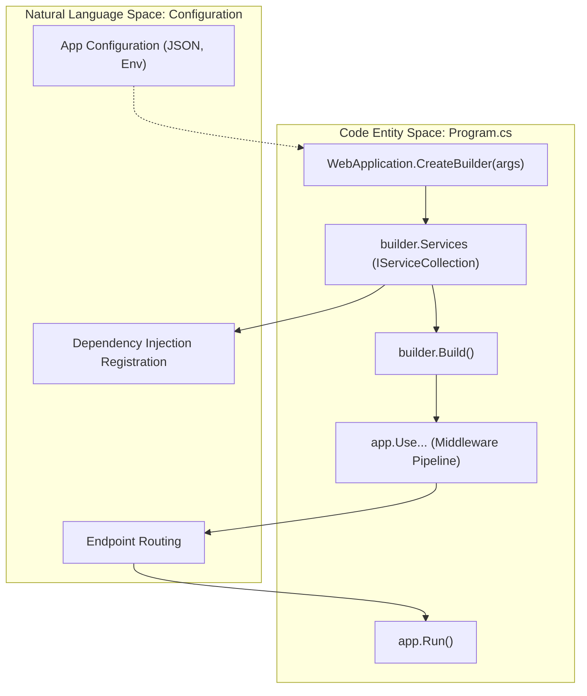
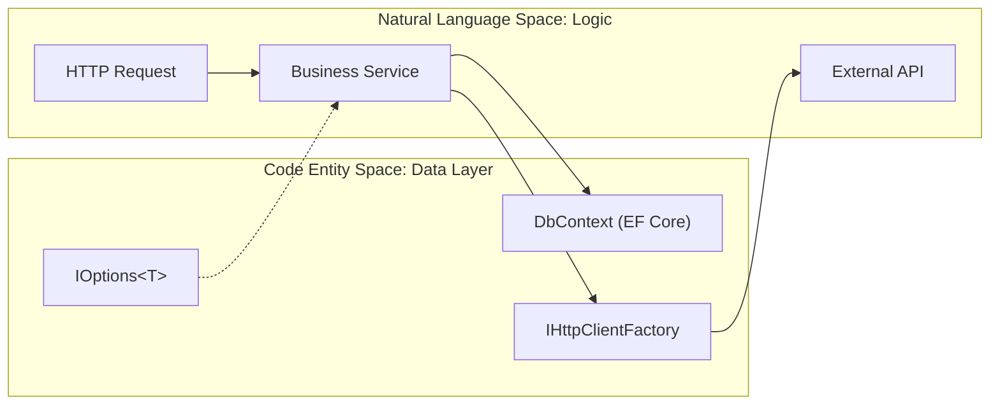

<!-- source: DeepWiki mcp.deepwiki.com · repo openai/skills · extra page ASP.NET Core · fetched 2026-10-30 -->

# ASP.NET Core

Relevant source files

The following files were used as context for generating this wiki page:

- [skills/.curated/aspnet-core/LICENSE.txt](skills/.curated/aspnet-core/LICENSE.txt)
- [skills/.curated/aspnet-core/SKILL.md](skills/.curated/aspnet-core/SKILL.md)
- [skills/.curated/aspnet-core/agents/openai.yaml](skills/.curated/aspnet-core/agents/openai.yaml)
- [skills/.curated/aspnet-core/assets/dotnet-logo.png](skills/.curated/aspnet-core/assets/dotnet-logo.png)
- [skills/.curated/aspnet-core/references/_sections.md](skills/.curated/aspnet-core/references/_sections.md)
- [skills/.curated/aspnet-core/references/apis-minimal-and-controllers.md](skills/.curated/aspnet-core/references/apis-minimal-and-controllers.md)
- [skills/.curated/aspnet-core/references/data-state-and-services.md](skills/.curated/aspnet-core/references/data-state-and-services.md)
- [skills/.curated/aspnet-core/references/program-and-pipeline.md](skills/.curated/aspnet-core/references/program-and-pipeline.md)
- [skills/.curated/aspnet-core/references/realtime-grpc-and-background-work.md](skills/.curated/aspnet-core/references/realtime-grpc-and-background-work.md)
- [skills/.curated/aspnet-core/references/security-and-identity.md](skills/.curated/aspnet-core/references/security-and-identity.md)
- [skills/.curated/aspnet-core/references/source-map.md](skills/.curated/aspnet-core/references/source-map.md)

The `aspnet-core` skill provides a comprehensive framework for building, reviewing, refactoring, and architecting web applications using modern ASP.NET Core guidance [skills/.curated/aspnet-core/SKILL.md:2-3](). It supports a wide array of application models including Blazor, Razor Pages, MVC, and Minimal APIs, with a specific focus on the .NET 10 ecosystem [skills/.curated/aspnet-core/SKILL.md:34-35]().

## Overview and Workflow

This skill is designed to guide developers through the selection of the appropriate application model and the correct composition of the request pipeline [skills/.curated/aspnet-core/SKILL.md:9-10](). It operates on a reference-based model where specific documentation is loaded only as needed for the task at hand [skills/.curated/aspnet-core/SKILL.md:12-13]().

### Development Workflow
The skill follows a structured process for application development and maintenance [skills/.curated/aspnet-core/SKILL.md:14-30]():
1. **Context Initialization**: Confirm target framework, SDK, and current app model [skills/.curated/aspnet-core/SKILL.md:16]().
2. **Architecture Selection**: Open `references/stack-selection.md` first for new apps or major refactors [skills/.curated/aspnet-core/SKILL.md:17]().
3. **Host Configuration**: Open `references/program-and-pipeline.md` next for `Program.cs`, Dependency Injection (DI), configuration, and middleware [skills/.curated/aspnet-core/SKILL.md:18]().
4. **App Model Implementation**: Open exactly one primary app-model reference (Blazor, Razor Pages, MVC, or APIs) [skills/.curated/aspnet-core/SKILL.md:19-23]().
5. **Cross-Cutting Concerns**: Add references for data (EF Core), security, or realtime (SignalR/gRPC) only as needed [skills/.curated/aspnet-core/SKILL.md:24-28]().
6. **Lifecycle Management**: Open `references/versioning-and-upgrades.md` before introducing new APIs or migrating versions [skills/.curated/aspnet-core/SKILL.md:29]().
7. **Documentation Mapping**: Use `references/source-map.md` to find corresponding official Microsoft Learn sections [skills/.curated/aspnet-core/SKILL.md:30]().

**Sources:** [skills/.curated/aspnet-core/SKILL.md:9-30]()

## Architecture and Pipeline

Modern ASP.NET Core utilizes the `WebApplicationBuilder` pattern, which consolidates service registration and middleware configuration into a single flow [skills/.curated/aspnet-core/references/program-and-pipeline.md:11-18]().

### Request Pipeline Order
The middleware order is critical for security and functionality. The skill enforces a standard sequence [skills/.curated/aspnet-core/references/program-and-pipeline.md:50-61]():

| Order | Middleware Component | Purpose |
| :--- | :--- | :--- |
| 1 | `ForwardedHeaders` | Proxy/Load balancer support [skills/.curated/aspnet-core/references/program-and-pipeline.md:52]() |
| 2 | `ExceptionHandling` | Error catching and HSTS [skills/.curated/aspnet-core/references/program-and-pipeline.md:53]() |
| 3 | `HttpsRedirection` | Enforce TLS [skills/.curated/aspnet-core/references/program-and-pipeline.md:54]() |
| 4 | `StaticFiles` | Serve `wwwroot` assets [skills/.curated/aspnet-core/references/program-and-pipeline.md:55]() |
| 5 | `Routing` | Endpoint matching [skills/.curated/aspnet-core/references/program-and-pipeline.md:56]() |
| 6 | `CORS` | Cross-origin resource sharing [skills/.curated/aspnet-core/references/program-and-pipeline.md:57]() |
| 7 | `Authentication` | Identify the user (`UseAuthentication`) [skills/.curated/aspnet-core/references/program-and-pipeline.md:58]() |
| 8 | `Authorization` | Check permissions (`UseAuthorization`) [skills/.curated/aspnet-core/references/program-and-pipeline.md:59]() |
| 9 | `EndpointMapping` | `MapRazorPages`, `MapControllers`, `MapGet`, etc. [skills/.curated/aspnet-core/references/program-and-pipeline.md:61]() |

### System Architecture Diagram
The following diagram illustrates the relationship between the `WebApplicationBuilder` and the resulting application host.

**ASP.NET Core Host Construction**

**Sources:** [skills/.curated/aspnet-core/references/program-and-pipeline.md:11-18](), [skills/.curated/aspnet-core/references/program-and-pipeline.md:33-40]()

## Application Model Selection

The skill provides a heuristic-based matrix for choosing the correct framework for a task, mapping specific needs to primary references [skills/.curated/aspnet-core/references/_sections.md:16-23]().

### Model Matrix
| Model | Reference File | Use Case |
| :--- | :--- | :--- |
| **Blazor** | `ui-blazor.md` | Build or review Blazor Web Apps and component-based UI [skills/.curated/aspnet-core/references/_sections.md:20]() |
| **Razor Pages** | `ui-razor-pages.md` | Build or review page-focused server-rendered applications [skills/.curated/aspnet-core/references/_sections.md:21]() |
| **MVC** | `ui-mvc.md` | Build or review controller/view applications [skills/.curated/aspnet-core/references/_sections.md:22]() |
| **APIs** | `apis-minimal-and-controllers.md` | Build or review HTTP APIs (Minimal or Controllers) [skills/.curated/aspnet-core/references/_sections.md:23]() |

**Sources:** [skills/.curated/aspnet-core/references/_sections.md:14-23]()

## Data and State Management

Data access is primarily handled through Entity Framework Core (EF Core) and the built-in Dependency Injection system [skills/.curated/aspnet-core/references/data-state-and-services.md:1-7]().

### Implementation Standards
- **Dependency Injection**: Constructor injection is the default [skills/.curated/aspnet-core/references/data-state-and-services.md:12](). Scoped services (like `DbContext`) must not be resolved from Singletons [skills/.curated/aspnet-core/references/data-state-and-services.md:14]().
- **EF Core**: `DbContext` is registered with `AddDbContext` and treated as scoped by default [skills/.curated/aspnet-core/references/data-state-and-services.md:23-24](). `IDbContextFactory<TContext>` is used for Blazor components or background services where the scope is longer-lived [skills/.curated/aspnet-core/references/data-state-and-services.md:29-33]().
- **Outbound HTTP**: Use `IHttpClientFactory` with named or typed clients [skills/.curated/aspnet-core/references/data-state-and-services.md:44-49]().

### Data Flow Diagram
This diagram maps the interaction between the HTTP Request and the underlying data services.

**ASP.NET Core Data Flow**

**Sources:** [skills/.curated/aspnet-core/references/data-state-and-services.md:9-52]()

## API Development Guidance

The skill supports two primary API styles: **Minimal APIs** and **Controller-based APIs** [skills/.curated/aspnet-core/references/apis-minimal-and-controllers.md:8-15]().

### Minimal APIs
- **Preferred for**: Small to medium surfaces and concise definitions [skills/.curated/aspnet-core/references/apis-minimal-and-controllers.md:19]().
- **Features**: Route groups, `TypedResults`, and built-in validation in .NET 10 via `AddValidation()` [skills/.curated/aspnet-core/references/apis-minimal-and-controllers.md:23-37]().

### Controller APIs
- **Preferred for**: Mature organization, attribute routing, and `[ApiController]` behaviors [skills/.curated/aspnet-core/references/apis-minimal-and-controllers.md:41-47]().
- **Automatic Behavior**: Invalid model state automatically results in an HTTP 400 with `ProblemDetails` [skills/.curated/aspnet-core/references/apis-minimal-and-controllers.md:57-62]().

**Sources:** [skills/.curated/aspnet-core/references/apis-minimal-and-controllers.md:17-62]()

## Security and Identity

Security is implemented via the standard ASP.NET Core Identity system and middleware pipeline [skills/.curated/aspnet-core/references/security-and-identity.md:35-37]().

- **Authentication vs. Authorization**: Authentication identifies the user; Authorization determines permissions via policies or roles [skills/.curated/aspnet-core/references/security-and-identity.md:19-32]().
- **Secrets Management**: Secret Manager is used for development; secure external stores are required for production [skills/.curated/aspnet-core/references/security-and-identity.md:12-13]().
- **Browser Security**: Antiforgery protection is mandatory for cookie-based interactive apps and form posts [skills/.curated/aspnet-core/references/security-and-identity.md:55]().

**Sources:** [skills/.curated/aspnet-core/references/security-and-identity.md:8-72]()

## Realtime and Background Work

The skill provides guidance for asynchronous and realtime communication patterns [skills/.curated/aspnet-core/references/realtime-grpc-and-background-work.md:1]().

- **SignalR**: Used for server-to-client push updates (chat, dashboards, live status) [skills/.curated/aspnet-core/references/realtime-grpc-and-background-work.md:8-18]().
- **gRPC**: Preferred for efficient service-to-service communication with strongly typed contracts via `.proto` files [skills/.curated/aspnet-core/references/realtime-grpc-and-background-work.md:29-41]().
- **Background Services**: Implemented using `IHostedService` or `BackgroundService` for tasks tied to the application host [skills/.curated/aspnet-core/references/realtime-grpc-and-background-work.md:46-49](). Developers must respect `CancellationToken` and avoid capturing scoped services directly in singleton hosted services [skills/.curated/aspnet-core/references/realtime-grpc-and-background-work.md:54-55]().

**Sources:** [skills/.curated/aspnet-core/references/realtime-grpc-and-background-work.md:1-59]()

---

