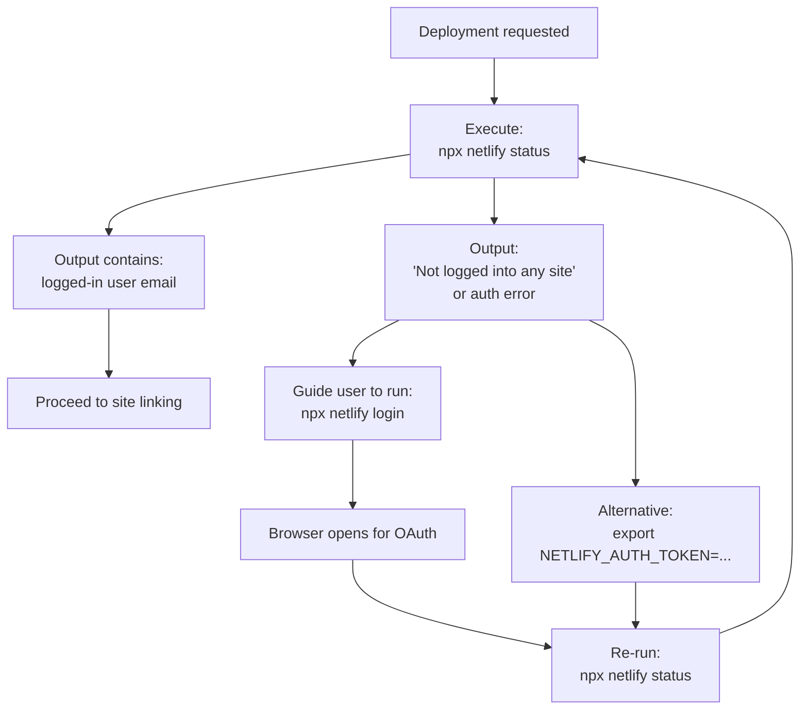
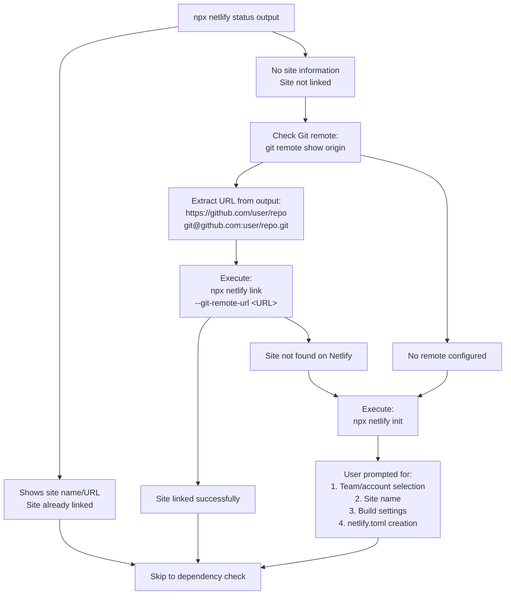
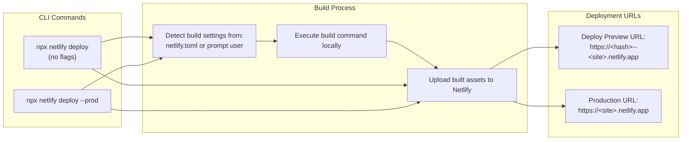
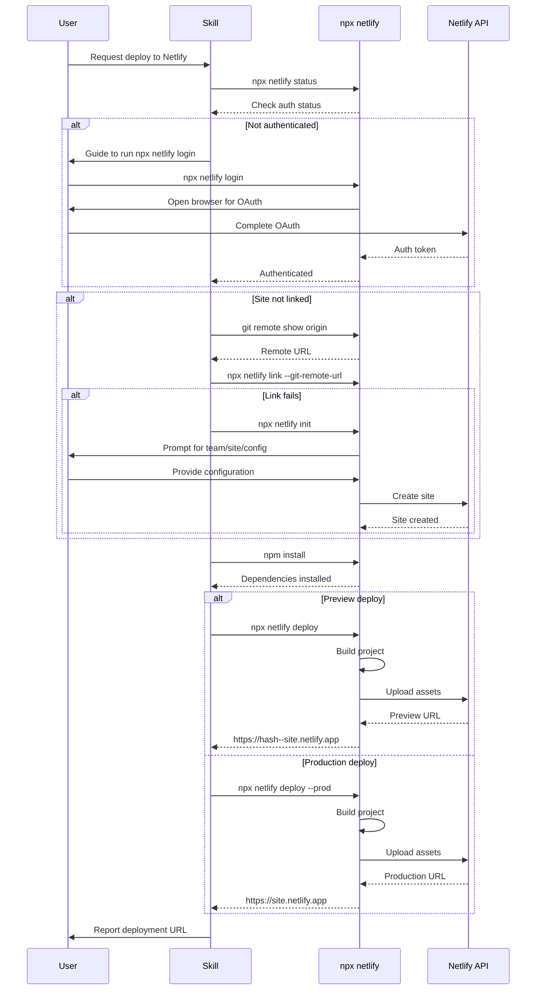

<!-- source: DeepWiki mcp.deepwiki.com · repo openai/skills · extra page Netlify Deploy · fetched 2026-10-30 -->

# Netlify Deploy

Relevant source files

The following files were used as context for generating this wiki page:

- [skills/.curated/cloudflare-deploy/SKILL.md](skills/.curated/cloudflare-deploy/SKILL.md)
- [skills/.curated/cloudflare-deploy/agents/openai.yaml](skills/.curated/cloudflare-deploy/agents/openai.yaml)
- [skills/.curated/linear/agents/openai.yaml](skills/.curated/linear/agents/openai.yaml)
- [skills/.curated/linear/assets/linear-small.svg](skills/.curated/linear/assets/linear-small.svg)
- [skills/.curated/linear/assets/linear.png](skills/.curated/linear/assets/linear.png)
- [skills/.curated/netlify-deploy/SKILL.md](skills/.curated/netlify-deploy/SKILL.md)
- [skills/.curated/netlify-deploy/agents/openai.yaml](skills/.curated/netlify-deploy/agents/openai.yaml)
- [skills/.curated/render-deploy/SKILL.md](skills/.curated/render-deploy/SKILL.md)

The Netlify Deploy skill automates web project deployments to Netlify using the Netlify CLI (`npx netlify`). This skill handles authentication verification, site linking/creation, project detection, dependency installation, and both preview and production deployments.

For deployment to other cloud platforms, see [Vercel Deploy](5.5.2), [Cloudflare Deploy](5.5.3), or [Render Deploy](5.5.4).

**Sources:** [skills/.curated/netlify-deploy/SKILL.md:1-8](), [skills/.curated/netlify-deploy/SKILL.md:2-3]()

## Scope and Prerequisites

This skill operates on web projects in the current directory and requires:
- **Netlify CLI**: Available via `npx netlify` (no global install required). [skills/.curated/netlify-deploy/SKILL.md:20-20]()
- **Authentication**: Active Netlify account with an authenticated session. [skills/.curated/netlify-deploy/SKILL.md:21-21]()
- **Project**: A valid web project in the current directory. [skills/.curated/netlify-deploy/SKILL.md:22-22]()
- **Permissions**: Escalated sandbox permissions (`sandbox_permissions=require_escalated`) when network restrictions block deployment. [skills/.curated/netlify-deploy/SKILL.md:23-23]()
- **Timeouts**: Appropriate timeout values for multi-minute deployment operations. [skills/.curated/netlify-deploy/SKILL.md:24-24]()

The skill does NOT create Netlify accounts or handle billing configurations. Users must have an existing Netlify account before deployment.

**Sources:** [skills/.curated/netlify-deploy/SKILL.md:18-24]()

## Authentication Pattern

The skill uses a pre-authenticated CLI approach rather than programmatic OAuth. It verifies authentication via `npx netlify status` which outputs the logged-in user email if authenticated, or an error message if not. [skills/.curated/netlify-deploy/SKILL.md:28-32]()

### Authentication Logic Flow

Authentication methods supported:
1. **Browser OAuth** (primary): `npx netlify login` opens a browser window for authentication. [skills/.curated/netlify-deploy/SKILL.md:35-35]()
2. **API Token** (alternative): Set `NETLIFY_AUTH_TOKEN` environment variable with a personal access token generated in the Netlify dashboard. [skills/.curated/netlify-deploy/SKILL.md:36-68]()

**Sources:** [skills/.curated/netlify-deploy/SKILL.md:26-68]()

## Site Linking Workflow

The linking workflow determines whether the current project is connected to an existing Netlify site.

### Linking Logic Flow

1. **Check link status**: Parse `npx netlify status` output for site name/URL. [skills/.curated/netlify-deploy/SKILL.md:72-75]()
2. **If not linked**: Attempt Git-based linking via `npx netlify link --git-remote-url <REMOTE_URL>`. [skills/.curated/netlify-deploy/SKILL.md:80-91]()
3. **If link fails**: Fall back to `npx netlify init` for interactive site creation, which guides users through team selection and build configuration. [skills/.curated/netlify-deploy/SKILL.md:93-105]()

**Sources:** [skills/.curated/netlify-deploy/SKILL.md:70-105]()

## Deployment Types and Commands

The skill chooses the deployment type based on the context of the user request. [skills/.curated/netlify-deploy/SKILL.md:120-120]()

### Deployment Process Mapping

### Preview vs Production
- **Preview/Draft Deploy**: `npx netlify deploy` (default for existing sites). Creates a unique URL for testing. [skills/.curated/netlify-deploy/SKILL.md:122-128]()
- **Production Deploy**: `npx netlify deploy --prod` (for new sites or explicit production requests). Deploys to the live production URL. [skills/.curated/netlify-deploy/SKILL.md:130-136]()

Both commands involve local building and asset uploading. [skills/.curated/netlify-deploy/SKILL.md:138-142]()

**Sources:** [skills/.curated/netlify-deploy/SKILL.md:118-142]()

## netlify.toml Configuration Detection

If `netlify.toml` exists, the CLI uses it automatically. If not, the CLI prompts for build settings. [skills/.curated/netlify-deploy/SKILL.md:152-156]()

### Framework Detection Logic

| Framework | Build Command | Publish Directory |
|-----------|--------------|-------------------|
| **Next.js** | `npm run build` | `.next` |
| **React (Vite)** | `npm run build` | `dist` |
| **Static HTML** | (none) | `.` |

The skill detects these frameworks from `package.json` and suggests appropriate settings. [skills/.curated/netlify-deploy/SKILL.md:158-163]()

**Sources:** [skills/.curated/netlify-deploy/SKILL.md:152-163]()

## Complete Deployment Sequence

**Sources:** [skills/.curated/netlify-deploy/SKILL.md:165-190]()

## Error Handling and Troubleshooting

Common error patterns and their associated fixes:

| Error Pattern | Resolution |
|---------------|------------|
| **"Not logged in"** | Run `npx netlify login`. [skills/.curated/netlify-deploy/SKILL.md:196-197]() |
| **"No site linked"** | Run `npx netlify link` or `npx netlify init`. [skills/.curated/netlify-deploy/SKILL.md:199-200]() |
| **"Build failed"** | Verify `netlify.toml`, dependencies, and build logs. [skills/.curated/netlify-deploy/SKILL.md:202-205]() |
| **"Publish directory not found"** | Verify build success and directory path. [skills/.curated/netlify-deploy/SKILL.md:207-209]() |
| **Network Failures** | Rerun with `sandbox_permissions=require_escalated`. [skills/.curated/netlify-deploy/SKILL.md:212-215]() |

### Escalated Network Access
If deployment fails due to timeouts, DNS errors, or connection resets, the skill prompts the user to rerun with escalated permissions to bypass sandbox networking blocks. [skills/.curated/netlify-deploy/SKILL.md:212-221]()

**Sources:** [skills/.curated/netlify-deploy/SKILL.md:192-221]()

## Environment Variables and Tips

- **Secrets Management**: Never commit secrets to Git. Set them in the Netlify dashboard (Site Settings → Environment Variables) and access them via `process.env`. [skills/.curated/netlify-deploy/SKILL.md:223-229]()
- **Dashboard Access**: Use `netlify open` to view the site in the Netlify dashboard. [skills/.curated/netlify-deploy/SKILL.md:234-234]()
- **Functions**: Use `netlify logs` for function logs and `netlify dev` for local development with Netlify Functions. [skills/.curated/netlify-deploy/SKILL.md:235-236]()

**Sources:** [skills/.curated/netlify-deploy/SKILL.md:223-236]()

---

