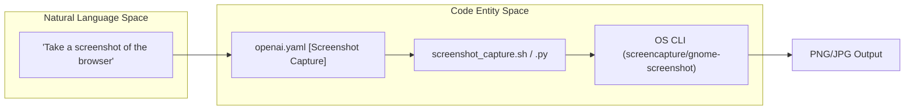
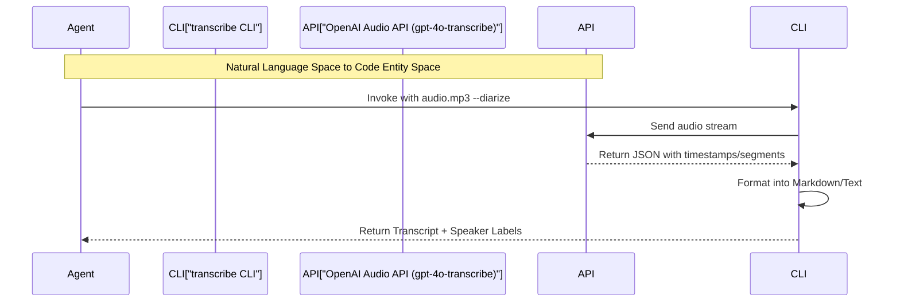

<!-- source: DeepWiki mcp.deepwiki.com · repo openai/skills · extra page PDF, Screenshot, and Transcribe · fetched 2026-10-30 -->

# PDF, Screenshot, and Transcribe

Relevant source files

The following files were used as context for generating this wiki page:

- [skills/.curated/jupyter-notebook/agents/openai.yaml](skills/.curated/jupyter-notebook/agents/openai.yaml)
- [skills/.curated/jupyter-notebook/assets/jupyter-small.svg](skills/.curated/jupyter-notebook/assets/jupyter-small.svg)
- [skills/.curated/jupyter-notebook/assets/jupyter.png](skills/.curated/jupyter-notebook/assets/jupyter.png)
- [skills/.curated/pdf/agents/openai.yaml](skills/.curated/pdf/agents/openai.yaml)
- [skills/.curated/screenshot/agents/openai.yaml](skills/.curated/screenshot/agents/openai.yaml)
- [skills/.curated/speech/agents/openai.yaml](skills/.curated/speech/agents/openai.yaml)
- [skills/.curated/transcribe/agents/openai.yaml](skills/.curated/transcribe/agents/openai.yaml)
- [skills/.curated/transcribe/assets/transcribe-small.svg](skills/.curated/transcribe/assets/transcribe-small.svg)
- [skills/.curated/transcribe/assets/transcribe.png](skills/.curated/transcribe/assets/transcribe.png)

This page documents the **PDF**, **Screenshot**, and **Transcribe** skills. These curated capabilities allow agents to generate and extract data from documents, capture OS-level visual state, and convert audio/video into structured text with speaker identification.

## PDF Skill

The PDF skill provides programmatic generation and extraction of PDF documents. It relies on `reportlab` for creation and `pdfplumber` for high-fidelity text and table extraction [skills/.curated/pdf/agents/openai.yaml:2-3]().

### Implementation Details
The skill is designed to handle both "Write" and "Read" operations:
*   **Generation:** Uses Python scripts (typically leveraging `reportlab`) to create structured reports, invoices, or documentation from raw data.
*   **Extraction:** Uses `pdfplumber` to parse existing PDFs, allowing the agent to "review" content or convert PDF tables into structured formats like JSON or Markdown [skills/.curated/pdf/agents/openai.yaml:5]().

**Sources:** [skills/.curated/pdf/agents/openai.yaml:1-6]()

---

## Screenshot Skill

The Screenshot skill enables agents to capture the current state of the desktop environment. This is critical for UI automation, debugging visual regressions, or providing "eyes" to the agent on macOS and Linux systems.

### OS-Level Capture
The skill abstracts the underlying OS capture utilities:
*   **macOS:** Typically invokes the `screencapture` CLI.
*   **Linux:** Utilizes tools like `gnome-screenshot` or `maim` depending on the desktop environment.

The agent can specify a target window, a specific screen area, or a full-screen capture [skills/.curated/screenshot/agents/openai.yaml:6]().

**Diagram: Screenshot Execution Flow**

**Sources:** [skills/.curated/screenshot/agents/openai.yaml:1-7]()

---

## Transcribe Skill

The Transcribe skill converts audio and video files into text. It is optimized for accuracy using OpenAI's transcription models (e.g., `gpt-4o-transcribe` variants) and supports advanced features like speaker diarization [skills/.curated/transcribe/agents/openai.yaml:2-3]().

### Key Features
*   **Speaker Diarization:** When requested, the skill attempts to label different speakers (e.g., "Speaker 1", "Speaker 2") to provide a coherent transcript of meetings or interviews [skills/.curated/transcribe/agents/openai.yaml:6]().
*   **Deterministic Execution:** Prefers a bundled CLI for repeatable runs, ensuring that long-form audio is processed consistently [skills/.curated/transcribe/agents/openai.yaml:3]().
*   **Summarization:** Often paired with a post-processing step to provide a "clean summary" alongside the raw transcript [skills/.curated/transcribe/agents/openai.yaml:6]().

**Diagram: Transcribe Data Flow**

**Sources:** [skills/.curated/transcribe/agents/openai.yaml:1-7](), [skills/.curated/transcribe/assets/transcribe-small.svg:1-4]()

---

## Interface Reference

The following table summarizes the interfaces for these content generation and extraction skills.

| Skill | Display Name | Short Description | Default Prompt |
| :--- | :--- | :--- | :--- |
| **PDF** | PDF Skill | Create, edit, and review PDFs | "Create, edit, or review this PDF and summarize the key output or changes." [skills/.curated/pdf/agents/openai.yaml:2-5]() |
| **Screenshot** | Screenshot Capture | Capture screenshots | "Capture the right screenshot for this task (target, area, and output path)." [skills/.curated/screenshot/agents/openai.yaml:2-6]() |
| **Transcribe** | Audio Transcribe | Transcribe audio using OpenAI, with optional speaker diarization when requested. | "Transcribe this audio or video, include speaker labels when possible, and provide a clean summary." [skills/.curated/transcribe/agents/openai.yaml:2-6]() |

**Sources:** [skills/.curated/pdf/agents/openai.yaml:1-6](), [skills/.curated/screenshot/agents/openai.yaml:1-7](), [skills/.curated/transcribe/agents/openai.yaml:1-7]()

---

