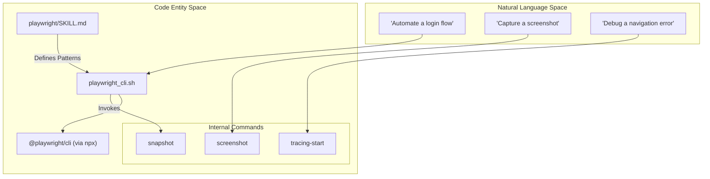
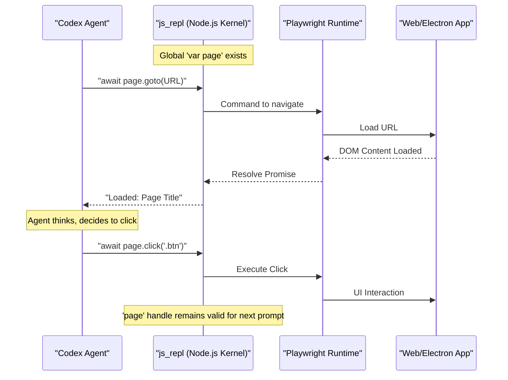

<!-- source: DeepWiki mcp.deepwiki.com · repo openai/skills · extra page Playwright and Browser Automation · fetched 2026-10-30 -->

# Playwright and Browser Automation

Relevant source files

The following files were used as context for generating this wiki page:

- [skills/.curated/playwright-interactive/LICENSE.txt](skills/.curated/playwright-interactive/LICENSE.txt)
- [skills/.curated/playwright-interactive/NOTICE.txt](skills/.curated/playwright-interactive/NOTICE.txt)
- [skills/.curated/playwright-interactive/SKILL.md](skills/.curated/playwright-interactive/SKILL.md)
- [skills/.curated/playwright-interactive/agents/openai.yaml](skills/.curated/playwright-interactive/agents/openai.yaml)
- [skills/.curated/playwright-interactive/assets/playwright-small.svg](skills/.curated/playwright-interactive/assets/playwright-small.svg)
- [skills/.curated/playwright-interactive/assets/playwright.png](skills/.curated/playwright-interactive/assets/playwright.png)
- [skills/.curated/playwright/SKILL.md](skills/.curated/playwright/SKILL.md)
- [skills/.curated/playwright/scripts/playwright_cli.sh](skills/.curated/playwright/scripts/playwright_cli.sh)

The Agent Skills repository provides two distinct approaches to browser automation: the **Playwright CLI Skill** for terminal-based, scriptable automation and the **Playwright Interactive Skill** for persistent, stateful debugging and QA sessions. These skills allow agents to navigate the web, interact with UI elements, capture screenshots, and debug both web and Electron applications.

## 1. Playwright CLI Skill (`playwright`)

The `playwright` skill is designed for CLI-first automation tasks such as form filling, data extraction, and UI-flow debugging using a bundled wrapper script `playwright_cli.sh` [[skills/.curated/playwright/SKILL.md:1-10]]().

### 1.1 Implementation and Data Flow

The skill relies on `@playwright/cli` and a bash wrapper to ensure execution even without global installations. It uses a "Snapshot and Interact" pattern to maintain reliable element references [[skills/.curated/playwright/SKILL.md:63-70]]().

| Component | Description | File Path |
| :--- | :--- | :--- |
| **Wrapper Script** | `playwright_cli.sh` - Manages `npx` execution and session flags. | [[skills/.curated/playwright/scripts/playwright_cli.sh:1-26]]() |
| **Interface** | `openai.yaml` - Defines the skill's display name and default prompt. | [[skills/.curated/playwright-interactive/agents/openai.yaml:1-7]]() |
| **Workflow** | `SKILL.md` - Documents the snapshot-based interaction loop. | [[skills/.curated/playwright/SKILL.md:1-148]]() |

### 1.2 CLI Invocation Pattern

The agent interacts with the browser by calling the wrapper script with specific sub-commands. The `PLAYWRIGHT_CLI_SESSION` environment variable can be used to persist state across multiple calls [[skills/.curated/playwright/scripts/playwright_cli.sh:20-22]]().

**Common Commands:**
*   `"$PWCLI" open <url>`: Initializes the browser session [[skills/.curated/playwright/SKILL.md:48]]().
*   `"$PWCLI" snapshot`: Generates stable element IDs (e.g., `e1`, `e2`) for the current DOM [[skills/.curated/playwright/SKILL.md:49]]().
*   `"$PWCLI" click <id>`: Interacts with an element identified in the last snapshot [[skills/.curated/playwright/SKILL.md:50]]().
*   `"$PWCLI" screenshot`: Captures the current viewport to `output/playwright/` [[skills/.curated/playwright/SKILL.md:53]]().

### 1.3 Entity Mapping: Natural Language to Code

The following diagram maps high-level automation concepts to the specific code entities and scripts used in the `playwright` skill.

**Playwright CLI Entity Map**

Sources: [[skills/.curated/playwright/SKILL.md:37-54]](), [[skills/.curated/playwright/scripts/playwright_cli.sh:19-25]]()

---

## 2. Playwright Interactive Skill (`playwright-interactive`)

The `playwright-interactive` skill provides a persistent `js_repl` session. Unlike the CLI skill, it keeps browser handles, contexts, and page objects alive in memory across multiple iterations, making it ideal for iterative UI debugging and complex QA [[skills/.curated/playwright-interactive/SKILL.md:1-9]]().

### 2.1 Technical Requirements

*   **Feature Flag**: `js_repl` must be enabled in `~/.codex/config.toml` [[skills/.curated/playwright-interactive/SKILL.md:12-18]]().
*   **Sandbox Mode**: Currently requires `danger-full-access` to allow the Node.js process to manage browser instances [[skills/.curated/playwright-interactive/SKILL.md:22]]().
*   **Dependencies**: Requires `playwright` and optionally `electron` installed in the project directory [[skills/.curated/playwright-interactive/SKILL.md:28-36]]().

### 2.2 Execution Logic and Global State

The skill uses `var` declarations in the `js_repl` to ensure that handles like `browser`, `context`, and `page` persist between cell executions [[skills/.curated/playwright-interactive/SKILL.md:84-89]]().

**Key Lifecycle Functions:**
*   `ensureWebBrowser()`: Launches a headed Chromium instance if one isn't already connected [[skills/.curated/playwright-interactive/SKILL.md:100-108]]().
*   `reloadWebContexts()`: Refreshes all open pages in the current session [[skills/.curated/playwright-interactive/SKILL.md:110-119]]().
*   `resetWebHandles()`: Clears stale references without killing the browser process [[skills/.curated/playwright-interactive/SKILL.md:93-98]]().

### 2.3 Interactive Session Architecture

This diagram illustrates how the `js_repl` maintains state between the Agent's requests and the live browser/Electron instance.

**Playwright Interactive State Flow**

Sources: [[skills/.curated/playwright-interactive/SKILL.md:63-82]](), [[skills/.curated/playwright-interactive/SKILL.md:140-153]]()

---

## 3. Use Case Comparison

| Feature | Playwright CLI (`playwright`) | Playwright Interactive (`playwright-interactive`) |
| :--- | :--- | :--- |
| **Primary Tool** | `playwright_cli.sh` wrapper | `js_repl` (JavaScript REPL) |
| **Persistence** | Session-based via env vars/files | In-memory object persistence |
| **Best For** | One-off automation, scraping, CI-like tasks | Iterative UI fix/debug, Electron QA |
| **Sandbox** | Works in standard sandbox | Requires `danger-full-access` |
| **Headed Mode** | Optional (`--headed`) | Default (Headed Chromium) |

Sources: [[skills/.curated/playwright/SKILL.md:7-10]](), [[skills/.curated/playwright-interactive/SKILL.md:1-9]](), [[skills/.curated/playwright-interactive/SKILL.md:106]]()

---

