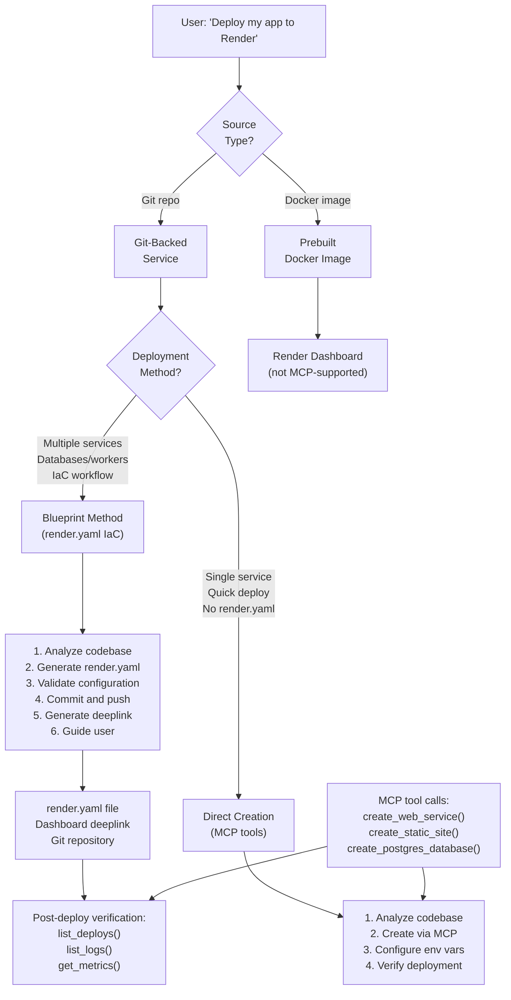
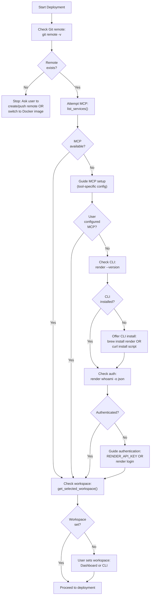
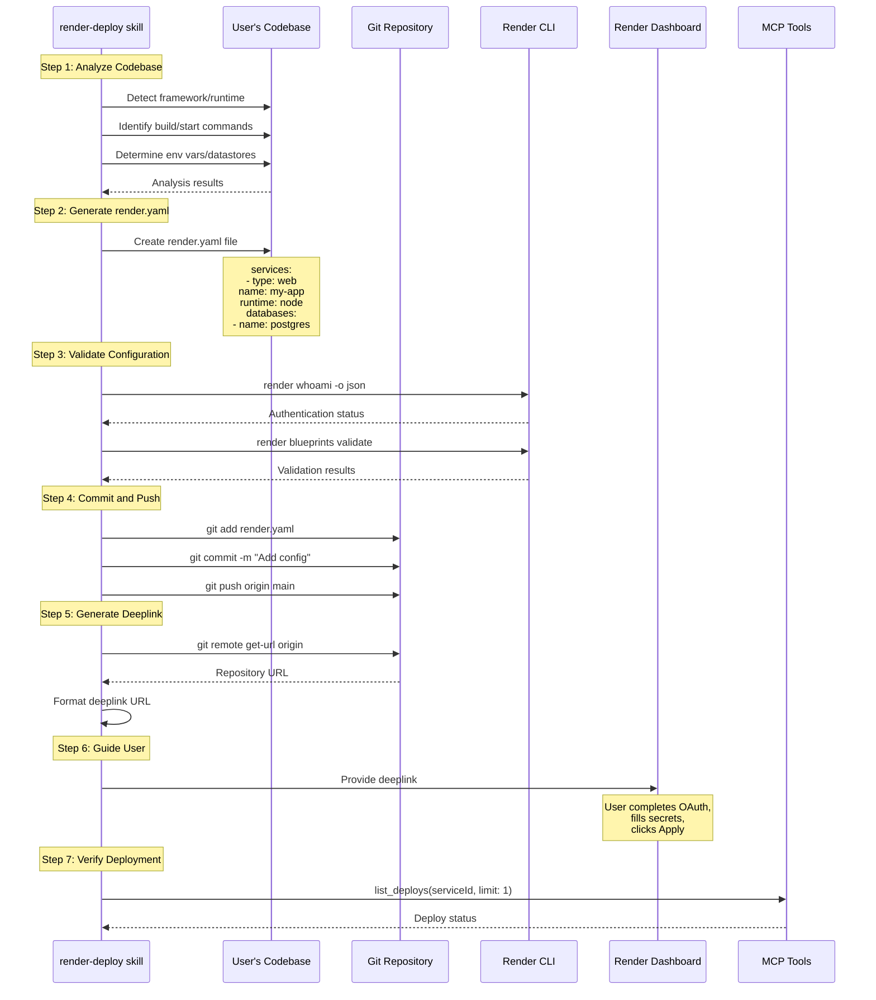
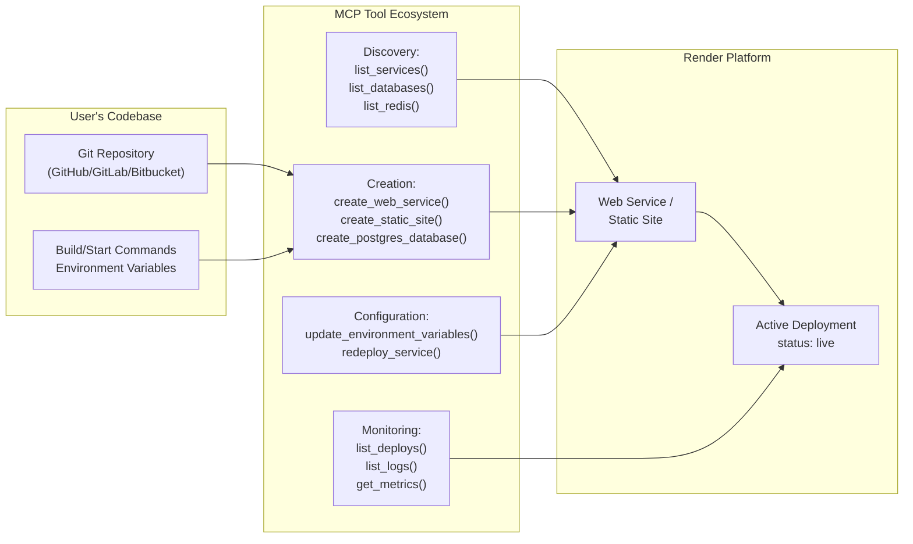
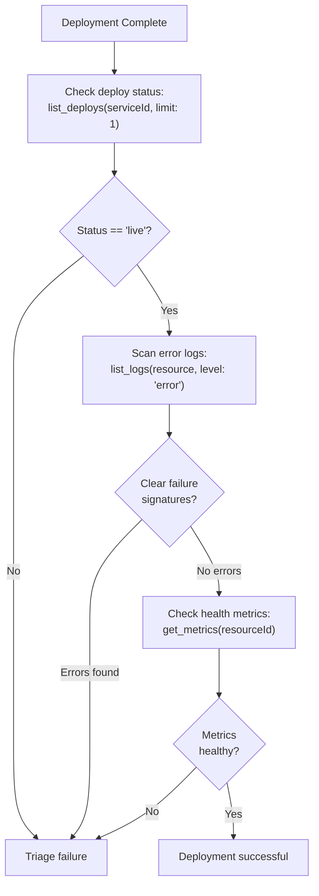

<!-- source: DeepWiki mcp.deepwiki.com · repo openai/skills · extra page Render Deploy · fetched 2026-10-30 -->

# Render Deploy

<details>
<summary>Relevant source files</summary>

The following files were used as context for generating this wiki page:

- [skills/.curated/cloudflare-deploy/SKILL.md](skills/.curated/cloudflare-deploy/SKILL.md)
- [skills/.curated/netlify-deploy/SKILL.md](skills/.curated/netlify-deploy/SKILL.md)
- [skills/.curated/render-deploy/SKILL.md](skills/.curated/render-deploy/SKILL.md)

</details>


This page documents the `render-deploy` skill, which provides automated deployment workflows for Render's cloud platform. The skill supports two deployment methods: **Blueprint-based Infrastructure-as-Code** (IaC) deployments using `render.yaml` configuration files, and **Direct Creation** via MCP (Model Context Protocol) tools for quick single-service deployments.

For other cloud deployment skills, see [Netlify Deploy](5.5.1), [Vercel Deploy](5.5.2), and [Cloudflare Deploy](5.5.3).

Sources: [skills/.curated/render-deploy/SKILL.md:1-25]()

## Purpose and Scope

The skill activates when users want to deploy, host, publish, or set up applications on Render. It analyzes codebases to determine runtime requirements, generates deployment configurations, handles authentication, and verifies deployment health. The skill supports both Git-backed services (code deployed from GitHub/GitLab/Bitbucket) and prebuilt Docker images (via Blueprint with `runtime: image`). [skills/.curated/render-deploy/SKILL.md:1-18]().

The skill does **not** support creating image-backed services via MCP—users must use the Render Dashboard or API for that workflow. [skills/.curated/render-deploy/SKILL.md:16-19]().

Sources: [skills/.curated/render-deploy/SKILL.md:7-18, 26-33]()

## Deployment Architecture

The following diagram maps user intent to the specific code-level deployment strategies and MCP tool interactions.

Title: Render Deployment Logic Flow


**Deployment Method Selection Heuristic**

The skill uses a decision rule to select the method:
- **Direct Creation (MCP)**: Used for single services (one web app/static site) with simple environment variables and no attached databases or cron jobs. [skills/.curated/render-deploy/SKILL.md:66-71]().
- **Blueprint**: Used for multiple services, databases (Postgres/Redis), cron jobs, or when Infrastructure-as-Code is desired. [skills/.curated/render-deploy/SKILL.md:73-80]().

Sources: [skills/.curated/render-deploy/SKILL.md:40-80]()

## Authentication Methods

The skill supports three authentication patterns, checked in order during prerequisites verification:

### MCP Authentication (Preferred)

MCP tools provide the best experience for service creation and management. The skill depends on the `render` MCP server using `streamable_http` transport. [skills/.curated/render-deploy/SKILL.md:98-103]().

**Codex:**
```bash
export RENDER_API_KEY="<YOUR_API_KEY>"
codex mcp add render --url https://mcp.render.com/mcp --bearer-token-env-var RENDER_API_KEY
```
[skills/.curated/render-deploy/SKILL.md:158-178]().

**Cursor:** Add to `~/.cursor/mcp.json`:
```json
{
  "mcpServers": {
    "render": {
      "url": "https://mcp.render.com/mcp",
      "headers": {
        "Authorization": "Bearer <YOUR_API_KEY>"
      }
    }
  }
}
```
[skills/.curated/render-deploy/SKILL.md:117-141]().

**Claude Code:**
```bash
claude mcp add --transport http render https://mcp.render.com/mcp --header "Authorization: Bearer <YOUR_API_KEY>"
```
[skills/.curated/render-deploy/SKILL.md:142-157]().

After configuration, verify with:
```
list_services()
```
[skills/.curated/render-deploy/SKILL.md:98-103]().

Sources: [skills/.curated/render-deploy/SKILL.md:113-182]()

### CLI Authentication (Fallback)

If MCP is not available, the skill uses the Render CLI:

```bash
render whoami -o json
```
[skills/.curated/render-deploy/SKILL.md:191-195]().

If not authenticated, users choose between:
- **API Key:** `export RENDER_API_KEY="rnd_xxxxx"` (from `https://dashboard.render.com/u/*/settings#api-keys`)
- **OAuth Login:** `render login` (opens browser)

Sources: [skills/.curated/render-deploy/SKILL.md:192-204]()

### Workspace Selection

After authentication, verify the active workspace:

```bash
# Via MCP
get_selected_workspace()

# Via CLI
render workspace current -o json
```
[skills/.curated/render-deploy/SKILL.md:183-189]().

List available workspaces:
```
list_workspaces()
```

Sources: [skills/.curated/render-deploy/SKILL.md:183-189, 206-224]()

## Prerequisites Verification Flow

Title: Render Deployment Prerequisites


**Network Prerequisites**

Both deployment methods may require escalated sandbox permissions if network calls are blocked. The skill prompts users to retry with `sandbox_permissions=require_escalated` for timeouts, DNS errors, or connection resets. [skills/.curated/render-deploy/SKILL.md:22-23]().

Sources: [skills/.curated/render-deploy/SKILL.md:82-224, 468-476]()

## Method 1: Blueprint Deployment

Blueprint deployment uses `render.yaml` Infrastructure-as-Code configuration files for version-controlled, reproducible deployments. [skills/.curated/render-deploy/SKILL.md:11-12]().

### Blueprint Workflow

Title: Blueprint Deployment Sequence


Sources: [skills/.curated/render-deploy/SKILL.md:228-397]()

### render.yaml Structure

The Blueprint specification defines the complete infrastructure. The skill defaults to `plan: free` unless specified otherwise. [skills/.curated/render-deploy/SKILL.md:236-282]().

**Basic Structure:**
```yaml
services:
  - type: web
    name: my-app
    runtime: node
    plan: free
    buildCommand: npm ci
    startCommand: npm start
    envVars:
      - key: DATABASE_URL
        fromDatabase:
          name: postgres
          property: connectionString
      - key: JWT_SECRET
        sync: false  # User fills in Dashboard

databases:
  - name: postgres
    databaseName: myapp_db
    plan: free
```

Sources: [skills/.curated/render-deploy/SKILL.md:236-282]()

### Validation and Deeplink Generation

The CLI validates Blueprint syntax before deployment using `render blueprints validate`. [skills/.curated/render-deploy/SKILL.md:295-309]().

**Git Remote URL Conversion:**

The skill converts SSH format to HTTPS for Dashboard deeplinks. [skills/.curated/render-deploy/SKILL.md:329-350]().

**Deeplink Format:**
```
https://dashboard.render.com/blueprint/new?repo=<REPOSITORY_URL>
```
[skills/.curated/render-deploy/SKILL.md:352-357]().

### Critical Blueprint Workflow Note

**Before providing the deeplink**, the skill verifies that `render.yaml` is committed and pushed to the repository. The Dashboard deeplink reads the configuration from the repository—if the file isn't merged and pushed, deployment will fail. [skills/.curated/render-deploy/SKILL.md:312-327, 359-372]().

Sources: [skills/.curated/render-deploy/SKILL.md:295-372]()

## Method 2: Direct Service Creation

Direct Creation uses MCP tools to create services instantly without a `render.yaml` file. [skills/.curated/render-deploy/SKILL.md:12-13]().

### Direct Creation MCP Tools

Title: MCP Tool-to-Entity Mapping


Sources: [skills/.curated/render-deploy/SKILL.md:400-445]()

### Direct Creation Workflow Steps

**Step 1: Analyze Codebase**

The skill determines runtime, framework, build commands, and start commands from the codebase. [skills/.curated/render-deploy/SKILL.md:427-434]().

**Step 2: Create Resources via MCP**

Example web service creation using `create_web_service`. [skills/.curated/render-deploy/SKILL.md:436-440]().

**Step 3: Configure Environment Variables**

Add required environment variables using `update_environment_variables`. [skills/.curated/render-deploy/SKILL.md:442-445]().

**Step 4: Verify Deployment**

Check deployment status using `list_deploys`. [skills/.curated/render-deploy/SKILL.md:452-460]().

Sources: [skills/.curated/render-deploy/SKILL.md:427-460]()

## Post-Deploy Verification

The skill performs a standardized verification checklist after both deployment methods:

Title: Render Health Verification Flow


**MCP Tool Usage:**

| Verification Task | MCP Tool |
| :--- | :--- |
| **Check deployment status** | `list_deploys(serviceId: "<service-id>", limit: 1)` |
| **Check for runtime errors** | `list_logs(resource: ["<service-id>"], level: ["error"], limit: 20)` |
| **Check health metrics** | `get_metrics(resourceId: "<service-id>", metricTypes: ["http_request_count", "cpu_usage", "memory_usage"])` |

Sources: [skills/.curated/render-deploy/SKILL.md:375-397, 452-465]()

## Troubleshooting

### Escalated Network Access

If deployment fails due to network issues (timeouts, DNS errors, connection resets), the skill prompts users to retry with escalated permissions:

```
The deploy needs escalated network access to deploy to Render. 
I can rerun the command with escalated permissions—want me to proceed?
```
[skills/.curated/render-deploy/SKILL.md:468-479]().

Use `sandbox_permissions=require_escalated` when rerunning the deployment. [skills/.curated/render-deploy/SKILL.md:22]().

Sources: [skills/.curated/render-deploy/SKILL.md:22, 468-479]()

---

