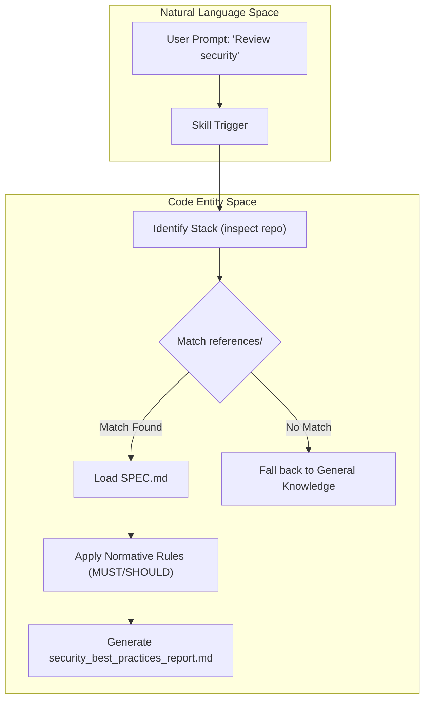
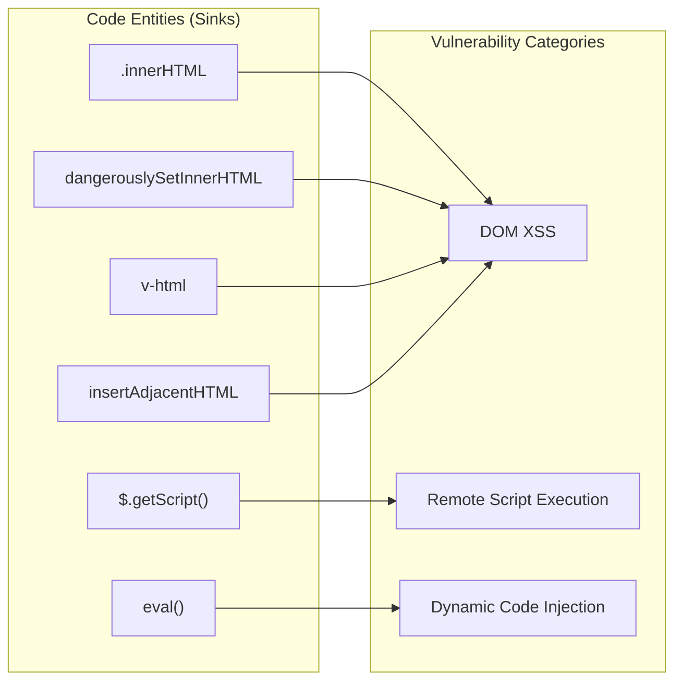

<!-- source: DeepWiki mcp.deepwiki.com · repo openai/skills · extra page Security Best Practices · fetched 2026-10-30 -->

# Security Best Practices

Relevant source files

The following files were used as context for generating this wiki page:

- [skills/.curated/security-best-practices/LICENSE.txt](skills/.curated/security-best-practices/LICENSE.txt)
- [skills/.curated/security-best-practices/SKILL.md](skills/.curated/security-best-practices/SKILL.md)
- [skills/.curated/security-best-practices/agents/openai.yaml](skills/.curated/security-best-practices/agents/openai.yaml)
- [skills/.curated/security-best-practices/references/golang-general-backend-security.md](skills/.curated/security-best-practices/references/golang-general-backend-security.md)
- [skills/.curated/security-best-practices/references/javascript-express-web-server-security.md](skills/.curated/security-best-practices/references/javascript-express-web-server-security.md)
- [skills/.curated/security-best-practices/references/javascript-general-web-frontend-security.md](skills/.curated/security-best-practices/references/javascript-general-web-frontend-security.md)
- [skills/.curated/security-best-practices/references/javascript-jquery-web-frontend-security.md](skills/.curated/security-best-practices/references/javascript-jquery-web-frontend-security.md)
- [skills/.curated/security-best-practices/references/javascript-typescript-nextjs-web-server-security.md](skills/.curated/security-best-practices/references/javascript-typescript-nextjs-web-server-security.md)
- [skills/.curated/security-best-practices/references/javascript-typescript-react-web-frontend-security.md](skills/.curated/security-best-practices/references/javascript-typescript-react-web-frontend-security.md)
- [skills/.curated/security-best-practices/references/javascript-typescript-vue-web-frontend-security.md](skills/.curated/security-best-practices/references/javascript-typescript-vue-web-frontend-security.md)
- [skills/.curated/security-best-practices/references/python-django-web-server-security.md](skills/.curated/security-best-practices/references/python-django-web-server-security.md)

The `security-best-practices` skill is a curated capability designed to perform language and framework-specific security reviews [skills/.curated/security-best-practices/SKILL.md:1-4](). It provides a structured approach for generating secure-by-default code, passively detecting vulnerabilities during development, and performing active security audits [skills/.curated/security-best-practices/SKILL.md:9-13]().

## Overview and Purpose

This skill functions as a specialized knowledge engine that identifies the tech stack of a project and applies normative security requirements based on a library of reference specifications [skills/.curated/security-best-practices/SKILL.md:16-19](). It is specifically scoped to Python, JavaScript/TypeScript, and Go [skills/.curated/security-best-practices/SKILL.md:3]().

### Operating Modes
The skill operates in three distinct modes:
1.  **Generation Mode**: Writing new code following "MUST" and "SHOULD" requirements from the reference specs [skills/.curated/security-best-practices/SKILL.md:27-28]().
2.  **Passive Review Mode**: Continuously monitoring nearby code for violations while the agent is performing other tasks [skills/.curated/security-best-practices/SKILL.md:30-32]().
3.  **Active Audit Mode**: Systematically scanning the codebase upon explicit user request to produce a structured `security_best_practices_report.md` [skills/.curated/security-best-practices/SKILL.md:33-34](), [skills/.curated/security-best-practices/SKILL.md:45-46]().

**Sources:**
- [skills/.curated/security-best-practices/SKILL.md:1-34]()
- [skills/.curated/security-best-practices/SKILL.md:45-46]()

## Technical Implementation

The skill relies on a strict directory structure and naming convention to load the correct security context.

### Reference File Naming Convention
Reference files are stored in the `references/` directory and follow a specific pattern:
`<language>-<framework>-<stack>-security.md` [skills/.curated/security-best-practices/SKILL.md:18-19]().

Common reference files include:
- `javascript-typescript-nextjs-web-server-security.md` [skills/.curated/security-best-practices/references/javascript-typescript-nextjs-web-server-security.md:1]()
- `python-django-web-server-security.md` [skills/.curated/security-best-practices/references/python-django-web-server-security.md:1]()
- `golang-general-backend-security.md` [skills/.curated/security-best-practices/references/golang-general-backend-security.md:1]()
- `javascript-express-web-server-security.md` [skills/.curated/security-best-practices/references/javascript-express-web-server-security.md:1]()
- `javascript-typescript-vue-web-frontend-security.md` [skills/.curated/security-best-practices/references/javascript-typescript-vue-web-frontend-security.md:1]()
- `javascript-typescript-react-web-frontend-security.md` [skills/.curated/security-best-practices/references/javascript-typescript-react-web-frontend-security.md:1]()

### Workflow Logic
The following diagram illustrates the internal decision-making process when the skill is triggered, transitioning from a natural language request to code-level analysis.

**Security Review Data Flow**

**Sources:**
- [skills/.curated/security-best-practices/SKILL.md:16-39]()
- [skills/.curated/security-best-practices/SKILL.md:45-46]()

## Supported Frameworks and Specs

The skill includes comprehensive specifications for modern web stacks. Each spec defines "Sinks" (dangerous functions) and "Sources" (untrusted input).

| Category | Supported Specs / Frameworks | Key Security Focus |
| :--- | :--- | :--- |
| **JavaScript/TS** | Next.js, React, Vue, Express, jQuery, General Frontend | XSS, CSRF, Secure Cookies, CSP, SSRF, Sink protection |
| **Python** | Django | Middleware config, `SECRET_KEY`, ORM safety, `DEBUG` mode |
| **Go** | Standard Library (`net/http`) | Toolchain patching, HTTP timeouts, `govulncheck`, injection |

### Example: JavaScript Sink Analysis
In the JavaScript specs, specific code entities are flagged as dangerous "sinks" that must be audited for DOM XSS or remote execution vulnerabilities.

**JS Security Sink Mapping**

**Sources:**
- [skills/.curated/security-best-practices/references/javascript-general-web-frontend-security.md:79-87]()
- [skills/.curated/security-best-practices/references/javascript-jquery-web-frontend-security.md:80-101]()
- [skills/.curated/security-best-practices/references/javascript-typescript-react-web-frontend-security.md:33]()
- [skills/.curated/security-best-practices/references/javascript-typescript-vue-web-frontend-security.md:31]()

## Audit and Remediation Workflow

When performing an active audit, the skill follows a standardized output contract to ensure findings are actionable and evidence-based.

### Finding Format
Every vulnerability identified MUST include [skills/.curated/security-best-practices/references/javascript-typescript-nextjs-web-server-security.md:100-111]():
- **Rule ID**: Unique identifier for the violation (e.g., `EXPRESS-INPUT-001` [skills/.curated/security-best-practices/references/javascript-express-web-server-security.md:126]()).
- **Severity**: Critical, High, Medium, or Low.
- **Location**: File path, function/class, and exact line numbers.
- **Evidence**: The specific code snippet causing the issue.
- **Impact**: Description of the risk and exploitability.
- **Fix**: A minimal diff to remediate the vulnerability.
- **Mitigation**: Defense-in-depth strategies if a direct fix is complex.

### Remediation Principles
When suggesting fixes, the skill is governed by several constraints:
- **Functionality First**: Avoid breaking changes; insecure code is often relied upon for functionality [skills/.curated/security-best-practices/SKILL.md:70-71]().
- **Minimal Diffs**: Prefer small, surgical changes over large refactors [skills/.curated/security-best-practices/SKILL.md:72]().
- **No Secrets**: The skill MUST NOT output, log, or commit actual secrets (API keys, tokens) found during the review [skills/.curated/security-best-practices/references/golang-general-backend-security.md:13](), [skills/.curated/security-best-practices/references/javascript-express-web-server-security.md:14]().

**Sources:**
- [skills/.curated/security-best-practices/SKILL.md:44-75]()
- [skills/.curated/security-best-practices/references/golang-general-backend-security.md:13-17]()
- [skills/.curated/security-best-practices/references/javascript-express-web-server-security.md:14-18]()
- [skills/.curated/security-best-practices/references/javascript-typescript-nextjs-web-server-security.md:100-111]()

## Anti-Abuse and Safety Constraints

The skill includes hard-coded safety boundaries that it cannot bypass:
- **No Disabling Protections**: It will not suggest "fixing" an issue by disabling security headers, CSRF checks, or TLS [skills/.curated/security-best-practices/references/javascript-typescript-nextjs-web-server-security.md:17]().
- **Uncertainty Honesty**: If a protection might exist at the infrastructure level (e.g., WAF, CDN), it must be reported as "not visible in repo" rather than assumed missing [skills/.curated/security-best-practices/references/javascript-typescript-vue-web-frontend-security.md:17]().
- **Frontend Trust Model**: It must treat the browser as an attacker-controlled environment; frontend-only checks are never considered security boundaries [skills/.curated/security-best-practices/references/javascript-jquery-web-frontend-security.md:15-18]().
- **Secret Handling**: Strict prohibition against requesting or committing secrets like `SECRET_KEY` or database credentials [skills/.curated/security-best-practices/references/python-django-web-server-security.md:14]().

**Sources:**
- [skills/.curated/security-best-practices/references/javascript-typescript-nextjs-web-server-security.md:14-22]()
- [skills/.curated/security-best-practices/references/javascript-typescript-vue-web-frontend-security.md:12-18]()
- [skills/.curated/security-best-practices/references/javascript-jquery-web-frontend-security.md:12-22]()
- [skills/.curated/security-best-practices/references/python-django-web-server-security.md:12-18]()

---

