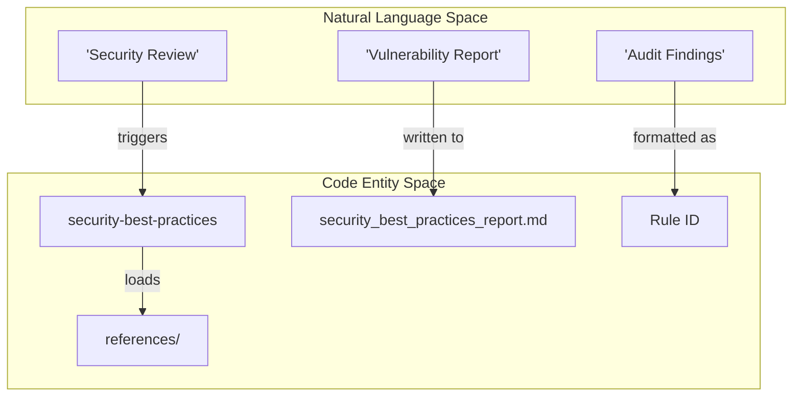
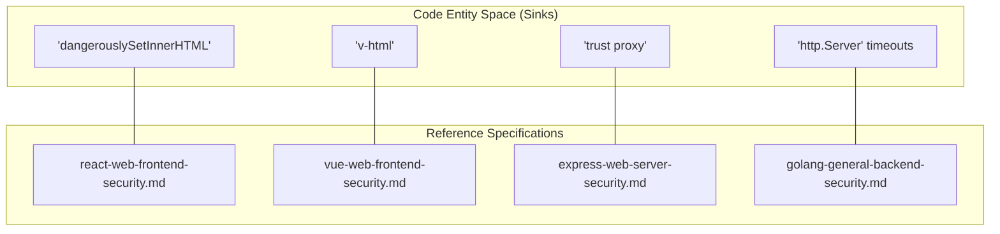
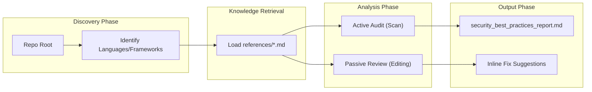

<!-- source: DeepWiki mcp.deepwiki.com · repo openai/skills · extra page Security Ownership Map · fetched 2026-10-30 -->

# Security Ownership Map

Relevant source files

The following files were used as context for generating this wiki page:

- [skills/.curated/security-best-practices/LICENSE.txt](skills/.curated/security-best-practices/LICENSE.txt)
- [skills/.curated/security-best-practices/SKILL.md](skills/.curated/security-best-practices/SKILL.md)
- [skills/.curated/security-best-practices/agents/openai.yaml](skills/.curated/security-best-practices/agents/openai.yaml)
- [skills/.curated/security-best-practices/references/golang-general-backend-security.md](skills/.curated/security-best-practices/references/golang-general-backend-security.md)
- [skills/.curated/security-best-practices/references/javascript-express-web-server-security.md](skills/.curated/security-best-practices/references/javascript-express-web-server-security.md)
- [skills/.curated/security-best-practices/references/javascript-general-web-frontend-security.md](skills/.curated/security-best-practices/references/javascript-general-web-frontend-security.md)
- [skills/.curated/security-best-practices/references/javascript-jquery-web-frontend-security.md](skills/.curated/security-best-practices/references/javascript-jquery-web-frontend-security.md)
- [skills/.curated/security-best-practices/references/javascript-typescript-nextjs-web-server-security.md](skills/.curated/security-best-practices/references/javascript-typescript-nextjs-web-server-security.md)
- [skills/.curated/security-best-practices/references/javascript-typescript-react-web-frontend-security.md](skills/.curated/security-best-practices/references/javascript-typescript-react-web-frontend-security.md)
- [skills/.curated/security-best-practices/references/javascript-typescript-vue-web-frontend-security.md](skills/.curated/security-best-practices/references/javascript-typescript-vue-web-frontend-security.md)
- [skills/.curated/security-best-practices/references/python-django-web-server-security.md](skills/.curated/security-best-practices/references/python-django-web-server-security.md)

The `security-ownership-map` skill is a curated tool designed to analyze repository security through the lens of human interaction and code provenance. It builds bipartite graphs mapping contributors to files using git history to compute metrics such as the **bus factor**, identify **orphaned sensitive code**, and visualize the security topology of a codebase.

## Overview

The skill enables security engineers and architects to understand the "social" structure of their code. By analyzing commit frequency and authorship, it identifies which parts of the system are bottlenecked by a single developer or which security-critical files no longer have active maintainers.

### Key Capabilities
*   **Bipartite Graph Construction**: Maps "People" nodes to "File" nodes based on git activity [skills/.curated/security-best-practices/SKILL.md:14-18]().
*   **Bus Factor Analysis**: Calculates the minimum number of developers who must "be hit by a bus" before a component becomes unmaintainable.
*   **Orphan Detection**: Identifies sensitive files (e.g., auth logic, crypto) that have not been touched by current team members.
*   **Visualization Export**: Generates data formats compatible with Neo4j (graph database) and Gephi (visualization software).

## Architecture and Data Flow

The skill operates by extracting metadata from the local git environment and processing it through a series of analytical steps. It bridges the gap between raw git logs and high-level security insights by associating file-level risks (sinks) with contributor patterns.

### Code-to-Entity Mapping
The following diagrams illustrate how system concepts map to specific implementation references within the skill's workflow and how "Natural Language" triggers correspond to "Code Entity" components.

**Natural Language to Code Entity Space: Security Review Workflow**

Sources: [skills/.curated/security-best-practices/SKILL.md:2-4](), [skills/.curated/security-best-practices/SKILL.md:44-50]()

**Code Entity Space: Sink and Vulnerability Mapping**

Sources: [skills/.curated/security-best-practices/references/javascript-typescript-react-web-frontend-security.md:53-53](), [skills/.curated/security-best-practices/references/javascript-typescript-vue-web-frontend-security.md:51-51](), [skills/.curated/security-best-practices/references/javascript-express-web-server-security.md:51-51](), [skills/.curated/security-best-practices/references/golang-general-backend-security.md:98-98]()

### Technical Data Flow
The data flow starts with identifying the environment and then applying specialized security specs found in the `references/` directory.

**Security Analysis Pipeline**

Sources: [skills/.curated/security-best-practices/SKILL.md:14-25](), [skills/.curated/security-best-practices/SKILL.md:34-39]()

## Implementation Details

### Operating Modes
The skill supports three distinct modes of operation to balance developer productivity with security rigor:

1.  **Generation Mode**: Used when writing new code. The skill ensures new snippets follow "MUST" requirements from the reference specs [skills/.curated/security-best-practices/references/golang-general-backend-security.md:23-28]().
2.  **Passive Review Mode**: Always active during editing. It "notices" violations in nearby code and provides brief explanations with safe fixes [skills/.curated/security-best-practices/SKILL.md:30-31]().
3.  **Active Audit Mode**: Triggered by explicit requests (e.g., "scan for vulnerabilities"). It performs a systematic search and generates a structured report [skills/.curated/security-best-practices/SKILL.md:32-33]().

### Reference Specifications
The skill relies on a library of normative requirements. These files use `MUST/SHOULD/MAY` terminology to define security boundaries for various stacks. Filenames follow the pattern `<language>-<framework>-<stack>-security.md` [skills/.curated/security-best-practices/SKILL.md:18-19]().

| Stack | Reference File |
| :--- | :--- |
| **Go** | `golang-general-backend-security.md` [skills/.curated/security-best-practices/references/golang-general-backend-security.md:1-1]() |
| **Next.js** | `javascript-typescript-nextjs-web-server-security.md` [skills/.curated/security-best-practices/references/javascript-typescript-nextjs-web-server-security.md:1-1]() |
| **Django** | `python-django-web-server-security.md` [skills/.curated/security-best-practices/references/python-django-web-server-security.md:1-1]() |
| **React** | `javascript-typescript-react-web-frontend-security.md` [skills/.curated/security-best-practices/references/javascript-typescript-react-web-frontend-security.md:1-1]() |
| **Vue** | `javascript-typescript-vue-web-frontend-security.md` [skills/.curated/security-best-practices/references/javascript-typescript-vue-web-frontend-security.md:1-1]() |
| **Express** | `javascript-express-web-server-security.md` [skills/.curated/security-best-practices/references/javascript-express-web-server-security.md:1-1]() |
| **jQuery** | `javascript-jquery-web-frontend-security.md` [skills/.curated/security-best-practices/references/javascript-jquery-web-frontend-security.md:1-1]() |

Sources: [skills/.curated/security-best-practices/SKILL.md:16-23](), [skills/.curated/security-best-practices/agents/openai.yaml:1-5]()

## Security Audit Workflow

When performing a full ownership and security map, the skill follows a prioritized audit order:

1.  **Entrypoint Analysis**: Inspects `main.go`, `cmd/*`, `Dockerfiles`, and CI workflows to understand the attack surface [skills/.curated/security-best-practices/references/golang-general-backend-security.md:41-41]().
2.  **Bipartite Mapping**: Correlates file sensitivity (based on the presence of sinks like `unsafe`, `reflect`, or raw SQL) with author history [skills/.curated/security-best-practices/references/golang-general-backend-security.md:48-51]().
3.  **Report Generation**: Findings are written to `security_best_practices_report.md` with specific fields:
    *   **Rule ID**: Unique identifier for the violation [skills/.curated/security-best-practices/references/golang-general-backend-security.md:74-74]().
    *   **Severity**: Critical/High/Medium/Low [skills/.curated/security-best-practices/references/golang-general-backend-security.md:75-75]().
    *   **Location**: File path and line numbers [skills/.curated/security-best-practices/SKILL.md:56-57]().
    *   **Evidence**: The exact code snippet [skills/.curated/security-best-practices/references/golang-general-backend-security.md:77-77]().
    *   **Fix**: A minimal diff to remediate the issue [skills/.curated/security-best-practices/SKILL.md:68-70]().

Sources: [skills/.curated/security-best-practices/SKILL.md:44-57](), [skills/.curated/security-best-practices/references/golang-general-backend-security.md:71-82]()

## Safety and Constraints
*   **No Secret Exposure**: The skill is strictly prohibited from requesting, logging, or committing secrets (API keys, JWTs, database URLs) [skills/.curated/security-best-practices/references/golang-general-backend-security.md:13-13]().
*   **Minimal Breaking Changes**: Fixes are designed to be production-safe and minimal to avoid functionality regressions [skills/.curated/security-best-practices/SKILL.md:70-71]().
*   **Evidence-Based**: Every finding must cite specific file paths and line numbers [skills/.curated/security-best-practices/SKILL.md:56-57]().

Sources: [skills/.curated/security-best-practices/SKILL.md:12-14](), [skills/.curated/security-best-practices/references/golang-general-backend-security.md:11-17]()

---

