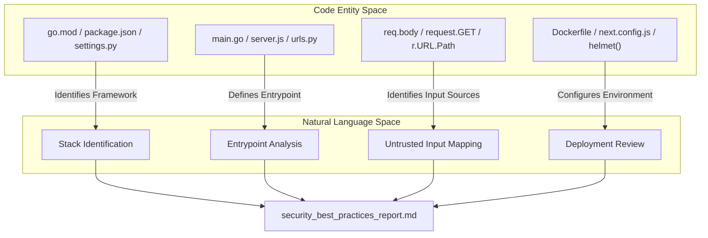
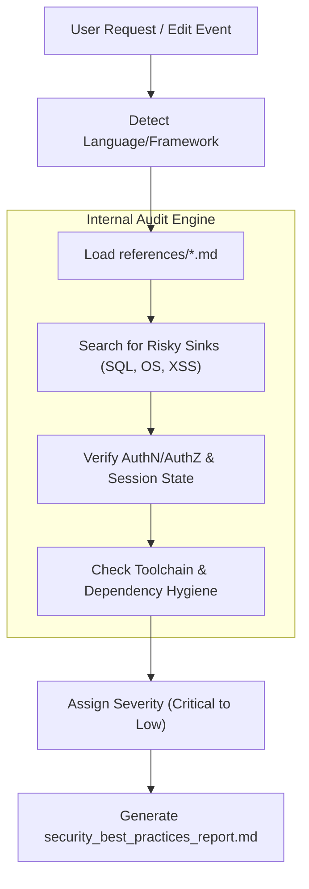

<!-- source: DeepWiki mcp.deepwiki.com · repo openai/skills · extra page Security Threat Model · fetched 2026-10-30 -->

# Security Threat Model

Relevant source files

The following files were used as context for generating this wiki page:

- [skills/.curated/security-best-practices/LICENSE.txt](skills/.curated/security-best-practices/LICENSE.txt)
- [skills/.curated/security-best-practices/SKILL.md](skills/.curated/security-best-practices/SKILL.md)
- [skills/.curated/security-best-practices/agents/openai.yaml](skills/.curated/security-best-practices/agents/openai.yaml)
- [skills/.curated/security-best-practices/references/golang-general-backend-security.md](skills/.curated/security-best-practices/references/golang-general-backend-security.md)
- [skills/.curated/security-best-practices/references/javascript-express-web-server-security.md](skills/.curated/security-best-practices/references/javascript-express-web-server-security.md)
- [skills/.curated/security-best-practices/references/javascript-general-web-frontend-security.md](skills/.curated/security-best-practices/references/javascript-general-web-frontend-security.md)
- [skills/.curated/security-best-practices/references/javascript-jquery-web-frontend-security.md](skills/.curated/security-best-practices/references/javascript-jquery-web-frontend-security.md)
- [skills/.curated/security-best-practices/references/javascript-typescript-nextjs-web-server-security.md](skills/.curated/security-best-practices/references/javascript-typescript-nextjs-web-server-security.md)
- [skills/.curated/security-best-practices/references/javascript-typescript-react-web-frontend-security.md](skills/.curated/security-best-practices/references/javascript-typescript-react-web-frontend-security.md)
- [skills/.curated/security-best-practices/references/javascript-typescript-vue-web-frontend-security.md](skills/.curated/security-best-practices/references/javascript-typescript-vue-web-frontend-security.md)
- [skills/.curated/security-best-practices/references/python-django-web-server-security.md](skills/.curated/security-best-practices/references/python-django-web-server-security.md)

The `security-threat-model` skill (implemented within the `security-best-practices` curated skill) is a repository-grounded Application Security (AppSec) capability. It enables Codex to systematically identify, categorize, and propose mitigations for security risks by analyzing the actual implementation details of a codebase rather than relying on generic security advice [skills/.curated/security-best-practices/SKILL.md:10-12]().

## Overview

The skill operates by extracting the architectural scope of a repository and applying an 8-step workflow to produce an AppSec-grade threat model. It is specifically tailored for developers and security engineers to integrate security thinking directly into the development lifecycle.

### Key Capabilities
*   **Scope Extraction**: Automatically identifies the primary languages and frameworks (frontend, backend, and stack) by inspecting files like `go.mod`, `package.json`, or `settings.py` [skills/.curated/security-best-practices/SKILL.md:16-18]().
*   **Grounded Analysis**: Uses specific reference documents for languages like Python (Django), JavaScript/TypeScript (React, Vue, Express, Next.js, jQuery), and Go to identify known risky sinks and patterns [skills/.curated/security-best-practices/SKILL.md:18-20]().
*   **Mitigation Mapping**: Proposes specific code changes or architectural adjustments based on industry-standard "MUST/SHOULD" requirements defined in the reference specifications [skills/.curated/security-best-practices/references/golang-general-backend-security.md:87-95]().

## Workflow Implementation

The skill follows a structured decision tree to ensure consistency across different technology stacks [skills/.curated/security-best-practices/SKILL.md:34-39]().

### 8-Step Threat Modeling Workflow

1.  **Scope Identification**: Determine the tech stack by inspecting the repo and listing evidence of frameworks used (e.g., detecting Vite, Django, or Go modules) [skills/.curated/security-best-practices/SKILL.md:36-37]().
2.  **Reference Loading**: Fetch the relevant security specs from the `references/` directory. Filenames follow the `<language>-<framework>-<stack>-security.md` convention [skills/.curated/security-best-practices/SKILL.md:18-20]().
3.  **Entrypoint Audit**: Analyze deployment manifests (`Dockerfiles`, `Kubernetes` manifests), build scripts (`package.json` scripts), and server bootstrap code (`main.go`, `app.js`, `settings.py`) [skills/.curated/security-best-practices/references/golang-general-backend-security.md:41-42](), [skills/.curated/security-best-practices/references/javascript-express-web-server-security.md:49-51](), [skills/.curated/security-best-practices/references/javascript-typescript-vue-web-frontend-security.md:49-50]().
4.  **Data Flow Mapping**: Identify "Untrusted Input" sources such as `*http.Request` fields in Go, `req.body/req.query` in Express, or `request.GET/POST` in Django [skills/.curated/security-best-practices/references/golang-general-backend-security.md:59-67](), [skills/.curated/security-best-practices/references/python-django-web-server-security.md:69-73]().
5.  **Sink Identification**: Locate dangerous sinks like OS command execution, SQL injection, `dangerouslySetInnerHTML` in React, or jQuery's `.html()` [skills/.curated/security-best-practices/references/golang-general-backend-security.md:49-50](), [skills/.curated/security-best-practices/references/javascript-jquery-web-frontend-security.md:86-91]().
6.  **Trust Boundary Analysis**: Evaluate AuthN/AuthZ boundaries, session/cookie settings (e.g., `HttpOnly`, `Secure`, `SameSite` flags), and CSRF protections [skills/.curated/security-best-practices/references/golang-general-backend-security.md:45-46](), [skills/.curated/security-best-practices/references/javascript-typescript-nextjs-web-server-security.md:131-132]().
7.  **Vulnerability Categorization**: Group findings by severity (Critical, High, Medium, Low) and assign numeric IDs for structured reporting [skills/.curated/security-best-practices/SKILL.md:50-51]().
8.  **Mitigation Generation**: Produce a structured report with evidence-based fixes and defense-in-depth recommendations [skills/.curated/security-best-practices/references/golang-general-backend-security.md:79-81]().

### Data Flow: From Code to Threat Model

The following diagram illustrates how the skill bridges the gap between raw source code and structured security findings.

**Code-to-Entity Mapping for Threat Modeling**

Sources: [skills/.curated/security-best-practices/SKILL.md:16-25](), [skills/.curated/security-best-practices/references/golang-general-backend-security.md:41-67](), [skills/.curated/security-best-practices/references/javascript-express-web-server-security.md:107-116]()

## Security Reference Architecture

The skill relies on a library of normative requirements stored in `references/`. These files define what constitutes a "Critical" finding versus a "Low" risk.

| Language/Stack | Reference File | Key Focus Areas |
| :--- | :--- | :--- |
| **Go (General)** | `golang-general-backend-security.md` | `http.Server` timeouts, `govulncheck`, `unsafe` usage, concurrency [skills/.curated/security-best-practices/references/golang-general-backend-security.md:41-53]() |
| **React** | `javascript-typescript-react-web-frontend-security.md` | `dangerouslySetInnerHTML`, XSS, Token Storage, CSP [skills/.curated/security-best-practices/references/javascript-typescript-react-web-frontend-security.md:51-60]() |
| **Next.js** | `javascript-typescript-nextjs-web-server-security.md` | Server Actions, Route Handlers, `headers()`, `cookies()` [skills/.curated/security-best-practices/references/javascript-typescript-nextjs-web-server-security.md:73-82]() |
| **Django** | `python-django-web-server-security.md` | `SECRET_KEY`, `ALLOWED_HOSTS`, `CsrfViewMiddleware`, `DEBUG` [skills/.curated/security-best-practices/references/python-django-web-server-security.md:111-115]() |
| **jQuery** | `javascript-jquery-web-frontend-security.md` | `.html()`, `.append()`, `$.getScript()`, SRI for CDNs [skills/.curated/security-best-practices/references/javascript-jquery-web-frontend-security.md:86-96]() |

### Logic Flow for Security Audits

The audit logic is designed to be "passive" (noticing issues while editing), "active" (full repository scan), or "generative" (writing secure code by default) [skills/.curated/security-best-practices/SKILL.md:26-33]().

**Audit Execution Logic**

Sources: [skills/.curated/security-best-practices/SKILL.md:35-39](), [skills/.curated/security-best-practices/references/golang-general-backend-security.md:40-54]()

## Output Contract: The Threat Model Report

When an active audit is requested, the skill must produce a report (typically `security_best_practices_report.md`) following a strict contract [skills/.curated/security-best-practices/SKILL.md:45-47]():

1.  **Executive Summary**: High-level posture of the application [skills/.curated/security-best-practices/SKILL.md:48-49]().
2.  **Finding ID**: Unique numeric identifier for tracking [skills/.curated/security-best-practices/SKILL.md:50-51]().
3.  **Evidence**: Exact code snippets and file paths with line numbers [skills/.curated/security-best-practices/SKILL.md:56-57]().
4.  **Impact Statement**: Description of what an attacker could achieve [skills/.curated/security-best-practices/SKILL.md:52-53]().
5.  **Remediation**: Recommended code fix (minimal diff) and defense-in-depth mitigations [skills/.curated/security-best-practices/references/golang-general-backend-security.md:79-81]().

### Safety Constraints
The skill is governed by strict anti-abuse rules:
*   **No Secrets**: It MUST NOT request, output, log, or commit secrets (API keys, passwords, JWTs, `SECRET_KEY`) [skills/.curated/security-best-practices/references/golang-general-backend-security.md:13-14](), [skills/.curated/security-best-practices/references/python-django-web-server-security.md:14-15]().
*   **No Disabling Protections**: It MUST NOT "fix" security by disabling protections (e.g., `InsecureSkipVerify`, disabling CSRF, or removing `ALLOWED_HOSTS`) [skills/.curated/security-best-practices/references/golang-general-backend-security.md:14-15](), [skills/.curated/security-best-practices/references/python-django-web-server-security.md:15-16]().
*   **Evidence-Based**: Every claim must be backed by specific code snippets and file paths [skills/.curated/security-best-practices/references/golang-general-backend-security.md:15-16]().

Sources: [skills/.curated/security-best-practices/SKILL.md:1-81](), [skills/.curated/security-best-practices/agents/openai.yaml:1-5](), [skills/.curated/security-best-practices/references/golang-general-backend-security.md:1-115](), [skills/.curated/security-best-practices/references/python-django-web-server-security.md:1-120](), [skills/.curated/security-best-practices/references/javascript-jquery-web-frontend-security.md:1-115]()

---

