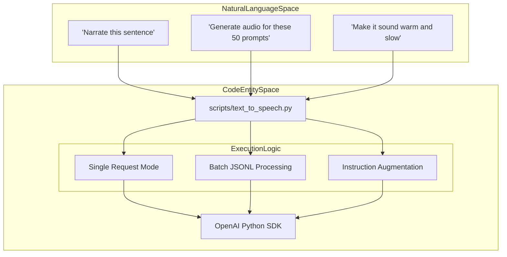
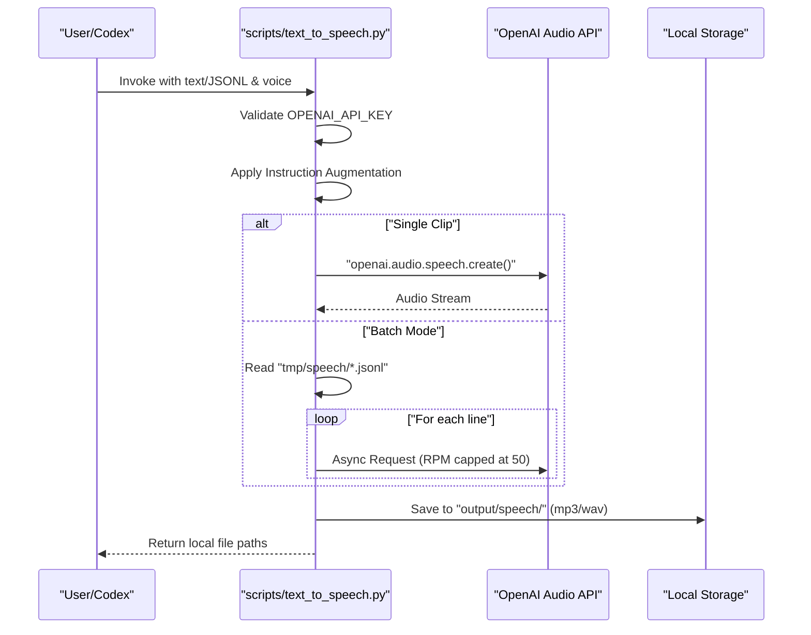

<!-- source: DeepWiki mcp.deepwiki.com · repo openai/skills · extra page Speech Generation · fetched 2026-10-30 -->

# Speech Generation

Relevant source files

The following files were used as context for generating this wiki page:

- [skills/.curated/pdf/SKILL.md](skills/.curated/pdf/SKILL.md)
- [skills/.curated/pdf/agents/openai.yaml](skills/.curated/pdf/agents/openai.yaml)
- [skills/.curated/screenshot/SKILL.md](skills/.curated/screenshot/SKILL.md)
- [skills/.curated/screenshot/agents/openai.yaml](skills/.curated/screenshot/agents/openai.yaml)
- [skills/.curated/speech/SKILL.md](skills/.curated/speech/SKILL.md)
- [skills/.curated/speech/agents/openai.yaml](skills/.curated/speech/agents/openai.yaml)
- [skills/.curated/yeet/SKILL.md](skills/.curated/yeet/SKILL.md)

The speech skill provides a comprehensive interface for text-to-speech narration, voiceovers, and accessibility reads within the Agent Skills framework. It leverages the OpenAI Audio API to generate high-quality spoken audio using the `gpt-4o-mini-tts` model [skills/.curated/speech/SKILL.md:1-9](). The skill is centered around a bundled Python CLI (`text_to_speech.py`) that supports single-clip generation and high-throughput batch processing via JSONL files [skills/.curated/speech/SKILL.md:20-27]().

## System Architecture

The speech skill bridges natural language requests to the OpenAI Audio API through a structured command-line interface. It manages the conversion of text into audio assets while applying stylistic augmentations.

### Natural Language to Code Entity Map

The following diagram illustrates how user intent is mapped to specific execution paths and parameters within the `text_to_speech.py` CLI.

**Intent Mapping Architecture**

Sources: [skills/.curated/speech/SKILL.md:15-24](), [skills/.curated/speech/SKILL.md:66-67](), [skills/.curated/speech/SKILL.md:135]()

### Data Flow and Lifecycle

The speech generation process follows a deterministic flow from input collection to local file storage.

**Speech Generation Lifecycle**

Sources: [skills/.curated/speech/SKILL.md:20-32](), [skills/.curated/speech/SKILL.md:46-48](), [skills/.curated/speech/SKILL.md:63](), [skills/.curated/speech/SKILL.md:66]()

## Core Capabilities

### 1. Model and Voice Selection
*   **Model:** Defaults to `gpt-4o-mini-tts-2025-12-15` [skills/.curated/speech/SKILL.md:58]().
*   **Voices:** Uses built-in voices such as `cedar` (default) and `marin` (brighter tone) [skills/.curated/speech/SKILL.md:59-60](). Custom voice creation is explicitly out of scope [skills/.curated/speech/SKILL.md:3-4]().
*   **Constraints:** Input length is limited to 4096 characters per request [skills/.curated/speech/SKILL.md:62]().

### 2. Batch Processing
For requests involving multiple lines or prompts, the skill utilizes a batch workflow:
*   **JSONL Format:** Jobs are written to a temporary JSONL file in `tmp/speech/` [skills/.curated/speech/SKILL.md:22, 30]().
*   **Throughput:** The CLI enforces a rate limit of 50 requests per minute (RPM) [skills/.curated/speech/SKILL.md:63]().
*   **Cleanup:** Temporary batch files are deleted upon completion [skills/.curated/speech/SKILL.md:22]().

### 3. Instruction Augmentation
The skill transforms user stylistic preferences into a structured "labeled spec" to guide the TTS model without altering the source text [skills/.curated/speech/SKILL.md:23, 71]().

| Category | Description |
| :--- | :--- |
| `Voice Affect` | Overall character and texture of the voice |
| `Tone` | Attitude, formality, or warmth |
| `Pacing` | Speed (slow, steady, brisk) |
| `Pronunciation` | Hints for acronyms or specific emphasis |

Sources: [skills/.curated/speech/SKILL.md:77-87](), [skills/.curated/speech/SKILL.md:112-117]()

## Technical Reference

### CLI Usage (`text_to_speech.py`)
The primary interface for generation. It requires the `openai` Python package and a valid `OPENAI_API_KEY` [skills/.curated/speech/SKILL.md:37-47]().

*   **Output Paths:** Uses `--out` for single files or `--out-dir` for batches [skills/.curated/speech/SKILL.md:32]().
*   **Conventions:** Final artifacts are stored under `output/speech/` [skills/.curated/speech/SKILL.md:31]().

### Use Case Modules
The skill provides targeted defaults and templates for specific scenarios:
*   **Narration/Explainer:** Steady pacing and friendly tones [skills/.curated/speech/SKILL.md:123, 140]().
*   **IVR/Phone Prompts:** Clear, neutral delivery with slow pacing [skills/.curated/speech/SKILL.md:109, 125]().
*   **Accessibility:** Optimized for reading clarity [skills/.curated/speech/SKILL.md:126, 143]().

### Guardrails
*   **Disclosure:** Users must be informed that the audio is AI-generated [skills/.curated/speech/SKILL.md:65]().
*   **API Usage:** Raw HTTP calls are prohibited; the OpenAI Python SDK must be used [skills/.curated/speech/SKILL.md:66]().
*   **Security:** Never paste API keys into chat; they must be set as environment variables [skills/.curated/speech/SKILL.md:53]().

Sources: [skills/.curated/speech/SKILL.md:46-53](), [skills/.curated/speech/SKILL.md:57-68](), [skills/.curated/speech/SKILL.md:135-145]()

---

