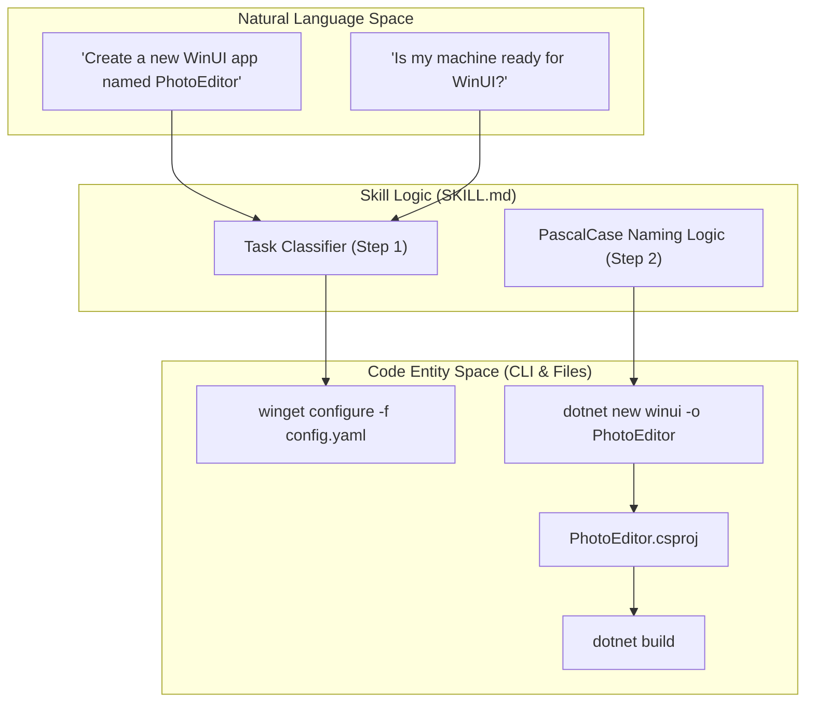
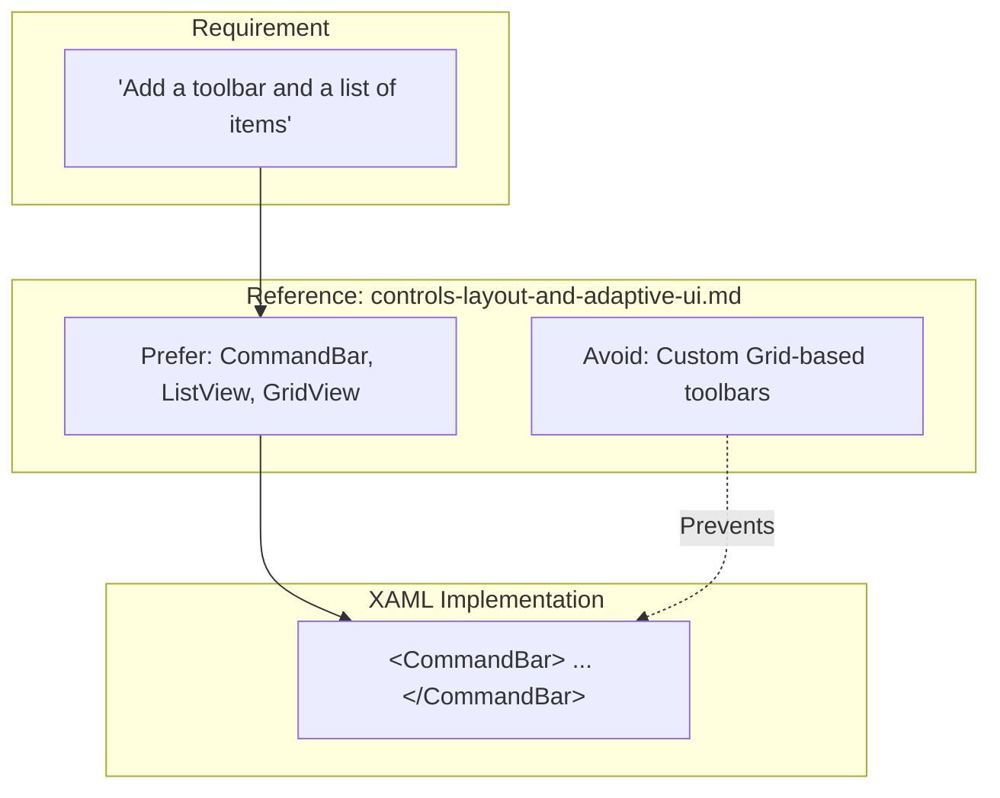

<!-- source: DeepWiki mcp.deepwiki.com · repo openai/skills · extra page WinUI App · fetched 2026-10-30 -->

# WinUI App

Relevant source files

The following files were used as context for generating this wiki page:

- [skills/.curated/winui-app/assets/winui.png](skills/.curated/winui-app/assets/winui.png)

The `winui-app` skill provides a comprehensive toolkit for bootstrapping, developing, and designing modern WinUI 3 desktop applications using C# and the Windows App SDK. It integrates official Microsoft guidance, WinUI Gallery patterns, and CommunityToolkit components into a streamlined workflow that covers everything from machine environment auditing to final app verification.

## Overview and Purpose

This skill is designed to handle the full lifecycle of a WinUI 3 application. It automates the complex setup requirements of the Windows development environment and provides grounded implementation patterns for XAML, navigation, and windowing.

Key capabilities include:
*   **Environment Bootstrapping**: Using WinGet configuration to install Visual Studio components and the Windows App SDK [skills/.curated/winui-app/SKILL.md:22-22]().
*   **Project Scaffolding**: Utilizing `dotnet new winui` with supported flags for MVVM, Central Package Management, and packaging models [skills/.curated/winui-app/SKILL.md:34-34]().
*   **Reference-Grounded Development**: Leveraging a curated library of Microsoft Learn and WinUI Gallery patterns [skills/.curated/winui-app/SKILL.md:43-45]().
*   **Verification Loops**: Automated building and launching of applications to ensure functional UI and responsive windows [skills/.curated/winui-app/SKILL.md:35-41]().

Sources: [skills/.curated/winui-app/SKILL.md:1-45](), [skills/.curated/winui-app/agents/openai.yaml:1-6]()

## Architectural Logic: From Request to Running App

The `winui-app` skill follows a strict "Required Flow" to ensure the development environment is stable before code is written. It transitions from natural language requirements to concrete CLI actions and file system entities.

### Natural Language to Code Entity Mapping

The following diagram illustrates how user intent is mapped to specific WinUI development entities and commands.

**Intent Mapping Diagram**

Sources: [skills/.curated/winui-app/SKILL.md:10-36]()

## Core Implementation Workflows

### 1. Environment Setup and Bootstrapping
The skill uses a bundled `config.yaml` with WinGet to ensure the developer machine has the necessary workloads. This includes Developer Mode, Visual Studio Community, and the Managed Desktop workloads.

*   **Command**: `winget configure -f config.yaml --accept-configuration-agreements --disable-interactivity` [skills/.curated/winui-app/SKILL.md:22-22]().
*   **Validation**: The skill verifies the template availability using `dotnet new list winui` before proceeding [skills/.curated/winui-app/SKILL.md:30-30]().

### 2. Project Scaffolding
When creating a new application, the skill defaults to a PascalCase naming convention and uses the standard `dotnet` template.

| Feature | Template Option |
| :--- | :--- |
| **Framework** | `-f net10.0` (or 9.0/8.0) |
| **Solution Format** | `-slnx` |
| **Dependency Mgmt** | `-cpm` (Central Package Management) |
| **Architecture** | `-mvvm` or `-imt` (MVVM Toolkit) |
| **Packaging** | `--unpackaged` (defaults to false/packaged) |

Sources: [skills/.curated/winui-app/SKILL.md:34-34]()

### 3. Packaging Models
The skill distinguishes between two primary deployment models:
*   **Packaged**: Default for Store-like workflows and Visual Studio F5 flows.
*   **Unpackaged**: Preferred for repeatable CLI build-and-run loops and direct `.exe` launches.

Sources: [skills/.curated/winui-app/SKILL.md:38-38](), [skills/.curated/winui-app/references/foundation-setup-and-project-selection.md:46-48]()

## Technical Reference Library

The skill utilizes specialized reference files to guide implementation details.

### UI and Layout Principles
The `controls-layout-and-adaptive-ui.md` reference enforces "WinUI-first" design.

**UI Implementation Data Flow**

Sources: [skills/.curated/winui-app/references/controls-layout-and-adaptive-ui.md:15-34]()

### Key Layout Guidelines
*   **Command Surfaces**: Use `CommandBar` for grouped actions before building custom rows with `Grid` or `StackPanel` [skills/.curated/winui-app/references/controls-layout-and-adaptive-ui.md:18-19]().
*   **Scroll Ownership**: Explicitly define scroll ownership. For vertical pages with horizontal "shelves," use a horizontal `ScrollViewer` containing an `ItemsRepeater` rather than nested `GridView` controls which cause scroll conflicts [skills/.curated/winui-app/references/controls-layout-and-adaptive-ui.md:45-47]().
*   **Adaptive UI**: Design for "effective pixels" and ensure the smallest supported layout (phone-width) is fully usable by stacking content vertically instead of clipping desktop rails [skills/.curated/winui-app/references/controls-layout-and-adaptive-ui.md:58-67]().

## Verification and Recovery

The skill mandates a "Build and Run" loop for every change:
1.  **Edit**: Minimal, complete XAML/C# edits.
2.  **Build**: `dotnet build` against the `.csproj` [skills/.curated/winui-app/SKILL.md:35-35]().
3.  **Launch**: Execute the app based on its packaging model.
4.  **Observe**: Confirm a responsive top-level window exists (process exit code is not enough) [skills/.curated/winui-app/SKILL.md:41-41]().

### Troubleshooting XAML Compiler Failures
For opaque errors like `MSB3073` or `XamlCompiler.exe` failures, the skill refers to `foundation-template-first-recovery.md` to simplify the project back toward the standard `dotnet new winui` scaffold before attempting custom fixes.

Sources: [skills/.curated/winui-app/SKILL.md:39-40]()

---

