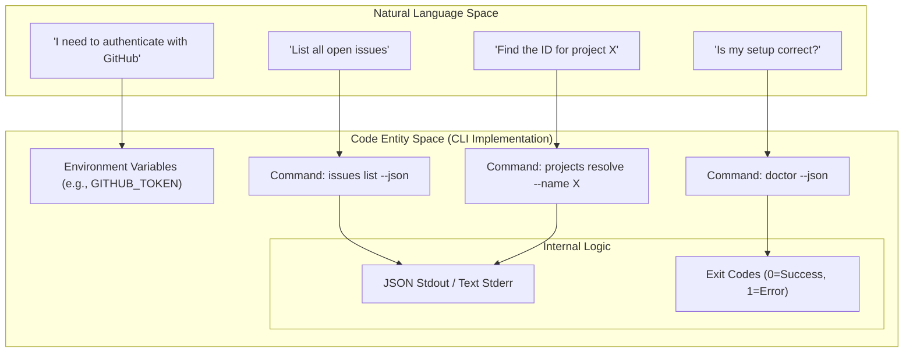
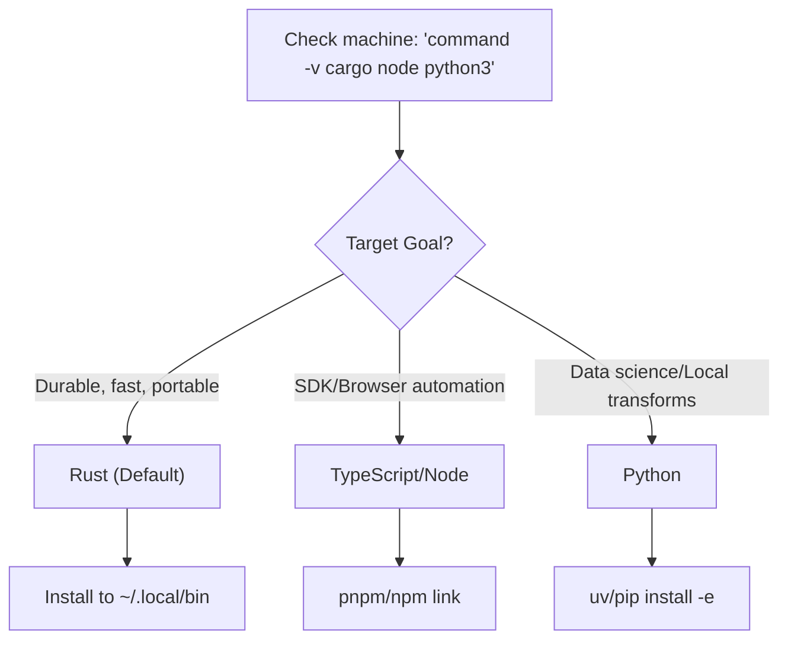

<!-- source: DeepWiki mcp.deepwiki.com · repo openai/skills · extra page CLI Creator · fetched 2026-10-30 -->

# CLI Creator

Relevant source files

The following files were used as context for generating this wiki page:

- [skills/.curated/cli-creator/LICENSE.txt](skills/.curated/cli-creator/LICENSE.txt)
- [skills/.curated/cli-creator/SKILL.md](skills/.curated/cli-creator/SKILL.md)
- [skills/.curated/cli-creator/agents/openai.yaml](skills/.curated/cli-creator/agents/openai.yaml)
- [skills/.curated/cli-creator/references/agent-cli-patterns.md](skills/.curated/cli-creator/references/agent-cli-patterns.md)

The `cli-creator` skill enables Codex to build durable, composable, and machine-readable Command Line Interfaces (CLIs) from various source materials, including API documentation, OpenAPI specifications, SDKs, or existing scripts. Unlike one-off scripts, this skill focuses on creating tools that are installed on the system `PATH`, return structured JSON, and are designed for repeated use by AI agents across different repositories.

Sources: [skills/.curated/cli-creator/SKILL.md:1-10](), [skills/.curated/cli-creator/agents/openai.yaml:1-5]()

## Architectural Patterns

The `cli-creator` follows a "Command Layer" mental model, where the CLI serves as the primary interface between the AI agent and external services or data sources. It prioritizes composable primitives over monolithic "do-it-all" commands.

### Agent-CLI Design Principles
CLIs generated by this skill are expected to follow specific patterns to ensure they are "agent-friendly":

*   **Discovery**: Commands to list top-level containers (accounts, projects, workspaces, channels). [skills/.curated/cli-creator/references/agent-cli-patterns.md:75](), [skills/.curated/cli-creator/SKILL.md:59]()
*   **Resolution**: Commands to turn human-readable names, URLs, or slugs into stable IDs to prevent repeated broad searches. [skills/.curated/cli-creator/references/agent-cli-patterns.md:76](), [skills/.curated/cli-creator/SKILL.md:60]()
*   **Reading**: Structured fetching of objects (issues, events, threads) with pagination support via `--limit`, cursors, or offsets. [skills/.curated/cli-creator/references/agent-cli-patterns.md:77](), [skills/.curated/cli-creator/SKILL.md:61]()
*   **Writing**: Narrow, named actions (create, update, delete) that support `--dry-run`, `draft`, or `preview` modes. [skills/.curated/cli-creator/SKILL.md:62]()
*   **Escape Hatch**: A raw request command (e.g., `tool-name request get /path`) for cases where high-level abstractions are missing. [skills/.curated/cli-creator/SKILL.md:64](), [skills/.curated/cli-creator/references/agent-cli-patterns.md:116-128]()

### Natural Language to Code Entity Mapping

The following diagram illustrates how natural language requirements are translated into specific CLI code structures and behaviors.

**Diagram: Requirement to Implementation Mapping**

Sources: [skills/.curated/cli-creator/references/agent-cli-patterns.md:5-102](), [skills/.curated/cli-creator/SKILL.md:59-68]()

## Implementation Workflow

The creation of a CLI follows a structured build workflow to ensure reliability and discoverability. Before scaffolding, the skill checks if the command name is already taken using `command -v <tool-name>`. [skills/.curated/cli-creator/SKILL.md:22-28]()

### Build Phases
| Phase | Action | Purpose |
| :--- | :--- | :--- |
| **1. Inventory** | Read docs/specs | Identify resources, auth, pagination, and IDs. [skills/.curated/cli-creator/SKILL.md:88]() |
| **2. Sketch** | Define surface | Agree on command names and flags in chat. [skills/.curated/cli-creator/SKILL.md:89]() |
| **3. Scaffold** | Initialize repo | Create project structure and README. [skills/.curated/cli-creator/SKILL.md:90]() |
| **4. Implement** | Code commands | Build `doctor`, discovery, and read paths. [skills/.curated/cli-creator/SKILL.md:91]() |
| **5. Install** | Link to PATH | Ensure `tool-name` works globally. [skills/.curated/cli-creator/SKILL.md:92]() |
| **6. Validate** | Smoke test | Verify execution from outside the source folder. [skills/.curated/cli-creator/SKILL.md:93]() |

Sources: [skills/.curated/cli-creator/SKILL.md:87-95]()

### Runtime Selection Logic
The skill selects a runtime based on the user's environment and the specific requirements of the tool.

**Diagram: Runtime Decision Flow**

Sources: [skills/.curated/cli-creator/SKILL.md:32-46]()

## Auth and Configuration

The `cli-creator` enforces a strict precedence for authentication to prevent credential leakage and ensure ease of use.

1.  **Environment Variables**: The primary method (e.g., `GITHUB_TOKEN`). [skills/.curated/cli-creator/SKILL.md:74]()
2.  **Config Files**: Persistent storage (e.g., `~/.<tool-name>/config.toml`). [skills/.curated/cli-creator/SKILL.md:75]()
3.  **Flags**: Used only for one-off overrides (e.g., `--api-key`). Flags are discouraged for normal use as they leak into shell history. [skills/.curated/cli-creator/SKILL.md:76-77]()

The `doctor --json` command is a mandatory implementation detail. It must report:
*   Whether a token is available and its source category. [skills/.curated/cli-creator/SKILL.md:78]()
*   Endpoint reachability and version. [skills/.curated/cli-creator/SKILL.md:57]()
*   Machine-readable error shapes that redact credentials. [skills/.curated/cli-creator/SKILL.md:68](), [skills/.curated/cli-creator/references/agent-cli-patterns.md:91]()

Sources: [skills/.curated/cli-creator/SKILL.md:70-79](), [skills/.curated/cli-creator/references/agent-cli-patterns.md:102]()

## Companion Skill Pairing

Every CLI created via `cli-creator` should be paired with a "Companion Skill". This is a lightweight `SKILL.md` file that teaches Codex how to use the newly created tool.

### Companion Skill Contract
The companion skill must:
*   **Prefer System PATH**: Instruct Codex to use the installed binary. [skills/.curated/cli-creator/references/agent-cli-patterns.md:147]()
*   **Structured Analysis**: Mandate the use of `--json` for output parsing. [skills/.curated/cli-creator/references/agent-cli-patterns.md:148]()
*   **Safety Constraints**: Define "safe" workflows (e.g., "Do not publish/delete unless the user asked"). [skills/.curated/cli-creator/references/agent-cli-patterns.md:149-150]()
*   **Pathfinding**: Provide example command sequences for common jobs. [skills/.curated/cli-creator/references/agent-cli-patterns.md:132-144]()

Sources: [skills/.curated/cli-creator/references/agent-cli-patterns.md:130-155]()

---

