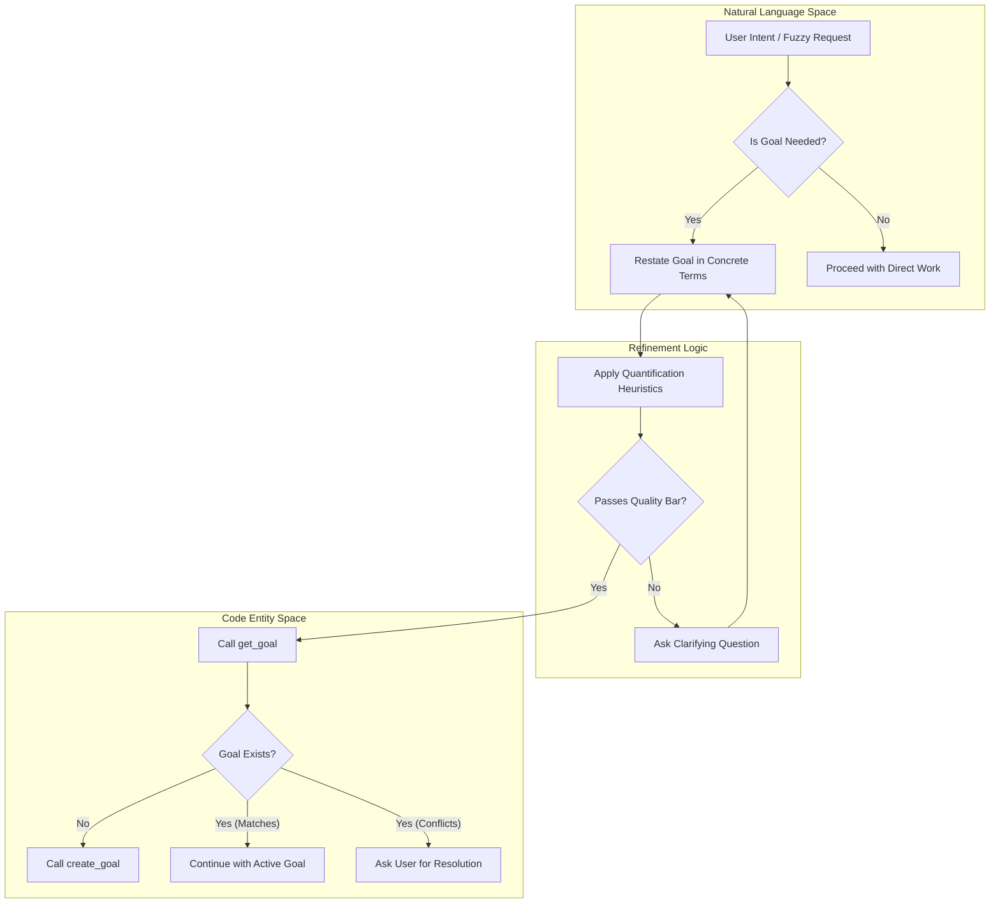
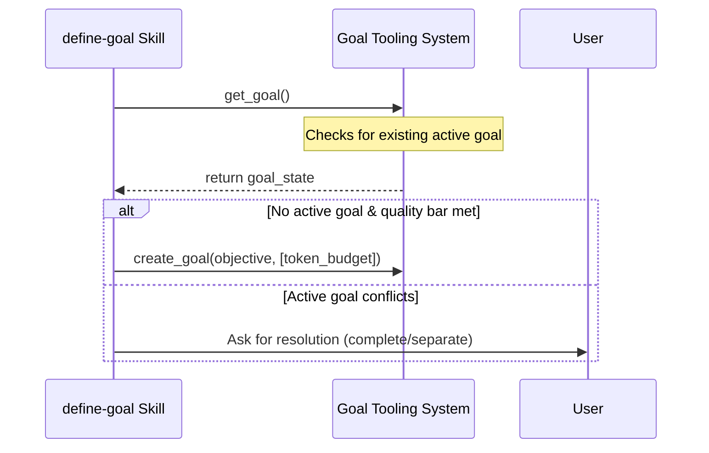

<!-- source: DeepWiki mcp.deepwiki.com · repo openai/skills · extra page define-goal · fetched 2026-10-30 -->

# define-goal

Relevant source files

The following files were used as context for generating this wiki page:

- [skills/.curated/define-goal/LICENSE.txt](skills/.curated/define-goal/LICENSE.txt)
- [skills/.curated/define-goal/SKILL.md](skills/.curated/define-goal/SKILL.md)
- [skills/.curated/define-goal/agents/openai.yaml](skills/.curated/define-goal/agents/openai.yaml)

The `define-goal` skill is a curated capability designed to shape fuzzy user intentions into concrete, measurable objectives. It acts as a quality filter and initialization step for goal-backed work, ensuring that an agent has a clear success criterion, verification method, and bounded scope before execution begins [skills/.curated/define-goal/SKILL.md:1-12]().

## Overview

The primary purpose of `define-goal` is to transform intent into an objective that an agent can pursue honestly [skills/.curated/define-goal/SKILL.md:9-10](). It focuses exclusively on goal definition and the invocation of the goal-tooling interface; it is explicitly prohibited from managing intermediate planning artifacts like decision logs, durable snapshots, or resume files [skills/.curated/define-goal/SKILL.md:12-13]().

### When to Use
- When a user explicitly invokes `$define-goal` [skills/.curated/define-goal/SKILL.md:17]().
- When a user asks to "set an objective" or "clarify success criteria" [skills/.curated/define-goal/SKILL.md:2-3]().
- When turning a "fuzzy intention" into a quantitative outcome [skills/.curated/define-goal/SKILL.md:3]().
- **Skip** if the user is asking for ordinary implementation work without requesting a goal-backed structure [skills/.curated/define-goal/SKILL.md:18]().

## Workflow and Logic

The skill follows a structured workflow to validate and refine the goal before committing it to the system state.

### Goal Definition Workflow
"Natural Language Space" (User Intent) to "Code Entity Space" (Tool Calls)

Sources: [skills/.curated/define-goal/SKILL.md:15-52]()

### Quantification Heuristics
The skill applies specific heuristics to ensure the goal is measurable [skills/.curated/define-goal/SKILL.md:80-88]():

| Domain | Success Definition |
| :--- | :--- |
| **Bugs** | Reproduction first, fix second, failing-then-passing validator [skills/.curated/define-goal/SKILL.md:82](). |
| **Tests** | Name exact command and required pass condition [skills/.curated/define-goal/SKILL.md:83](). |
| **Performance** | Metric, target threshold, measurement method, and run count [skills/.curated/define-goal/SKILL.md:84](). |
| **Quality** | Observable bar (e.g., lint/typecheck pass, user-approved artifact) [skills/.curated/define-goal/SKILL.md:85](). |
| **Research** | Sources in scope and the decision the research enables [skills/.curated/define-goal/SKILL.md:86](). |

## Goal Quality Bar

Before calling `create_goal`, the objective must meet a specific quality bar. It must answer:
1. What concrete thing will be true? [skills/.curated/define-goal/SKILL.md:58]()
2. What evidence will prove it? [skills/.curated/define-goal/SKILL.md:59]()
3. What is the quantitative/binary threshold for success? [skills/.curated/define-goal/SKILL.md:60]()
4. What are the scope boundaries? [skills/.curated/define-goal/SKILL.md:61]()

### Examples of the Quality Bar

| Quality | Example Objective |
| :--- | :--- |
| **Good** | "Reduce checkout API p95 latency below 250 ms... verify with `npm run test:checkout`... across 3 consecutive runs." [skills/.curated/define-goal/SKILL.md:66-67]() |
| **Weak** | "Make checkout faster." [skills/.curated/define-goal/SKILL.md:74]() |
| **Weak** | "Keep investigating the PR comments." [skills/.curated/define-goal/SKILL.md:78]() |

Sources: [skills/.curated/define-goal/SKILL.md:54-80]()

## Tool Interface

The skill interacts with the underlying system via two primary tool calls.

### System Interaction Diagram

Sources: [skills/.curated/define-goal/SKILL.md:41-52]()

### Interface Configuration
The skill's metadata is defined in `openai.yaml`:
- **Display Name**: "Define Goal" [skills/.curated/define-goal/agents/openai.yaml:2]()
- **Short Description**: "Shape clear measurable goals" [skills/.curated/define-goal/agents/openai.yaml:3]()
- **Default Prompt**: Instructs the agent to use `$define-goal` to turn intentions into concrete goals [skills/.curated/define-goal/agents/openai.yaml:4]().

## Implementation Details

- **File Path**: `skills/.curated/define-goal/`
- **License**: Apache License 2.0 [skills/.curated/define-goal/LICENSE.txt:1-20]()
- **Frontmatter Name**: `define-goal` [skills/.curated/define-goal/SKILL.md:2]()

### Constraints
- Do not call `create_goal` for ordinary multi-step tasks unless explicitly requested [skills/.curated/define-goal/SKILL.md:52]().
- Avoid "activity goals" (e.g., "make progress") [skills/.curated/define-goal/SKILL.md:39]().
- Only include a `token_budget` if the user explicitly requested one [skills/.curated/define-goal/SKILL.md:51]().

Sources: [skills/.curated/define-goal/SKILL.md:1-52](), [skills/.curated/define-goal/agents/openai.yaml:1-5]()

---

