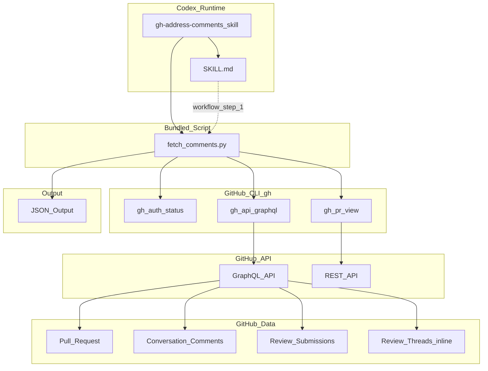
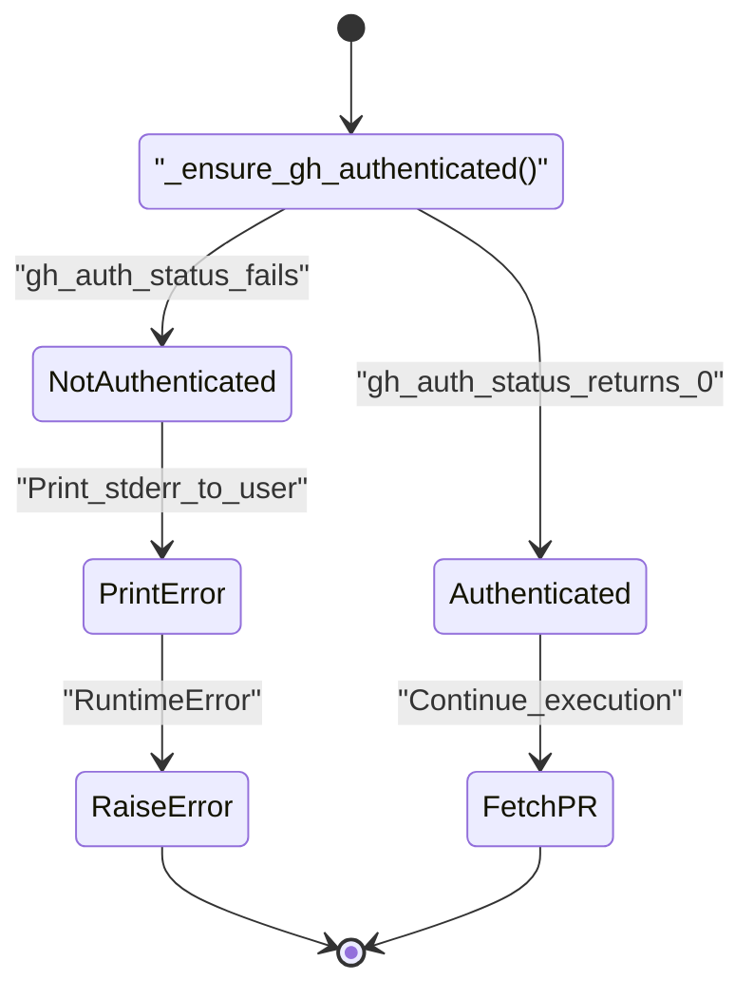
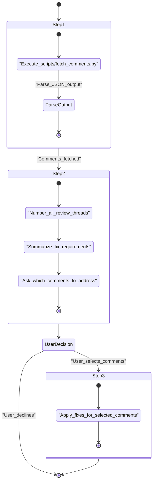
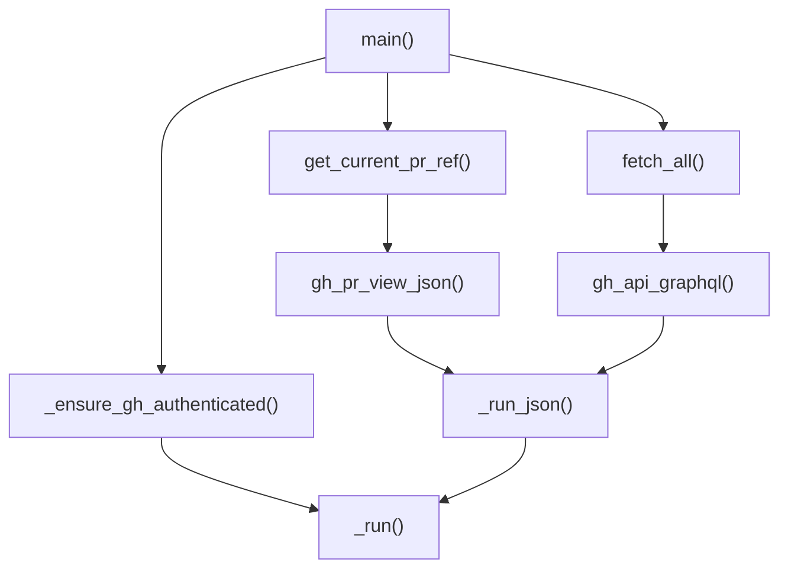
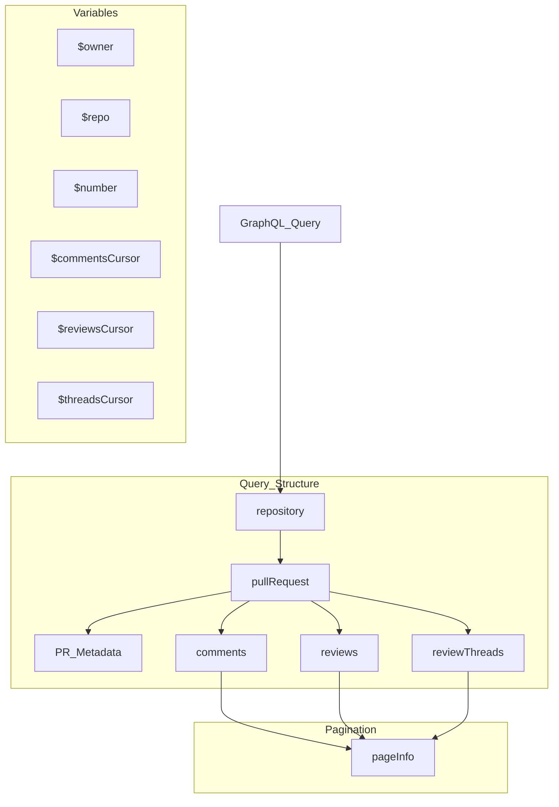
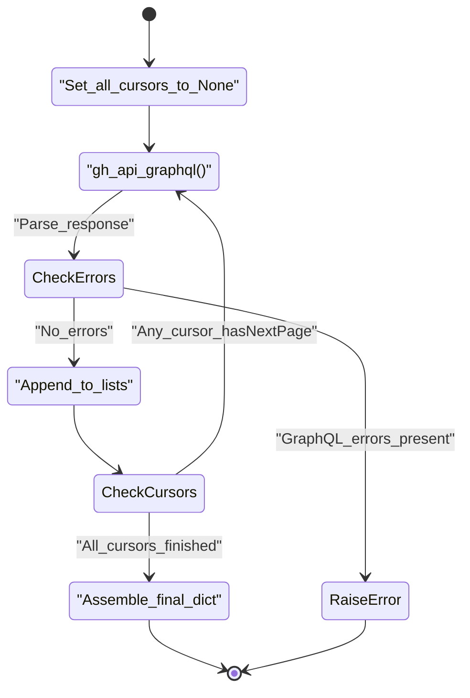
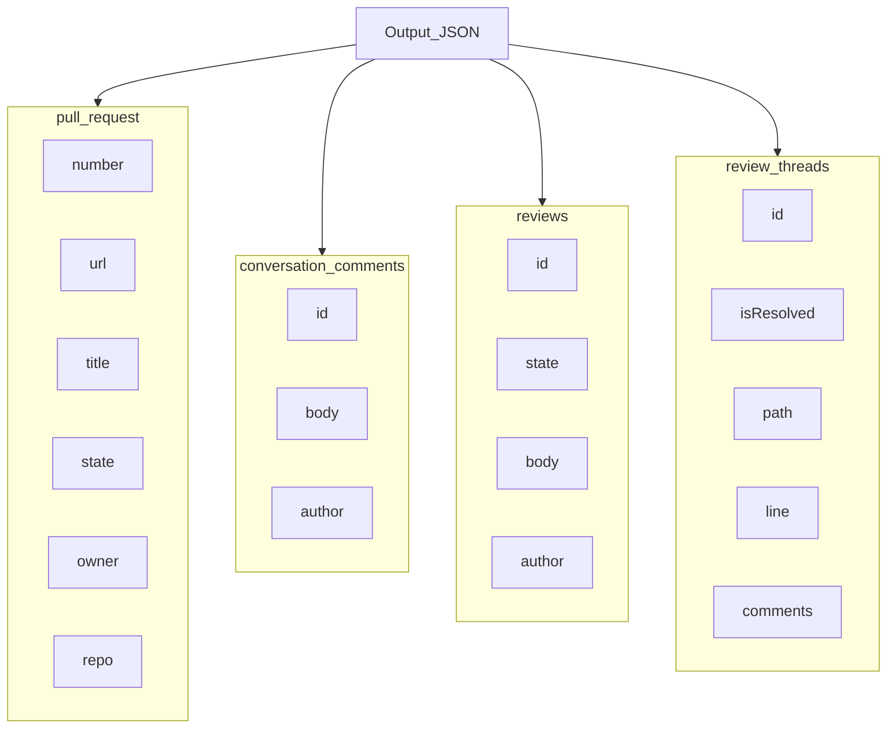

<!-- source: DeepWiki mcp.deepwiki.com · repo openai/skills · extra page gh-address-comments · fetched 2026-10-30 -->

# gh-address-comments

<details>
<summary>Relevant source files</summary>

The following files were used as context for generating this wiki page:

- [skills/.curated/gh-address-comments/LICENSE.txt](skills/.curated/gh-address-comments/LICENSE.txt)
- [skills/.curated/gh-address-comments/SKILL.md](skills/.curated/gh-address-comments/SKILL.md)
- [skills/.curated/gh-address-comments/scripts/fetch_comments.py](skills/.curated/gh-address-comments/scripts/fetch_comments.py)
- [skills/.curated/gh-fix-ci/LICENSE.txt](skills/.curated/gh-fix-ci/LICENSE.txt)
- [skills/.curated/gh-fix-ci/SKILL.md](skills/.curated/gh-fix-ci/SKILL.md)
- [skills/.curated/gh-fix-ci/assets/github.png](skills/.curated/gh-fix-ci/assets/github.png)
- [skills/.curated/gh-fix-ci/scripts/inspect_pr_checks.py](skills/.curated/gh-fix-ci/scripts/inspect_pr_checks.py)

</details>


This page documents the `gh-address-comments` skill, a curated skill that helps users address review and issue comments on GitHub pull requests. The skill provides an automated workflow for fetching PR comments, presenting them to the user for triage, and applying fixes for selected comments. 

For information about CI failure diagnosis, see [gh-fix-ci](5.1.1). For general GitHub integration patterns, see [GitHub Integration Skills](5.1).

**Sources:** [skills/.curated/gh-address-comments/SKILL.md:1-6]()

---

## Purpose and Capabilities

The `gh-address-comments` skill automates the process of addressing PR review comments by:

1. Fetching all conversation comments, review submissions, and inline review threads from the current branch's PR [skills/.curated/gh-address-comments/scripts/fetch_comments.py:3-14]().
2. Presenting comments to the user in a numbered, summarized format [skills/.curated/gh-address-comments/SKILL.md:18-19]().
3. Applying fixes for user-selected comments [skills/.curated/gh-address-comments/SKILL.md:21-22]().

The skill operates on the open PR associated with the current Git branch and requires the GitHub CLI (`gh`) for authentication and API access [skills/.curated/gh-address-comments/SKILL.md:10-12]().

**Sources:** [skills/.curated/gh-address-comments/SKILL.md:1-6](), [skills/.curated/gh-address-comments/scripts/fetch_comments.py:3-14]()

---

## System Architecture



**Diagram: System Interaction Model**

This diagram shows how `gh-address-comments` interacts with external systems. The skill loads workflow instructions from `SKILL.md` [skills/.curated/gh-address-comments/SKILL.md:8-26]() and executes `fetch_comments.py` [skills/.curated/gh-address-comments/scripts/fetch_comments.py:1-238]() to retrieve PR data. The script shells out to `gh` CLI commands, which authenticate and interact with GitHub's GraphQL and REST APIs. The script outputs structured JSON containing PR metadata and all comment data.

**Sources:** [skills/.curated/gh-address-comments/SKILL.md:8-26](), [skills/.curated/gh-address-comments/scripts/fetch_comments.py:1-238]()

---

## Prerequisites and Authentication

### GitHub CLI Setup

The skill requires `gh` CLI to be installed and authenticated. The workflow verifies authentication status before executing commands [skills/.curated/gh-address-comments/SKILL.md:12]().

| Requirement | Command | Permissions |
|-------------|---------|-------------|
| Initial authentication | `gh auth login` | One-time setup [skills/.curated/gh-address-comments/SKILL.md:12]() |
| Authentication verification | `gh auth status` | Requires escalated permissions [skills/.curated/gh-address-comments/SKILL.md:12]() |
| Required scopes | N/A | `workflow` and `repo` scopes [skills/.curated/gh-address-comments/SKILL.md:12]() |

The skill explicitly requires elevated network access for all `gh` commands due to sandboxing restrictions. If `gh auth status` fails due to sandboxing, the skill instructs Codex to retry with `sandbox_permissions=require_escalated` [skills/.curated/gh-address-comments/SKILL.md:12]().

**Sources:** [skills/.curated/gh-address-comments/SKILL.md:10-12](), [skills/.curated/gh-address-comments/scripts/fetch_comments.py:110-116]()

### Authentication Verification Flow



**Diagram: Authentication Verification State Machine**

The `_ensure_gh_authenticated()` function at [skills/.curated/gh-address-comments/scripts/fetch_comments.py:110-116]() checks authentication status before proceeding. If authentication fails, the script prints the error message and raises a `RuntimeError`, prompting the user to run `gh auth login`.

**Sources:** [skills/.curated/gh-address-comments/scripts/fetch_comments.py:110-116]()

---

## Three-Step Workflow

The skill follows a structured three-step process defined in the SKILL.md body [skills/.curated/gh-address-comments/SKILL.md:14-22]():



**Diagram: Skill Workflow State Machine**

The workflow implements a three-phase process with explicit user interaction at Step 2.

### Step 1: Inspect Comments

The skill executes `scripts/fetch_comments.py`, which outputs a JSON structure containing:
- `pull_request`: PR metadata (number, URL, title, state, owner, repo) [skills/.curated/gh-address-comments/scripts/fetch_comments.py:196-203]()
- `conversation_comments`: Top-level issue comments [skills/.curated/gh-address-comments/scripts/fetch_comments.py:39-49]()
- `reviews`: Review submissions (approve/request changes/comment) [skills/.curated/gh-address-comments/scripts/fetch_comments.py:52-61]()
- `review_threads`: Inline code review threads with resolution status [skills/.curated/gh-address-comments/scripts/fetch_comments.py:64-88]()

**Sources:** [skills/.curated/gh-address-comments/SKILL.md:14-15](), [skills/.curated/gh-address-comments/scripts/fetch_comments.py:221-226]()

### Step 2: User Triage

The skill presents all comments with:
1. Sequential numbering for each review thread and comment [skills/.curated/gh-address-comments/SKILL.md:18]()
2. Short summaries of required fixes [skills/.curated/gh-address-comments/SKILL.md:18]()
3. Prompt asking which numbered comments should be addressed [skills/.curated/gh-address-comments/SKILL.md:19]()

This step requires user input and is not automated, allowing the user to selectively choose which comments require immediate attention.

**Sources:** [skills/.curated/gh-address-comments/SKILL.md:17-19]()

### Step 3: Apply Fixes

If the user selects comments, the skill applies fixes for those specific comments [skills/.curated/gh-address-comments/SKILL.md:21-22](). The implementation of this step is left to the agent's capabilities, using the comment context and code understanding to make appropriate changes.

**Sources:** [skills/.curated/gh-address-comments/SKILL.md:21-22]()

---

## fetch_comments.py Script Architecture

### Core Functions

The script provides a layered architecture for fetching PR data:



**Diagram: Function Call Hierarchy**

The script uses a three-tier function architecture:
1. **Entry point**: `main()` orchestrates the workflow [skills/.curated/gh-address-comments/scripts/fetch_comments.py:229-233]()
2. **Business logic**: `get_current_pr_ref()` [skills/.curated/gh-address-comments/scripts/fetch_comments.py:123-133]() and `fetch_all()` [skills/.curated/gh-address-comments/scripts/fetch_comments.py:170-227]() handle PR resolution and data fetching
3. **Utilities**: `_run()` [skills/.curated/gh-address-comments/scripts/fetch_comments.py:95-99]() and `_run_json()` [skills/.curated/gh-address-comments/scripts/fetch_comments.py:102-108]() abstract subprocess execution

**Sources:** [skills/.curated/gh-address-comments/scripts/fetch_comments.py:95-237]()

### Key Function Specifications

| Function | Lines | Input | Output | Purpose |
|----------|-------|-------|--------|---------|
| `_run()` | [95-99]() | `cmd: list[str]`, `stdin: str \| None` | `str` | Execute subprocess, capture stdout |
| `_run_json()` | [102-108]() | `cmd: list[str]`, `stdin: str \| None` | `dict[str, Any]` | Execute and parse JSON output |
| `_ensure_gh_authenticated()` | [110-116]() | None | None | Verify `gh auth status`, raise if fails |
| `gh_pr_view_json()` | [118-121]() | `fields: str` | `dict[str, Any]` | Execute `gh pr view --json` |
| `get_current_pr_ref()` | [123-133]() | None | `tuple[str, str, int]` | Resolve (owner, repo, number) for current branch |
| `gh_api_graphql()` | [135-168]() | `owner`, `repo`, `number`, cursors | `dict[str, Any]` | Execute GraphQL query via `gh api graphql` |
| `fetch_all()` | [170-227]() | `owner: str`, `repo: str`, `number: int` | `dict[str, Any]` | Paginate and aggregate all PR data |

**Sources:** [skills/.curated/gh-address-comments/scripts/fetch_comments.py:95-227]()

### PR Reference Resolution

The script resolves the current branch's PR using cross-repository-aware logic [skills/.curated/gh-address-comments/scripts/fetch_comments.py:123-133]():

```python
# At fetch_comments.py:123-133
def get_current_pr_ref() -> tuple[str, str, int]:
    pr = gh_pr_view_json("number,headRepositoryOwner,headRepository")
    owner = pr["headRepositoryOwner"]["login"]
    repo = pr["headRepository"]["name"]
    number = int(pr["number"])
    return owner, repo, number
```

This function queries `gh pr view` for the current branch and extracts the head repository owner (handling forks), the repository name, and the PR number [skills/.curated/gh-address-comments/scripts/fetch_comments.py:128-132]().

**Sources:** [skills/.curated/gh-address-comments/scripts/fetch_comments.py:123-133]()

---

## GraphQL Query Structure

### Query Definition

The script uses a comprehensive GraphQL query [skills/.curated/gh-address-comments/scripts/fetch_comments.py:23-92]() to fetch all PR data in paginated batches:



**Diagram: GraphQL Query Structure**

The query at [scripts/fetch_comments.py:23-92]() defines a single request that fetches:
1. PR metadata (number, URL, title, state)
2. Conversation comments with pagination [skills/.curated/gh-address-comments/scripts/fetch_comments.py:40-49]()
3. Review submissions with pagination [skills/.curated/gh-address-comments/scripts/fetch_comments.py:52-61]()
4. Review threads (inline comments) with pagination [skills/.curated/gh-address-comments/scripts/fetch_comments.py:64-88]()

**Sources:** [skills/.curated/gh-address-comments/scripts/fetch_comments.py:23-92]()

### Pagination Strategy

The `fetch_all()` function implements cursor-based pagination [skills/.curated/gh-address-comments/scripts/fetch_comments.py:181-218]():



**Diagram: Pagination Loop State Machine**

The pagination loop at [scripts/fetch_comments.py:181-218]() continues until all three data types (comments, reviews, threads) have exhausted their pagination cursors.

**Sources:** [skills/.curated/gh-address-comments/scripts/fetch_comments.py:170-227]()

---

## Data Model

### Output JSON Schema

The script outputs a JSON object with the following structure [skills/.curated/gh-address-comments/scripts/fetch_comments.py:221-226]():



**Diagram: Output JSON Schema**

The output structure at [scripts/fetch_comments.py:221-226]() contains four top-level keys.

### Review Threads Schema Details

Review threads represent inline code comments and include position information [skills/.curated/gh-address-comments/scripts/fetch_comments.py:64-88]():

| Field | Type | Description |
|-------|------|-------------|
| `id` | string | GraphQL node ID |
| `isResolved` | boolean | Whether thread is marked resolved |
| `isOutdated` | boolean | Whether thread is on outdated diff |
| `path` | string | File path |
| `line` | int | Line number in new version |
| `diffSide` | enum | `LEFT` (deleted) or `RIGHT` (added) |
| `startLine` | int | Start line for multi-line comments |
| `startDiffSide` | enum | Side for start line |
| `originalLine` | int | Line number in base version |
| `originalStartLine` | int | Start line in base version |
| `resolvedBy` | object | User who resolved (null if unresolved) |
| `comments.nodes[]` | array | Comment objects in thread |

**Sources:** [skills/.curated/gh-address-comments/scripts/fetch_comments.py:64-88]()

---

## Error Handling

### Authentication Failures

The script provides explicit error messages for authentication failures [skills/.curated/gh-address-comments/scripts/fetch_comments.py:110-116]():

```python
# At fetch_comments.py:110-116
def _ensure_gh_authenticated() -> None:
    try:
        _run(["gh", "auth", "status"])
    except RuntimeError:
        print("run `gh auth login` to authenticate the GitHub CLI", file=sys.stderr)
        raise RuntimeError("gh auth status failed; run `gh auth login` to authenticate the GitHub CLI") from None
```

This prints guidance to stderr and raises an exception that propagates to the user.

**Sources:** [skills/.curated/gh-address-comments/scripts/fetch_comments.py:110-116]()

### GraphQL Errors

The pagination loop checks for GraphQL errors in each response [skills/.curated/gh-address-comments/scripts/fetch_comments.py:191-192]():

```python
# At fetch_comments.py:191-192
if "errors" in payload and payload["errors"]:
    raise RuntimeError(f"GitHub GraphQL errors:\n{json.dumps(payload['errors'], indent=2)}")
```

This handles query errors (e.g., invalid PR number, permission denied) by formatting the error array and raising a `RuntimeError`.

**Sources:** [skills/.curated/gh-address-comments/scripts/fetch_comments.py:191-192]()

### Subprocess Failures

The `_run()` utility function handles subprocess failures [skills/.curated/gh-address-comments/scripts/fetch_comments.py:95-99]():

```python
# At fetch_comments.py:95-99
def _run(cmd: list[str], stdin: str | None = None) -> str:
    p = subprocess.run(cmd, input=stdin, capture_output=True, text=True)
    if p.returncode != 0:
        raise RuntimeError(f"Command failed: {' '.join(cmd)}\n{p.stderr}")
    return p.stdout
```

This raises exceptions with the full command and stderr output for debugging.

**Sources:** [skills/.curated/gh-address-comments/scripts/fetch_comments.py:95-99]()

### JSON Parsing Errors

The `_run_json()` function handles malformed JSON responses [skills/.curated/gh-address-comments/scripts/fetch_comments.py:102-108]():

```python
# At fetch_comments.py:102-108
def _run_json(cmd: list[str], stdin: str | None = None) -> dict[str, Any]:
    out = _run(cmd, stdin=stdin)
    try:
        return json.loads(out)
    except json.JSONDecodeError as e:
        raise RuntimeError(f"Failed to parse JSON from command output: {e}\nRaw:\n{out}") from e
```

This provides both the parse error and the raw output for debugging.

**Sources:** [skills/.curated/gh-address-comments/scripts/fetch_comments.py:102-108]()

---

## Usage Example

### Command Execution

When the skill is triggered, the user sees output similar to:

```bash
$ python scripts/fetch_comments.py
{
  "pull_request": {
    "number": 123,
    "url": "https://github.com/openai/skills/pull/123",
    "title": "Add new feature",
    "state": "OPEN",
    "owner": "openai",
    "repo": "skills"
  },
  "conversation_comments": [
    {
      "id": "IC_...",
      "body": "Please update the documentation",
      "createdAt": "2024-01-15T10:00:00Z",
      "updatedAt": "2024-01-15T10:00:00Z",
      "author": {"login": "reviewer1"}
    }
  ],
  "reviews": [...],
  "review_threads": [...]
}
```

The skill then numbers and summarizes these comments, presents them to the user, and waits for selection before applying fixes [skills/.curated/gh-address-comments/SKILL.md:14-22]().

**Sources:** [skills/.curated/gh-address-comments/SKILL.md:14-22](), [skills/.curated/gh-address-comments/scripts/fetch_comments.py:229-237]()

---

## Integration with Codex Runtime

The skill leverages Codex's progressive disclosure model:

1. **Metadata Loading**: The SKILL.md frontmatter (name and description) is loaded at Codex startup [skills/.curated/gh-address-comments/SKILL.md:1-6]()
2. **Body Loading**: The workflow instructions are loaded when the skill triggers [skills/.curated/gh-address-comments/SKILL.md:8-26]()
3. **Script Execution**: The `scripts/fetch_comments.py` script executes without being loaded into context (0 tokens) [skills/.curated/gh-address-comments/SKILL.md:15]()

The description field acts as the trigger condition: "Help address review/issue comments on the open GitHub PR for the current branch" [skills/.curated/gh-address-comments/SKILL.md:3](). When a user query matches this pattern, Codex loads the full workflow and begins execution.

**Sources:** [skills/.curated/gh-address-comments/SKILL.md:1-6]()

---

## Related Skills

For related GitHub workflow automation, see:
- [gh-fix-ci](5.1.1) - Diagnose and fix GitHub Actions CI failures
- [GitHub Integration Skills](5.1) - Overview of all GitHub-focused skills

For information about skill structure and bundled resources, see:
- [Skill Anatomy](4.3) - SKILL.md format and bundled resources
- [Progressive Disclosure](2.2) - How Codex loads skills efficiently

**Sources:** [skills/.curated/gh-address-comments/SKILL.md:1-26]()

---

