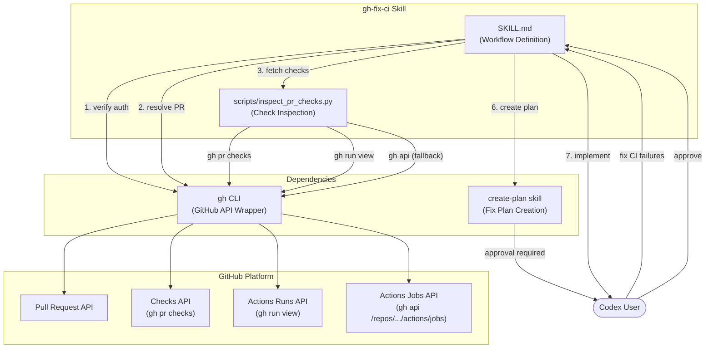
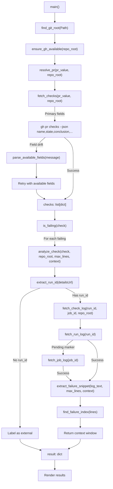

<!-- source: DeepWiki mcp.deepwiki.com · repo openai/skills · extra page gh-fix-ci · fetched 2026-10-30 -->

# gh-fix-ci

<details>
<summary>Relevant source files</summary>

The following files were used as context for generating this wiki page:

- [skills/.curated/gh-address-comments/LICENSE.txt](skills/.curated/gh-address-comments/LICENSE.txt)
- [skills/.curated/gh-address-comments/SKILL.md](skills/.curated/gh-address-comments/SKILL.md)
- [skills/.curated/gh-address-comments/scripts/fetch_comments.py](skills/.curated/gh-address-comments/scripts/fetch_comments.py)
- [skills/.curated/gh-fix-ci/LICENSE.txt](skills/.curated/gh-fix-ci/LICENSE.txt)
- [skills/.curated/gh-fix-ci/SKILL.md](skills/.curated/gh-fix-ci/SKILL.md)
- [skills/.curated/gh-fix-ci/assets/github.png](skills/.curated/gh-fix-ci/assets/github.png)
- [skills/.curated/gh-fix-ci/scripts/inspect_pr_checks.py](skills/.curated/gh-fix-ci/scripts/inspect_pr_checks.py)

</details>


## Purpose and Scope

The `gh-fix-ci` skill automates the diagnosis and repair of failing GitHub Actions CI checks on pull requests. It inspects PR check status, fetches log output from failed workflows, extracts relevant failure snippets, and generates a fix plan for user approval before implementing changes.

This skill focuses exclusively on **GitHub Actions** checks. For external CI systems (e.g., Buildkite, CircleCI), it identifies them as out of scope and reports only their details URL. For addressing PR review comments, see [gh-address-comments]().

**Sources:** [skills/.curated/gh-fix-ci/SKILL.md:1-13]()

---

## Overview

The skill operates in a structured 8-step workflow:

1. Verify `gh` CLI authentication with elevated scopes.
2. Resolve the target PR (from current branch or explicit input).
3. Inspect failing checks using GitHub Actions APIs via `inspect_pr_checks.py`.
4. Filter out external (non-GitHub Actions) checks.
5. Summarize failures with log snippets.
6. Create a fix plan using the `create-plan` skill.
7. Implement approved changes.
8. Suggest revalidation with `gh pr checks`.

The skill depends on the `create-plan` skill for drafting and approving fix plans, ensuring users maintain control over proposed changes.

**Sources:** [skills/.curated/gh-fix-ci/SKILL.md:8-60]()

---

## Prerequisites

### Authentication Requirements

The skill requires authenticated `gh` CLI with escalated permissions:

| Requirement | Command | Notes |
|-------------|---------|-------|
| Initial login | `gh auth login` | One-time setup |
| Verify authentication | `gh auth status` | Must include `workflow` and `repo` scopes |

The `workflow` scope is necessary for fetching GitHub Actions logs via `gh run view --log` and `gh api /repos/{owner}/{repo}/actions/jobs/{job_id}/logs`.

**Sources:** [skills/.curated/gh-fix-ci/SKILL.md:14-15](), [skills/.curated/gh-fix-ci/SKILL.md:29-31]()

---

## Architecture

The skill consists of a declarative workflow definition and a bundled Python script that handles the complexity of GitHub API field drift and log fetching fallbacks.

### System Components to Code Entities



**Sources:** [skills/.curated/gh-fix-ci/SKILL.md:1-70](), [skills/.curated/gh-fix-ci/scripts/inspect_pr_checks.py:1-11]()

---

## Workflow Steps

### Step 1: Verify gh Authentication
The skill first runs `gh auth status` to confirm authentication. If unauthenticated, it instructs the user to run `gh auth login` ensuring `repo` and `workflow` scopes are present.
**Sources:** [skills/.curated/gh-fix-ci/SKILL.md:29-31](), [skills/.curated/gh-fix-ci/scripts/inspect_pr_checks.py:150-159]()

### Step 2: Resolve Target PR
The skill prefers to use the current branch's associated PR via `gh pr view --json number,url`. If the user provides an explicit PR number or URL, that value is used directly.
**Sources:** [skills/.curated/gh-fix-ci/SKILL.md:32-34](), [skills/.curated/gh-fix-ci/scripts/inspect_pr_checks.py:162-179]()

### Step 3: Inspect Failing Checks
The skill invokes the bundled script with configurable parameters:
```bash
python "<path-to-skill>/scripts/inspect_pr_checks.py" --repo "." --pr "<number-or-url>" --json
```
Parameters defined in `parse_args()`:
| Parameter | Default | Purpose |
|-----------|---------|---------|
| `--repo` | `.` | Path to repository root |
| `--pr` | `None` | Explicit PR number or URL |
| `--max-lines` | 160 | Maximum lines in log snippet |
| `--context` | 30 | Context lines around failure marker |
| `--json` | `False` | Emit JSON output for parsing |

**Sources:** [skills/.curated/gh-fix-ci/SKILL.md:36-38](), [skills/.curated/gh-fix-ci/scripts/inspect_pr_checks.py:78-93]()

---

## inspect_pr_checks.py Script

The bundled script at `scripts/inspect_pr_checks.py` handles the complexity of fetching and analyzing GitHub Actions checks. It is designed to be robust against GitHub API field changes.

### Key Functions and Data Flow



**Sources:** [skills/.curated/gh-fix-ci/scripts/inspect_pr_checks.py:96-135](), [skills/.curated/gh-fix-ci/scripts/inspect_pr_checks.py:182-224]()

### Failure Detection Logic
The `is_failing(check)` function identifies failures using multiple signals:

| Field | Failure Values | Code Reference |
|-------|----------------|-----------|
| `conclusion` | `failure`, `cancelled`, `timed_out`, `action_required` | [skills/.curated/gh-fix-ci/scripts/inspect_pr_checks.py:13-18]() |
| `state` | `failure`, `error`, `cancelled`, `timed_out`, `action_required` | [skills/.curated/gh-fix-ci/scripts/inspect_pr_checks.py:20-26]() |
| `bucket` | `fail` | [skills/.curated/gh-fix-ci/scripts/inspect_pr_checks.py:28-28]() |

**Sources:** [skills/.curated/gh-fix-ci/scripts/inspect_pr_checks.py:227-231]()

### Log Fetching Strategy
The script uses a cascading fallback approach to maximize log availability:
1. **`fetch_run_log(run_id)`**: Attempts `gh run view <run_id> --log`.
2. **Pending Detection**: If the log contains `PENDING_LOG_MARKERS` (e.g., "still in progress"), it attempts to fetch specific job logs.
3. **`fetch_job_log(job_id)`**: Uses `gh api "/repos/<owner>/<repo>/actions/jobs/<job_id>/logs"` to get logs for an in-progress or specific job.

**Sources:** [skills/.curated/gh-fix-ci/scripts/inspect_pr_checks.py:45-48](), [skills/.curated/gh-fix-ci/SKILL.md:42-46]()

### Failure Snippet Extraction
The `extract_failure_snippet()` function centers log output around the most relevant failure using `FAILURE_MARKERS` (e.g., "error", "traceback", "exception", "panic"). It extracts a window of `context` lines around the marker, up to `max_lines`.

**Sources:** [skills/.curated/gh-fix-ci/scripts/inspect_pr_checks.py:30-41](), [skills/.curated/gh-fix-ci/scripts/inspect_pr_checks.py:43-44]()

---

## Usage Examples

### Basic Usage (Current Branch PR)
```bash
python "skills/.curated/gh-fix-ci/scripts/inspect_pr_checks.py" --repo "."
```

### JSON Output with Custom Snippet Size
```bash
python "skills/.curated/gh-fix-ci/scripts/inspect_pr_checks.py" --repo "." --pr "123" --json --max-lines 200 --context 40
```

**Sources:** [skills/.curated/gh-fix-ci/SKILL.md:67-69]()

---

## Comparison: gh-fix-ci vs gh-address-comments

While `gh-fix-ci` focuses on automated CI logs, the `gh-address-comments` skill handles human feedback on the PR.

| Feature | `gh-fix-ci` | `gh-address-comments` |
|---------|-------------|-----------------------|
| **Primary Data Source** | GitHub Actions Logs | PR Reviews & Threads |
| **Primary Script** | `inspect_pr_checks.py` | `fetch_comments.py` |
| **Data Fetching** | `gh pr checks` / `gh run view` | `gh api graphql` |
| **Authentication** | `gh auth status` | `gh auth status` |

**Sources:** [skills/.curated/gh-fix-ci/SKILL.md:1-4](), [skills/.curated/gh-address-comments/SKILL.md:1-6](), [skills/.curated/gh-address-comments/scripts/fetch_comments.py:23-92]()

---

