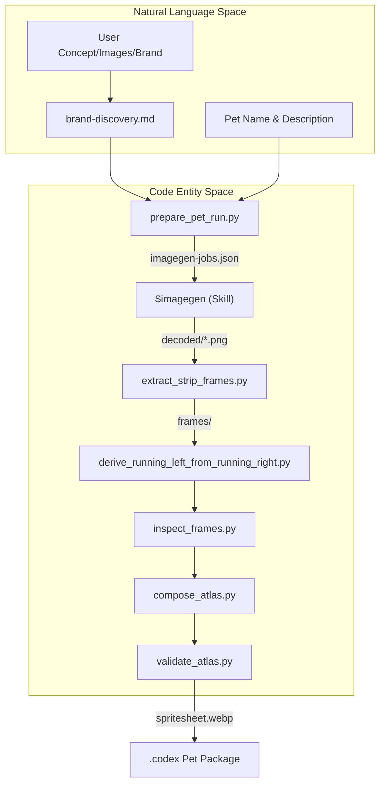
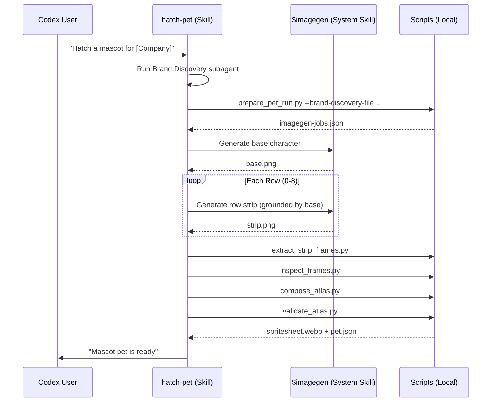

<!-- source: DeepWiki mcp.deepwiki.com · repo openai/skills · extra page hatch-pet · fetched 2026-10-30 -->

# hatch-pet

Relevant source files

The following files were used as context for generating this wiki page:

- [skills/.curated/hatch-pet/SKILL.md](skills/.curated/hatch-pet/SKILL.md)
- [skills/.curated/hatch-pet/agents/openai.yaml](skills/.curated/hatch-pet/agents/openai.yaml)
- [skills/.curated/hatch-pet/references/animation-rows.md](skills/.curated/hatch-pet/references/animation-rows.md)
- [skills/.curated/hatch-pet/references/qa-rubric.md](skills/.curated/hatch-pet/references/qa-rubric.md)
- [skills/.curated/hatch-pet/scripts/compose_atlas.py](skills/.curated/hatch-pet/scripts/compose_atlas.py)
- [skills/.curated/hatch-pet/scripts/derive_running_left_from_running_right.py](skills/.curated/hatch-pet/scripts/derive_running_left_from_running_right.py)
- [skills/.curated/hatch-pet/scripts/extract_strip_frames.py](skills/.curated/hatch-pet/scripts/extract_strip_frames.py)
- [skills/.curated/hatch-pet/scripts/inspect_frames.py](skills/.curated/hatch-pet/scripts/inspect_frames.py)
- [skills/.curated/hatch-pet/scripts/prepare_pet_run.py](skills/.curated/hatch-pet/scripts/prepare_pet_run.py)
- [skills/.curated/hatch-pet/scripts/validate_atlas.py](skills/.curated/hatch-pet/scripts/validate_atlas.py)

The `hatch-pet` skill is a curated capability for creating, repairing, validating, and packaging Codex-compatible animated pet spritesheets from character art, generated images, or brand references [skills/.curated/hatch-pet/SKILL.md:2-3](). It manages the end-to-end workflow of transforming character concepts into a standardized 8x9 animation atlas used by the Codex application [skills/.curated/hatch-pet/SKILL.md:8-10]().

## Overview

This skill provides a structured pipeline for digital pet generation, combining creative AI delegation with deterministic processing scripts. It supports a variety of "pet-safe" visual styles—including pixel, plush, clay, sticker, and flat-vector—to ensure visual consistency and readability at small sizes [skills/.curated/hatch-pet/scripts/prepare_pet_run.py:110-132]().

### Key Capabilities
*   **Brand Discovery**: Optional subagent workflow to extract visual and personality cues from company or product names using web search [skills/.curated/hatch-pet/SKILL.md:40-54]().
*   **Prompt Planning**: Orchestrates state-specific animation prompts (idle, running, jumping, etc.) with strict behavioral requirements [skills/.curated/hatch-pet/scripts/prepare_pet_run.py:33-93]().
*   **Visual Delegation**: Uses the `$imagegen` system skill for all base art and row strip generation to maintain storage efficiency and policy compliance [skills/.curated/hatch-pet/SKILL.md:14-24]().
*   **Deterministic Assembly**: Extracts frames from generated strips, handles chroma-key transparency, and assembles the final 1536x1872 atlas [skills/.curated/hatch-pet/scripts/extract_strip_frames.py:14-26](), [skills/.curated/hatch-pet/scripts/compose_atlas.py:11-17]().
*   **QA & Validation**: Validates geometry, frame counts, and character consistency against a rigorous rubric [skills/.curated/hatch-pet/references/qa-rubric.md:5-12]().

### Data Flow: Concept to Package
The following diagram illustrates the transition from natural language requirements to code-driven execution.

**Pet Generation Pipeline**

Sources: [skills/.curated/hatch-pet/SKILL.md:8-30](), [skills/.curated/hatch-pet/scripts/prepare_pet_run.py:2-12](), [skills/.curated/hatch-pet/scripts/extract_strip_frames.py:1-10]()

## Technical Specifications

### The Codex Pet Contract
To be compatible with the Codex webview, pets must adhere to a strict geometry and file structure [skills/.curated/hatch-pet/references/animation-rows.md:3-4]().

| Attribute | Specification |
| :--- | :--- |
| **Atlas Dimensions** | 1536 x 1872 pixels |
| **Grid Layout** | 8 columns x 9 rows |
| **Cell Size** | 192 x 208 pixels |
| **Format** | PNG or WebP (Lossless) |
| **Transparency** | Required (Unused cells and backgrounds must be transparent) |

Sources: [skills/.curated/hatch-pet/references/animation-rows.md:3-17](), [skills/.curated/hatch-pet/scripts/compose_atlas.py:11-17]()

### Animation Row Map
The atlas defines 9 specific states, each mapped to a row index [skills/.curated/hatch-pet/references/animation-rows.md:5-15]().

| Row | State | Frame Count | Purpose |
| :--- | :--- | :--- | :--- |
| 0 | `idle` | 6 | Calm resting, breathing, and blinking loop |
| 1 | `running-right`| 8 | Rightward drag movement loop |
| 2 | `running-left` | 8 | Leftward drag movement loop (often mirrored) |
| 3 | `waving` | 4 | Greeting or attention gesture |
| 4 | `jumping` | 5 | Hover or playful jump (anticipation to settle) |
| 5 | `failed` | 8 | Blocked, failed, or cancelled reaction |
| 6 | `waiting` | 6 | Waiting for approval, help, or user input |
| 7 | `running` | 6 | Active task work or processing (not foot-running) |
| 8 | `review` | 6 | Ready or completed output review |

Sources: [skills/.curated/hatch-pet/references/animation-rows.md:7-15](), [skills/.curated/hatch-pet/scripts/prepare_pet_run.py:21-31]()

## Implementation Detail

### Visual Generation Delegation
The skill explicitly delegates all visual synthesis to the `$imagegen` system skill [skills/.curated/hatch-pet/SKILL.md:14-18]().
*   **Base Art**: If the user omits references, the base pet is generated from text first and used as the canonical reference for all animation rows [skills/.curated/hatch-pet/SKILL.md:12]().
*   **Row Strips**: Generated as horizontal strips of frames. The `running` row (Row 7) is specifically defined as a "working" state (thinking, typing) rather than literal locomotion [skills/.curated/hatch-pet/scripts/prepare_pet_run.py:73-76]().
*   **Mirroring Logic**: `running-left` can be deterministically mirrored from `running-right` using `derive_running_left_from_running_right.py`. This requires horizontal mirroring while preserving the temporal frame order [skills/.curated/hatch-pet/scripts/derive_running_left_from_running_right.py:53-67]().

### Processing & Extraction
The script `extract_strip_frames.py` handles the conversion of raw generation outputs into atlas-ready frames:
1.  **Chroma Key Removal**: Removes the background color (defaulting to green `#00FF00`) to create transparency [skills/.curated/hatch-pet/scripts/extract_strip_frames.py:66-78]().
2.  **Component Extraction**: Uses connected component analysis to isolate the pet silhouette from background artifacts [skills/.curated/hatch-pet/scripts/extract_strip_frames.py:122-181]().
3.  **Cell Fitting**: Crops the sprite to its bounding box and centers it within the `192x208` cell, applying a 10px margin [skills/.curated/hatch-pet/scripts/extract_strip_frames.py:81-99]().

### Validation Workflow
Validation occurs at multiple levels:
*   **Frame Inspection**: `inspect_frames.py` checks for empty/sparse frames, edge-clipping, and chroma-key residue [skills/.curated/hatch-pet/scripts/inspect_frames.py:143-182]().
*   **Atlas Validation**: `validate_atlas.py` ensures the final composite matches the 1536x1872 dimensions and that unused cells are fully transparent [skills/.curated/hatch-pet/scripts/validate_atlas.py:74-108]().

**System Interaction Diagram**

Sources: [skills/.curated/hatch-pet/SKILL.md:14-35](), [skills/.curated/hatch-pet/scripts/prepare_pet_run.py:2-12](), [skills/.curated/hatch-pet/agents/openai.yaml:4]()

## QA Rubric and Repair
A detailed rubric in `references/qa-rubric.md` defines the acceptance criteria for a "hatch" [skills/.curated/hatch-pet/references/qa-rubric.md:1-5]().

*   **Geometry**: Exact 1536x1872 dimensions and no non-zero RGB residue in transparent pixels [skills/.curated/hatch-pet/references/qa-rubric.md:7-11]().
*   **Character Consistency**: Identical silhouette, face language, and palette across all rows [skills/.curated/hatch-pet/references/qa-rubric.md:16-20]().
*   **App Fitness**: The first frame of the `idle` row must work as a static reduced-motion pet [skills/.curated/hatch-pet/references/qa-rubric.md:42-43]().
*   **Repair Policy**: Developers must repair the smallest failing scope first (single frame -> single row -> full atlas) [skills/.curated/hatch-pet/references/qa-rubric.md:58-64]().

Sources: [skills/.curated/hatch-pet/references/qa-rubric.md:1-67](), [skills/.curated/hatch-pet/scripts/validate_atlas.py:128-132]()

---

