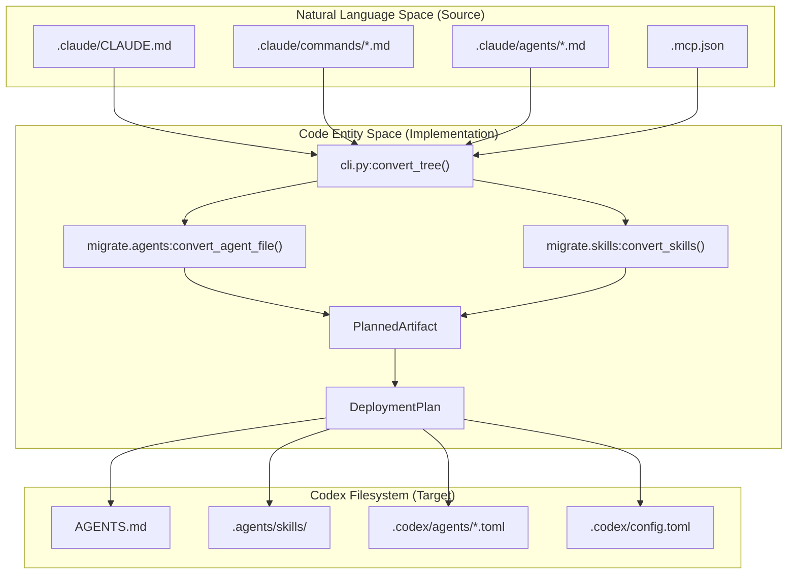
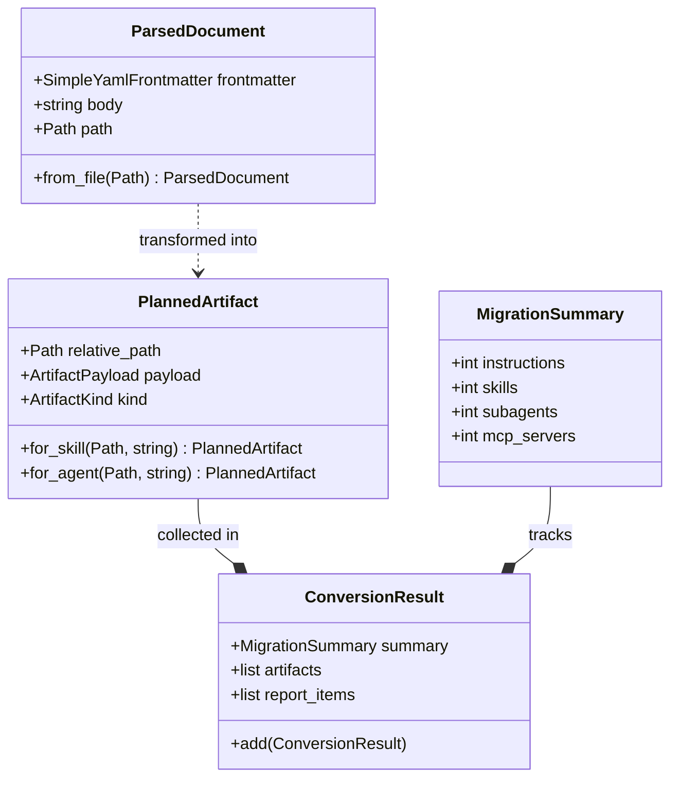

<!-- source: DeepWiki mcp.deepwiki.com · repo openai/skills · extra page migrate-to-codex · fetched 2026-10-30 -->

# migrate-to-codex

Relevant source files

The following files were used as context for generating this wiki page:

- [skills/.curated/migrate-to-codex/LICENSE.txt](skills/.curated/migrate-to-codex/LICENSE.txt)
- [skills/.curated/migrate-to-codex/SKILL.md](skills/.curated/migrate-to-codex/SKILL.md)
- [skills/.curated/migrate-to-codex/agents/openai.yaml](skills/.curated/migrate-to-codex/agents/openai.yaml)
- [skills/.curated/migrate-to-codex/references/differences.md](skills/.curated/migrate-to-codex/references/differences.md)
- [skills/.curated/migrate-to-codex/scripts/cli.py](skills/.curated/migrate-to-codex/scripts/cli.py)
- [skills/.curated/migrate-to-codex/scripts/migrate-to-codex.py](skills/.curated/migrate-to-codex/scripts/migrate-to-codex.py)
- [skills/.curated/migrate-to-codex/scripts/migrate/__init__.py](skills/.curated/migrate-to-codex/scripts/migrate/__init__.py)
- [skills/.curated/migrate-to-codex/scripts/migrate/agents.py](skills/.curated/migrate-to-codex/scripts/migrate/agents.py)
- [skills/.curated/migrate-to-codex/scripts/migrate/codex_config.py](skills/.curated/migrate-to-codex/scripts/migrate/codex_config.py)
- [skills/.curated/migrate-to-codex/scripts/migrate/common.py](skills/.curated/migrate-to-codex/scripts/migrate/common.py)
- [skills/.curated/migrate-to-codex/scripts/migrate/hooks.py](skills/.curated/migrate-to-codex/scripts/migrate/hooks.py)
- [skills/.curated/migrate-to-codex/scripts/migrate/instructions.py](skills/.curated/migrate-to-codex/scripts/migrate/instructions.py)
- [skills/.curated/migrate-to-codex/scripts/migrate/mcps.py](skills/.curated/migrate-to-codex/scripts/migrate/mcps.py)

The `migrate-to-codex` skill provides an automated pipeline for migrating AI agent configurations from Claude Code to Codex. It handles the translation of instructions, slash commands, custom skills, subagents, and Model Context Protocol (MCP) configurations into Codex-native formats while maintaining a self-healing validation loop to ensure migration integrity.

## Overview

The migration process is orchestrated by a CLI tool that scans source directories (global and project-specific), plans the transformation, and deploys artifacts to the Codex project structure.

### Key Capabilities
*   **Instruction Mapping**: Converts `CLAUDE.md` or `claude.md` to `AGENTS.md` symlinks or copies [skills/.curated/migrate-to-codex/scripts/migrate/instructions.py:17-22]().
*   **Skill Conversion**: Transforms `.claude/commands/*.md` and `.claude/skills/` into standard Codex skill directories under `.agents/skills/` [skills/.curated/migrate-to-codex/scripts/migrate/common.py:29-29]().
*   **Agent Translation**: Maps Claude subagents (`.claude/agents/*.md`) to Codex custom agent TOML files (`.codex/agents/*.toml`) [skills/.curated/migrate-to-codex/scripts/migrate/agents.py:14-20]().
*   **Config & MCP**: Migrates `.mcp.json` or `.claude.json` settings into `.codex/config.toml` [skills/.curated/migrate-to-codex/scripts/migrate/codex_config.py:1-6]().
*   **Hook Rewrite**: Converts supported Claude lifecycle hooks into `.codex/hooks.json` [skills/.curated/migrate-to-codex/scripts/migrate/hooks.py:24-24]().

**Sources**: [skills/.curated/migrate-to-codex/SKILL.md:2-3](), [skills/.curated/migrate-to-codex/scripts/migrate/common.py:27-29]()

---

## Migration Pipeline Architecture

The migration follows a structured pipeline managed by `cli.py` and the core script `migrate-to-codex.py`.

### Technical Workflow Diagram
This diagram shows how the `MigrationContext` and `DeploymentPlan` bridge the source Claude files to the target Codex entities.

**Sources**: [skills/.curated/migrate-to-codex/scripts/cli.py:212-229](), [skills/.curated/migrate-to-codex/scripts/migrate/common.py:153-157]()

---

## Surface Converters

The migration is split into specialized modules, each owning a specific "surface" of the configuration.

### 1. Instructions (`instructions.py`)
The converter looks for candidates like `.claude/CLAUDE.md` or `CLAUDE.md` [skills/.curated/migrate-to-codex/scripts/migrate/instructions.py:17-22](). 
*   **Symlink Strategy**: If the content is "provider-neutral" (no mentions of `/hooks` or `.claude/agents/`), it creates a symlink to `AGENTS.md` to avoid duplication [skills/.curated/migrate-to-codex/scripts/migrate/instructions.py:56-57]().
*   **Copy Strategy**: If Claude-specific markers are found, it performs a copy for manual rewrite [skills/.curated/migrate-to-codex/SKILL.md:34-34]().

### 2. Skills and Commands (`skills.py`)
Claude "Slash Commands" are promoted to full Codex skills.
*   **Pathing**: Commands move from `.claude/commands/` to `.agents/skills/source-command-<name>/SKILL.md` [skills/.curated/migrate-to-codex/references/differences.md:21-21]().
*   **Interpolation**: Variables like `$ARGUMENTS` and shell-output interpolation are preserved as prompt guidance within the new `SKILL.md` [skills/.curated/migrate-to-codex/references/differences.md:21-22]().

### 3. Subagents (`agents.py`)
Converts Markdown-based Claude agents to TOML-based Codex agents.
*   **Model Mapping**: Maps Claude model families (Sonnet, Opus) to Codex equivalents (GPT-5.4 family) [skills/.curated/migrate-to-codex/scripts/migrate/common.py:60-76]().
*   **Effort Mapping**: Translates "effort" levels; for example, Claude `max` effort maps to Codex `xhigh` [skills/.curated/migrate-to-codex/scripts/migrate/common.py:64-64]().
*   **Permission Mapping**: Maps `acceptEdits` to `workspace-write` and `readOnly` to `read-only` [skills/.curated/migrate-to-codex/scripts/migrate/common.py:33-36]().

### 4. Config and MCP (`codex_config.py` & `mcps.py`)
*   **Personality**: The migrator injects `personality = "friendly"` into the generated `.codex/config.toml` to maintain the assistant's tone [skills/.curated/migrate-to-codex/scripts/migrate/codex_config.py:38-38]().
*   **MCP Auth**: Automatically rewrites `Authorization: Bearer ${VAR}` headers into the Codex `bearer_token_env_var` field [skills/.curated/migrate-to-codex/references/differences.md:43-43]().

**Sources**: [skills/.curated/migrate-to-codex/scripts/migrate/agents.py:122-128](), [skills/.curated/migrate-to-codex/scripts/migrate/codex_config.py:82-105](), [skills/.curated/migrate-to-codex/references/differences.md:1-60]()

---

## Data Flow: Artifact Generation

The following diagram illustrates the internal class structure used to manage data during the conversion process, specifically how `ParsedDocument` instances are transformed into `PlannedArtifact` objects.

**Sources**: [skills/.curated/migrate-to-codex/scripts/migrate/common.py:142-235]()

---

## Self-Healing Validation Loop

The skill implements a "Self-Healing Loop" to ensure that the generated configuration is valid and functional.

1.  **Scan**: Run with `--scan-only` to identify active surfaces [skills/.curated/migrate-to-codex/SKILL.md:29-29]().
2.  **Plan**: Run with `--plan` to preview the filesystem changes [skills/.curated/migrate-to-codex/SKILL.md:30-30]().
3.  **Dry Run**: Execute the conversion logic without writing to disk [skills/.curated/migrate-to-codex/SKILL.md:74-74]().
4.  **Deploy**: Perform the actual write. Use `--replace` to clean up orphaned skills or agents [skills/.curated/migrate-to-codex/SKILL.md:41-41]().
5.  **Validate**: Run `--validate-target` to check generated TOML/JSON and verify that `AGENTS.md` is under the 32KB context threshold [skills/.curated/migrate-to-codex/scripts/migrate/instructions.py:60-70]().
6.  **Fix**: Address `## MANUAL MIGRATION REQUIRED` blocks injected into files where 1:1 mapping was impossible [skills/.curated/migrate-to-codex/SKILL.md:76-76]().

### Validation Logic
*   **TOML Validation**: `validate_config_toml` checks for syntax errors and valid MCP command structures [skills/.curated/migrate-to-codex/scripts/migrate/codex_config.py:108-134]().
*   **Instruction Threshold**: `validate_agents_md_files` warns if any instruction file exceeds 32KB, which can degrade agent performance [skills/.curated/migrate-to-codex/scripts/migrate/instructions.py:65-71]().

**Sources**: [skills/.curated/migrate-to-codex/SKILL.md:69-81](), [skills/.curated/migrate-to-codex/scripts/migrate/codex_config.py:108-134]()

---

