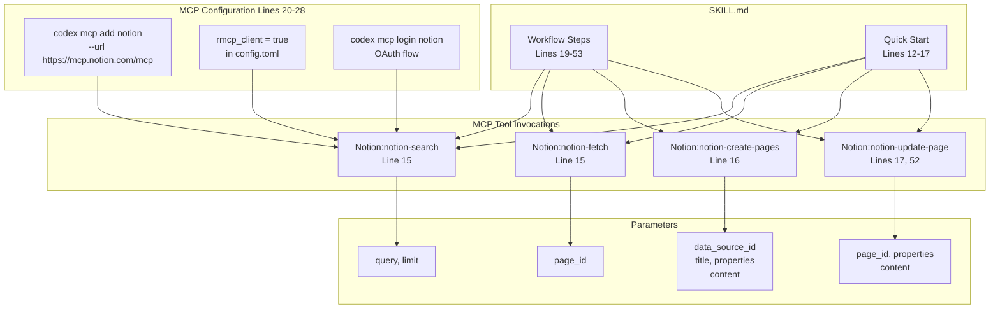
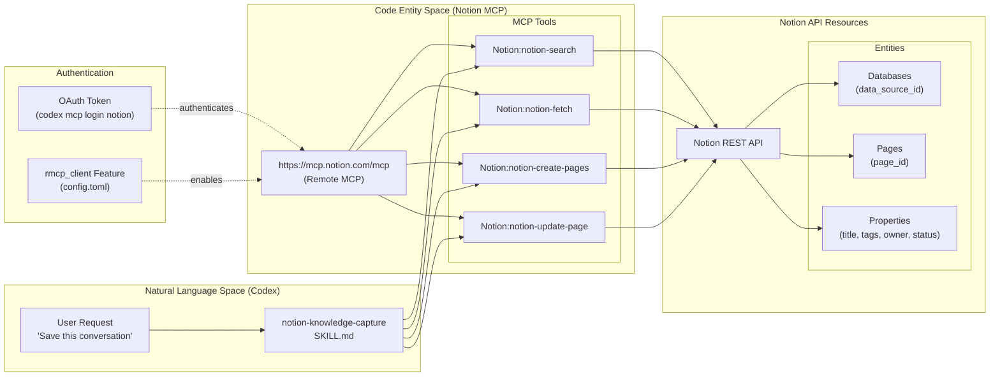

<!-- source: DeepWiki mcp.deepwiki.com · repo openai/skills · extra page notion-knowledge-capture · fetched 2026-10-30 -->

# notion-knowledge-capture

Relevant source files

The following files were used as context for generating this wiki page:

- [skills/.curated/figma-code-connect-components/SKILL.md](skills/.curated/figma-code-connect-components/SKILL.md)
- [skills/.curated/figma-create-design-system-rules/SKILL.md](skills/.curated/figma-create-design-system-rules/SKILL.md)
- [skills/.curated/figma-implement-design/SKILL.md](skills/.curated/figma-implement-design/SKILL.md)
- [skills/.curated/notion-knowledge-capture/LICENSE.txt](skills/.curated/notion-knowledge-capture/LICENSE.txt)
- [skills/.curated/notion-knowledge-capture/SKILL.md](skills/.curated/notion-knowledge-capture/SKILL.md)
- [skills/.curated/notion-knowledge-capture/evaluations/README.md](skills/.curated/notion-knowledge-capture/evaluations/README.md)
- [skills/.curated/notion-knowledge-capture/evaluations/conversation-to-wiki.json](skills/.curated/notion-knowledge-capture/evaluations/conversation-to-wiki.json)
- [skills/.curated/notion-knowledge-capture/evaluations/decision-record.json](skills/.curated/notion-knowledge-capture/evaluations/decision-record.json)
- [skills/.curated/notion-knowledge-capture/examples/conversation-to-faq.md](skills/.curated/notion-knowledge-capture/examples/conversation-to-faq.md)
- [skills/.curated/notion-knowledge-capture/examples/decision-capture.md](skills/.curated/notion-knowledge-capture/examples/decision-capture.md)
- [skills/.curated/notion-knowledge-capture/examples/how-to-guide.md](skills/.curated/notion-knowledge-capture/examples/how-to-guide.md)
- [skills/.curated/notion-knowledge-capture/reference/database-best-practices.md](skills/.curated/notion-knowledge-capture/reference/database-best-practices.md)
- [skills/.curated/notion-knowledge-capture/reference/decision-log-database.md](skills/.curated/notion-knowledge-capture/reference/decision-log-database.md)
- [skills/.curated/notion-knowledge-capture/reference/documentation-database.md](skills/.curated/notion-knowledge-capture/reference/documentation-database.md)
- [skills/.curated/notion-meeting-intelligence/SKILL.md](skills/.curated/notion-meeting-intelligence/SKILL.md)
- [skills/.curated/notion-research-documentation/SKILL.md](skills/.curated/notion-research-documentation/SKILL.md)
- [skills/.curated/notion-spec-to-implementation/SKILL.md](skills/.curated/notion-spec-to-implementation/SKILL.md)

## Purpose and Scope

The `notion-knowledge-capture` skill converts conversations, decisions, and unstructured notes into structured, linkable Notion pages. This skill enables agents to create wiki entries, how-to guides, architectural decision records (ADRs), FAQs, and documentation by extracting content from conversations and organizing it into appropriate Notion databases with proper tagging, ownership, and relationships. [skills/.curated/notion-knowledge-capture/SKILL.md:1-10]()

This page documents the workflow, Notion MCP integration, database templates, and evaluation criteria for the `notion-knowledge-capture` skill. For other Notion-focused skills, see [notion-meeting-intelligence](notion-meeting-intelligence), [notion-research-documentation](notion-research-documentation), and [notion-spec-to-implementation](notion-spec-to-implementation).

**Sources:** [skills/.curated/notion-knowledge-capture/SKILL.md:1-10]()

---

## System Architecture

### MCP Tool Integration

The skill orchestrates several tools from the Notion MCP server to perform discovery, retrieval, and writing operations.

Title: Notion Knowledge Capture Tool Flow

**Sources:** [skills/.curated/notion-knowledge-capture/SKILL.md:13-17](), [skills/.curated/notion-knowledge-capture/SKILL.md:20-28](), [skills/.curated/notion-knowledge-capture/SKILL.md:44-52]()

### Notion MCP Integration Architecture

The interaction between the Codex runtime and the Notion API is mediated by a remote MCP server.

Title: Natural Language Space to Notion Entity Space Mapping

**Sources:** [skills/.curated/notion-knowledge-capture/SKILL.md:20-28](), [skills/.curated/notion-knowledge-capture/evaluations/README.md:51-66]()

---

## Workflow Implementation

The skill implements a structured five-step workflow for converting conversations into Notion pages.

### 1. Define the Capture
The agent clarifies the purpose (decision, how-to, FAQ, concept, wiki entry, learning, documentation), identifies the target audience, and determines if this is a new page or an update to existing documentation. [skills/.curated/notion-knowledge-capture/SKILL.md:30-32]()

### 2. Locate Destination
The agent picks the correct database using `reference/*-database.md` guides and confirms required properties (title, tags, owner, status, date, relations). If multiple candidate databases exist, the agent asks the user for clarification; otherwise, it defaults to the primary wiki or documentation database. [skills/.curated/notion-knowledge-capture/SKILL.md:34-37]()

### 3. Extract and Structure
Facts, decisions, and actions are extracted from the conversation context. The content is structured based on the type: [skills/.curated/notion-knowledge-capture/SKILL.md:38-43]()
*   **Decisions**: Records alternatives, rationale, outcomes, and consequences. [skills/.curated/notion-knowledge-capture/reference/decision-log-database.md:33-42]()
*   **How-tos**: Captures steps, prerequisites, links to assets/code, and edge cases. [skills/.curated/notion-knowledge-capture/examples/how-to-guide.md:14-20]()
*   **FAQs**: Formatted as Q&A with concise answers and links to deeper docs. [skills/.curated/notion-knowledge-capture/SKILL.md:42]()

### 4. Create/Update in Notion
The agent uses `Notion:notion-create-pages` with the correct `data_source_id` to instantiate the page, applying templates from the `reference/` directory for headers and checklists. If an update is required, it fetches the page first via `Notion:notion-fetch` and then uses `Notion:notion-update-page`. [skills/.curated/notion-knowledge-capture/SKILL.md:44-48]()

### 5. Link and Surface
Relations and backlinks are added to hub pages, related specs, or teams. Follow-up tasks are created in relevant databases and linked to the new documentation. [skills/.curated/notion-knowledge-capture/SKILL.md:49-52]()

---

## Data Structures and Templates

### Decision Log Schema
The skill follows a specific schema for Architecture Decision Records (ADRs).

| Property | Type | Purpose |
|----------|------|---------|
| **Decision** | title | What was decided |
| **Status** | select | Proposed, Accepted, Superseded, Deprecated |
| **Domain** | select | Architecture, Product, Business, Design, Operations |
| **Impact** | select | High, Medium, Low |
| **Deciders** | people | Who made the decision |

**Sources:** [skills/.curated/notion-knowledge-capture/reference/decision-log-database.md:7-17]()

### Documentation Database Schema
For general team wikis and knowledge bases, the following schema is used:

| Property | Type | Options | Purpose |
|----------|------|---------|---------|
| **Title** | title | - | Document name |
| **Type** | select | How-To, Concept, Reference, FAQ, Decision | Categorize content type |
| **Status** | select | Draft, In Review, Final, Deprecated | Track document lifecycle |
| **Owner** | people | - | Document maintainer |
| **Last Reviewed**| date | - | Manual review tracking |

**Sources:** [skills/.curated/notion-knowledge-capture/reference/documentation-database.md:7-17]()

---

## Authentication and Setup

If MCP calls fail, the skill pauses to guide the user through setup: [skills/.curated/notion-knowledge-capture/SKILL.md:20-28]()

1.  **Add MCP**: `codex mcp add notion --url https://mcp.notion.com/mcp` [skills/.curated/notion-knowledge-capture/SKILL.md:22]()
2.  **Enable Remote Client**: Set `[features].rmcp_client = true` in `config.toml` or run `codex --enable rmcp_client`. [skills/.curated/notion-knowledge-capture/SKILL.md:24]()
3.  **Login**: `codex mcp login notion` (OAuth flow). [skills/.curated/notion-knowledge-capture/SKILL.md:26]()
4.  **Restart**: The user must restart Codex after successful login to proceed. [skills/.curated/notion-knowledge-capture/SKILL.md:28]()

**Sources:** [skills/.curated/notion-knowledge-capture/SKILL.md:20-28]()

---

## Evaluations and Success Criteria

The skill is evaluated against specific scenarios to ensure technical accuracy and proper structuring.

### Key Evaluation Behaviors
*   **Content Extraction**: Accurately captures key points and preserves specific technical details (commands, configs) from the chat. [skills/.curated/notion-knowledge-capture/evaluations/README.md:51-55]()
*   **Type Selection**: Correctly identifies if content is a how-to, FAQ, or decision record. [skills/.curated/notion-knowledge-capture/evaluations/README.md:56-60]()
*   **Notion Integration**: Uses correct tool names (`Notion:notion-search`, `Notion:notion-fetch`, `Notion:notion-create-pages`) and places pages in appropriate parent locations with discoverable titles. [skills/.curated/notion-knowledge-capture/evaluations/README.md:61-66]()

### Success Criteria
*   **Formatting**: Content uses proper Notion markdown (headings, code blocks, bullets). [skills/.curated/notion-knowledge-capture/evaluations/README.md:59]()
*   **Decision Quality**: Decisions include both positive and negative consequences (trade-offs) and alternatives considered. [skills/.curated/notion-knowledge-capture/evaluations/README.md:32-35]()
*   **Actionability**: How-to guides include numbered steps and verification checklists. [skills/.curated/notion-knowledge-capture/examples/how-to-guide.md:76-82]()

**Sources:** [skills/.curated/notion-knowledge-capture/evaluations/README.md:47-72](), [skills/.curated/notion-knowledge-capture/examples/how-to-guide.md:113-119]()

---

