<!-- source: DeepWiki mcp.deepwiki.com · repo openai/skills · extra page notion-meeting-intelligence · fetched 2026-10-30 -->

# notion-meeting-intelligence

<details>
<summary>Relevant source files</summary>

The following files were used as context for generating this wiki page:

- [skills/.curated/figma-code-connect-components/SKILL.md](skills/.curated/figma-code-connect-components/SKILL.md)
- [skills/.curated/figma-create-design-system-rules/SKILL.md](skills/.curated/figma-create-design-system-rules/SKILL.md)
- [skills/.curated/figma-implement-design/SKILL.md](skills/.curated/figma-implement-design/SKILL.md)
- [skills/.curated/notion-knowledge-capture/SKILL.md](skills/.curated/notion-knowledge-capture/SKILL.md)
- [skills/.curated/notion-meeting-intelligence/SKILL.md](skills/.curated/notion-meeting-intelligence/SKILL.md)
- [skills/.curated/notion-research-documentation/SKILL.md](skills/.curated/notion-research-documentation/SKILL.md)
- [skills/.curated/notion-spec-to-implementation/SKILL.md](skills/.curated/notion-spec-to-implementation/SKILL.md)

</details>


This page documents the `notion-meeting-intelligence` skill, a curated production skill that prepares meeting materials by gathering Notion context, drafting tailored agendas and pre-reads, and enriching content with research. This skill helps users create comprehensive meeting preparation documents that pull relevant background information from Notion and structure it according to meeting type.

For information about capturing conversations into Notion pages, see [notion-knowledge-capture](5.3.1). For converting specifications into implementation plans, see [notion-spec-to-implementation](5.3.4). For general research synthesis in Notion, see [notion-research-documentation](5.3.3).

---

## Purpose and Scope

The `notion-meeting-intelligence` skill automates meeting preparation workflows by:

- Searching Notion for relevant context (prior notes, specs, OKRs, decisions).
- Selecting appropriate meeting templates based on meeting type.
- Drafting structured agendas with owners, timeboxes, and expected outputs.
- Enriching materials with Codex research (benchmarks, risks, best practices).
- Creating and updating Notion pages with meeting materials.

This skill is triggered when users need to prepare for meetings, gather context from multiple sources, draft agendas or pre-reads, and tailor materials to specific attendees or meeting objectives.

**Sources:** [skills/.curated/notion-meeting-intelligence/SKILL.md:1-11]()

---

## Skill Metadata

| Property | Value |
|----------|-------|
| **Name** | `notion-meeting-intelligence` |
| **Description** | Prepare meeting materials with Notion context and Codex research; use when gathering context, drafting agendas/pre-reads, and tailoring materials to attendees. |
| **Short Description** | Prep meetings with Notion context and tailored agendas |
| **Category** | `.curated` (production-ready, name-installable) |
| **External Integration** | Notion MCP (`https://mcp.notion.com/mcp`) |

The skill's description serves as the trigger condition for Codex skill matching. When user queries mention meeting preparation, context gathering, agenda drafting, or pre-read creation, this skill is loaded into context.

**Sources:** [skills/.curated/notion-meeting-intelligence/SKILL.md:1-6]()

---

## Prerequisites and Notion MCP Setup

This skill requires the Notion MCP to be configured and authenticated before use. If any MCP call fails, the skill workflow pauses and guides users through setup.

### Notion MCP Configuration Steps

```mermaid
graph TB
    ["Check_Notion_MCP_Connection"] -->|"MCP not connected"| ["codex_mcp_add_notion"]
    ["codex_mcp_add_notion"] --> ["Enable_rmcp_client"]
    ["Enable_rmcp_client"] --> ["codex_mcp_login_notion"]
    ["codex_mcp_login_notion"] --> ["Restart_Codex"]
    ["Restart_Codex"] --> ["Notion_MCP_Ready"]
    ["Check_Notion_MCP_Connection"] -->|"MCP connected"| ["Notion_MCP_Ready"]

    subgraph "Natural Language Space"
        ["Check_Notion_MCP_Connection"]
    end

    subgraph "Code Entity Space"
        ["codex_mcp_add_notion"] -- "CLI command" --> ["mcp.notion.com/mcp"]
        ["Enable_rmcp_client"] -- "config.toml" --> ["rmcp_client = true"]
        ["codex_mcp_login_notion"] -- "OAuth flow" --> ["Notion:notion-search"]
    end
```

**Configuration Requirements:**

1. **Add Notion MCP:** Run `codex mcp add notion --url https://mcp.notion.com/mcp` [skills/.curated/notion-meeting-intelligence/SKILL.md:22-22]()
2. **Enable Remote MCP:** Set `[features].rmcp_client = true` in `config.toml` OR run `codex --enable rmcp_client` [skills/.curated/notion-meeting-intelligence/SKILL.md:23-24]()
3. **Authenticate:** Run `codex mcp login notion` to complete OAuth flow [skills/.curated/notion-meeting-intelligence/SKILL.md:25-26]()
4. **Restart Codex:** Required after successful login to load MCP connection [skills/.curated/notion-meeting-intelligence/SKILL.md:28-28]()

The skill workflow explicitly checks for MCP connectivity and provides these setup instructions if any operation fails.

**Sources:** [skills/.curated/notion-meeting-intelligence/SKILL.md:20-29]()

---

## Core Workflow

The skill implements a five-step workflow for meeting preparation, from input gathering through finalization.

```mermaid
stateDiagram-v2
    [*] --> GatherInputs
    
    state GatherInputs {
        [*] --> AskDetails
        AskDetails: "Ask for objective, outcomes, attendees, duration, date/time"
        AskDetails --> SearchNotion
        SearchNotion: "Notion:notion-search (Find relevant docs, notes, specs)"
        SearchNotion --> FetchPages
        FetchPages: "Notion:notion-fetch (Retrieve key pages)"
        FetchPages --> CaptureBlockers
        CaptureBlockers: "Document blockers, risks, open questions"
    }
    
    GatherInputs --> ChooseFormat
    
    state ChooseFormat {
        [*] --> ReadGuide
        ReadGuide: "reference/template-selection-guide.md"
        ReadGuide --> SelectTemplate
        SelectTemplate: "Match meeting type: status, decision, planning, retro, 1:1, brainstorming"
    }
    
    ChooseFormat --> BuildAgenda
    
    state BuildAgenda {
        [*] --> LoadTemplate
        LoadTemplate: "Load template from reference/"
        LoadTemplate --> AdaptSections
        AdaptSections: "Customize: context, goals, agenda, owners, timeboxes"
        AdaptSections --> LinkSources
        LinkSources: "Include Notion page links and pre-reading"
        LinkSources --> AssignOwners
        AssignOwners: "Assign owners and timeboxes per agenda item"
    }
    
    BuildAgenda --> EnrichResearch
    
    state EnrichResearch {
        [*] --> ConductResearch
        ConductResearch: "Add Codex research: benchmarks, risks, best practices"
        ConductResearch --> CiteSources
        CiteSources: "Include source links, separate fact from opinion"
    }
    
    EnrichResearch --> FinalizeShare
    
    state FinalizeShare {
        [*] --> CreatePage
        CreatePage: "Notion:notion-create-pages (Create meeting page)"
        CreatePage --> AddNextSteps
        AddNextSteps: "Document next steps, assign follow-up owners"
        AddNextSteps --> UpdatePage
        UpdatePage: "Notion:notion-update-page (Update as details change)"
    }
    
    FinalizeShare --> [*]
```



### Step 1: Gather Inputs

The skill collects meeting parameters and relevant context:

- **Meeting Details:** Objective, desired outcomes/decisions, attendees, duration, date/time, prior materials. [skills/.curated/notion-meeting-intelligence/SKILL.md:31-31]()
- **Notion Context:** Uses `Notion:notion-search` to find relevant documents, past notes, specifications, and action items. [skills/.curated/notion-meeting-intelligence/SKILL.md:32-32]()
- **Content Retrieval:** Uses `Notion:notion-fetch` to retrieve full content of key pages. [skills/.curated/notion-meeting-intelligence/SKILL.md:32-32]()
- **Risk Capture:** Documents blockers, risks, and open questions upfront. [skills/.curated/notion-meeting-intelligence/SKILL.md:33-33]()

**Sources:** [skills/.curated/notion-meeting-intelligence/SKILL.md:30-34]()

### Step 2: Choose Format

Template selection matches meeting type to appropriate structure:

| Meeting Type | Template Used |
|--------------|---------------|
| Status/update meeting | `status-update-template.md` |
| Decision/approval meeting | `decision-meeting-template.md` |
| Planning (sprint/project) | `sprint-planning-template.md` |
| Retrospective/feedback | `retrospective-template.md` |
| One-on-one meeting | `one-on-one-template.md` |
| Ideation/brainstorming | `brainstorming-template.md` |

The `reference/template-selection-guide.md` file provides decision logic for template selection. [skills/.curated/notion-meeting-intelligence/SKILL.md:42-42]()

**Sources:** [skills/.curated/notion-meeting-intelligence/SKILL.md:35-43]()

### Step 3: Build the Agenda/Pre-read

Starting from the selected template, the skill adapts sections to meeting needs:

- **Core Sections:** Context, goals, agenda items, owner/time per item, decisions needed, risks, prep asks. [skills/.curated/notion-meeting-intelligence/SKILL.md:45-45]()
- **Source Links:** Include links to pulled Notion pages and required pre-reading materials. [skills/.curated/notion-meeting-intelligence/SKILL.md:46-46]()
- **Ownership Assignment:** Assign owners for each agenda item with timeboxes and expected outputs. [skills/.curated/notion-meeting-intelligence/SKILL.md:47-47]()

**Sources:** [skills/.curated/notion-meeting-intelligence/SKILL.md:44-48]()

### Step 4: Enrich with Research

The skill supplements materials with Codex-generated research:

- **Research Areas:** Market/industry facts, benchmarks, risks, best practices. [skills/.curated/notion-meeting-intelligence/SKILL.md:50-50]()
- **Source Attribution:** Claims cited with source links. [skills/.curated/notion-meeting-intelligence/SKILL.md:51-51]()
- **Opinion Separation:** Distinguishes factual research from subjective recommendations. [skills/.curated/notion-meeting-intelligence/SKILL.md:51-51]()

**Sources:** [skills/.curated/notion-meeting-intelligence/SKILL.md:49-52]()

### Step 5: Finalize and Share

Final steps create and maintain the meeting page:

- **Page Creation:** Uses `Notion:notion-create-pages` to create the meeting preparation page. [skills/.curated/notion-meeting-intelligence/SKILL.md:16-16]()
- **Next Steps:** Documents follow-up actions and assigns owners. [skills/.curated/notion-meeting-intelligence/SKILL.md:54-54]()
- **Task Linking:** Creates or links to tasks in relevant Notion databases. [skills/.curated/notion-meeting-intelligence/SKILL.md:55-55]()
- **Updates:** Uses `Notion:notion-update-page` when details change, maintaining a changelog for multiple edits. [skills/.curated/notion-meeting-intelligence/SKILL.md:56-56]()

**Sources:** [skills/.curated/notion-meeting-intelligence/SKILL.md:53-57]()

---

## Notion MCP Operations

The skill uses four primary Notion MCP tools throughout its workflow.

```mermaid
graph LR
    subgraph "Gather Context"
        ["Notion:notion-search"] -->|"Find relevant pages"| ["Notion:notion-fetch"]
    end
    
    subgraph "Create & Update"
        ["Notion:notion-create-pages"] -->|"Initial page"| ["Notion:notion-update-page"]
    end
    
    subgraph "Code Entity Space"
        ["Notion:notion-search"]
        ["Notion:notion-fetch"]
        ["Notion:notion-create-pages"]
        ["Notion:notion-update-page"]
    end
    
    ["Notion:notion-search"] --> ["Find prior meeting notes, specs, OKRs, decisions"]
    ["Notion:notion-fetch"] --> ["Retrieve full page content for context"]
    ["Notion:notion-create-pages"] --> ["Create meeting prep page with agenda"]
    ["Notion:notion-update-page"] --> ["Update page as plans change, add changelog"]
```

### Operation Details

| MCP Operation | Purpose | Usage in Workflow |
|---------------|---------|-------------------|
| `Notion:notion-search` | Search Notion workspace for pages matching query | Step 1: Find relevant documents, past notes, specs, action items related to meeting topic [skills/.curated/notion-meeting-intelligence/SKILL.md:32-32]() |
| `Notion:notion-fetch` | Retrieve full content of specific Notion page(s) | Step 1: Get detailed content from key pages identified in search [skills/.curated/notion-meeting-intelligence/SKILL.md:32-32]() |
| `Notion:notion-create-pages` | Create new page(s) in Notion workspace | Step 5: Create meeting preparation page with agenda, context, and research [skills/.curated/notion-meeting-intelligence/SKILL.md:16-16]() |
| `Notion:notion-update-page` | Update existing Notion page content | Step 5: Modify page when meeting details change, add notes, maintain changelog [skills/.curated/notion-meeting-intelligence/SKILL.md:56-56]() |

**Sources:** [skills/.curated/notion-meeting-intelligence/SKILL.md:14-17](), [skills/.curated/notion-meeting-intelligence/SKILL.md:32-33](), [skills/.curated/notion-meeting-intelligence/SKILL.md:54-56]()

---

## Template System

The skill bundles a template selection guide and six meeting-type-specific templates in the `reference/` directory.

### Available Templates

The skill includes six templates, each optimized for different meeting contexts:

| Template File | Meeting Type | Key Sections |
|---------------|--------------|--------------|
| `status-update-template.md` | Status/progress updates | Accomplishments, metrics, blockers, next steps |
| `decision-meeting-template.md` | Decision/approval meetings | Context, options, trade-offs, recommendation, decision needed |
| `sprint-planning-template.md` | Sprint/project planning | Goals, capacity, backlog items, acceptance criteria, risks |
| `retrospective-template.md` | Retrospectives/feedback | What went well, what didn't, action items, experiments |
| `one-on-one-template.md` | One-on-one meetings | Check-in, updates, coaching, career development, feedback |
| `brainstorming-template.md` | Ideation/brainstorming | Problem statement, constraints, ideas, evaluation, next steps |

**Sources:** [skills/.curated/notion-meeting-intelligence/SKILL.md:35-42](), [skills/.curated/notion-meeting-intelligence/SKILL.md:59]()

---

## Example Scenarios

The skill bundles four end-to-end examples in the `examples/` directory demonstrating complete meeting preparation workflows:

| Example File | Scenario | Demonstrates |
|--------------|----------|--------------|
| `executive-review.md` | Executive status update meeting | High-level summary, key metrics, asks |
| `project-decision.md` | Project decision/approval meeting | Options analysis, trade-offs, recommendation with research |
| `sprint-planning.md` | Sprint planning session | Capacity calculation, backlog prioritization, acceptance criteria |
| `customer-meeting.md` | Customer meeting preparation | Account context, use case review, feedback capture strategy |

**Sources:** [skills/.curated/notion-meeting-intelligence/SKILL.md:60]()

---

## Skill File Structure

The `notion-meeting-intelligence` skill follows the standard skill structure with bundled reference and example resources.

| Path | Type | Purpose |
|------|------|---------|
| `SKILL.md` | Required | Skill metadata, workflow, and instructions [skills/.curated/notion-meeting-intelligence/SKILL.md:1-61]() |
| `reference/` | Optional | Template selection guide and six meeting templates [skills/.curated/notion-meeting-intelligence/SKILL.md:59-59]() |
| `examples/` | Optional | Four end-to-end meeting preparation examples [skills/.curated/notion-meeting-intelligence/SKILL.md:60-60]() |

**Sources:** [skills/.curated/notion-meeting-intelligence/SKILL.md:58-60]()

---

## Installation

Install the `notion-meeting-intelligence` skill using the curated skill name-based installation method:

```bash
$skill-installer notion-meeting-intelligence
```

After installation, restart Codex to load the skill. The skill will be triggered when user queries match meeting preparation, context gathering, agenda drafting, or pre-read creation patterns.

**Sources:** [skills/.curated/notion-meeting-intelligence/SKILL.md:1-3]()

---

