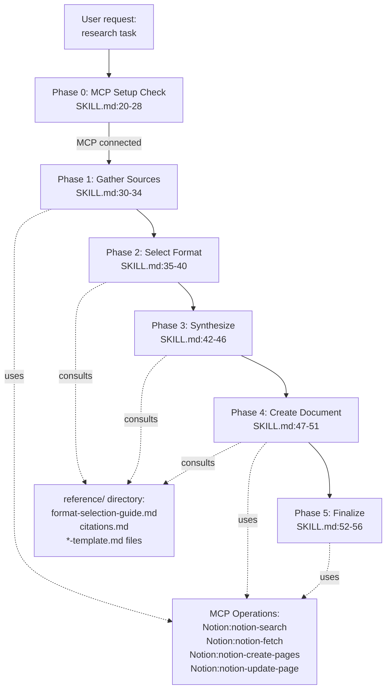
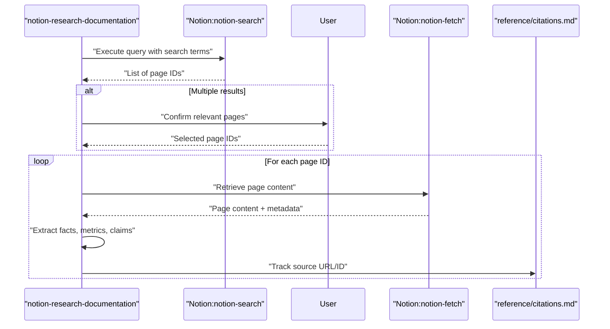
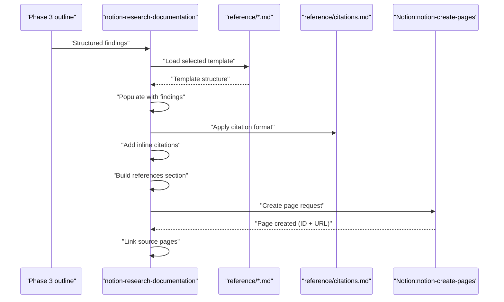

<!-- source: DeepWiki mcp.deepwiki.com · repo openai/skills · extra page notion-research-documentation · fetched 2026-10-30 -->

# notion-research-documentation

<details>
<summary>Relevant source files</summary>

The following files were used as context for generating this wiki page:

- [skills/.curated/figma-code-connect-components/SKILL.md](skills/.curated/figma-code-connect-components/SKILL.md)
- [skills/.curated/figma-create-design-system-rules/SKILL.md](skills/.curated/figma-create-design-system-rules/SKILL.md)
- [skills/.curated/figma-implement-design/SKILL.md](skills/.curated/figma-implement-design/SKILL.md)
- [skills/.curated/notion-knowledge-capture/SKILL.md](skills/.curated/notion-knowledge-capture/SKILL.md)
- [skills/.curated/notion-meeting-intelligence/SKILL.md](skills/.curated/notion-meeting-intelligence/SKILL.md)
- [skills/.curated/notion-research-documentation/SKILL.md](skills/.curated/notion-research-documentation/SKILL.md)
- [skills/.curated/notion-spec-to-implementation/SKILL.md](skills/.curated/notion-spec-to-implementation/SKILL.md)

</details>


## Purpose and Scope

The `notion-research-documentation` skill performs multi-source research across Notion workspaces and synthesizes findings into structured documentation with source citations. The skill implements a five-phase workflow that progresses from source discovery through document creation. [skills/.curated/notion-research-documentation/SKILL.md:1-10]()

**Primary function:** Aggregate information from multiple Notion pages and produce briefs, comparisons, or reports with proper citations. [skills/.curated/notion-research-documentation/SKILL.md:1-6]()

**Related skills:**
- [notion-knowledge-capture](5.3.1) — Converts conversations to Notion pages [skills/.curated/notion-knowledge-capture/SKILL.md:2-3]()
- [notion-meeting-intelligence](5.3.2) — Prepares meeting materials [skills/.curated/notion-meeting-intelligence/SKILL.md:2-3]()
- [notion-spec-to-implementation](5.3.4) — Converts specifications to implementation tasks [skills/.curated/notion-spec-to-implementation/SKILL.md:2-3]()

**Sources:** [skills/.curated/notion-research-documentation/SKILL.md:1-10](), [skills/.curated/notion-knowledge-capture/SKILL.md:2-3](), [skills/.curated/notion-meeting-intelligence/SKILL.md:2-3](), [skills/.curated/notion-spec-to-implementation/SKILL.md:2-3]()

---

## Skill Metadata

| Property | Value |
|----------|-------|
| Skill name | `notion-research-documentation` |
| Description | Research across Notion and synthesize into structured documentation; use when gathering info from multiple Notion sources to produce briefs, comparisons, or reports with citations. |
| Short description | Research Notion content and produce briefs/reports |
| Location | `.curated/notion-research-documentation/` |
| Installation | Via `$skill-installer` by name |

**Sources:** [skills/.curated/notion-research-documentation/SKILL.md:1-6]()

---

## Prerequisites

### Notion MCP Server Requirements

This skill requires the remote MCP client feature and authenticated connection to the Notion MCP server at `https://mcp.notion.com/mcp`. The skill detects missing MCP configuration and outputs setup commands. [skills/.curated/notion-research-documentation/SKILL.md:20-28]()

**Setup sequence (Phase 0 in workflow):**

```bash
# Add Notion MCP server
codex mcp add notion --url https://mcp.notion.com/mcp

# Enable rmcp_client feature
codex --enable rmcp_client
# OR manually edit config.toml: [features].rmcp_client = true

# Authenticate via OAuth
codex mcp login notion
```

Codex restart required after authentication to load MCP connection. [skills/.curated/notion-research-documentation/SKILL.md:28-28]()

**Sources:** [skills/.curated/notion-research-documentation/SKILL.md:20-28]()

---

## Five-Phase Workflow Architecture

The skill executes a structured research pipeline defined in `SKILL.md`. Each phase maps to specific MCP operations and reference materials. [skills/.curated/notion-research-documentation/SKILL.md:19-56]()

### Workflow Phase Mapping



**Sources:** [skills/.curated/notion-research-documentation/SKILL.md:12-17](), [skills/.curated/notion-research-documentation/SKILL.md:19-56]()

---

## Phase 1: Source Gathering

Phase 1 implements two-step source discovery using MCP operations `notion-search` and `notion-fetch`. [skills/.curated/notion-research-documentation/SKILL.md:30-34]()

### MCP Operation Sequence



### Content Extraction Targets

| Data Type | Extraction Method | Citation Requirement |
|-----------|------------------|---------------------|
| Facts | Direct quote preferred | Source URL/ID tracked [SKILL.md:33-34]() |
| Metrics | Numeric values captured | Source URL/ID tracked [SKILL.md:32-34]() |
| Claims | Quote or paraphrase | Source URL/ID tracked [SKILL.md:33-34]() |
| Constraints | Note limitations | Source URL/ID tracked [SKILL.md:32-34]() |
| Dates | Timestamp extraction | Source URL/ID tracked [SKILL.md:32-34]() |

Search refinement iterates with `Notion:notion-search` until scope is confirmed by the user. [skills/.curated/notion-research-documentation/SKILL.md:31-31]()

**Sources:** [skills/.curated/notion-research-documentation/SKILL.md:13-14](), [skills/.curated/notion-research-documentation/SKILL.md:30-34]()

---

## Phase 2: Format Selection

Phase 2 selects one of four document formats based on research scope and user requirements. [skills/.curated/notion-research-documentation/SKILL.md:35-40]()

### Format-Template Mapping

| Format | User Signal | Template File | Structure |
|--------|------------|---------------|-----------|
| Quick Brief | "quick readout" | `reference/quick-brief-template.md` | Title, summary, key findings, sources |
| Research Summary | "single-topic dive" | `reference/research-summary-template.md` | Title, summary, background, findings, recommendations |
| Comparison | "option tradeoffs" | `reference/comparison-template.md` | Title, options, side-by-side matrix, recommendations |
| Comprehensive Report | "deep dive / exec-ready" | `reference/comprehensive-template.md` | Title, executive summary, methodology, findings, evidence, recommendations, next steps |

**Sources:** [skills/.curated/notion-research-documentation/SKILL.md:35-40](), [skills/.curated/notion-research-documentation/SKILL.md:48-49](), [skills/.curated/notion-research-documentation/SKILL.md:58-58]()

---

## Phase 3: Synthesis

Phase 3 organizes fetched content into a structured outline before document creation. [skills/.curated/notion-research-documentation/SKILL.md:42-46]()

### Synthesis Operations

| Operation | Input | Output |
|-----------|-------|--------|
| Outline creation | Fetched sources | Themes/questions grouping [SKILL.md:43-43]() |
| Evidence mapping | Source content + IDs | Evidence-to-source associations [SKILL.md:44-44]() |
| Gap identification | Thematic groups | Missing information flags [SKILL.md:44-44]() |
| Goal alignment | User objective | Prioritized findings [SKILL.md:45-45]() |

User objective types include: decision support, summary, plan, or recommendation. [skills/.curated/notion-research-documentation/SKILL.md:45-45]()

**Sources:** [skills/.curated/notion-research-documentation/SKILL.md:42-46]()

---

## Phase 4: Document Creation

Phase 4 generates the Notion document using the `Notion:notion-create-pages` MCP operation with template-based content structure. [skills/.curated/notion-research-documentation/SKILL.md:47-51]()

### MCP Operation Sequence



All document formats include title, summary, key findings, supporting evidence with citations, and recommendations when relevant. [skills/.curated/notion-research-documentation/SKILL.md:49-50]()

**Sources:** [skills/.curated/notion-research-documentation/SKILL.md:47-51]()

---

## Phase 5: Finalization

Phase 5 adds metadata and enables iterative updates using the `Notion:notion-update-page` MCP operation. [skills/.curated/notion-research-documentation/SKILL.md:52-56]()

### Finalization Components

| Component | Purpose | Implementation |
|-----------|---------|----------------|
| Highlights | Key findings emphasis | Callouts or summary block [SKILL.md:53-53]() |
| Risks | Issue flagging | Dedicated risks section [SKILL.md:53-53]() |
| Open questions | Gap documentation | Unanswered items list [SKILL.md:53-53]() |
| Follow-up tasks | Action items | Checklists or task links [SKILL.md:54-54]() |
| Task linking | Database integration | Link to task database entries [SKILL.md:54-54]() |

`Notion:notion-update-page` is used for adding new findings or appending changelog notes. [skills/.curated/notion-research-documentation/SKILL.md:55-55]()

**Sources:** [skills/.curated/notion-research-documentation/SKILL.md:52-56]()

---

## MCP Operation Reference

Four Notion MCP operations are invoked across the five-phase workflow. [skills/.curated/notion-research-documentation/SKILL.md:30-56]()

| MCP Operation | Invocation Phase | Input | Output |
|---------------|-----------------|-------|--------|
| `Notion:notion-search` | Phase 1 | Query string | List of page IDs [SKILL.md:31-31]() |
| `Notion:notion-fetch` | Phase 1 | Page ID | Content + metadata [SKILL.md:32-32]() |
| `Notion:notion-create-pages` | Phase 4 | Content + properties | New Page ID + URL [SKILL.md:49-49]() |
| `Notion:notion-update-page` | Phase 5 | Page ID + updates | Updated page [SKILL.md:55-55]() |

All operations require authenticated MCP connection to `https://mcp.notion.com/mcp` via OAuth and the `streamable_http` transport. [skills/.curated/notion-research-documentation/SKILL.md:20-28]()

**Sources:** [skills/.curated/notion-research-documentation/SKILL.md:20-28](), [skills/.curated/notion-research-documentation/SKILL.md:30-56]()

---

## Bundled Resources

The skill packages reference materials and examples in two directories. [skills/.curated/notion-research-documentation/SKILL.md:57-60]()

### Reference Directory

Location: `reference/` within skill package. [skills/.curated/notion-research-documentation/SKILL.md:58-58]()

| File | Purpose |
|------|---------|
| `advanced-search.md` | Search tactics for `Notion:notion-search` |
| `format-selection-guide.md` | Format selection decision criteria |
| `research-summary-template.md` | Template structure for summaries |
| `comparison-template.md` | Template structure for comparisons |
| `citations.md` | Citation format and source tracking rules |

### Examples Directory

Location: `examples/` within skill package. [skills/.curated/notion-research-documentation/SKILL.md:59-59]()

| File | Scenario Type |
|------|--------------|
| `competitor-analysis.md` | Multi-competitor research |
| `technical-investigation.md` | Technical deep dive |
| `market-research.md` | Market landscape |
| `trip-planning.md` | Information aggregation |

**Sources:** [skills/.curated/notion-research-documentation/SKILL.md:57-60]()

---

## Citation System

The skill implements source tracking across phases to maintain citation integrity. Citation format standards are defined in `reference/citations.md`. [skills/.curated/notion-research-documentation/SKILL.md:14-14]()

### Citation Storage Pattern

| Phase | Operation | Citation Data |
|-------|-----------|---------------|
| Phase 1 | `Notion:notion-fetch` | Store page URL + ID per fetch [SKILL.md:33-33]() |
| Phase 3 | Synthesis | Associate evidence with source ID [SKILL.md:44-44]() |
| Phase 4 | Document assembly | Insert inline citations + references section [SKILL.md:50-50]() |

**Sources:** [skills/.curated/notion-research-documentation/SKILL.md:14](), [skills/.curated/notion-research-documentation/SKILL.md:33-34](), [skills/.curated/notion-research-documentation/SKILL.md:44-44](), [skills/.curated/notion-research-documentation/SKILL.md:50-50]()

---

