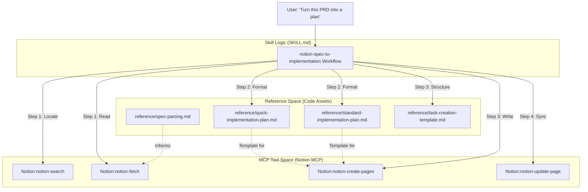
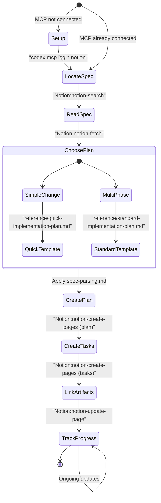
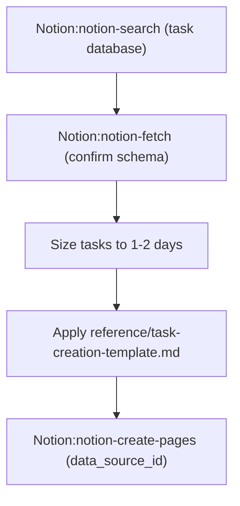

<!-- source: DeepWiki mcp.deepwiki.com · repo openai/skills · extra page notion-spec-to-implementation · fetched 2026-10-30 -->

# notion-spec-to-implementation

Relevant source files

The following files were used as context for generating this wiki page:

- [skills/.curated/figma-code-connect-components/SKILL.md](skills/.curated/figma-code-connect-components/SKILL.md)
- [skills/.curated/figma-create-design-system-rules/SKILL.md](skills/.curated/figma-create-design-system-rules/SKILL.md)
- [skills/.curated/figma-implement-design/SKILL.md](skills/.curated/figma-implement-design/SKILL.md)
- [skills/.curated/notion-knowledge-capture/SKILL.md](skills/.curated/notion-knowledge-capture/SKILL.md)
- [skills/.curated/notion-knowledge-capture/agents/openai.yaml](skills/.curated/notion-knowledge-capture/agents/openai.yaml)
- [skills/.curated/notion-meeting-intelligence/SKILL.md](skills/.curated/notion-meeting-intelligence/SKILL.md)
- [skills/.curated/notion-meeting-intelligence/agents/openai.yaml](skills/.curated/notion-meeting-intelligence/agents/openai.yaml)
- [skills/.curated/notion-research-documentation/SKILL.md](skills/.curated/notion-research-documentation/SKILL.md)
- [skills/.curated/notion-research-documentation/agents/openai.yaml](skills/.curated/notion-research-documentation/agents/openai.yaml)
- [skills/.curated/notion-spec-to-implementation/SKILL.md](skills/.curated/notion-spec-to-implementation/SKILL.md)
- [skills/.curated/notion-spec-to-implementation/agents/openai.yaml](skills/.curated/notion-spec-to-implementation/agents/openai.yaml)
- [skills/.curated/sentry/agents/openai.yaml](skills/.curated/sentry/agents/openai.yaml)

## Purpose and Scope

The `notion-spec-to-implementation` skill converts Notion specification documents (PRDs, feature specs) into structured implementation artifacts: linked plans, tasks, and progress tracking pages. This skill orchestrates the complete workflow from spec analysis through task creation and ongoing status updates. [skills/.curated/notion-spec-to-implementation/SKILL.md:1-11]()

This skill focuses on the **implementation planning phase** after a specification has been written. It automates the extraction of requirements and the generation of a task-oriented implementation graph within Notion using the Model Context Protocol (MCP). [skills/.curated/notion-spec-to-implementation/SKILL.md:31-55]()

Sources: [skills/.curated/notion-spec-to-implementation/SKILL.md:1-59]()

## Architecture Overview

The skill operates as a coordinator that orchestrates multiple Notion MCP operations to transform a single spec document into a network of linked implementation artifacts. It relies entirely on the Notion MCP server for all Notion API interactions. [skills/.curated/notion-spec-to-implementation/SKILL.md:13-17]()

### Natural Language to Code Entity Mapping

The following diagram bridges the user's natural language intent with the specific MCP tool calls and reference files defined in the skill's codebase.

Sources: [skills/.curated/notion-spec-to-implementation/SKILL.md:13-58](), [skills/.curated/notion-spec-to-implementation/agents/openai.yaml:8-15]()

## Workflow State Machine

The skill follows a five-phase workflow (plus an optional setup phase) that transforms a spec into tracked implementation work. [skills/.curated/notion-spec-to-implementation/SKILL.md:19-55]()

Sources: [skills/.curated/notion-spec-to-implementation/SKILL.md:19-55]()

## MCP Operations Mapping

The skill uses core Notion MCP operations configured via the `openai.yaml` interface. [skills/.curated/notion-spec-to-implementation/agents/openai.yaml:8-15]()

| Workflow Step | MCP Operation | Purpose | Key Parameters |
|--------------|---------------|---------|----------------|
| **Step 1: Locate spec** | `Notion:notion-search` | Find spec page by title/keyword | Query string, filter by page type |
| **Step 1: Read spec** | `Notion:notion-fetch` | Retrieve full spec content | Page ID from search results |
| **Step 2: Create plan** | `Notion:notion-create-pages` | Generate implementation plan page | Template choice, link to spec |
| **Step 3: Verify task DB** | `Notion:notion-fetch` | Confirm task database schema | Database ID, check properties |
| **Step 3: Create tasks** | `Notion:notion-create-pages` | Populate task database | `data_source_id`, properties |
| **Step 4: Link artifacts** | `Notion:notion-update-page` | Add implementation section to spec | Spec page ID, new content block |
| **Step 5: Track progress** | `Notion:notion-update-page` | Update plan/task status | Page IDs, status fields |

Sources: [skills/.curated/notion-spec-to-implementation/SKILL.md:13-54](), [skills/.curated/notion-spec-to-implementation/agents/openai.yaml:8-15]()

## Workflow Step Details

### Step 0: MCP Setup (Conditional)

This step executes only if a Notion MCP call fails due to missing authentication. The skill detects the failure and provides setup instructions. [skills/.curated/notion-spec-to-implementation/SKILL.md:21-29]()

1.  **Add the Notion MCP:** `codex mcp add notion --url https://mcp.notion.com/mcp` [skills/.curated/notion-spec-to-implementation/SKILL.md:23]()
2.  **Enable remote client:** Set `[features].rmcp_client = true` in `config.toml` or run `codex --enable rmcp_client`. [skills/.curated/notion-spec-to-implementation/SKILL.md:24-25]()
3.  **Login:** `codex mcp login notion`. [skills/.curated/notion-spec-to-implementation/SKILL.md:26]()
4.  **Restart:** The user must restart Codex after login to refresh the MCP connection. [skills/.curated/notion-spec-to-implementation/SKILL.md:29]()

### Step 1: Locate and Read Spec

The skill searches for the specification document, disambiguates if multiple results exist, and fetches the full content. [skills/.curated/notion-spec-to-implementation/SKILL.md:31-34]()

**Key Operations:**
- `Notion:notion-search` with user-provided keywords. [skills/.curated/notion-spec-to-implementation/SKILL.md:32]()
- `Notion:notion-fetch` to retrieve full page content. [skills/.curated/notion-spec-to-implementation/SKILL.md:33]()
- Parse using patterns from `reference/spec-parsing.md` for requirements, acceptance criteria, constraints, and priorities. [skills/.curated/notion-spec-to-implementation/SKILL.md:33]()

### Step 2: Choose Plan Depth

The skill selects an appropriate implementation plan template based on complexity: [skills/.curated/notion-spec-to-implementation/SKILL.md:36-39]()

| Change Type | Template | Content Includes |
|-------------|----------|------------------|
| Simple change | `reference/quick-implementation-plan.md` | Overview, requirements summary, single phase. [skills/.curated/notion-spec-to-implementation/SKILL.md:37]() |
| Multi-phase feature | `reference/standard-implementation-plan.md` | Phases, dependencies, risks, success criteria. [skills/.curated/notion-spec-to-implementation/SKILL.md:38-39]() |

### Step 3: Create Tasks

The skill locates the task database, validates its schema, and creates individual task pages sized to 1–2 days. [skills/.curated/notion-spec-to-implementation/SKILL.md:42-45]()

### Step 4: Link Artifacts

The skill creates bidirectional relationships. The plan links to the spec, and tasks link to both the plan and the spec. [skills/.curated/notion-spec-to-implementation/SKILL.md:47-49]() Optionally, the spec is updated with an "Implementation" section pointing to the new artifacts using `Notion:notion-update-page`. [skills/.curated/notion-spec-to-implementation/SKILL.md:49]()

### Step 5: Track Progress

The skill maintains ongoing status synchronization using `reference/progress-tracking.md`. Updates are posted using `reference/progress-update-template.md` and milestones are closed with `reference/milestone-summary-template.md`. [skills/.curated/notion-spec-to-implementation/SKILL.md:51-54]()

Sources: [skills/.curated/notion-spec-to-implementation/SKILL.md:21-54](), [skills/.curated/notion-spec-to-implementation/agents/openai.yaml:1-15]()

---

