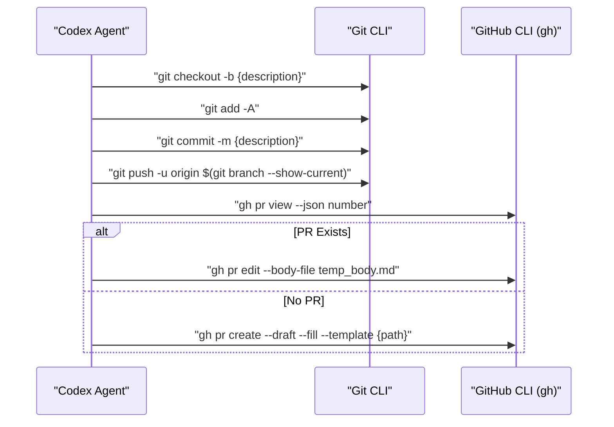

<!-- source: DeepWiki mcp.deepwiki.com · repo openai/skills · extra page yeet · fetched 2026-10-30 -->

# yeet

<details>
<summary>Relevant source files</summary>

The following files were used as context for generating this wiki page:

- [skills/.curated/gh-address-comments/agents/openai.yaml](skills/.curated/gh-address-comments/agents/openai.yaml)
- [skills/.curated/gh-address-comments/assets/github-small.svg](skills/.curated/gh-address-comments/assets/github-small.svg)
- [skills/.curated/gh-address-comments/assets/github.png](skills/.curated/gh-address-comments/assets/github.png)
- [skills/.curated/gh-fix-ci/agents/openai.yaml](skills/.curated/gh-fix-ci/agents/openai.yaml)
- [skills/.curated/pdf/SKILL.md](skills/.curated/pdf/SKILL.md)
- [skills/.curated/screenshot/SKILL.md](skills/.curated/screenshot/SKILL.md)
- [skills/.curated/speech/SKILL.md](skills/.curated/speech/SKILL.md)
- [skills/.curated/yeet/SKILL.md](skills/.curated/yeet/SKILL.md)
- [skills/.curated/yeet/agents/openai.yaml](skills/.curated/yeet/agents/openai.yaml)
- [skills/.curated/yeet/assets/yeet-small.svg](skills/.curated/yeet/assets/yeet-small.svg)
- [skills/.curated/yeet/assets/yeet.png](skills/.curated/yeet/assets/yeet.png)
- [skills/.system/skill-creator/agents/openai.yaml](skills/.system/skill-creator/agents/openai.yaml)
- [skills/.system/skill-installer/agents/openai.yaml](skills/.system/skill-installer/agents/openai.yaml)

</details>


The `yeet` skill is a curated automation workflow designed to streamline the process of staging changes, committing, pushing, and opening a GitHub Pull Request (PR) in a single unified flow. It leverages the GitHub CLI (`gh`) to handle authentication, PR creation, and updates, enforcing specific naming conventions and description formats to maintain repository consistency [skills/.curated/yeet/SKILL.md:1-4]().

### Workflow Overview

The skill follows a strict sequence of operations to ensure that code changes are safely transitioned from a local environment to a remote GitHub repository. It includes built-in logic for branch management, template discovery, and automated PR body generation [skills/.curated/yeet/SKILL.md:38-55]().

#### Data Flow and Execution Logic

The following diagram illustrates the transition from a natural language request to the execution of specific git and GitHub CLI commands.

**Natural Language to Code Entity Space: Yeet Workflow**
```mermaid
graph TD
    subgraph "NaturalLanguageSpace"
        "UserRequest"["'Yeet these changes with description fix-login'"]
    end

    subgraph "CodeEntitySpace"
        direction TB
        "BranchLogic"["git checkout -b 'fix-login'"]
        "StageAction"["git add -A"]
        "CommitAction"["git commit -m 'fix-login'"]
        "PushAction"["git push -u origin $(git branch --show-current)"]
        "PRDiscovery"["gh pr view --json number"]
        "PRAction"["gh pr create --draft --fill"]
    end

    "UserRequest" --> "BranchLogic"
    "BranchLogic" --> "StageAction"
    "StageAction" --> "CommitAction"
    "CommitAction" --> "PushAction"
    "PushAction" --> "PRDiscovery"
    "PRDiscovery" --> "PRAction"
```
Sources: [skills/.curated/yeet/SKILL.md:11-16](), [skills/.curated/yeet/SKILL.md:38-55]()

### Implementation Details

#### 1. Prerequisites and Authentication
Before execution, the skill performs a pre-flight check for the GitHub CLI. It requires an authenticated session, verified via `gh auth status`. If authentication is missing, the workflow halts to prompt the user for `gh auth login` [skills/.curated/yeet/SKILL.md:6-9]().

#### 2. Naming Conventions
To maintain a clean history, the skill enforces the following patterns:

| Entity | Convention | Example |
| :--- | :--- | :--- |
| **Branch** | `{description}` | `feat-add-wobble` |
| **Commit** | `{description}` (terse) | `feat: add hat wobble` |
| **PR Title** | `<type>(<scope>): <subject>` | `feat(ui): add hat wobble` |

Sources: [skills/.curated/yeet/SKILL.md:11-16](), [skills/.curated/yeet/SKILL.md:67-93]()

#### 3. PR Template Discovery
The skill attempts to find existing PR templates to ensure consistency with repository standards. It checks the following locations in order:
1. `.github/pull_request_template.md`
2. `.github/PULL_REQUEST_TEMPLATE.md`
3. A single `*.md` file under `.github/pull_request_template/` or `.github/PULL_REQUEST_TEMPLATE/` [skills/.curated/yeet/SKILL.md:17-31]().

If exactly one template is found, it is passed to `gh pr create` via the `--template` flag [skills/.curated/yeet/SKILL.md:34]().

#### 4. Execution Steps
The automated flow handles several edge cases, such as existing PRs and CI failures:

*   **Branch Management**: If on `main`, `master`, or the default branch, it creates a new branch. Otherwise, it stays on the current branch [skills/.curated/yeet/SKILL.md:40-41]().
*   **Staging & Committing**: Runs `git status -sb` for confirmation before performing a global `git add -A` and committing with the provided description [skills/.curated/yeet/SKILL.md:42-43]().
*   **CI & Dependencies**: If local checks fail due to missing tools, the skill attempts to install dependencies and reruns the checks once [skills/.curated/yeet/SKILL.md:44]().
*   **Push & PR Logic**: Pushes with tracking. It then checks if a PR already exists for the branch using `gh pr view` [skills/.curated/yeet/SKILL.md:45-48](). 
    *   **Existing PR**: Updates the PR in place and preserves its review state (never converts a ready PR back to draft) [skills/.curated/yeet/SKILL.md:49](), [skills/.curated/yeet/SKILL.md:65]().
    *   **New PR**: Opens a new draft PR using `gh pr create --draft --fill` [skills/.curated/yeet/SKILL.md:50-52]().

**Component Interaction Diagram**

Sources: [skills/.curated/yeet/SKILL.md:38-55](), [skills/.curated/yeet/SKILL.md:57-66]()

### PR Body Format
The skill avoids shell-escaped newline issues by writing the PR description to a temporary file before passing it via `--body-file` [skills/.curated/yeet/SKILL.md:54](). The body should prioritize explaining **why** a change was made before **what** changed [skills/.curated/yeet/SKILL.md:101-103]().

**Fallback Structure (when no template is found):**
*   **## Why**: Describes the user-facing or maintainer-facing problem.
*   **## What Changed**: Describes the net implementation change in concise prose [skills/.curated/yeet/SKILL.md:120-132]().

### Interface and Assets
The skill is defined with a specific interface for the agent, including icons and a default prompt [skills/.curated/yeet/agents/openai.yaml:1-7]().

**Natural Language to Code Entity Space: Interface Definition**
```mermaid
classDiagram
    class "YeetSkill" {
        +String display_name "Yeet"
        +String short_description "Stage, commit, and open PR"
        +String default_prompt "Prepare this branch for review..."
        +Path icon_small "./assets/yeet-small.svg"
        +Path icon_large "./assets/yeet.png"
    }
```
Sources: [skills/.curated/yeet/agents/openai.yaml:1-7]()

*   **Display Name**: "Yeet" [skills/.curated/yeet/agents/openai.yaml:2]()
*   **Default Prompt**: "Prepare this branch for review: stage intended changes, write a focused commit, and open a PR." [skills/.curated/yeet/agents/openai.yaml:6]()
*   **Icon (Small)**: `yeet-small.svg` [skills/.curated/yeet/assets/yeet-small.svg:1-3]()
*   **Icon (Large)**: `yeet.png` [skills/.curated/yeet/assets/yeet.png:1-6]()

Sources: [skills/.curated/yeet/agents/openai.yaml](), [skills/.curated/yeet/assets/yeet-small.svg](), [skills/.curated/yeet/assets/yeet.png]()

---

