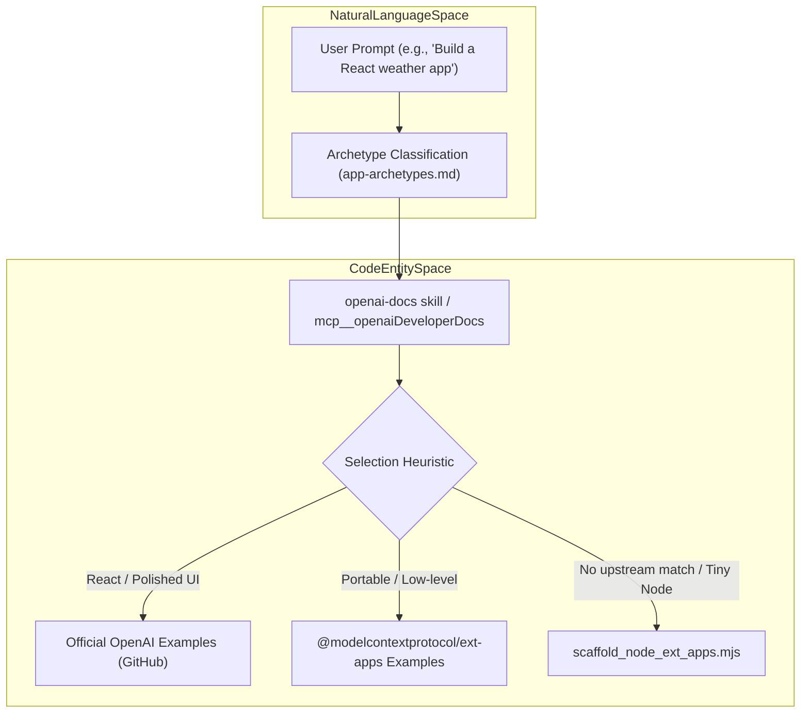
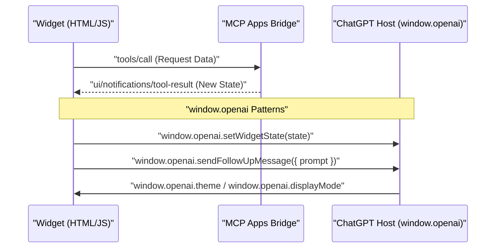

<!-- source: DeepWiki mcp.deepwiki.com · repo openai/skills · extra page ChatGPT Apps · fetched 2026-10-30 -->

# ChatGPT Apps

Relevant source files

The following files were used as context for generating this wiki page:

- [skills/.curated/chatgpt-apps/LICENSE.txt](skills/.curated/chatgpt-apps/LICENSE.txt)
- [skills/.curated/chatgpt-apps/SKILL.md](skills/.curated/chatgpt-apps/SKILL.md)
- [skills/.curated/chatgpt-apps/agents/openai.yaml](skills/.curated/chatgpt-apps/agents/openai.yaml)
- [skills/.curated/chatgpt-apps/references/app-archetypes.md](skills/.curated/chatgpt-apps/references/app-archetypes.md)
- [skills/.curated/chatgpt-apps/references/apps-sdk-docs-workflow.md](skills/.curated/chatgpt-apps/references/apps-sdk-docs-workflow.md)
- [skills/.curated/chatgpt-apps/references/interactive-state-sync-patterns.md](skills/.curated/chatgpt-apps/references/interactive-state-sync-patterns.md)
- [skills/.curated/chatgpt-apps/references/repo-contract-and-validation.md](skills/.curated/chatgpt-apps/references/repo-contract-and-validation.md)
- [skills/.curated/chatgpt-apps/references/search-fetch-standard.md](skills/.curated/chatgpt-apps/references/search-fetch-standard.md)
- [skills/.curated/chatgpt-apps/references/upstream-example-workflow.md](skills/.curated/chatgpt-apps/references/upstream-example-workflow.md)
- [skills/.curated/chatgpt-apps/references/window-openai-patterns.md](skills/.curated/chatgpt-apps/references/window-openai-patterns.md)
- [skills/.curated/chatgpt-apps/scripts/scaffold_node_ext_apps.mjs](skills/.curated/chatgpt-apps/scripts/scaffold_node_ext_apps.mjs)

The `chatgpt-apps` skill is a specialized toolkit for building, scaffolding, and troubleshooting applications using the **ChatGPT Apps SDK**. It combines Model Context Protocol (MCP) servers with widget-based user interfaces to create interactive, tool-augmented experiences within ChatGPT. The skill enforces a docs-first workflow, utilizing the official OpenAI developer documentation to ensure implementations align with the latest SDK patterns and security requirements.

## Core Concepts and Workflow

The skill operates on a "Docs-First" principle, requiring developers to fetch current guidance before generating code. This ensures that tool schemas, UI bridge protocols, and security settings (like CSP) are accurate.

### The Five App Archetypes
To avoid custom structures for every request, the skill classifies apps into five primary archetypes:

| Archetype | Use Case | Key Components |
| :--- | :--- | :--- |
| `tool-only` | Background actions, search, or retrieval without a UI. | MCP Server only. |
| `vanilla-widget` | Simple demos, workshop starters, or single HTML widgets. | Server + `public/` assets. |
| `react-widget` | Polished, component-based UIs with rich design needs. | Split `server/` + `web/` layout. |
| `interactive-decoupled` | Stateful experiences (boards, games, editors) with repeated interaction. | Data tools + Render tools. |
| `submission-ready` | Public launch or directory submission readiness. | Full repo + Deployment/CSP/Auth. |

**Sources:** [skills/.curated/chatgpt-apps/references/app-archetypes.md:1-125](), [skills/.curated/chatgpt-apps/SKILL.md:79-97]()

### Implementation Logic Flow
The following diagram illustrates the transition from a natural language request to the selection of code entities and scaffolds.

**Archetype and Scaffold Selection Logic**

**Sources:** [skills/.curated/chatgpt-apps/SKILL.md:110-131](), [skills/.curated/chatgpt-apps/references/upstream-example-workflow.md:1-80]()

---

## Technical Architecture

### MCP Server and Tool Design
The server acts as the backend, exposing an `/mcp` route and registering tools that the ChatGPT model can invoke.

*   **Standard Tools:** For connector-like or sync-oriented apps, the skill defaults to implementing standard `search` and `fetch` tools [skills/.curated/chatgpt-apps/references/search-fetch-standard.md:5-43]().
*   **Annotations:** Tools must include impact hints such as `readOnlyHint`, `destructiveHint`, and `openWorldHint` [skills/.curated/chatgpt-apps/references/apps-sdk-docs-workflow.md:51-58]().
*   **UI Integration:** Tools intended to trigger a UI use `_meta.ui.resourceUri` to link the tool result to a specific widget template [skills/.curated/chatgpt-apps/references/repo-contract-and-validation.md:23-31]().

### The Widget Bridge (`window.openai`)
The widget UI communicates with the host (ChatGPT) via the MCP Apps bridge. While the bridge handles portable messaging (`ui/message`, `tools/call`), the `window.openai` object provides ChatGPT-specific runtime conveniences.

**Bridge Communication and window.openai Surface**

**Sources:** [skills/.curated/chatgpt-apps/references/window-openai-patterns.md:1-43](), [skills/.curated/chatgpt-apps/references/repo-contract-and-validation.md:32-40]()

### Key window.openai APIs
| API | Purpose |
| :--- | :--- |
| `toolInput` | Arguments supplied by the host to the tool [skills/.curated/chatgpt-apps/references/window-openai-patterns.md:15-15](). |
| `toolOutput` | The current `structuredContent` payload [skills/.curated/chatgpt-apps/references/window-openai-patterns.md:16-16](). |
| `setWidgetState(state)` | Persists a local UI snapshot [skills/.curated/chatgpt-apps/references/window-openai-patterns.md:19-19](). |
| `callTool(name, args)` | Calls another MCP tool from the widget [skills/.curated/chatgpt-apps/references/window-openai-patterns.md:23-23](). |
| `requestDisplayMode(mode)` | Requests `inline`, `pip`, or `fullscreen` [skills/.curated/chatgpt-apps/references/window-openai-patterns.md:26-26](). |

**Sources:** [skills/.curated/chatgpt-apps/references/window-openai-patterns.md:11-32]()

---

## Validation and Contract

The skill follows a **Validation Ladder** to ensure generated repos are functional beyond simple file creation.

1.  **Level 0 (Static):** Review repo shape, `/mcp` route presence, and archetype coherence [skills/.curated/chatgpt-apps/references/repo-contract-and-validation.md:51-60]().
2.  **Level 1 (Syntax):** Run `tsc` or Python syntax checks [skills/.curated/chatgpt-apps/references/repo-contract-and-validation.md:61-68]().
3.  **Level 2 (Runtime):** Start the server and confirm the `/mcp` endpoint responds [skills/.curated/chatgpt-apps/references/repo-contract-and-validation.md:69-75]().
4.  **Level 3 (Host Loop):** Test through ChatGPT Developer Mode or MCP Inspector [skills/.curated/chatgpt-apps/references/repo-contract-and-validation.md:76-83]().

**Sources:** [skills/.curated/chatgpt-apps/references/repo-contract-and-validation.md:47-83]()

### Minimum Working Repo Contract
Every app must satisfy these requirements:
*   **Shape:** Matches the chosen archetype (e.g., split `server/` and `web/` for React) [skills/.curated/chatgpt-apps/references/repo-contract-and-validation.md:11-14]().
*   **Server:** Exposes `/mcp` and registers resources with the `text/html;profile=mcp-app` MIME type [skills/.curated/chatgpt-apps/references/apps-sdk-docs-workflow.md:44-45]().
*   **Security:** Accurate Content Security Policy (CSP) in `_meta.ui.csp.connectDomains` and `resourceDomains` [skills/.curated/chatgpt-apps/references/apps-sdk-docs-workflow.md:73-77]().
*   **Metadata:** Includes `openai/widgetDescription` to inform the model of the widget's purpose [skills/.curated/chatgpt-apps/references/apps-sdk-docs-workflow.md:78-78]().

**Sources:** [skills/.curated/chatgpt-apps/references/repo-contract-and-validation.md:7-46](), [skills/.curated/chatgpt-apps/references/apps-sdk-docs-workflow.md:73-79]()

---

## Local Scaffolding Utility

When upstream examples are unavailable, the skill utilizes a local Node.js fallback script: `scripts/scaffold_node_ext_apps.mjs`.

### Key Functions
*   `buildPackageJson(appSlug)`: Generates a `package.json` with `@modelcontextprotocol/ext-apps` and `@modelcontextprotocol/sdk` dependencies [skills/.curated/chatgpt-apps/scripts/scaffold_node_ext_apps.mjs:49-72]().
*   `WIDGET_TEMPLATE`: A baseline HTML/CSS/JS template that implements the RPC bridge for communication with the host [skills/.curated/chatgpt-apps/scripts/scaffold_node_ext_apps.mjs:91-231]().
*   `rpcRequest(method, params)`: Handles JSON-RPC communication over `window.parent.postMessage` [skills/.curated/chatgpt-apps/scripts/scaffold_node_ext_apps.mjs:226-231]().

**Sources:** [skills/.curated/chatgpt-apps/scripts/scaffold_node_ext_apps.mjs:1-231]()

---

