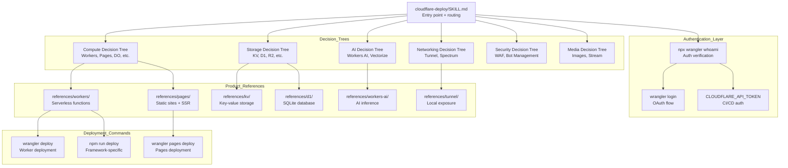
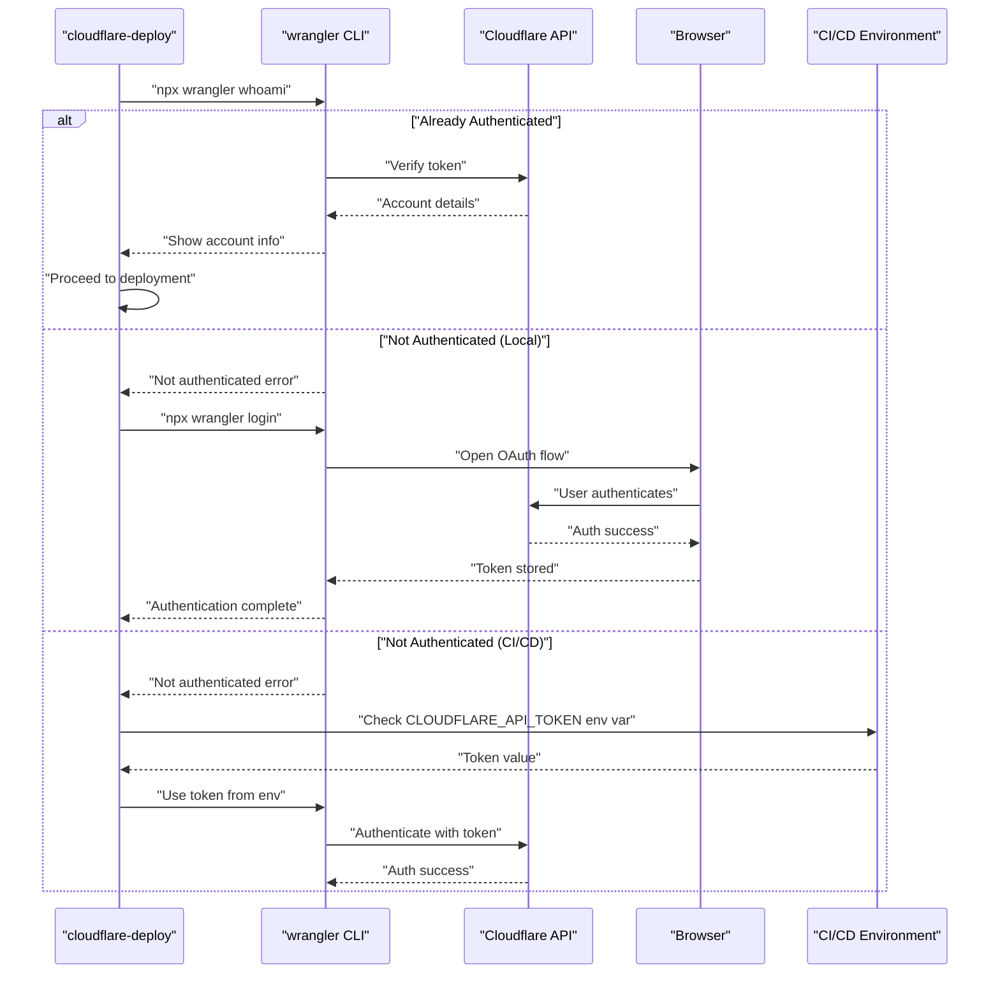
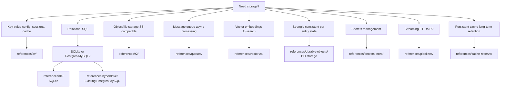
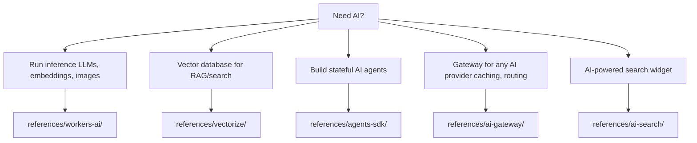
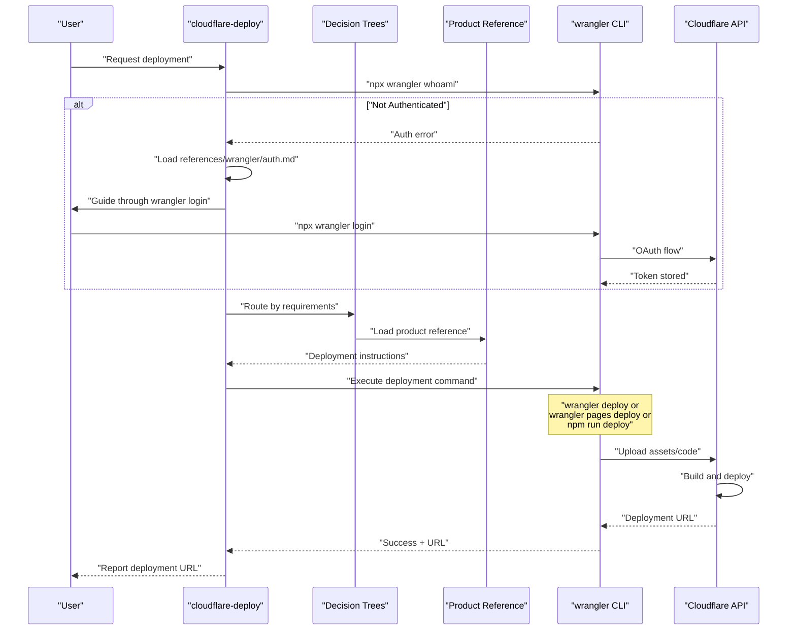

<!-- source: DeepWiki mcp.deepwiki.com · repo openai/skills · extra page Cloudflare Deploy · fetched 2026-10-30 -->

# Cloudflare Deploy

<details>
<summary>Relevant source files</summary>

The following files were used as context for generating this wiki page:

- [skills/.curated/cloudflare-deploy/SKILL.md](skills/.curated/cloudflare-deploy/SKILL.md)
- [skills/.curated/netlify-deploy/SKILL.md](skills/.curated/netlify-deploy/SKILL.md)
- [skills/.curated/render-deploy/SKILL.md](skills/.curated/render-deploy/SKILL.md)

</details>


This page documents the `cloudflare-deploy` skill, which provides deployment capabilities for Cloudflare's platform services including Workers, Pages, and related infrastructure. The skill uses the `wrangler` CLI to interact with Cloudflare's API and provides decision trees to help users select the appropriate Cloudflare product for their use case.

For other deployment platforms, see [Netlify Deploy](5.5.1), [Vercel Deploy](5.5.2), and [Render Deploy](5.5.4).

## Skill Purpose and Scope

The `cloudflare-deploy` skill activates when users want to deploy, host, publish, or set up projects on the Cloudflare platform. It serves as a unified entry point to Cloudflare's extensive product catalog, guiding users through product selection, authentication, and deployment workflows [skills/.curated/cloudflare-deploy/SKILL.md:1-8]().

The skill operates as a hub-and-spoke architecture: the main `SKILL.md` provides decision trees and product routing, while detailed implementation instructions are stored in product-specific reference files under `references/` [skills/.curated/cloudflare-deploy/SKILL.md:112-213]().

Sources: [skills/.curated/cloudflare-deploy/SKILL.md:1-10]()

## Architecture Overview

### Skill Structure



Sources: [skills/.curated/cloudflare-deploy/SKILL.md:1-213]()

## Prerequisites and Sandboxing

The skill requires escalated sandbox permissions for network operations. Deployments may fail with timeout, DNS, or connection errors under default sandbox settings. Users should be prompted to rerun with `sandbox_permissions=require_escalated` if deployment network calls are blocked [skills/.curated/cloudflare-deploy/SKILL.md:12-13]().

Deployments typically take several minutes to complete. The skill should use appropriate timeout values and inform users of expected duration [skills/.curated/cloudflare-deploy/SKILL.md:13]().

Sources: [skills/.curated/cloudflare-deploy/SKILL.md:10-13]()

## Authentication Workflow

### Authentication Verification

Before any deployment operation (`wrangler deploy`, `wrangler pages deploy`, or `npm run deploy`), the skill verifies authentication status using:

```bash
npx wrangler whoami
```

This command returns the authenticated account details if successful, or an error if not authenticated [skills/.curated/cloudflare-deploy/SKILL.md:19-21]().

Sources: [skills/.curated/cloudflare-deploy/SKILL.md:15-21]()

### Authentication Methods



The skill supports two authentication methods [skills/.curated/cloudflare-deploy/SKILL.md:23-25]():

1. **Interactive/Local**: `wrangler login` triggers a one-time OAuth flow via browser.
2. **CI/CD**: `CLOUDFLARE_API_TOKEN` environment variable for automated pipelines.

Detailed authentication instructions are stored in the `references/wrangler/auth.md` reference file [skills/.curated/cloudflare-deploy/SKILL.md:23]().

Sources: [skills/.curated/cloudflare-deploy/SKILL.md:15-25]()

## Product Selection Decision Trees

The skill uses decision trees to route users to appropriate Cloudflare products based on their requirements. The trees are structured by functional category: compute, storage, AI, networking, security, and media.

### Compute Decision Tree

```mermaid
graph TD
    ComputeEntry["Need to run code?"]
    
    ComputeEntry --> ServerlessEdge["Serverless functions at edge"]
    ComputeEntry --> FullStack["Full-stack web app with Git deploys"]
    ComputeEntry --> Stateful["Stateful coordination/real-time"]
    ComputeEntry --> LongRunning["Long-running multi-step jobs"]
    ComputeEntry --> Containers["Run containers"]
    ComputeEntry --> MultiTenant["Multi-tenant customers deploy code"]
    ComputeEntry --> Cron["Scheduled tasks cron"]
    ComputeEntry --> EdgeLogic["Lightweight edge logic HTTP modification"]
    ComputeEntry --> Observability["Process Worker execution events"]
    ComputeEntry --> Latency["Optimize latency to backend"]
    
    ServerlessEdge --> WorkersRef["references/workers/"]
    FullStack --> PagesRef["references/pages/"]
    Stateful --> DORef["references/durable-objects/"]
    LongRunning --> WorkflowsRef["references/workflows/"]
    Containers --> ContainersRef["references/containers/"]
    MultiTenant --> PlatformsRef["references/workers-for-platforms/"]
    Cron --> CronRef["references/cron-triggers/"]
    EdgeLogic --> SnippetsRef["references/snippets/"]
    Observability --> TailRef["references/tail-workers/"]
    Latency --> SmartPlaceRef["references/smart-placement/"]
```



Sources: [skills/.curated/cloudflare-deploy/SKILL.md:27-43]()

### Storage Decision Tree



Sources: [skills/.curated/cloudflare-deploy/SKILL.md:45-58]()

### AI/ML Decision Tree



Sources: [skills/.curated/cloudflare-deploy/SKILL.md:60-69]()

## Product Catalog

The skill maintains a comprehensive index of Cloudflare products organized by category. Each entry maps to a reference directory containing detailed deployment instructions.

### Compute & Runtime Products

| Product | Reference Path | Primary Use Case |
|---------|----------------|------------------|
| Workers | `references/workers/` | Serverless edge functions [skills/.curated/cloudflare-deploy/SKILL.md:117]() |
| Pages | `references/pages/` | Static sites with Git integration [skills/.curated/cloudflare-deploy/SKILL.md:118]() |
| Durable Objects | `references/durable-objects/` | Stateful coordination primitives [skills/.curated/cloudflare-deploy/SKILL.md:120]() |
| Workflows | `references/workflows/` | Long-running multi-step jobs [skills/.curated/cloudflare-deploy/SKILL.md:121]() |

Sources: [skills/.curated/cloudflare-deploy/SKILL.md:115-127]()

### Storage & Data Products

| Product | Reference Path | Storage Type |
|---------|----------------|--------------|
| KV | `references/kv/` | Key-value store [skills/.curated/cloudflare-deploy/SKILL.md:132]() |
| D1 | `references/d1/` | SQLite database [skills/.curated/cloudflare-deploy/SKILL.md:133]() |
| R2 | `references/r2/` | S3-compatible object storage [skills/.curated/cloudflare-deploy/SKILL.md:134]() |
| Queues | `references/queues/` | Message queuing [skills/.curated/cloudflare-deploy/SKILL.md:135]() |

Sources: [skills/.curated/cloudflare-deploy/SKILL.md:130-141]()

## Deployment Workflow

### General Deployment Pattern



Sources: [skills/.curated/cloudflare-deploy/SKILL.md:15-213]()

## Troubleshooting

### Escalated Network Access

When deployment commands fail due to network issues (timeouts, DNS errors, connection resets), the skill should prompt users to rerun with escalated sandbox permissions [skills/.curated/cloudflare-deploy/SKILL.md:216-218](). This typically occurs when sandbox networking blocks outbound requests to Cloudflare's API.

The recommended user-facing guidance:
```
The deploy needs escalated network access to deploy to Cloudflare. I can rerun the command with escalated permissions—want me to proceed?
```
Sources: [skills/.curated/cloudflare-deploy/SKILL.md:216-222]()

### Integration with Other Deployment Skills

The `cloudflare-deploy` skill is part of a broader deployment tools suite:

- **[Netlify Deploy](5.5.1)**: Alternative for JAMstack sites with Netlify-specific features using `npx netlify` [skills/.curated/netlify-deploy/SKILL.md:2-3]().
- **[Render Deploy](5.5.4)**: Full-stack applications with databases and background workers using `render.yaml` Blueprints or Direct Creation [skills/.curated/render-deploy/SKILL.md:2-12]().

Sources: [skills/.curated/cloudflare-deploy/SKILL.md:1-10](), [skills/.curated/netlify-deploy/SKILL.md:1-10](), [skills/.curated/render-deploy/SKILL.md:1-15]()

---

