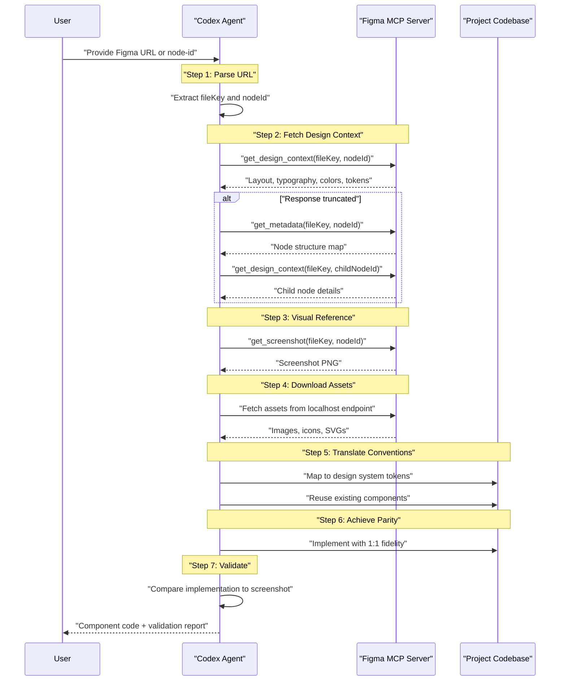
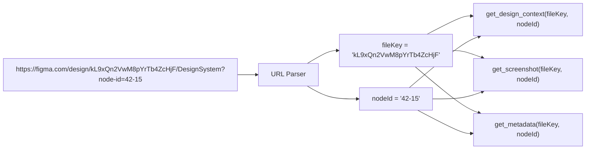
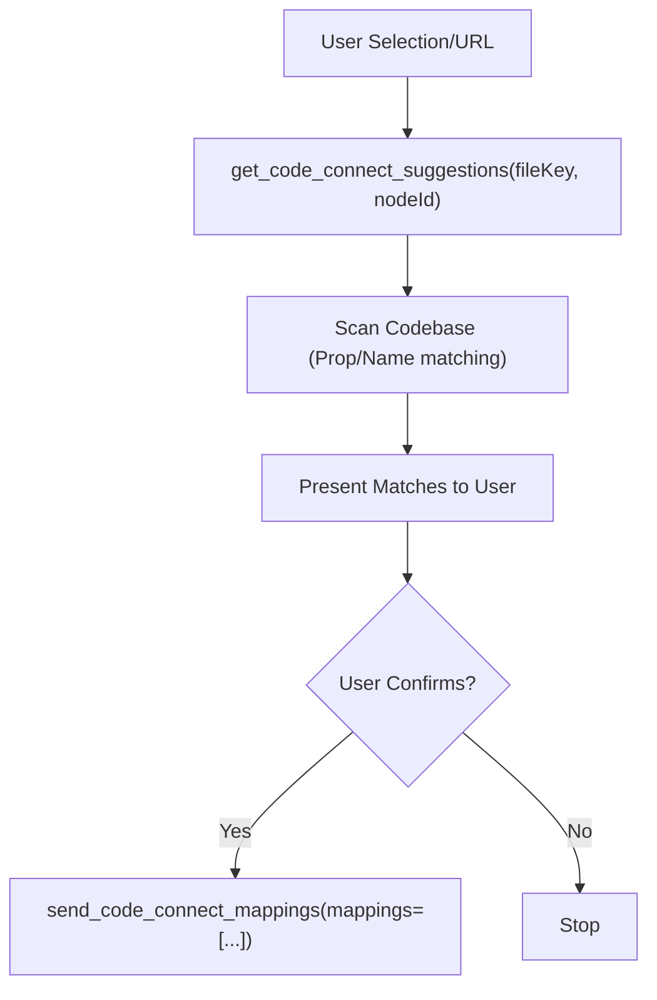

<!-- source: DeepWiki mcp.deepwiki.com · repo openai/skills · extra page Figma Design Implementation Workflows · fetched 2026-10-30 -->

# Figma Design Implementation Workflows

Relevant source files

The following files were used as context for generating this wiki page:

- [skills/.curated/figma-code-connect-components/SKILL.md](skills/.curated/figma-code-connect-components/SKILL.md)
- [skills/.curated/figma-code-connect-components/agents/openai.yaml](skills/.curated/figma-code-connect-components/agents/openai.yaml)
- [skills/.curated/figma-code-connect-components/assets/figma-small.svg](skills/.curated/figma-code-connect-components/assets/figma-small.svg)
- [skills/.curated/figma-code-connect-components/assets/figma.png](skills/.curated/figma-code-connect-components/assets/figma.png)
- [skills/.curated/figma-code-connect-components/assets/icon.svg](skills/.curated/figma-code-connect-components/assets/icon.svg)
- [skills/.curated/figma-code-connect-components/references/mapping-checklist.md](skills/.curated/figma-code-connect-components/references/mapping-checklist.md)
- [skills/.curated/figma-code-connect-components/scripts/normalize_node_id.py](skills/.curated/figma-code-connect-components/scripts/normalize_node_id.py)
- [skills/.curated/figma-create-design-system-rules/SKILL.md](skills/.curated/figma-create-design-system-rules/SKILL.md)
- [skills/.curated/figma-create-design-system-rules/agents/openai.yaml](skills/.curated/figma-create-design-system-rules/agents/openai.yaml)
- [skills/.curated/figma-create-design-system-rules/assets/figma-small.svg](skills/.curated/figma-create-design-system-rules/assets/figma-small.svg)
- [skills/.curated/figma-create-design-system-rules/assets/figma.png](skills/.curated/figma-create-design-system-rules/assets/figma.png)
- [skills/.curated/figma-implement-design/SKILL.md](skills/.curated/figma-implement-design/SKILL.md)
- [skills/.curated/notion-knowledge-capture/SKILL.md](skills/.curated/notion-knowledge-capture/SKILL.md)
- [skills/.curated/notion-meeting-intelligence/SKILL.md](skills/.curated/notion-meeting-intelligence/SKILL.md)
- [skills/.curated/notion-research-documentation/SKILL.md](skills/.curated/notion-research-documentation/SKILL.md)
- [skills/.curated/notion-spec-to-implementation/SKILL.md](skills/.curated/notion-spec-to-implementation/SKILL.md)

This document details the design-to-code workflows available through Figma integration skills. These workflows enable translating Figma designs into production-ready code with pixel-perfect accuracy using structured MCP tool calls and validation steps.

For information about the underlying Figma MCP server configuration and available tools, see **5.2.1 Figma MCP Server**.

## Available Workflows

The Figma integration provides three curated workflows defined in the `skills/.curated/` directory:

| Workflow | Skill Name | Purpose |
|----------|------------|---------|
| Design Implementation | `figma-implement-design` | Translate Figma nodes into production code with 1:1 visual fidelity |
| Design System Rules | `figma-create-design-system-rules` | Extract design system patterns and constraints from Figma files |
| Code Connect | `figma-code-connect-components` | Link Figma components to existing code component implementations |

**Sources:** [skills/.curated/figma-implement-design/SKILL.md:1-11](), [skills/.curated/figma-create-design-system-rules/SKILL.md:1-3](), [skills/.curated/figma-code-connect-components/SKILL.md:1-3]()

## figma-implement-design Workflow

The `figma-implement-design` skill provides a structured process for converting Figma designs to code. It ensures consistency across implementations by enforcing a specific sequence of MCP tool calls and validation checkpoints.

### Workflow Overview

The following diagram illustrates the interaction between the Codex agent, the Figma MCP server (configured via `streamable_http` [skills/.curated/figma-code-connect-components/agents/openai.yaml:13-13]()), and the project codebase.

**Figma Implementation Data Flow**

**Sources:** [skills/.curated/figma-implement-design/SKILL.md:22-147](), [skills/.curated/figma-code-connect-components/agents/openai.yaml:8-15]()

### URL Parsing and Node Identification

The workflow supports two input methods: URL-based and selection-based (desktop app only).

#### URL Format
The standard URL format used for extraction is:
`https://figma.com/design/:fileKey/:fileName?node-id=1-2` [skills/.curated/figma-implement-design/SKILL.md:39-39]()

**Extraction logic:**

| Component | Location | Example |
|-----------|----------|---------|
| `fileKey` | Path segment after `/design/` | `kL9xQn2VwM8pYrTb4ZcHjF` |
| `nodeId` | Query parameter `node-id` | `42-15` |

**Natural Language to Tool Arguments**

**Sources:** [skills/.curated/figma-implement-design/SKILL.md:39-58]()

#### Desktop Selection (figma-desktop MCP only)
When using the `figma-desktop` MCP server variant, the `fileKey` is not required as the server automatically uses the currently open file [skills/.curated/figma-implement-design/SKILL.md:46-46](). Selection-based prompting requires the user to have a node selected in the Figma desktop app [skills/.curated/figma-implement-design/SKILL.md:58-58]().

**Sources:** [skills/.curated/figma-implement-design/SKILL.md:54-59]()

### Implementation Translation Process

Step 5 involves translating Figma MCP output (typically React + Tailwind) into project-specific conventions [skills/.curated/figma-implement-design/SKILL.md:105-105]().

#### Translation Principles
1.  **Reuse existing components**: Use project buttons, inputs, and typography instead of duplicating functionality [skills/.curated/figma-implement-design/SKILL.md:111-111]().
2.  **Token Mapping**: Replace Tailwind utility classes with the project's design system tokens [skills/.curated/figma-implement-design/SKILL.md:110-110]().
3.  **Consistency**: Use the project's color system, typography scale, and spacing tokens [skills/.curated/figma-implement-design/SKILL.md:112-112]().

**Sources:** [skills/.curated/figma-implement-design/SKILL.md:103-114]()

---

## figma-create-design-system-rules Workflow

The `figma-create-design-system-rules` skill helps establish project-level instructions (e.g., `CLAUDE.md`, `AGENTS.md`, or `.cursor/rules`) to ensure AI coding agents follow team-specific conventions [skills/.curated/figma-create-design-system-rules/SKILL.md:12-19]().

### Workflow Steps
1.  **Initialize**: Call `create_design_system_rules` with `clientLanguages` and `clientFrameworks` to fetch the foundation template [skills/.curated/figma-create-design-system-rules/SKILL.md:53-61]().
2.  **Analyze Codebase**: Inspect the project for component organization (e.g., `src/components/`), styling approach (e.g., Tailwind), and naming conventions [skills/.curated/figma-create-design-system-rules/SKILL.md:66-93]().
3.  **Generate Rules**: Create project-specific rules covering styling, asset handling, and Figma MCP integration [skills/.curated/figma-create-design-system-rules/SKILL.md:94-166]().
4.  **Save**: Persist the rules to the appropriate file for the active agent [skills/.curated/figma-create-design-system-rules/SKILL.md:168-175]().

**Sources:** [skills/.curated/figma-create-design-system-rules/SKILL.md:49-175]()

---

## figma-code-connect-components Workflow

The `figma-code-connect-components` skill automates the linking of Figma design components to their code implementations using Figma's Code Connect feature [skills/.curated/figma-code-connect-components/SKILL.md:8-10]().

### Technical Workflow
1.  **Get Suggestions**: Call `get_code_connect_suggestions` [skills/.curated/figma-code-connect-components/SKILL.md:33-33](). Note that URL node IDs using hyphens (`1-2`) must be converted to colon format (`1:2`) for tool compatibility [skills/.curated/figma-code-connect-components/SKILL.md:52-56]().
2.  **Scan Codebase**: Search for components with matching names or props (variants, text, styles) in directories like `src/components/` [skills/.curated/figma-code-connect-components/SKILL.md:77-106]().
3.  **Batch Mapping**: Call `send_code_connect_mappings` with an array of confirmed mappings including `nodeId`, `componentName`, `source` path, and `label` [skills/.curated/figma-code-connect-components/SKILL.md:129-144]().

**Code Connect Logic Flow**

**Sources:** [skills/.curated/figma-code-connect-components/SKILL.md:29-145](), [skills/.curated/figma-code-connect-components/scripts/normalize_node_id.py:9-21]()

---

