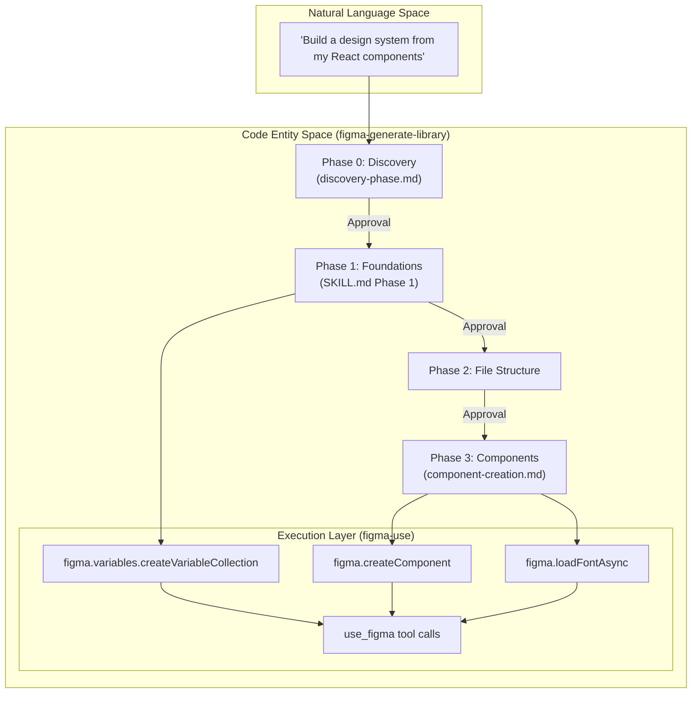
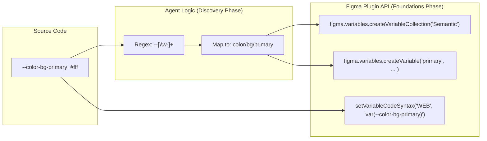

<!-- source: DeepWiki mcp.deepwiki.com · repo openai/skills · extra page Figma Design System Builder · fetched 2026-10-30 -->

# Figma Design System Builder

Relevant source files

The following files were used as context for generating this wiki page:

- [skills/.curated/figma-generate-library/SKILL.md](skills/.curated/figma-generate-library/SKILL.md)
- [skills/.curated/figma-generate-library/references/component-creation.md](skills/.curated/figma-generate-library/references/component-creation.md)
- [skills/.curated/figma-generate-library/references/discovery-phase.md](skills/.curated/figma-generate-library/references/discovery-phase.md)

The `figma-generate-library` skill is a professional-grade toolset for building or updating Figma design systems directly from a codebase. It automates the creation of variables (tokens), component libraries, theming (light/dark modes), and foundational documentation while ensuring perfect parity between code and design.

## Purpose and Scope

This skill focuses on **what** to build and the **order** in which to build it. It orchestrates complex, multi-phase workflows that typically involve 20–100+ `use_figma` tool calls [[skills/.curated/figma-generate-library/SKILL.md:3-8]]().

**Critical Dependency**: This skill MUST be used in conjunction with `figma-use`. While `figma-generate-library` provides the domain knowledge and workflow logic, `figma-use` provides the technical rules for the Figma Plugin API (e.g., font loading, color ranges, and return patterns) [[skills/.curated/figma-generate-library/SKILL.md:10-12]]().

## Mandatory Multi-Phase Workflow

Building a design system is never a one-shot task. Attempting to create everything in a single call results in broken structures. The skill enforces a strict phase-based progression with mandatory user checkpoints [[skills/.curated/figma-generate-library/SKILL.md:16-19]]().

### Phase 0: Discovery
Before any writes occur, the agent must analyze the codebase and the existing Figma environment.
*   **Codebase Analysis**: Extract tokens from CSS variables, Tailwind configs, or design token JSON files [[skills/.curated/figma-generate-library/references/discovery-phase.md:9-13]]().
*   **Figma Inspection**: Check for existing pages, variables, and styles to match conventions [[skills/.curated/figma-generate-library/references/discovery-phase.md:180-182]]().
*   **Scope Locking**: Agree on the exact token set and component list with the user [[skills/.curated/figma-generate-library/SKILL.md:31-33]]().

### Phase 1: Foundations
Tokens must exist before components.
*   **Variables**: Create primitive collections (raw values) and semantic collections (mode-aware aliases) [[skills/.curated/figma-generate-library/SKILL.md:35-38]]().
*   **Scoping**: Set explicit scopes (e.g., `FRAME_FILL`, `TEXT_FILL`, `GAP`, `CORNER_RADIUS`) on all variables to prevent misuse [[skills/.curated/figma-generate-library/SKILL.md:39-40]](), [[skills/.curated/figma-generate-library/SKILL.md:90-90]]().
*   **Styles**: Create Effect Styles (shadows) and Text Styles (typography) [[skills/.curated/figma-generate-library/SKILL.md:41-42]]().

### Phase 2: File Structure
*   **Page Skeleton**: Generate standard pages: Cover, Getting Started, Foundations, Components, and Utilities [[skills/.curated/figma-generate-library/SKILL.md:46-47]]().
*   **Documentation**: Create visual specimens for color swatches, type specimens, and spacing bars [[skills/.curated/figma-generate-library/SKILL.md:47-48]]().

### Phase 3: Components
Components are built one at a time in dependency order (Atoms → Molecules → Organisms) [[skills/.curated/figma-generate-library/SKILL.md:51-52]]().
*   **Dependency Graph**: Build atoms (Icon, Avatar) before molecules (Button, Input) to allow for instance embedding [[skills/.curated/figma-generate-library/references/component-creation.md:11-21]]().
*   **Base Construction**: Build with Auto-Layout and bind all properties to variables [[skills/.curated/figma-generate-library/SKILL.md:54-54]]().
*   **Variants**: Use `combineAsVariants`, arrange in a grid, and add component properties (TEXT, BOOLEAN, INSTANCE_SWAP) [[skills/.curated/figma-generate-library/SKILL.md:55-56]]().
*   **Validation**: Run `get_metadata` for structure and `get_screenshot` for visual verification after each component [[skills/.curated/figma-generate-library/SKILL.md:59-59]]().

### Phase 4: Integration & QA
*   **Code Connect**: Finalize mappings between Figma components and code snippets [[skills/.curated/figma-generate-library/SKILL.md:65-66]]().
*   **Audits**: Perform accessibility audits (contrast, touch targets) and naming audits to ensure no unnamed nodes or duplicates [[skills/.curated/figma-generate-library/SKILL.md:66-68]]().

### Workflow Orchestration Logic
The following diagram illustrates the transition from Natural Language requirements to the technical execution phases.

**Design System Construction Flow**

Sources: [[skills/.curated/figma-generate-library/SKILL.md:22-71]](), [[skills/.curated/figma-generate-library/SKILL.md:75-102]](), [[skills/.curated/figma-generate-library/references/component-creation.md:3-5]]()

## Implementation Details

### State Management and Idempotency
Because the workflow spans dozens of tool calls, the skill requires a robust state management pattern.
*   **State Ledger**: The agent must maintain a ledger of created IDs (e.g., `variableIds`, `componentIds`) to avoid hallucinating IDs or creating duplicates [[skills/.curated/figma-generate-library/SKILL.md:105-108]]().
*   **Deterministic Naming**: Use unique, consistent names for nodes to allow for idempotent cleanup and resumability [[skills/.curated/figma-generate-library/SKILL.md:95-95]().
*   **PluginData**: Use `setPluginData` to tag frames with run IDs and keys (e.g., `dsb_run_id`) to ensure the agent can re-identify nodes it created in previous turns [[skills/.curated/figma-generate-library/references/component-creation.md:102-104]]().

### Data Flow: Code Token to Figma Variable
This diagram shows how a CSS variable is transformed into a Figma entity during the Foundations phase.

**Token Transformation Pipeline**

Sources: [[skills/.curated/figma-generate-library/references/discovery-phase.md:37-48]](), [[skills/.curated/figma-generate-library/SKILL.md:35-41]]()

## Critical Rules for Implementation

1.  **Variables Before Components**: Components must bind to variables. No hardcoded colors or spacing are permitted in the final library [[skills/.curated/figma-generate-library/SKILL.md:86-86]]().
2.  **Sequential Execution**: NEVER parallelize `use_figma` calls. Figma state mutations must be strictly sequential to prevent race conditions or corrupted file state [[skills/.curated/figma-generate-library/SKILL.md:98-98]]().
3.  **Variable Scoping**: Scopes must be set on every variable (e.g., `TEXT_FILL` for text colors, `GAP` for spacing) rather than leaving them as `ALL_SCOPES` [[skills/.curated/figma-generate-library/SKILL.md:90-90]]().
4.  **Code Syntax**: Web syntax for variables MUST use the `var()` wrapper (e.g., `var(--color-bg-primary)`) to match actual CSS usage [[skills/.curated/figma-generate-library/SKILL.md:91-91]]().
5.  **Font Loading**: `await figma.loadFontAsync({family, style})` must be called before any text write operations [[skills/.curated/figma-generate-library/SKILL.md:83-83]]().
6.  **No Destructive Cleanup**: Cleanup logic must identify nodes by name convention or returned IDs, never by guessing [[skills/.curated/figma-generate-library/SKILL.md:96-96]]().
7.  **Private Components**: Use the `__` prefix for internal helper components and `_` for documentation-only components [[skills/.curated/figma-generate-library/references/component-creation.md:44-51]]().

Sources:
- [[skills/.curated/figma-generate-library/SKILL.md]]()
- [[skills/.curated/figma-generate-library/references/discovery-phase.md]]()
- [[skills/.curated/figma-generate-library/references/component-creation.md]]()

---

