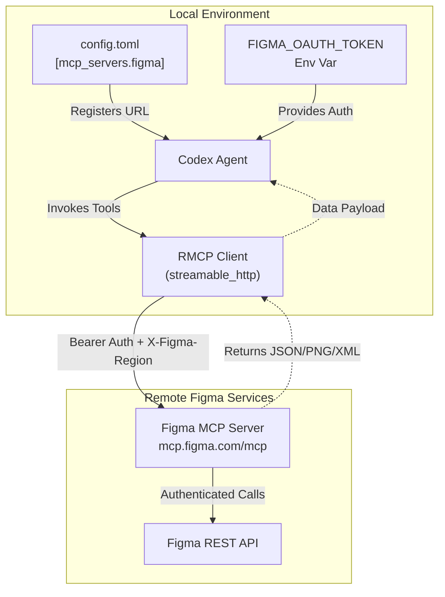
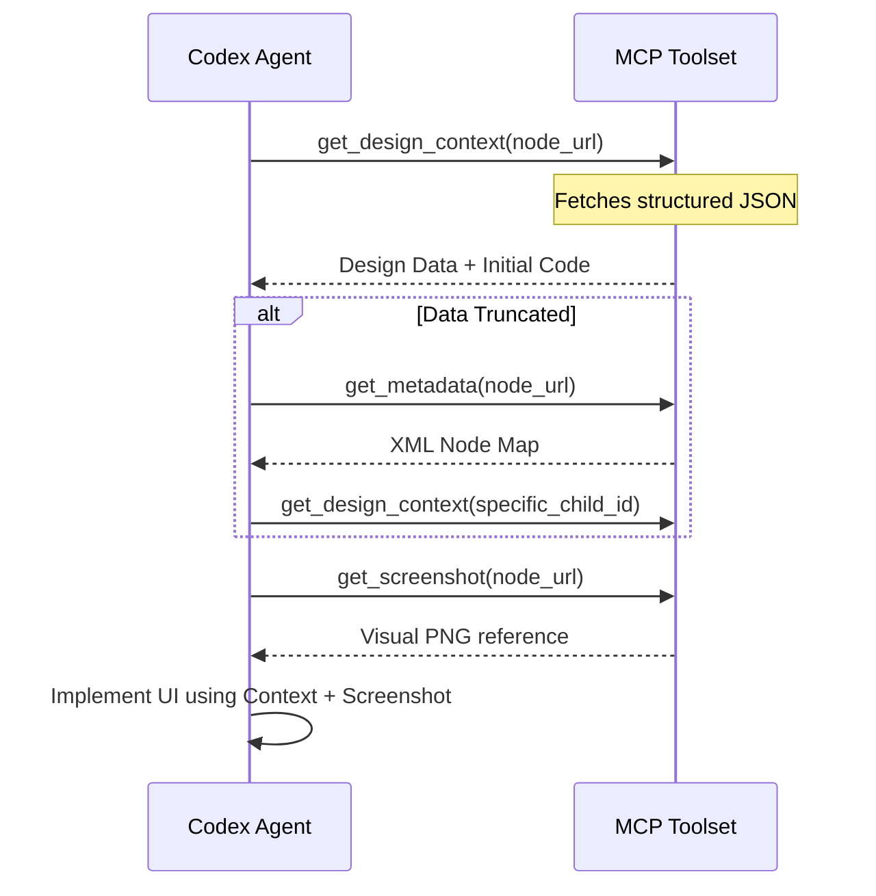

<!-- source: DeepWiki mcp.deepwiki.com · repo openai/skills · extra page Figma MCP Server · fetched 2026-10-30 -->

# Figma MCP Server

<details>
<summary>Relevant source files</summary>

The following files were used as context for generating this wiki page:

- [skills/.curated/figma/SKILL.md](skills/.curated/figma/SKILL.md)
- [skills/.curated/figma/agents/openai.yaml](skills/.curated/figma/agents/openai.yaml)
- [skills/.curated/figma/assets/figma-small.svg](skills/.curated/figma/assets/figma-small.svg)
- [skills/.curated/figma/assets/figma.png](skills/.curated/figma/assets/figma.png)
- [skills/.curated/figma/assets/icon.svg](skills/.curated/figma/assets/icon.svg)
- [skills/.curated/figma/references/figma-mcp-config.md](skills/.curated/figma/references/figma-mcp-config.md)
- [skills/.curated/figma/references/figma-tools-and-prompts.md](skills/.curated/figma/references/figma-tools-and-prompts.md)

</details>


This page documents the Figma MCP (Model Context Protocol) server integration (the `figma` skill), which enables Codex to interact with Figma designs programmatically. The Figma MCP server is a remote HTTP-based integration that provides tools for fetching design context, screenshots, variables, and assets from Figma files.

## Overview

The Figma MCP server is a curated skill that connects to `https://mcp.figma.com/mcp` [skills/.curated/figma/agents/openai.yaml:14-14](). It uses the `streamable_http` transport protocol [skills/.curated/figma/agents/openai.yaml:13-13](). This integration allows Codex to inspect Figma designs and translate them into implementable UI decisions using a set of specialized tools [skills/.curated/figma/agents/openai.yaml:6-6]().

The server provides capabilities for:
- Retrieving structured design data and default React + Tailwind code [skills/.curated/figma/references/figma-tools-and-prompts.md:6-6]().
- Listing variables and styles (colors, spacing, typography) [skills/.curated/figma/references/figma-tools-and-prompts.md:7-7]().
- Capturing screenshots for visual fidelity checks [skills/.curated/figma/references/figma-tools-and-prompts.md:9-9]().
- Mapping Figma nodes to existing code components via Code Connect [skills/.curated/figma/references/figma-tools-and-prompts.md:12-13]().

**Sources:** [skills/.curated/figma/agents/openai.yaml:1-15](), [skills/.curated/figma/references/figma-tools-and-prompts.md:1-16]()

## Connection Architecture

The following diagram illustrates the relationship between the local configuration, the MCP client, and the remote Figma services.

### Figma MCP System Topology


**Sources:** [skills/.curated/figma/references/figma-mcp-config.md:3-10](), [skills/.curated/figma/agents/openai.yaml:8-14](), [skills/.curated/figma/references/figma-mcp-config.md:15-16]()

## Configuration

### config.toml Setup
The Figma MCP server is registered in `~/.codex/config.toml` under the `[mcp_servers.figma]` section [skills/.curated/figma/references/figma-mcp-config.md:3-6]().

```toml
[mcp_servers.figma]
url = "https://mcp.figma.com/mcp"
bearer_token_env_var = "FIGMA_OAUTH_TOKEN"
http_headers = { "X-Figma-Region" = "us-east-1" }
```

| Field | Purpose | Notes |
|-------|---------|-------|
| `url` | MCP server endpoint | `https://mcp.figma.com/mcp` [skills/.curated/figma/references/figma-mcp-config.md:7-7]() |
| `bearer_token_env_var` | Auth source | Environment variable for the OAuth token [skills/.curated/figma/references/figma-mcp-config.md:8-8]() |
| `http_headers` | Metadata | Includes `X-Figma-Region` (e.g., `us-east-1`) [skills/.curated/figma/references/figma-mcp-config.md:9-9]() |

### Authentication
The server requires an OAuth bearer token.
1. **Environment Variable**: Export `FIGMA_OAUTH_TOKEN` in the shell that launches Codex [skills/.curated/figma/references/figma-mcp-config.md:13-13]().
2. **Feature Flag**: OAuth on streamable HTTP requires the RMCP client. Set `[features].rmcp_client = true` in `config.toml` [skills/.curated/figma/references/figma-mcp-config.md:15-15]().

**Sources:** [skills/.curated/figma/references/figma-mcp-config.md:1-26]()

## Available Tools

The `figma` skill provides a comprehensive toolset for design inspection.

| Tool Name | Scope | Description |
|-----------|-------|-------------|
| `get_design_context` | Design/Make | Primary tool. Returns structured data and default React + Tailwind code [skills/.curated/figma/references/figma-tools-and-prompts.md:6-6](). |
| `get_variable_defs` | Design | Lists variables/styles (colors, spacing, typography) for the selection [skills/.curated/figma/references/figma-tools-and-prompts.md:7-7](). |
| `get_metadata` | Design | Sparse XML outline of layer IDs/names. Used to avoid truncation on large nodes [skills/.curated/figma/references/figma-tools-and-prompts.md:8-8](). |
| `get_screenshot` | Design/Jam | Captures a PNG screenshot of the selection for visual fidelity [skills/.curated/figma/references/figma-tools-and-prompts.md:9-9](). |
| `get_figjam` | FigJam | Returns XML and screenshots for FigJam diagrams [skills/.curated/figma/references/figma-tools-and-prompts.md:10-10](). |
| `get_code_connect_map`| Design | Returns mapping of Figma node IDs to code components [skills/.curated/figma/references/figma-tools-and-prompts.md:12-12](). |
| `add_code_connect_map`| Design | Adds/updates a mapping between a Figma node and a code component [skills/.curated/figma/references/figma-tools-and-prompts.md:13-13](). |
| `whoami` | Remote | Returns authenticated Figma user identity (email, plans) [skills/.curated/figma/references/figma-tools-and-prompts.md:16-16](). |

**Sources:** [skills/.curated/figma/references/figma-tools-and-prompts.md:5-16]()

## Implementation Workflow

Codex follows a strict multi-step flow when translating Figma designs to code to ensure accuracy and visual parity.

### Design Extraction Sequence


### Integration Rules
1. **Required Flow**: Always run `get_design_context` first, followed by `get_screenshot` [skills/.curated/figma/SKILL.md:14-17]().
2. **Metadata Fallback**: If a response is too large, use `get_metadata` to identify specific nodes for re-fetching [skills/.curated/figma/SKILL.md:15-15]().
3. **Asset Handling**: If the server returns a `localhost` source for an image or SVG, use it directly. Do not create placeholders or import new icon packages [skills/.curated/figma/SKILL.md:31-34]().
4. **Link-Based Prompting**: The server extracts the node ID from the provided Figma frame/layer link; it does not browse the URL [skills/.curated/figma/SKILL.md:37-38]().

**Sources:** [skills/.curated/figma/SKILL.md:10-39](), [skills/.curated/figma/references/figma-tools-and-prompts.md:33-35]()

## Prompt Patterns

The skill supports natural language steering to customize the output of the MCP tools.

- **Framework Steering**: "generate my Figma selection in Vue" or "for iOS" [skills/.curated/figma/references/figma-tools-and-prompts.md:19-19]().
- **Component Reuse**: "generate my Figma selection using components from `src/components/ui`" [skills/.curated/figma/references/figma-tools-and-prompts.md:20-20]().
- **Variable Inspection**: "list the variable names and their values used in my Figma selection" [skills/.curated/figma/references/figma-tools-and-prompts.md:27-27]().
- **Code Connect**: "map this node to `src/components/ui/Button.tsx` with name `Button`" [skills/.curated/figma/references/figma-tools-and-prompts.md:31-31]().

**Sources:** [skills/.curated/figma/references/figma-tools-and-prompts.md:18-32]()

---

