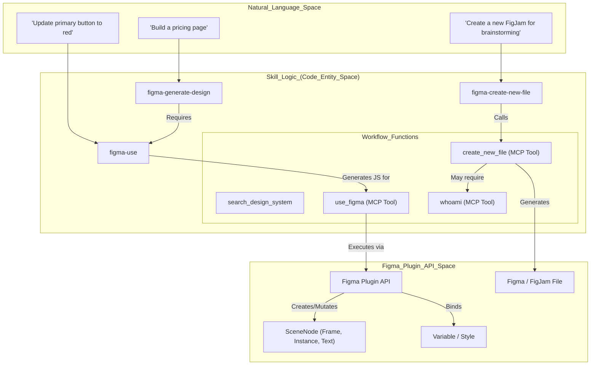
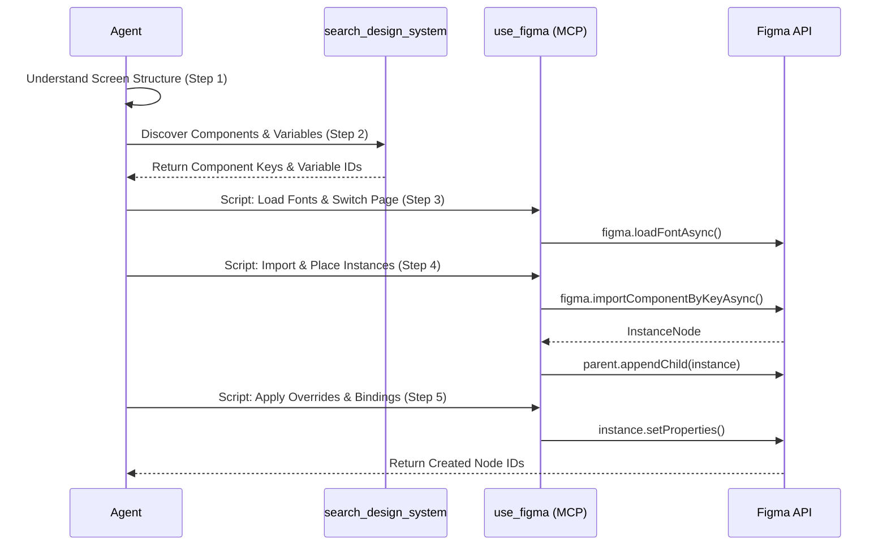

<!-- source: DeepWiki mcp.deepwiki.com · repo openai/skills · extra page Figma Plugin API Skills · fetched 2026-10-30 -->

# Figma Plugin API Skills

Relevant source files

The following files were used as context for generating this wiki page:

- [skills/.curated/figma-create-new-file/SKILL.md](skills/.curated/figma-create-new-file/SKILL.md)
- [skills/.curated/figma-generate-design/SKILL.md](skills/.curated/figma-generate-design/SKILL.md)
- [skills/.curated/figma-use/SKILL.md](skills/.curated/figma-use/SKILL.md)

The Figma Plugin API skills provide a robust framework for programmatically interacting with Figma files. These skills enable agents to execute JavaScript directly within the Figma environment via the Model Context Protocol (MCP), bridging the gap between high-level design descriptions and the low-level Figma Plugin API.

The system is centered around three primary skills:
1.  **`figma-use`**: The foundational skill that defines the execution environment, safety constraints, and API rules. It is a mandatory prerequisite for any `use_figma` tool call.
2.  **`figma-generate-design`**: A high-level workflow skill for translating application code or descriptions into full Figma screens using existing design system components.
3.  **`figma-create-new-file`**: A utility skill for creating blank Figma or FigJam files, often used as the first step in a design workflow.

## Architecture and Data Flow

The Figma integration utilizes a "Bridge" pattern where the agent generates JavaScript code that conforms to the Figma Plugin API. This code is sent via the `use_figma` MCP tool to a runner that executes it within the context of a specific Figma file.

### Design-to-Code Data Flow
The following diagram illustrates how natural language requests are transformed into Figma entities through the interaction of these skills.

**Diagram: Natural Language to Figma Entity Mapping**

Sources: [skills/.curated/figma-generate-design/SKILL.md:1-12](), [skills/.curated/figma-use/SKILL.md:1-12](), [skills/.curated/figma-create-new-file/SKILL.md:1-10]()

---

## 1. figma-use (Foundational Skill)

The `figma-use` skill is the **mandatory prerequisite** for all `use_figma` calls [skills/.curated/figma-use/SKILL.md:2-3](). It contains the critical operational rules that prevent script failures and ensure data consistency.

### Critical Constraints
*   **Atomic Execution**: Scripts are atomic. If an error occurs, no changes are applied to the Figma file [skills/.curated/figma-use/SKILL.md:34-34]().
*   **Output via `return`**: The `return` statement is the only way to send data back to the agent. `console.log()` is not captured [skills/.curated/figma-use/SKILL.md:20-20](), [skills/.curated/figma-use/SKILL.md:75-75]().
*   **Color Space**: Figma uses a **0.0 to 1.0** range for RGB values, not 0-255 [skills/.curated/figma-use/SKILL.md:26-26]().
*   **Async Operations**: All Figma API promises (e.g., `figma.loadFontAsync`, `figma.setCurrentPageAsync`) **must** be awaited to prevent race conditions [skills/.curated/figma-use/SKILL.md:37-37]().
*   **Layout Sizing**: Setting `layoutSizingHorizontal/Vertical = 'FILL'` must occur **after** the node is appended to its parent [skills/.curated/figma-use/SKILL.md:32-32]().
*   **Node Tracking**: Every script that creates or mutates canvas nodes **MUST** return all affected node IDs [skills/.curated/figma-use/SKILL.md:72-72]().

### Reference Documentation
The skill relies on a set of local reference files to guide code generation:
*   `plugin-api-standalone.d.ts`: The definitive TypeScript definitions for the API [skills/.curated/figma-use/SKILL.md:14-14]().
*   `gotchas.md`: Documentation of common pitfalls and their corrections [skills/.curated/figma-use/SKILL.md:39-39]().
*   `variable-patterns.md`: Guidelines for binding variables and setting scopes [skills/.curated/figma-use/SKILL.md:36-36]().

Sources: [skills/.curated/figma-use/SKILL.md:10-75]()

---

## 2. figma-generate-design (Workflow Skill)

This skill orchestrates complex design tasks, specifically translating code or descriptions into full Figma screens [skills/.curated/figma-generate-design/SKILL.md:3-3](). It prioritizes the use of **Design System Tokens** (components, variables, and styles) over drawing primitives with hardcoded values [skills/.curated/figma-generate-design/SKILL.md:8-9]().

### Component Discovery Strategy
The skill follows a strict hierarchy for finding components:
1.  **Inspect Existing Screens**: The agent first scans the current file for existing `INSTANCE` nodes to build an authoritative component map [skills/.curated/figma-generate-design/SKILL.md:62-77]().
2.  **Search Design System**: If no local examples exist, it uses the `search_design_system` tool to find published components and variables across linked libraries [skills/.curated/figma-generate-design/SKILL.md:79-80]().
3.  **Variable Discovery**: The agent must distinguish between `getLocalVariableCollectionsAsync()` (local only) and `search_design_system` (includes remote libraries) to avoid missing design system tokens [skills/.curated/figma-generate-design/SKILL.md:99-104]().

### The Parallel Workflow (Web Apps)
For web-based applications, the skill utilizes a dual-track approach to achieve pixel perfection:
1.  **Track A**: Assemble the screen using `use_figma` and design system components [skills/.curated/figma-generate-design/SKILL.md:35-35]().
2.  **Track B**: Run `generate_figma_design` to capture a screenshot of the live web app [skills/.curated/figma-generate-design/SKILL.md:36-36]().
3.  **Merge**: Use the screenshot as a visual reference to adjust the layout, then delete the reference capture [skills/.curated/figma-generate-design/SKILL.md:37-38]().

**Diagram: figma-generate-design Execution Flow**

Sources: [skills/.curated/figma-generate-design/SKILL.md:31-106]()

---

## 3. figma-create-new-file (Utility Skill)

The `figma-create-new-file` skill handles the creation of new assets in the user's drafts folder [skills/.curated/figma-create-new-file/SKILL.md:66-66](). It is typically used as a setup step before design generation [skills/.curated/figma-create-new-file/SKILL.md:8-8]().

### Plan Resolution Workflow
Creating a file requires a `planKey`. The skill implements a specific logic to resolve this:
1.  **Direct Provision**: If the user provides a key, use it [skills/.curated/figma-create-new-file/SKILL.md:30-30]().
2.  **Discovery**: Call the `whoami` tool to fetch available plans [skills/.curated/figma-create-new-file/SKILL.md:32-32]().
    *   **Single Plan**: Use the `key` automatically [skills/.curated/figma-create-new-file/SKILL.md:34-34]().
    *   **Multiple Plans**: Prompt the user to select the target team or organization [skills/.curated/figma-create-new-file/SKILL.md:35-35]().

### Supported Types
The skill supports two `editorType` values: `design` (default) and `figjam` [skills/.curated/figma-create-new-file/SKILL.md:14-14]().

Sources: [skills/.curated/figma-create-new-file/SKILL.md:26-62]()

---

## 4. Collaborative Skill Usage

The skills are designed to be loaded together depending on the complexity of the task.

| Task Type | Required Skills | Primary Tools |
| :--- | :--- | :--- |
| **Simple API Call** | `figma-use` | `use_figma` |
| **Build Full Screen** | `figma-use`, `figma-generate-design` | `search_design_system`, `use_figma` |
| **New File Setup** | `figma-create-new-file`, `figma-use` | `create_new_file`, `whoami`, `use_figma` |

### Multi-Call Orchestration
Complex designs are never built in a single `use_figma` call. The workflow follows an incremental pattern:
1.  **Discovery Call**: Read the file structure or existing components [skills/.curated/figma-use/SKILL.md:66-66]().
2.  **Foundation Call**: Create the main frame and background [skills/.curated/figma-use/SKILL.md:25-25]().
3.  **Section Calls**: Build individual sections (Header, Hero, etc.) one by one [skills/.curated/figma-generate-design/SKILL.md:52-53]().
4.  **Refinement Call**: Apply final constraints, auto-layout, and variable bindings [skills/.curated/figma-use/SKILL.md:32-32]().

Sources: [skills/.curated/figma-create-new-file/SKILL.md:68-68](), [skills/.curated/figma-generate-design/SKILL.md:10-12](), [skills/.curated/figma-use/SKILL.md:10-12]()

---

