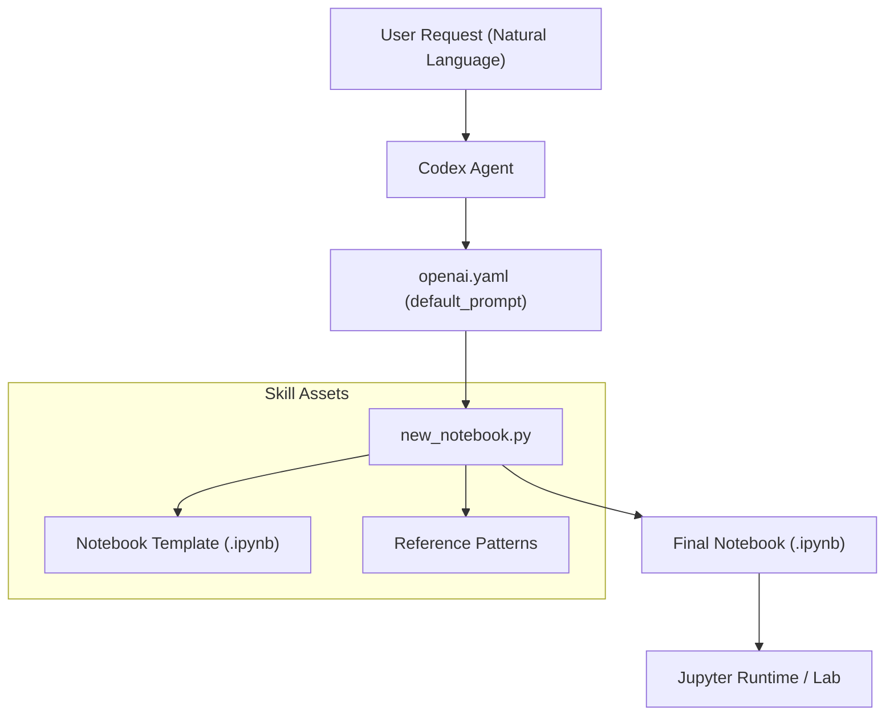
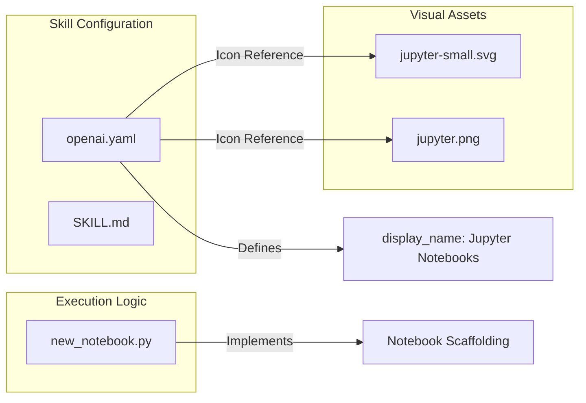

<!-- source: DeepWiki mcp.deepwiki.com · repo openai/skills · extra page Jupyter Notebook · fetched 2026-10-30 -->

# Jupyter Notebook

Relevant source files

The following files were used as context for generating this wiki page:

- [skills/.curated/jupyter-notebook/agents/openai.yaml](skills/.curated/jupyter-notebook/agents/openai.yaml)
- [skills/.curated/jupyter-notebook/assets/jupyter-small.svg](skills/.curated/jupyter-notebook/assets/jupyter-small.svg)
- [skills/.curated/jupyter-notebook/assets/jupyter.png](skills/.curated/jupyter-notebook/assets/jupyter.png)
- [skills/.curated/transcribe/agents/openai.yaml](skills/.curated/transcribe/agents/openai.yaml)
- [skills/.curated/transcribe/assets/transcribe-small.svg](skills/.curated/transcribe/assets/transcribe-small.svg)
- [skills/.curated/transcribe/assets/transcribe.png](skills/.curated/transcribe/assets/transcribe.png)

The `jupyter-notebook` skill is a curated capability designed for creating reproducible, well-structured, and runnable Jupyter notebooks. It provides a standardized workflow for experiments, tutorials, and technical demonstrations by utilizing pre-defined templates and helper scripts to ensure consistency and quality in notebook generation.

### Interface Definition

The skill is defined by its interface configuration in `openai.yaml`, which specifies how the agent should present and initialize the capability within the Codex environment.

| Field | Value |
| :--- | :--- |
| **Display Name** | Jupyter Notebooks |
| **Short Description** | Create Jupyter notebooks for experiments and tutorials |
| **Default Prompt** | Create a Jupyter notebook for this task with clear sections, runnable cells, and concise takeaways. |
| **Small Icon** | `./assets/jupyter-small.svg` |
| **Large Icon** | `./assets/jupyter.png` |

Sources: [`skills/.curated/jupyter-notebook/agents/openai.yaml:1-6`]()

---

### Core Components and Data Flow

The `jupyter-notebook` skill operates through a specialized helper script, `new_notebook.py`, which serves as the primary engine for notebook instantiation. This script manages the transition from a natural language request to a structured `.ipynb` file.

#### System Architecture

The following diagram illustrates the relationship between the user's intent and the code entities responsible for generating the notebook.

**Jupyter Notebook Generation Flow**

Sources: [`skills/.curated/jupyter-notebook/agents/openai.yaml:1-6`]()

---

### Implementation Details

The skill focuses on reproducibility and clarity. Unlike ad-hoc code generation, the `jupyter-notebook` skill enforces a structure that includes:

1.  **Clear Sectioning**: Automatically generates markdown headers for Introduction, Implementation, and Conclusion.
2.  **Runnable Cells**: Ensures that code cells are self-contained or correctly ordered to maintain state.
3.  **Concise Takeaways**: Prompts the inclusion of a summary section at the end of the notebook to highlight findings or tutorial goals.

#### Code Entity Mapping

This diagram maps the functional requirements of the skill to the specific files and configurations within the repository.

**Code Entity Mapping**

Sources: [`skills/.curated/jupyter-notebook/agents/openai.yaml:1-6`](), [`skills/.curated/jupyter-notebook/assets/jupyter-small.svg:1-4`]()

---

### Visual Assets

The skill includes branding assets used in the agent's UI to distinguish Jupyter-related tasks. These are referenced in the `interface` section of the skill configuration.

*   **Small Icon**: A 20x21 pixel SVG optimized for sidebar or inline display.
    *   Path: `skills/.curated/jupyter-notebook/assets/jupyter-small.svg`
    *   Implementation: Uses `fill="currentColor"` to support theme-aware rendering.
*   **Large Icon**: A high-resolution PNG for detailed skill views.
    *   Path: `skills/.curated/jupyter-notebook/assets/jupyter.png`

Sources: [`skills/.curated/jupyter-notebook/agents/openai.yaml:4-5`](), [`skills/.curated/jupyter-notebook/assets/jupyter-small.svg:1-4`](), [`skills/.curated/jupyter-notebook/assets/jupyter.png:1-10`]()

---

### Usage Pattern

When an agent invokes this skill, it typically follows these steps:
1.  **Initialization**: Calls `new_notebook.py` to create the file structure.
2.  **Content Injection**: Populates cells based on the specific experiment or tutorial requested by the user.
3.  **Validation**: Ensures the resulting `.ipynb` JSON structure is valid and can be opened by standard Jupyter interfaces.

The `default_prompt` ensures that the agent doesn't just write code, but wraps it in a narrative suitable for a notebook format: *"Create a Jupyter notebook for this task with clear sections, runnable cells, and concise takeaways."*

Sources: [`skills/.curated/jupyter-notebook/agents/openai.yaml:6-6`]()

---

