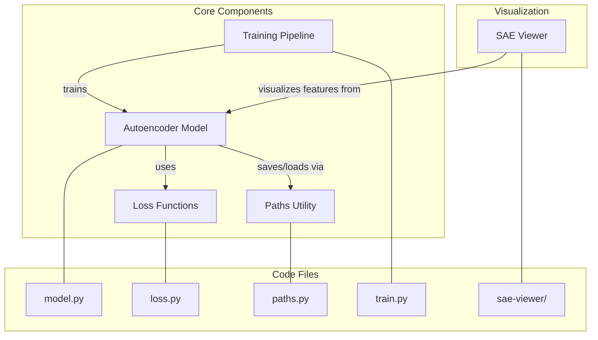
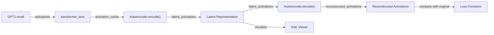
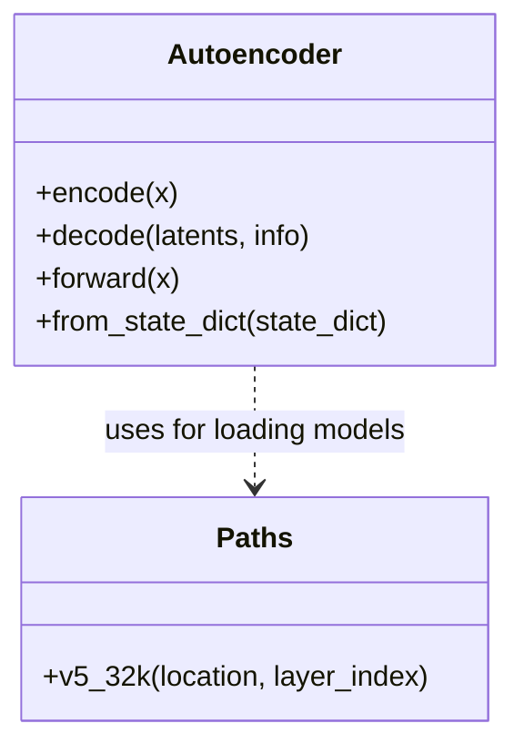
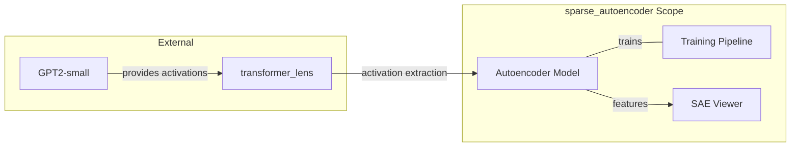

<!-- source: DeepWiki mcp.deepwiki.com · repo openai/sparse_autoencoder · page 1 Overview · fetched 2026-10-26 -->

# Overview

Relevant source files

The following files were used as context for generating this wiki page:

- [README.md](README.md)

## Purpose and Scope

The `sparse_autoencoder` repository implements sparse autoencoders designed to analyze and interpret activations from transformer models. Specifically, the codebase focuses on:

1. Training sparse autoencoders on GPT2-small model's internal activations
2. Providing tools to visualize and interpret the features learned by these autoencoders

This page provides a high-level overview of the repository's purpose, structure, and components. For detailed information about the system architecture, see [System Architecture](#2), and for specifics about the autoencoder model implementation, see [Autoencoder Model](#3).

Sources: [README.md:1-5]()

## System Components

The `sparse_autoencoder` repository consists of several core components that work together to train, evaluate, and visualize sparse autoencoders.

### Key Components:

1. **Autoencoder Model**: The core neural network architecture that encodes input activations into a sparse representation and then decodes them back.
   
2. **Loss Functions**: Specialized loss functions for training sparse autoencoders, including reconstruction loss and L1 sparsity penalties.
   
3. **Paths Utility**: Handles model saving, loading, and management of trained autoencoder checkpoints.
   
4. **Training Pipeline**: Manages the training process for sparse autoencoders on transformer activations.
   
5. **SAE Viewer**: A web-based tool for visualizing and exploring the features learned by the sparse autoencoders.

Sources: [README.md:14-19](), [model.py](), [train.py](), [paths.py]()

## Data Flow

The following diagram illustrates how data flows through the sparse autoencoder system:

1. Activations are extracted from GPT2-small using the transformer_lens library
2. These activations are fed into the autoencoder's encode method
3. The encode method produces sparse latent activations
4. The latent activations are decoded back to the original activation space
5. Loss functions compare the reconstructed activations with the original ones
6. The SAE Viewer can visualize the learned features in the latent space

Sources: [README.md:23-64]()

## Implementation and Usage

The sparse autoencoder is implemented in PyTorch and designed to work with transformer models through the transformer_lens library. The core `Autoencoder` class serves as the main interface to the system.

### Basic Example:

A typical workflow involves:
1. Extracting activations from a transformer model
2. Loading a pre-trained autoencoder
3. Running the activations through the autoencoder
4. Analyzing the results

The repository includes pre-trained autoencoders that can be loaded using the `paths` module, which provides functions to retrieve the correct autoencoder for specific layers and locations within the GPT2-small model.

Sources: [README.md:23-64](), [model.py](), [paths.py]()

## System Scope and Boundaries

The `sparse_autoencoder` system is focused on analyzing neural network activations rather than the transformer models themselves:

The system does not modify or train the underlying transformer models but rather extracts and analyzes their internal representations through the lens of sparse autoencoders.

For detailed usage instructions and examples, see the [Usage Guide](#4). For information about the visualization capabilities, see the [SAE Viewer](#5) page.

Sources: [README.md]()

---

