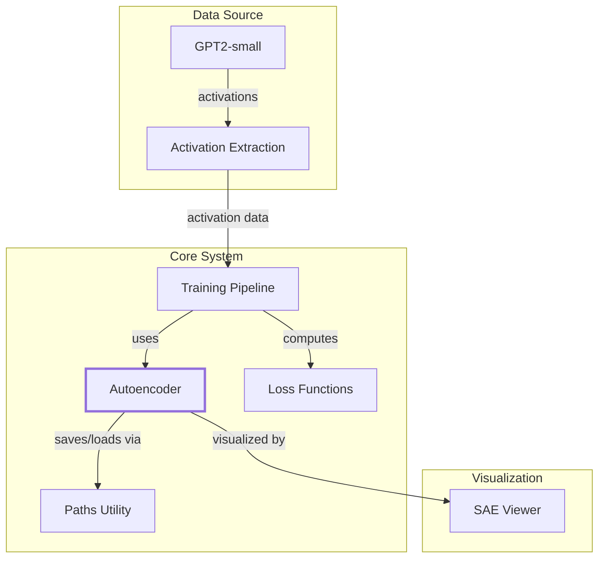
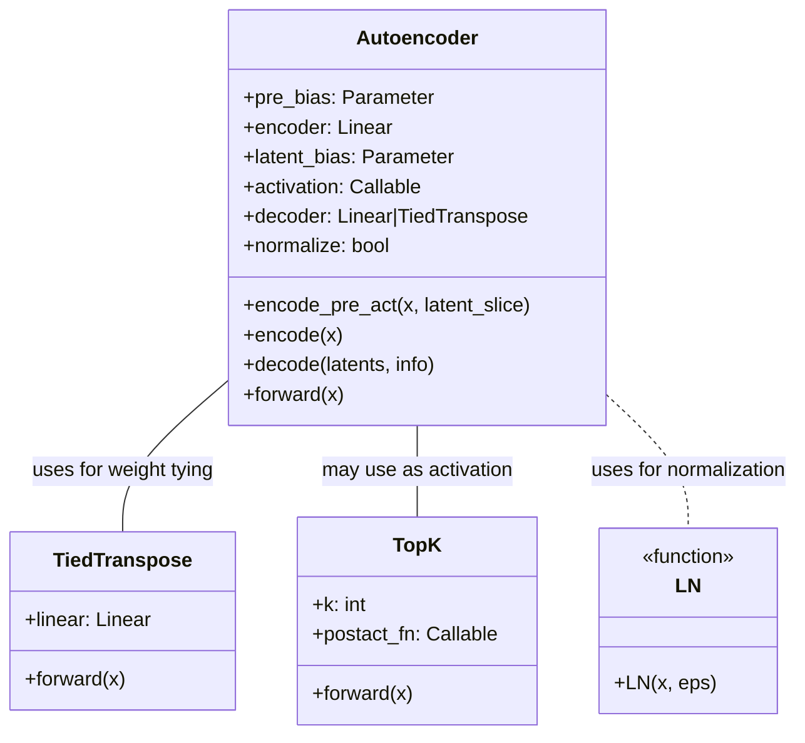
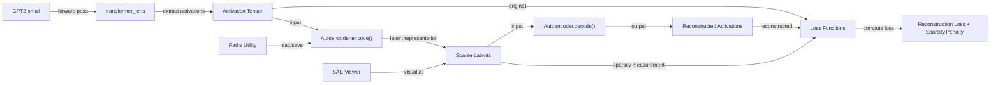
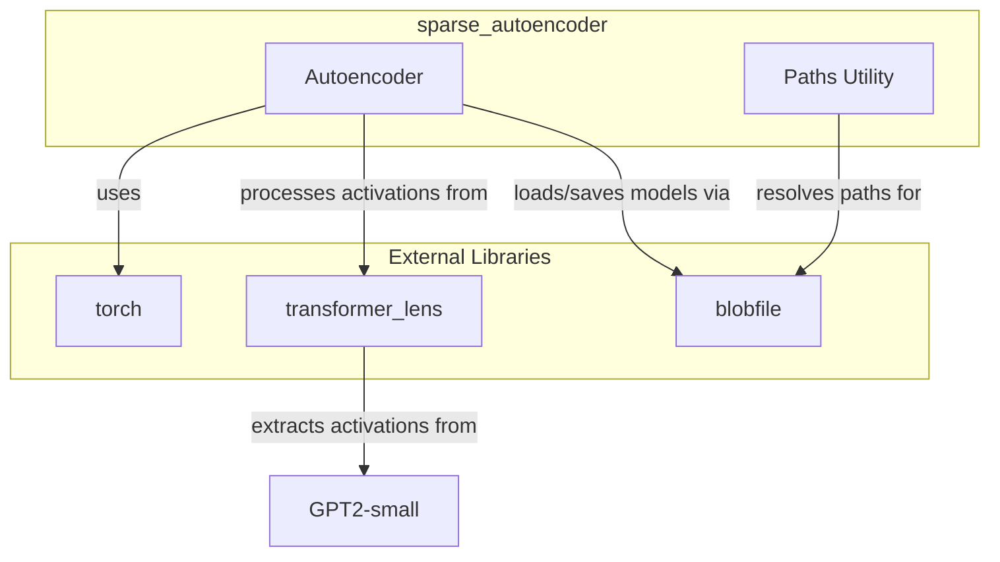
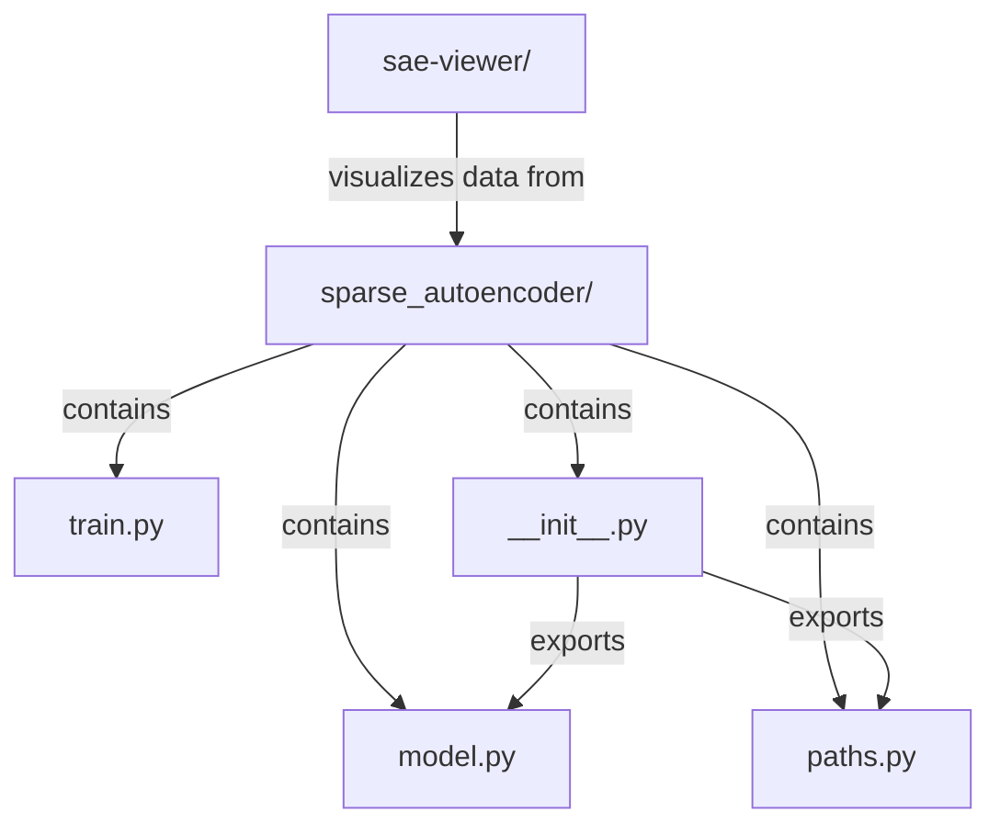

<!-- source: DeepWiki mcp.deepwiki.com · repo openai/sparse_autoencoder · page 2 System Architecture · fetched 2026-10-26 -->

# System Architecture

Relevant source files

The following files were used as context for generating this wiki page:

- [README.md](README.md)
- [sparse_autoencoder/__init__.py](sparse_autoencoder/__init__.py)
- [sparse_autoencoder/model.py](sparse_autoencoder/model.py)

This document describes the high-level architecture of the sparse autoencoder system, outlining its primary components and how they interact with each other. It provides a technical overview of the system design without delving into implementation details of specific components, which are covered in dedicated pages.

For details about the core Autoencoder model implementation, see [Autoencoder Model](#3). For usage instructions, see [Usage Guide](#4).

## System Overview

The sparse autoencoder system is designed to learn interpretable features from neural network activations. Specifically, it focuses on extracting and representing features from GPT2-small model activations using a sparse coding approach.

Sources: [sparse_autoencoder/model.py](), [README.md:3-5]()

## Core Components

The system consists of several key components that work together:

| Component | Purpose | Implementation |
|-----------|---------|----------------|
| Autoencoder | Encodes input activations into sparse latent representations and decodes them back | `Autoencoder` class in model.py |
| Loss Functions | Computes reconstruction error and sparsity penalties | Various loss functions for training |
| Paths Utility | Manages model saving, loading, and path resolution | paths.py utility module |
| Training Pipeline | Orchestrates the training process | train.py module |
| Activation Extraction | Extracts activations from transformer models | Uses transformer_lens library |
| SAE Viewer | Visualizes the learned features | Web-based visualization tool |

Sources: [sparse_autoencoder/model.py:16-142](), [README.md:15-19]()

## Component Architecture

The `Autoencoder` class forms the central component of the system, with several related classes supporting its functionality:

Sources: [sparse_autoencoder/model.py:16-142](), [sparse_autoencoder/model.py:144-155](), [sparse_autoencoder/model.py:162-185]()

### Autoencoder Implementation

The sparse autoencoder implements the following transformation:

1. **Encoding**: `latents = activation(encoder(x - pre_bias) + latent_bias)`
2. **Decoding**: `reconstruction = decoder(latents) + pre_bias`

Key features of the implementation include:
- Optional weight tying between encoder and decoder
- Configurable activation function (default: ReLU)
- Optional layer normalization
- Support for TopK activation for enforcing sparsity

Sources: [sparse_autoencoder/model.py:17-22](), [sparse_autoencoder/model.py:24-44]()

## Data Flow Architecture

The following diagram illustrates how data flows through the system:

Sources: [README.md:22-64](), [sparse_autoencoder/model.py:74-91]()

### Processing Steps

1. **Activation Extraction**:
   - GPT2-small model is loaded via transformer_lens
   - Text is tokenized and passed through the model
   - Activations are extracted from specific layers and locations

2. **Encoding Process**:
   - Optional normalization of input activations
   - Linear transformation with encoder weights
   - Addition of latent bias
   - Application of activation function (e.g., ReLU or TopK)

3. **Decoding Process**:
   - Linear transformation of latent activations
   - Addition of pre-bias
   - Optional denormalization

4. **Loss Calculation**:
   - Reconstruction error between original and reconstructed activations
   - L1 sparsity penalty on latent activations

Sources: [sparse_autoencoder/model.py:68-104](), [README.md:30-47]()

## Integration with External Systems

The sparse autoencoder system integrates with external libraries to fulfill its functionality:

Sources: [sparse_autoencoder/__init__.py:1-4](), [README.md:24-27](), [sparse_autoencoder/model.py:1-5]()

## Package Structure

The sparse autoencoder repository has a focused structure:

Sources: [README.md:13-19](), [sparse_autoencoder/__init__.py:1-4]()

## Conclusion

The sparse autoencoder system follows a modular architecture centered around the `Autoencoder` class. It leverages transformer_lens to extract activations from GPT2-small, processes them through the sparse autoencoder to learn interpretable features, and provides visualization capabilities through the SAE Viewer. The system's design allows for flexible configuration of the autoencoder's behavior, including different activation functions, weight tying options, and normalization techniques.

For more detailed information about the system's components, see:
- [Component Relationships](#2.1) for details on how components interact
- [Data Flow](#2.2) for a deeper look at how data moves through the system
- [Autoencoder Model](#3) for implementation details of the core autoencoder

---

