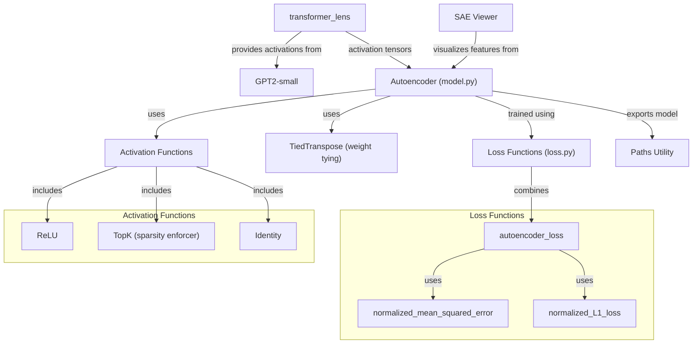
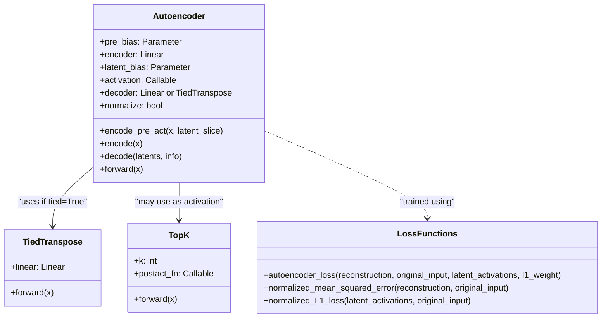
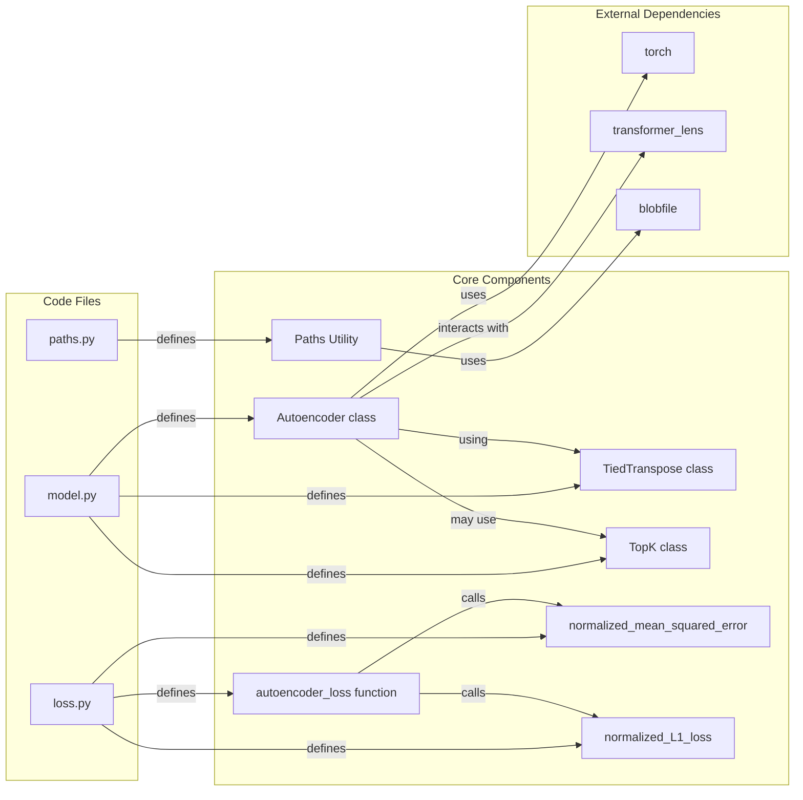
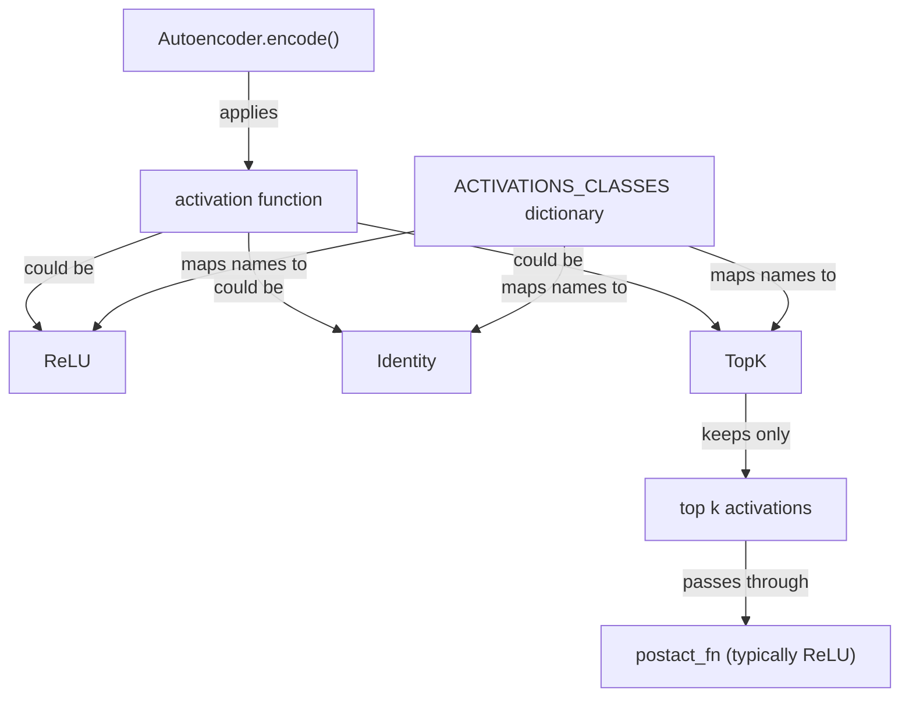
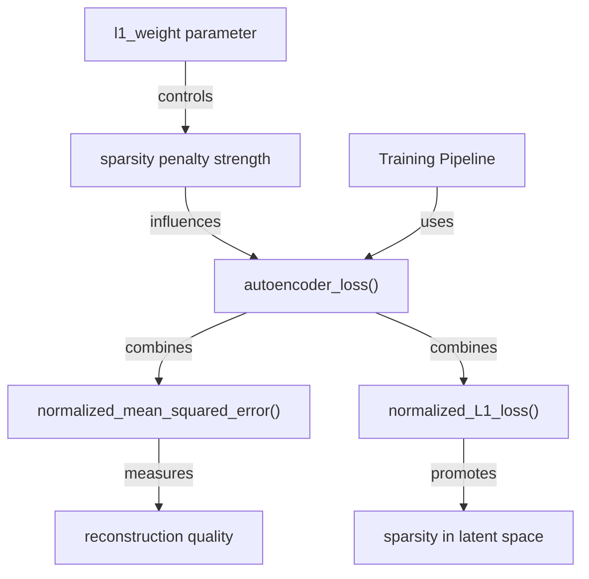
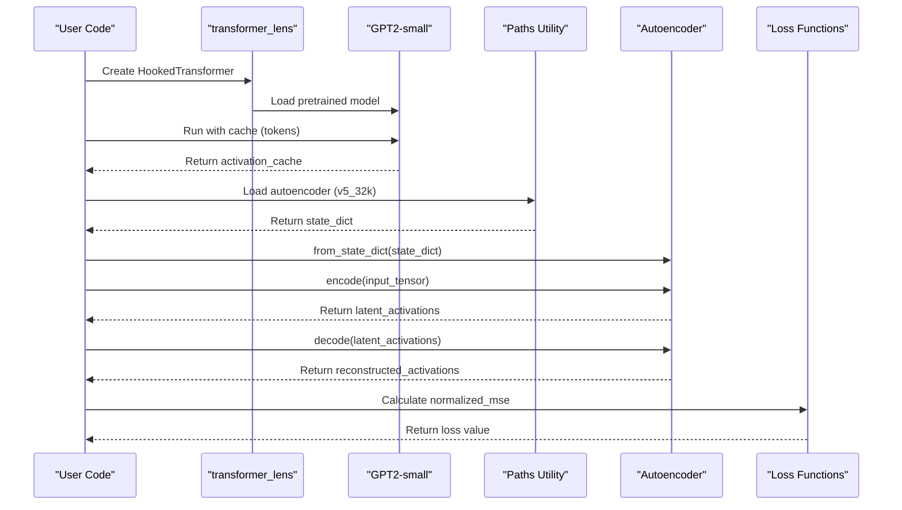

<!-- source: DeepWiki mcp.deepwiki.com · repo openai/sparse_autoencoder · page 2.1 Component Relationships · fetched 2026-10-26 -->

# Component Relationships

Relevant source files

The following files were used as context for generating this wiki page:

- [README.md](README.md)
- [sparse_autoencoder/loss.py](sparse_autoencoder/loss.py)
- [sparse_autoencoder/model.py](sparse_autoencoder/model.py)

This page describes how different components of the sparse autoencoder system interact with each other. It focuses on the architectural relationships between the core modules, including the Autoencoder model, loss functions, and external dependencies. For information about data flow through the system, see [Data Flow](#2.2).

## Core Component Overview

The sparse autoencoder system consists of several interconnected components that work together to analyze, encode, and visualize neural network activations.

Sources: [sparse_autoencoder/model.py:16-142](), [sparse_autoencoder/loss.py:4-46](), [README.md:3-19]()

## Autoencoder Component Architecture

This diagram illustrates the internal structure of the `Autoencoder` class and how its components interact with each other.

Sources: [sparse_autoencoder/model.py:16-142](), [sparse_autoencoder/model.py:144-155](), [sparse_autoencoder/model.py:162-185](), [sparse_autoencoder/loss.py:4-46]()

## Code to Component Mapping

This diagram maps the code entities to the conceptual components in the system, providing a bridge between the code structure and the functional architecture.

Sources: [sparse_autoencoder/model.py:1-192](), [sparse_autoencoder/loss.py:1-46](), [README.md:15-19]()

## Activation Function Relationships

The `Autoencoder` class supports different activation functions, with `TopK` being particularly significant for enforcing sparsity.

Sources: [sparse_autoencoder/model.py:162-192](), [sparse_autoencoder/model.py:74-80]()

## Loss Function Relationships

The loss functions are a critical component for training the autoencoder, combining reconstruction error with sparsity penalties.

Sources: [sparse_autoencoder/loss.py:4-46]()

## Forward Pass Flow

This diagram illustrates the flow of data through the Autoencoder during a forward pass.

```mermaid
flowchart LR
    A["Input Data x"] -->|"preprocess if normalize=True"| B["Normalized Input"]
    B -->|"subtract pre_bias"| C["Centered Input"]
    C -->|"multiply by encoder.weight"| D["Raw Latents"]
    D -->|"add latent_bias"| E["Latents Pre-Activation"]
    E -->|"apply activation function"| F["Latent Activations"]
    F -->|"multiply by decoder.weight"| G["Raw Reconstruction"]
    G -->|"add pre_bias"| H["Centered Reconstruction"]
    H -->|"apply inverse normalization if needed"| I["Output Reconstruction"]
```

Sources: [sparse_autoencoder/model.py:93-109](), [sparse_autoencoder/model.py:74-91]()

## Component Interface Table

This table outlines the key interfaces between components in the system and how they interact.

| Component A | Component B | Interface Method | Description |
|-------------|-------------|------------------|-------------|
| Autoencoder | Activation Function | `Autoencoder.encode()` | Applies the activation function to the encoded representation |
| Autoencoder | TiedTranspose | `Autoencoder.__init__()` | Uses TiedTranspose when `tied=True` to share weights between encoder and decoder |
| Autoencoder | Loss Functions | External usage | Loss functions evaluate autoencoder outputs during training |
| transformer_lens | Autoencoder | External usage | Provides GPT2 activations that are fed into the autoencoder |
| TopK | Autoencoder | `Autoencoder.activation` | Provides sparse activation by keeping only top-k values |
| Paths Utility | Autoencoder | `Autoencoder.from_state_dict()` | Loads saved autoencoder models from storage |

Sources: [sparse_autoencoder/model.py:16-142](), [README.md:23-64]()

## Usage Flow with External Components

This diagram illustrates how the sparse autoencoder system interacts with external components like transformer_lens in a typical usage flow.

Sources: [README.md:23-64](), [sparse_autoencoder/model.py:111-141]()

## Key Dependencies

The sparse autoencoder system relies on several external libraries to function properly:

1. **torch**: Provides the core tensor operations and neural network building blocks
2. **transformer_lens**: Used to extract activations from GPT2-small
3. **blobfile**: Used for storage and retrieval of trained models

The interaction with these dependencies is essential for the entire pipeline to function correctly, from obtaining activation data to storing and loading trained models.

Sources: [README.md:23-28](), [sparse_autoencoder/model.py:1-5](), [sparse_autoencoder/loss.py:1]()

---

