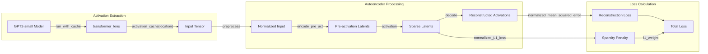
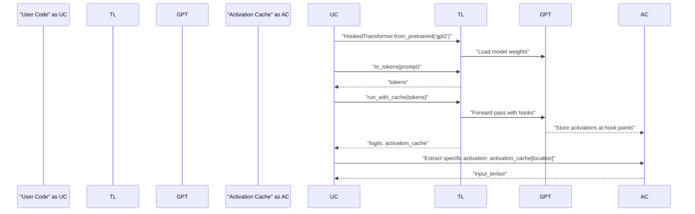
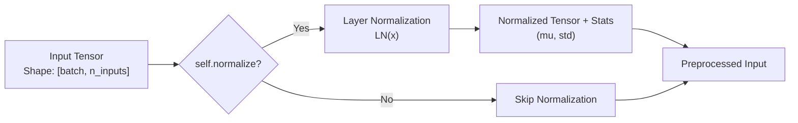
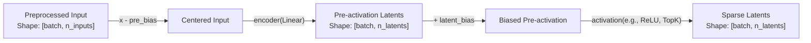
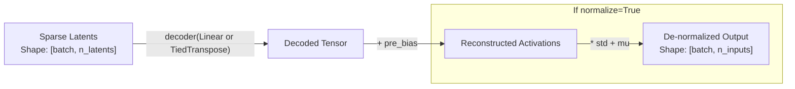
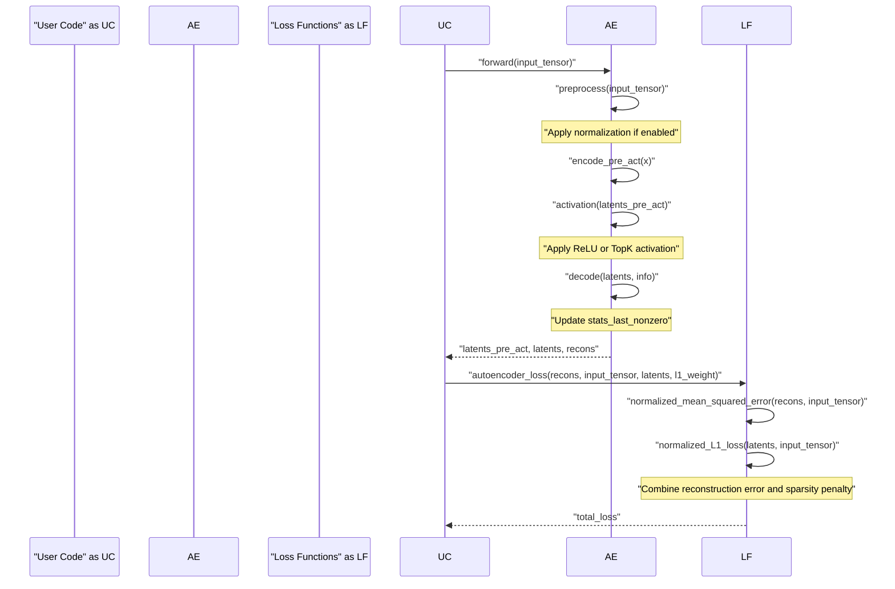
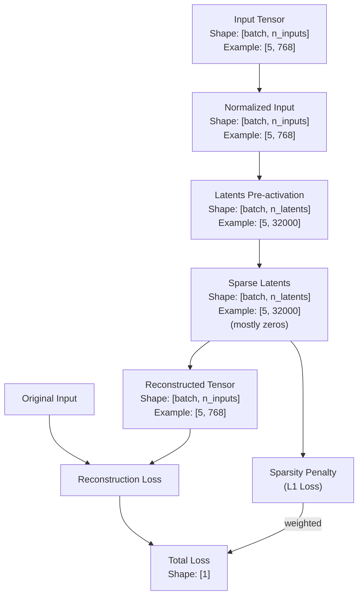
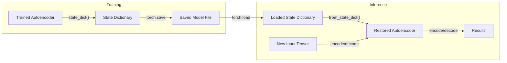
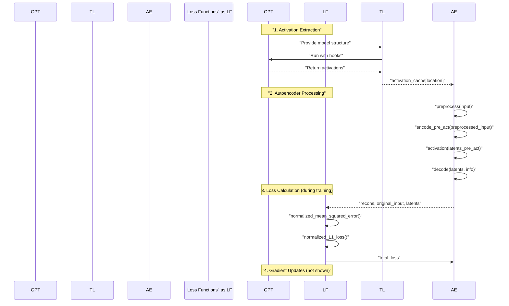

<!-- source: DeepWiki mcp.deepwiki.com · repo openai/sparse_autoencoder · page 2.2 Data Flow · fetched 2026-10-26 -->

# Data Flow

Relevant source files

The following files were used as context for generating this wiki page:

- [README.md](README.md)
- [sparse_autoencoder/loss.py](sparse_autoencoder/loss.py)
- [sparse_autoencoder/model.py](sparse_autoencoder/model.py)

This document describes the end-to-end flow of data through the sparse autoencoder system, from extracting activations from a transformer model to the final reconstruction and loss calculation. For information about component relationships and interactions, see [Component Relationships](#2.1).

## Overview of the Data Flow

The sparse autoencoder system processes data through a sequence of transformations, starting with activation extraction from a transformer model (typically GPT2-small), through encoding and decoding steps, and finally calculating loss values for training.

Sources: [README.md:29-62](), [sparse_autoencoder/model.py:16-109](), [sparse_autoencoder/loss.py:4-46]()

## Activation Extraction

The data flow begins with extracting activations from a transformer model (GPT2-small) using the transformer_lens library.

The activation extraction process:

1. Load the GPT2-small model using transformer_lens
2. Convert input text to tokens
3. Run the model with caching enabled to capture intermediate activations
4. Extract specific activations from the cache using a location identifier

The location identifiers map to specific parts of the transformer architecture:
- `mlp_post_act`: Activations after the MLP activation function
- `resid_delta_attn`: Attention output
- `resid_post_attn`: Residual stream after attention
- `resid_delta_mlp`: MLP output
- `resid_post_mlp`: Residual stream after MLP

Sources: [README.md:29-54]()

## Autoencoder Processing

### Preprocessing

Before encoding, input activations may be normalized depending on the autoencoder configuration.

The preprocessing is handled by the `preprocess` method which:
1. Checks if normalization is enabled
2. If enabled, applies Layer Normalization
3. Returns the normalized tensor and normalization statistics

Sources: [sparse_autoencoder/model.py:68-72]()

### Encoding Process

The encoding process transforms input activations into a sparse latent representation.

The encoding consists of:
1. Centering the input by subtracting the `pre_bias`
2. Applying a linear transformation with the encoder
3. Adding the `latent_bias`
4. Applying an activation function (ReLU by default, or TopK for enforced sparsity)

Sources: [sparse_autoencoder/model.py:55-80]()

### Decoding Process

The decoding process transforms the sparse latent representation back into reconstructed activations.

The decoding consists of:
1. Applying a linear transformation with the decoder
   - May use weight tying with the encoder if `tied=True`
2. Adding the `pre_bias` (same as was subtracted during encoding)
3. If normalization was applied during preprocessing, undo the normalization

Sources: [sparse_autoencoder/model.py:82-91]()

## Forward Pass and Loss Calculation

The forward pass through the autoencoder combines preprocessing, encoding, and decoding, while also updating some internal statistics.

The loss calculation involves:
1. Reconstruction loss: Normalized mean squared error between reconstructed activations and original input
2. Sparsity penalty: Normalized L1 loss that encourages sparsity in the latent representation
3. Total loss: Weighted combination of reconstruction loss and sparsity penalty

Sources: [sparse_autoencoder/model.py:93-109](), [sparse_autoencoder/loss.py:4-46]()

## Specific Tensor Transformations

This section illustrates the shape and content transformations of the tensors as they flow through the system.

Key tensor transformations:
1. Input tensor: Activations from the transformer model, typically of shape [batch_size, n_inputs]
2. After encoding: Latent representation with higher dimensionality (e.g., 32000 latents) but mostly zeros
3. After decoding: Reconstruction of the original input with the same shape

Sources: [sparse_autoencoder/model.py:94-103](), [sparse_autoencoder/loss.py:4-46]()

## Model State Management

The model's state (weights and biases) can be saved and loaded for future use, maintaining the data flow across sessions.

The state management includes:
1. Saving the model state using `state_dict()` and `torch.save()`
2. Loading the model state using `torch.load()` and `from_state_dict()`
3. Special handling for activation functions like TopK

Sources: [sparse_autoencoder/model.py:111-141](), [README.md:48-63]()

## Complete Data Flow Example

Here's a complete example of the data flow in a typical usage scenario:

This sequence diagram shows the complete flow from activation extraction to loss calculation, highlighting the key steps in the process.

Sources: [README.md:29-63](), [sparse_autoencoder/model.py:16-109](), [sparse_autoencoder/loss.py:4-46]()

## Summary

The data flow in the sparse autoencoder system follows a clear path:

1. **Extraction**: Activations are extracted from GPT2-small using transformer_lens
2. **Preprocessing**: Input activations may be normalized
3. **Encoding**: Preprocessed input is encoded into a sparse latent representation
4. **Decoding**: Latent representation is decoded into reconstructed activations
5. **Loss Calculation**: Reconstruction error and sparsity penalty are calculated
6. **Model Management**: Model state can be saved and loaded for future use

This data flow enables the training and utilization of sparse autoencoders to analyze and interpret the internal representations of language models.

Sources: [README.md:3-64](), [sparse_autoencoder/model.py:16-192](), [sparse_autoencoder/loss.py:4-46]()

---

