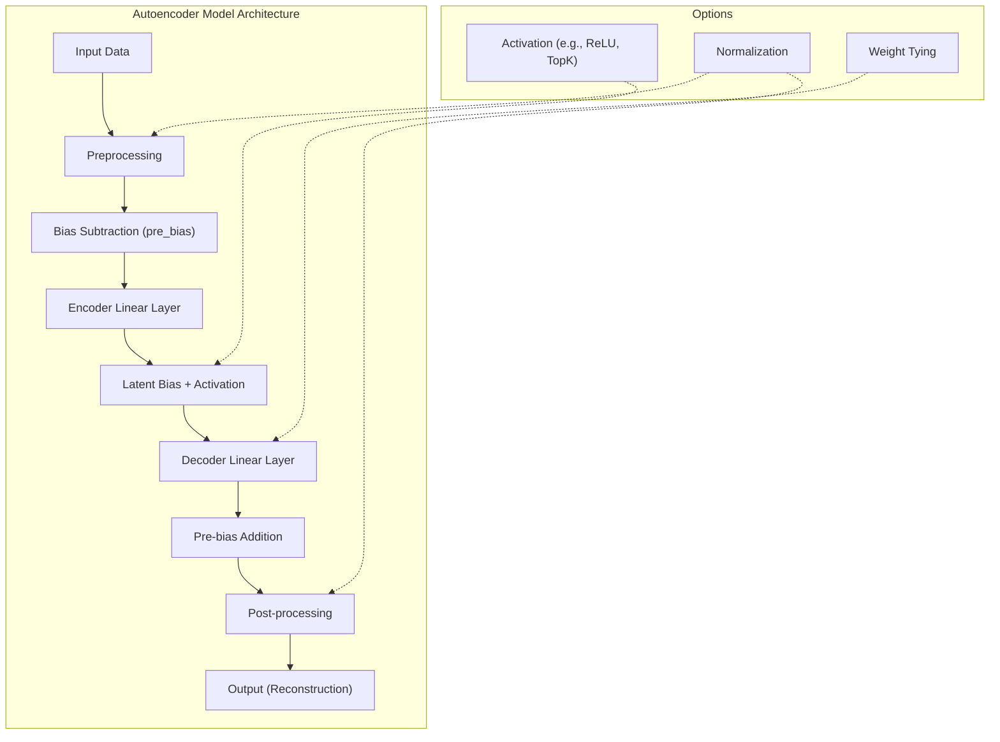
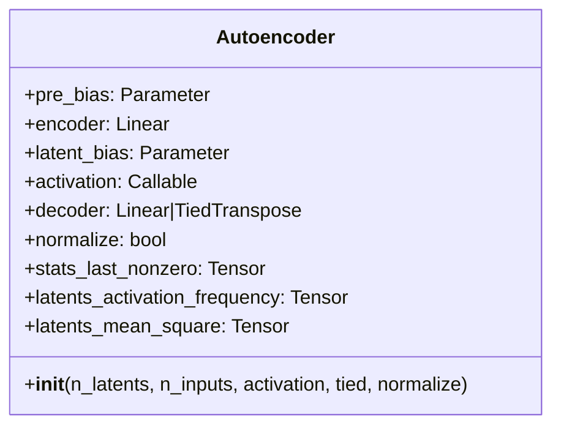
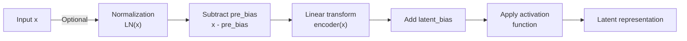
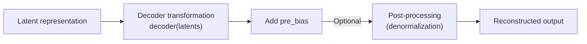
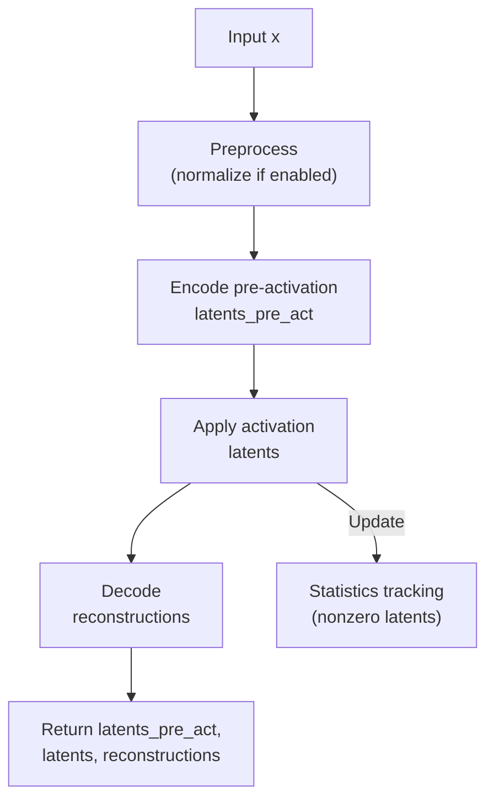
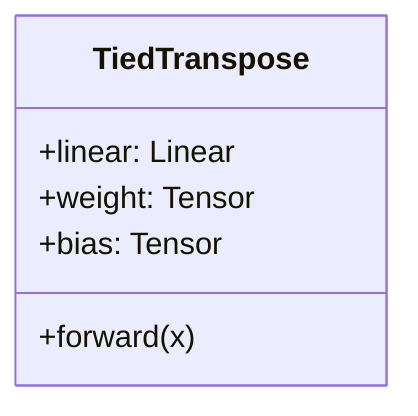
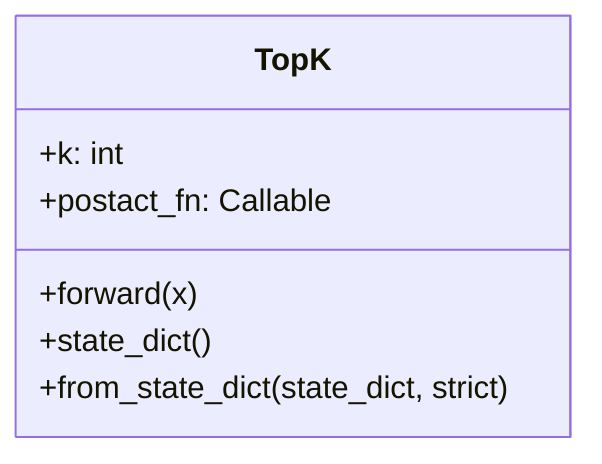
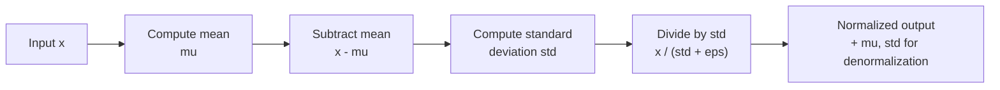
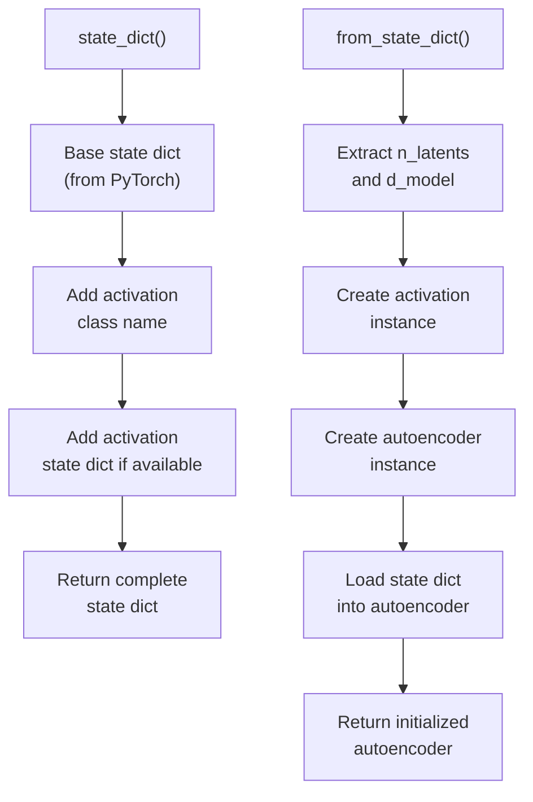
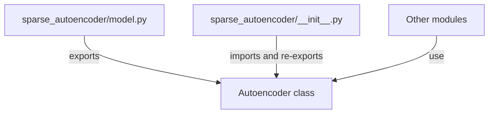

<!-- source: DeepWiki mcp.deepwiki.com · repo openai/sparse_autoencoder · page 3 Autoencoder Model · fetched 2026-10-26 -->

# Autoencoder Model

<details>
<summary>Relevant source files</summary>

The following files were used as context for generating this wiki page:

- [sparse_autoencoder/__init__.py](sparse_autoencoder/__init__.py)
- [sparse_autoencoder/model.py](sparse_autoencoder/model.py)

</details>


This document details the core Autoencoder model used in the sparse_autoencoder repository. It focuses on the implementation, architecture, and key features of the model. For specific information about encoder and decoder components, see [Encoder and Decoder](#3.1); for activation functions, see [Activation Functions](#3.2); for loss functions, see [Loss Functions](#3.3); and for normalization techniques, see [Normalization](#3.4).

## Overview

The Autoencoder model is the central component of the sparse autoencoder system, designed to learn sparse representations of neural network activations. It implements a standard autoencoder architecture with specific adaptations for sparsity, including support for different activation functions and weight tying options.



Sources: [sparse_autoencoder/model.py:16-141]()

## Core Components

The Autoencoder class is implemented as a PyTorch module with the following core components:

| Component | Type | Description |
|-----------|------|-------------|
| `pre_bias` | Parameter | Bias subtracted from input and added to output |
| `encoder` | Linear Layer | Transforms input data to latent space |
| `latent_bias` | Parameter | Bias added to encoder output before activation |
| `activation` | Callable | Activation function (e.g., ReLU, TopK) |
| `decoder` | Linear Layer or TiedTranspose | Transforms latent representation back to input space |

The model implements the following transformation:
```
latents = activation(encoder(x - pre_bias) + latent_bias)
recons = decoder(latents) + pre_bias
```

Sources: [sparse_autoencoder/model.py:16-54]()

## Implementation Details

### Initialization

The Autoencoder's constructor initializes the model components and sets up tracking buffers for monitoring the activity of latent neurons.



Key initialization parameters:
- `n_latents`: Dimension of the latent space
- `n_inputs`: Dimension of the input data
- `activation`: Activation function (default: ReLU)
- `tied`: Whether to tie encoder and decoder weights
- `normalize`: Whether to apply normalization

Sources: [sparse_autoencoder/model.py:24-53]()

### Encoding Process

The encoding process consists of two main steps:
1. Optional normalization of input data
2. Linear transformation followed by bias addition and activation



The encoding is implemented through two methods:
- `encode_pre_act`: Computes pre-activation latents
- `encode`: Applies activation to produce final latents

Sources: [sparse_autoencoder/model.py:55-80]()

### Decoding Process

The decoder transforms the latent representation back to the original input space:



If normalization was applied during encoding, the corresponding denormalization is applied during decoding.

Sources: [sparse_autoencoder/model.py:82-91]()

### Forward Pass

The forward pass ties together the encoding and decoding steps, and also updates tracking statistics:



The method tracks which latent neurons are active by updating the `stats_last_nonzero` buffer, which counts how many batches have passed since each neuron was last active.

Sources: [sparse_autoencoder/model.py:93-109]()

## Supporting Components

### TiedTranspose

The `TiedTranspose` class enables weight tying between encoder and decoder, which reduces the number of parameters and enforces a specific form of regularization:



When weight tying is enabled, the decoder's weight matrix is the transpose of the encoder's weight matrix.

Sources: [sparse_autoencoder/model.py:144-159]()

### TopK Activation

The `TopK` activation function is a specialized activation that enforces sparsity by only allowing the K largest values to pass through:



The function:
1. Identifies the K largest values in each input vector
2. Applies a post-activation function (typically ReLU) to these values
3. Sets all other values to zero

This ensures that only a small subset of latent neurons are active for any given input, promoting sparse representations.

Sources: [sparse_autoencoder/model.py:162-185]()

### Layer Normalization

The `LN` function implements layer normalization, which standardizes input data by centering and scaling it:



Layer normalization helps stabilize training by reducing internal covariate shift.

Sources: [sparse_autoencoder/model.py:8-13]()

## State Management

The Autoencoder implements custom state dictionary methods to handle saving and loading, including support for the activation function's state:



This implementation ensures that all model components, including the activation function, are properly saved and restored.

Sources: [sparse_autoencoder/model.py:111-141]()

## Available Activation Functions

The model supports several activation functions through the `ACTIVATIONS_CLASSES` dictionary:

| Activation Name | Class | Purpose |
|-----------------|-------|---------|
| ReLU | nn.ReLU | Standard non-linear activation |
| Identity | nn.Identity | Linear activation (no non-linearity) |
| TopK | TopK | Sparse activation (keeps only k largest values) |

Sources: [sparse_autoencoder/model.py:188-192]()

## Integration with System Architecture

The Autoencoder model is exported as the primary interface of the sparse_autoencoder package:



This makes the Autoencoder class easily accessible to users of the package without requiring them to import from specific submodules.

Sources: [sparse_autoencoder/__init__.py:1-4]()

---

