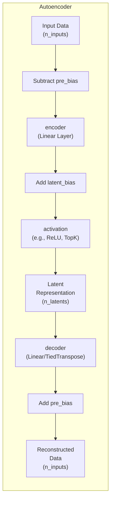
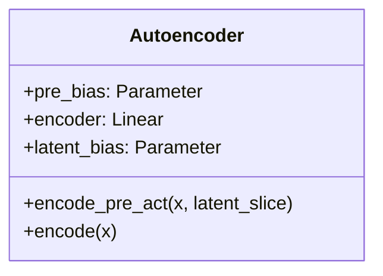
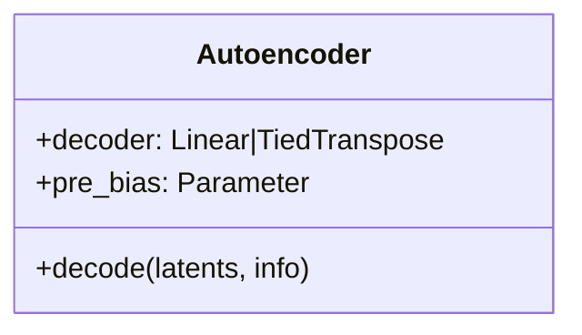
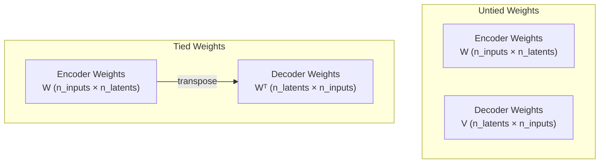
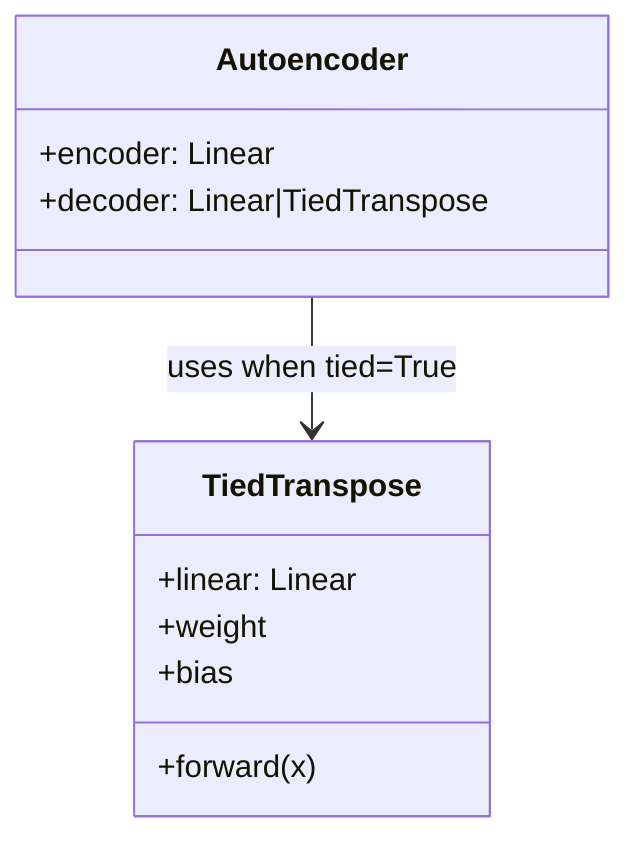
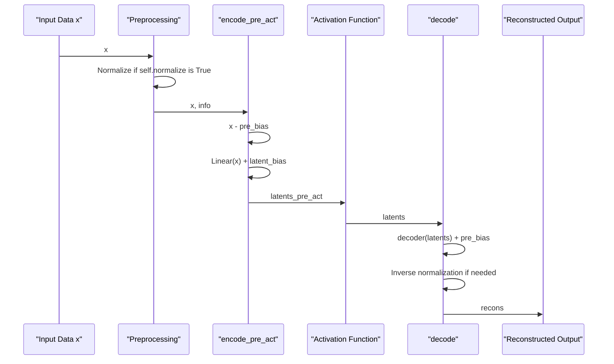

<!-- source: DeepWiki mcp.deepwiki.com · repo openai/sparse_autoencoder · page 3.1 Encoder and Decoder · fetched 2026-10-26 -->

# Encoder and Decoder

<details>
<summary>Relevant source files</summary>

The following files were used as context for generating this wiki page:

- [sparse_autoencoder/model.py](sparse_autoencoder/model.py)

</details>


This page documents the encoder and decoder components of the sparse autoencoder implementation. These are the core neural network components responsible for compressing input data into sparse latent representations and reconstructing the original data from these representations. For information about activation functions used in the autoencoder, see [Activation Functions](#3.2).

## Overview

The encoder-decoder architecture forms the backbone of the sparse autoencoder. The encoder compresses input data (typically neural network activations from GPT-2) into a higher-dimensional latent space, while the decoder attempts to reconstruct the original input from this latent representation.



Sources: [sparse_autoencoder/model.py:16-109]()

## Implementation Details

The encoder and decoder are implemented as part of the `Autoencoder` class with the following components:

- **pre_bias**: A learnable bias subtracted from the input before encoding and added back after decoding
- **encoder**: A linear transformation without bias from input space to latent space
- **latent_bias**: A learnable bias added after the linear encoder transformation
- **decoder**: A linear transformation from latent space back to input space (can use weight tying)

### Encoder

The encoder transforms the input data into a higher-dimensional representation. The encoding process consists of several steps:

1. Subtract `pre_bias` from input data 
2. Apply a linear transformation (without bias)
3. Add `latent_bias`
4. Apply an activation function to introduce sparsity

The encoding process is implemented in two methods:



The `encode_pre_act` method computes the pre-activation values and supports computing only a slice of the latent dimensions. The `encode` method handles preprocessing (if normalization is enabled) and applies the activation function.

Sources: [sparse_autoencoder/model.py:55-80]()

### Decoder

The decoder transforms the latent representation back to the original input space. The decoding process consists of:

1. Apply a linear transformation from latent space to input space
2. Add back the `pre_bias`
3. If normalization was used during encoding, apply inverse normalization



Sources: [sparse_autoencoder/model.py:82-91]()

## Weight Tying Mechanism

The autoencoder supports weight tying between the encoder and decoder, which means the decoder weights are constrained to be the transpose of the encoder weights. This reduces the number of parameters and often improves generalization.



Weight tying is implemented through the `TiedTranspose` class, which wraps the encoder's linear layer and uses its transposed weight matrix for the forward pass.

Sources: [sparse_autoencoder/model.py:144-159]()

### TiedTranspose Class

When the `tied` parameter is set to `True` during initialization, the decoder uses the `TiedTranspose` module instead of a separate `nn.Linear` layer:



The `TiedTranspose` module:
- Takes the encoder's linear layer as input during initialization
- In its forward pass, uses the transpose of the encoder's weight matrix
- Provides weight and bias properties for compatibility with `nn.Linear`

Sources: [sparse_autoencoder/model.py:144-159](), [sparse_autoencoder/model.py:40-43]()

## Data Flow

The complete data flow through the encoder and decoder is implemented in the `forward` method of the `Autoencoder` class:



The forward method returns three tensors:
1. `latents_pre_act`: The pre-activation values of the latent representation
2. `latents`: The activated latent representation
3. `recons`: The reconstructed output

Sources: [sparse_autoencoder/model.py:93-109]()

## Normalization

The autoencoder optionally supports normalization of the input data. When enabled (`normalize=True`):

1. During encoding, the input is normalized using layer normalization (without learnable parameters)
2. During decoding, the output is denormalized using the stored statistics

The normalization process is implemented in:
- The `LN` function which computes mean and standard deviation, then normalizes the input
- The `preprocess` method which either returns the input unchanged or applies normalization
- The `decode` method which applies inverse normalization if needed

Sources: [sparse_autoencoder/model.py:8-13](), [sparse_autoencoder/model.py:68-72](), [sparse_autoencoder/model.py:82-91]()

## Initialization and State Management

The autoencoder encoder and decoder are initialized in the `__init__` method:

```python
def __init__(
    self, n_latents: int, n_inputs: int, activation: Callable = nn.ReLU(), tied: bool = False,
    normalize: bool = False
) -> None:
```

Key parameters:
- `n_latents`: Dimension of the latent space
- `n_inputs`: Dimension of the input data
- `tied`: Whether to use weight tying between encoder and decoder
- `normalize`: Whether to apply normalization

The class also provides state management through:
- `state_dict`: Saves the model state including activation function information
- `from_state_dict`: Class method to reconstruct an autoencoder from a saved state

Sources: [sparse_autoencoder/model.py:24-45](), [sparse_autoencoder/model.py:111-141]()

## Implementation Equations

The sparse autoencoder encoder and decoder implement the following mathematical operations:

1. **Encoder**:
   - latents = activation(encoder(x - pre_bias) + latent_bias)

2. **Decoder**:
   - recons = decoder(latents) + pre_bias

When normalization is enabled, additional steps are added:
1. Before encoding: x_norm = (x - mean(x)) / std(x)
2. After decoding: recons = recons_raw * std(x) + mean(x)

Sources: [sparse_autoencoder/model.py:16-22](), [sparse_autoencoder/model.py:87-91]()

---

