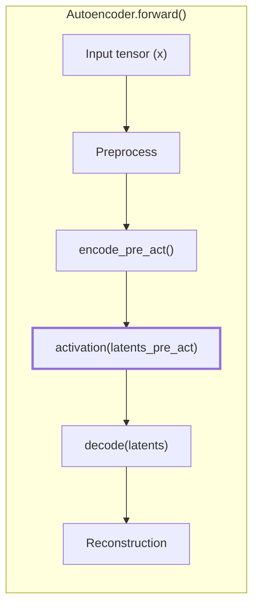
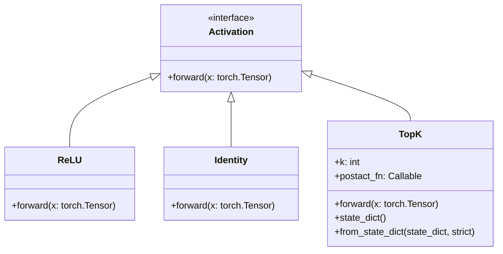
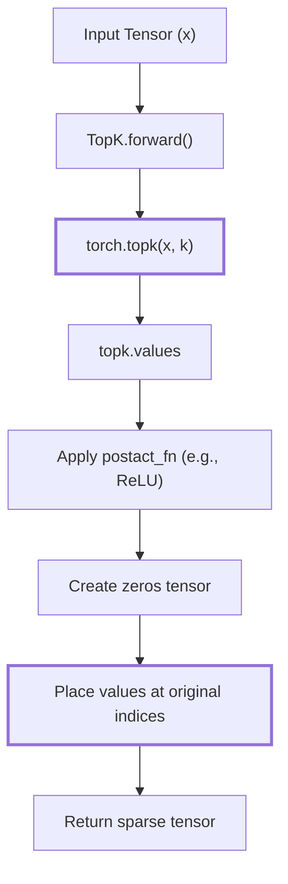
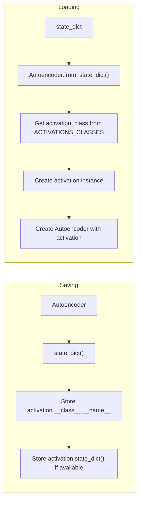

<!-- source: DeepWiki mcp.deepwiki.com · repo openai/sparse_autoencoder · page 3.2 Activation Functions · fetched 2026-10-26 -->

# Activation Functions

<details>
<summary>Relevant source files</summary>

The following files were used as context for generating this wiki page:

- [sparse_autoencoder/model.py](sparse_autoencoder/model.py)

</details>


This document details the activation functions used in the sparse autoencoder implementation, focusing on both standard activation functions and the specialized `TopK` activation for enforcing sparsity. For information about loss functions, see [Loss Functions](#3.3).

## Overview

Activation functions in the sparse autoencoder are a critical component that determine how features are represented in the latent space. They are applied after the encoding step and before decoding, controlling which neurons activate in the latent representation.



Sources: [sparse_autoencoder/model.py:93-109]()

## Supported Activation Functions

The sparse autoencoder supports three main activation functions, defined in the `ACTIVATIONS_CLASSES` dictionary:



Sources: [sparse_autoencoder/model.py:188-192]()

### Standard PyTorch Activations

The system supports standard PyTorch activation functions:

1. **ReLU** (`nn.ReLU`) - The default activation that zeros out negative values
2. **Identity** (`nn.Identity`) - A passthrough function that applies no transformation

When creating an autoencoder, an activation function is passed as a parameter:

```python
# Default initialization uses ReLU
autoencoder = Autoencoder(n_latents=256, n_inputs=768, activation=nn.ReLU())

# Using Identity activation
autoencoder = Autoencoder(n_latents=256, n_inputs=768, activation=nn.Identity())
```

Sources: [sparse_autoencoder/model.py:25-27](), [sparse_autoencoder/model.py:39]()

### TopK Activation

The `TopK` class is a specialized activation function designed specifically for enforcing sparsity in the latent representation. It ensures that only a fixed number of neurons are active for each input.



Sources: [sparse_autoencoder/model.py:162-185]()

#### Implementation Details

The `TopK` class takes two parameters:
- `k`: The number of neurons to keep active
- `postact_fn`: An optional post-activation function (defaults to ReLU)

Its `forward` method:
1. Finds the top k values in the input tensor along the last dimension
2. Applies the post-activation function to these values
3. Creates a result tensor filled with zeros
4. Places the activated top k values in their original positions

```
# Example of TopK activation with k=10 and ReLU post-activation
topk_activation = TopK(k=10, postact_fn=nn.ReLU())
autoencoder = Autoencoder(n_latents=256, n_inputs=768, activation=topk_activation)
```

Sources: [sparse_autoencoder/model.py:168-174]()

#### State Management

The `TopK` class implements custom state management to save and load its configuration:

- `state_dict()` saves the `k` value and the class name of the post-activation function
- `from_state_dict()` class method reconstructs a `TopK` instance from saved state

Sources: [sparse_autoencoder/model.py:176-185]()

## Usage in the Autoencoder

The activation function is a key component in the autoencoder's operation:

| Method | Role of Activation Function |
|--------|----------------------------|
| `encode(x)` | Applies activation to transform pre-activation latents |
| `forward(x)` | Creates sparse latent representation for decoding |

In the encoding process:
```python
# Inside encode method
latents = self.activation(self.encode_pre_act(x))
```

In the forward pass:
```python
# Inside forward method
latents_pre_act = self.encode_pre_act(x)
latents = self.activation(latents_pre_act)
recons = self.decode(latents, info)
```

Sources: [sparse_autoencoder/model.py:74-80](), [sparse_autoencoder/model.py:93-109]()

## Serialization and Deserialization

The `Autoencoder` class ensures that activation functions are properly saved and restored by:

1. Storing the activation class name in the state dictionary
2. For custom activations like `TopK`, storing additional parameters
3. Using the appropriate class method to reconstruct the activation when loading



Sources: [sparse_autoencoder/model.py:111-141]()

## Integration with Normalization

When using the `TopK` activation, normalization is automatically enabled in the autoencoder. This is handled through the `normalize` flag that affects input preprocessing:

```python
# When creating from state dict
normalize = activation_class_name == "TopK"  # Determine normalization
autoencoder = cls(n_latents, d_model, activation=activation, normalize=normalize)
```

The autoencoder uses the `LN` (Layer Normalization) function to normalize inputs when required.

Sources: [sparse_autoencoder/model.py:8-13](), [sparse_autoencoder/model.py:120]()

## Choosing the Right Activation Function

The choice of activation function depends on the specific requirements:

- **ReLU**: Good for general-purpose autoencoder training with natural sparsity
- **Identity**: Useful for cases where no transformation is needed
- **TopK**: Recommended when strict sparsity control is required, ensuring exactly k features are active

The `TopK` activation is particularly important for sparse autoencoders analyzing neural network activations, as it ensures consistent sparsity patterns that make the learned features more interpretable.

Sources: [sparse_autoencoder/model.py:162-185]()

---

