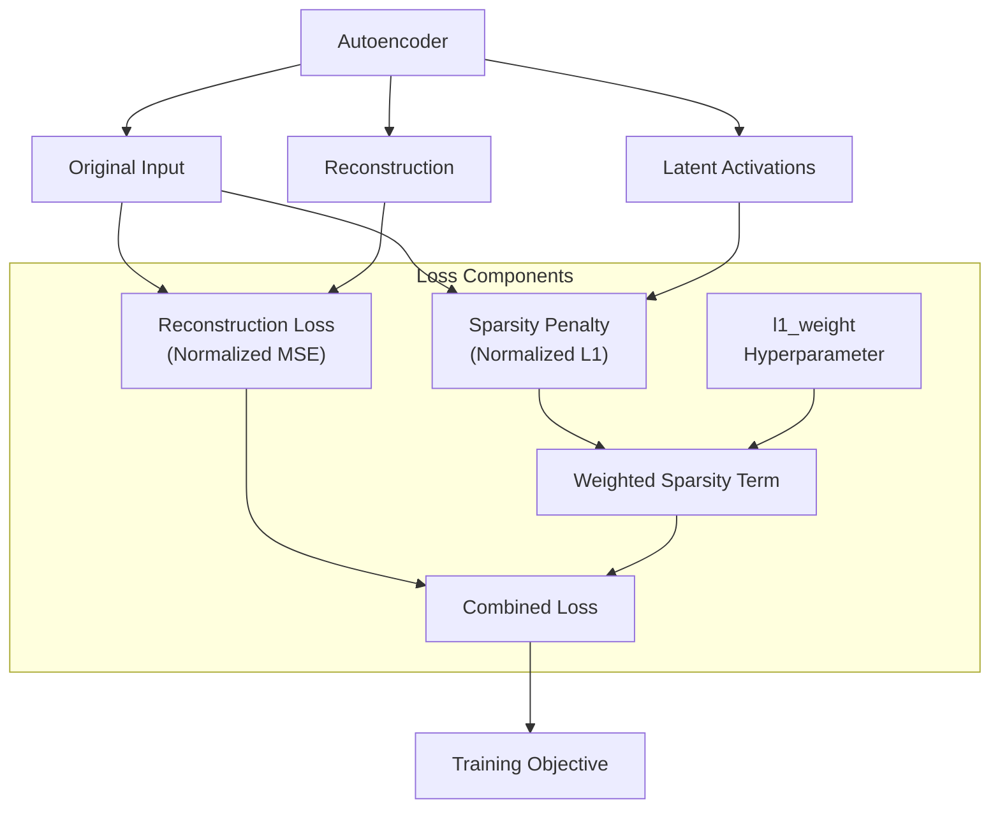
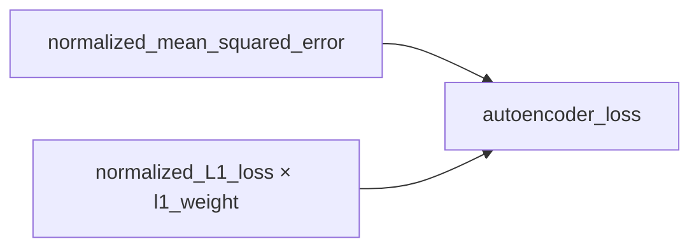
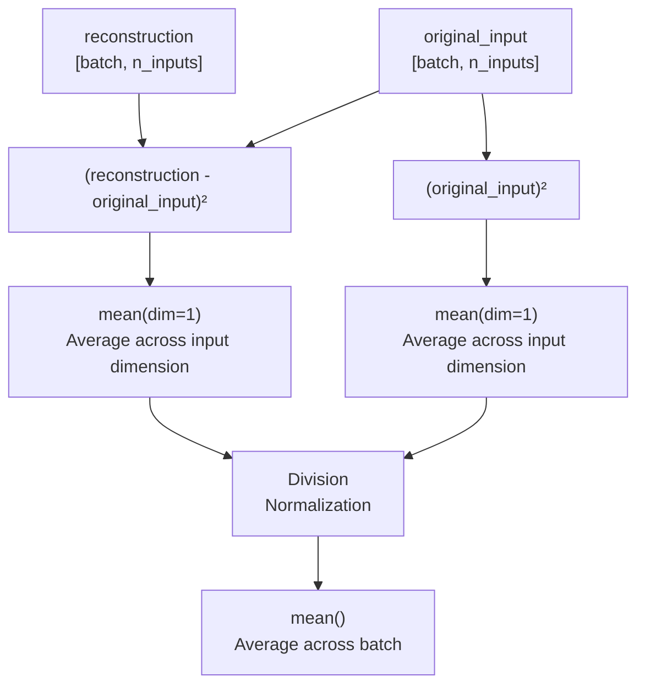
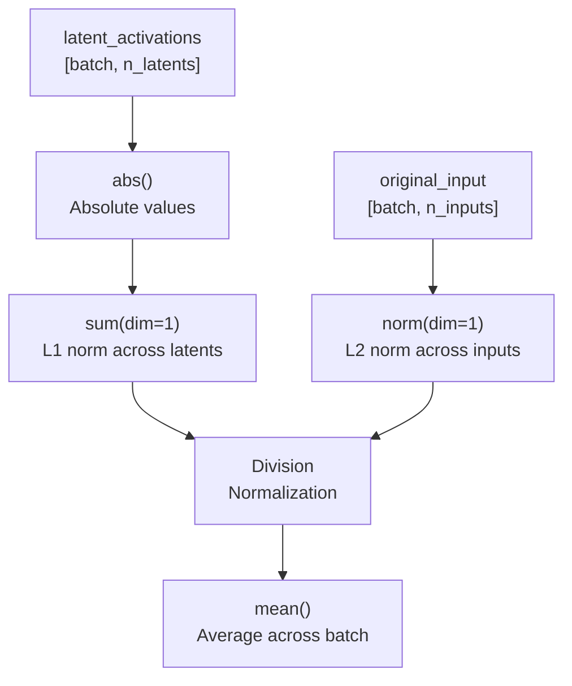
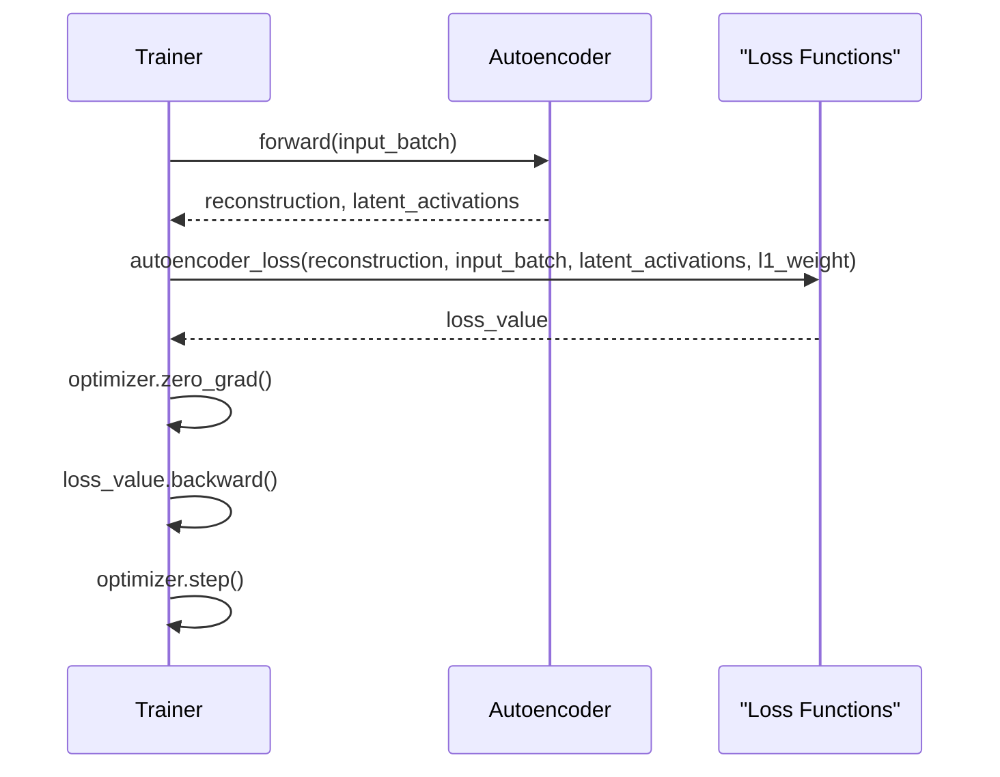
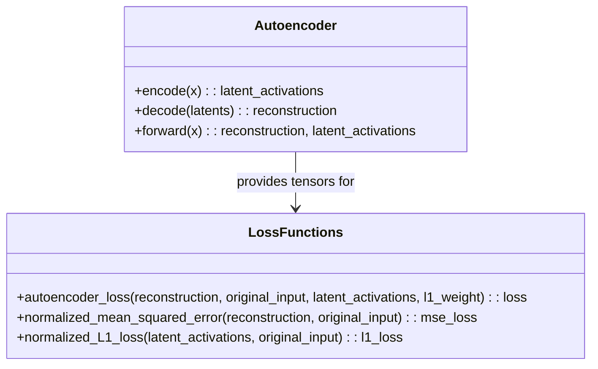

<!-- source: DeepWiki mcp.deepwiki.com · repo openai/sparse_autoencoder · page 3.3 Loss Functions · fetched 2026-10-26 -->

# Loss Functions

<details>
<summary>Relevant source files</summary>

The following files were used as context for generating this wiki page:

- [sparse_autoencoder/loss.py](sparse_autoencoder/loss.py)

</details>


This page documents the loss functions implemented in the sparse autoencoder repository. These functions are crucial for training the autoencoder to accurately reconstruct inputs while maintaining sparse activations in the latent space. For information about the autoencoder model itself, see [Autoencoder Model](#3).

## Purpose of Loss Functions

In sparse autoencoders, the loss function serves two primary objectives:
1. **Reconstruction accuracy**: Ensuring the decoded output closely matches the original input
2. **Sparsity promotion**: Encouraging the latent representation to be sparse (having few non-zero elements)

The implementation balances these potentially competing objectives through a weighted combination of specialized loss terms.

## Loss Function Architecture

The sparse autoencoder uses a composite loss function that combines reconstruction error with a sparsity penalty:



Sources: [sparse_autoencoder/loss.py:4-20]()

## Combined Autoencoder Loss

The primary loss function that orchestrates the training of the sparse autoencoder is `autoencoder_loss`. This function combines the normalized mean squared error for reconstruction quality with the normalized L1 loss for promoting sparsity.

```python
autoencoder_loss(
    reconstruction: torch.Tensor,  # shape: [batch, n_inputs]
    original_input: torch.Tensor,  # shape: [batch, n_inputs]
    latent_activations: torch.Tensor,  # shape: [batch, n_latents]
    l1_weight: float,  # sparsity weight hyperparameter
) -> torch.Tensor:  # shape: [1]
```

The implementation combines the two loss components with a weighting factor:



Sources: [sparse_autoencoder/loss.py:4-20]()

## Reconstruction Loss: Normalized Mean Squared Error

The normalized mean squared error measures how accurately the autoencoder reconstructs the original input, while being invariant to the scale of the input:



This function:
1. Computes the squared difference between reconstruction and original input
2. Takes the mean across the input dimension
3. Normalizes by the mean squared value of the original input
4. Takes the mean across the batch dimension

The normalization makes the loss scale-invariant, ensuring that inputs with larger magnitudes don't dominate the loss.

Sources: [sparse_autoencoder/loss.py:23-34]()

## Sparsity Penalty: Normalized L1 Loss

The normalized L1 loss promotes sparsity in the latent space by penalizing the absolute sum of activations, normalized by the norm of the original input:



This function:
1. Takes the absolute value of all latent activations
2. Sums across the latent dimension to get the L1 norm
3. Normalizes by the L2 norm of the original input
4. Takes the mean across the batch dimension

The normalization ensures that the sparsity penalty scales appropriately with the magnitude of the input.

Sources: [sparse_autoencoder/loss.py:37-46]()

## Mathematical Formulation

The complete loss function can be expressed mathematically as:

| Component | Formula |
|-----------|---------|
| Normalized MSE | mean(((reconstruction - original_input)²).mean(dim=1) / (original_input²).mean(dim=1)) |
| Normalized L1 | mean(abs(latent_activations).sum(dim=1) / original_input.norm(dim=1)) |
| Combined Loss | Normalized MSE + l1_weight × Normalized L1 |

## Usage in Training

During training, the autoencoder loss function is typically used as follows:



The `l1_weight` hyperparameter is crucial for balancing reconstruction accuracy and sparsity. Higher values encourage more sparsity but may sacrifice reconstruction quality, while lower values prioritize reconstruction at the expense of sparsity.

Sources: [sparse_autoencoder/loss.py:4-46]()

## Integration with the Autoencoder

The loss functions are designed to work directly with the tensors produced and consumed by the `Autoencoder` class:



The tensor shapes are carefully aligned between the autoencoder outputs and the loss function inputs:
- `original_input`: [batch_size, n_inputs]
- `reconstruction`: [batch_size, n_inputs]
- `latent_activations`: [batch_size, n_latents]

Sources: [sparse_autoencoder/loss.py:4-46]()

## Summary

The loss functions in the sparse autoencoder repository provide a balanced approach to training autoencoders that produce both accurate reconstructions and sparse latent representations. The `autoencoder_loss` function combines normalized mean squared error for reconstruction with normalized L1 loss for sparsity, with a tunable weight parameter to control the sparsity-reconstruction trade-off.

---

