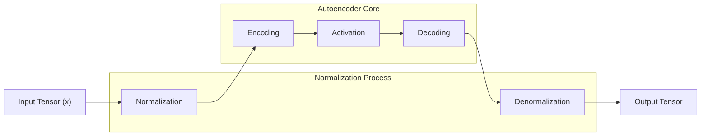
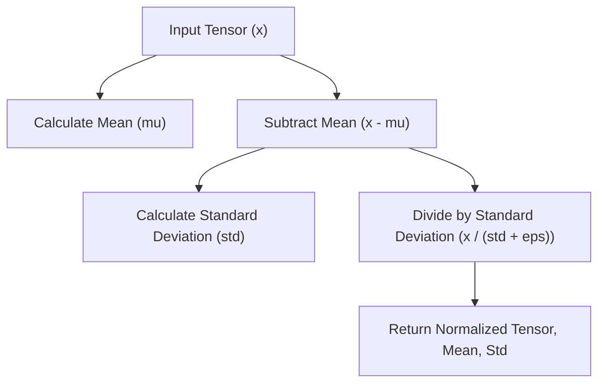
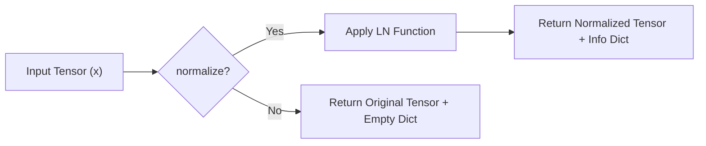
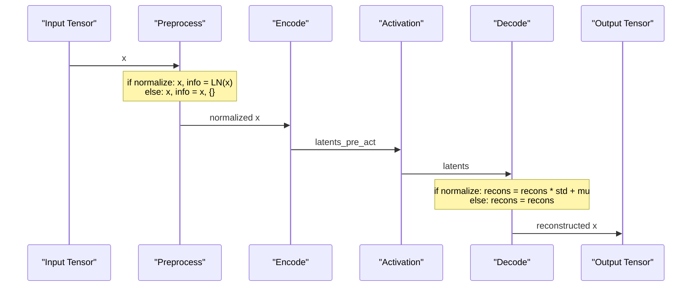

<!-- source: DeepWiki mcp.deepwiki.com · repo openai/sparse_autoencoder · page 3.4 Normalization · fetched 2026-10-26 -->

# Normalization

<details>
<summary>Relevant source files</summary>

The following files were used as context for generating this wiki page:

- [sparse_autoencoder/loss.py](sparse_autoencoder/loss.py)
- [sparse_autoencoder/model.py](sparse_autoencoder/model.py)

</details>


This document describes the normalization techniques implemented in the sparse autoencoder system. Normalization is a preprocessing step that standardizes input data, which can improve training stability and performance. For information about loss functions, see [Loss Functions](#3.3). For information about activation functions, see [Activation Functions](#3.2).

## Overview of Normalization in the Sparse Autoencoder

The sparse autoencoder library implements an optional layer normalization mechanism that can be enabled during model initialization. When enabled, inputs are normalized before encoding and then denormalized after decoding, ensuring that the original scale and distribution of the data is preserved in the output.



Sources: [sparse_autoencoder/model.py:68-72](), [sparse_autoencoder/model.py:82-91]()

## Layer Normalization Implementation

The sparse autoencoder implements layer normalization through the `LN` function, which performs the following operations:

1. Compute the mean of the input tensor along the last dimension
2. Subtract the mean from the input tensor
3. Compute the standard deviation of the mean-subtracted tensor
4. Divide by the standard deviation (with a small epsilon for numerical stability)
5. Return the normalized tensor along with the mean and standard deviation for later denormalization



Sources: [sparse_autoencoder/model.py:8-13]()

## Normalization in the Autoencoder Pipeline

### Enabling Normalization

Normalization is controlled by the `normalize` parameter in the `Autoencoder` class constructor. When set to `True`, the autoencoder will apply normalization during preprocessing. In the codebase, normalization is often enabled implicitly when using the `TopK` activation function.

```python
def __init__(
    self, n_latents: int, n_inputs: int, activation: Callable = nn.ReLU(), 
    tied: bool = False, normalize: bool = False
) -> None:
    # ...
    self.normalize = normalize
    # ...
```

Sources: [sparse_autoencoder/model.py:24-44]()

### Preprocessing with Normalization

The `preprocess` method applies normalization when enabled and returns both the normalized tensor and a dictionary containing the mean and standard deviation needed for denormalization:



Sources: [sparse_autoencoder/model.py:68-72]()

### Forward Pass with Normalization

During the forward pass, the autoencoder:

1. Preprocesses the input, potentially normalizing it
2. Encodes the (normalized) input to get the latent representation
3. Applies the activation function to the latent representation
4. Decodes the latent representation
5. If normalization was applied, denormalizes the output using the saved mean and standard deviation



Sources: [sparse_autoencoder/model.py:93-109](), [sparse_autoencoder/model.py:74-80](), [sparse_autoencoder/model.py:82-91]()

## Denormalization during Decoding

To ensure that the reconstructed output matches the scale of the original input, the `decode` method applies denormalization when normalization is enabled:

```python
def decode(self, latents: torch.Tensor, info: dict[str, Any] | None = None) -> torch.Tensor:
    ret = self.decoder(latents) + self.pre_bias
    if self.normalize:
        assert info is not None
        ret = ret * info["std"] + info["mu"]
    return ret
```

This denormalization applies the inverse of the normalization process: multiplying by the standard deviation and adding the mean that were stored during preprocessing.

Sources: [sparse_autoencoder/model.py:82-91]()

## Integration with Model Serialization

The normalization setting is preserved during model serialization and deserialization. When loading a model from a state dictionary, the `from_state_dict` method determines if normalization should be enabled based on the activation function:

```python
# NOTE: hacky way to determine if normalization is enabled
normalize = activation_class_name == "TopK"
```

This approach assumes that models using the `TopK` activation function should have normalization enabled, which is a convention used in the codebase.

Sources: [sparse_autoencoder/model.py:112-134]()

## Relationship with Loss Functions

The normalization process works in conjunction with the loss functions, which themselves use normalization techniques:

1. The `normalized_mean_squared_error` function normalizes the MSE by dividing by the squared norm of the input
2. The `normalized_L1_loss` function normalizes the L1 loss by dividing by the L2 norm of the input

These normalized loss functions are used even when the autoencoder's normalization flag is disabled, ensuring that the loss calculations are well-scaled regardless of the input magnitude.

Sources: [sparse_autoencoder/loss.py:23-46]()

## Summary

Normalization in the sparse autoencoder system:

1. Is an optional feature that can be enabled via the `normalize` parameter
2. Implements layer normalization through the `LN` function
3. Preserves information needed for denormalization during the forward pass
4. Is automatically enabled when using the `TopK` activation function
5. Works in concert with normalized loss functions to ensure stable training

The normalization mechanism helps the autoencoder handle inputs with varying scales and distributions, which is particularly important when analyzing activations from different layers of transformer models like GPT2.

---

