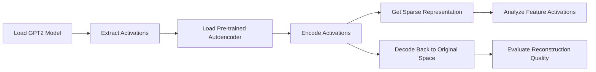
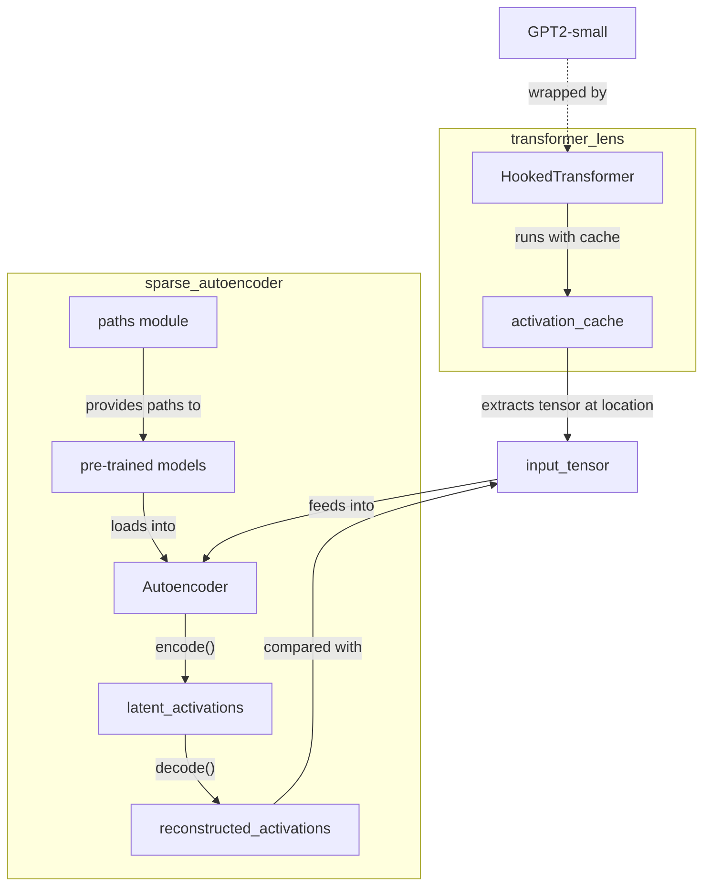
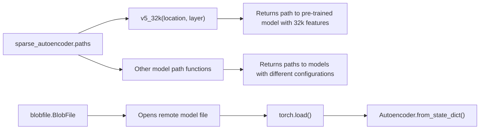

<!-- source: DeepWiki mcp.deepwiki.com · repo openai/sparse_autoencoder · page 4 Usage Guide · fetched 2026-10-26 -->

# Usage Guide

<details>
<summary>Relevant source files</summary>

The following files were used as context for generating this wiki page:

- [README.md](README.md)
- [pyproject.toml](pyproject.toml)

</details>


This guide provides instructions for using the sparse_autoencoder package to work with sparse autoencoders trained on GPT2-small model activations. It covers installation, basic usage patterns, and model management. For details about the autoencoder model architecture, see [Autoencoder Model](#3), and for information about visualizing learned features, see [SAE Viewer](#5).

## Installation

The sparse_autoencoder package can be installed directly from GitHub using pip:

```bash
pip install git+https://github.com/openai/sparse_autoencoder.git
```

This will install the package along with its dependencies, which include:
- blobfile (version 2.0.2)
- torch (version 2.1.0)
- transformer_lens (version 1.9.1)

Sources: [README.md:7-11](), [pyproject.toml:6-10]()

## Basic Usage Workflow

The typical workflow for using sparse_autoencoder involves:
1. Extracting neuron activations from a transformer model
2. Loading a pre-trained sparse autoencoder
3. Encoding the activations to get sparse representations
4. Optionally decoding back to the original activation space
5. Analyzing the results



Sources: [README.md:21-64]()

### Extracting Activations with transformer_lens

First, you need to extract activations from a specific layer and location in the GPT2 model using transformer_lens:

```python
import torch
import transformer_lens

# Load the model
model = transformer_lens.HookedTransformer.from_pretrained("gpt2", center_writing_weights=False)
device = next(model.parameters()).device

# Prepare input
prompt = "This is an example of a prompt that"
tokens = model.to_tokens(prompt)  # (1, n_tokens)

# Extract activations
with torch.no_grad():
    logits, activation_cache = model.run_with_cache(tokens, remove_batch_dim=True)

# Specify layer and location
layer_index = 6
location = "resid_post_mlp"
```

The `location` variable specifies which activations to extract from the model. Common options include:

| Location | Description | Transformer Lens Hook |
|----------|-------------|------------------------|
| mlp_post_act | Activations after MLP hidden layer | blocks.{layer}.mlp.hook_post |
| resid_delta_attn | Attention output before adding to residual stream | blocks.{layer}.hook_attn_out |
| resid_post_attn | Residual stream after attention | blocks.{layer}.hook_resid_mid |
| resid_delta_mlp | MLP output before adding to residual stream | blocks.{layer}.hook_mlp_out |
| resid_post_mlp | Residual stream after MLP | blocks.{layer}.hook_resid_post |

Sources: [README.md:29-47]()

### Loading a Pre-trained Autoencoder

The package provides pre-trained autoencoders that can be loaded using the paths module:

```python
import blobfile as bf
import sparse_autoencoder

# Map location string to transformer_lens hook location
transformer_lens_loc = {
    "mlp_post_act": f"blocks.{layer_index}.mlp.hook_post",
    "resid_delta_attn": f"blocks.{layer_index}.hook_attn_out",
    "resid_post_attn": f"blocks.{layer_index}.hook_resid_mid",
    "resid_delta_mlp": f"blocks.{layer_index}.hook_mlp_out",
    "resid_post_mlp": f"blocks.{layer_index}.hook_resid_post",
}[location]

# Load a pre-trained autoencoder
with bf.BlobFile(sparse_autoencoder.paths.v5_32k(location, layer_index), mode="rb") as f:
    state_dict = torch.load(f)
    autoencoder = sparse_autoencoder.Autoencoder.from_state_dict(state_dict)
    autoencoder.to(device)
```

The `paths.v5_32k()` function returns the path to a pre-trained autoencoder with 32,000 features trained on the specified location and layer.

Sources: [README.md:41-52]()

### Encoding and Decoding Activations

Once you have the activations and the autoencoder, you can encode the activations to get their sparse representation and optionally decode them back:

```python
# Get activations from the cache
input_tensor = activation_cache[transformer_lens_loc]

# No layer normalization is needed for the pre-trained autoencoders
input_tensor_ln = input_tensor

# Encode and decode
with torch.no_grad():
    latent_activations, info = autoencoder.encode(input_tensor_ln)
    reconstructed_activations = autoencoder.decode(latent_activations, info)
```

The `encode` method returns two values:
1. `latent_activations`: The sparse representation of the input
2. `info`: Additional information that might be needed for decoding

Sources: [README.md:54-60]()

## Evaluating Reconstruction Quality

You can evaluate how well the autoencoder reconstructs the original activations by computing the normalized mean squared error:

```python
normalized_mse = (reconstructed_activations - input_tensor).pow(2).sum(dim=1) / (input_tensor).pow(2).sum(dim=1)
print(location, normalized_mse)
```

A lower value indicates better reconstruction quality.

Sources: [README.md:62-63]()

## Autoencoder Integration Architecture

The following diagram illustrates how the sparse autoencoder integrates with transformer_lens and GPT2:



Sources: [README.md:21-64]()

## Model Loading Options

The package provides several pre-trained autoencoders accessible via the `paths` module:



For more details on available models and how to manage them, see [Model Saving and Loading](#4.3).

Sources: [README.md:49-51](), [README.md:19]()

## Complete Usage Example

Here's a complete example that demonstrates how to use the sparse_autoencoder package:

```python
import torch
import blobfile as bf
import transformer_lens
import sparse_autoencoder

# Extract neuron activations with transformer_lens
model = transformer_lens.HookedTransformer.from_pretrained("gpt2", center_writing_weights=False)
device = next(model.parameters()).device

prompt = "This is an example of a prompt that"
tokens = model.to_tokens(prompt)  # (1, n_tokens)
with torch.no_grad():
    logits, activation_cache = model.run_with_cache(tokens, remove_batch_dim=True)

layer_index = 6
location = "resid_post_mlp"

transformer_lens_loc = {
    "mlp_post_act": f"blocks.{layer_index}.mlp.hook_post",
    "resid_delta_attn": f"blocks.{layer_index}.hook_attn_out",
    "resid_post_attn": f"blocks.{layer_index}.hook_resid_mid",
    "resid_delta_mlp": f"blocks.{layer_index}.hook_mlp_out",
    "resid_post_mlp": f"blocks.{layer_index}.hook_resid_post",
}[location]

with bf.BlobFile(sparse_autoencoder.paths.v5_32k(location, layer_index), mode="rb") as f:
    state_dict = torch.load(f)
    autoencoder = sparse_autoencoder.Autoencoder.from_state_dict(state_dict)
    autoencoder.to(device)

input_tensor = activation_cache[transformer_lens_loc]
input_tensor_ln = input_tensor

with torch.no_grad():
    latent_activations, info = autoencoder.encode(input_tensor_ln)
    reconstructed_activations = autoencoder.decode(latent_activations, info)

normalized_mse = (reconstructed_activations - input_tensor).pow(2).sum(dim=1) / (input_tensor).pow(2).sum(dim=1)
print(location, normalized_mse)
```

This example extracts activations from layer 6's post-MLP residual stream, loads a pre-trained sparse autoencoder, and evaluates how well it can reconstruct the activations.

Sources: [README.md:23-64]()

---

