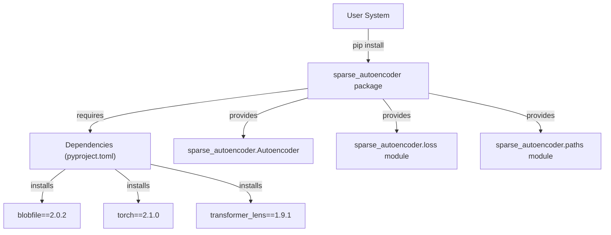
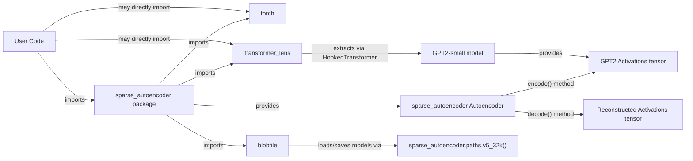

<!-- source: DeepWiki mcp.deepwiki.com · repo openai/sparse_autoencoder · page 4.1 Installation · fetched 2026-10-26 -->

# Installation

<details>
<summary>Relevant source files</summary>

The following files were used as context for generating this wiki page:

- [README.md](README.md)
- [pyproject.toml](pyproject.toml)

</details>


This page provides instructions for installing the `sparse_autoencoder` package and its dependencies. For information on how to use the package after installation, see [Basic Usage](#4.2) and [Model Saving and Loading](#4.3).

## System Requirements

The `sparse_autoencoder` package is compatible with systems that support:
- Python 3.x
- PyTorch 2.1.0
- CUDA (optional, for GPU acceleration)

Sources: [pyproject.toml:6-10]()

## Installation Methods

### Using pip (Recommended)

The simplest way to install the package is using pip directly from the GitHub repository:

```
pip install git+https://github.com/openai/sparse_autoencoder.git
```

This command installs the latest version of the package with all required dependencies.

Sources: [README.md:9-11]()

### Manual Installation

For development purposes or if you need to modify the package, you can clone the repository and install it in development mode using standard Python package development practices.

## Dependencies

The `sparse_autoencoder` package has the following dependencies, which are automatically installed when using pip:

| Dependency | Version | Purpose |
|------------|---------|---------|
| blobfile   | 2.0.2   | Used for accessing and storing trained autoencoder models |
| torch      | 2.1.0   | Provides the neural network framework and tensor operations |
| transformer_lens | 1.9.1 | Used to extract activations from GPT2-small model |

Sources: [pyproject.toml:6-10]()

## Verifying Installation

To verify that the installation was successful, you can import the package in Python. If the package is installed correctly, this should not produce any errors.

## Diagram: Installation Architecture and Dependencies



Sources: [pyproject.toml:1-19](), [README.md:7-11]()

## Diagram: Package Integration with External Systems



Sources: [README.md:23-64]()

## Package Structure

After installation, the package provides the following key components:

| Component | Description |
|-----------|-------------|
| `sparse_autoencoder.Autoencoder` | The main autoencoder class for encoding and decoding neural network activations |
| `sparse_autoencoder.paths` | Utilities for managing file paths for loading and saving models |
| `sparse_autoencoder.loss` | Loss functions used for training the autoencoder |
| `sparse_autoencoder.train` | Functionality for training the autoencoder |

Sources: [README.md:13-19]()

## Troubleshooting

### Common Issues

1. **Version conflicts**: If you encounter version conflicts with existing packages, try creating a virtual environment before installation.

2. **CUDA compatibility**: If using GPU acceleration, ensure your CUDA version is compatible with the installed PyTorch version.

3. **blobfile access issues**: If experiencing problems with blobfile, check your network connection and permissions.

Sources: [README.md:3-19](), [pyproject.toml:1-19]()

---

