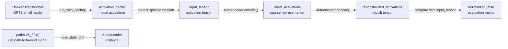
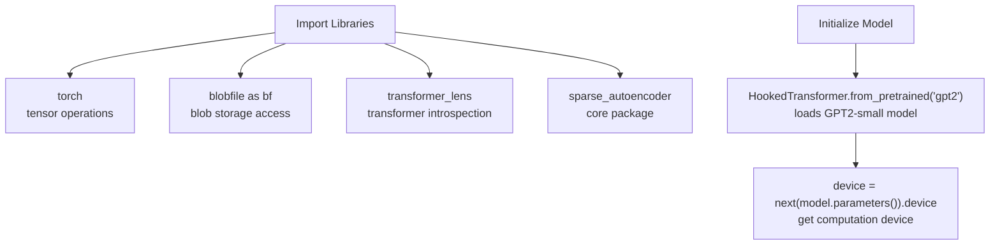
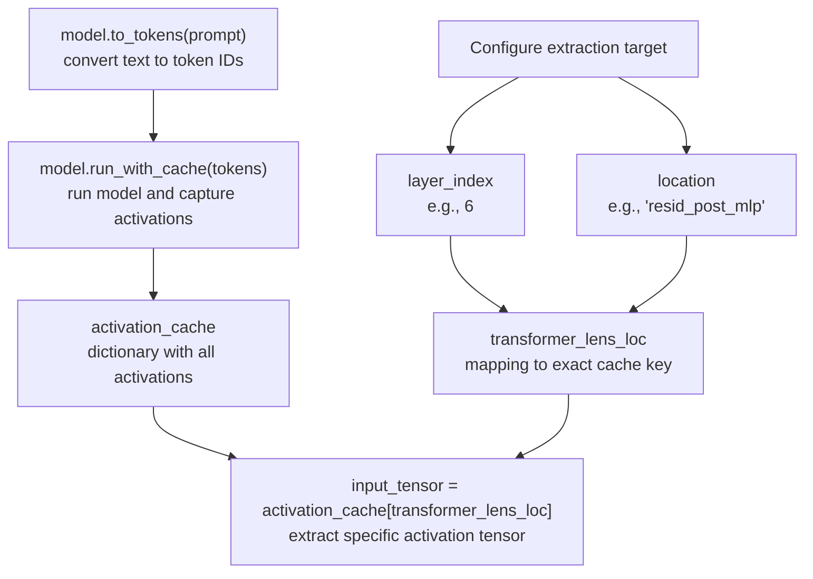
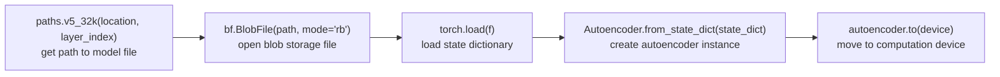
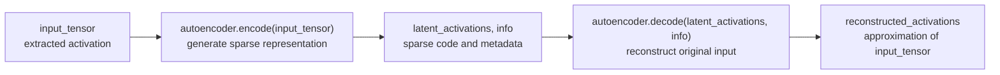

<!-- source: DeepWiki mcp.deepwiki.com · repo openai/sparse_autoencoder · page 4.2 Basic Usage · fetched 2026-10-26 -->

# Basic Usage

<details>
<summary>Relevant source files</summary>

The following files were used as context for generating this wiki page:

- [README.md](README.md)

</details>


This document explains how to use the `sparse_autoencoder` package with `transformer_lens` to analyze GPT2-small model activations. For installation instructions, see [Installation](#4.1). For information on managing saved models, see [Model Saving and Loading](#4.3).

## Basic Workflow Overview



Sources: [README.md:23-64]()

## Setting Up Prerequisites

Before using the sparse autoencoder, you need to import the necessary libraries and initialize the GPT2-small model:



Key code components:
- `transformer_lens.HookedTransformer`: Main class for loading and accessing transformer models
- `sparse_autoencoder.Autoencoder`: Core class for encoding and decoding activations
- `sparse_autoencoder.paths`: Module providing access to pre-trained autoencoders

Sources: [README.md:24-31]()

## Extracting Activations from GPT2

The process of extracting activations involves:



The mapping dictionary maps user-friendly location names to `transformer_lens` internal paths:

| `location` value | `transformer_lens_loc` format | Description |
|------------------|------------------------------|-------------|
| `"mlp_post_act"` | `blocks.{layer_index}.mlp.hook_post` | MLP outputs after activation |
| `"resid_delta_attn"` | `blocks.{layer_index}.hook_attn_out` | Attention contribution to residual stream |
| `"resid_post_attn"` | `blocks.{layer_index}.hook_resid_mid` | Residual stream after attention |
| `"resid_delta_mlp"` | `blocks.{layer_index}.hook_mlp_out` | MLP contribution to residual stream |
| `"resid_post_mlp"` | `blocks.{layer_index}.hook_resid_post` | Residual stream after MLP |

Sources: [README.md:33-47]()

## Loading a Pre-trained Autoencoder

To load a pre-trained autoencoder:



The `paths.v5_32k()` function returns a path to a pre-trained sparse autoencoder with 32k features that was trained on activations from the specified layer and location.

Sources: [README.md:49-52]()

## Using the Autoencoder

Once the autoencoder is loaded and activations extracted, you can encode and decode:



Key methods:
- `autoencoder.encode()`: Converts input activations to a sparse representation, returning both latent activations and an info dictionary
- `autoencoder.decode()`: Reconstructs the original activations from the latent representation and info

Sources: [README.md:54-60]()

## Evaluating Results

To evaluate the autoencoder's performance:

```python
normalized_mse = (reconstructed_activations - input_tensor).pow(2).sum(dim=1) / (input_tensor).pow(2).sum(dim=1)
```

This normalized mean squared error quantifies reconstruction quality. Lower values indicate better reconstruction.

You can also analyze:
1. Sparsity by examining the percentage of zero values in `latent_activations`
2. Feature activations to understand what patterns the autoencoder has learned
3. Distribution of feature usage across different inputs

For visualizing learned features, refer to the [SAE Viewer](#5) documentation.

Sources: [README.md:62-63]()

## Complete Example

The following table outlines the complete workflow:

| Step | Code Component | Purpose |
|------|---------------|---------|
| 1 | `HookedTransformer.from_pretrained("gpt2")` | Initialize GPT2-small model |
| 2 | `model.run_with_cache(tokens)` | Get activations from all model layers |
| 3 | `activation_cache[transformer_lens_loc]` | Extract specific layer/location activations |
| 4 | `paths.v5_32k(location, layer_index)` | Get path to pre-trained autoencoder |
| 5 | `Autoencoder.from_state_dict(state_dict)` | Load autoencoder model |
| 6 | `autoencoder.encode(input_tensor)` | Generate sparse representation |
| 7 | `autoencoder.decode(latent_activations, info)` | Reconstruct activations |
| 8 | Calculate `normalized_mse` | Evaluate reconstruction quality |

Sources: [README.md:23-64]()

---

