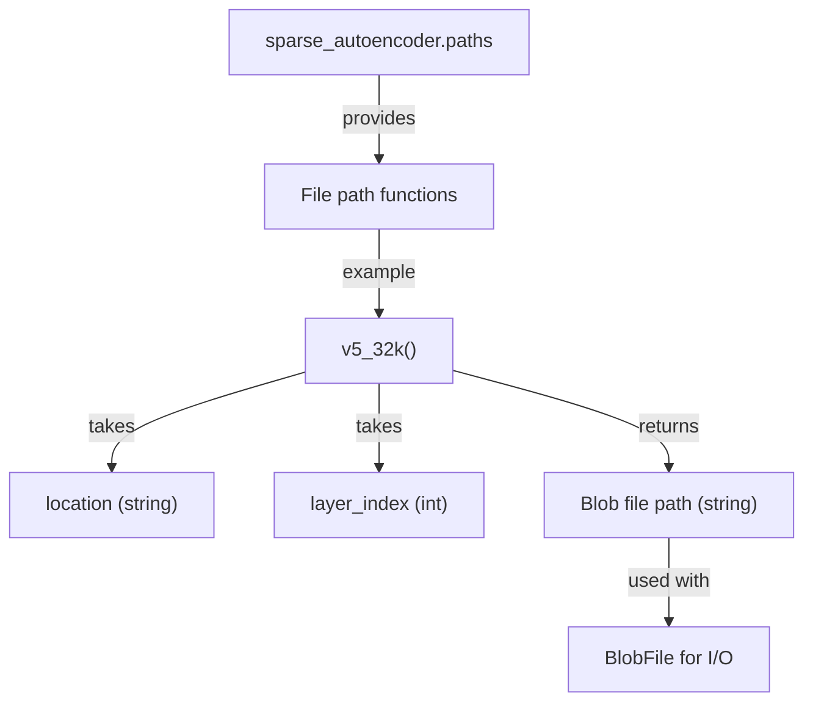
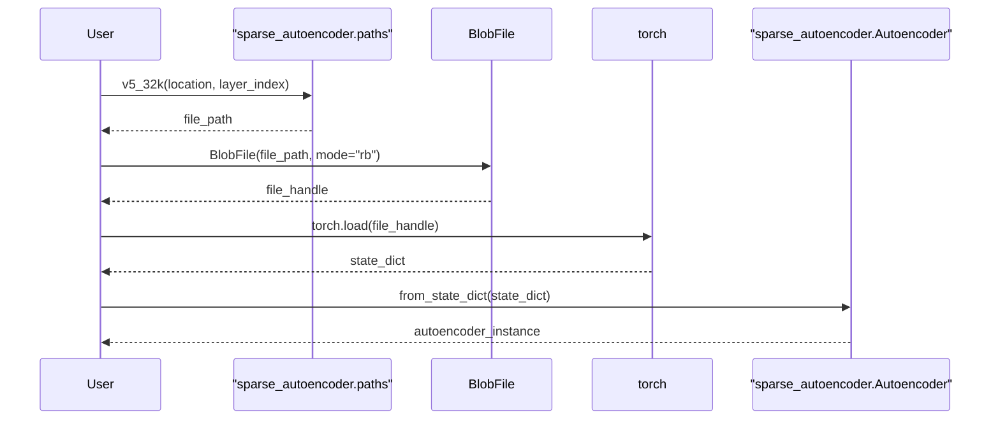
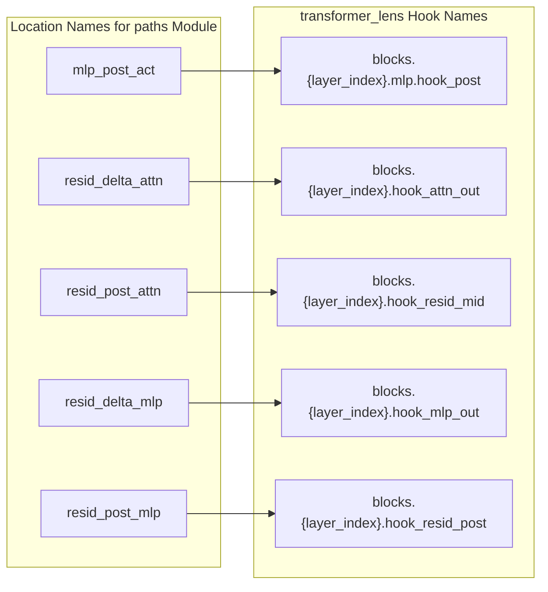
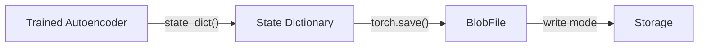

<!-- source: DeepWiki mcp.deepwiki.com · repo openai/sparse_autoencoder · page 4.3 Model Saving and Loading · fetched 2026-10-26 -->

# Model Saving and Loading

<details>
<summary>Relevant source files</summary>

The following files were used as context for generating this wiki page:

- [README.md](README.md)
- [sparse_autoencoder/__init__.py](sparse_autoencoder/__init__.py)

</details>


## Purpose and Overview

This document explains how to save and load sparse autoencoder models in the `sparse_autoencoder` package. It focuses on using the `paths` module to locate saved models and the methods available in the `Autoencoder` class for loading these models.

For information about the autoencoder model architecture itself, see [Autoencoder Model](#3). For basic usage of loaded models, see [Basic Usage](#4.2).

## The paths Module

The `paths` module in the `sparse_autoencoder` package provides utilities for locating saved autoencoder models. It is directly imported in the package's `__init__.py`, making it accessible as `sparse_autoencoder.paths`.

**Model Path Organization**



From the README example, we can see that the paths module provides at least one function, `v5_32k`, which generates file paths for models based on:
- The activation location (e.g., "resid_post_mlp")
- The layer index (e.g., 6)

Sources: [sparse_autoencoder/__init__.py:2-2](), [README.md:19](), [README.md:49]()

## Loading Models

Loading a saved autoencoder model involves three steps:

1. Getting the file path using a function from the paths module
2. Opening the file with BlobFile and loading the state dictionary with torch.load
3. Creating an Autoencoder instance using the from_state_dict class method

**Model Loading Sequence**



Here's the code example from the README that demonstrates this process:

```python
with bf.BlobFile(sparse_autoencoder.paths.v5_32k(location, layer_index), mode="rb") as f:
    state_dict = torch.load(f)
    autoencoder = sparse_autoencoder.Autoencoder.from_state_dict(state_dict)
    autoencoder.to(device)  # Move to appropriate device if using GPU
```

The `from_state_dict` method reconstructs the Autoencoder instance from the saved state dictionary, which contains the model's weights and configuration.

Sources: [README.md:49-52]()

## Activation Locations and Layer Indices

When loading a model, you need to specify both the activation location and the layer index. The README provides a mapping from high-level location names to transformer_lens hook names:

```python
transformer_lens_loc = {
    "mlp_post_act": f"blocks.{layer_index}.mlp.hook_post",
    "resid_delta_attn": f"blocks.{layer_index}.hook_attn_out",
    "resid_post_attn": f"blocks.{layer_index}.hook_resid_mid",
    "resid_delta_mlp": f"blocks.{layer_index}.hook_mlp_out",
    "resid_post_mlp": f"blocks.{layer_index}.hook_resid_post",
}[location]
```

This mapping shows the available activation locations for which pretrained models are likely to be available.

**Location to Hook Name Mapping**



The layer index refers to the layer number in the GPT2-small model, which has 12 layers (0-11).

Sources: [README.md:41-47]()

## Complete Usage Example

Below is a complete example that demonstrates the process of loading a model and using it to encode and decode activations:

| Step | Description |
|------|-------------|
| 1 | Extract activations from a transformer model |
| 2 | Load the appropriate autoencoder model |
| 3 | Process the activations with the autoencoder |
| 4 | Evaluate reconstruction quality |

```python
import torch
import blobfile as bf
import transformer_lens
import sparse_autoencoder

# Extract neuron activations with transformer_lens
model = transformer_lens.HookedTransformer.from_pretrained("gpt2", center_writing_weights=False)
device = next(model.parameters()).device

prompt = "This is an example of a prompt that"
tokens = model.to_tokens(prompt)  # (1, n_tokens)
with torch.no_grad():
    logits, activation_cache = model.run_with_cache(tokens, remove_batch_dim=True)

layer_index = 6
location = "resid_post_mlp"

transformer_lens_loc = {
    "mlp_post_act": f"blocks.{layer_index}.mlp.hook_post",
    "resid_delta_attn": f"blocks.{layer_index}.hook_attn_out",
    "resid_post_attn": f"blocks.{layer_index}.hook_resid_mid",
    "resid_delta_mlp": f"blocks.{layer_index}.hook_mlp_out",
    "resid_post_mlp": f"blocks.{layer_index}.hook_resid_post",
}[location]

# Load the autoencoder model
with bf.BlobFile(sparse_autoencoder.paths.v5_32k(location, layer_index), mode="rb") as f:
    state_dict = torch.load(f)
    autoencoder = sparse_autoencoder.Autoencoder.from_state_dict(state_dict)
    autoencoder.to(device)

input_tensor = activation_cache[transformer_lens_loc]
input_tensor_ln = input_tensor  # In this example, no normalization is applied

# Use the autoencoder
with torch.no_grad():
    latent_activations, info = autoencoder.encode(input_tensor_ln)
    reconstructed_activations = autoencoder.decode(latent_activations, info)

# Evaluate reconstruction quality
normalized_mse = (reconstructed_activations - input_tensor).pow(2).sum(dim=1) / (input_tensor).pow(2).sum(dim=1)
print(location, normalized_mse)
```

This example shows the workflow from extracting activations to loading an autoencoder model and using it to encode and decode those activations.

Sources: [README.md:23-64]()

## Model Saving Process

**Standard PyTorch Model Saving Pattern**



While the provided files don't explicitly show how to save models, based on standard PyTorch practices, models would typically be saved by storing their state dictionaries:

```python
# Assuming you have a trained autoencoder
import torch
import blobfile as bf

# Save the model
file_path = "path/to/save/model.pt"
with bf.BlobFile(file_path, mode="wb") as f:
    torch.save(autoencoder.state_dict(), f)
```

If you're adding new models to be accessible via the paths module, you would need to update the module accordingly.

## Summary

The `sparse_autoencoder` package provides a streamlined way to load pretrained autoencoder models for different activation locations and layers of GPT2-small. The key components in this process are:

1. The `paths` module - helps locate model files based on location and layer
2. `BlobFile` - handles file I/O for model storage
3. `Autoencoder.from_state_dict` - reconstructs models from saved state dictionaries

When loading a model, you need to specify both the activation location (e.g., "resid_post_mlp") and the layer index (e.g., 6), which correspond to specific transformer_lens hook points in the GPT2 model.

---

