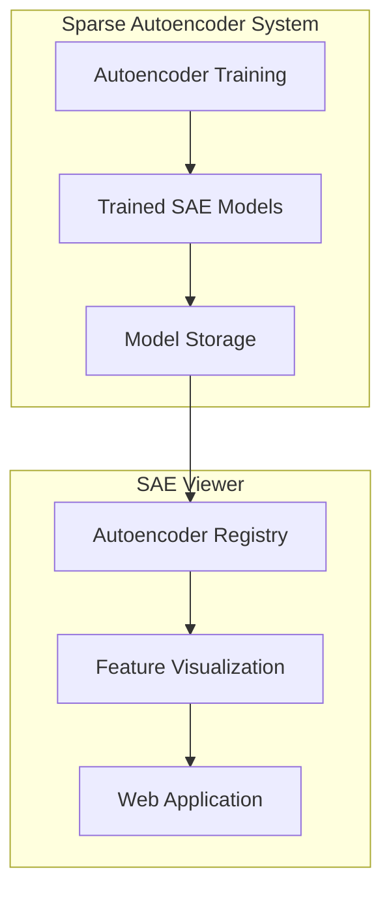
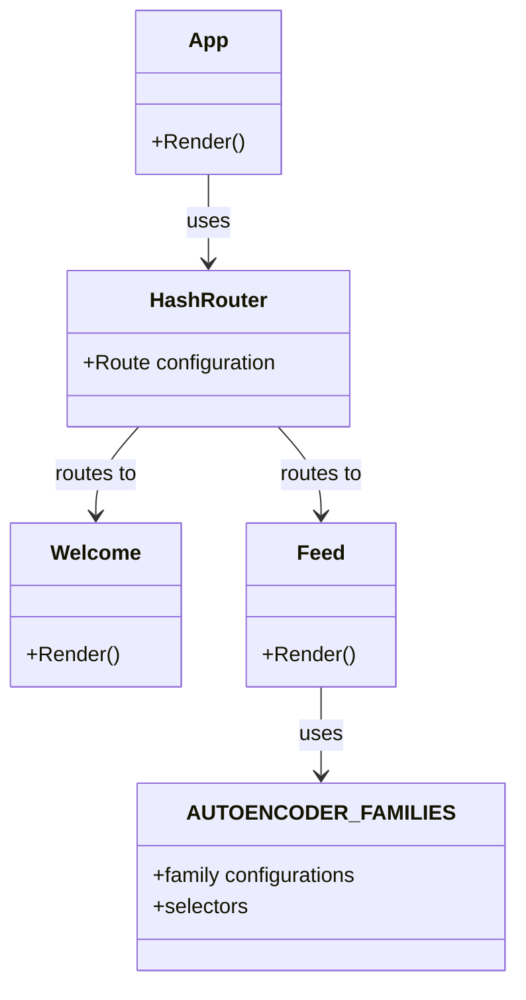
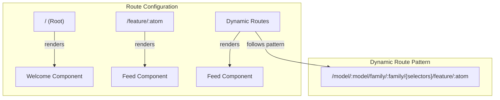
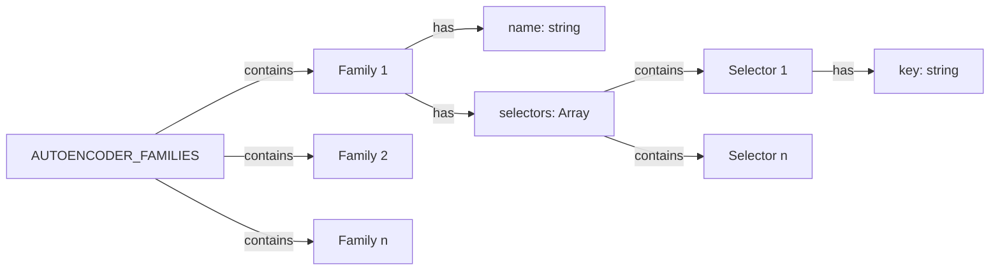
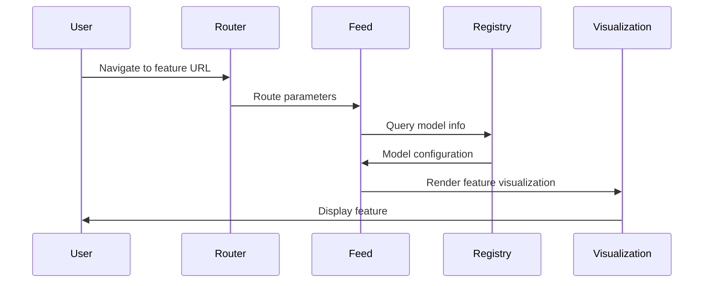
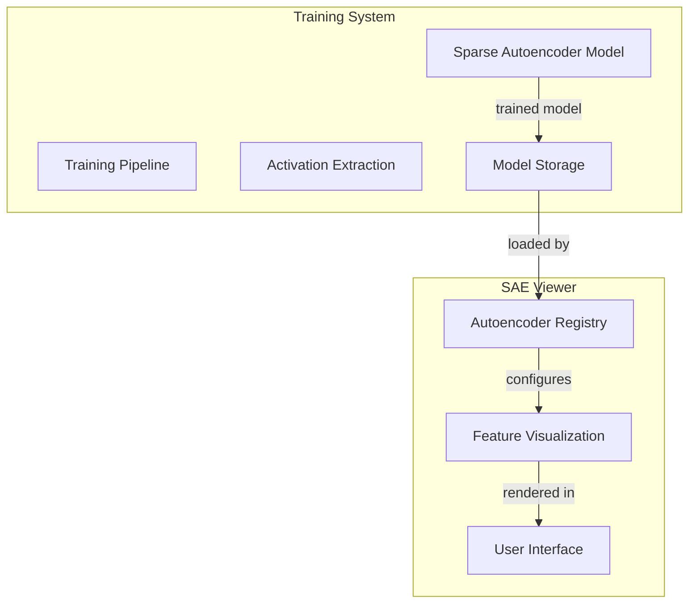

<!-- source: DeepWiki mcp.deepwiki.com · repo openai/sparse_autoencoder · page 5 SAE Viewer · fetched 2026-10-26 -->

# SAE Viewer

<details>
<summary>Relevant source files</summary>

The following files were used as context for generating this wiki page:

- [sae-viewer/README.md](sae-viewer/README.md)
- [sae-viewer/src/App.tsx](sae-viewer/src/App.tsx)

</details>


The SAE Viewer is a web-based visualization tool for exploring and analyzing activation patterns generated by sparse autoencoders in the sparse_autoencoder repository. It provides an intuitive interface for researchers and developers to examine the features learned by trained sparse autoencoder models, allowing for better understanding and interpretation of neural network internals.

## Overview

The SAE Viewer is designed to visualize the latent representations and activation patterns that have been learned by sparse autoencoders trained on neural network activations. It allows users to view different features across various models and model families through an interactive web interface.



Sources: [sae-viewer/README.md:1-16](), [sae-viewer/src/App.tsx:1-31]()

## Accessing the SAE Viewer

### Public Website

The simplest way to use the SAE Viewer is through the public website, which is pre-loaded with a variety of trained sparse autoencoder models:

```
https://openaipublic.blob.core.windows.net/sparse-autoencoder/sae-viewer/index.html
```

### Local Development

For those who want to run the SAE Viewer locally or contribute to its development:

1. Install dependencies:
   ```
   npm install
   ```

2. Run the development server:
   ```
   npm start
   ```

This will start a local development server with the SAE Viewer application.

Sources: [sae-viewer/README.md:7-15]()

## Architecture and Components

The SAE Viewer is built as a React-based single-page application with client-side routing to navigate between different views and features.



### Core Components

- **App**: The main application component that sets up routing
- **Welcome**: The landing page component
- **Feed**: The component responsible for displaying feature visualizations
- **AUTOENCODER_FAMILIES**: Configuration object defining the available autoencoder models

Sources: [sae-viewer/src/App.tsx:1-31]()

## Routing System

The SAE Viewer uses React Router to handle navigation between different views. The routing system is designed to accommodate various parameters that specify which model, family, and feature to display.



### Route Structure

The application defines the following routes:

1. **Root Route (`/`)**: Displays the welcome page
2. **Feature Route (`/feature/:atom`)**: Displays a specific feature identified by the `atom` parameter
3. **Dynamic Model Routes**: Generated based on the configured autoencoder families, following the pattern:
   ```
   /model/:model/family/:family/{selector1}/:value1/{selector2}/:value2/.../feature/:atom
   ```

The dynamic routes are generated programmatically from the `AUTOENCODER_FAMILIES` configuration, with each family potentially having different selectors that become part of the URL structure.

Sources: [sae-viewer/src/App.tsx:8-27]()

## Autoencoder Registry

The SAE Viewer uses an autoencoder registry to define and organize different families of autoencoder models. This registry (`AUTOENCODER_FAMILIES`) is a central configuration object that specifies how different models are structured and accessed.



Each family in the registry contains:
- A name identifier
- A set of selectors that define the parameters needed to specify a particular model instance within the family

The selectors are used to generate dynamic routes and to filter/select specific model instances when visualizing features.

Sources: [sae-viewer/src/App.tsx:5-22]()

## Visualization Interface

The SAE Viewer provides an interface to visualize the activation patterns and features learned by sparse autoencoders. The visualization component (`Feed`) accepts parameters from the URL and displays the corresponding feature visualizations.



The visualization typically includes:
- Feature activation patterns
- Neuron activations
- Interactive plots for exploring the feature space

Sources: [sae-viewer/src/App.tsx:2-23]()

## Integration with Sparse Autoencoder System

The SAE Viewer integrates with the broader sparse autoencoder system by visualizing the models that have been trained and saved. It does not perform training itself but serves as a tool for analyzing and understanding the results of training.



This separation of concerns allows the training system to focus on learning and storing models, while the SAE Viewer focuses on providing tools for human understanding and interpretation of the learned features.

Sources: [sae-viewer/README.md:1-5](), [sae-viewer/src/App.tsx:1-31]()

## Conclusion

The SAE Viewer is a crucial component of the sparse autoencoder ecosystem, providing the necessary tools to visualize and understand the features learned by the trained models. By offering both a public website and local development options, it caters to different user needs while maintaining a consistent interface for exploring activation patterns.

Researchers and developers can use the SAE Viewer to gain insights into how sparse autoencoders represent and process information, potentially leading to better understanding of neural network interpretability and more effective model designs.

---

