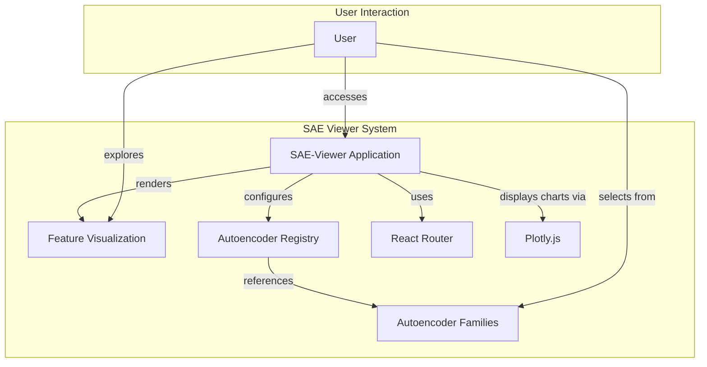
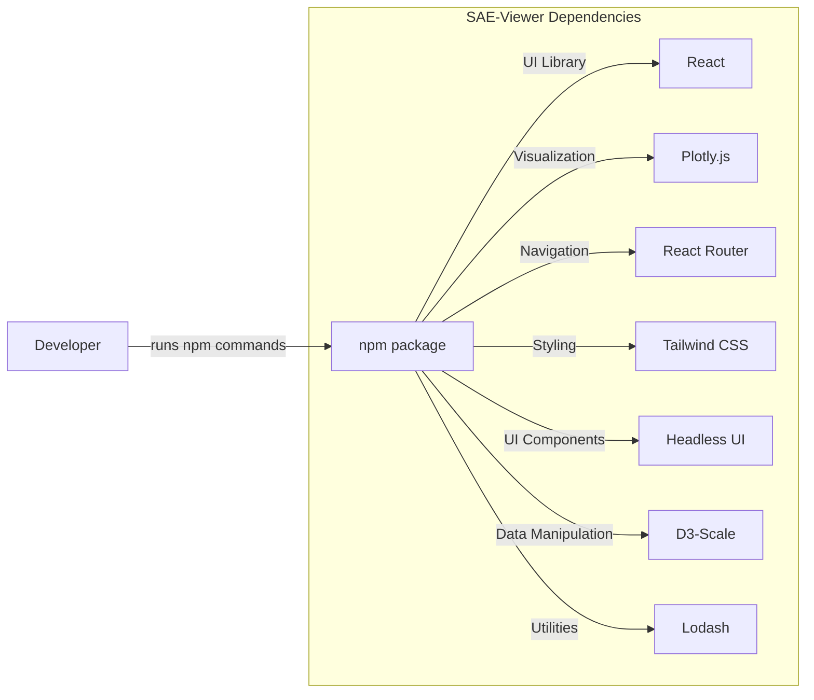
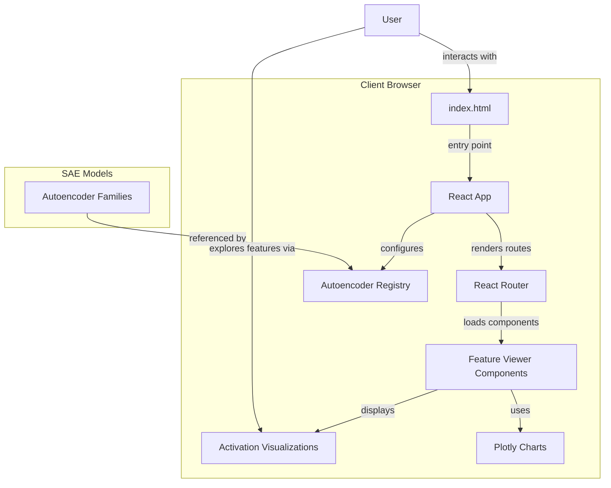
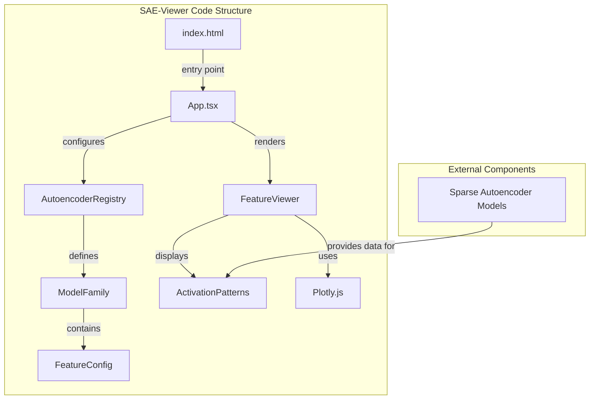

<!-- source: DeepWiki mcp.deepwiki.com · repo openai/sparse_autoencoder · page 5.1 Viewer Setup · fetched 2026-10-26 -->

# Viewer Setup

<details>
<summary>Relevant source files</summary>

The following files were used as context for generating this wiki page:

- [sae-viewer/README.md](sae-viewer/README.md)
- [sae-viewer/package.json](sae-viewer/package.json)

</details>


## Purpose

This document provides technical instructions for setting up and running the SAE Viewer, a web-based visualization tool for examining sparse autoencoder activation patterns. The viewer enables researchers and developers to analyze and understand the features learned by sparse autoencoders trained on transformer model activations. For information about using the visualization features of the viewer, see [Visualization Features](#5.3). For details about configuring the autoencoder registry, see [Autoencoder Registry](#5.2).

## Overview of the SAE Viewer

The SAE Viewer is a React-based web application that visualizes activation patterns from sparse autoencoders. It provides interactive interfaces to explore the learned representations of neural network activations.



Sources: [sae-viewer/README.md:1-5](), [sae-viewer/package.json:1-20]()

## Access Options

There are two ways to access the SAE Viewer:

1. **Public Website**: The easiest way to view activation patterns without any setup
2. **Local Development**: Run a local instance for development or personal use

### Public Website

The SAE Viewer is publicly accessible at:
```
https://openaipublic.blob.core.windows.net/sparse-autoencoder/sae-viewer/index.html
```

This pre-deployed version allows immediate access to the viewer without any installation requirements.

Sources: [sae-viewer/README.md:3-5](), [sae-viewer/package.json:4]()

## Local Development Setup

For developers who want to run the SAE Viewer locally or contribute to its development, follow these steps:

### Prerequisites

Before setting up the SAE Viewer locally, ensure you have:

1. **Node.js**: The JavaScript runtime environment (recommended version: 14.x or newer)
2. **npm**: Node.js package manager (typically installed with Node.js)

### Component Dependencies

The SAE Viewer relies on several key external libraries:

| Component | Purpose | Source |
|-----------|---------|--------|
| React | UI framework | `react`, `react-dom` |
| Plotly.js | Data visualization | `plotly.js`, `react-plotly.js` |
| Routing | Page navigation | `react-router-dom` |
| UI Framework | Interface components | `@headlessui/react`, `tailwindcss` |
| Data Processing | Utilities | `lodash`, `d3-scale` |



Sources: [sae-viewer/package.json:5-19](), [sae-viewer/package.json:35-46]()

### Installation Steps

1. **Clone the Repository** (if not already done):
   ```bash
   git clone https://github.com/openai/sparse_autoencoder.git
   cd sparse_autoencoder
   ```

2. **Navigate to the Viewer Directory**:
   ```bash
   cd sae-viewer
   ```

3. **Install Dependencies**:
   ```bash
   npm install
   ```

Sources: [sae-viewer/README.md:9-11]()

### Running the Viewer

After installation, start the development server:

```bash
npm start
```

This command:
1. Removes any previous build artifacts (`dist` and `.parcel-cache` directories)
2. Uses Parcel to serve the application in development mode
3. Makes the viewer accessible at http://localhost:1234 (default Parcel port)

Sources: [sae-viewer/README.md:13-15](), [sae-viewer/package.json:22]()

### Additional Development Commands

The SAE Viewer provides several npm scripts for different development tasks:

| Command | Purpose |
|---------|---------|
| `npm run build` | Build the application for production |
| `npm run serve` | Serve the application using Parcel |
| `npm run typecheck` | Run TypeScript type checking |

Sources: [sae-viewer/package.json:21-26]()

## SAE Viewer Architecture

The SAE Viewer application follows a component-based architecture typical of React applications:



Sources: [sae-viewer/package.json:5-19]()

## Code to Configuration Relationship

The SAE Viewer connects to sparse autoencoder models through a configuration system:



Sources: [sae-viewer/package.json:4-19]()

## Troubleshooting

If you encounter issues while setting up the SAE Viewer:

1. **Dependency Errors**: Make sure you're using a compatible Node.js version
   ```bash
   node --version
   ```

2. **Build Failures**: Clear cache and retry
   ```bash
   rm -rf node_modules
   rm -rf .parcel-cache
   npm install
   npm start
   ```

3. **TypeScript Issues**: Run the typecheck command to identify type errors
   ```bash
   npm run typecheck
   ```

Sources: [sae-viewer/package.json:21-26]()

## Summary

The SAE Viewer provides a crucial visualization layer for the sparse autoencoder system, allowing users to interpret and analyze the learned features of the model. It can be accessed through the public website for immediate use or set up locally for development purposes. The application is built with modern web technologies including React and Plotly.js, providing interactive visualizations of autoencoder activation patterns.

---

